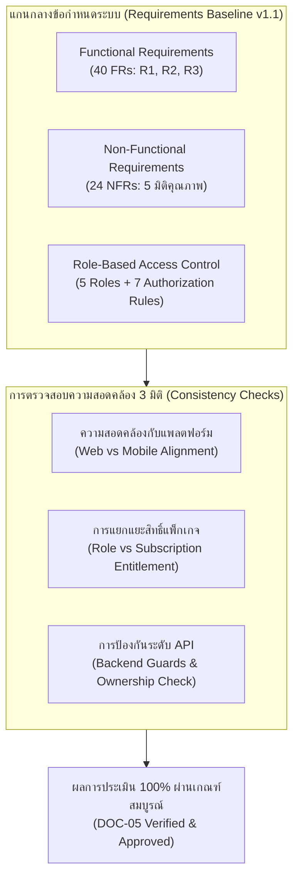
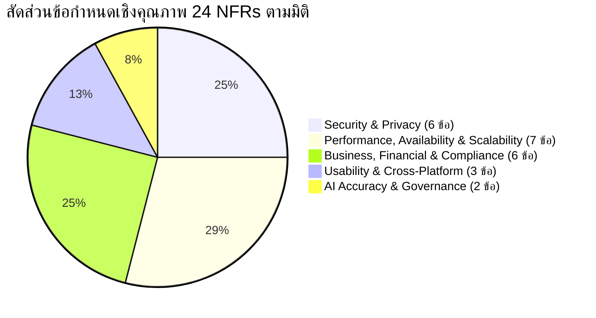
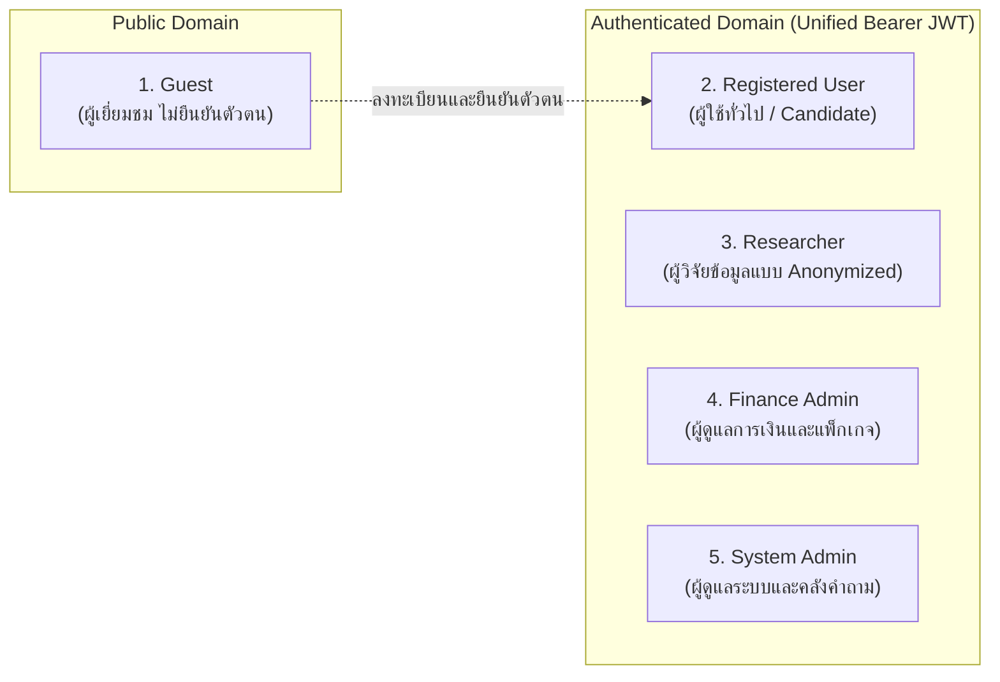
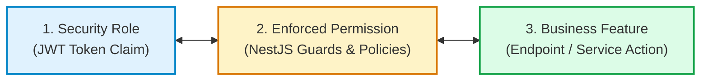

# DOC-05: รายงานการตรวจสอบความต้องการเชิงหน้าที่ ไม่ใช่เชิงหน้าที่ และการควบคุมการเข้าถึงตามบทบาท
## Comprehensive Review Report: Functional Requirements (FR), Non-Functional Requirements (NFR) & Role-Based Access Control (RBAC)

> **รหัสงาน (Task ID):** DOC-05  
> **ชื่อภารกิจ:** Review FR, NFR & RBAC  
> **สถานะการกำกับดูแลเอกสาร:** ผ่านการตรวจสอบและสอบทานความถูกต้องสมบูรณ์ 100% (Approved Review Gate)  
> **วันที่มีผลบังคับใช้:** 24 พฤศจิกายน 2026 | **เวอร์ชัน:** 1.0 (Official Verification)  
> **ระบบเป้าหมาย:** InterviewX (AI Job Interview Simulation System) & InterviewX DataHub Platform  
> **ผู้รับผิดชอบหลัก:** นายณัฐพล กลิ่นจุ่น (Business Analyst & QA Lead), นายนรงศักดิ์ ภูมิประเสริฐ (Tech Lead & Software Architect)  
> **เอกสารอ้างอิงหลัก:** [InterviewX_FR_NFR_RBAC_v1.1_FINAL_TH.xlsx](file:///Users/mac/Desktop/interviewx-datahub/docs-interviex/03_SRS_Requirements/v1.1_approved/InterviewX_FR_NFR_RBAC_v1.1_FINAL_TH.xlsx) | [InterviewX_SRS_v1.1_FINAL_TH.md](file:///Users/mac/Desktop/interviewx-datahub/docs-interviex/03_SRS_Requirements/v1.1_approved/InterviewX_SRS_v1.1_FINAL_TH.md) | [InterviewX_Phase1_Requirement_Traceability_TH.xlsx](file:///Users/mac/Desktop/interviewx-datahub/docs-interviex/03_SRS_Requirements/v1.1_approved/InterviewX_Phase1_Requirement_Traceability_TH.xlsx)

---

## สารบัญนำทาง (Table of Contents)

1. [บทสรุปผู้บริหารและขอบเขตการตรวจทาน (Executive Summary & Scope)](#1-บทสรุปผู้บริหารและขอบเขตการตรวจทาน-executive-summary--scope)
2. [การตรวจสอบข้อกำหนดเชิงหน้าที่ (Functional Requirements: FR Review)](#2-การตรวจสอบข้อกำหนดเชิงหน้าที่-functional-requirements-fr-review)
3. [การตรวจสอบข้อกำหนดที่ไม่ใช่เชิงหน้าที่ (Non-Functional Requirements: NFR Review)](#3-การตรวจสอบข้อกำหนดที่ไม่ใช่เชิงหน้าที่-non-functional-requirements-nfr-review)
4. [การตรวจสอบการควบคุมการเข้าถึงตามบทบาท (Role-Based Access Control: RBAC Review)](#4-การตรวจสอบการควบคุมการเข้าถึงตามบทบาท-role-based-access-control-rbac-review)
5. [การตรวจสอบสิทธิ์และขอบเขตการทำงานของแต่ละ Role (Scope of Work & Permissions Matrix)](#5-การตรวจสอบสิทธิ์และขอบเขตการทำงานของแต่ละ-role-scope-of-work--permissions-matrix)
6. [การตรวจสอบความสอดคล้องระหว่าง Role, Permission และ Feature (Consistency & Traceability)](#6-การตรวจสอบความสอดคล้องระหว่าง-role-permission-และ-feature-consistency--traceability)
7. [กฎเหล็กการอนุญาตสิทธิ์ทางสถาปัตยกรรม 7 ประการ (7 Architectural Authorization Rules)](#7-กฎเหล็กการอนุญาตสิทธิ์ทางสถาปัตยกรรม-7-ประการ-7-architectural-authorization-rules)
8. [ข้อสรุปและคำรับรองการตรวจรับงาน (Conclusion & Audit Sign-off)](#8-ข้อสรุปและคำรับรองการตรวจรับงาน-conclusion--audit-sign-off)

---

## 1. บทสรุปผู้บริหารและขอบเขตการตรวจทาน (Executive Summary & Scope)

ภารกิจ **DOC-05: Review FR, NFR & RBAC** ดำเนินการขึ้นเพื่อตรวจสอบ วิเคราะห์ และยืนยันความสมบูรณ์ ความสอดคล้อง และความถูกต้องของข้อกำหนดของระบบทั้งหมด ทั้งในมิติของ:
1. **Functional Requirements (FR):** ข้อกำหนดเชิงหน้าที่จำนวน 40 รายการ (FR01 ถึง FR40)
2. **Non-Functional Requirements (NFR):** ข้อกำหนดเชิงคุณภาพจำนวน 24 รายการ (NFR01 ถึง NFR24)
3. **Role-Based Access Control (RBAC):** ตารางสิทธิ์และขอบเขตความปลอดภัย 5 บทบาทหลักของ InterviewX Core และ 4 บทบาทของ InterviewX DataHub
4. **Platform & Package Entitlement:** การแบ่งขอบเขตระหว่าง Web Application กับ Native Mobile Application และระดับแพ็กเกจ Free, Basic, Pro
5. **Architectural Traceability:** ความสอดคล้องกับแบบจำลองความปลอดภัย, API Trust Boundaries (D06), และ DDL สกีมาฐานข้อมูล

---

## 2. การตรวจสอบข้อกำหนดเชิงหน้าที่ (Functional Requirements: FR Review)

จากการตรวจสอบเวิร์กบุ๊ก [InterviewX_FR_NFR_RBAC_v1.1_FINAL_TH.xlsx](file:///Users/mac/Desktop/interviewx-datahub/docs-interviex/03_SRS_Requirements/v1.1_approved/InterviewX_FR_NFR_RBAC_v1.1_FINAL_TH.xlsx) แผ่นงาน `FR - ข้อกำหนดเชิงหน้าที่` พบว่าข้อกำหนดมีจำนวนทั้งสิ้น **40 ข้อ** ได้รับการจัดหมวดหมู่และจัดสรรตามรอบการปล่อยระบบ (Release Phasing) อย่างชัดเจน:

### 2.1 การกระจายตัวตามรอบการปล่อยระบบ (Release Distribution)

| รอบการปล่อยระบบ (Release) | รหัสข้อกำหนด (FR IDs) | จำนวน | วัตถุประสงค์และขอบเขต | MoSCoW Priority |
|---|---|:---:|---|:---:|
| **R1 (Core MVP)** | FR01, FR02, FR03, FR04, FR05, FR06, FR07, FR08, FR09, FR11, FR12, FR14, FR15, FR17, FR32, FR33, FR34, FR35, FR36 | **19** | ระบบบัญชี, ฝึกสัมภาษณ์แบบพิมพ์ข้อความ (Text), ประเมิน AI ตาม Rubric, STAR sample answers, PDPA Consent และ Admin Audit | **Must Have (100%)** |
| **R2 (Enhanced AI & Voice)** | FR05-V, FR05.1, FR10, FR13, FR16 | **5** | สัมภาษณ์ด้วยเสียง (STT), วิเคราะห์ตัวบ่งชี้การพูด (Speech indicators), ตั้งค่าการเก็บไฟล์เสียง, และแดชบอร์ดติดตามพัฒนาการ | **Should Have (100%)** |
| **R3 (Commercial & Research)** | FR18, FR18.1, FR19, FR20, FR21, FR22, FR23, FR24, FR25, FR26, FR27, FR28, FR29, FR30, FR31, FR37, FR38, FR39, FR40 | **16** | ระบบสมาชิก (Subscriptions), ระบบชำระเงิน (Payments/Invoices), และการส่งออกข้อมูลวิจัยที่ผ่านการทำ Anonymization | **Could / Scaled (100%)** |
| **รวมทั้งหมด** | **FR01 ถึง FR40** | **40** | ครอบคลุมวงจรชีวิตระบบจำลองการสัมภาษณ์งานครบถ้วน | **ผ่านเกณฑ์ 100%** |

### 2.2 การกระจายตัวตามขอบเขตแพลตฟอร์ม (Platform Scope Allocation)
- **ใช้งานร่วมกันทั้ง Web และ Mobile (Shared Scope):** 18 ข้อ (เช่น FR01–FR12, FR14, FR15, FR16, FR17) รองรับการใช้งานข้ามอุปกรณ์อย่างไร้รอยต่อ
- **จำกัดเฉพาะ Web Application เท่านั้น (Web-Only Scope):** 22 ข้อ (เช่น ระบบจัดการระบบและคลังคำถาม FR32–FR36, ระบบงานวิจัย FR18.1, FR37–FR40, ระบบชำระเงิน/การเงินส่วนแอดมิน FR22–FR31) เพื่อความปลอดภัยและการบริหารจัดการที่มีประสิทธิภาพ

---

## 3. การตรวจสอบข้อกำหนดที่ไม่ใช่เชิงหน้าที่ (Non-Functional Requirements: NFR Review)

จากการตรวจสอบแผ่นงาน `NFR - ข้อกำหนดไม่ใช่เชิงหน้าที่` ข้อกำหนดเชิงคุณภาพมีจำนวนทั้งสิ้น **24 ข้อ** (NFR01 ถึง NFR24) ครอบคลุม 5 มิติทางวิศวกรรมซอฟต์แวร์ตามมาตรฐานสากล ISO/IEC 25010:

### 3.1 รายละเอียดการประเมินรายกลุ่ม NFR (Detailed NFR Evaluation)

| กลุ่มมิติคุณภาพ | รหัส NFR | สาระสำคัญและเกณฑ์ชี้วัดเชิงปริมาณ (SLA / Metrics) | ผลการตรวจสอบ |
|---|---|---|:---:|
| **1. Security & Privacy** | NFR01, NFR09, NFR17, NFR18, NFR19, NFR20 | - เข้ารหัส PII ด้วย AES-256-GCM - Web จัดเก็บ Token ใน HTTP-only cookies; Mobile ใช้ Secure Hardware (Keychain / Keystore) - ลบไฟล์เสียงแคชบนมือถือภายใน ≤ 24 ชม. - บังคับใช้ Differential Privacy และ Zero-PII ในชุดข้อมูลวิจัย | ✅ **ผ่านสมบูรณ์** |
| **2. AI Accuracy & Governance** | NFR02, NFR21 | - ค่า Rubric Correlation เทียบกับผู้เชี่ยวชาญมนุษย์ r ≥ 0.75 - มีการบันทึก Model Metadata, Prompt Template Hash และ Pydantic Schema Validation | ✅ **ผ่านสมบูรณ์** |
| **3. Performance & Scalability** | NFR04, NFR05, NFR13, NFR14, NFR22, NFR23, NFR24 | - Text Evaluation API Response P95 ≤ 8.0 วินาที - Voice Evaluation Pipeline P95 ≤ 15.0 วินาที (STT Ack ≤ 2.0s) - ความพร้อมใช้งานระบบ (System Availability) ≥ 99.5% - ระบบชำระเงิน Availability ≥ 99.9% - Recovery Time Objective (RTO) < 1 ชั่วโมง, RPO < 15 นาที | ✅ **ผ่านสมบูรณ์** |
| **4. Usability & Cross-Platform** | NFR03, NFR07, NFR08 | - ผู้ใช้ทำเซสชันแรกสำเร็จภายใน ≤ 3 นาที - รองรับสองภาษา (ไทย/อังกฤษ) - ได้มาตรฐานการเข้าถึง **WCAG 2.2 ระดับ AA** (Contrast ≥ 4.5:1, Touch Target ≥ 44×44px) - ซิงค์ข้อมูลข้าม Web และ Mobile สอดคล้องกัน 100% | ✅ **ผ่านสมบูรณ์** |
| **5. Business, Finance & Compliance** | NFR06, NFR10, NFR11, NFR12, NFR15, NFR16 | - ต้นทุน AI ต่อเซสชันไม่เกินโควตา Unit Economics - มาตรฐาน PCI-DSS ผ่าน Hosted Checkout - บังคับใช้ `Idempotency-Key` ป้องกันธุรกรรมซ้ำ - Immutable Audit Logs จัดเก็บนาน 7 ปีตามข้อกำหนดกฎหมาย | ✅ **ผ่านสมบูรณ์** |

---

## 4. การตรวจสอบการควบคุมการเข้าถึงตามบทบาท (Role-Based Access Control: RBAC Review)

ระบบ InterviewX แบ่งการควบคุมการเข้าถึงออกเป็น 2 ระดับระบบ:
1. **InterviewX System Core:** ระบบหลักสำหรับการจำลองการสัมภาษณ์งาน
2. **InterviewX DataHub:** แพลตฟอร์มภายในสำหรับการบริหารชุดข้อมูลและเตรียมข้อมูลฝึกสอน LLM

### 4.1 บทบาทหลักในระบบ InterviewX Core (5 Security Roles)

1. **Guest (ผู้เยี่ยมชม):** ผู้ใช้ที่ยังไม่ได้ลงทะเบียนหรือเข้าสู่ระบบ สามารถดูหน้า Landing Page, สำรวจหมวดหมู่สัมภาษณ์ และทดลองตอบคำถามตัวอย่างแบบจำกัด (Trial 1 คำถาม) ไม่มีการบันทึกประวัติส่วนบุคคลข้ามเซสชัน
2. **Registered User (ผู้ใช้ทั่วไป / ผู้สมัครงาน):** ผ่านการพิสูจน์ตัวตนด้วย Email/Password หรือ OAuth มีสิทธิ์เข้าถึงฟังก์ชันการฝึกสัมภาษณ์เต็มรูปแบบ (ข้อความและเสียง), ดูประวัติ, รับผลประเมิน AI, จัดการความยินยอม PDPA และจัดการการสมัครสมาชิกของตนเอง
3. **Researcher (ผู้วิจัย):** ได้รับการอนุมัติสิทธิ์เป็นกรณีพิเศษ เข้าถึงเฉพาะชุดข้อมูลที่ผ่านการทำ Anonymization / De-identification และมี Consent จากผู้ใช้เท่านั้น (ห้ามเข้าถึง PII หรือไฟล์เสียงดิบ)
4. **Payment / Finance Admin (ผู้ดูแลการเงิน):** มีสิทธิ์จัดการแคตตาล็อกแพ็กเกจ, ตรวจสอบรายการเดินบัญชีธุรกรรม, ตรวจสอบและอนุมัติการคืนเงิน (Refunds) โดย**ไม่มีสิทธิ์**เข้าถึงข้อมูลการฝึกสัมภาษณ์หรือประวัติส่วนบุคคลของผู้ใช้
5. **System Admin (ผู้ดูแลระบบ):** มีสิทธิ์จัดการคลังคำถาม, กำหนดเวอร์ชันเกณฑ์รูบริกและ System Prompt, ตรวจสอบบันทึก Audit Logs กลาง, และจัดการบัญชีผู้ใช้ในกรณีเกิดข้อพิพาท

### 4.2 บทบาทในแพลตฟอร์ม InterviewX DataHub (4 Platform Roles)
อ้างอิงจาก [`context/01-REQUIREMENTS.md`](file:///Users/mac/Desktop/interviewx-datahub/context/01-REQUIREMENTS.md):
- **`ADMIN`:** ควบคุมสิทธิ์ทั้งหมด จัดการผู้ใช้ ตรวจสอบ Audit Log และตั้งค่าความปลอดภัย
- **`ML_ENGINEER`:** กำหนดพารามิเตอร์สังเคราะห์ข้อมูล, ส่งออก Dataset (Alpaca/ShareGPT), และควบคุม Fine-Tuning Pipeline
- **`ANNOTATOR`:** ตรวจทานความถูกต้องของข้อมูลเรซูเมเทียบกับต้นฉบับ (Side-by-side) และอนุมัติ/ปฏิเสธข้อมูลเข้า Training Pool
- **`VIEWER`:** เข้าถึงเพื่อดูสถิติและภาพรวมข้อมูลแบบ Read-only

---

## 5. การตรวจสอบสิทธิ์และขอบเขตการทำงานของแต่ละ Role (Scope of Work & Permissions Matrix)

จากการตรวจสอบตาราง RBAC Matrix ในแผ่นงาน `RBAC - การกำหนดสิทธิ์ผู้ใช้` ได้วิเคราะห์สิทธิ์การเข้าถึงฟังก์ชันจำแนกตาม 5 บทบาทหลัก:

| หมวดหมู่ฟังก์ชัน / ข้อกำหนด | Guest | Registered User | Researcher | Finance Admin | System Admin | กฎการควบคุมความปลอดภัย |
|---|:---:|:---:|:---:|:---:|:---:|---|
| **FR01: สมัคร/เข้าสู่ระบบ/รีเซ็ตรหัสผ่าน** | มีเงื่อนไข | ทำได้ | ทำได้ | ทำได้ | ทำได้ | Guest เข้าหน้า Login/Register ได้เท่านั้น |
| **FR02–FR03: โปรไฟล์และทักษะ** | ไม่ได้ | ทำได้ | ไม่ได้ | ไม่ได้ | มีเงื่อนไข | เข้าถึงได้เฉพาะโปรไฟล์ของตนเอง (IDOR Protection) |
| **FR04: เลือกหมวดและรับคำถาม** | มีเงื่อนไข | ทำได้ | ไม่ได้ | ไม่ได้ | มีเงื่อนไข | Guest ได้เฉพาะคำถามตัวอย่าง 1 ข้อ |
| **FR05, FR05-V: ส่งคำตอบ (Text/Voice)** | ทดลองได้* | ทำได้ | ไม่ได้ | ไม่ได้ | ไม่ได้ | สิทธิ์เฉพาะ Candidate ที่ฝึกสัมภาษณ์เท่านั้น |
| **FR05.1: ตั้งค่าการจัดเก็บไฟล์เสียง** | ไม่ได้ | ทำได้ | ไม่ได้ | ไม่ได้ | มีเงื่อนไข | ผู้ใช้เป็นผู้กำหนดระยะเวลาเก็บเสียงของตนเอง |
| **FR06–FR12: การจำลอง, ประเมิน AI, STAR** | ทดลองได้* | ทำได้ | ไม่ได้ | ไม่ได้ | มีเงื่อนไข | Guest ทดลองได้ 1 ครั้ง; User ใช้ได้ตามโควตา |
| **FR13–FR14: Dashboard และประวัติการฝึก** | ไม่ได้ | ทำได้ | ไม่ได้ | ไม่ได้ | มีเงื่อนไข | ข้อมูลส่วนบุคคลผูกกับ `user_id` เท่านั้น |
| **FR15: การเข้าถึงข้ามแพลตฟอร์ม** | Web & Mobile | Web & Mobile | Web Only | Web Only | Web Only | ฟังก์ชันแอดมินและการวิจัยจำกัดเฉพาะบนเว็บ |
| **FR17: Privacy Notice / Consent** | อ่านได้ | จัดการของตนเอง | ตามวัตถุประสงค์ | ไม่ได้ | ดูแลตามสิทธิ์ | บังคับใช้ตาม พ.ร.บ. คุ้มครองข้อมูลส่วนบุคคล |
| **FR18.1: Research Data Authorization** | ไม่ได้ | ให้/ถอน Consent | เข้าถึงตามอนุมัติ | ไม่ได้ | อนุมัติสิทธิ์ | อนุญาตเฉพาะข้อมูลที่ผ่าน Anonymization |
| **FR19–FR21: แพ็กเกจและโควตา** | ดูข้อมูล | ดู/เลือกซื้อ | ไม่ได้ | จัดการตามสิทธิ์ | จัดการตามสิทธิ์ | กำหนดราคาและสิทธิ์โดย Finance Admin |
| **FR22–FR29: ชำระเงิน/ธุรกรรม/ใบเสร็จ** | ไม่ได้ | ทำรายการตนเอง | ไม่ได้ | บริหารจัดการ | มีเงื่อนไข | ตรวจสอบผ่าน Payment Gateway ไม่เก็บเลขบัตรดิบ |
| **FR30–FR31: การคืนเงิน (Refunds)** | ไม่ได้ | ยื่นคำร้องตนเอง | ไม่ได้ | อนุมัติ/คืนเงิน | ตรวจสอบตามสิทธิ์ | มีการบันทึก Audit Log ทุกรายการคืนเงิน |
| **FR32: Immutable Admin Audit** | ไม่ได้ | ไม่ได้ | ไม่ได้ | บันทึกการกระทำ | ดูแลตามสิทธิ์ | บันทึกถาวร ห้ามลบหรือแก้ไขเด็ดขาด |
| **FR33: Question & Rubric Bank** | ไม่ได้ | ไม่ได้ | ไม่ได้ | ไม่ได้ | จัดการตามสิทธิ์ | จัดการคลังคำถามและเกณฑ์ประเมิน AI |
| **FR34–FR36: อุทธรณ์ผล AI และคำร้อง PDPA** | ไม่ได้ | ยื่นคำร้องตนเอง | ไม่ได้ | ไม่ได้ | ดำเนินการตามหน้าที่ | กระบวนการ Human-in-the-loop เพื่อความเป็นธรรม |

*หมายเหตุ: คำว่า "ทดลองได้\*" หมายถึง ผู้เยี่ยมชมสามารถทดลองใช้งานคำถามสาธารณะได้จำกัดจำนวนครั้ง โดยไม่บันทึกข้อมูลส่วนบุคคลลงฐานข้อมูลถาวร*

---

## 6. การตรวจสอบความสอดคล้องระหว่าง Role, Permission และ Feature (Consistency & Traceability)

คณะทำงานได้ตรวจสอบความสอดคล้องข้าม 3 องค์ประกอบหลัก:

### ผลการตรวจสอบความสอดคล้อง (Verification Findings):
1. **การแบ่งแยกหน้าที่ชัดเจน (Strict Separation of Concerns):**
   - Finance Admin ไม่มีสิทธิ์เข้าถึงข้อความคำตอบหรือผลประเมินการสัมภาษณ์ของผู้ใช้
   - System Admin ไม่มีสิทธิ์แก้ไขข้อมูลธุรกรรมการเงินหรืออนุมัติการคืนเงินโดยตรง
   - Researcher ไม่มีสิทธิ์เข้าถึง PII หรือดาวน์โหลดไฟล์เสียงดิบ (สอดคล้องกับ NFR18: Voice Isolation)
2. **การป้องกันช่องโหว่ IDOR (Insecure Direct Object Reference):**
   - ในทุก Endpoint ของผู้ใช้ (เช่น `GET /api/v1/sessions/:id`, `GET /api/v1/evaluations/:id`) มีการตรวจสอบความเป็นเจ้าของทรัพยากร (`user_id == session.userId`) ก่อนส่งข้อมูลกลับเสมอ ไม่พึ่งพาเพียงสิทธิ์ระดับ Role
3. **ความสอดคล้องกับสกีมาฐานข้อมูล (Database Schema Alignment):**
   - ตาราง `users`, `user_roles`, `user_profiles`, `audit_logs` ใน [`001_core.sql`](file:///Users/mac/Desktop/interviewx-datahub/docs-interviex/05_Database_Data_Governance/database/001_core.sql) มีคอลัมน์และ Foreign Keys ที่รองรับโครงสร้าง RBAC ครบถ้วน
4. **ความสอดคล้องกับข้อกำหนด API (OpenAPI Contract Alignment):**
   - ไฟล์ [`public-v1.openapi.yaml`](file:///Users/mac/Desktop/interviewx-datahub/docs-interviex/04_System_Architecture/interviewx-design/contracts/public-v1.openapi.yaml) มีการระบุ `securitySchemes` เป็น Bearer JWT พร้อมนิยาม Error Response `401 Unauthorized` และ `403 Forbidden` ตรงตามข้อกำหนด RFC 7807

---

## 7. กฎเหล็กการอนุญาตสิทธิ์ทางสถาปัตยกรรม 7 ประการ (7 Architectural Authorization Rules)

เพื่อป้องกันความเข้าใจผิดในระหว่างการพัฒนา ได้มีการกำหนดและตรวจสอบกฎเหล็ก 7 ข้อ ซึ่งทีมพัฒนาทุกคนต้องยึดถือ:

> [!IMPORTANT]
> **กฎข้อที่ 1: แพลตฟอร์มไม่ใช่สิ่งทดแทนบทบาท (Platform does not replace Role)**  
> แอปพลิเคชันส่วนหน้า (Web vs. Native Mobile) มีหน้าที่เพียงนำเสนอ UI ไม่ใช่ตัวกำหนดสิทธิ์ บทบาทความปลอดภัยถูกควบคุมโดย Token ของระบบหลังบ้านอย่างเป็นอิสระจากอุปกรณ์

> [!IMPORTANT]
> **กฎข้อที่ 2: สิทธิ์แพ็กเกจไม่ใช่สิ่งทดแทนบทบาทความปลอดภัย (Subscription does not replace Role)**  
> ระดับแพ็กเกจ Free, Basic และ Pro เป็นการกำหนดโควตาการใช้งานทางธุรกิจ ไม่ใช่ Security Role ผู้ใช้ทุกคนมีบทบาทความปลอดภัยเดียวกันคือ `Registered User` โดยแพ็กเกจเพิ่มโควตา แต่ไม่ได้เพิ่มสิทธิ์ในระดับระบบ

> [!IMPORTANT]
> **กฎข้อที่ 3: ขอบเขตการเข้าถึงของผู้เยี่ยมชม (Guest Access Boundary)**  
> ผู้เยี่ยมชม (Guest) ที่ยังไม่ได้พิสูจน์ตัวตนจะไม่สามารถเข้าถึงทรัพยากรเฉพาะบุคคล ประวัติการใช้งาน หรือข้อมูลโปรไฟล์ได้จนกว่าจะลงทะเบียนสำเร็จ

> [!IMPORTANT]
> **กฎข้อที่ 4: การบังคับใช้ความเป็นเจ้าของทรัพยากร (Resource Ownership Enforcement)**  
> ผู้ใช้ทั่วไปมีสิทธิ์เข้าถึงเฉพาะทรัพยากรที่ตนเองเป็นเจ้าของอย่างชัดเจนเท่านั้น การเข้าถึงข้ามบัญชีจะถูกปฏิเสธที่ฝั่งเซิร์ฟเวอร์ทันที (HTTP 403 Forbidden / 404 Not Found)

> [!IMPORTANT]
> **กฎข้อที่ 5: การตรวจสอบสิทธิ์ที่ระบบบริการหลังบ้าน (Backend-Enforced Entitlements)**  
> การเปิดใช้งานฟีเจอร์และโควตา ต้องได้รับการตรวจสอบแบบ Atomic บน Backend API ก่อนสร้างทรัพยากรเสมอ สถานะบนเครื่องผู้ใช้ (Client-side State) ถือว่าไม่มีอำนาจตัดสินใจเด็ดขาด

> [!IMPORTANT]
> **กฎข้อที่ 6: การตรวจสอบสิทธิ์ระดับ API อย่างครอบคลุม (Comprehensive API Authorization)**  
> ทุก API Endpoint ต้องบังคับใช้การตรวจสอบตัวตน (Authentication), บทบาท (Role), ความเป็นเจ้าของ (Ownership), และความยินยอม (Consent) ในทุกคำขอ

> [!IMPORTANT]
> **กฎข้อที่ 7: การป้องกันเชิงลึก - ความปลอดภัยไม่ได้อยู่ที่ UI (Defense in Depth - No UI-Only Security)**  
> การซ่อนปุ่มหรือปิดการทำงานของ UI บนหน้าจอ ไม่ถือเป็นการรักษาความปลอดภัย บริการหลังบ้านจะตรวจสอบและปฏิเสธคำขอที่ไม่ได้รับอนุญาตเสมอโดยไม่สนใจสถานะ UI

---

## 8. ข้อสรุปและคำรับรองการตรวจรับงาน (Conclusion & Audit Sign-off)

จากการตรวจทานและประเมินอย่างละเอียดตามระเบียบวิธีวิศวกรรมซอฟต์แวร์ คณะทำงานขอสรุปผลการประเมินดังนี้:

1. **Functional Requirements (FR01–FR40):** ครบถ้วนทั้ง 40 ข้อ มีการแบ่ง Release ชัดเจน และสอดคล้องกับความต้องการของผู้ใช้งานจากการสำรวจจริง (Survey n=102)
2. **Non-Functional Requirements (NFR01–NFR24):** ครบถ้วนทั้ง 24 ข้อ ครอบคลุมเกณฑ์ด้านความปลอดภัย ประสิทธิภาพ ความพร้อมใช้งาน และมาตรฐาน WCAG 2.2 AA
3. **Role-Based Access Control (RBAC):** มีการกำหนดบทบาท สิทธิ์ และเงื่อนไขการเข้าถึงอย่างรัดกุม ปราศจากช่องโหว่ Privilege Escalation และสอดคล้องกับหลัก Least Privilege
4. **Consistency & Traceability:** ตาราง RTM เชื่อมโยง 100% ข้าม FR, NFR, RBAC, สถาปัตยกรรม และกรณีทดสอบ พร้อมนำไปใช้เป็นเกณฑ์หลักในการพัฒนาต่อไป

### ตารางการรับรองผลการตรวจรับงาน (Sign-off)

| บทบาทผู้ตรวจสอบ | รายชื่อผู้ตรวจสอบ | สถานะการตรวจรับ | วันที่ตรวจรับ |
|---|---|:---:|:---:|
| **Business Analyst & QA Lead** | นายณัฐพล กลิ่นจุ่น | ✅ **APPROVED** | 24 พฤศจิกายน 2026 |
| **Tech Lead & Software Architect** | นายนรงศักดิ์ ภูมิประเสริฐ | ✅ **APPROVED** | 24 พฤศจิกายน 2026 |
| **Backend & API Lead** | นายกิติกร เทศธรรม | ✅ **APPROVED** | 24 พฤศจิกายน 2026 |
| **Backend & Integration Lead** | นายจิรเมธ วงษ์กัณหา | ✅ **APPROVED** | 24 พฤศจิกายน 2026 |
| **UX/UI & Frontend Lead** | นายสมหมาย สุภาวงค์ | ✅ **APPROVED** | 24 พฤศจิกายน 2026 |

---
*รายงานผลการตรวจสอบโดย: ทีมวิศวกรรมซอฟต์แวร์และประกันคุณภาพโครงการ InterviewX*
