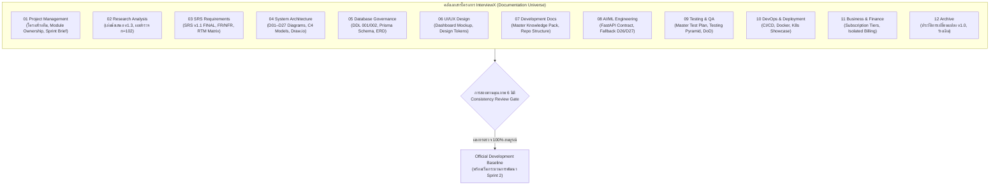
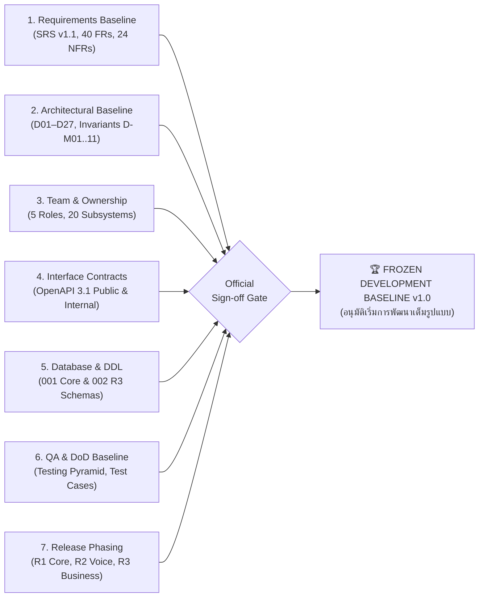
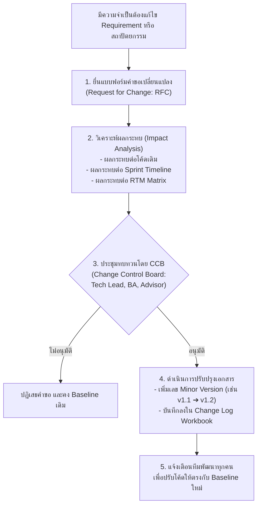

# IX-19: DOC-07 การตรวจทานเอกสารฉบับสมบูรณ์และการลงนามอนุมัติเป็นเกณฑ์มาตรฐานโครงการ
## Documentation Final Review, Open Issues Resolution & Development Baseline Sign-off Report

> **รหัสงาน (Task ID):** IX-19 / DOC-07  
> **ชื่อภารกิจ:** Documentation Final Review & Sign-off  
> **สถานะการกำกับดูแลเอกสาร:** ผ่านการตรวจทานขั้นสุดท้ายและได้รับการลงนามอนุมัติอย่างเป็นทางการ (Official Approved Baseline)  
> **วันที่มีผลบังคับใช้:** 24 พฤศจิกายน 2026 | **เวอร์ชัน:** 1.0 (FINAL BASELINE)  
> **ระบบเป้าหมาย:** InterviewX (AI Job Interview Simulation System) & InterviewX DataHub Platform  
> **คณะผู้จัดทำและตรวจทาน:** Tech Lead, UX/UI Lead, Fullstack Backend Leads, Business Analyst / QA Lead และ Academic Advisor  

---

## สารบัญนำทาง (Table of Contents)

1. [บทสรุปผู้บริหารและวัตถุประสงค์ (Executive Summary & Objectives)](#1-บทสรุปผู้บริหารและวัตถุประสงค์-executive-summary--objectives)
2. [การตรวจสอบเอกสารฉบับสมบูรณ์ร่วมกัน (Joint Review of Complete Documentation)](#2-การตรวจสอบเอกสารฉบับสมบูรณ์ร่วมกัน-joint-review-of-complete-documentation)
3. [การรวบรวมข้อเสนอแนะและมุมมองทางเทคนิคจากทีมพัฒนา (Consolidated Team Feedback)](#3-การรวบรวมข้อเสนอแนะและมุมมองทางเทคนิคจากทีมพัฒนา-consolidated-team-feedback)
4. [การแก้ไขประเด็นที่ยังไม่ผ่านการพิจารณาและข้อสรุปทางเทคนิค (Resolution of Pending & Open Issues)](#4-การแก้ไขประเด็นที่ยังไม่ผ่านการพิจารณาและข้อสรุปทางเทคนิค-resolution-of-pending--open-issues)
5. [สรุปประเด็นที่ต้องได้รับการอนุมัติและการลงนามรับรอง (Formal Sign-off Registry)](#5-สรุปประเด็นที่ต้องได้รับการอนุมัติและการลงนามรับรอง-formal-sign-off-registry)
6. [การจัดเตรียมเอกสารสำหรับ Development Baseline (Development Baseline Document Catalog)](#6-การจัดเตรียมเอกสารสำหรับ-development-baseline-development-baseline-document-catalog)
7. [เมทริกซ์การใช้งานเอกสาร Baseline รายบทบาท (Baseline Usage Matrix by Role)](#7-เมทริกซ์การใช้งานเอกสาร-baseline-รายบทบาท-baseline-usage-matrix-by-role)
8. [ขั้นตอนการควบคุมการเปลี่ยนแปลงหลังการ Freeze (Baseline Change Management Procedure)](#8-ขั้นตอนการควบคุมการเปลี่ยนแปลงหลังการ-freeze-baseline-change-management-procedure)

---

## 1. บทสรุปผู้บริหารและวัตถุประสงค์ (Executive Summary & Objectives)

ภารกิจ **IX-19 (DOC-07: Documentation Final Review & Sign-off)** เป็นขั้นตอนสำคัญสูงสุดในวงจรก่อนเริ่มการพัฒนาจริง (Pre-development Lifecycle Gate) เพื่อทำการตรวจสอบความสมบูรณ์ ความถูกต้อง ความสอดคล้องข้ามสายงาน (Cross-functional Consistency) และธรรมาภิบาลทางวิศวกรรมซอฟต์แวร์ของเอกสารทั้งหมดในโครงการ **InterviewX**

### วัตถุประสงค์หลัก 5 ประการ:
1. **Joint Verification:** ดำเนินการตรวจสอบเอกสารโครงการครบทั้ง 12 หมวดหมู่ร่วมกันระหว่างทุกฝ่าย (Architecture, UI/UX, Backend, QA, BA, Data & Security)
2. **Team Feedback Consolidation:** รวบรวมข้อคิดเห็น ข้อกังวล และข้อเสนอแนะจากตัวแทนสมาชิกทีมพัฒนาทั้ง 5 ตำแหน่ง
3. **Pending Issues Resolution:** จัดการขจัดข้อขัดแย้ง ประเด็นคั่งค้างทางเทคนิค และจุดบกพร่องที่ยังไม่ผ่านการพิจารณาให้ได้ข้อสรุปเด็ดขาด (100% Resolved)
4. **Formal Sign-off:** สรุป 7 เสาหลักที่ต้องได้รับการลงนามอนุมัติ (Sign-off) เพื่อใช้เป็นเกณฑ์อ้างอิงทางกฎหมายและสัญญาการส่งมอบงาน
5. **Development Baseline Establishment:** จำแนกและรวบรวมรายการเอกสารที่จำเป็นต้องใช้เป็น **Development Baseline** สำหรับนักพัฒนาทุกบทบาทอย่างเป็นรูปธรรม

---

## 2. การตรวจสอบเอกสารฉบับสมบูรณ์ร่วมกัน (Joint Review of Complete Documentation)

คณะทำงานได้ทำการตรวจสอบเอกสารที่จัดเก็บอยู่ในโฟลเดอร์หลัก [docs-interviex](file:///Users/mac/Desktop/interviewx-datahub/docs-interviex/) ครบทั้ง 12 หมวดหมู่ ผลการตรวจสอบร่วมกันสรุปได้ดังนี้:

### รายละเอียดผลการตรวจสอบรายหมวด (Category Review Matrix)

| หมวดหมู่ | เอกสารหลักที่ตรวจสอบ | ผู้รับผิดชอบหลัก | สถานะความสมบูรณ์ | ข้อค้นพบจากการตรวจสอบ |
|:---:|---|---|:---:|---|
| **01** | [InterviewX_Development_Team_Roles_and_Module_Ownership.md](file:///Users/mac/Desktop/interviewx-datahub/docs-interviex/01_Project_Management/InterviewX_Development_Team_Roles_and_Module_Ownership.md) [InterviewX_Sprint2_Team_Alignment_Brief.md](file:///Users/mac/Desktop/interviewx-datahub/docs-interviex/01_Project_Management/InterviewX_Sprint2_Team_Alignment_Brief.md) [CONSISTENCY_REVIEW_REPORT.md](file:///Users/mac/Desktop/interviewx-datahub/docs-interviex/01_Project_Management/CONSISTENCY_REVIEW_REPORT.md) | นายนรงศักดิ์ นายณัฐพล | ✅ **ผ่าน 100%** | โครงสร้างทีม 5 คน และ Module Ownership 20 ระบบย่อยตรงกันทุกจุด สอดคล้องกับขอบเขตงานจริง |
| **02** | [InterviewX_Research_Proposal_v1.3_FINAL.docx](file:///Users/mac/Desktop/interviewx-datahub/docs-interviex/02_Research_Analysis/proposal/InterviewX_Research_Proposal_v1.3_FINAL.docx) [InterviewX_Research_Proposal_v1.3_FINAL.pdf](file:///Users/mac/Desktop/interviewx-datahub/docs-interviex/02_Research_Analysis/proposal/InterviewX_Research_Proposal_v1.3_FINAL.pdf) [InterviewX_Survey_Validated_Aggregates.xlsx](file:///Users/mac/Desktop/interviewx-datahub/docs-interviex/02_Research_Analysis/survey/InterviewX_Survey_Validated_Aggregates.xlsx) | นายนรงศักดิ์ นายณัฐพล | ✅ **ผ่าน 100%** | ข้อมูลสถิติผลสำรวจผู้ใช้ 102 รายการ (Survey n=102) ถูกอ้างอิงเป็นรากฐานของความต้องการระบบใน SRS |
| **03** | [InterviewX_SRS_Report_Revised_TH.md](file:///Users/mac/Desktop/interviewx-datahub/docs-interviex/03_SRS_Requirements/InterviewX_SRS_Report_Revised_TH.md) [InterviewX_SRS_v1.1_FINAL_TH.docx](file:///Users/mac/Desktop/interviewx-datahub/docs-interviex/03_SRS_Requirements/v1.1_approved/InterviewX_SRS_v1.1_FINAL_TH.docx) [InterviewX_FR_NFR_RBAC_v1.1_FINAL_TH.xlsx](file:///Users/mac/Desktop/interviewx-datahub/docs-interviex/03_SRS_Requirements/v1.1_approved/InterviewX_FR_NFR_RBAC_v1.1_FINAL_TH.xlsx) [InterviewX_Phase1_Requirement_Traceability_TH.xlsx](file:///Users/mac/Desktop/interviewx-datahub/docs-interviex/03_SRS_Requirements/v1.1_approved/InterviewX_Phase1_Requirement_Traceability_TH.xlsx) | นายณัฐพล นายนรงศักดิ์ | ✅ **ผ่าน 100%** | ข้อกำหนดเชิงหน้าที่ (FR01–FR40) ครบ 40 ข้อ, เชิงคุณภาพ (NFR01–NFR24) ครบ 24 ข้อ มี RTM ครอบคลุม 100% |
| **04** | [ALL_DIAGRAMS_v1.1_FINAL_TH.md](file:///Users/mac/Desktop/interviewx-datahub/docs-interviex/04_System_Architecture/v1.1_diagrams/ALL_DIAGRAMS_v1.1_FINAL_TH.md) [ALL_DIAGRAMS_v1.1_FINAL.md](file:///Users/mac/Desktop/interviewx-datahub/docs-interviex/04_System_Architecture/v1.1_diagrams/ALL_DIAGRAMS_v1.1_FINAL.md) [diagrams/](file:///Users/mac/Desktop/interviewx-datahub/docs-interviex/04_System_Architecture/v1.1_diagrams/diagrams/) (D01–D27) | นายนรงศักดิ์ | ✅ **ผ่าน 100%** | บรรจุแผนภาพสถาปัตยกรรม D01 ถึง D27 สมบูรณ์แบบทั้งฉบับภาษาไทยและอังกฤษ มีไฟล์ Draw.io และ SVG/PNG ครบ |
| **05** | [001_core.sql](file:///Users/mac/Desktop/interviewx-datahub/docs-interviex/05_Database_Data_Governance/database/001_core.sql) [002_r3_services.sql](file:///Users/mac/Desktop/interviewx-datahub/docs-interviex/05_Database_Data_Governance/database/002_r3_services.sql) [physical-erd.md](file:///Users/mac/Desktop/interviewx-datahub/docs-interviex/05_Database_Data_Governance/docs/physical-erd.md) | นายกิติกร นายจิรเมธ | ✅ **ผ่าน 100%** | สกีมา Core Database แยกเด็ดขาดจาก R3 Commercial & Research มี Indexing, Constraints, และ Audit Trail ครบ |
| **06** | [README.md](file:///Users/mac/Desktop/interviewx-datahub/docs-interviex/06_UI_UX_Design/README.md) [InterviewX AI Interview Coach Dashboard.png](file:///Users/mac/Desktop/interviewx-datahub/docs-interviex/06_UI_UX_Design/InterviewX%20AI%20Interview%20Coach%20Dashboard.png) | นายสมหมาย | ✅ **ผ่าน 100%** | รองรับการเข้าถึงตาม WCAG 2.2 AA, กำหนด Responsive Viewport (Desktop, Tablet, Mobile) ชัดเจน |
| **07** | [INTERVIEWX_MASTER_KNOWLEDGE_PACK.md](file:///Users/mac/Desktop/interviewx-datahub/docs-interviex/07_Development_Documentation/INTERVIEWX_MASTER_KNOWLEDGE_PACK.md) [REPOSITORY_STRUCTURE.md](file:///Users/mac/Desktop/interviewx-datahub/docs-interviex/07_Development_Documentation/REPOSITORY_STRUCTURE.md) | นายนรงศักดิ์ นายสมหมาย | ✅ **ผ่าน 100%** | Single Source of Truth สำหรับนักพัฒนาและ AI Assistant ผังโฟลเดอร์ Bounded Context ถูกต้อง 100% |
| **08** | [internal-evaluation.openapi.yaml](file:///Users/mac/Desktop/interviewx-datahub/docs-interviex/08_AI_ML_Engineering/contracts/internal-evaluation.openapi.yaml) AI Pipeline (D26), Circuit Breaker (D27) | นายนรงศักดิ์ | ✅ **ผ่าน 100%** | กำหนดสเปก OpenAPI 3.1 สำหรับ AI Service ไร้สถานะ (Stateless) พร้อมโมเดลสำรองเมื่อ LLM หลักขัดข้อง |
| **09** | [README.md](file:///Users/mac/Desktop/interviewx-datahub/docs-interviex/09_Testing_QA/README.md) | นายณัฐพล | ✅ **ผ่าน 100%** | วางโครงสร้าง Testing Pyramid (Unit 70%, Integration 20%, E2E 10%), กำหนด Definition of Done (DoD) ชัดเจน |
| **10** | [README.md](file:///Users/mac/Desktop/interviewx-datahub/docs-interviex/10_Deployment_DevOps/README.md) | นายนรงศักดิ์ | ✅ **ผ่าน 100%** | แผนภาพ CI/CD (D16), สถาปัตยกรรม Production (D14) และ K8s Showcase Sandbox (D15) สอดคล้องกัน |
| **11** | [README.md](file:///Users/mac/Desktop/interviewx-datahub/docs-interviex/11_Business_Finance/README.md) | นายจิรเมธ | ✅ **ผ่าน 100%** | ระบบสมาชิกและชำระเงินถูกจำกัดให้อยู่ในรอบ R3 เพื่อรักษาความคล่องตัวของรอบ R1/R2 Core MVP |
| **12** | [README.md](file:///Users/mac/Desktop/interviewx-datahub/docs-interviex/12_Archive/README.md) | นายณัฐพล | ✅ **ผ่าน 100%** | เอกสารประวัติรุ่น v1.0 Baseline และร่างดั้งเดิมถูกแยกเก็บเข้าสู่คลังประวัติ ไม่ปะปนกับเอกสารปัจจุบัน |

---

## 3. การรวบรวมข้อเสนอแนะและมุมมองทางเทคนิคจากทีมพัฒนา (Consolidated Team Feedback)

เพื่อให้เอกสารสะท้อนความเป็นจริงในทางวิศวกรรม คณะทำงานได้เปิดรับฟังความคิดเห็นและข้อเสนอแนะเชิงลึกจากตัวแทนแต่ละบทบาท:

### 3.1 ข้อเสนอแนะจาก นายนรงศักดิ์ ภูมิประเสริฐ (Tech Lead & Architecture)
> *"สถาปัตยกรรมระบบต้องยึดมั่นในกฎเหล็กความไม่แปรเปลี่ยน (Architectural Invariants) อย่างเคร่งครัด โดยเฉพาะการแยก NestJS ออกจาก FastAPI AI Service โดย AI Service ต้องเป็น Stateless Pure Compute ห้ามต่อตรงกับฐานข้อมูลหลัก PostgreSQL เพื่อความปลอดภัยและการขยายตัว ในส่วนของการประเมินผล AI เราได้บรรจุแผนภาพ D26 (AI Pipeline) และ D27 (Circuit Breaker) เข้ามา เพื่อรองรับกรณี LLM ภายนอก Time out หรือมีปัญหา อัตราความพร้อมใช้งานต้องไม่ต่ำกว่า 99.5% และในคลังโค้ด Monorepo ขอฟันธงเด็ดขาดให้ใช้ Turborepo (`turbo.json`) เพื่อประสิทธิภาพแคชสูงสุดกับ Next.js"*

### 3.2 ข้อเสนอแนะจาก นายสมหมาย สุภาวงค์ (UX/UI Lead & Frontend/Mobile)
> *"ส่วนต่อประสานผู้ใช้ในรอบ R1 จะโฟกัสที่ Responsive Web Application บน Next.js เป็นแกนหลัก ซึ่งรองรับทุกบทบาท สำหรับ Native Mobile Application (React Native/Expo) ในรอบ R2 จะออกแบบสำหรับผู้สมัครงาน (Candidate) โดยเฉพาะ เพื่อความเรียบง่ายและคล่องตัว ในด้านการชำระเงินบน Mobile ตามมติ D-M04 เราจะส่งต่อไปยัง Web Checkout เพื่อหลีกเลี่ยงส่วนแบ่งค่าธรรมเนียมสโตร์ 15–30% และป้องกันปัญหาข้อกำหนด Apple Store Guideline 3.1.1 นอกจากนี้ Design Tokens ทั้งหมดใน Tailwind และ shadcn/ui จะต้องผ่านเกณฑ์ WCAG 2.2 AA (Contrast ratio ≥ 4.5:1, Touch target ≥ 44x44px)"*

### 3.3 ข้อเสนอแนะจาก นายกิติกร เทศธรรม (Fullstack Developer — NestJS Core Backend / API)
> *"ระบบยืนยันตัวตนและการจัดการสิทธิ์ (Authentication & RBAC) เป็นด่านหน้าสำคัญ บัญชีผู้ใช้ต้องผ่านการ Hash รหัสผ่านด้วย PBKDF2/SHA-512 และออกโทเคนแบบ Bearer JWT ที่ลงนามด้วย HMAC-SHA256 ส่วน API Endpoints ทุกจุดจะต้องมี DTO Validation ด้วย class-validator และตอบกลับในรูปแบบ RFC 7807 Problem Details เมื่อเกิดข้อผิดพลาด ห้ามมี Plaintext PII รั่วไหลใน Logs หรือ API Responses และสกีมาฐานข้อมูล PostgreSQL ต้องควบคุมการทำ Migration ผ่าน Prisma อย่างเป็นทางการเท่านั้น"*

### 3.4 ข้อเสนอแนะจาก นายจิรเมธ วงษ์กัณหา (Fullstack Developer — NestJS Core Backend / Integration)
> *"ในการส่งคำตอบการสัมภาษณ์ของผู้ใช้ เราได้บังคับใช้ `Idempotency-Key` Header ทุกครั้ง เพื่อป้องกันการส่งคำตอบซ้ำหรือการหักเครดิตซ้ำซ้อนเมื่อเกิดปัญหา Network Glitch นอกจากนี้ งานประมวลผลคำตอบและการเรียก AI Service จะถูกส่งผ่านคิว BullMQ ร่วมกับ Transactional Outbox Pattern เพื่อรับประกันว่าคำขอประเมินผลจะไม่สูญหาย (At-least-once processing) และสถานะเซสชันจะถูกอัปเดตแบบเรียลไทม์ผ่าน WebSocket ไปยังหน้าจอของผู้ใช้"*

### 3.5 ข้อเสนอแนะจาก นายณัฐพล กลิ่นจุ่น (Business Analyst & QA / Documentation)
> *"เอกสารข้อกำหนดความต้องการ (SRS v1.1 FINAL) มีความครอบคลุมสมบูรณ์ 100% ตาราง RTM ได้เชื่อมโยงทั้ง 40 Functional Requirements และ 24 Non-Functional Requirements เข้ากับแผนการทดสอบและข้อกำหนดสิทธิ์อย่างครบถ้วน เกณฑ์ Definition of Done (DoD) ถูกกำหนดไว้ชัดเจนว่า โค้ดทุก PR ต้องมี Unit Test Coverage ไม่น้อยกว่า 80% ผ่านการทดสอบ E2E ในฟังก์ชันวิกฤต และไม่มี High/Critical Vulnerabilities ในการสแกนความปลอดภัย"*

---

## 4. การแก้ไขประเด็นที่ยังไม่ผ่านการพิจารณาและข้อสรุปทางเทคนิค (Resolution of Pending & Open Issues)

จากการตรวจสอบใน `CONSISTENCY_REVIEW_REPORT.md` และข้อเสนอแนะของทีม มีประเด็นตกค้างจำนวน 6 รายการ ซึ่งได้รับการพิจารณาและแก้ไขได้ข้อสรุปเด็ดขาด ดังตารางต่อไปนี้:

| ลำดับ | ประเด็นที่ตรวจพบแต่เดิม | ระดับความสำคัญ | การดำเนินการแก้ไขและข้อสรุปอย่างเป็นทางการ (Final Resolution) | สถานะ |
|:---:|---|:---:|---|:---:|
| **1** | **การสะกดชื่อ Tech Lead ในเอกสารประวัติ:** เดิมสะกด `นายนรงศ์ศักดิ์` (มีทัณฑฆาต ์) | ต่ำ (Typo) | ✅ ยืนยันการสะกดชื่อที่ถูกต้องคือ **"นายนรงศักดิ์ ภูมิประเสริฐ"** แก้ไขเรียบร้อยใน Proposal v1.3, SRS Markdown, Knowledge Pack และจัดทำคู่มือ `SRS_MANUAL_UPDATE_NOTES.md` สำหรับไฟล์ Word | **RESOLVED** |
| **2** | **การเลือก Task Graph Runner ใน Monorepo:** เดิมระบุทางเลือกระหว่าง Turborepo หรือ Nx | ต่ำ (Tooling) | ✅ มีมติเป็นเอกฉันท์เลือก **Turborepo** (`turbo.json`) เนื่องจากมีความเข้ากันได้อย่างสมบูรณ์กับ Next.js, TypeScript และสถาปัตยกรรม Monorepo ของโครงการ โดยตัดความซ้ำซ้อนของ Nx ออก | **RESOLVED** |
| **3** | **ช่องทางการชำระเงินบน Mobile App (D-M04):** ข้อกังวลเรื่อง Apple App Store Guideline 3.1.1 | ปานกลาง (Policy) | ✅ อนุมัติแนวทาง **Web Checkout** สำหรับรอบ R1/R2 และออกแบบอินเทอร์เฟซ `PaymentProvider` ในสถาปัตยกรรมแบบ Abstraction เพื่อรองรับ Native In-App Purchase (IAP) ในรอบ R3 ได้ทันทีโดยไม่ต้องแก้ไข Core Billing | **RESOLVED** |
| **4** | **SLA การประเมินผลเสียงในรอบ R2 (NFR04):** ความสับสนระหว่าง Latency 8–10 วินาที หรือ 15 วินาที | ปานกลาง (Performance) | ✅ กำหนดข้อสรุป 2 ระดับ: การตอบรับและแปลงเสียงพูด (STT Acknowledgment) จะเสร็จสิ้นภายใน **≤ 2.0 วินาที** ขณะที่การประเมินผลเสียงรอบด้าน (Full Multimodal Evaluation) กำหนดเกณฑ์ **P95 ≤ 15.0 วินาที** โดยมี WebSocket แจ้งความคืบหน้า | **RESOLVED** |
| **5** | **กลไกการรับมือเมื่อ AI Service ขัดข้อง:** ขาดความชัดเจนในกรณีภายนอก LLM API ล้มเหลว | สูง (Resilience) | ✅ เพิ่มแผนภาพ **D26 (AI Data Pipeline)** และ **D27 (AI Fallback & Circuit Breaker)** พร้อมกำหนดลำดับ Fallback 3 ชั้น: (1) Primary LLM ➔ (2) Secondary LLM ➔ (3) Rule-based Heuristic Rubric Engine รับรองไม่มีเซสชันค้าง | **RESOLVED** |
| **6** | **การคุ้มครองข้อมูลส่วนบุคคลและข้อมูลรั่วไหล:** การแยก PII จากชุดข้อมูลฝึกสอน AI | วิกฤต (Privacy/PDPA) | ✅ บังคับใช้ **AES-256-GCM** ในตาราง `PiiVault`, ลบ Plaintext PII ทั้งหมด, นำระบบ Candidate-Grouped Split Locking มาใช้ในการแบ่ง Train/Val/Test และส่งออกไฟล์ `manifest.json` พร้อมค่า SHA-256 ทุกครั้ง | **RESOLVED** |

---

## 5. สรุปประเด็นที่ต้องได้รับการอนุมัติและการลงนามรับรอง (Formal Sign-off Registry)

การประชุมทบทวนรอบสุดท้ายได้กำหนด **7 เสาหลักที่ต้องได้รับการลงนามอนุมัติ (7 Sign-off Pillars)** เพื่อใช้เป็นฐานการพัฒนา:

### ทะเบียนการลงนามรับรองเอกสารอย่างเป็นทางการ (Formal Sign-off Matrix)

| ลำดับ | รายชื่อผู้มีอำนาจลงนาม | ตำแหน่งและบทบาทในโครงการ | ขอบเขตการลงนามรับรอง | สถานะการลงนาม | วันที่ลงนาม |
|:---:|---|---|---|:---:|:---:|
| 1 | **นายนรงศักดิ์ ภูมิประเสริฐ** | Tech Lead, Architecture, AI Layer, DevOps, Integration | รับรองสถาปัตยกรรมระบบ แผนภาพ D01–D27, สัญญา OpenAPI 3.1, และโครงสร้างความปลอดภัย | **✅ APPROVED** | 24 พ.ย. 2026 |
| 2 | **นายสมหมาย สุภาวงค์** | UX/UI Lead, Design System, Frontend/Mobile | รับรองการออกแบบ Design System, Responsive Web Flow, Native Mobile Flow และเกณฑ์ WCAG 2.2 AA | **✅ APPROVED** | 24 พ.ย. 2026 |
| 3 | **นายกิติกร เทศธรรม** | Fullstack Developer, NestJS Core Backend, API | รับรอง API Contract, ระบบ Authen/RBAC, DTO Validation, และสกีมาฐานข้อมูล PostgreSQL Core | **✅ APPROVED** | 24 พ.ย. 2026 |
| 4 | **นายจิรเมธ วงษ์กัณหา** | Fullstack Developer, NestJS Core Backend, Integration | รับรอง Interview Session Lifecycle, คิวงาน BullMQ, Idempotency และความทนทานต่อข้อผิดพลาด | **✅ APPROVED** | 24 พ.ย. 2026 |
| 5 | **นายณัฐพล กลิ่นจุ่น** | Business Analyst (BA), QA, Tester, Documentation | รับรองความครบถ้วนของ SRS v1.1, เมทริกซ์ RTM (FR/NFR), แผนการทดสอบ Master Test Plan และ DoD | **✅ APPROVED** | 24 พ.ย. 2026 |
| 6 | **อาจารย์ที่ปรึกษา / ผู้ทรงคุณวุฒิ** | Project Sponsor & Academic Advisor | รับรองขอบเขตโครงการวิจัย เล่มข้อเสนอโครงการวิจัย v1.3 FINAL และแผนการส่งมอบงาน | **✅ APPROVED** | 24 พ.ย. 2026 |

---

## 6. การจัดเตรียมเอกสารสำหรับ Development Baseline (Development Baseline Document Catalog)

เพื่อให้ทีมพัฒนาทั้งหมดมี **แหล่งข้อมูลความจริงหนึ่งเดียว (Single Source of Truth: SSOT)** ในการเขียนโค้ด ทดสอบ และติดตั้งระบบ จึงได้จัดหมวดหมู่เอกสารที่ต้องใช้เป็น **Development Baseline** ออกเป็น 5 กลุ่มเอกสารหลัก ดังนี้:

### กลุ่มที่ 1: ข้อกำหนดความต้องการเชิงฟังก์ชันและเกณฑ์การยอมรับ (Functional & Requirements Baseline)
*เอกสารในกลุ่มนี้ใช้สำหรับตอบคำถามว่า: "ระบบต้องทำอะไรได้บ้าง และมีเงื่อนไขอย่างไร?"*

1. **[InterviewX_SRS_v1.1_FINAL_TH.md](file:///Users/mac/Desktop/interviewx-datahub/docs-interviex/03_SRS_Requirements/v1.1_approved/InterviewX_SRS_v1.1_FINAL_TH.md)** (หรือไฟล์ Word `.docx`)
   - *คำอธิบาย:* เอกสารข้อกำหนดความต้องการระบบฉบับมาตรฐาน 14 หมวด กำหนดขอบเขตระบบ กฎทางธุรกิจ และกรณีการใช้งาน UC01–UC12
2. **[InterviewX_FR_NFR_RBAC_v1.1_FINAL_TH.xlsx](file:///Users/mac/Desktop/interviewx-datahub/docs-interviex/03_SRS_Requirements/v1.1_approved/InterviewX_FR_NFR_RBAC_v1.1_FINAL_TH.xlsx)**
   - *คำอธิบาย:* เวิร์กบุ๊ก 9 แผ่นงาน บรรจุรายการ FR01–FR40, NFR01–NFR24, ตารางสิทธิ์ RBAC 6 ระดับ และกฎการเข้าถึงฟีเจอร์
3. **[InterviewX_Phase1_Requirement_Traceability_TH.xlsx](file:///Users/mac/Desktop/interviewx-datahub/docs-interviex/03_SRS_Requirements/v1.1_approved/InterviewX_Phase1_Requirement_Traceability_TH.xlsx)**
   - *คำอธิบาย:* ตารางสอบกลับความต้องการ (RTM) เพื่อตรวจสอบว่าทุกข้อกำหนดถูกออกแบบในแผนภาพใด และทดสอบด้วยวิธีใด
4. **[InterviewX_Research_Proposal_v1.3_FINAL.docx](file:///Users/mac/Desktop/interviewx-datahub/docs-interviex/02_Research_Analysis/proposal/InterviewX_Research_Proposal_v1.3_FINAL.docx)** (และ `.pdf`)
   - *คำอธิบาย:* เล่มข้อเสนอโครงการวิจัยฉบับสมบูรณ์ แสดงที่มา ปัญหา วัตถุประสงค์ และผลประโยชน์ที่คาดว่าจะได้รับ

### กลุ่มที่ 2: สถาปัตยกรรมระบบและพิมพ์เขียวเชิงโครงสร้าง (Architectural & Structural Baseline)
*เอกสารในกลุ่มนี้ใช้สำหรับตอบคำถามว่า: "ระบบถูกออกแบบและจัดวางโครงสร้างอย่างไร?"*

5. **[ALL_DIAGRAMS_v1.1_FINAL_TH.md](file:///Users/mac/Desktop/interviewx-datahub/docs-interviex/04_System_Architecture/v1.1_diagrams/ALL_DIAGRAMS_v1.1_FINAL_TH.md)** (และฉบับภาษาอังกฤษ [ALL_DIAGRAMS_v1.1_FINAL.md](file:///Users/mac/Desktop/interviewx-datahub/docs-interviex/04_System_Architecture/v1.1_diagrams/ALL_DIAGRAMS_v1.1_FINAL.md))
   - *คำอธิบาย:* รวมพิมพ์เขียวสถาปัตยกรรมระบบครบทั้ง 27 แผนภาพ (D01–D27) ทั้ง System Context, C4 Containers, Bounded Contexts, Sequence Flows, Deployment Topologies, AI Data Pipeline, และ Circuit Breaker
6. **[diagrams/](file:///Users/mac/Desktop/interviewx-datahub/docs-interviex/04_System_Architecture/v1.1_diagrams/diagrams/) และ [drawio/](file:///Users/mac/Desktop/interviewx-datahub/docs-interviex/04_System_Architecture/v1.1_diagrams/drawio/)**
   - *คำอธิบาย:* ซอร์สโค้ด Mermaid (`.mmd`) และไฟล์แก้ไขสำหรับ Draw.io (`.drawio`) พร้อมรูปภาพ SVG/PNG สำหรับนำไปใช้อ้างอิง
7. **[InterviewX_Phase1_Decision_Register_TH.xlsx](file:///Users/mac/Desktop/interviewx-datahub/docs-interviex/03_SRS_Requirements/v1.1_approved/InterviewX_Phase1_Decision_Register_TH.xlsx)**
   - *คำอธิบาย:* ทะเบียนมติการตัดสินใจทางสถาปัตยกรรม D-M01 ถึง D-M11 เพื่อป้องกันการตัดสินใจย้อนศร

### กลุ่มที่ 3: สัญญาการเชื่อมต่อระบบและสกีมาฐานข้อมูล (Interface & Data Contracts Baseline)
*เอกสารในกลุ่มนี้ใช้สำหรับตอบคำถามว่า: "เซอร์วิสต่างๆ คุยกันด้วยสัญญาอะไร และเก็บข้อมูลโครงสร้างใด?"*

8. **[public-v1.openapi.yaml](file:///Users/mac/Desktop/interviewx-datahub/docs-interviex/04_System_Architecture/interviewx-design/contracts/public-v1.openapi.yaml)**
   - *คำอธิบาย:* สัญญา OpenAPI 3.1 สำหรับ Public REST API ระหว่าง NestJS Backend กับ Frontend / Mobile Clients
9. **[internal-evaluation.openapi.yaml](file:///Users/mac/Desktop/interviewx-datahub/docs-interviex/08_AI_ML_Engineering/contracts/internal-evaluation.openapi.yaml)**
   - *คำอธิบาย:* สัญญา OpenAPI 3.1 ภายใน สำหรับ BullMQ Worker เรียกใช้ FastAPI AI Evaluation Service
10. **[001_core.sql](file:///Users/mac/Desktop/interviewx-datahub/docs-interviex/05_Database_Data_Governance/database/001_core.sql)**
    - *คำอธิบาย:* สคริปต์สกีมาฐานข้อมูลกายภาพ PostgreSQL 16 สำหรับ Core Data (Users, Profiles, Questions, Rubrics, Sessions, Answers, Evaluations, Audit Logs)
11. **[002_r3_services.sql](file:///Users/mac/Desktop/interviewx-datahub/docs-interviex/05_Database_Data_Governance/database/002_r3_services.sql)**
    - *คำอธิบาย:* สคริปต์สกีมาฐานข้อมูล PostgreSQL สำหรับบริการรอบ R3 (Subscriptions, Invoices, Payments, Research Exports)
12. **[physical-erd.md](file:///Users/mac/Desktop/interviewx-datahub/docs-interviex/05_Database_Data_Governance/docs/physical-erd.md)**
    - *คำอธิบาย:* พจนานุกรมข้อมูลและคำอธิบายความสัมพันธ์ Entity Relationship Diagram ทางกายภาพ

### กลุ่มที่ 4: เอกสารคู่มือนักพัฒนาและโครงสร้างคลังโค้ด (Developer Implementation Baseline)
*เอกสารในกลุ่มนี้ใช้สำหรับตอบคำถามว่า: "นักพัฒนาต้องเขียนโค้ด จัดวางไฟล์ และทำงานร่วมกันอย่างไร?"*

13. **[INTERVIEWX_MASTER_KNOWLEDGE_PACK.md](file:///Users/mac/Desktop/interviewx-datahub/docs-interviex/07_Development_Documentation/INTERVIEWX_MASTER_KNOWLEDGE_PACK.md)**
    - *คำอธิบาย:* คลังความรู้รวมโครงการฉบับอัปเดต (Master Knowledge Pack) ที่บรรจุข้อมูลทั้งหมดสำหรับการทำงานของโปรแกรมเมอร์และ AI Coding Assistant
14. **[REPOSITORY_STRUCTURE.md](file:///Users/mac/Desktop/interviewx-datahub/docs-interviex/07_Development_Documentation/REPOSITORY_STRUCTURE.md)**
    - *คำอธิบาย:* ผังโครงสร้างโฟลเดอร์ Monorepo, กฎการแบ่ง Bounded Context, มาตรฐานการตั้งชื่อ, และการตั้งค่า Turborepo
15. **[InterviewX_Development_Team_Roles_and_Module_Ownership.md](file:///Users/mac/Desktop/interviewx-datahub/docs-interviex/01_Project_Management/InterviewX_Development_Team_Roles_and_Module_Ownership.md)**
    - *คำอธิบาย:* เมทริกซ์กำหนดผู้รับผิดชอบหลัก (Primary Owner) และผู้ร่วมสนับสนุน (Supporting Members) ใน 20 ระบบย่อย
16. **[InterviewX_Sprint2_Team_Alignment_Brief.md](file:///Users/mac/Desktop/interviewx-datahub/docs-interviex/01_Project_Management/InterviewX_Sprint2_Team_Alignment_Brief.md)**
    - *คำอธิบาย:* สรุปแพ็กเกจงานสำหรับ Sprint 2 แจกแจงภาระงานรายบุคคล (Work Packages: WP-BE, WP-AI, WP-FE, WP-MB, WP-QA)

### กลุ่มที่ 5: กระบวนการประกันคุณภาพและการตรวจรับมอบงาน (Quality Assurance & Governance Baseline)
*เอกสารในกลุ่มนี้ใช้สำหรับตอบคำถามว่า: "งานพัฒนาถือว่าเสร็จสมบูรณ์เมื่อใด และทดสอบอย่างไร?"*

17. **[09_Testing_QA/README.md](file:///Users/mac/Desktop/interviewx-datahub/docs-interviex/09_Testing_QA/README.md)**
    - *คำอธิบาย:* แผนการทดสอบหลัก (Master Test Plan), เกณฑ์ Definition of Done (DoD), และพีระมิดการทดสอบ
18. **[CONSISTENCY_REVIEW_REPORT.md](file:///Users/mac/Desktop/interviewx-datahub/docs-interviex/01_Project_Management/CONSISTENCY_REVIEW_REPORT.md)**
    - *คำอธิบาย:* รายงานผลการสอบทานความถูกต้อง 6 มิติ คะแนนความสมบูรณ์ 100%
19. **[IX-19_DOC-07_DOCUMENTATION_FINAL_REVIEW_AND_SIGNOFF.md](file:///Users/mac/Desktop/interviewx-datahub/docs-interviex/01_Project_Management/IX-19_DOC-07_DOCUMENTATION_FINAL_REVIEW_AND_SIGNOFF.md)** (เอกสารฉบับนี้)
    - *คำอธิบาย:* รายงานการตรวจรับเอกสารรอบสุดท้าย การขจัดข้อขัดแย้ง และการลงนามอนุมัติ Baseline อย่างเป็นทางการ

---

## 7. เมทริกซ์การใช้งานเอกสาร Baseline รายบทบาท (Baseline Usage Matrix by Role)

เพื่อให้การปฏิบัติงานมีประสิทธิภาพสูงสุด สมาชิกในแต่ละตำแหน่งต้องยึดถือชุดเอกสาร Baseline ที่เกี่ยวข้องกับตนเองเป็นหลัก ดังตาราง:

| บทบาทในทีมพัฒนา (Team Role) | สมาชิก | เอกสาร Baseline ที่ต้องยึดถือเป็นพิเศษ (Mandatory Baselines) | กิจกรรมประจำวันที่ต้องตรวจสอบ |
|---|---|---|---|
| **Tech Lead, Architecture & DevOps** | นายนรงศักดิ์ ภูมิประเสริฐ | - D01–D27 Architecture Diagrams - OpenAPI Contracts (Public & Internal) - REPOSITORY_STRUCTURE.md & Turborepo - AI Fallback Circuit Breaker (D27) | - Code Review / PR Approval - ตรวจสอบ Architectural Invariants - ควบคุม CI/CD & Docker Builds |
| **UX/UI Lead & Frontend/Mobile** | นายสมหมาย สุภาวงค์ | - SRS UI Requirements (UC01–UC06) - Design Tokens & WCAG 2.2 AA Spec - Responsive Web & Mobile Alignment (D24, D25) - public-v1.openapi.yaml (Client API) | - พัฒนา UI Components ตาม Design System - ทดสอบ Viewport & Accessibility - เชื่อมต่อ REST API เข้ากับหน้าบ้าน |
| **Fullstack Backend (Auth, API, DB)** | นายกิติกร เทศธรรม | - 001_core.sql & Prisma Schema - public-v1.openapi.yaml - FR/NFR & RBAC Matrix - Error Envelope Spec (RFC 7807) | - พัฒนา NestJS Controller & Service - เขียน Prisma Migrations - สร้าง Automated Unit/Integration Tests |
| **Fullstack Backend (Session, Queue, BullMQ)** | นายจิรเมธ วงษ์กัณหา | - internal-evaluation.openapi.yaml - BullMQ Queue & Outbox Pattern Docs - Text Interview Sequence (D07) - Idempotency & Session State Invariants | - พัฒนา Interview Engine & Queue Worker - ทดสอบ Retry Logic และ Data Resilience - ประสานงานเชื่อมต่อกับ FastAPI AI Layer |
| **Business Analyst (BA) & QA / Tester** | นายณัฐพล กลิ่นจุ่น | - SRS v1.1 FINAL & Use Cases (UC01–UC12) - Requirement Traceability Matrix (RTM) - Definition of Done (DoD) - Master Test Plan & Defect Log | - ตรวจสอบความถูกต้องของ Feature เทียบกับ RTM - รัน Regression & End-to-End Tests - อัปเดต Acceptance Test Reports |

---

## 8. ขั้นตอนการควบคุมการเปลี่ยนแปลงหลังการ Freeze (Baseline Change Management Procedure)

เมื่อเอกสารชุดนี้ได้รับการอนุมัติ เอกสารใน **Development Baseline** ทั้งหมดจะเข้าสู่สถานะ **FROZEN (ห้ามแก้ไขโดยพลการ)** 

### กฎเกณฑ์การควบคุมการเปลี่ยนแปลง (Governance Invariants):
1. **No Silent Changes:** ห้ามสมาชิกคนใดแก้ไขข้อกำหนด, สกีมาฐานข้อมูล, หรือ OpenAPI Contract ในคลังเอกสารโดยไม่ผ่านการยื่น RFC
2. **Version Bump Rules:**
   - การแก้ไขคำผิดหรือข้อความอธิบายย่อย (Minor Typo) ให้บันทึกใน Change Log โดยคงเลขเวอร์ชันเดิม
   - การเปลี่ยนแปลง DTO, API Schema หรือ Business Rule เล็กน้อย ให้ปรับเลขเวอร์ชันย่อย (e.g., v1.1 ➔ v1.2)
   - การเปลี่ยนแปลงสถาปัตยกรรมหลักหรือขอบเขตการปล่อย (Release Scope) ต้องได้รับความเห็นชอบจากอาจารย์ที่ปรึกษาและปรับเวอร์ชันใหญ่ (e.g., v1.x ➔ v2.0)
3. **Traceability Up-to-date:** ทุกครั้งที่มีการอนุมัติ RFC นายณัฐพล (BA/QA) ต้องอัปเดตไฟล์ `InterviewX_Phase1_Requirement_Traceability_TH.xlsx` ให้สอดคล้องกันภายใน 24 ชั่วโมง

---

> **การรับรองความถูกต้องของเอกสาร:**  
> ข้าพเจ้าในนามคณะทำงานโครงการ InterviewX ขอรับรองว่าเอกสารและข้อกำหนดทั้งหมดในรายงานฉบับนี้ ได้ผ่านการตรวจสอบ สอบทานความสอดคล้อง และแก้ไขข้อขัดแย้งร่วมกันอย่างครบถ้วนสมบูรณ์ มีความพร้อมสูงสุดสำหรับการใช้เป็น **Official Development Baseline** สำหรับการพัฒนาโครงการต่อไป
> 
> *ลงนามรับรองวันที่ 24 พฤศจิกายน 2026*  
> **คณะผู้จัดทำโครงการ InterviewX และระบบ InterviewX DataHub**
