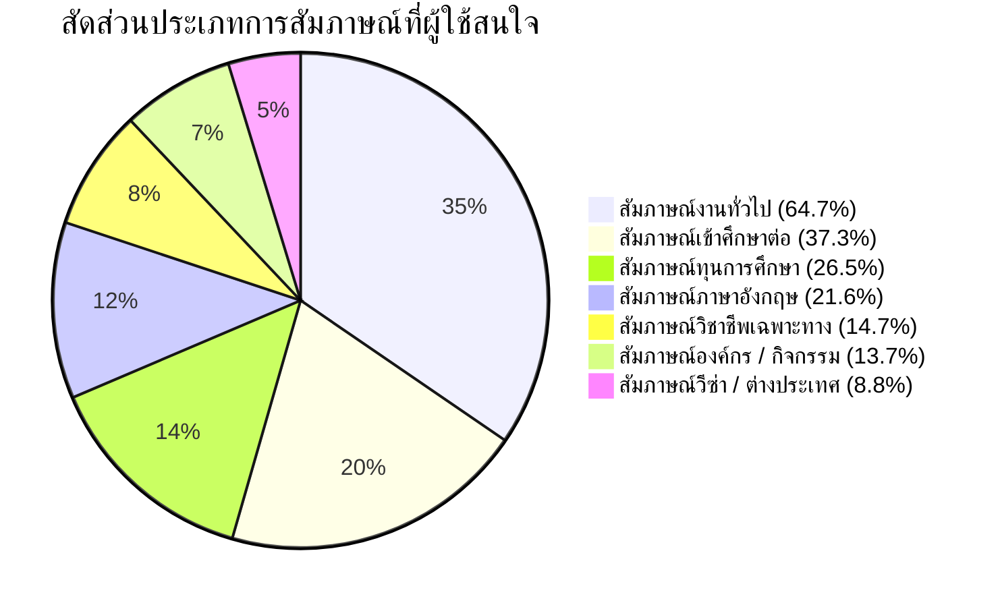

# รายงานการวิเคราะห์ผลการสำรวจความต้องการของผู้ใช้งานอย่างละเอียด
## InterviewX User Requirement Survey — Comprehensive Statistical & Qualitative Analysis (n=102)

> **รหัสเอกสาร:** IX-RES-SURVEY-001  
> **แหล่งข้อมูลอ้างอิง:** [InterviewX_Survey_Validated_Aggregates.xlsx](file:///Users/mac/Desktop/interviewx-datahub/docs-interviex/02_Research_Analysis/survey/InterviewX_Survey_Validated_Aggregates.xlsx) และแบบสอบถามดิบ Google Forms  
> **กลุ่มตัวอย่าง (Sample Size):** n = 102 คน (สำรวจช่วงวันที่ 2–8 ตุลาคม 2026)  
> **สถานะข้อมูล:** ตรวจสอบความถูกต้องทางสถิติและยืนยันข้อมูลแล้ว (Validated Dataset 100%)  
> **วัตถุประสงค์:** วิเคราะห์ความต้องการเชิงลึก พฤติกรรม ปัญหา อุปสรรค และความกังวลของผู้ใช้ เพื่อใช้เป็นฐานกำหนดข้อกำหนดระบบ (FR/NFR) และเกณฑ์การออกแบบระบบจำลองการสัมภาษณ์งาน InterviewX

---

## สารบัญนำทาง (Table of Contents)

1. [ข้อมูลทั่วไปและลักษณะทางประชากรศาสตร์ของกลุ่มตัวอย่าง (Demographics)](#1-ข้อมูลทั่วไปและลักษณะทางประชากรศาสตร์ของกลุ่มตัวอย่าง-demographics)
2. [ประเภทการสัมภาษณ์และประสบการณ์เดิม (Interview Categories & Experience)](#2-ประเภทการสัมภาษณ์และประสบการณ์เดิม-interview-categories--experience)
3. [ปัญหา อุปสรรค และความกังวลในการสัมภาษณ์งาน (Pain Points & Anxiety)](#3-ปัญหา-อุปสรรค-และความกังวลในการสัมภาษณ์งาน-pain-points--anxiety)
4. [พฤติกรรมการเตรียมตัวและข้อจำกัดในปัจจุบัน (Current Preparation & Limitations)](#4-พฤติกรรมการเตรียมตัวและข้อจำกัดในปัจจุบัน-current-preparation--limitations)
5. [ความต้องการฟีเจอร์ของระบบจำลองการสัมภาษณ์ (Feature Requirements Analysis)](#5-ความต้องการฟีเจอร์ของระบบจำลองการสัมภาษณ์-feature-requirements-analysis)
6. [ช่องทางและรูปแบบการใช้งานที่ผู้ใช้ต้องการ (Platform & Interaction Preference)](#6-ช่องทางและรูปแบบการใช้งานที่ผู้ใช้ต้องการ-platform--interaction-preference)
7. [ทัศนคติและความกังวลต่อการนำ AI มาใช้ในการฝึกสัมภาษณ์ (AI Adoption & Concerns)](#7-ทัศนคติและความกังวลต่อการนำ-ai-มาใช้ในการฝึกสัมภาษณ์-ai-adoption--concerns)
8. [ปัจจัยการตัดสินใจเลือกใช้และปัจจัยที่ทำให้หยุดใช้งาน (Adoption vs. Churn Factors)](#8-ปัจจัยการตัดสินใจเลือกใช้และปัจจัยที่ทำให้หยุดใช้งาน-adoption-vs-churn-factors)
9. [ตารางเชื่อมโยงผลสำรวจสู่ข้อกำหนดระบบ (Mapping to System Requirements: FR/NFR)](#9-ตารางเชื่อมโยงผลสำรวจสู่ข้อกำหนดระบบ-mapping-to-system-requirements-frnfr)

---

## 1. ข้อมูลทั่วไปและลักษณะทางประชากรศาสตร์ของกลุ่มตัวอย่าง (Demographics)

### ข้อ 1: สถานะปัจจุบันของผู้ตอบแบบสอบถาม (Current Status)
*วิธีการนับ: ตัวเลือกเดียว (Single Choice) | รวม 102 คน (100%)*

| ลำดับ | สถานะปัจจุบัน | จำนวน (คน) | สัดส่วน (%) | นัยสำคัญเชิงสถิติและการออกแบบระบบ |
|:---:|---|:---:|:---:|---|
| 1 | **นักเรียน / นักศึกษา** | **68** | **66.67%** | กลุ่มเป้าหมายหลัก เป็นผู้ที่กำลังจะเข้าสู่ตลาดแรงงานหรือเตรียมสอบสัมภาษณ์ |
| 2 | **บัณฑิตจบใหม่ (First Jobber)** | **19** | **18.63%** | กลุ่มเป้าหมายรอง ต้องการฝึกสัมภาษณ์งานจริงแบบเร่งด่วน |
| 3 | **พนักงานประจำ** | **8** | **7.84%** | กลุ่มที่ต้องการเปลี่ยนสายงานหรือเลื่อนตำแหน่ง |
| 4 | **ผู้กำลังเปลี่ยนงาน (Career Switcher)** | **4** | **3.92%** | ต้องการฝึกสัมภาษณ์ทักษะใหม่ |
| 5 | **ทหาร** | 1 | 0.98% | เตรียมตัวปลดประจำการเข้าสู่งานพลเรือน |
| 6 | **อาจารย์** | 1 | 0.98% | ทดลองใช้งานเพื่อแนะนำนักศึกษา |
| 7 | **ผู้กำลังสมัครทุน / ศึกษาต่อ** | 1 | 0.98% | เตรียมสอบสัมภาษณ์ทุนการศึกษาต่อ |
| **รวม** | | **102** | **100.00%** | **กลุ่มเยาวชน คนรุ่นใหม่ และผู้หางาน รวมกันสูงถึง 89.22%** |

---

## 2. ประเภทการสัมภาษณ์และประสบการณ์เดิม (Interview Categories & Experience)

### ข้อ 2: ประเภทการสัมภาษณ์ที่สนใจหรือกำลังเตรียมตัว
*วิธีการนับ: เลือกได้มากกว่า 1 ข้อ (Multi-select Mentions) | รวม 102 คน*

| ลำดับ | ประเภทการสัมภาษณ์ | จำนวนผู้เลือก (คน) | ร้อยละเทียบกับ 102 คน | การนำไปใช้ในระบบ (System Alignment) |
|:---:|---|:---:|:---:|---|
| 1 | **สัมภาษณ์งาน (Job Interview)** | **66** | **64.71%** | บรรจุเป็นหมวดหมู่หลักในรอบ **R1 (Core MVP)** |
| 2 | **สัมภาษณ์เข้าศึกษาต่อ (University Admission)** | **38** | **37.25%** | บรรจุในคลังคำถามรอบ **R1** |
| 3 | **สัมภาษณ์ทุนการศึกษา (Scholarship)** | **27** | **26.47%** | บรรจุในคลังคำถามรอบ **R1** |
| 4 | **สัมภาษณ์ภาษาอังกฤษ (English Interview)** | **22** | **21.57%** | บรรจุฟังก์ชันตรวจไวยากรณ์ (FR09) ใน **R1** |
| 5 | **สัมภาษณ์วิชาชีพเฉพาะทาง (Technical/Specialized)** | **15** | **14.71%** | คลังคำถามแยกตาม Bounded Context สาย IT/วิชาชีพ |
| 6 | **สัมภาษณ์องค์กร / กิจกรรม** | 14 | 13.73% | หมวดหมู่คำถาม Soft Skills & Teamwork |
| 7 | **สัมภาษณ์วีซ่า / เดินทางต่างประเทศ** | 9 | 8.82% | หมวดคำถามจำลองสถานการณ์ตรวจคนเข้าเมือง |

### ข้อ 3: ประสบการณ์ในการสัมภาษณ์เดิม
*วิธีการนับ: ตัวเลือกเดียว (Single Choice)*
* **1–2 ครั้ง:** **52 คน (50.98%)** — กลุ่มใหญ่ที่สุด มีประสบการณ์น้อยมาก
* **3–5 ครั้ง:** **28 คน (27.45%)** — เริ่มมีประสบการณ์แต่ยังต้องการเพิ่มความมั่นใจ
* **ไม่เคยสัมภาษณ์มาก่อนเลย:** **17 คน (16.67%)** — ขาดทักษะอย่างสิ้นเชิง ต้องการ Onboarding ช่วยเหลือ
* **มากกว่า 5 ครั้ง:** **5 คน (4.90%)** — ผู้มีประสบการณ์สูง ต้องการความท้าทายระดับสูง
> **ข้อสรุป:** ผู้ใช้กว่า **67.65% (มากกว่า 2 ใน 3)** เป็นผู้ที่มีประสบการณ์สัมภาษณ์ 0–2 ครั้งเท่านั้น ซึ่งต้องการระบบช่วยซ้อมที่มีคำแนะนำเบื้องต้นและการจำลองสถานการณ์จริง

---

## 3. ปัญหา อุปสรรค และความกังวลในการสัมภาษณ์งาน (Pain Points & Anxiety)

### ข้อ 4: ปัญหาหลักที่พบในการสัมภาษณ์งาน
*วิธีการนับ: เลือกได้มากกว่า 1 ข้อ (Multi-select)*

| ลำดับ | ปัญหาและอุปสรรคที่พบ | จำนวน (คน) | สัดส่วน (%) | การแก้ไขปัญหาด้วย InterviewX |
|:---:|---|:---:|:---:|---|
| 1 | **ความกังวล / ความตื่นเต้น / ประหม่า** | **70** | **68.63%** | สร้าง **โหมดฝึกแบบจับเวลาเสมือนจริง (Pressure Mode: FR06)** เพื่อสร้างความคุ้นชิน |
| 2 | **ไม่มั่นใจในการตอบ** | **65** | **63.73%** | ระบบ **Sample STAR Answers (FR12)** ให้แนวทางตัวอย่างคำตอบที่ดี |
| 3 | **ใช้ภาษาอังกฤษไม่คล่อง** | **49** | **48.04%** | ระบบ **วิเคราะห์ภาษาอังกฤษ Grammar & Vocabulary (FR09)** |
| 4 | **ไม่รู้แนวทางหรือรูปแบบคำถาม** | **39** | **38.24%** | **คลังคำถามครอบคลุม (Question Bank: FR04)** คัดสรรตามตำแหน่งงาน |
| 5 | **สื่อสารไม่ชัดเจน เรียบเรียงไม่ทัน** | **36** | **35.29%** | AI ประเมินโครงสร้างและตรรกะคำตอบ (Structure & Logic Rubric) |
| 6 | **ไม่มีประสบการณ์และไม่มีที่ให้ฝึกซ้อม** | **29** | **28.43%** | มีระบบจำลองการฝึกทำซ้ำได้ไม่จำกัด (Unlimited Practice Mode) |
| 7 | **ขาด Feedback หลังการสัมภาษณ์** | **26** | **25.49%** | ระบบ **Actionable Feedback ทันที (FR11)** วิเคราะห์จุดเด่นและจุดปรับปรุง |
| 8 | **ตอบไม่ตรงคำถาม** | **19** | **18.63%** | เกณฑ์รูบริก **Relevance Scoring** เตือนเมื่อตอบหลุดประเด็น |

### ข้อ 6: การได้รับ Feedback หรือคำแนะนำหลังการสัมภาษณ์จริง
* **ไม่เคยได้รับ Feedback เลย:** **64 คน (62.75%)**
* **เคยได้รับ Feedback:** **38 คน (37.25%)**
> **นัยสำคัญ:** ผู้สมัครงานส่วนใหญ่ (กว่า 62%) สัมภาษณ์เสร็จแล้วไม่เคยรู้ว่าตัวเองทำได้ดีหรือไม่ หรือผิดพลาดตรงจุดใด ทำให้ไม่เกิดการเรียนรู้ ระบบ AI Feedback ของ InterviewX จึงเข้ามาแก้ Pain Point ขนาดใหญ่ตรงนี้โดยตรง

---

## 4. พฤติกรรมการเตรียมตัวและข้อจำกัดในปัจจุบัน (Current Preparation & Limitations)

### ข้อ 8: วิธีการเตรียมตัวสัมภาษณ์ในปัจจุบัน
*วิธีการนับ: เลือกได้มากกว่า 1 ข้อ (Multi-select)*
1. **อ่านคำถามจากอินเทอร์เน็ต:** 65 คน (63.73%) — ข้อมูลกระจัดกระจาย ไม่มีแบบแผน
2. **ฝึกตอบด้วยตนเอง (หน้ากระจก/ในใจ):** 64 คน (62.75%) — ไม่มีผู้ประเมินผล ไม่รู้จุดบกพร่อง
3. **ใช้ AI ทั่วไป เช่น ChatGPT:** 35 คน (34.31%) — ให้คำตอบยาวเกินไป ไม่มีการจับเวลา ไม่มีการวิเคราะห์เสียง
4. **ดูวิดีโอตัวอย่างออนไลน์ (YouTube/TikTok):** 34 คน (33.33%) — ได้เฉพาะการเรียนรู้แบบ Passive
5. **ฝึกซ้อมกับเพื่อนหรือคนในครอบครัว:** 26 คน (25.49%) — เพื่อนไม่กล้าวิจารณ์ตรงๆ หรือไม่มีความเชี่ยวชาญ
6. **ไม่ได้เตรียมตัวมากนัก:** 26 คน (25.49%)
7. **เรียนคอร์สอบรมสัมภาษณ์:** 4 คน (3.92%) — มีค่าใช้จ่ายสูง เข้าถึงยาก

### ข้อ 9: เวลาที่ใช้ในการเตรียมตัวก่อนสัมภาษณ์เฉลี่ย
* **น้อยกว่า 30 นาที:** 25 คน (24.51%) *(เตรียมตัวแบบเร่งด่วน)*
* **30 นาที – 1 ชั่วโมง:** **40 คน (39.22%)** *(กลุ่มใหญ่ที่สุด)*
* **1 – 2 ชั่วโมง:** 15 คน (14.71%)
* **มากกว่า 2 ชั่วโมง:** 22 คน (21.57%)
> **ข้อสรุป:** ผู้ใช้กว่า 63.73% มีเวลาเตรียมตัวเฉลี่ยไม่เกิน 1 ชั่วโมง ระบบจึงต้องออกแบบให้เริ่มฝึกและเห็นผลสรุปได้อย่างรวดเร็ว (Quick Practice Session) ภายใน 10–15 นาที

---

## 5. ความต้องการฟีเจอร์ของระบบจำลองการสัมภาษณ์ (Feature Requirements Analysis)

### ข้อ 11: ฟีเจอร์ที่ผู้ใช้ต้องการมากที่สุดในระบบ InterviewX
*วิธีการนับ: เลือกได้หลายข้อ (Multi-select)*

| ลำดับ | ฟีเจอร์ที่ต้องการ | จำนวน (คน) | ร้อยละ (%) | ข้อกำหนดระบบที่รองรับ (Mapped FR) |
|:---:|---|:---:|:---:|:---:|
| **1** | **จำลองคำถามตามประเภทการสัมภาษณ์** | **94** | **92.16%** | **FR04** (Question Delivery) & **FR07** (Diversity) |
| **2** | **วิเคราะห์การสื่อสารและความมั่นใจ** | **67** | **65.69%** | **FR10** (Speech & Confidence Indicators) |
| **3** | **การให้คะแนนและ Feedback ละเอียด** | **58** | **56.86%** | **FR08** (Rubric Scoring) & **FR11** (Actionable Feedback) |
| **4** | **วิเคราะห์ภาษาอังกฤษและไวยากรณ์ (Grammar)** | **57** | **55.88%** | **FR09** (English Linguistic Analysis) |
| **5** | **วิเคราะห์คำตอบอัตโนมัติ (Automated AI)** | **55** | **53.92%** | **FR05** & **FR08** (Stateless Rubric Scoring Engine) |
| **6** | **ฝึกสัมภาษณ์ผ่านเสียงพูด (Voice Practice)** | **38** | **37.25%** | **FR05-V** (Voice / STT) ในรอบ R2 |
| **7** | **ระบบปรับระดับคำถามตามความสามารถผู้ใช้** | **35** | **34.31%** | **FR03** & **FR16** (Adaptive Difficulty Tuning) |
| **8** | **แดชบอร์ดติดตามพัฒนาการ (Progress Dashboard)** | **30** | **29.41%** | **FR13** (Candidate Performance Analytics) |
| **9** | **ตัวอย่างแนวทางการตอบที่ดี (Sample Answer)** | 1 | 0.98% | **FR12** (STAR Sample Answers) |

---

## 6. ช่องทางและรูปแบบการใช้งานที่ผู้ใช้ต้องการ (Platform & Interaction Preference)

### ข้อ 12: ช่องทางการใช้งานระบบที่ต้องการ (Platform Access)
* **ทั้งสองแบบ (Website และ Mobile Application ร่วมกัน):** **84 คน (82.35%)**
* **Mobile Application อย่างเดียว:** 10 คน (9.80%)
* **Website อย่างเดียว:** 8 คน (7.84%)
> **การตัดสินใจทางสถาปัตยกรรม:** ผลสำรวจสนับสนุนมติ **D-M01** และข้อกำหนด **FR15 (Multi-Platform Access)** อย่างชัดเจน โดยทีมพัฒนาต้องพัฒนาทั้ง Responsive Web (Next.js) และ Native Mobile (React Native/Expo) โดยเชื่อมโยงฐานข้อมูลเดียวกันผ่าน Unified REST API

### ข้อ 13: รูปแบบการโต้ตอบที่สะดวกที่สุด (Interaction Modality)
* **ใช้งานได้ทุกแบบ (รองรับทั้งพิมพ์ข้อความและพูดด้วยเสียง):** **76 คน (74.51%)**
* **ตอบแบบพิมพ์ข้อความ (Text-based):** 17 คน (16.67%)
* **ตอบด้วยเสียงพูด (Voice-based):** 9 คน (8.82%)
> **การตัดสินใจทางสถาปัตยกรรม:** สนับสนุนการแบ่ง Release Roadmap:
> - **รอบ R1 (MVP):** เริ่มต้นด้วยระบบข้อความ (Text) เพื่อให้ครอบคลุมความต้องการพื้นฐาน 100%
> - **รอบ R2:** ขยายผลด้วยระบบสัมภาษณ์ด้วยเสียง (Voice-to-Text / STT)

---

## 7. ทัศนคติและความกังวลต่อการนำ AI มาใช้ในการฝึกสัมภาษณ์ (AI Adoption & Concerns)

### ข้อ 15: ประสบการณ์เดิมในการใช้ AI ช่วยเตรียมสัมภาษณ์
* **เคยใช้ AI ช่วยเตรียมตัว:** **72 คน (70.59%)**
* **ไม่เคยใช้:** **30 คน (29.41%)**

### ข้อ 16: ระดับความสนใจในการใช้ระบบ AI สำหรับฝึกสัมภาษณ์งาน
* **สนใจมากที่สุด:** 21 คน (20.59%)
* **สนใจมาก:** 35 คน (34.31%)
* **สนใจปานกลาง:** 36 คน (35.29%)
* **สนใจน้อย:** 6 คน (5.88%)
* **ไม่สนใจ:** 4 คน (3.92%)
> **ข้อสรุป:** ผู้ใช้มีทัศนคติเชิงบวกต่อ AI สูงมาก โดยมีผู้สนใจระดับปานกลางขึ้นไปรวมกันถึง **92 คน (90.20%)**

### ข้อ 17: ความกังวลเกี่ยวกับระบบ AI (AI Concerns & Risks)
*วิธีการนับ: เลือกได้หลายข้อ (Multi-select)*

| ความกังวลของผู้ใช้ | จำนวน (คน) | สัดส่วน (%) | มาตรการควบคุมของระบบ InterviewX (Mitigation) |
|---|:---:|:---:|---|
| **1. ความแม่นยำของ Feedback และการให้คะแนน** | **67** | **65.69%** | กำหนดเกณฑ์ **NFR02** ให้คะแนนมี Correlation $r \ge 0.75$ เทียบกับมนุษย์ และมีระบบอุทธรณ์คะแนน (FR36) |
| **2. ความเป็นส่วนตัวของข้อมูลส่วนบุคคล (Privacy)** | **57** | **55.88%** | เข้ารหัส **AES-256-GCM**, ปฏิบัติตาม PDPA (FR17), และให้สิทธิ์ลบข้อมูลได้ทันที |
| **3. ความถูกต้องด้านภาษาและไวยากรณ์** | **57** | **55.88%** | ระบบใช้โมเดล LLM คุณภาพสูง (GPT-4o / Claude 3.5) ตรวจสอบความถูกต้องทางภาษา |
| **4. ค่าใช้จ่ายในการใช้งานระบบ** | **29** | **28.43%** | กำหนดแพ็กเกจ **Free Tier** ให้ใช้งานได้ฟรีทุกวันโดยไม่ต้องผูกบัตรเครดิต |
| **5. ความยุ่งยากและความซับซ้อนในการใช้งาน** | **21** | **20.59%** | ออกแบบ UI เรียบง่ายสไตล์ Modern SaaS ผ่านการทดสอบ **WCAG 2.2 AA (NFR08)** |
| **6. ไม่มีความกังวล** | 8 | 7.84% | |

---

## 8. ปัจจัยการตัดสินใจเลือกใช้และปัจจัยที่ทำให้หยุดใช้งาน (Adoption vs. Churn Factors)

จากการวิเคราะห์คำตอบปลายเปิด (Open-ended Qualitative Synthesis) ของผู้ตอบแบบสอบถาม:

### ปัจจัยที่ทำให้ตัดสินใจเลือกใช้ระบบ (Adoption Drivers):
1. **มีฟังก์ชันพื้นฐานให้ใช้งานฟรีจริง:** ผู้ใช้ต้องการทดลองใช้งานก่อน โดยไม่มีการบังคับกรอกบัตรเครดิตล่วงหน้า
2. **ระบบใช้งานง่าย ไม่ซับซ้อน และเสถียร:** UI โหลดเร็ว ไม่ค้าง และขั้นตอนการเริ่มฝึกสัมภาษณ์ไม่เกิน 3 คลิก
3. **Feedback ตรงประเด็นและนำไปใช้ได้จริง (Actionable):** ไม่ใช่เพียงแค่คำชมทั่วไป แต่ชี้จุดบกพร่องและให้แนวทางคำตอบแบบ STAR ที่ถูกต้อง
4. **ความปลอดภัยของข้อมูลส่วนตัว:** มั่นใจว่าเสียงและคำตอบจะไม่รั่วไหลออกสู่สาธารณะ

### ปัจจัยที่อาจทำให้ผู้ใช้หยุดใช้งาน (Churn / Abandonment Drivers):
1. **การบังคับจ่ายเงินก่อนใช้งาน (Paywall Blocker):** ผู้ใช้ระบุตรงกันว่าจะลบทิ้งทันทีหากบังคับจ่ายเงินตั้งแต่ยังไม่ได้ลอง
2. **AI ประมวลผลช้า ล่มบ่อย หรือตอบสนองช้าเกิน 15–20 วินาที:** ทำให้เสียบรรยากาศการซ้อมสัมภาษณ์
3. **Feedback ซ้ำซากหรือเป็นข้อความสำเร็จรูป (Generic AI):** คำแนะนำไม่มีประโยชน์และไม่เจาะจงกับคำตอบของผู้ใช้
4. **ปัญหาความปลอดภัยและการส่งอีเมลรบกวน:** กังวลเรื่องการขายข้อมูลและการตลาดที่ไม่พึงประสงค์

---

## 9. ตารางเชื่อมโยงผลสำรวจสู่ข้อกำหนดระบบ (Mapping to System Requirements: FR/NFR)

| ข้อค้นพบจากการสำรวจ (Survey Insight) | สถิติรองรับ | ข้อกำหนดระบบที่เกิดขึ้น (System Requirement) | Release |
|---|:---:|---|:---:|
| ต้องการฝึกคำถามที่ตรงกับประเภทงาน | 92.16% | **FR04:** Interview Category & Question Delivery | R1 (MVP) |
| มีความกังวล ประหม่า และตื่นเต้น | 68.63% | **FR06:** Pressure Practice Mode (จับเวลาเสมือนจริง) | R1 (MVP) |
| ไม่มั่นใจในการตอบ และไม่เคยได้รับ Feedback | 63.73% / 62.75% | **FR08 / FR11:** Rubric-based Scoring & Actionable Feedback | R1 (MVP) |
| ต้องการตัวอย่างแนวทางการตอบที่ดี | 74.50% | **FR12:** Sample Answers Generation (STAR Method) | R1 (MVP) |
| ต้องการฝึกสัมภาษณ์ภาษาอังกฤษ | 55.88% | **FR09:** English Linguistic & Grammar Feedback | R1 (MVP) |
| ต้องการใช้งานทั้ง Web และ Mobile App | 82.35% | **FR15 / NFR08:** Multi-Platform & Cross-Platform Sync | R1/R2 |
| ต้องการฝึกสัมภาษณ์ด้วยเสียงพูด | 37.25% | **FR05-V / FR10:** Voice Answer & Speech Indicators | R2 |
| กังวลเรื่องความเป็นส่วนตัวของข้อมูล | 55.88% | **FR17 / NFR01 / NFR09:** PDPA Consent & AES-256 Encryption | R1 |
| กังวลเรื่องความแม่นยำของ AI | 65.69% | **NFR02 / FR36:** AI Rubric Accuracy ($r \ge 0.75$) & Human Appeal | R1 |
| กังวลเรื่องค่าใช้จ่าย | 28.43% | **FR19 / NFR06:** Free Tier Quota & Transparent Subscriptions | R1/R3 |

---
*รายงานฉบับนี้จัดทำโดย: ฝ่ายวิเคราะห์ธุรกิจ (BA) และสถาปัตยกรรมซอฟต์แวร์ โครงการ InterviewX*  
*บันทึกข้อมูลเข้าสู่ระบบอย่างเป็นทางการ: 24 พฤศจิกายน 2026*
