# InterviewX — All Final System Diagrams
**Version: 1.1 FINAL — Phase 1: Requirement & Platform Alignment**  
**Date: 17 November 2026**  
**Status: Approved architecture baseline by project stakeholders.**

> [!NOTE]
> **Phase 1 Platform Scope Alignment Notice**  
> This draft revision explicitly separates the two client application frontends:
> 1. **Web Application**: Responsive Web (Desktop, Tablet, Mobile Browser) supporting End Users and Administrative/Research roles.
> 2. **Native Mobile Application**: Separately installable iOS and Android applications dedicated exclusively to End Users (Guest, Registered User).
> Both frontends communicate with the unified, shared backend via authenticated HTTPS REST APIs. All administrative and research capabilities remain strictly restricted to the Web Application.

---

## D01 SYSTEM CONTEXT

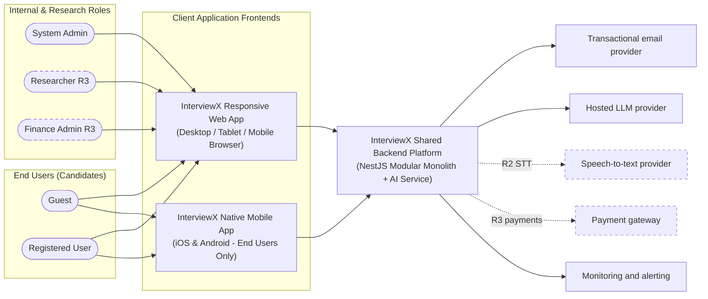

---

## D02 C4 CONTAINERS

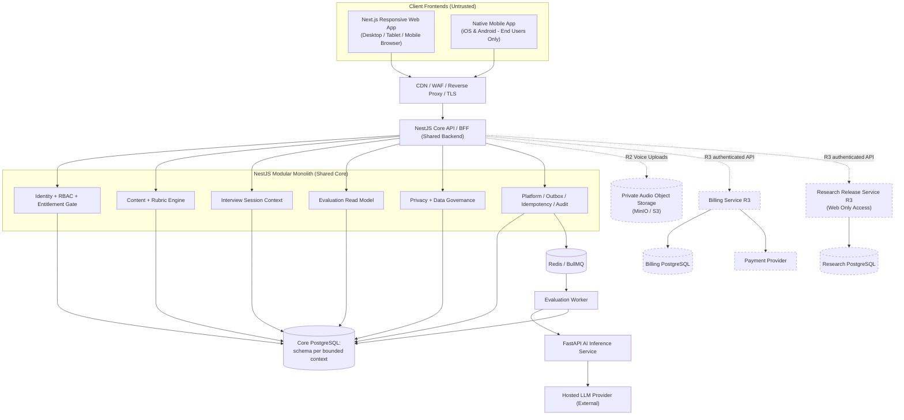

---

## D03 BOUNDED CONTEXTS

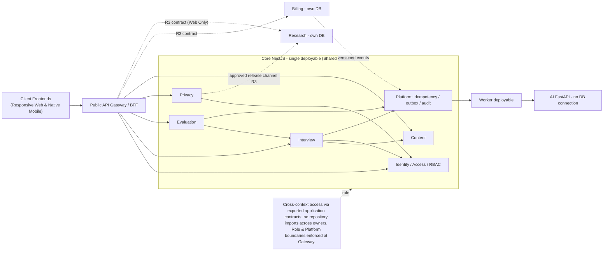

---

## D04 CORE ERD

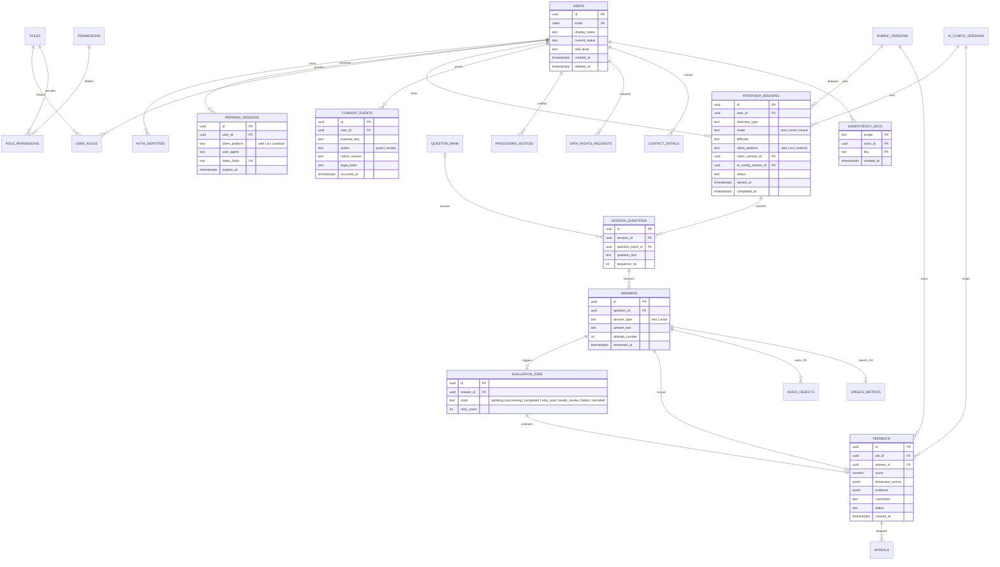

---

## D05 R3 ERD

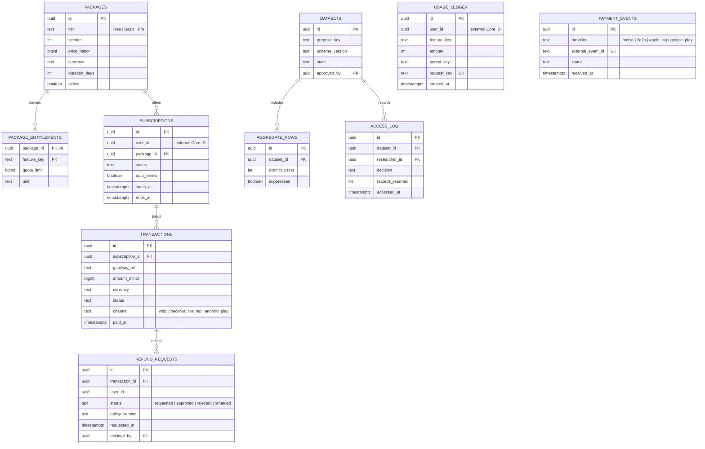

---

## D06 API TRUST

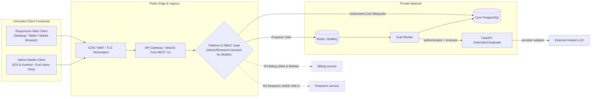

---

## D07 TEXT INTERVIEW SEQUENCE

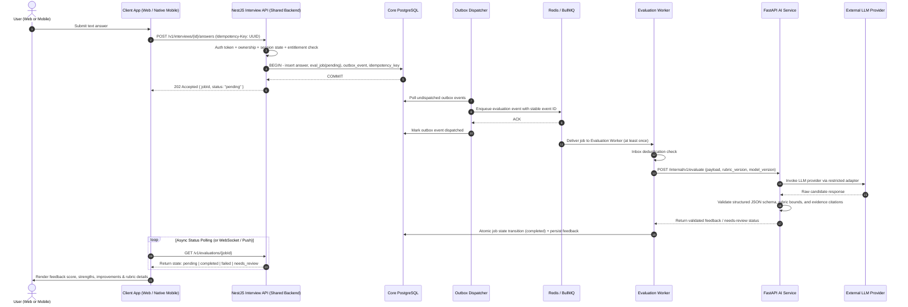

---

## D08 EVAL STATES

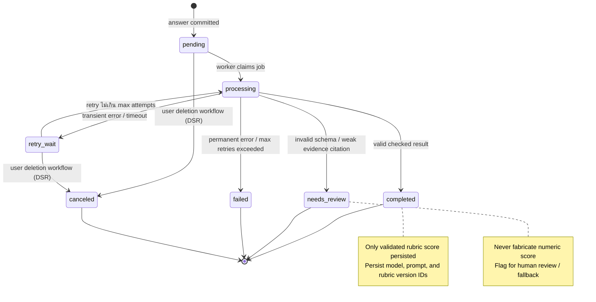

---

## D09 IDENTITY AUTHORIZATION

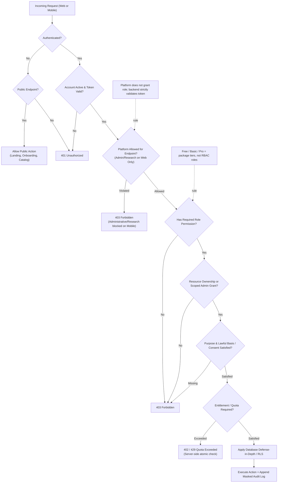

---

## D10 PRIVACY LIFECYCLE

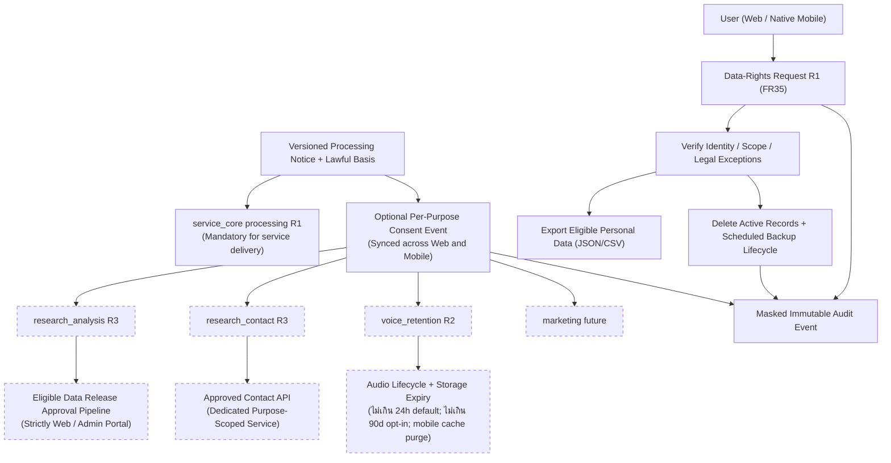

---

## D11 VOICE SEQUENCE R2

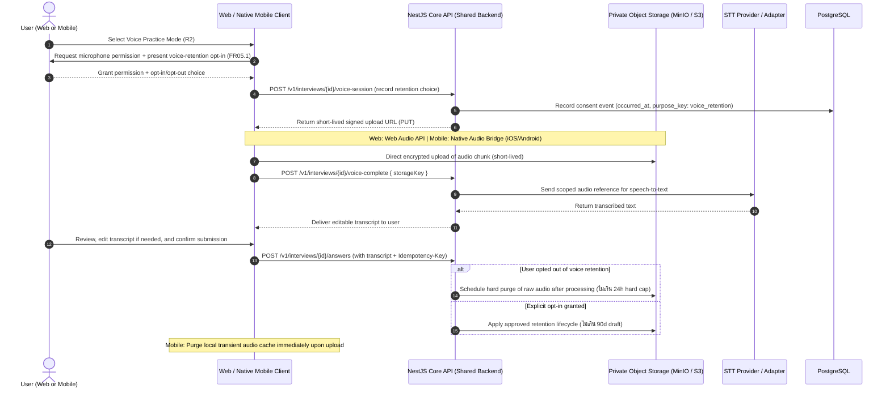

---

## D12 PAYMENT SEQUENCE R3

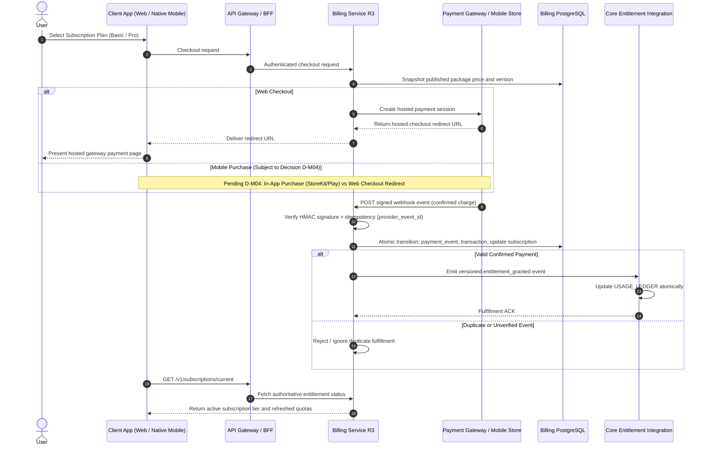

---

## D13 RESEARCH RELEASE R3

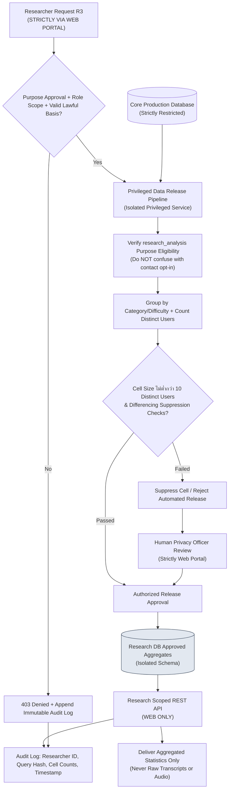

---

## D14 MANAGED PRODUCTION

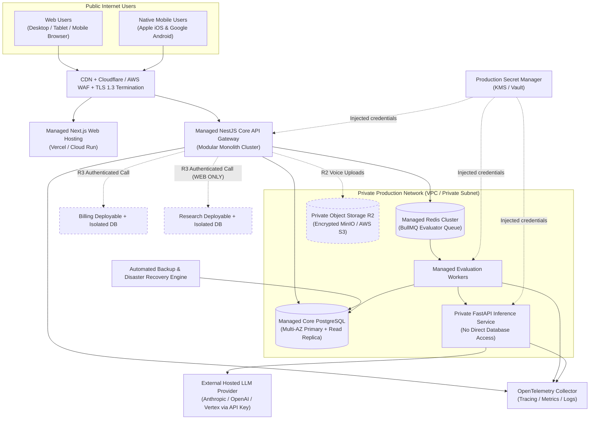

---

## D15 KUBERNETES SHOWCASE

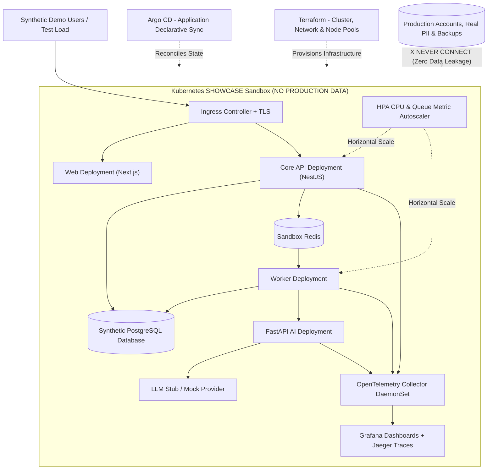

---

## D16 CI CD

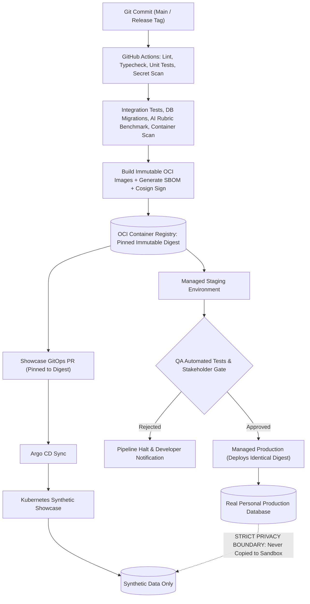

---

## D17 OBSERVABILITY RECOVERY

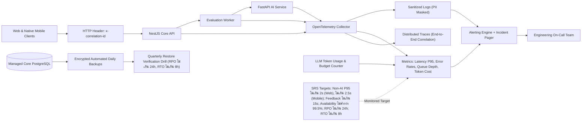

---

## D18 REPO BOUNDARIES

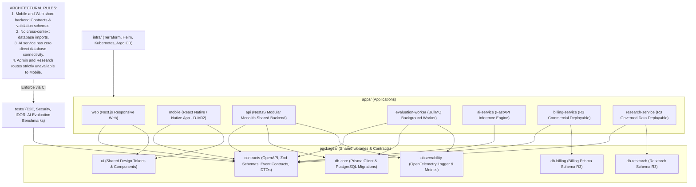

---

## D19 RELEASE ROADMAP

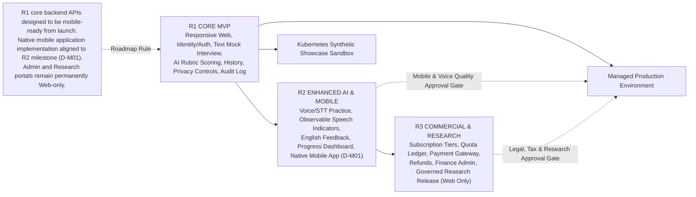

---

## D20 MASTER SYSTEM USE CASE MODEL

Master System Use Case Diagram specifying the relationships between all 5 actor roles (Guest, Registered User, System Admin, Finance Admin, Research Engineer) and core use cases (UC01–UC10) with formal UML `«include»` and `«extend»` dependencies:

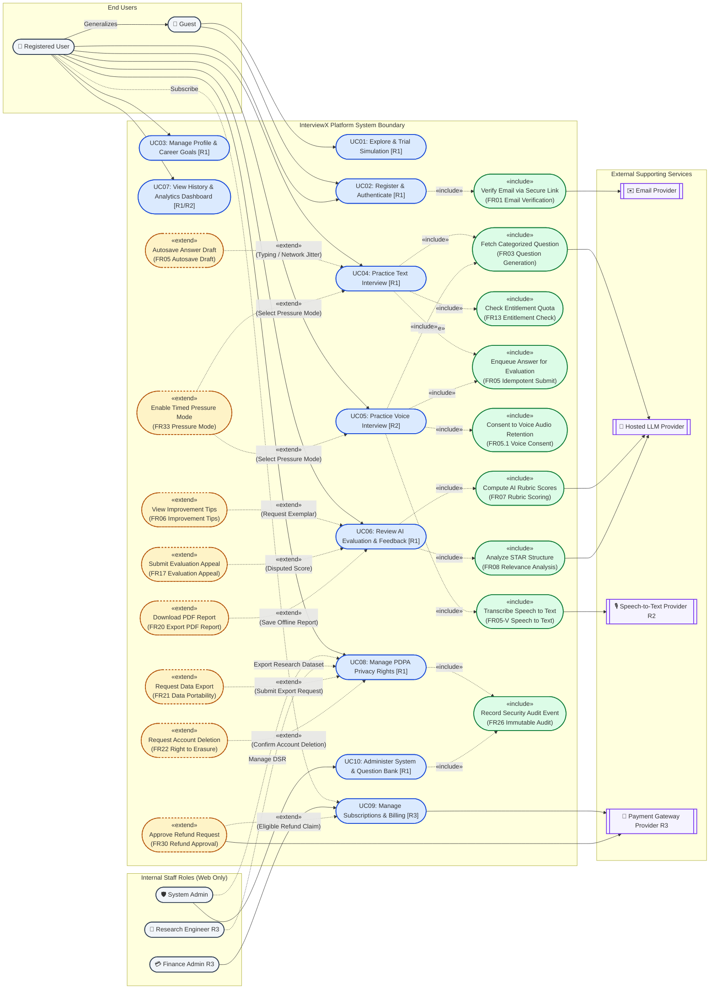

---

## D21 SUBSYSTEM USE CASES: PRACTICE & AI EVALUATION ENGINE

Subsystem Use Case Diagram detailing question selection, quota deduction, text/voice simulation flows, rubric evaluation, and contextual extensions:

```mermaid
flowchart LR
  subgraph Candidate["Candidate"]
    User([👤 Registered User])
  end

  subgraph PracticeBoundary["Practice & Evaluation Engine"]
    direction TB

    %% Base Use Cases
    UC_StartSession(["Start Interview Session"])
    UC_PracticeText(["(UC04) Practice Text Interview [FR05]"])
    UC_PracticeVoice(["(UC05) Practice Voice Interview [FR05-V]"])
    UC_ReviewEval(["(UC06) Review AI Evaluation Report [FR07]"])

    %% Includes for Sessions
    INC_FetchQ(["«include»<br/>Fetch Categorized Question<br/>(FR03 Category Question)"])
    INC_CheckQuota(["«include»<br/>Atomic Quota Deduction<br/>(FR13 Quota Ledger Check)"])
    INC_SubmitAnswer(["«include»<br/>Submit with Idempotency Key<br/>(FR05 Idempotent Submission)"])

    %% Includes for Voice
    INC_VoiceConsent(["«include»<br/>Request Voice Retention Consent<br/>(FR05.1 Voice Consent)"])
    INC_STT(["«include»<br/>Transcribe Audio to Text<br/>(FR05-V Speech to Text)"])

    %% Includes for Evaluation
    INC_RubricScore(["«include»<br/>Calculate Rubric Scores<br/>(FR07 Rubric Scoring Engine)"])
    INC_STARRelevance(["«include»<br/>Analyze STAR Relevance<br/>(FR08 Relevance Analysis)"])
    INC_StrengthsReport(["«include»<br/>Synthesize Strengths & Weaknesses<br/>(FR09 Strengths Report)"])

    %% Extends for Sessions
    EXT_DifficultyScaling(["«extend»<br/>Select Difficulty Level<br/>(FR16 Difficulty Scaling)"])
    EXT_PressureMode(["«extend»<br/>Enable Time Pressure Mode<br/>(FR33 Pressure Simulation)"])
    EXT_FollowupQ(["«extend»<br/>Generate Contextual Follow-up<br/>(FR14 Contextual Follow-up)"])
    EXT_Autosave(["«extend»<br/>Autosave Answer Draft<br/>(FR05 Client Draft Autosave)"])
    EXT_EditTranscript(["«extend»<br/>Review & Edit Transcript<br/>(Review & Edit Transcript)"])

    %% Extends for Evaluation
    EXT_GrammarAnalysis(["«extend»<br/>Analyze English Grammar<br/>(FR10 Professional Vocab)"])
    EXT_SpeechPace(["«extend»<br/>Analyze Speech Pace & Fillers<br/>(FR36 Speech Pace Analysis)"])
    EXT_ImprovementTips(["«extend»<br/>View Exemplar & Tips<br/>(FR06 Improvement Guidance)"])
    EXT_AppealScore(["«extend»<br/>Submit Score Appeal<br/>(FR17 Evaluation Score Appeal)"])
    EXT_ExportPDF(["«extend»<br/>Export Report to PDF<br/>(FR20 Feedback Report Export)"])
  end

  subgraph ExternalInference["External AI Services"]
    LLM[[🤖 Hosted LLM Provider]]
    STT[[🎙️ Speech-to-Text Provider]]
  end

  %% Actor associations
  User --> UC_StartSession
  User --> UC_PracticeText
  User --> UC_PracticeVoice
  User --> UC_ReviewEval

  %% Start Session Relationships
  UC_StartSession -.->|"«include»"| INC_FetchQ
  UC_StartSession -.->|"«include»"| INC_CheckQuota
  EXT_DifficultyScaling -.->|"«extend»<br/>(Specific Skill Level)"| UC_StartSession
  EXT_PressureMode -.->|"«extend»<br/>(High Pressure Drill)"| UC_StartSession
  EXT_FollowupQ -.->|"«extend»<br/>(Answer Opens Inquiry)"| INC_FetchQ

  %% Practice Text Relationships
  UC_PracticeText -.->|"«include»"| INC_SubmitAnswer
  EXT_Autosave -.->|"«extend»<br/>(Typing / Network Disruption)"| UC_PracticeText

  %% Practice Voice Relationships
  UC_PracticeVoice -.->|"«include»"| INC_VoiceConsent
  UC_PracticeVoice -.->|"«include»"| INC_STT
  UC_PracticeVoice -.->|"«include»"| INC_SubmitAnswer
  EXT_EditTranscript -.->|"«extend»<br/>(Transcription Correction)"| UC_PracticeVoice

  %% Review Evaluation Relationships
  UC_ReviewEval -.->|"«include»"| INC_RubricScore
  UC_ReviewEval -.->|"«include»"| INC_STARRelevance
  UC_ReviewEval -.->|"«include»"| INC_StrengthsReport

  EXT_GrammarAnalysis -.->|"«extend»<br/>(English Response)"| UC_ReviewEval
  EXT_SpeechPace -.->|"«extend»<br/>(R2 Voice Session Only)"| UC_ReviewEval
  EXT_ImprovementTips -.->|"«extend»<br/>(Guidance Requested)"| UC_ReviewEval
  EXT_AppealScore -.->|"«extend»<br/>(Disputed AI Score)"| UC_ReviewEval
  EXT_ExportPDF -.->|"«extend»<br/>(Export Requested)"| UC_ReviewEval

  %% External Connections
  INC_FetchQ --> LLM
  EXT_FollowupQ --> LLM
  INC_STT --> STT
  INC_RubricScore --> LLM
  INC_STARRelevance --> LLM
  EXT_GrammarAnalysis --> LLM
  EXT_ImprovementTips --> LLM

  classDef baseStyle fill:#dbeafe,stroke:#1d4ed8,stroke-width:2px
  classDef incStyle fill:#dcfce7,stroke:#15803d,stroke-width:2px
  classDef extStyle fill:#fef3c7,stroke:#b45309,stroke-width:2px,stroke-dasharray:4 4
  classDef actorStyle fill:#f1f5f9,stroke:#334155,stroke-width:2px
  classDef extSysStyle fill:#f5f3ff,stroke:#7c3aed,stroke-width:2px

  class UC_StartSession,UC_PracticeText,UC_PracticeVoice,UC_ReviewEval baseStyle
  class INC_FetchQ,INC_CheckQuota,INC_SubmitAnswer,INC_VoiceConsent,INC_STT,INC_RubricScore,INC_STARRelevance,INC_StrengthsReport incStyle
  class EXT_DifficultyScaling,EXT_PressureMode,EXT_FollowupQ,EXT_Autosave,EXT_EditTranscript,EXT_GrammarAnalysis,EXT_SpeechPace,EXT_ImprovementTips,EXT_AppealScore,EXT_ExportPDF extStyle
  class User actorStyle
  class LLM,STT extSysStyle
```

---

## D22 SUBSYSTEM USE CASES: IDENTITY & PDPA PRIVACY GOVERNANCE

Subsystem Use Case Diagram covering registration, authentication, consent lifecycle, audit event logging, data portability, and the right to erasure workflow:

```mermaid
flowchart LR
  subgraph Actors["Actors"]
    Guest([👤 Guest])
    User([👤 Registered User])
    Admin([🛡️ System Admin / DPO])
  end

  subgraph PrivacyBoundary["Identity & Privacy Governance"]
    direction TB

    %% Base Use Cases
    UC_Register(["Sign Up with Email (FR01)"])
    UC_Login(["(UC02) Authenticate & Issue Tokens"])
    UC_ManageProfile(["(UC03) Manage Profile & Goals (FR02)"])
    UC_ConsentDashboard(["(UC08) Manage Consent Preferences (FR18)"])
    UC_DSRWorkflow(["(FR35) Data Subject Rights SLA Workflow"])

    %% Includes
    INC_VerifyEmail(["«include»<br/>Send Secure Verification Link"])
    INC_IssueTokens(["«include»<br/>Generate Access & Refresh Tokens"])
    INC_AuditRecord(["«include»<br/>Record Immutable Consent Event Log"])

    %% Extends
    EXT_ResetPassword(["«extend»<br/>Password Reset Request"])
    EXT_ChangePassword(["«extend»<br/>Change Account Password (FR23)"])
    EXT_LogoutAll(["«extend»<br/>Logout from All Devices (FR23)"])
    EXT_RevokeConsent(["«extend»<br/>Revoke Purpose Consent (FR18)"])
    EXT_DataPortability(["«extend»<br/>Data Portability Request (FR21)"])
    EXT_AccountErasure(["«extend»<br/>Right to Erasure / Deletion (FR22)"])
  end

  subgraph MailService["External Services"]
    EmailGateway[[✉️ Transactional Email]]
  end

  %% Associations
  Guest --> UC_Register
  Guest --> UC_Login
  User --> UC_Login
  User --> UC_ManageProfile
  User --> UC_ConsentDashboard
  Admin --> UC_DSRWorkflow

  %% Includes
  UC_Register -.->|"«include»"| INC_VerifyEmail
  UC_Login -.->|"«include»"| INC_IssueTokens
  UC_ConsentDashboard -.->|"«include»"| INC_AuditRecord

  %% Extends
  EXT_ResetPassword -.->|"«extend»<br/>(Forgot Password)"| UC_Login
  EXT_ChangePassword -.->|"«extend»<br/>(Update Credentials)"| UC_Login
  EXT_LogoutAll -.->|"«extend»<br/>(Security Compromise)"| UC_Login

  EXT_RevokeConsent -.->|"«extend»<br/>(Withdraw Consent)"| UC_ConsentDashboard
  EXT_DataPortability -.->|"«extend»<br/>(Export JSON/CSV)"| UC_ConsentDashboard
  EXT_AccountErasure -.->|"«extend»<br/>(Confirm Account Deletion)"| UC_ConsentDashboard

  %% DSR Inclusion
  EXT_DataPortability -.->|"«include»"| UC_DSRWorkflow
  EXT_AccountErasure -.->|"«include»"| UC_DSRWorkflow

  INC_VerifyEmail --> EmailGateway
  EXT_ResetPassword --> EmailGateway

  classDef baseStyle fill:#dbeafe,stroke:#1d4ed8,stroke-width:2px
  classDef incStyle fill:#dcfce7,stroke:#15803d,stroke-width:2px
  classDef extStyle fill:#fef3c7,stroke:#b45309,stroke-width:2px,stroke-dasharray:4 4
  classDef actorStyle fill:#f1f5f9,stroke:#334155,stroke-width:2px
  classDef extSysStyle fill:#f5f3ff,stroke:#7c3aed,stroke-width:2px

  class UC_Register,UC_Login,UC_ManageProfile,UC_ConsentDashboard,UC_DSRWorkflow baseStyle
  class INC_VerifyEmail,INC_IssueTokens,INC_AuditRecord incStyle
  class EXT_ResetPassword,EXT_ChangePassword,EXT_LogoutAll,EXT_RevokeConsent,EXT_DataPortability,EXT_AccountErasure extStyle
  class Guest,User,Admin actorStyle
  class EmailGateway extSysStyle
```

---

## D23 SUBSYSTEM USE CASES: BACKOFFICE, FINANCE & RESEARCH

Subsystem Use Case Diagram for internal staff portals (Web Only) covering question bank and rubric management, AI prompt configuration, financial reconciliation, and governed differential privacy dataset export:

```mermaid
flowchart LR
  subgraph StaffUsers["Internal Staff (Web Only)"]
    Admin([🛡️ System Admin])
    Finance([💳 Finance Admin R3])
    Researcher([🔬 Research Engineer R3])
  end

  subgraph BackofficeBoundary["Backoffice & Governance Portal"]
    direction TB

    %% Base Use Cases
    UC_ManageQuestions(["(UC10) Question Bank & Rubric Console (FR24)"])
    UC_ManageUsers(["User & Role RBAC Console (FR25)"])
    UC_AuditViewer(["Security Audit Viewer (FR26)"])
    UC_FinancialDashboard(["(UC09) Financial & MRR Dashboard (FR31)"])
    UC_ResearchExport(["(UC08.1) Research Dataset Release (FR18.1)"])

    %% Includes
    INC_ImmutableVersion(["«include»<br/>Immutable Rubric Version Pinning"])
    INC_AuditTrail(["«include»<br/>Record Audit Trail Event"])
    INC_DiffPrivacy(["«include»<br/>Differential Privacy Noise & Suppression"])
    INC_PaymentAPI(["«include»<br/>Execute Payment Gateway API Call"])

    %% Extends
    EXT_ConfigPrompt(["«extend»<br/>AI Model & Prompt Config (FR34)"])
    EXT_SuspendAccount(["«extend»<br/>Suspend & Unlock User (FR32)"])
    EXT_ResolveAppeal(["«extend»<br/>Resolve Score Appeal (FR17)"])
    EXT_ProcessRefund(["«extend»<br/>Process Refund Request (FR30)"])
  end

  subgraph ExternalGW["External Gateways"]
    PaymentGateway[[🏦 Payment Gateway Provider]]
  end

  %% Associations
  Admin --> UC_ManageQuestions
  Admin --> UC_ManageUsers
  Admin --> UC_AuditViewer
  Finance --> UC_FinancialDashboard
  Researcher --> UC_ResearchExport

  %% Includes
  UC_ManageQuestions -.->|"«include»"| INC_ImmutableVersion
  UC_ManageQuestions -.->|"«include»"| INC_AuditTrail
  UC_ManageUsers -.->|"«include»"| INC_AuditTrail
  UC_ResearchExport -.->|"«include»"| INC_DiffPrivacy
  EXT_ProcessRefund -.->|"«include»"| INC_PaymentAPI
  INC_PaymentAPI --> PaymentGateway

  %% Extends
  EXT_ConfigPrompt -.->|"«extend»<br/>(Tune or Upgrade AI Model)"| UC_ManageQuestions
  EXT_SuspendAccount -.->|"«extend»<br/>(Fraud / Policy Violation)"| UC_ManageUsers
  EXT_ResolveAppeal -.->|"«extend»<br/>(Pending Score Appeal)"| UC_ManageQuestions
  EXT_ProcessRefund -.->|"«extend»<br/>(Eligible Refund Claim)"| UC_FinancialDashboard

  classDef baseStyle fill:#dbeafe,stroke:#1d4ed8,stroke-width:2px
  classDef incStyle fill:#dcfce7,stroke:#15803d,stroke-width:2px
  classDef extStyle fill:#fef3c7,stroke:#b45309,stroke-width:2px,stroke-dasharray:4 4
  classDef actorStyle fill:#f1f5f9,stroke:#334155,stroke-width:2px
  classDef extSysStyle fill:#f5f3ff,stroke:#7c3aed,stroke-width:2px

  class UC_ManageQuestions,UC_ManageUsers,UC_AuditViewer,UC_FinancialDashboard,UC_ResearchExport baseStyle
  class INC_ImmutableVersion,INC_AuditTrail,INC_DiffPrivacy,INC_PaymentAPI incStyle
  class EXT_ConfigPrompt,EXT_SuspendAccount,EXT_ResolveAppeal,EXT_ProcessRefund extStyle
  class Admin,Finance,Researcher actorStyle
  class PaymentGateway extSysStyle
```

---

---

## D24 WEB & MOBILE ARCHITECTURE ALIGNMENT

Illustrates the architectural alignment, responsibility boundaries, shared monorepo contracts, and unified backend between Responsive Web (Next.js) and Native Mobile (React Native / Expo).

```mermaid
flowchart TD
    %% Styling & Classes
    classDef clientWeb fill:#e0f2fe,stroke:#0284c7,stroke-width:2px,color:#0369a1
    classDef clientMobile fill:#fef3c7,stroke:#d97706,stroke-width:2px,color:#b45309
    classDef sharedContracts fill:#ede9fe,stroke:#7c3aed,stroke-width:2px,color:#5b21b6
    classDef securityGate fill:#fee2e2,stroke:#dc2626,stroke-width:2px,color:#991b1b
    classDef backendCore fill:#ecfdf5,stroke:#059669,stroke-width:2px,color:#047857
    classDef dataStore fill:#f1f5f9,stroke:#475569,stroke-width:2px,color:#1e293b
    classDef external fill:#f3f4f6,stroke:#9ca3af,stroke-width:1px,color:#374151

    %% 1. Client Layer
    subgraph ClientLayer["1. Frontend Clients Layer"]
        subgraph WebApp["Responsive Web Application (apps/web)"]
            W_Tech["Next.js 14+ (TypeScript / Tailwind / shadcn/ui)"]
            W_Roles["Supports All 5 Roles:<br/>- Guest<br/>- Registered User<br/>- Researcher<br/>- Payment / Finance Admin<br/>- System Admin"]
            W_Auth["Auth: HTTP-Only, Secure, SameSite Cookie<br/>+ CSRF Protection"]
            W_View["Viewport: Desktop, Tablet, Mobile Browser (360px+)"]
        end

        subgraph MobileApp["Native Mobile Application (apps/mobile)"]
            M_Tech["React Native / Expo (iOS 16+ / Android 13+)"]
            M_Roles["Supports 2 End-User Roles Only:<br/>- Guest<br/>- Registered User<br/>(Admin & Research 100% Restricted to Web)"]
            M_Auth["Auth: Bearer JWT<br/>(iOS Keychain / Android Keystore)"]
            M_Storage["Offline Draft Autosave (Every 5s)<br/>Network Flakiness Resilient"]
        end
    end

    %% 2. Shared Monorepo Contracts Layer
    subgraph MonorepoLayer["2. Shared Contracts & Interfaces Layer"]
        Contracts["packages/contracts<br/>- OpenAPI Specification<br/>- Zod Validation Schemas<br/>- Shared TypeScript DTOs<br/>- Domain Event Definitions"]
        UI_Shared["packages/ui<br/>- Shared Design Tokens & Theme"]
    end

    Contracts -.->|Type-Safe API Contracts| WebApp
    Contracts -.->|Type-Safe API Contracts| MobileApp
    UI_Shared -.->|Design Tokens| WebApp
    UI_Shared -.->|Design Tokens| MobileApp

    %% 3. Edge Gateway & Security Layer
    subgraph GatewayLayer["3. Edge & API Gateway Boundary"]
        CDN_WAF["Cloudflare WAF / CDN / TLS 1.3 Termination"]
        
        subgraph IngressGateway["NestJS Ingress & Policy Enforcement"]
            AuthGuard["Unified Auth Guard<br/>- Extract Cookie (Web)<br/>- Extract Bearer JWT (Mobile)"]
            ClientGuard{"Client-Type & RBAC Guard"}
            IdempotencyMW["Idempotency Middleware<br/>(Requires Idempotency-Key: UUIDv4)"]
            RateLimiter["Rate Limiting & Anti-Abuse<br/>(Throttler by Client IP / User ID)"]
        end
    end

    WebApp -->|HTTPS / REST API| CDN_WAF
    MobileApp -->|HTTPS / REST API| CDN_WAF
    CDN_WAF --> AuthGuard
    AuthGuard --> IdempotencyMW
    IdempotencyMW --> RateLimiter
    RateLimiter --> ClientGuard

    ClientGuard -->|Mobile requesting Admin/Researcher routes| RejectAdmin["403 Forbidden<br/>(Strictly Block Administrative Actions on Mobile)"]
    ClientGuard -->|Valid Authorized Request| BackendRouting["Route to Target Module"]

    %% 4. Backend Modular Monolith
    subgraph BackendCore["4. Unified Backend Core (Zero Duplication)"]
        subgraph NestJS["NestJS Modular Monolith (apps/api)"]
            Mod_Identity["Identity & Auth Module<br/>(Token Rotation, Ownership Guard)"]
            Mod_Interview["Interview & Session Module<br/>(Question Gen, Answer Ingestion)"]
            Mod_Eval["Evaluation Module<br/>(Transactional Outbox Publisher)"]
            Mod_Privacy["Privacy & Consent Module<br/>(PDPA Audit Logs, Consent Check)"]
        end

        subgraph AsyncQueue["Asynchronous Processing System"]
            OutboxPoll["Transactional Outbox Dispatcher"]
            BullQueue[("Redis / BullMQ<br/>(Evaluation Job Queue)")]
            EvalWorker["Evaluation Worker<br/>(Inbox Deduplication)"]
        end

        subgraph AIService["AI Evaluation Engine (apps/ai-service)"]
            FastAPI["FastAPI AI Service<br/>(Stateless Scoring Engine)"]
            PydanticVal["Pydantic Output Validation<br/>(Rubric Bounds & Citation Check)"]
        end
    end

    BackendRouting --> NestJS
    Mod_Eval --> OutboxPoll
    OutboxPoll --> BullQueue
    BullQueue --> EvalWorker
    EvalWorker --> FastAPI
    FastAPI --> PydanticVal

    %% 5. Data Layer
    subgraph DataLayer["5. Persistent Data Layer (Single Source of Truth)"]
        Postgres[("Core PostgreSQL<br/>- USERS & REFRESH_TOKENS<br/>- SESSIONS & QUESTIONS<br/>- ANSWERS & EVALUATION_JOBS<br/>- OUTBOX_EVENTS<br/>- IDEMPOTENCY_KEYS")]
        ObjectStore[("MinIO / S3<br/>- Audio Cache (R2 Voice)<br/>- Export Artifacts")]
    end

    NestJS --> Postgres
    EvalWorker --> Postgres

    %% 6. External Services
    subgraph ExternalServices["6. External Integrations"]
        ExtLLM["External LLM Provider<br/>(OpenAI / Claude / Gemini)"]
        WebCheckout["Web Payment Gateway (R3)<br/>(Mobile Redirects to Web Checkout)"]
    end

    FastAPI --> ExtLLM
    WebApp -.-> WebCheckout
    MobileApp -.->|D-M04: In-App Browser Redirect| WebCheckout

    %% Apply Classes
    class W_Tech,W_Roles,W_Auth,W_View clientWeb
    class M_Tech,M_Roles,M_Auth,M_Storage clientMobile
    class Contracts,UI_Shared sharedContracts
    class CDN_WAF,AuthGuard,ClientGuard,IdempotencyMW,RateLimiter,RejectAdmin securityGate
    class Mod_Identity,Mod_Interview,Mod_Eval,Mod_Privacy,OutboxPoll,BullQueue,EvalWorker,FastAPI,PydanticVal backendCore
    class Postgres,ObjectStore dataStore
    class ExtLLM,WebCheckout external
```

---

## D25 WEB VS MOBILE INTERACTION SEQUENCE

Compares authentication protocols, strict client RBAC enforcement, and network flakiness resilience using idempotency keys and client-side autosave.

```mermaid
sequenceDiagram
    autonumber
    actor UserWeb as Web User
    actor UserMobile as Mobile User
    participant ClientWeb as Web Client (Next.js)
    participant ClientMobile as Mobile App (React Native)
    participant API as NestJS Gateway / Backend
    participant DB as Core PostgreSQL
    participant Queue as Redis / BullMQ
    participant AI as Evaluation Worker & FastAPI

    %% 1. Authentication Strategy Comparison
    rect rgb(240, 248, 255)
    note over UserWeb, API: 1. Authentication Strategy
    UserWeb->>ClientWeb: Login (Email / Password)
    ClientWeb->>API: POST /api/v1/auth/login
    API-->>ClientWeb: Set-Cookie: access_token (HTTP-Only, Secure, SameSite)
    
    UserMobile->>ClientMobile: Login (Email / Password)
    ClientMobile->>API: POST /api/v1/auth/login (Client-Type: mobile)
    API-->>ClientMobile: 200 OK { accessToken: "JWT...", refreshToken: "..." }
    ClientMobile->>ClientMobile: Store tokens securely in iOS Keychain / Android Keystore
    end

    %% 2. Strict Client RBAC Enforcement
    rect rgb(255, 240, 240)
    note over UserMobile, API: 2. Strict Client RBAC Enforcement
    UserMobile->>ClientMobile: Attempt to access Admin / Finance route
    ClientMobile->>API: GET /api/v1/admin/dashboard (Authorization: Bearer [JWT])
    API->>API: Client-Type Check: Detected request from Mobile Client
    API-->>ClientMobile: 403 Forbidden (Admin functions are restricted to Web only)
    end

    %% 3. Answer Submission & Idempotency
    rect rgb(240, 255, 240)
    note over UserMobile, AI: 3. Answer Submission & Network Flakiness Resilience
    UserMobile->>ClientMobile: Type interview answer
    loop Local Draft Autosave (Every 5s)
        ClientMobile->>ClientMobile: Persist draft to local device storage
    end
    UserMobile->>ClientMobile: Tap "Submit Answer"
    ClientMobile->>ClientMobile: Generate UUIDv4 for Idempotency-Key
    ClientMobile->>API: POST /api/v1/interviews/{id}/answers<br/>Header: Idempotency-Key: 550e8400-e29b...<br/>Header: Authorization: Bearer [JWT]
    
    API->>API: Verify Bearer JWT + Session Ownership Check
    API->>DB: Check if Idempotency-Key already exists
    alt New Request (Key not seen before)
        API->>DB: BEGIN - Insert answer + create Job (pending) + insert Outbox Event + save Key
        DB-->>API: COMMIT
        API-->>ClientMobile: 202 Accepted { jobId: "job_123", status: "pending" }
        API->>Queue: Dispatcher enqueues Job to Redis / BullMQ
        Queue->>AI: Evaluate candidate response against Rubric
        AI->>DB: Persist score & feedback (status: completed)
    else Network Dropout & Retry with same Idempotency-Key
        API->>DB: Key found in database (Fetch existing job state)
        DB-->>API: Return existing job state (pending or completed)
        API-->>ClientMobile: 202 Accepted { jobId: "job_123", status: "pending" } (No duplicated job)
    end
    
    loop Async Status Polling (or Push Notification)
        ClientMobile->>API: GET /api/v1/evaluations/job_123
        API-->>ClientMobile: 200 OK { status: "completed", score: 85, feedback: {...} }
    end
    ClientMobile->>UserMobile: Render feedback score, strengths, and improvements
    end
```

---

## D26 AI DATA PIPELINE FLOW

Illustrates the end-to-end data lifecycle for AI evaluation, from ingesting candidate responses, sanitizing prompt injections and PII, pinning rubric and prompt configuration versions, dispatching LLM inference calls, to rigorous schema validation via Pydantic.

```mermaid
flowchart LR
 subgraph Ingestion["1. Answer Ingestion"]
  RawAnswer["Interview Answer<br/>(Text / STT Transcript)"]
 end

 subgraph ContextPrep["2. Context & Version Pinning"]
  Rubric["Pinned Rubric Definition<br/>(Rubric Version)"]
  AIConfig["Pinned AI System Prompts<br/>(AI Config Version)"]
  Sanitizer["Security Sanitizer<br/>(Prompt Injection & PII Filter)"]
 end

 subgraph Inference["3. AI Inference Dispatch"]
  LLMClient["LLM Adapter Client<br/>(10s Timeout + 2 Retries)"]
  RawOutput["Raw LLM JSON Response"]
 end

 subgraph Validation["4. Strict Output Validation"]
  Validator{"Schema & Criteria Check"}
  ValCriteria["Pydantic Validation Criteria:<br/>- 4 Rubric Dimensions Present<br/>- Score Range 0-100<br/>- Evidence Excerpts Present"]
  Valid["Valid & Conforming<br/>(Status: completed)"]
  Invalid["Schema Violation / Anomaly<br/>(Status: needs_review)"]
 end

 RawAnswer --> Sanitizer
 Sanitizer --> LLMClient
 Rubric --> LLMClient
 AIConfig --> LLMClient
 LLMClient --> RawOutput
 RawOutput --> Validator
 Validator -.->|Evaluated Against| ValCriteria
 Validator -->|Pass| Valid
 Validator -->|Fail| Invalid
```

---

## D27 AI FALLBACK & CIRCUIT BREAKER

Illustrates High Availability (HA) and fault-tolerance architecture for AI evaluation jobs, including BullMQ/Redis worker job consumption, exponential backoff retries, circuit breaking after 5 consecutive failures, secondary backup LLM failover, and `needs_review` on-call alerting fallback.

```mermaid
flowchart TD
 Start["Evaluation Job dequeued from Redis Queue"] --> CallAI["Invoke Primary LLM Provider"]
 CallAI --> CheckSuccess{"Response received within 10s?"}

 CheckSuccess -->|Success| Validate["Validate Output via Pydantic Schema"]
 Validate --> CheckValid{"Is score payload valid?"}
 CheckValid -->|Valid| Complete["Persist Result: status completed"]

 CheckSuccess -->|Failure / Timeout| Trip{"5 or more consecutive failures?"}
 Trip -->|Trip Circuit Open| FallbackLLM["Failover to Secondary Backup LLM"]
 Trip -->|Circuit Closed| Retry["Exponential Backoff Retry (Max 3 attempts)"]
 Retry --> CallAI

 FallbackLLM --> CheckFallback{"Backup LLM call succeeded?"}
 CheckFallback -->|Success| Validate
 CheckFallback -->|Failure| MarkReview["Mark Job Status: needs_review<br/>(Queued for Human Expert Review)"]
 CheckValid -->|Invalid Payload| MarkReview

 MarkReview --> Alert["Trigger Immediate Admin On-Call Alert"]
```
