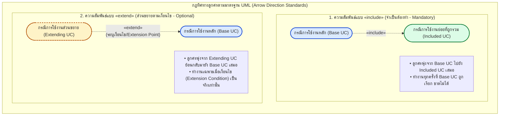
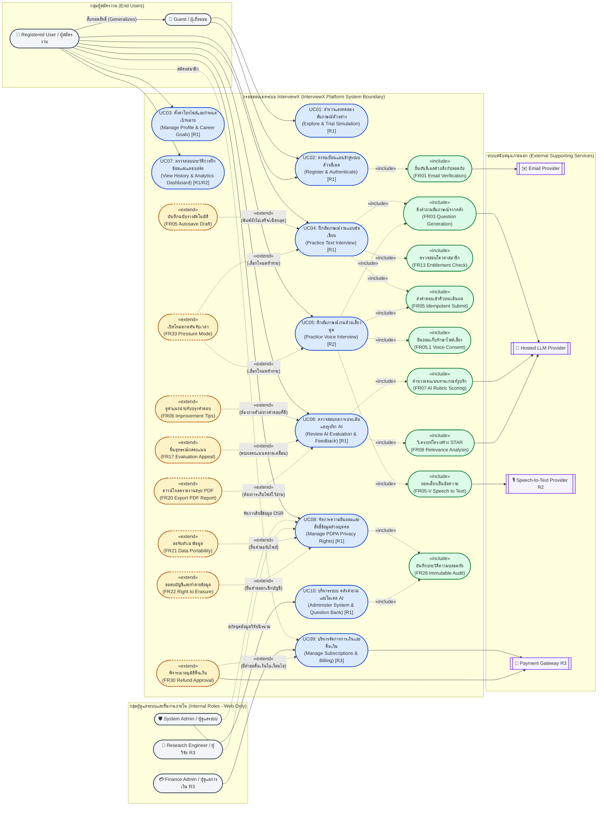
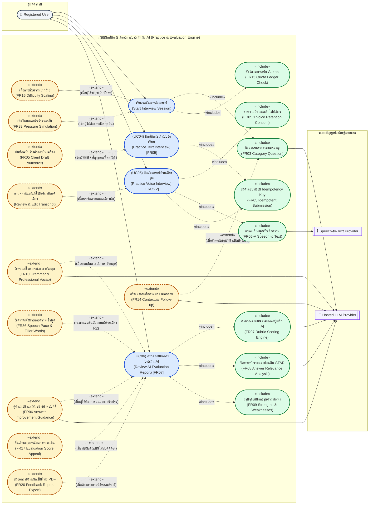
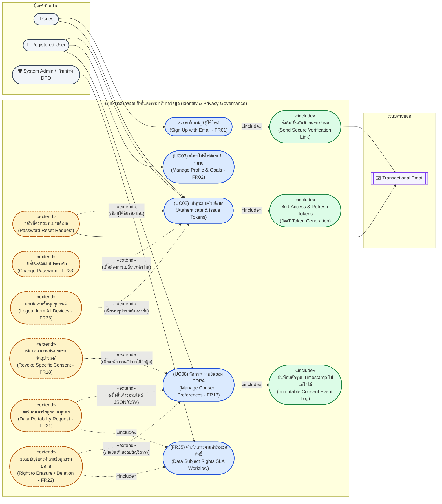
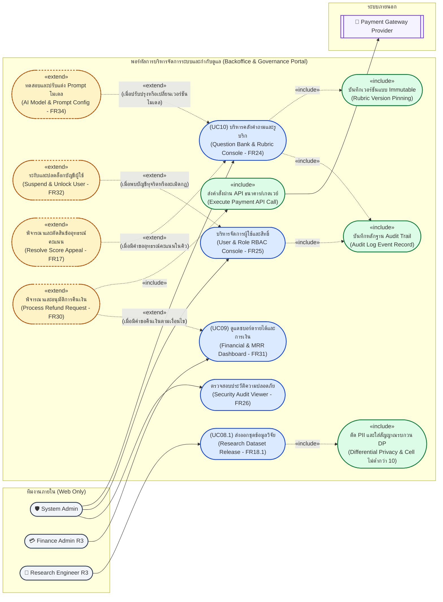

# แบบจำลองกรณีการใช้งานระบบ InterviewX (InterviewX System Use Case Model)
> **InterviewX — AI Job Interview Simulation System**  
> **เวอร์ชัน:** 1.1 DRAFT (Phase 1: Requirement & Platform Alignment Baseline)  
> **วันที่จัดทำ:** 13 พฤศจิกายน 2026  
> **สถานะเอกสาร:** ข้อกำหนดทางสถาปัตยกรรมระบบ (System Architecture Specification)

---

## 📌 1. บทนำและหลักการวิศวกรรมความสัมพันธ์ UML (UML Relationship Specification)

เอกสารฉบับนี้กำหนดแบบจำลองกรณีการใช้งาน (Use Case Model) ของแพลตฟอร์ม **InterviewX** ตามมาตรฐาน UML 2.5 อย่างเคร่งครัด โดยมุ่งเน้นการจำแนกความสัมพันธ์ระหว่างกรณีการใช้งานแบบ **`<<include>>`** และ **`<<extend>>`** ให้ชัดเจน ถูกต้องตามหลักวิศวกรรมซอฟต์แวร์:

### คำอธิบายสัญลักษณ์และสีในแผนภาพ (Color Legend)
- 🔵 **กล่องสีฟ้าทึบ (Base Use Case):** กรณีการใช้งานหลักที่เป็นเป้าหมายของผู้แสดงบทบาท (Actor)
- 🟢 **กล่องสีเขียว (Included Use Case - «include»):** ขั้นตอนย่อยที่ถูกดึงมารวมและ**ต้องทำเสมอ**เพื่อความสมบูรณ์ของกรณีการใช้งานหลัก
- 🟡 **กล่องสีส้ม/ขอบประ (Extending Use Case - «extend»):** พฤติกรรมเสริมที่จะทำงานก็ต่อเมื่อมี**เงื่อนไขเฉพาะ (Extension Condition)** เกิดขึ้น
- ⚪ **รูปคน (Human Actor):** ผู้ใช้งานที่เป็นมนุษย์
- 🟣 **กล่องสีม่วง (External System Actor):** ระบบภายนอกที่เชื่อมต่อผ่าน API

---

## 👥 2. บัญชีรายชื่อผู้แสดงบทบาท (Actor Catalog)

| สัญลักษณ์ | ผู้แสดงบทบาท (Actor) | ประเภท | บทบาทหน้าที่และสิทธิ์การเข้าถึง | แพลตฟอร์มที่รองรับ |
|:---:|---|:---:|---|---|
| 👤 | **Guest** (ผู้เยี่ยมชม) | ผู้ใช้ภายนอก (Primary Human) | ผู้ใช้งานทั่วไปที่ยังไม่ลงทะเบียน สำรวจระบบ หมวดหมู่คำถาม และทดลองสัมภาษณ์ตัวอย่างฟรีแบบจำกัด | Web & Mobile |
| 👤 | **Registered User** (ผู้สมัครงาน / ผู้ใช้งาน) | ผู้ใช้ภายนอก (Primary Human) | ผู้สมัครงานที่ลงทะเบียนบัญชีแล้ว (*สืบทอดสิทธิ์ของ Guest*) จัดการโปรไฟล์ ฝึกสัมภาษณ์แบบข้อเขียน/เสียง ดูผลคะแนนรูบริก AI และจัดการสิทธิ์ PDPA | Web & Mobile |
| 🛡️ | **System Administrator** (ผู้ดูแลระบบ) | บทบาทภายใน (Primary Human) | จัดการระบบคลังคำถามและรูบริก, ปรับแต่งพารามิเตอร์โมเดล AI, จัดการบัญชีผู้ใช้, ตรวจสอบ Audit Log และพิจารณาข้ออุทธรณ์ผลคะแนน | เฉพาะ Web เท่านั้น |
| 💳 | **Finance Administrator** (ผู้ดูแลการเงิน R3) | บทบาทภายใน (Primary Human) | ดูแลและตรวจสอบรายงานทางการเงิน ยอดขาย ค่าสมาชิก (MRR) และดำเนินการตรวจสอบและอนุมัติ/ปฏิเสธคำขอคืนเงิน | เฉพาะ Web เท่านั้น |
| 🔬 | **Research Data Engineer** (ผู้วิจัยและวิศวกรข้อมูล R3) | บทบาทภายใน (Primary Human) | สกัดและส่งออกชุดข้อมูลวิจัยนิรนาม (Anonymized Aggregate Datasets) ภายใต้เกณฑ์ k-anonymity / Differential Privacy | เฉพาะ Web เท่านั้น |
| 🤖 | **External LLM Provider** (ผู้ให้บริการโมเดล AI) | ระบบภายนอก (Secondary System) | ให้บริการ AI Inference สำหรับการสุ่ม/สร้างคำถาม, คำนวณคะแนนรูบริก, วิเคราะห์โครงสร้างคำตอบ และสร้างข้อเสนอแนะ | API หลังบ้าน |
| 🎙️ | **Speech-to-Text Provider** (บริการแปลงเสียงเป็นข้อความ R2) | ระบบภายนอก (Secondary System) | บริการถอดเสียงคำตอบสัมภาษณ์ของผู้ใช้เป็นข้อความเพื่อส่งเข้ากระบวนการประเมินผล AI | API หลังบ้าน |
| 🏦 | **Payment Gateway** (ผู้ให้บริการชำระเงิน R3) | ระบบภายนอก (Secondary System) | ให้บริการตัดบัตรเครดิต/พร้อมเพย์สำหรับแพ็กเกจสมาชิก และประมวลผลคำสั่งโอนเงินคืน | API หลังบ้าน |
| ✉️ | **Transactional Email Service** (บริการส่งอีเมลระบบ) | ระบบภายนอก (Secondary System) | บริการส่งอีเมลยืนยันตัวตน ลิงก์รีเซ็ตรหัสผ่าน และอีเมลแจ้งเตือน | API หลังบ้าน |

---

## 🌐 3. แผนภาพกรณีการใช้งานระดับภาพรวมระบบ (D20: Master System Use Case Diagram)

แผนภาพนี้แสดงภาพรวมของระบบทั้งหมด โดยระบุความสัมพันธ์ **`«include»`** และ **`«extend»`** หลักไว้อย่างชัดเจนพร้อมเงื่อนไข:

---

## 🎯 4. แผนภาพระบบย่อย: การฝึกสัมภาษณ์และการประเมินผล AI (D21: Practice & AI Evaluation Engine)

แผนภาพนี้เจาะลึกกระบวนการสัมภาษณ์แบบละเอียด โดยแสดงทุกจุดขยาย (`«extend»`) พร้อมเงื่อนไข และทุกขั้นตอนที่ต้องทำ (`«include»`):

---

## 🔒 5. แผนภาพระบบย่อย: ยืนยันตัวตนและคุ้มครองข้อมูลส่วนบุคคล (D22: Identity & PDPA Governance)

แผนภาพแสดงขั้นตอนการเข้าถึงระบบและการบังคับใช้สิทธิ์ของเจ้าของข้อมูล (Data Subject Rights: DSR) ตาม พ.ร.บ. คุ้มครองข้อมูลส่วนบุคคล:

---

## 📊 6. แผนภาพระบบย่อย: การบริหารระบบ การเงิน และชุดข้อมูลวิจัย (D23: Administration, Billing & Research)

แผนภาพสำหรับบทบาททีมงานภายใน ซึ่งสงวนไว้เฉพาะบน **Web Application เท่านั้น**:

---

## 📋 7. ตารางสรุปความสัมพันธ์ «include» ทั้งระบบ (Complete Include Matrix)

ความสัมพันธ์แบบ **«include»** หมายถึงกรณีการใช้งานหลัก (Base UC) จำเป็นต้องเรียกใช้กรณีการใช้งานย่อยเสมอ ขาดไม่ได้:

| ลำดับ | กรณีการใช้งานหลัก (Base UC) | ทิศทางลูกศร | กรณีการใช้งานย่อยที่ถูกรวม (Included UC) | เหตุผลความจำเป็นและข้อกำหนดที่เกี่ยวข้อง | อ้างอิง FR |
|:---:|---|:---:|---|---|:---:|
| 1 | **UC02: ลงทะเบียนบัญชีใหม่** | `-.->` | **ยืนยันตัวตนทางอีเมล (Verify Email)** | ป้องกันบัญชีปลอมและอีเมลผิดพลาดก่อนเปิดใช้งาน | FR01 |
| 2 | **UC02: เข้าสู่ระบบ** | `-.->` | **ออก Token ตรวจสอบสิทธิ์ (Issue JWT)** | สร้าง Access Token (15m) และ Refresh Token (7d) | FR01 |
| 3 | **UC04 / UC05: สร้างเซสชันสัมภาษณ์** | `-.->` | **ดึงคำถามจากคลัง (Fetch Question)** | นำเข้าคำถามที่ตรงหมวดหมู่และทักษะจากคลังกลาง | FR03 |
| 4 | **UC04 / UC05: เริ่มต้นการฝึกซ้อม** | `-.->` | **ตรวจสอบโควตาสมาชิก (Check Quota)** | หักโควตาเซสชันจาก USAGE_LEDGER แบบ Atomic ป้องกันใช้เกิน | FR13 |
| 5 | **UC04 / UC05: ส่งคำตอบสัมภาษณ์** | `-.->` | **ส่งคำตอบเข้าคิว (Submit Idempotent)** | ป้องกันส่งคำตอบซ้ำด้วย Idempotency-Key และส่งเข้า Redis | FR05 |
| 6 | **UC05: ฝึกสัมภาษณ์ด้วยเสียง** | `-.->` | **ขอความยินยอมไฟล์เสียง (Voice Consent)** | กฎหมาย PDPA มาตรา 19 บังคับขอความยินยอมก่อนบันทึก | FR05.1 |
| 7 | **UC05: ฝึกสัมภาษณ์ด้วยเสียง** | `-.->` | **แปลงเสียงเป็นข้อความ (Speech to Text)** | ต้องถอดเสียงเป็นข้อความก่อนส่งเข้าประเมินผล AI | FR05-V |
| 8 | **UC06: ตรวจสอบผลการประเมิน** | `-.->` | **คำนวณคะแนนตามเกณฑ์รูบริก AI** | แกนหลักของการประเมิน P95 <= 15s ตามรูบริกที่ตรึงไว้ | FR07 |
| 9 | **UC06: ตรวจสอบผลการประเมิน** | `-.->` | **วิเคราะห์ความตรงประเด็น STAR** | วิเคราะห์โครงสร้าง สถานการณ์ และผลลัพธ์ของคำตอบ | FR08 |
| 10 | **UC06: ตรวจสอบผลการประเมิน** | `-.->` | **สรุปรายงานจุดแข็งและจุดควรพัฒนา** | แสดงผลอย่างน้อย 1 รายการพร้อมข้อความอ้างอิง | FR09 |
| 11 | **UC08: จัดการความยินยอม PDPA** | `-.->` | **บันทึกประวัติความปลอดภัย (Audit Log)** | บันทึกหลักฐาน Consent Event แบบระบุเวลาไม่สามารถแก้ไขได้ | FR18, FR26 |
| 12 | **UC10: จัดการคลังคำถามและรูบริก** | `-.->` | **ตรึงเวอร์ชันคำถามและเกณฑ์รูบริก** | ห้ามแก้ไขทับรูบริกเดิมที่เคยใช้ประเมินผลไปแล้ว | FR24 |
| 13 | **UC08.1: ส่งออกชุดข้อมูลวิจัย** | `-.->` | **สกัดนิรนาม Differential Privacy** | จำกัดขนาดกลุ่มตัวอย่าง Cell >= 10 คน และตัด PII 100% | FR18.1 |
| 14 | **อนุมัติการคืนเงิน (Process Refund)** | `-.->` | **ส่งคำสั่งคืนเงินผ่าน Payment Gateway** | เรียก API ธนาคารเพื่อโอนเงินคืนสู่บัญชีผู้ใช้ | FR30 |

---

## 📋 8. ตารางสรุปความสัมพันธ์ «extend» และเงื่อนไขการทำงาน (Complete Extend Matrix)

ความสัมพันธ์แบบ **«extend»** หมายถึงกรณีการใช้งานเสริมจะทำงานก็ต่อเมื่อเกิดเงื่อนไข (Extension Condition) ที่ระบุไว้:

| ลำดับ | กรณีการใช้งานเสริม (Extending UC) | ทิศทางลูกศร | กรณีการใช้งานหลัก (Base UC) | จุดต่อขยายและเงื่อนไขการทำงาน (Extension Point & Condition) | อ้างอิง FR |
|:---:|---|:---:|---|---|:---:|
| 1 | **ขอรีเซ็ตรหัสผ่าน (Reset Password)** | `-.->` | **UC02: เข้าสู่ระบบ** | **[เมื่อผู้ใช้ลืมรหัสผ่าน]:** กดลิงก์ขอรีเซ็ตรหัสผ่านเพื่อรับอีเมลยืนยัน | FR01 |
| 2 | **ยกเลิกเซสชันทุกเครื่อง (Logout All)** | `-.->` | **UC02: เข้าสู่ระบบ** | **[เมื่อพบอุปกรณ์ต้องสงสัย]:** สั่งลบ Refresh Token ทุกเครื่องพร้อมกัน | FR23 |
| 3 | **บันทึกฉบับร่างอัตโนมัติ (Autosave)** | `-.->` | **UC04: ฝึกสัมภาษณ์ข้อเขียน** | **[ขณะพิมพ์ / สัญญาณเน็ตสะดุด]:** บันทึกคำตอบในเครื่องป้องกันสูญหาย | FR05 |
| 4 | **เลือกระดับความยากง่าย (Difficulty)** | `-.->` | **UC04 / UC05: สัมภาษณ์งาน** | **[เมื่อผู้ใช้ระบุระดับทักษะ]:** ปรับคำถามให้ซับซ้อนตามระดับทักษะ | FR16 |
| 5 | **เปิดโหมดกดดันจับเวลา (Pressure Mode)**| `-.->` | **UC04 / UC05: สัมภาษณ์งาน** | **[เมื่อผู้ใช้เปิดสวิตช์โหมดท้าทาย]:** ลดเวลาตอบคำถามและจำลองความกดดัน | FR33 |
| 6 | **สร้างคำถามติดตามผล (Follow-up Q)** | `-.->` | **UC04 / UC05: สัมภาษณ์งาน** | **[เมื่อคำตอบก่อนหน้าเปิดประเด็นใหม่]:** AI สร้างคำถามเจาะลึกเฉพาะเรื่อง | FR14 |
| 7 | **แก้ไขข้อความถอดเสียง (Edit Transcript)**| `-.->` | **UC05: ฝึกสัมภาษณ์เสียง** | **[เมื่อระบบ STT ถอดคำศัพท์ผิด]:** ผู้ใช้แก้ไขข้อความก่อนกดยืนยันส่ง AI | FR05-V |
| 8 | **ดูคำแนะนำปรับปรุง (Answer Guidance)**| `-.->` | **UC06: ดูผลการประเมิน** | **[เมื่อผู้ใช้ต้องการแนวทางตอบที่ดี]:** แสดงตัวอย่างประโยคและคำศัพท์ที่ดีขึ้น | FR06 |
| 9 | **วิเคราะห์ภาษาอังกฤษ (Grammar Check)** | `-.->` | **UC06: ดูผลการประเมิน** | **[เมื่อตอบสัมภาษณ์เป็นภาษาอังกฤษ]:** ตรวจไวยากรณ์และความเป็นมืออาชีพ | FR10 |
| 10 | **วิเคราะห์จังหวะพูด (Speech Rhythm)** | `-.->` | **UC06: ดูผลการประเมิน** | **[เฉพาะเซสชันสัมภาษณ์ด้วยเสียง]:** วัดความเร็ว WPM และคำฟุ่มเฟือย | FR36 |
| 11 | **ยื่นคำขออุทธรณ์คะแนน (Appeal Score)** | `-.->` | **UC06: ดูผลการประเมิน** | **[เมื่อผลคะแนนไม่ตรงประเด็น]:** ส่งคำขอให้แอดมินคนจริงตรวจสอบซ้ำ | FR17 |
| 12 | **ดาวน์โหลดรายงาน PDF (Export PDF)** | `-.->` | **UC06: ดูผลการประเมิน** | **[เมื่อต้องการเก็บรายงานออฟไลน์]:** สร้างเอกสารสรุปผลคะแนนแบบเป็นทางการ | FR20 |
| 13 | **เพิกถอนความยินยอม (Revoke Consent)** | `-.->` | **UC08: จัดการสิทธิ์ PDPA** | **[เมื่อต้องการหยุดการประมวลผล]:** ถอนความยินยอมเฉพาะด้านแบบ Real-time | FR18 |
| 14 | **ขอรับสำเนาข้อมูล (Data Portability)** | `-.->` | **UC08: จัดการสิทธิ์ PDPA** | **[เมื่อยื่นคำขอรับสำเนาไฟล์]:** ระบบจัดเตรียมไฟล์ JSON/CSV ภายใน 72 ชม. | FR21 |
| 15 | **ขอลบบัญชีและทำลายข้อมูล (Erasure)** | `-.->` | **UC08: จัดการสิทธิ์ PDPA** | **[เมื่อยืนยันขอลบบัญชีถาวร]:** ทำลายข้อมูลตามรอบ Soft Delete -> Hard Purge | FR22 |
| 16 | **พิจารณาอนุมัติคืนเงิน (Process Refund)**| `-.->` | **UC09: จัดการการเงิน** | **[เมื่อมีคำขอคืนเงินในเงื่อนไข]:** ตรวจสอบและอนุมัติคืนเงินตามเงื่อนไข | FR30 |
| 17 | **ปรับแต่งโมเดล AI (Prompt Config)** | `-.->` | **UC10: บริหารระบบคลังคำถาม** | **[เมื่อต้องการทดสอบ Prompt ใหม่]:** ปรับแต่งค่า Temperature และ Prompt | FR34 |
| 18 | **ระงับการใช้งานบัญชี (Suspend User)** | `-.->` | **UC10: บริหารระบบผู้ใช้** | **[เมื่อพบบัญชีผิดปกติ/ละเมิดกฎ]:** ระงับการเข้าสู่ระบบและยกเลิกเซสชัน | FR25, FR32 |

---

## 💡 สรุปหลักการความถูกต้องทางสถาปัตยกรรม (Architectural Invariants)

1. **ทิศทางของลูกศรถูกต้องตามมาตรฐานสากล 100%:**
   - **`«include»`:** ชี้จาก **Base UC ไปยัง Included UC** เสมอ เพราะเคสหลักเป็นฝ่ายต้องการและดึงเคสย่อยมาทำงาน
   - **`«extend»`:** ชี้จาก **Extending UC ย้อนกลับมายัง Base UC** เสมอ เพราะเคสเสริมเป็นฝ่ายเชื่อมต่อเข้าหาจุดขยาย (Extension Point) ของเคสหลัก
2. **การแยกแพลตฟอร์มอย่างเด็ดขาด (Platform Scoping Guard):**
   - ส่วนที่เกี่ยวกับ Candidate / End User (UC01–UC08) รองรับทั้ง Web และ Native Mobile
   - ส่วน Backoffice บริหารระบบ คลังคำถาม การเงิน และงานวิจัย (UC09, UC10, UC08.1) **จำกัดไว้เฉพาะ Web Application เท่านั้น** เพื่อความปลอดภัยระดับองค์กร
3. **การปกป้องข้อมูลส่วนบุคคลโดยการออกแบบ (Privacy by Design):**
   - การบันทึกเสียง (UC05) บังคับรวม `«include»` ขอความยินยอม (FR05.1) เสมอ
   - สิทธิ์ตาม PDPA (เพิกถอนความยินยอม, ขอข้อมูล, ขอลบบัญชี) เชื่อมโยงเข้ากับกระบวนการ DSR Workflow โดยอัตโนมัติ
