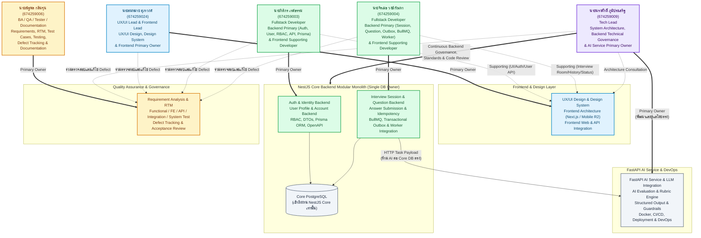
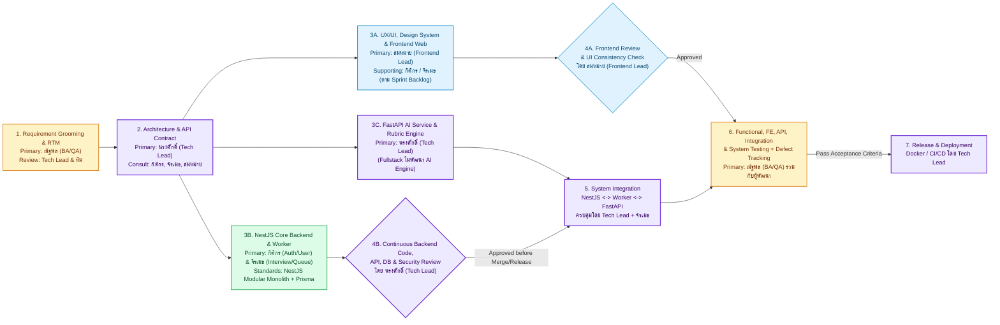

# แผนภาพโครงสร้างทีมพัฒนา ความเป็นเจ้าของระบบ และสายการกำกับดูแลทางเทคนิค (v1.2 Team-Revised)
## InterviewX — Development Team Structure, Technical Ownership & Governance Workflow Diagrams

> **สถานะเอกสาร:** แผนภาพประกอบฉบับปรับปรุงโครงสร้างทีม (Supplement to `ALL_DIAGRAMS_v1.1_FINAL_TH.md`)  
> **วันที่มีผลบังคับใช้:** 25 พฤศจิกายน 2026 | **เวอร์ชัน:** 1.2 (Team Structure & Ownership Aligned)  
> **หมายเหตุสำคัญ:** แผนภาพสถาปัตยกรรมระบบหลัก **D01–D27** ใน [ALL_DIAGRAMS_v1.1_FINAL_TH.md](file:///Users/mac/Desktop/interviewx-datahub/docs-interviex/04_System_Architecture/v1.1_diagrams/ALL_DIAGRAMS_v1.1_FINAL_TH.md) ไม่มีข้อมูลโครงสร้างทีมพัฒนาหรือการแบ่งหน้าที่รายบุคคล จึงยังคงต้นฉบับเดิมไว้ครบถ้วน 100% และจัดทำแผนภาพ **D28** และ **D29** ในเอกสารนี้เพิ่มเติมเพื่อแสดง Team Ownership และ Review Workflow ที่ได้รับอนุมัติใหม่

---

## D28 โครงสร้างทีมพัฒนา บทบาทหน้าที่ และ Technical Ownership Matrix

แสดงการจัดแบ่งความรับผิดชอบหลัก (Primary Owner) และความรับผิดชอบเชิงสนับสนุน (Supporting) ของสมาชิกทั้ง 5 คน ครอบคลุม Client Layer, Core Backend Modular Monolith, AI Service และ QA/Documentation โดยคงขอบเขต Single Ownership ของ Core PostgreSQL และ AI Service

---

## D29 กระบวนการทำงานร่วมกัน การตรวจสอบโค้ด และการตรวจรับงาน (Team Workflow & Technical Governance)

แสดงลำดับการทำงานร่วมกันระหว่างบทบาทในรอบการพัฒนา (Sprint Workflow) ตั้งแต่การวิเคราะห์ข้อกำหนด การออกแบบ UX/UI การพัฒนา Backend/Frontend/AI Service การทบทวนโค้ดโดย Tech Lead และ Frontend Lead จนถึงการทดสอบและตรวจรับมอบงานโดย BA/QA

---

## สรุปความสอดคล้องกับแผนภาพสถาปัตยกรรมหลัก (D01–D27)

1. แผนภาพสถาปัตยกรรมระบบ D01–D27 ใน [ALL_DIAGRAMS_v1.1_FINAL_TH.md](file:///Users/mac/Desktop/interviewx-datahub/docs-interviex/04_System_Architecture/v1.1_diagrams/ALL_DIAGRAMS_v1.1_FINAL_TH.md) ยังคงถูกต้องและไม่มีการแก้ไข Technology Stack หรือ Architecture Invariants ใดๆ
2. แผนภาพ D28 และ D29 ยืนยันขอบเขตเชิงสถาปัตยกรรมตามเดิม: **NestJS Core** เป็น Single Owner ของ Core PostgreSQL และ **FastAPI AI Service** ไม่เชื่อมต่อ Core PostgreSQL โดยตรง
