# เอกสารโครงสร้างทีมพัฒนา บทบาทหน้าที่ และการกำหนดผู้รับผิดชอบระบบย่อย
## InterviewX — Development Team Roles, Responsibilities & Module Ownership Matrix

> **สถานะเอกสาร:** ควบคุมและเป็นเกณฑ์หลักในการบริหารโครงการ (Project Management & Governance Baseline)  
> **วันที่มีผลบังคับใช้:** 21 พฤศจิกายน 2026 | **เวอร์ชัน:** 1.0 (Official Approved Baseline)  
> **ระบบ:** InterviewX — AI Job Interview Simulation System  
> **กลุ่มเป้าหมาย:** คณะผู้จัดทำ, อาจารย์ที่ปรึกษา, คณะกรรมการตรวจรับโครงงาน, สถาปนิกและทีมวิศวกรรมซอฟต์แวร์  
> **เอกสารอ้างอิงหลัก:** [InterviewX_SRS_v1.1_FINAL_TH.md](file:///D:/workspaces/interviewx-datahub/docs-interviex/03_SRS_Requirements/v1.1_approved/InterviewX_SRS_v1.1_FINAL_TH.md) | [ALL_DIAGRAMS_v1.1_FINAL_TH.md](file:///D:/workspaces/interviewx-datahub/docs-interviex/04_System_Architecture/v1.1_diagrams/ALL_DIAGRAMS_v1.1_FINAL_TH.md)

---

## 1. บทนำและวัตถุประสงค์ (Executive Summary & Objectives)

เอกสารฉบับนี้จัดทำขึ้นโดย Senior Business Analyst, Software Architect และ Project Manager เพื่อกำหนดโครงสร้างการจัดองค์กรทีมพัฒนาซอฟต์แวร์ (Development Team Structure) สำหรับโครงการ **InterviewX (AI Job Interview Simulation System)** ให้มีความชัดเจน มีธรรมาภิบาลทางวิศวกรรม และสามารถนำไปใช้ปฏิบัติงานได้จริงในการบริหารรอบการพัฒนา (Sprint Planning), การจัดสรรงาน (Work Breakdown Structure & Task Assignment), การติดตามความคืบหน้า (Progress Tracking) ตลอดจนการส่งมอบงานและการประกันคุณภาพซอฟต์แวร์

### วัตถุประสงค์หลัก 4 ประการ:
1. **Development Roles:** บันทึกตำแหน่งและบทบาทที่ได้รับการอนุมัติอย่างเป็นทางการ (Approved Team Roles) ของสมาชิกทั้ง 5 คน โดยไม่สลับหรือดัดแปลงตำแหน่ง
2. **Responsibilities:** ระบุขอบเขตงาน หน้าที่ความรับผิดชอบเฉพาะด้าน และผลงานที่ต้องส่งมอบ (Deliverables) ของแต่ละบุคคลอย่างเป็นรูปธรรม
3. **Module Ownership:** กำหนดผู้รับผิดชอบหลัก (Primary Owner) และผู้ร่วมสนับสนุน (Supporting Members) สำหรับทุกระบบย่อยและโมดูล เพื่อขจัดปัญหาความซ้ำซ้อนและช่องว่างในการทำงาน (Zero Ambiguity)
4. **Deliverables & Accountability:** วางเกณฑ์การตรวจรับ ความรับผิดชอบในการทดสอบ และการรักษาความสอดคล้องกับแผนการปล่อยระบบ (Release Roadmap: R1, R2, R3)

---

## 2. โครงสร้างตำแหน่งสมาชิกทีมที่ได้รับการอนุมัติ (Approved Development Team Structure)

โครงสร้างทีมพัฒนา InterviewX ประกอบด้วยสมาชิกจำนวน 5 คน โดยมีการแบ่งหน้าที่ตามความเชี่ยวชาญเฉพาะด้าน (Specialized Engineering Roles) ดังนี้:

| ลำดับ | ชื่อ-นามสกุล | รหัสนักศึกษา | ตำแหน่งและบทบาทหลัก (Approved Team Roles) | ความเชี่ยวชาญหลัก (Core Competencies) |
|:---:|---|:---:|---|---|
| 1 | **นายนรงศักดิ์ ภูมิประเสริฐ** | 674259009 | **Tech Lead, Architecture, AI Layer, DevOps, Integration** | System & Technical Architecture, LLM Pipeline, Rubric Engine, DevOps & CI/CD, System Integration |
| 2 | **นายสมหมาย สุภาวงค์** | 674259024 | **UX/UI Lead, Design System, Frontend/Mobile** | UX Research, Design System, Responsive Web (Next.js), Mobile App (React Native/Expo), Accessibility |
| 3 | **นายกิติกร เทศธรรม** | 674259003 | **Fullstack Developer, NestJS Core Backend, API** | NestJS Core Backend, Auth & Identity, REST API, Database Integration & Migration, API Security |
| 4 | **นายจิรเมธ วงษ์กัณหา** | 674259004 | **Fullstack Developer, NestJS Core Backend, Integration** | Interview Session Flow, BullMQ Queue & Outbox, Backend Integration, Idempotency, Session Resilience |
| 5 | **นายณัฐพล กลิ่นจุ่น** | 674259006 | **Business Analyst (BA), QA, Tester, Documentation** | Requirement Analysis, RTM, Test Cases & QA, Defect Tracking, System Acceptance, Technical Documentation |

> [!IMPORTANT]
> ตำแหน่งข้างต้นเป็นตำแหน่งที่ผ่านการอนุมัติและเห็นชอบร่วมกันของทีม ห้ามสลับชื่อ ดัดแปลงบทบาท หรือโยกย้ายตำแหน่งโดยเด็ดขาด ทั้งนี้ Development Role แตกต่างจาก System RBAC Role (ซึ่งเป็นสิทธิ์ของผู้ใช้ในระบบ เช่น Guest, User, Admin, Researcher)

---

## 3. ขอบเขตงาน หน้าที่ความรับผิดชอบ และผลงานที่ต้องส่งมอบรายบุคคล (Individual Responsibilities & Deliverables)

### 3.1 นายนรงศักดิ์ ภูมิประเสริฐ — Tech Lead
*ตำแหน่งทางการ:* **Tech Lead, Architecture, AI Layer, DevOps, Integration**

#### ก. ขอบเขตงานและความรับผิดชอบ (Scope of Responsibilities)
- **System Architecture & Technical Direction:** กำหนดทิศทางเทคโนโลยี มาตรฐานการเขียนโค้ด (Coding Standards) และโครงสร้าง Monorepo Repository
- **AI Architecture & AI Layer:** ออกแบบและพัฒนาระบบบริการปัญญาประดิษฐ์ (FastAPI AI Service), Stateless Rubric Scoring Engine และ Prompt Management
- **AI Inference Flow & Evaluation:** ควบคุมโฟลว์การอนุมานของ LLM (OpenAI/Anthropic/Gemini) พร้อม Guardrails ป้องกัน Prompt Injection และ Pydantic Schema Validation
- **DevOps & Development Infrastructure:** ออกแบบและดูแลระบบคอนเทนเนอร์ Docker, Docker Compose, CI/CD Pipeline (GitHub Actions), และ Environment Configuration
- **API Contract & Integration Standards:** กำหนดข้อกำหนดการเชื่อมต่อ API กลาง (OpenAPI 3.0/3.1) ร่วมกับ Backend และ Frontend
- **Technical Review & Architecture Validation:** ดำเนินการตรวจสอบโค้ด (Pull Request Review) และตรวจสอบความสอดคล้องทางสถาปัตยกรรม (Architecture Invariants)

#### ข. ผลงานที่ต้องส่งมอบ (Deliverables)
1. เอกสารสถาปัตยกรรมระบบ (System Architecture Documentation) และ Architecture Diagrams (D01–D25)
2. สถาปัตยกรรมและการทำงานของไปป์ไลน์ AI (AI Architecture & Evaluation Pipeline Specification)
3. สเปกการเชื่อมต่อบริการ AI (AI Service OpenAPI Contract: `internal-evaluation.openapi.yaml`)
4. คอนฟิกูเรชันโครงสร้างพื้นฐาน DevOps (`Dockerfile`, `docker-compose.yml`, CI/CD Workflows)
5. คู่มือและเอกสารการติดตั้งระบบ (Deployment & Operations Guide)
6. รายการตรวจสอบการทบทวนทางเทคนิค (Technical Review Checklist)
7. รายการตรวจสอบการเชื่อมต่อระบบโดยรวม (System Integration Checklist)

---

### 3.2 นายสมหมาย สุภาวงค์ — UX/UI Lead
*ตำแหน่งทางการ:* **UX/UI Lead, Design System, Frontend/Mobile**

#### ก. ขอบเขตงานและความรับผิดชอบ (Scope of Responsibilities)
- **UX Research & User Journey:** วิเคราะห์เส้นทางการใช้งานของผู้ใช้ (User Journey) และจัดทำผังกระบวนการใช้งาน (User Flow)
- **Wireframes & Prototypes:** ออกแบบโครงร่างหน้าจอระดับต่ำ (Low-Fidelity Wireframes) และส่วนติดต่อผู้ใช้งานระดับสูง (High-Fidelity Interactive Prototypes) ใน Figma
- **Design System & Component Library:** สร้างและดูแล InterviewX Design System (Design Tokens, Typography, Color Palette, Spacing) และไลบรารีคอมโพเนนต์
- **Next.js Responsive Web Application:** พัฒนาเว็บแอปพลิเคชันส่วนหน้าด้วย Next.js (App Router), TypeScript, Tailwind CSS และ shadcn/ui รองรับตั้งแต่ขนาดหน้าจอ 360px จนถึง 4K
- **React Native / Expo Mobile Application (R2):** พัฒนาแอปพลิเคชันมือถือเนทีฟสำหรับ iOS และ Android ในรอบการปล่อย R2
- **Cross-Platform UX Consistency:** ดูแลความต่อเนื่องของประสบการณ์ผู้ใช้งานและความสอดคล้องของหน้าจอระหว่าง Web และ Mobile
- **Frontend API Integration:** เชื่อมต่อ API ส่วนหน้าเข้ากับ Backend REST API พร้อมระบบจัดเก็บฉบับร่างอัตโนมัติ (Client Autosave)
- **Accessibility & UI Testing:** ควบคุมการเข้าถึงตามมาตรฐาน WCAG 2.2 Level AA และทดสอบความเข้ากันได้ของเบราว์เซอร์และขนาดหน้าจอ

#### ข. ผลงานที่ต้องส่งมอบ (Deliverables)
1. เอกสารการออกแบบประสบการณ์และส่วนต่อประสาน (UX/UI Design Documentation & Guidelines)
2. ผังขั้นตอนการใช้งาน (User Flow Diagrams) และ User Journey Maps
3. โครงร่างหน้าจอและต้นแบบปฏิสัมพันธ์ (Wireframes & Interactive Prototypes)
4. ระบบการออกแบบของโครงการ (InterviewX Design System & Style Guide)
5. คลังคอมโพเนนต์ส่วนติดต่อผู้ใช้ (UI Component Library)
6. เว็บแอปพลิเคชันแบบตอบสนอง (Responsive Web Application Source Code)
7. แอปพลิเคชันบนอุปกรณ์เคลื่อนที่เนทีฟ (Native Mobile Application Code ตามขอบเขต R2)
8. รายงานการตรวจสอบการเข้าถึงและการทดสอบหน้าจอ (UI Testing & Accessibility Review Report)

---

### 3.3 นายกิติกร เทศธรรม — Fullstack Developer (Backend Core & API)
*ตำแหน่งทางการ:* **Fullstack, NestJS Core Backend, API**

#### ก. ขอบเขตงานและความรับผิดชอบ (Scope of Responsibilities)
- **NestJS Core Backend Development:** พัฒนาโครงสร้างระบบบริการหลังบ้านหลัก (NestJS Modular Monolith) ตามรูปแบบ DDD (Domain-Driven Design)
- **Authentication & Identity:** พัฒนาระบบยืนยันตัวตน (Registration, Login, Refresh Token Rotation, Password Hashing ด้วย Argon2id/Bcrypt)
- **Session & User Profile Management:** พัฒนาระบบจัดการบัญชีผู้ใช้งาน (User Profile), การตั้งค่า และการจัดการสิทธิ์ RBAC
- **REST API Development:** พัฒนา REST Endpoints, DTO (Data Transfer Objects), Request Validation ด้วย `class-validator` และ `zod`
- **Database Integration & Migration:** พัฒนาสกีมาฐานข้อมูลผ่าน Prisma ORM, เขียนสคริปต์ Migration, และควบคุมการเชื่อมต่อ PostgreSQL 16
- **Backend Security & Authorization:** ติดตั้ง Guards ตรวจสอบ JWT, ป้องกันช่องโหว่ IDOR และบังคับใช้ Server-side Ownership Verification
- **Error Handling & RFC 7807:** วางมาตรฐานการส่งกลับข้อผิดพลาด (Global Exception Filter) ตามข้อกำหนด RFC 7807
- **Backend Automated Testing:** เขียนชุดทดสอบระดับหน่วย (Unit Tests) และการทดสอบเชื่อมต่อ (Integration Tests) สำหรับโมดูล Identity และ Users

#### ข. ผลงานที่ต้องส่งมอบ (Deliverables)
1. ซอร์สโค้ดบริการหลังบ้านหลัก (NestJS Core Backend: `IdentityModule`, `UserModule`, `AuthModule`)
2. โมดูลการยืนยันตัวตนและจัดการสิทธิ์ (Authentication & Identity Management Modules)
3. ส่วนต่อประสานโปรแกรมประยุกต์จัดการผู้ใช้ (User Management REST API)
4. สเปกการเชื่อมต่อ API ฝั่งผู้ใช้ (REST API OpenAPI Documentation: `public-v1.openapi.yaml`)
5. สคริปต์และการผสานฐานข้อมูล (Database Integration & Prisma Migration Scripts)
6. ระบบตรวจจับข้อผิดพลาดและการตรวจสอบข้อมูล (API Validation & Global Error Envelope)
7. รายงานผลการทดสอบแบ็กเอนด์ (Backend Unit & Integration Test Reports)

---

### 3.4 นายจิรเมธ วงษ์กัณหา — Fullstack Developer (Backend Core & Integration)
*ตำแหน่งทางการ:* **Fullstack, NestJS Core Backend, Integration**

#### ก. ขอบเขตงานและความรับผิดชอบ (Scope of Responsibilities)
- **Interview Session Module:** พัฒนาวงจรชีวิตของเซสชันการสัมภาษณ์ (`InterviewModule`: Start, Question Retrieval, Timer, Submit, Complete)
- **Question Delivery & Question Bank:** พัฒนาระบบสุ่มและจัดส่งคำถามตามหมวดหมู่ ความยาก และกฎป้องกันคำถามซ้ำ 5 ครั้งล่าสุด
- **Answer Submission & Idempotency:** พัฒนาระบบส่งคำตอบที่รองรับ `Idempotency-Key` ป้องกันการส่งซ้ำหรือการสร้างงานประเมินซ้ำ
- **Evaluation Workflow Integration:** เชื่อมต่อโฟลว์การประเมินผล AI เข้ากับระบบแบ็กเอนด์หลักผ่านสถาปัตยกรรม Transactional Outbox Pattern
- **Redis / BullMQ Queue Integration:** ติดตั้งและดูแลระบบคิวงานอะซิงโครนัส (BullMQ Consumer & Evaluation Worker) ดึงงานจากคิวไปส่งต่อยัง AI Service
- **Session Resilience & State Consistency:** จัดการความคงอยู่ของข้อมูลเซสชัน (State Machine) ป้องกันสถานะค้างเติ่ง และรองรับการทำ Polling สถานะผลประเมิน
- **Cross-Module Integration:** ตรวจสอบความสอดคล้องของการไหลของข้อมูลข้ามโมดูลระหว่าง Identity, Interview, Evaluation และ Privacy
- **Integration Testing:** เขียนชุดทดสอบการจำลองเครือข่ายหลุด (Network Drop Simulation) และการส่งคำขอซ้ำ (Idempotency Verification)

#### ข. ผลงานที่ต้องส่งมอบ (Deliverables)
1. ซอร์สโค้ดระบบจำลองการสัมภาษณ์ (Interview Session Module & Workflow Engine)
2. ส่วนต่อประสานโปรแกรมการจัดส่งคำถาม (Question Delivery API)
3. ส่วนต่อประสานโปรแกรมการส่งคำตอบพร้อมการป้องกันคำขอซ้ำ (Answer Submission & Idempotency API)
4. โค้ดเชื่อมต่อระบบคิวงานและการประเมินผล (Evaluation Job & Worker Integration Code)
5. สถาปัตยกรรมการประมวลผลพื้นหลัง (Background Job Processing & Transactional Outbox)
6. ชุดทดสอบการเชื่อมต่อระบบหลังบ้าน (Backend Integration & Concurrency Test Suites)
7. รายการตรวจสอบการเชื่อมต่อข้อมูลข้ามโมดูล (Cross-Module Integration Checklist)

---

### 3.5 นายณัฐพล กลิ่นจุ่น — Business Analyst (BA) / QA & Tester / Documentation
*ตำแหน่งทางการ:* **BA, QA, Tester, Documentation**

#### ก. ขอบเขตงานและความรับผิดชอบ (Scope of Responsibilities)
- **Business Analysis & Requirements Elicitation:** ศึกษาวิเคราะห์ความต้องการของผู้ใช้และผู้มีส่วนได้ส่วนเสีย รวบรวมข้อมูลจากการสำรวจ (n=102)
- **Requirements Analysis & Review:** วิเคราะห์และจัดหมวดหมู่ Functional Requirements (40 ข้อ) และ Non-Functional Requirements (24 ข้อ) ตามเกณฑ์ MoSCoW
- **Use Case Documentation:** จัดทำรายละเอียดกรณีการใช้งาน (Use Case Specifications: UC01–UC12) และแผนภาพ Use Cases (D20–D23)
- **Requirement Traceability Matrix (RTM):** จัดทำและบำรุงรักษาเมทริกซ์การตรวจสอบย้อนกลับความต้องการ เชื่อมโยง FR/NFR เข้ากับ API, ตารางฐานข้อมูล และชุดทดสอบ
- **Test Planning & Test Design:** ออกแบบแผนการทดสอบระบบ (Master Test Plan), สถานการณ์ทดสอบ (Test Scenarios) และกรณีทดสอบ (Test Cases)
- **Quality Assurance & Defect Tracking:** ดำเนินการทดสอบระบบ (Functional Testing, Regression Testing), บันทึกและติดตามข้อผิดพลาด (Bug/Defect Tracking)
- **Non-Functional Testing Support:** ร่วมมือกับ Tech Lead ในการทดสอบโหลด (Load Testing), ความปลอดภัย (Security Testing) และการกู้คืนระบบ
- **Technical Documentation & Acceptance:** ตรวจสอบความถูกต้องของเอกสารทางเทคนิคทั้งหมด จัดทำรายงานผลการทดสอบ (Test Execution Report) และเกณฑ์การตรวจรับมอบงาน (Acceptance Criteria & DoD)

#### ข. ผลงานที่ต้องส่งมอบ (Deliverables)
1. เอกสารวิเคราะห์ความต้องการทางธุรกิจ (Business Requirements Documentation)
2. รายงานการทบทวนและกลั่นกรองข้อกำหนดระบบ (Requirement Review Report)
3. เมทริกซ์การตรวจสอบย้อนกลับความต้องการ (Requirement Traceability Matrix: RTM Workbook)
4. เอกสารข้อกำหนดกรณีการใช้งานฉบับละเอียด (Detailed Use Case Specifications)
5. แผนการทดสอบระบบซอฟต์แวร์ (Master Test Plan)
6. บัญชีกรณีทดสอบและชุดข้อมูลทดสอบ (Test Cases & Test Scenarios Catalog)
7. รายงานผลการทดสอบระบบ (Test Execution Report)
8. บันทึกและรายงานข้อผิดพลาดของระบบ (Defect & Bug Tracking Report)
9. รายงานการตรวจรับมอบงานตามข้อกำหนด (User Acceptance Test & DoD Report)
10. เอกสารประกอบโครงการและรายงานทางเทคนิค (Technical Documentation & Project Reports)

---

## 4. ตารางการกำหนดผู้รับผิดชอบระบบย่อย (Module Ownership Matrix)

ตารางด้านล่างแสดงการกำหนดความเป็นเจ้าของระบบย่อย (Module Ownership) โดยแยกบทบาทระหว่าง **ผู้รับผิดชอบหลัก (Primary Owner)** ซึ่งเป็นผู้ถือความรับผิดชอบสูงสุดในการพัฒนา ส่งมอบ และตรวจรับ กับ **ผู้ร่วมสนับสนุน (Supporting Members)** ที่ร่วมพัฒนาหรือเชื่อมต่อ:

| ลำดับ | ระบบย่อย / โมดูล (Subsystem / Module) | ผู้รับผิดชอบหลัก (Primary Owner) | ผู้ร่วมสนับสนุน (Supporting Members) | ขอบเขตการปล่อย (Release Scope) | ความรับผิดชอบในการตรวจรับ (Verification & Acceptance) |
|:---:|---|---|---|:---:|---|
| 1 | **System Architecture & Technical Standards** | **นายนรงศักดิ์** | กิติกร, จิรเมธ | R1–R3 | ตรวจสอบความสอดคล้องตาม Architectural Invariants |
| 2 | **AI Architecture & AI Service (FastAPI)** | **นายนรงศักดิ์** | จิรเมธ | R1–R3 | ตรวจสอบผ่าน OpenAPI Contract และ Pydantic Validation |
| 3 | **DevOps, CI/CD & Infrastructure** | **นายนรงศักดิ์** | กิติกร, จิรเมธ | R1–R3 | ตรวจสอบ Docker Build, CI Pipeline และ Deployment Scripts |
| 4 | **Authentication & Identity Management** | **นายกิติกร** | นายนรงศักดิ์ | R1 | ทดสอบการออก Token, Refresh Flow, Password Hashing |
| 5 | **User Profile & Account Management** | **นายกิติกร** | นายสมหมาย | R1 | ตรวจสอบ CRUD Profile, Avatar Upload, User Preferences |
| 6 | **NestJS Core Backend Modular Monolith** | **นายกิติกร, นายจิรเมธ** | นายนรงศักดิ์ | R1–R3 | ตรวจสอบ DDD Modules, Code Review, Module Isolation |
| 7 | **REST API Development & Public Contracts** | **นายกิติกร** | นายจิรเมธ | R1–R3 | ตรวจสอบ OpenAPI 3.0 Compliance และ Response Formats |
| 8 | **Interview Session & Question Bank Module** | **นายจิรเมธ** | นายกิติกร | R1 | ตรวจสอบ Session Lifecycle, Question Delivery, Timer |
| 9 | **Evaluation Job Integration (BullMQ/Outbox)** | **นายจิรเมธ** | นายนรงศักดิ์ | R1 | ทดสอบ Transactional Outbox และการดึงงานของ Worker |
| 10 | **AI Evaluation & Rubric Engine** | **นายนรงศักดิ์** | นายจิรเมธ | R1–R2 | ตรวจสอบความแม่นยำของคะแนนเกณฑ์รูบริกและ STAR Feedback |
| 11 | **UX/UI Design & InterviewX Design System** | **นายสมหมาย** | นายณัฐพล | R1–R3 | ตรวจสอบ Figma Prototypes, Design Tokens, Style Guide |
| 12 | **Responsive Web Application (Next.js)** | **นายสมหมาย** | นายกิติกร, นายจิรเมธ | R1–R3 | ตรวจสอบ Responsive Layout (360px–4K), WCAG 2.2 AA |
| 13 | **Native Mobile Application (React Native/Expo)** | **นายสมหมาย** | นายกิติกร, นายจิรเมธ | R2 | ตรวจสอบ iOS Keychain/Android Keystore, Native Navigation |
| 14 | **Database Design & Prisma Integration** | **นายกิติกร, นายจิรเมธ** | นายนรงศักดิ์ | R1–R3 | ตรวจสอบ ERD, DDL Schemas, Prisma Migrations |
| 15 | **Privacy, Consent & PDPA Lifecycle** | **นายกิติกร** | นายนรงศักดิ์, นายณัฐพล | R1–R2 | ตรวจสอบ Consent Logging, Data Export, Right-to-be-Forgotten |
| 16 | **Requirement Analysis & RTM Management** | **นายณัฐพล** | สมาชิกทุกคน | R1–R3 | ตรวจสอบความครบถ้วนของ FR (40 ข้อ) และ NFR (24 ข้อ) ใน RTM |
| 17 | **QA, Functional Testing & Bug Tracking** | **นายณัฐพล** | สมาชิกทุกคน | R1–R3 | ตรวจสอบผ่านเกณฑ์ Test Coverage ≥ 80% และ Zero High Bugs |
| 18 | **System Integration Testing (SIT)** | **นายนรงศักดิ์** | ณัฐพล, กิติกร, จิรเมธ | R1–R3 | ตรวจสอบ End-to-End Flow จาก Web -> API -> Queue -> AI |
| 19 | **Technical Documentation & Project Reports** | **นายณัฐพล** | สมาชิกทุกคน | R1–R3 | ตรวจสอบความสมบูรณ์ของเอกสารโครงการ รายงานวิจัย และคู่มือ |
| 20 | **Release Review & Final Acceptance** | **นายณัฐพล** | นายนรงศักดิ์ และทุกคน | R1–R3 | ตรวจสอบความพร้อมตามเกณฑ์ Definition of Done (DoD) |

---

## 5. การจัดกลุ่มความรับผิดชอบตามแผนการส่งมอบระบบ (Release-Based Responsibility)

การดำเนินงานถูกจัดแบ่งออกเป็น 3 ระยะหลักตาม **Release Roadmap** ของโครงการ โดยสมาชิกทุกคนมีความรับผิดชอบตามขอบเขตงานดังนี้:

```mermaid
flowchart LR
    subgraph R1["รอบ R1: ระบบแกนหลัก (Core MVP)"]
        direction TB
        R1_Web["Responsive Web (Next.js)"]
        R1_Auth["Auth & User Management"]
        R1_Text["Text Interview Room & Timer"]
        R1_AI["Rubric Scoring & STAR Feedback"]
        R1_PDPA["PDPA Consent Baseline"]
    end

    subgraph R2["รอบ R2: AI ขั้นสูงและแอปมือถือ (Enhanced AI & Mobile)"]
        direction TB
        R2_Mob["Native Mobile App (iOS / Android)"]
        R2_Voice["Voice Interview & STT Engine"]
        R2_Speech["Speech Indicator Analysis"]
        R2_Adapt["Adaptive Dynamic Questions"]
        R2_Sync["Cross-Platform Data Sync"]
    end

    subgraph R3["รอบ R3: เชิงพาณิชย์และงานวิจัย (Commercial & Research)"]
        direction TB
        R3_Bill["Subscription & Payment Gateway"]
        R3_Quota["Quota & Billing Management"]
        R3_Res["Anonymized Research Pipeline"]
        R3_Gov["Research Data Governance"]
    end

    R1 --> R2
    R2 --> R3
```

### 5.1 รอบ R1 — Core Text MVP (ระบบแกนหลัก)
*เป้าหมาย:* พัฒนาระบบจำลองการสัมภาษณ์งานแบบพิมพ์ข้อความบน Responsive Web Application พร้อมระบบประเมินผล AI อิงเกณฑ์รูบริก
- **นายนรงศักดิ์ (Tech Lead):** วางโครงสร้างสถาปัตยกรรม NestJS + FastAPI, พัฒนา Rubric AI Evaluation Engine, คอนฟิก Docker & CI/CD
- **นายสมหมาย (UX/UI Lead):** ออกแบบ Design System, พัฒนาหน้าจอ Responsive Web (Landing, Auth, Practice Room, Feedback Dashboard)
- **นายกิติกร (Fullstack Backend):** พัฒนาระบบ Authentication, User Profile, Prisma ORM Core Schema, และ API Security Guards
- **นายจิรเมธ (Fullstack Backend):** พัฒนาระบบ Interview Session, Question Bank, Idempotency Answer Submission, BullMQ & Outbox Queue
- **นายณัฐพล (BA / QA):** จัดทำ RTM รอบ R1, จัดทำ Test Cases สำหรับ Text Interview, ทดสอบ Functional & Regression, บันทึก Defect

### 5.2 รอบ R2 — Enhanced AI & Mobile Expansion (ระบบ AI ขั้นสูงและแอปมือถือ)
*เป้าหมาย:* ขยายขีดความสามารถสู่ Native Mobile Application และการสัมภาษณ์งานด้วยเสียง (Voice Interview)
- **นายนรงศักดิ์ (Tech Lead):** ออกแบบ AI Speech Analysis Pipeline (STT, WPM, Filler Words), การปรับคำถามแบบ Adaptive, ปรับสถาปัตยกรรมรองรับ Audio S3
- **นายสมหมาย (UX/UI Lead):** พัฒนา Native Mobile Application ด้วย React Native / Expo, ออกแบบ Mobile UI สำหรับการบันทึกเสียง, เชื่อมต่อ iOS Keychain / Android Keystore
- **นายกิติกร (Fullstack Backend):** พัฒนาระบบจัดการความยินยอมไฟล์เสียง (Voice Retention Choice: 0 วัน vs 30 วัน), ปรับปรุง API ให้รองรับ Mobile Client
- **นายจิรเมธ (Fullstack Backend):** พัฒนา Audio Upload Handling, Asynchronous STT Job Processing, และการตรวจสอบความสอดคล้องของข้อมูลข้ามแพลตฟอร์ม (100% Data Sync)
- **นายณัฐพล (BA / QA):** ออกแบบ Test Cases สำหรับ Native Mobile บน iOS/Android Emulator, ทดสอบ Voice Latency SLA, ตรวจสอบ Cross-Platform Sync

### 5.3 รอบ R3 — Commercial & Research Expansion (ระบบเชิงพาณิชย์และงานวิจัย)
*เป้าหมาย:* เพิ่มระบบจัดการแพ็กเกจสมาชิก การชำระเงิน และระบบส่งออกข้อมูลวิจัยที่ผ่านการปิดบังตัวตน
- **นายนรงศักดิ์ (Tech Lead):** ออกแบบสถาปัตยกรรม Database Isolation สำหรับ `billing-service` และ `research-service`, วางไปป์ไลน์ Anonymization (K-Anonymity)
- **นายสมหมาย (UX/UI Lead):** ออกแบบหน้าจอ Pricing, Subscription Checkout, Payment Status, และ Research Export Interface
- **นายกิติกร (Fullstack Backend):** พัฒนาระบบ Subscription Tier, Payment Gateway Webhook Integration, และ Quota Entitlements
- **นายจิรเมธ (Fullstack Backend):** พัฒนาระบบออกใบเสร็จ (Receipts Management), Financial Audit Trail, และ Transaction Reconciliation
- **นายณัฐพล (BA / QA):** ตรวจสอบ Data Privacy Compliance (PDPA/GDPR) สำหรับ Research Pipeline, ทดสอบ Payment Webhook Security, จัดทำรายงานการตรวจรับขั้นสุดท้าย

---

## 6. เมทริกซ์ความรับผิดชอบในระดับรอบพัฒนา (Sprint RACI Matrix)

ตาราง RACI กำหนดระดับความรับผิดชอบของสมาชิกในกิจกรรมหลักแต่ละสปรินต์:
- **R (Responsible):** ผู้ลงมือปฏิบัติงานหลัก
- **A (Accountable):** ผู้รับผิดชอบสูงสุดในการอนุมัติผลงาน (มีได้เพียง 1 คนต่อกิจกรรม)
- **C (Consulted):** ผู้ให้คำปรึกษาและข้อเสนอแนะทางเทคนิค
- **I (Informed):** ผู้รับทราบความก้าวหน้าและผลลัพธ์

| กิจกรรมในวงจรการพัฒนา (Sprint Lifecycle Activity) | นายนรงศักดิ์ (Tech Lead) | นายสมหมาย (UX/UI Lead) | นายกิติกร (Backend/API) | นายจิรเมธ (Backend/Int) | นายณัฐพล (BA/QA) |
|---|:---:|:---:|:---:|:---:|:---:|
| การรวบรวมและกลั่นกรองข้อกำหนด (Requirement Grooming) | C | C | C | C | **R / A** |
| การออกแบบสถาปัตยกรรมและโครงสร้างระบบ (Architecture Design) | **R / A** | C | C | C | I |
| การออกแบบส่วนติดต่อผู้ใช้และต้นแบบ (UX/UI Prototyping) | C | **R / A** | I | I | C |
| การพัฒนา Core Backend Modules (Auth, Identity, Users) | C | I | **R / A** | C | I |
| การพัฒนา Interview Flow & Asynchronous Queue | C | I | C | **R / A** | I |
| การพัฒนา FastAPI AI Evaluation Engine & Prompts | **R / A** | I | I | C | I |
| การพัฒนา Responsive Web Application (Next.js) | C | **R / A** | C | C | I |
| การพัฒนา Native Mobile Application (React Native) | C | **R / A** | C | C | I |
| การตั้งค่า DevOps, Docker และ CI/CD Pipelines | **R / A** | I | C | C | I |
| การออกแบบและดำเนินการทดสอบระบบ (Test Execution) | C | C | C | C | **R / A** |
| การตรวจจับและจัดการข้อผิดพลาด (Defect Management) | C | C | C | C | **R / A** |
| การจัดทำเอกสารและรายงานความก้าวหน้า (Technical Documentation) | C | C | C | C | **R / A** |
| การตรวจรับมอบงานในแต่ละ Sprint (Sprint Review & Acceptance) | C | C | C | C | **R / A** |

---

## 7. เกณฑ์การตรวจรับผลงานและความรับผิดชอบในการตรวจสอบ (Accountability & Review Process)

เพื่อให้ผลงานทุกชิ้นมีคุณภาพสูงสุดตามเกณฑ์ Definition of Done (DoD) ของโครงการ ทีมพัฒนาจะใช้ขั้นตอนการตรวจสอบร่วมกันดังนี้:

1. **การตรวจสอบโค้ด (Peer Code Review):**
   - โค้ด Backend ต้องผ่านการ Review และ Approved โดย **นายกิติกร** หรือ **นายจิรเมธ** และได้รับความเห็นชอบขั้นสุดท้ายจาก **นายนรงศักดิ์ (Tech Lead)**
   - โค้ด Frontend/Mobile ต้องผ่านการ Review และ Approved โดย **นายสมหมาย (UX/UI Lead)**
2. **การตรวจสอบสถาปัตยกรรม (Architecture Compliance Review):**
   - **นายนรงศักดิ์** ตรวจสอบว่าไม่มีการละเมิด Architectural Invariants (เช่น Single Ownership ของ Core DB, การใช้ Outbox Pattern และ Idempotency)
3. **การตรวจสอบคุณภาพและความครอบคลุมของการทดสอบ (QA Review):**
   - **นายณัฐพล** ตรวจสอบชุดทดสอบ Unit/Integration Tests ว่าผ่านเกณฑ์ Coverage ≥ 80% และผ่านเกณฑ์การตรวจสอบย้อนกลับ (RTM Verification)
4. **การตรวจรับมอบงานรอบสปรินต์ (Sprint Acceptance):**
   - ชิ้นงานทุกชิ้นต้องผ่านการทดสอบตาม Test Cases โดยไม่มี Defect ระดับ Critical/High หลงเหลืออยู่ จึงจะถือว่าเสร็จสมบูรณ์ (Done)

---

*เอกสารฉบับนี้มีผลบังคับใช้เป็นแนวทางมาตรฐานในการปฏิบัติงานและการประเมินผลโครงการ InterviewX ตั้งแต่วันที่ประกาศใช้เป็นต้นไป*
