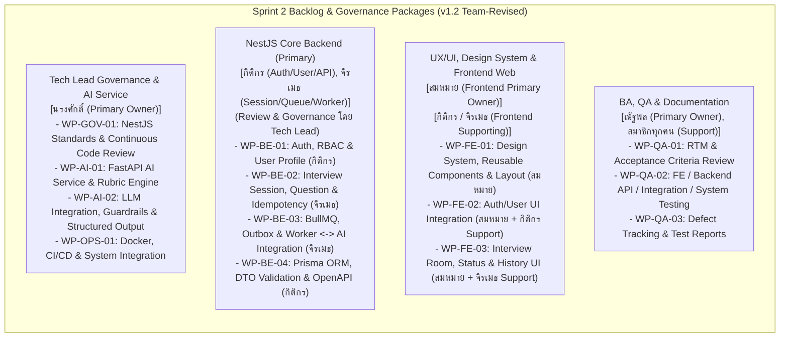

# เอกสารสรุปสำหรับนำเสนอและวางแผนงานร่วมกับทีมใน Sprint 2 (v1.2 Team-Revised)
## InterviewX — Sprint 2 Team Alignment & Architecture Brief (v1.2 Team-Revised)

> **เวอร์ชันเอกสาร:** 1.2 (ปรับปรุงตามโครงสร้างทีมพัฒนา บทบาทหน้าที่ และ Technical Ownership ล่าสุด)  
> **วันที่จัดทำ:** 25 พฤศจิกายน 2026  
> **เอกสารต้นฉบับที่คงสภาพเดิม:** [InterviewX_Sprint2_Team_Alignment_Brief_v1.1_Updated.md](file:///Users/mac/Desktop/interviewx-datahub/docs-interviex/01_Project_Management/InterviewX_Sprint2_Team_Alignment_Brief_v1.1_Updated.md)  
> **เอกสารอ้างอิงหลักฐาน:**  
> - [InterviewX_SRS_Report_v1.2_TeamRevised_TH.md](file:///Users/mac/Desktop/interviewx-datahub/docs-interviex/03_SRS_Requirements/InterviewX_SRS_Report_v1.2_TeamRevised_TH.md)  
> - [InterviewX_Development_Team_Roles_and_Module_Ownership_v1.2_TeamRevised.md](file:///Users/mac/Desktop/interviewx-datahub/docs-interviex/01_Project_Management/InterviewX_Development_Team_Roles_and_Module_Ownership_v1.2_TeamRevised.md)

---

## 1. บริบทและหลักการแบ่งหน้าที่ (Alignment Context)

เอกสารสรุป Sprint 2 ฉบับนี้ปรับปรุงการจัดสรรงานและสายการตรวจสอบทางเทคนิคให้ตรงกับโครงสร้างทีมพัฒนาที่ได้รับอนุมัติ:
- **นายนรงศักดิ์ ภูมิประเสริฐ (674259009) — Tech Lead:** ควบคุม System Architecture, Backend Technical Governance, ตรวจสอบ Backend Code/API/DB/Security อย่างต่อเนื่อง และเป็น Primary Owner ของ FastAPI AI Service & Rubric Engine (ไม่ใช่เพียงผู้ให้คำปรึกษา)
- **นายสมหมาย สุภาวงค์ (674259024) — UX/UI Lead & Frontend Lead:** เป็น Frontend Primary Owner ทั้ง UX/UI Design, Design System, Frontend Architecture และการพัฒนา Next.js Web (รวมถึง Mobile ตาม Roadmap R2)
- **นายกิติกร เทศธรรม (674259003) — Fullstack Developer:** Backend Primary Developer (Auth, Identity, User Profile, RBAC, REST API, Prisma/PostgreSQL, OpenAPI) และ Frontend Supporting Developer
- **นายจิรเมธ วงษ์กัณหา (674259004) — Fullstack Developer:** Backend Primary Developer (Interview Session, Question, Answer Submission, Session State, BullMQ/Redis, Outbox, Idempotency, Session Resilience, NestJS Worker Integration) และ Frontend Supporting Developer
- **นายณัฐพล กลิ่นจุ่น (674259006) — BA / QA / Tester / Documentation:** Requirement Analysis, RTM, Test Cases, Testing ทุกระดับ, Defect Tracking, Technical Documentation และ Acceptance Criteria Review

---

## 2. แพ็กเกจงาน Sprint 2 ตาม Technical Ownership (Work Packages)

### 2.1 Backend Governance & AI Service (Tech Lead: นายนรงศักดิ์)
- **Primary Owner:** นายนรงศักดิ์ ภูมิประเสริฐ (Tech Lead)
- ควบคุมมาตรฐาน NestJS Modular Monolith, ตรวจสอบ Backend Code / API Contract / Database Integration / Security อย่างต่อเนื่องก่อน Merge/Release
- พัฒนาและดูแล FastAPI / Python AI Service, LLM Integration, AI Evaluation Engine, Rubric Engine, Structured Output และ Guardrails โดยตรง (Fullstack Developers ไม่พัฒนา AI Evaluation Engine)
- คง Single Ownership ของ Core PostgreSQL (NestJS Core เท่านั้นที่เข้าถึงและจัดการ Core DB; ห้าม AI Service ต่อ Core PostgreSQL โดยตรง)

### 2.2 NestJS Core Backend & Worker Integration (Backend Primary: นายกิติกร & นายจิรเมธ)
- **นายกิติกร เทศธรรม (Backend Primary):** Auth & Authorization, Registration/Login/Logout, User Profile & Account Management, RBAC, REST API, DTOs & Validation, PostgreSQL & Prisma ORM, Backend Security, API Documentation & OpenAPI *(ตรวจสอบและอนุมัติโดย Tech Lead)*
- **นายจิรเมธ วงษ์กัณหา (Backend Primary):** Interview Session & Question Management, Answer Submission API, Session State Management, BullMQ & Redis Queue, Evaluation Job Integration, Transactional Outbox Pattern, Idempotency Mechanism, Session Resilience, NestJS Worker Integration กับ AI Service, Backend Error Handling *(ตรวจสอบและอนุมัติโดย Tech Lead)*

### 2.3 UX/UI Design & Frontend Web Development (Frontend Primary Owner: นายสมหมาย)
- **Primary Owner:** นายสมหมาย สุภาวงค์ (UX/UI Lead & Frontend Lead) — รับผิดชอบ UX/UI, Design System, Design Tokens, Reusable UI Components, Responsive Layout, Next.js Frontend Architecture, การพัฒนา UI และเชื่อมต่อ REST API, UI Consistency และ Accessibility
- **Frontend Supporting:**
  - **นายกิติกร เทศธรรม:** สนับสนุน UI Components/หน้าเว็บตามมอบหมาย, เชื่อมต่อ UI กับ Auth & User APIs, Frontend Form Validation, แก้ปัญหาเชื่อมต่อ FE-BE, ทดสอบ FE ใน Feature ที่รับผิดชอบ
  - **นายจิรเมธ วงษ์กัณหา:** สนับสนุน Interview Room UI, Question/Answer Components, เชื่อมต่อ Interview APIs, แสดงสถานะ Evaluation Processing และ Interview History/Results, ทดสอบ FE ใน Feature ที่รับผิดชอบ ภายใต้แนวทางของ Frontend Lead

### 2.4 BA / QA / Testing / Documentation (Primary Owner: นายณัฐพล)
- **Primary Owner:** นายณัฐพล กลิ่นจุ่น — Requirement Analysis, FR/NFR Review, RTM, Test Scenarios & Test Cases, Functional / Frontend / Backend API / Integration / System Testing, Defect Tracking, Test Reports, Technical Documentation และ Acceptance Criteria Review ร่วมกับผู้พัฒนาทุกฝ่าย

---

## 3. มติการตัดสินใจ D-M01 ถึง D-M11 (Aligned Roles)

| รหัส | ประเด็นการตัดสินใจ | ผู้รับผิดชอบหลัก (Aligned Approved Roles) |
|:---:|---|---|
| **D-M01** | กำหนดการเปิดตัว Native Mobile (R2) | Tech Lead / UX/UI Lead & Frontend Lead / BA & QA |
| **D-M02** | เทคโนโลยีพัฒนาแอปมือถือ (React Native / Expo) | Tech Lead / UX/UI Lead & Frontend Lead |
| **D-M03** | OS ขั้นต่ำที่รองรับ (iOS 16+ / Android 13+) | BA & QA / UX/UI Lead & Frontend Lead |
| **D-M04** | ช่องทางชำระเงินบนมือถือ (Web Checkout) | Tech Lead / Fullstack Developer (Backend Primary) / BA & QA |
| **D-M05** | Push Notifications (APNs / FCM) | Fullstack Developer (จิรเมธ: Backend Primary) / UX/UI Lead & Frontend Lead / Tech Lead |
| **D-M06** | Biometric Unlock บนอุปกรณ์ | Fullstack Developer (กิติกร: Backend Primary) / UX/UI Lead & Frontend Lead / Tech Lead |
| **D-M07** | Universal Links & Deep Linking | UX/UI Lead & Frontend Lead / Fullstack Developer (Backend Primary) / Tech Lead |
| **D-M08** | ขอบเขต Offline & Online-Required AI | Tech Lead (Architecture & AI Service Owner) |
| **D-M09** | ความเท่าเทียมฟังก์ชัน Web vs Mobile | BA & QA / UX/UI Lead & Frontend Lead |
| **D-M10** | นโยบาย App Store / Google Play & PDPA Delete | Fullstack Developer (กิติกร: Backend Primary) / Tech Lead / BA & QA |
| **D-M11** | โพรโทคอลอัปโหลดเสียง R2 (Chunked Upload) | Tech Lead (AI Service Owner) / Fullstack Developer (จิรเมธ: Backend Primary) |
