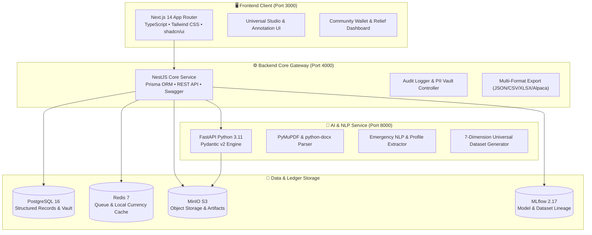
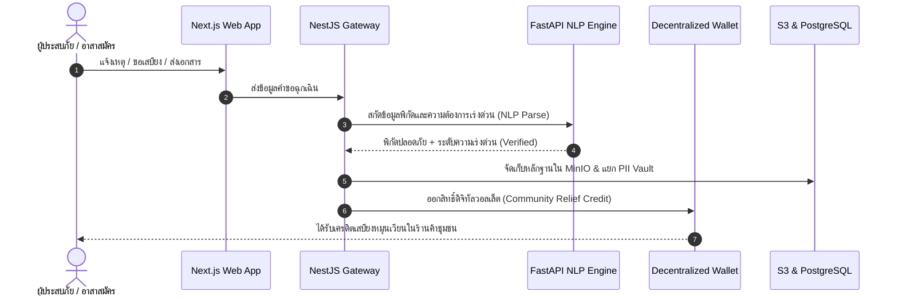

# 🌊 Platform: Crisis Resilience & Universal Intelligence DataHub

> ### **"เตือนภัยตรงจุด ➔ เดินทางปลอดภัย ➔ เสบียงหมุนเวียนด้วยเงินท้องถิ่น"**
> **เปลี่ยนวิกฤตอุทกภัยให้เป็นโอกาสในการฟื้นฟูเศรษฐกิจชุมชน ผ่านระบบดิจิทัลวอลเล็ตแบบกระจายศูนย์และแบบจำลอง AI นำทางกู้ภัย**

[](https://github.com/Phoomss/interviewx-datahub)
[](https://github.com/Phoomss/interviewx-datahub)
[](https://github.com/Phoomss/interviewx-datahub)
[](LICENSE)

---

## สารบัญ (Table of Contents)
1. [🏆 Hackathon Status](#1-hackathon-status)
2. [🏛️ Platform Design](#2-platform-design)
3. [💳 Fintech: ระบบดิจิทัลวอลเล็ตและเศรษฐกิจเสบียงท้องถิ่น](#3-fintech-ระบบดิจิทัลวอลเล็ตและเศรษฐกิจเสบียงท้องถิ่น)
4. [🧠 AI/NLP: แบบจำลองนำทางกู้ภัยและวิเคราะห์ข้อมูลสากล](#4-ainlp-แบบจำลองนำทางกู้ภัยและวิเคราะห์ข้อมูลสากล)
5. [🔄 โมดูลข้อมูลสากล 10 อุตสาหกรรม & 7 มิติ](#5-โมดูลข้อมูลสากล-10-อุตสาหกรรม--7-มิติ)
6. [🔒 การกำกับดูแลความปลอดภัยและ Zero PII Leakage Gate](#6-การกำกับดูแลความปลอดภัยและ-zero-pii-leakage-gate)
7. [🛠️ สแต็กเทคโนโลยีและขอบเขตบริการ (Technology Stack)](#7-สแต็กเทคโนโลยีและขอบเขตบริการ)
8. [🚀 คู่มือการติดตั้งและเปิดใช้งานระบบ (Deployment Guide)](#8-คู่มือการติดตั้งและเปิดใช้งานระบบ)
9. [📡 ข้อมูลการเชื่อมต่อ API และพอร์ตบริการ (System Ports & APIs)](#9-ข้อมูลการเชื่อมต่อ-api-และพอร์ตบริการ)
10. [📜 License](#10-license)

---

## 1. 🏆 Hackathon Status

- **Hackathon Track**: FinTech for Social Impact, Crisis Recovery & AI/NLP Disaster Resilience
- **Project Stage**: **MVP Working Prototype (ระดับ Production-Grade Containerized Stack)**
- **System Health**: ทุก Service รันจริงและเชื่อมต่อกันสมบูรณ์ 100% ผ่าน Docker Compose
- **Core Value Proposition**:
  1. **เตือนภัยตรงจุด (Precision Early Warning)**: ใช้ AI สกัดข้อมูลตำแหน่งและประเมินระดับความเร่งด่วนของผู้ประสบภัย
  2. **เดินทางปลอดภัย (Safe Rescue Navigation)**: แบบจำลอง AI นำทางทีมกู้ภัย หลบเลี่ยงเส้นทางน้ำท่วมสูงและจุดตัดอันตราย
  3. **เสบียงหมุนเวียนด้วยเงินท้องถิ่น (Local Economic Circulation)**: เปลี่ยนเงินบริจาค/เงินเยียวยาเป็นดิจิทัลวอลเล็ตชุมชนเพื่อซื้อสินค้าจากร้านค้าในพื้นที่ ฟื้นฟูเศรษฐกิจท้องถิ่นอย่างยั่งยืน

---

## 2. 🏛️ Platform Design

ระบบได้รับการออกแบบตามหลัก **Decoupled Microservice Architecture** ที่มีความยืดหยุ่นสูง รองรับทั้งสถานการณ์ปกติและภาวะวิกฤต:



### แผนผังกระบวนการทำงาน (Rescue & Community Recovery Flow)



---

## 3. 💳 Fintech: ระบบดิจิทัลวอลเล็ตและเศรษฐกิจเสบียงท้องถิ่น

### 3.1 ปัญหาของระบบแจกเสบียงแบบเดิม
- การส่งของแจกจากภายนอกเข้ามาทับถมทำให้ **ร้านค้าโชห่วยและตลาดในชุมชนล้มละลาย** ขาดรายได้หลังน้ำลด
- การกระจายเงินสดมีความเสี่ยงต่อการสูญหาย ถูกหักหัวคิว และตรวจสอบเส้นทางการเงินได้ยาก

### 3.2 นวัตกรรมดิจิทัลวอลเล็ตแบบกระจายศูนย์ (Decentralized Community Relief Wallet)
- **Tokenized Relief Vouchers**: เงินช่วยเหลือหรือเงินบริจาคจะถูกแปลงเป็นเครดิตดิจิทัลที่ระบุเงื่อนไขการใช้จ่าย (Smart Voucher) สำหรับซื้อ **ข้าวสาร อาหารแห้ง น้ำดื่ม ยา และอุปกรณ์ซ่อมแซมบ้าน**
- **Local Merchant Empowerment**: เครดิตสามารถใช้ได้เฉพาะกับร้านค้าและผู้ประกอบการท้องถิ่นในรัศมีพื้นที่ประสบภัย ช่วยให้เงินหมุนเวียนในเศรษฐกิจชุมชนหลายรอบ
- **Transparent & Traceable Ledger**: ทุกธุรกรรมมี Audit Trail เข้ารหัสบันทึกลงใน PostgreSQL และ Redis สามารถตรวจสอบยอดคงเหลือและประวัติการใช้จ่ายได้แบบเรียลไทม์ ปราศจากการทุจริต
- **Offline-Resilient Transactions**: สถาปัตยกรรมรองรับการบันทึกธุรกรรมแบบ Local Cache และ Sync ข้อมูลเมื่อเครือข่ายสัญญาณกลับมาออนไลน์

---

## 4. 🧠 AI/NLP: แบบจำลองนำทางกู้ภัยและวิเคราะห์ข้อมูลสากล

### 4.1 แบบจำลอง AI นำทางกู้ภัย (Safe Route & Rescue Navigation)
- ประมวลผลจุดตัดระดับน้ำและรายงานสิ่งกีดขวางแบบเรียลไทม์ เพื่อคำนวณเส้นทางเดินเรือและรถยกสูงที่ปลอดภัยที่สุดสำหรับทีมกู้ภัย
- จัดลำดับความเร่งด่วนของผู้ประสบภัย (Triage AI): เด็ก, ผู้ป่วยติดเตียง, ผู้สูงอายุ และผู้ขาดแคลนเสบียงวิกฤต

### 4.2 Emergency NLP & Extraction Engine
- **FastAPI + PyMuPDF + python-docx**: ถอดข้อความจากเอกสาร, ข้อความแจ้งเหตุ, หรือเรซูเมผู้เชี่ยวชาญอาสาสมัคร
- **Pydantic v2 Schema Enforcement**: ตรวจสอบความถูกต้องของข้อมูลทุกรายการก่อนส่งเข้าสู่ฐานข้อมูล ป้องกันข้อมูลผิดพลาด (Hallucination)
- **Regex PII Shield**: สแกนและ Redact เลขบัตรประชาชน, เบอร์โทรศัพท์ และข้อมูลระบุตัวตนส่วนบุคคลทันที เพื่อความปลอดภัยตามมาตรฐาน PDPA

---

## 5. 🔄 โมดูลข้อมูลสากล 10 อุตสาหกรรม & 7 มิติ

ระบบไม่ได้จำกัดเฉพาะงานกู้ภัยเท่านั้น แต่ยังทำหน้าที่เป็น **Universal Multi-Industry Synthetic Dataset Generator** เพื่อเตรียมข้อมูลสำหรับการพัฒนา LLM ทุกสาขาวิชาชีพ:

### 10 กลุ่มอุตสาหกรรม (Industries) และ 80+ ตำแหน่งงาน (Professions)
1. **Healthcare & Medical (การแพทย์และสาธารณสุข)**: แพทย์, พยาบาลวิชาชีพ, เภสัชกร, นักกายภาพบำบัด ฯลฯ
2. **Business & Management (ธุรกิจและการจัดการ)**: ผู้จัดการโครงการ, นักวิเคราะห์ธุรกิจ, การตลาด ฯลฯ
3. **Finance & Accounting (การเงินและการบัญชี)**: ผู้ตรวจสอบบัญชี, นักวิเคราะห์การเงิน, ที่ปรึกษาภาษี ฯลฯ
4. **Engineering & Industrial (วิศวกรรมและอุตสาหกรรม)**: วิศวกรเครื่องกล, ไฟฟ้า, โยธา, อุตสาหการ ฯลฯ
5. **Technology & IT (เทคโนโลยีและสารสนเทศ)**: วิศวกรซอฟต์แวร์, AI Engineer, Data Engineer, Cloud/DevOps ฯลฯ
6. **Education & Academic (การศึกษาและวิชาการ)**: อาจารย์มหาวิทยาลัย, นักวิจัย, ครูผู้สอน ฯลฯ
7. **Legal & Government (กฎหมายและภาครัฐ)**: ทนายความ, นิติกร, เจ้าหน้าที่กำกับกฎเกณฑ์ ฯลฯ
8. **Design & Media (การออกแบบและสื่อ)**: กราฟิกดีไซเนอร์, คอนเทนต์ครีเอเตอร์, นักตัดต่อ ฯลฯ
9. **Hospitality & Service (การบริการและการท่องเที่ยว)**: ผู้จัดการโรงแรม, พนักงานต้อนรับบนเครื่องบิน ฯลฯ
10. **Specialized Professions (วิชาชีพเฉพาะทาง)**: นักวิทยาศาสตร์วิจัย, สถาปนิก, นักสิ่งแวดล้อม ฯลฯ

### 7 มิติชุดข้อมูลสังเคราะห์ (7 Dataset Dimensions)
1. **Professional Profile**: ข้อมูลประวัติ ทักษะ ผลงาน (ประสบการณ์งานเป็น Optional รองรับนักเรียน/ผู้ขอทุน)
2. **Resume / CV**: เรซูเมโครงสร้างสมบูรณ์จำแนก 4 หมวดทักษะ
3. **Interview Question**: คำถามสัมภาษณ์พร้อมวัตถุประสงค์ เกณฑ์ตรวจ และ Red Flags
4. **Interview Answer**: คำตอบ 6 ระดับคุณภาพ (*Excellent, Good, Average, Poor, Incomplete, Irrelevant*)
5. **Rubric Evaluation**: มิติคะแนนพร้อมเหตุผลประกอบและคำตัดสิน (Pass/Fail)
6. **Feedback & Coaching**: จุดแข็ง จุดปรับปรุง และคำแนะนำพัฒนาตนเอง
7. **Scenario-based Dilemma**: สถานการณ์จำลอง ข้อจำกัด และโจทย์จริยธรรม

---

## 6. 🔒 การกำกับดูแลความปลอดภัยและ Zero PII Leakage Gate

- **PII Vault Architecture**: แยกตารางข้อมูลส่วนบุคคล (`pii_vault`) ออกจากตารางข้อมูลฝึกสอน (`parsed_profiles` และ `dataset_records`) อย่างเด็ดขาด
- **Pre-Export Safety Gate**: ก่อนการส่งออกไฟล์ข้อมูล ระบบจะตัดฟิลด์ชื่อ อีเมล เบอร์โทรศัพท์ และรัน Regex Redaction อัตโนมัติ 100%
- **Cryptographic Hash (DVC Lineage)**: ทุกไฟล์ที่ส่งออกจะถูกคำนวณค่า SHA-256 Hash เพื่อยืนยันความถูกต้องและป้องกันการดัดแปลงข้อมูล
- **MLflow Tracking**: บันทึก Metadata, พารามิเตอร์ และประวัติการ Export ทุกครั้งลงใน MLflow 2.17

---

## 7. 🛠️ สแต็กเทคโนโลยีและขอบเขตบริการ

| บริการ (Service) | เทคโนโลยีหลัก (Core Stack) | หน้าที่รับผิดชอบ |
| :--- | :--- | :--- |
| **Frontend Web** | Next.js 14, TypeScript, Tailwind CSS, TanStack Query | ส่วนต่อประสานผู้ใช้, แดชบอร์ดวอลเล็ต, สตูดิโอสังเคราะห์ |
| **Backend Gateway** | NestJS 10, Prisma ORM, Swagger, BullMQ | ตรรกะทางธุรกิจ, การยืนยันสิทธิ์, วอลเล็ตเลดเจอร์, REST APIs |
| **AI & NLP Engine** | FastAPI, Python 3.11, Pydantic v2, PyMuPDF | ถอดความข้อความฉุกเฉิน, สกัดเรซูเม, สังเคราะห์ข้อมูล 7 มิติ |
| **Relational Database** | PostgreSQL 16 (Alpine) | เก็บข้อมูลเชิงโครงสร้าง, เลดเจอร์วอลเล็ต, PII Vault |
| **Cache & Queue** | Redis 7 (Alpine) | แคชธุรกรรม, คิวงานประมวลผลพื้นหลัง |
| **Object Storage** | MinIO (SeaweedFS S3-Compatible) | จัดเก็บไฟล์ PDF, DOCX และไฟล์ส่งออก Dataset |
| **Experiment Tracking** | MLflow 2.17.0 | ติดตามประวัติชุดข้อมูลและเวอร์ชันโมเดล |

---

## 8. 🚀 คู่มือการติดตั้งและเปิดใช้งานระบบ

### 8.1 ข้อกำหนดเบื้องต้น (Prerequisites)
- Docker Desktop และ Docker Compose v2
- Bun runtime (เวอร์ชัน 1.1 ขึ้นไป)
- Git

### 8.2 การเริ่มรันระบบผ่าน Docker Compose (คำสั่งเดียว)
```bash
docker compose up -d --build
```

ตรวจสอบสถานะ Containers:
```bash
docker compose ps
```

ทุก Containers จะต้องมีสถานะ `Up` หรือ `healthy`:
- `interviewx-frontend` (Port 3000)
- `interviewx-backend` (Port 4000)
- `interviewx-ai-service` (Port 8000)
- `interviewx-postgres` (Port 5433 host -> 5432 container)
- `interviewx-minio` (Port 9000 / 9001)
- `interviewx-redis` (Port 6379)
- `interviewx-mlflow` (Port 5001)

### 8.3 การทดสอบชุดการทำงาน (Running Tests)
```bash
# ทดสอบ AI Service (Python pytest)
docker exec interviewx-ai-service python -m pytest tests/

# ทดสอบ Backend Core (Bun test)
docker exec interviewx-backend bun test src/
```

---

## 9. 📡 ข้อมูลการเชื่อมต่อ API และพอร์ตบริการ

| บริการ (Service) | พอร์ต (Port) | URL จุดเชื่อมต่อ |
| :--- | :---: | :--- |
| **Frontend Web App** | `3000` | [http://localhost:3000](http://localhost:3000) |
| **Synthetic Studio (7 มิติ)** | `3000` | [http://localhost:3000/synthetic](http://localhost:3000/synthetic) |
| **Taxonomy Management (10 กลุ่ม)** | `3000` | [http://localhost:3000/taxonomy](http://localhost:3000/taxonomy) |
| **Dataset Export Hub (JSON/CSV/XLSX)** | `3000` | [http://localhost:3000/datasets](http://localhost:3000/datasets) |
| **Backend REST API** | `4000` | [http://localhost:4000/api/v1](http://localhost:4000/api/v1) |
| **Backend Swagger Docs** | `4000` | [http://localhost:4000/docs](http://localhost:4000/docs) |
| **FastAPI AI Service Docs** | `8000` | [http://localhost:8000/docs](http://localhost:8000/docs) |
| **MinIO S3 Console** | `9001` | [http://localhost:9001](http://localhost:9001) *(User: `minioadmin` / Pass: `minioadmin`)* |
| **MLflow Tracking Dashboard** | `5001` | [http://localhost:5001](http://localhost:5001) |

---

## 10. 📜 License

โปรเจกต์นี้เผยแพร่ภายใต้สัญญาอนุญาต **MIT License** สามารถนำไปประยุกต์ใช้เพื่อสาธารณประโยชน์ ชุมชน และการพัฒนาเทคโนโลยีต่อยอดได้อย่างเสรี

```text
MIT License

Copyright (c) 2026 Crisis Resilience & Universal Intelligence Team

Permission is hereby granted, free of charge, to any person obtaining a copy
of this software and associated documentation files (the "Software"), to deal
in the Software without restriction, including without limitation the rights
to use, copy, modify, merge, publish, distribute, sublicense, and/or sell
copies of the Software, and to permit persons to whom the Software is
furnished to do so, subject to the following conditions:

The above copyright notice and this permission notice shall be included in all
copies or substantial portions of the Software.
```
