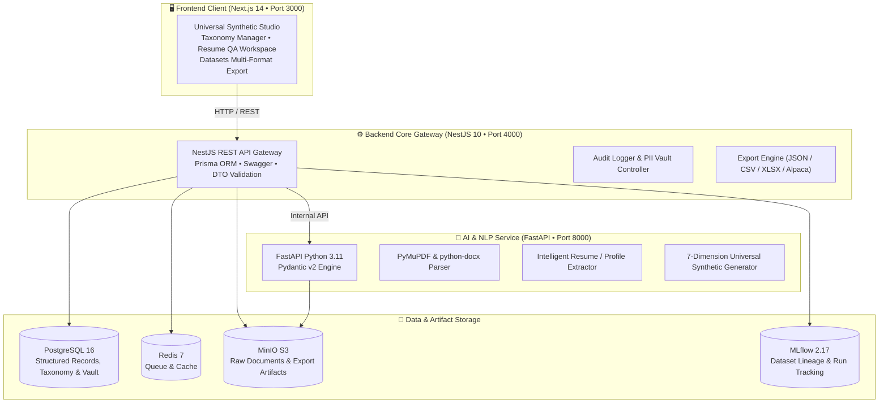
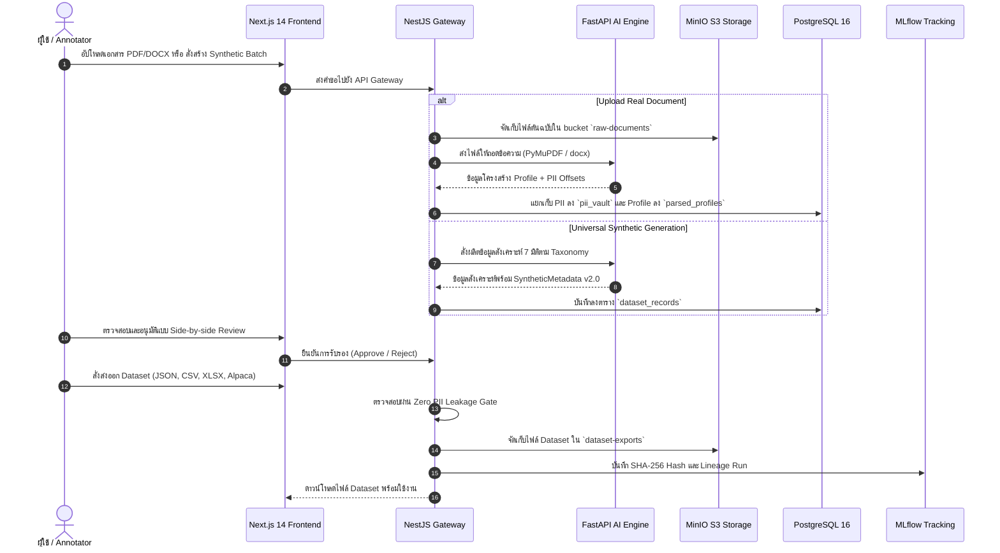

# InterviewX DataHub

> **Universal Multi-Industry & Multi-Profession Interview Dataset Generator**  
> แพลตฟอร์มบริหารจัดการ สังเคราะห์ ตรวจสอบคุณภาพ และเตรียมชุดข้อมูลสัมภาษณ์ระดับสากล สำหรับการพัฒนาและฝึกสอนโมเดลภาษาขนาดใหญ่ (InterviewX LLM)

[](https://github.com/Phoomss/interviewx-datahub)
[](https://github.com/Phoomss/interviewx-datahub)
[](https://github.com/Phoomss/interviewx-datahub)
[](https://github.com/Phoomss/interviewx-datahub)
[](LICENSE)

---

## สารบัญ (Table of Contents)
1. [🏆 Hackathon Status & Executive Summary](#1-hackathon-status--executive-summary)
2. [🏛️ Platform Design & System Architecture](#2-platform-design--system-architecture)
3. [💳 Fintech & Multi-Industry Domains](#3-fintech--multi-industry-domains)
4. [🧠 AI / NLP Intelligence & Parsing Engine](#4-ai--nlp-intelligence--parsing-engine)
5. [🔄 7 มิติชุดข้อมูลสังเคราะห์ (7 Dataset Dimensions)](#5-7-มิติชุดข้อมูลสังเคราะห์-7-dataset-dimensions)
6. [🔒 การกำกับดูแลความปลอดภัยและ Zero PII Leakage Gate](#6-การกำกับดูแลความปลอดภัยและ-zero-pii-leakage-gate)
7. [🛠️ สแต็กเทคโนโลยี (Technology Stack)](#7-สแต็กเทคโนโลยี-technology-stack)
8. [🚀 คู่มือการติดตั้งและเปิดใช้งานระบบ (Deployment Guide)](#8-คู่มือการติดตั้งและเปิดใช้งานระบบ-deployment-guide)
9. [📡 ข้อมูลการเชื่อมต่อ API และพอร์ตบริการ (System Ports & APIs)](#9-ข้อมูลการเชื่อมต่อ-api-และพอร์ตบริการ-system-ports--apis)
10. [📜 License](#10-license)

---

## 1. 🏆 Hackathon Status & Executive Summary

- **Hackathon Track**: Generative AI, LLM Data Engineering & Enterprise NLP
- **Project Stage**: **MVP Ready (Production-Grade Containerized Stack)**
- **System Health**: ทุก Service รันจริงและเชื่อมต่อกันสมบูรณ์ 100% ผ่าน Docker Compose
- **ปัญหาที่ระบบแก้ไข (Problem Statement)**:
  1. **Data Scarcity for Multi-Domain LLM**: ขาดแคลนชุดข้อมูลสัมภาษณ์งานและวิชาการที่มีคุณภาพ โครงสร้างมาตรฐาน และความหลากหลายข้ามอุตสาหกรรม
  2. **PII & Legal Risks (PDPA)**: การนำเรซูเมจริงมาใช้เทรนโมเดลมักติดปัญหาข้อมูลส่วนบุคคลรั่วไหล
  3. **IT-Centric Bias**: ระบบสร้าง Synthetic Data ส่วนใหญ่จำกัดอยู่เพียงตำแหน่งไอที ไม่รองรับสายการแพทย์ การเงิน กฎหมาย หรือการศึกษา
  4. **Data Verification Bottleneck**: ขาดระบบ Human-in-the-Loop สำหรับตรวจรับรองคุณภาพข้อมูล (QA Review) ก่อนส่งเข้ากระบวนการ Fine-tuning

---

## 2. 🏛️ Platform Design & System Architecture

ระบบได้รับการออกแบบตามหลัก **Decoupled Microservice Architecture** แบ่งแยกความรับผิดชอบอย่างชัดเจนระหว่าง Core Business Logic, AI Processing และ Data Storage:



### แผนผังกระบวนการเตรียมและตรวจสอบข้อมูล (Data Pipeline Sequence)



---

## 3. 💳 Fintech & Multi-Industry Domains

ระบบรองรับกลุ่มอุตสาหกรรมและตำแหน่งงานอย่างครอบคลุม **10 กลุ่มอุตสาหกรรม** และ **80+ ตำแหน่งงาน** สามารถเพิ่มขยายตำแหน่งงานใหม่ได้แบบ Dynamic ผ่าน REST API และหน้าเว็บ `/taxonomy`:

1. **Finance & Accounting (Fintech, การเงินและการบัญชี)**:
   - Financial Analyst (Corporate Fintech)
   - Financial Controller & Treasury Specialist
   - Auditor (ผู้ตรวจสอบบัญชีและระบบความเสี่ยง)
   - Investment Analyst (ตราสารทุนและการบริหารพอร์ต)
   - Banking Officer (สินเชื่อและวาณิชธนกิจ)
   - Financial Advisor (ที่ปรึกษาการเงินและ Wealth Management)
   - Risk Analyst (Basel III, Credit Scoring, VaR)
   - Tax Consultant (ภาษีองค์กรและ Transfer Pricing)
2. **Technology & IT**: Software Engineer, Frontend, Backend, Full-stack, Mobile, AI/ML Engineer, Data Scientist, Data Engineer, Cybersecurity, Cloud, DevOps, System Administrator, UI/UX Designer, Product Manager, Software Architect
3. **Healthcare & Medical**: แพทย์เวชปฏิบัติ/เฉพาะทาง, พยาบาลวิชาชีพ, เภสัชกร, นักกายภาพบำบัด, นักเทคนิคการแพทย์, นักวิชาการสาธารณสุข, ผู้บริหารโรงพยาบาล, นักวิจัยการแพทย์
4. **Engineering & Industrial**: วิศวกรเครื่องกล, ไฟฟ้า, โยธา, อุตสาหการ, เคมี, ออโตเมชัน, QA/QC, ฝ่ายผลิต, วิศวกรโครงการ
5. **Business & Management**: นักวิเคราะห์ธุรกิจ, พัฒนาธุรกิจ (BD), ผู้จัดการฝ่ายการตลาด, การตลาดดิจิทัล, ฝ่ายขาย, HR Business Partner, ผู้จัดการฝ่ายปฏิบัติการ, ที่ปรึกษาธุรกิจ
6. **Education & Academic**: อาจารย์มหาวิทยาลัย, นักวิจัยวิชาการ, ครูผู้สอน, ผู้ช่วยวิจัย, ผู้บริหารสถานศึกษา, ผู้ช่วยสอน
7. **Legal & Government**: ทนายความว่าความ, นิติกรองค์กร, เจ้าหน้าที่กำกับกฎเกณฑ์ (Compliance), นักวิเคราะห์นโยบายและแผน, ข้าราชการ, นักการทูต
8. **Design, Media & Communication**: นักออกแบบกราฟิก, UX/UI, คอนเทนต์ครีเอเตอร์, นักเขียน, นักตัดต่อวิดีโอ, ช่างภาพ, นักข่าว, ประชาสัมพันธ์ (PR), ครีเอทีฟไดเรกเตอร์
9. **Hospitality & Service**: ผู้จัดการโรงแรม, พนักงานต้อนรับส่วนหน้า, พนักงานบริการลูกค้า, พนักงานต้อนรับบนเครื่องบิน, ผู้ประสานงานอีเวนต์, ผู้จัดการร้านอาหาร
10. **Specialized Professions**: นักวิทยาศาสตร์วิจัย, สถาปนิก, ผู้เชี่ยวชาญสิ่งแวดล้อม, ผู้เชี่ยวชาญโลจิสติกส์, ผู้จัดการซัพพลายเชน, นักวิชาการเกษตร, นักสังคมสงเคราะห์

---

## 4. 🧠 AI / NLP Intelligence & Parsing Engine

### 4.1 PyMuPDF & python-docx Extraction
- ถอดข้อความจากเอกสารจริงทั้งไฟล์ PDF และ DOCX ผ่าน FastAPI AI Service
- สกัดโครงสร้าง: ข้อมูลสรุป (Summary), ทักษะ (Skills), ประวัติการทำงาน (Experience), ประวัติการศึกษา (Education), ประกาศนียบัตร (Certifications) และข้อมูลติดต่อ

### 4.2 Universal Pydantic v2 Schema Enforcement
- กำกับโครงสร้างข้อมูลสังเคราะห์ด้วย Pydantic v2 เพื่อป้องกันความผิดพลาดและควบคุม Provenance
- บรรจุ `SyntheticMetadata`: `is_synthetic: true`, `generation_version: "2.0.0"`, `industry`, `profession`, `interview_category`, `seniority_level`

### 4.3 Human-in-the-Loop Side-by-side Review
- พื้นที่ทำงานเปรียบเทียบเอกสารต้นฉบับกับข้อมูลที่ AI สกัดแบบสองฝั่งคู่ขนาน
- รองรับการไฮไลต์ข้อความต้นฉบับ (Provenance), การแก้ไขข้อมูลแบบ Interactive และคีย์ลัด (*Cmd+Enter เพื่ออนุมัติ, Cmd+J เพื่อปฏิเสธ*)

---

## 5. 🔄 7 มิติชุดข้อมูลสังเคราะห์ (7 Dataset Dimensions)

| มิติชุดข้อมูล (Dimension) | รายละเอียดข้อมูล | ประโยชน์สำหรับการฝึกสอน LLM |
| :--- | :--- | :--- |
| **1. Professional Profile** | ข้อมูลประวัติการทำงาน การศึกษา ทักษะ (*ประสบการณ์ทำงานเป็น Optional รองรับนักศึกษา/ผู้ขอรับทุน*) | เทรนโมเดลจับคู่โปรไฟล์ผู้สมัครงาน |
| **2. Resume / CV** | โครงสร้างเรซูเมฉบับเต็ม จำแนกทักษะ 4 มิติ และผลงานเด่น | เทรนโมเดลสกัดและวิเคราะห์เรซูเม |
| **3. Interview Question** | คำถามสัมภาษณ์เฉพาะด้าน พร้อมวัตถุประสงค์, เกณฑ์วัดผล และ Red Flags | เทรนโมเดลเป็นผู้สัมภาษณ์อัจฉริยะ (AI Interviewer) |
| **4. Interview Answer** | คำตอบจำลอง 6 ระดับคุณภาพ (*Excellent (STAR), Good, Average, Poor, Incomplete, Irrelevant*) | เทรนโมเดลให้เข้าใจความแตกต่างของคำตอบ |
| **5. Rubric Evaluation** | เกณฑ์การให้คะแนนหลายมิติ คะแนนที่ได้ พร้อมเหตุผลประกอบและคำตัดสิน | เทรนโมเดลการประเมินผลอย่างเป็นธรรม |
| **6. Feedback & Coaching** | รายงานสรุปจุดเด่น จุดที่ต้องพัฒนา และคำแนะนำเชิงปฏิบัติการ (Actionable Tips) | เทรนโมเดลให้คำแนะนำและโค้ชชิ่งผู้สมัคร |
| **7. Scenario-based Dilemma** | สถานการณ์จำลอง ข้อจำกัดขัดแย้ง และโจทย์จริยธรรมวิชาชีพ | เทรนโมเดลจำลองสถานการณ์วัดไหวพริบ |

---

## 6. 🔒 การกำกับดูแลความปลอดภัยและ Zero PII Leakage Gate

- **PII Vault Architecture**: แยกตารางข้อมูลส่วนบุคคล (`pii_vault`) ออกจากตารางข้อมูลฝึกสอน (`parsed_profiles` และ `dataset_records`) อย่างเด็ดขาด
- **Pre-Export Safety Gate**: ก่อนการส่งออกไฟล์ข้อมูล ระบบจะตัดฟิลด์ชื่อ อีเมล เบอร์โทรศัพท์ และรัน Regex Redaction กรองข้อความส่วนบุคคลทิ้ง 100%
- **Cryptographic Hash (DVC Lineage)**: ทุกไฟล์ที่ส่งออกจะถูกคำนวณค่า SHA-256 Hash เพื่อยืนยันความถูกต้องและป้องกันการดัดแปลงข้อมูล
- **MLflow Tracking**: บันทึก Metadata, พารามิเตอร์ และประวัติการ Export ทุกครั้งลงใน MLflow 2.17

---

## 7. 🛠️ สแต็กเทคโนโลยี (Technology Stack)

| บริการ (Service) | เทคโนโลยีหลัก | บทบาทและหน้าที่ |
| :--- | :--- | :--- |
| **Frontend Web App** | Next.js 14, TypeScript, Tailwind CSS, TanStack Query | ส่วนต่อประสานผู้ใช้, Universal Studio, คลังเอกสาร, ตัวจัดการ Taxonomy |
| **Backend API Gateway** | NestJS 10, Prisma ORM, Swagger, BullMQ | ตรรกะทางธุรกิจ, REST API, ระบบจัดการ Taxonomy, ส่งออก Dataset |
| **AI & NLP Engine** | FastAPI, Python 3.11, Pydantic v2, PyMuPDF | ถอดความ PDF/Word, สกัดเรซูเม, สังเคราะห์ข้อมูล 7 มิติ |
| **Relational Database** | PostgreSQL 16 (Alpine) | เก็บข้อมูลโครงสร้าง, Taxonomy, PII Vault, Dataset Records |
| **Cache & Queue** | Redis 7 (Alpine) | แคชข้อมูล, คิวงานประมวลผลพื้นหลัง |
| **Object Storage** | MinIO (SeaweedFS S3-Compatible) | จัดเก็บไฟล์ต้นฉบับ PDF/DOCX และไฟล์ส่งออก Dataset |
| **Experiment Tracking** | MLflow 2.17.0 | ติดตามประวัติชุดข้อมูลและเวอร์ชันโมเดล |
| **Package Manager** | Bun 1.1+ (TypeScript) / Pip (Python) | รันสคริปต์และบริหารจัดการ Dependencies รวดเร็วสูง |

---

## 8. 🚀 คู่มือการติดตั้งและเปิดใช้งานระบบ (Deployment Guide)

### 8.1 การเริ่มรันระบบผ่าน Docker Compose (คำสั่งเดียว)
```bash
docker compose up -d --build
```

### 8.2 ตรวจสอบสถานะ Containers
```bash
docker compose ps
```
ทุกบริการจะต้องมีสถานะ `Up` หรือ `healthy`

### 8.3 การทดสอบชุดการทำงานอัตโนมัติ (Automated Tests)
```bash
# ทดสอบ AI Service Universal Generator (Python pytest - 11 tests)
docker exec interviewx-ai-service python -m pytest tests/

# ทดสอบ Backend Core, Taxonomy & Zero PII Gate (Bun test - 13 tests)
docker exec interviewx-backend bun test src/
```

---

## 9. 📡 ข้อมูลการเชื่อมต่อ API และพอร์ตบริการ (System Ports & APIs)

| บริการ (Service) | พอร์ต (Port) | หน้าต่างใช้งาน / URL |
| :--- | :---: | :--- |
| **Frontend Web App** | `3000` | [http://localhost:3000](http://localhost:3000) |
| **Universal Synthetic Studio** | `3000` | [http://localhost:3000/synthetic](http://localhost:3000/synthetic) |
| **Taxonomy Manager (10 อุตสาหกรรม)** | `3000` | [http://localhost:3000/taxonomy](http://localhost:3000/taxonomy) |
| **Resume Repository & QA** | `3000` | [http://localhost:3000/resumes](http://localhost:3000/resumes) |
| **Dataset Export Hub (JSON/CSV/XLSX)** | `3000` | [http://localhost:3000/datasets](http://localhost:3000/datasets) |
| **Backend REST API** | `4000` | [http://localhost:4000/api/v1](http://localhost:4000/api/v1) |
| **Backend Swagger API Docs** | `4000` | [http://localhost:4000/docs](http://localhost:4000/docs) |
| **FastAPI AI Service OpenAPI Docs** | `8000` | [http://localhost:8000/docs](http://localhost:8000/docs) |
| **MinIO Web Console** | `9001` | [http://localhost:9001](http://localhost:9001) *(User: `minioadmin` / Pass: `minioadmin`)* |
| **MLflow Tracking Dashboard** | `5001` | [http://localhost:5001](http://localhost:5001) |

---

## 10. 📜 License

โปรเจกต์นี้เผยแพร่ภายใต้สัญญาอนุญาต **MIT License** สามารถนำไปประยุกต์ใช้และพัฒนาต่อยอดได้อย่างเสรี

```text
MIT License

Copyright (c) 2026 InterviewX DataHub Team

Permission is hereby granted, free of charge, to any person obtaining a copy
of this software and associated documentation files (the "Software"), to deal
in the Software without restriction, including without limitation the rights
to use, copy, modify, merge, publish, distribute, sublicense, and/or sell
copies of the Software, and to permit persons to whom the Software is
furnished to do so, subject to the following conditions:

The above copyright notice and this permission notice shall be included in all
copies or substantial portions of the Software.
```
