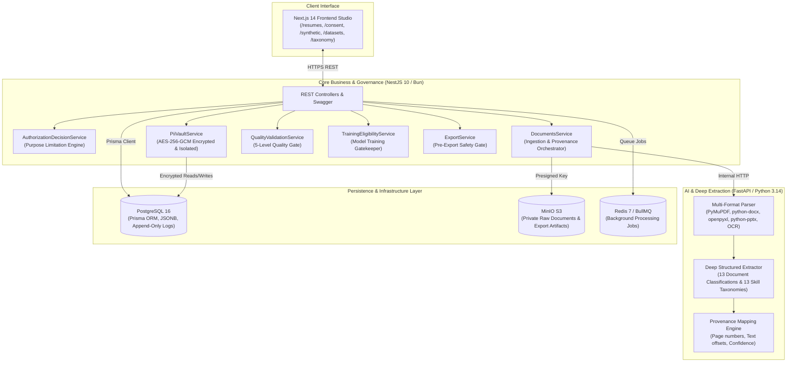
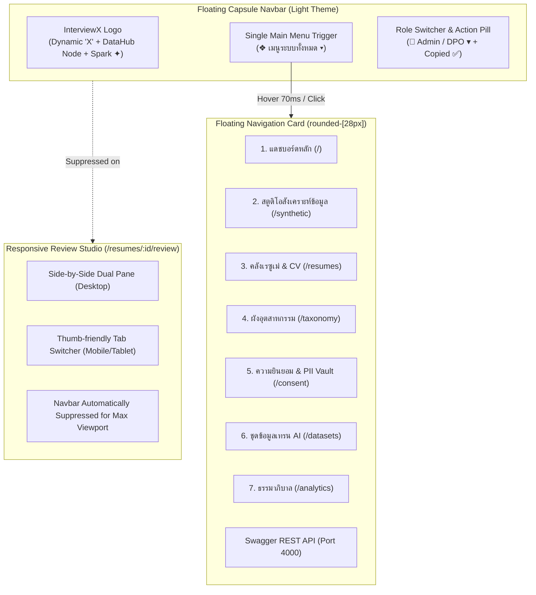

# SYSTEM.md — InterviewX DataHub Master System Manual

> **System Version**: 2.0 Universal  
> **Classification**: Internal Data Management & AI Training Infrastructure  
> **Compliance Standard**: Thailand PDPA / GDPR / ISO-27701 Privacy Information Management  
> **Core Architecture**: Decoupled Polyglot (NestJS Core + FastAPI AI Service + Next.js Studio + PostgreSQL + MinIO + Redis)

---

## 1. Executive Overview & System Topology

**InterviewX DataHub** is an enterprise data management and dataset governance platform built specifically for collecting, extracting, validating, annotating, and exporting training datasets for InterviewX Large Language Models (LLMs).

The platform bridges real-world candidate documents and synthetic interview datasets with strict privacy guarantees, governed by legal basis authorization and a zero-PII-leakage architecture.



---

## 2. Real Authorized Document Intelligence & Deep Extraction Engine

### 2.1 Multi-Format Ingestion & Cryptographic Signature Validation
The ingestion pipeline verifies all uploaded files using strict magic byte signatures rather than trusting user-supplied extensions or MIME headers (`apps/backend/src/documents/file-validator.util.ts`):

- **PDF**: `%PDF-` (`0x25 0x50 0x44 0x46`)
- **Office Open XML (DOCX, XLSX, PPTX)**: `PK\x03\x04` (`0x50 0x4B 0x03 0x04`)
- **PNG**: `\x89PNG\r\n\x1a\n` (`0x89 0x50 0x4E 0x47`)
- **JPEG/JPG**: `0xFF 0xD8 0xFF`
- **Security Scanners**: Blocks executable PE binaries (`MZ`), checks for malicious payloads (EICAR signature scanning), and computes immutable SHA-256 checksums.

### 2.2 13 Document Classifications
Documents are classified into 13 distinct types with confidence metrics and human override capabilities:
1. `RESUME` (Standard professional resume)
2. `CV` (Curriculum Vitae)
3. `ACADEMIC_CV` (Scholarly CV with publications and grants)
4. `PORTFOLIO` (Project showcases and design portfolios)
5. `TRANSCRIPT` (Official university academic transcripts)
6. `CERTIFICATE` (Professional licenses and credentials)
7. `RECOMMENDATION_LETTER` (Letters of endorsement/recommendation)
8. `RESEARCH_PAPER` (Peer-reviewed articles, preprints, theses)
9. `PROJECT_REPORT` (Technical reports and case studies)
10. `EMPLOYMENT_DOCUMENT` (Service records, employment verification letters)
11. `SCHOLARSHIP_DOCUMENT` (Fellowship and scholarship records)
12. `TRAINING_RECORD` (CPE/CPD attendance and training hours)
13. `OTHER` (Unclassified authorized documents)

### 2.3 Deep Structured Extraction Schemas
FastAPI leverages Pydantic v2 schemas (`services/ai-service/src/schemas/profile.py`) to extract comprehensive structured records:
- **Profile**: Full Name, Preferred Name, Email, Phone, Address, Nationality, Location, Languages, Professional Title, Summary, Career Objective, Industry, Profession, Career Level.
- **Education**: Institution, Faculty, Department, Degree, Major, Minor, Program, Study Mode, Start/Graduation Date, GPA, Academic Standing, Relevant Coursework, Academic Projects, Thesis Title, Achievements.
- **Work Experience**: Organization, Department, Job Title, Employment Type, Location, Start/End Date, Current Status, Responsibilities, Achievements, Tools & Technologies, Applied Skills, Measurable Business Impact (KPIs/Metrics).
- **13 Skill Taxonomies**: Technical, Domain Knowledge, Analytical, Problem Solving, Communication, Leadership, Research, Creative, Language, Interpersonal, Professional Ethics, Management, Digital Skills. Every skill item explicitly flags `is_explicit: bool` vs `is_inferred: bool`.
- **Projects**: Title, Description, Background, Problem Statement, Role, Personal Contribution vs Team Scope, Tools, Methodology, Challenges, Measurable Results, Lessons Learned.
- **Certifications**: Credential Name, Issuing Organization, License ID, Issue Date, Expiry Date, Training Hours, Verification URL, Status (`UNVERIFIED` by default).
- **Academic & Research**: Research Title, Abstract, Objectives, Methodology, Findings, Authors, Venues, DOI, Conference Presentations, Grant Funding.

### 2.4 Provenance & Evidence Tracking
Every extracted attribute is linked to an immutable provenance record (`FieldProvenanceRecord`):
```json
{
  "fieldPath": "experiences[0].job_title",
  "extractedValue": "Backend Developer",
  "normalizedValue": "Backend Developer",
  "source": {
    "documentId": "c92fa320-1b77-4fa6-8092-23fbe25d9921",
    "pageNumber": 1,
    "sectionName": "Work Experience",
    "sourceText": "Backend Developer at Tech Corp..."
  },
  "extractionMethod": "pdf_text_extraction",
  "confidenceScore": 0.96,
  "verificationStatus": "PENDING_REVIEW"
}
```

---

## 3. Consent-Governed PII Vault & Purpose Limitation Architecture

### 3.1 Architectural Separation
The system strictly enforces physical and logical separation across 5 boundaries:
1. **Original Document Storage**: Private MinIO S3 bucket, accessible only via short-lived presigned URLs.
2. **PII Vault**: High-security PostgreSQL table `PiiVault` storing sensitive fields encrypted with **AES-256-GCM**, keyed by pseudonymous `subject_id` (`SUB-XXXXXXXX`).
3. **Structured Extracted Data**: Clean `ParsedProfile` records containing only professional competencies without personal identifiers.
4. **Training-Eligible Dataset**: Anonymized datasets approved exclusively by the Training Eligibility Gate.
5. **Audit & Consent Records**: Append-only compliance ledgers (`ConsentRecord`, `ConsentHistory`, `ProcessingAuthorizationLog`, `PiiAccessLog`).

### 3.2 Granular Consent & Purpose Limitation Engine
Processing is governed by `AuthorizationDecisionService`:
- **Supported Purposes**: `DOCUMENT_EXTRACTION`, `PROFILE_MANAGEMENT`, `RESUME_ANALYSIS`, `PORTFOLIO_ANALYSIS`, `DATASET_PREPARATION`, `AI_MODEL_TRAINING`, `MODEL_FINE_TUNING`, `AI_EVALUATION`, `ACADEMIC_RESEARCH`, `SYSTEM_IMPROVEMENT`.
- **Enforcement Rules**:
  - A valid Consent ID alone does **not** grant unlimited processing rights.
  - Each processing operation validates:
    1. Consent status (`ACTIVE`).
    2. Date bounds (`granted_at <= now <= expires_at`).
    3. Document category inclusion (`permittedDataCategories`).
    4. Exact requested purpose (`permittedPurposes`).
  - Unauthorized requests are rejected immediately with `403 Forbidden` and logged in `ProcessingAuthorizationLog`.

### 3.3 Access Control & Right to be Forgotten (Purge Workflow)
- **Role-Based Access Control**:
  - `ADMIN`: Full access, can view unmasked PII in the Vault (triggers an immutable `PiiAccessLog` audit record).
  - `ML_ENGINEER`, `ANNOTATOR`, `VIEWER`: Completely barred from `PiiVault` (HTTP 403 Forbidden).
- **Consent Revocation Workflow**:
  - When consent is revoked (`POST /api/v1/consent/:id/revoke`), the system:
    1. Updates `ConsentRecord.status` to `REVOKED` and creates an immutable snapshot in `ConsentHistory`.
    2. Hard-purges the document's PII entry in `PiiVault` (`isPurged = true`, cryptographic key rotation/payload wipe).
    3. Transitions `Document.trainingEligibilityStatus` to `REVOKED_CONSENT_RESTRICTED`.
    4. Removes the raw file from MinIO storage.
    5. Excludes the record permanently from all future training exports.

---

## 4. 5-Level Data Quality Validation Gate

Every document entering the system is evaluated across 5 quality tiers (`apps/backend/src/documents/quality-validation.service.ts`):

| Level | Validation Name | Scope & Criteria | Output Action |
| :--- | :--- | :--- | :--- |
| **Level 1** | **File Integrity** | Magic byte validation, non-zero size, uncorrupted headers, anti-malware scan | Rejects corrupted uploads (HTTP 400) |
| **Level 2** | **Completeness & OCR** | Detects required sections (Skills, Experience, Education); verifies OCR confidence > 85% | Flags low-confidence scans for human review |
| **Level 3** | **Field Validation** | Validates date formats (YYYY-MM-DD), ensures graduation years are within realistic bounds (1960–2035) | Generates quality issue warnings |
| **Level 4** | **Timeline Consistency** | Detects chronological paradoxes (e.g., job start date after end date) | Flags inverted timelines as severity `ERROR` |
| **Level 5** | **Human Review & Provenance** | Human annotator audits side-by-side extracted values vs source text offsets | Grants `APPROVED` verification status |

---

## 5. Training Eligibility Gate

The `TrainingEligibilityService` acts as an absolute barrier separating general profile management from LLM training sets:

```mermaid
flowchart TD
    Doc["Uploaded Document"] --> CheckSynthetic{Is Synthetic?}
    CheckSynthetic -->|Yes| AutoApprove["APPROVED_FOR_TRAINING\n(Synthetic Zero-PII by design)"]
    CheckSynthetic -->|No (Real Data)| CheckConsent{Valid Consent ID?}
    
    CheckConsent -->|No| BlockNoConsent["RESTRICTED_NO_CONSENT\n(Blocked from training)"]
    CheckConsent -->|Yes| CheckRevoked{Consent Active?}
    
    CheckRevoked -->|Revoked / Expired| BlockRevoked["REVOKED_CONSENT_RESTRICTED\n(Permanent block & PII purged)"]
    CheckRevoked -->|Active| CheckTrainingPurpose{AI_MODEL_TRAINING\npurpose granted?}
    
    CheckTrainingPurpose -->|No| ProfileOnly["APPROVED_FOR_PROFILE_MANAGEMENT\n(Profile allowed, Training BLOCKED)"]
    CheckTrainingPurpose -->|Yes| CheckHumanReview{Human Review Status?}
    
    CheckHumanReview -->|Pending / Needs Correction| AwaitReview["PENDING_HUMAN_REVIEW\n(Awaiting verification)"]
    CheckHumanReview -->|Rejected| Rejected["REJECTED_QUALITY\n(Excluded)"]
    CheckHumanReview -->|Approved| QualityCheck{Level 1-4 Quality Pass?}
    
    QualityCheck -->|Pass| ApprovedTraining["APPROVED_FOR_TRAINING\n(Eligible for LLM Export)"]
    QualityCheck -->|Fail| QualityBlocked["RESTRICTED_QUALITY_ISSUES"]
```

The pre-export engine (`apps/backend/src/export/export.service.ts`) strictly queries documents matching:
```typescript
{
  trainingEligibilityStatus: 'APPROVED_FOR_TRAINING',
  isSynthetic: true // OR (real with active consent && status === 'APPROVED')
}
```
All export formatters (Alpaca, ChatML, ShareGPT) apply secondary regex redaction for any remaining email addresses or phone numbers.

---

## 6. Frontend Studio, Brand Identity & Universal Navigation System

The Next.js 14 frontend studio provides an enterprise-grade, clean light-themed UI designed for clarity, ergonomics, and rapid data exploration.



### 6.1 Modern Floating Capsule Navbar (`apps/frontend/src/components/navigation/IconNavigation.tsx`)
- **Aesthetic**: Floating glassmorphic white capsule (`bg-white/90 backdrop-blur-xl border border-slate-200/80 shadow-xl shadow-slate-200/50 rounded-full px-3 py-2`).
- **Brand Identity (`apps/frontend/src/components/brand/InterviewXLogo.tsx`)**:
  - Gradient icon badge (`from-blue-600 via-indigo-600 to-blue-500`).
  - Dynamic intersecting **"X"** stroke representing InterviewX agility and AI intelligence.
  - Central neural data node (`●`) representing DataHub consolidation.
  - Top-right intelligence sparkle (`✦`) symbolizing LLM generation and synthetic excellence.
- **Single Main Menu Trigger**:
  - Eliminates visual clutter by replacing multiple top-level buttons with one unified trigger: `[ ❖ เมนูระบบทั้งหมด (All Modules) [Active Page] ▾ ]`.
  - **Zero-Flicker Debounce**: 70ms opening delay (prevents accidental popups when crossing the mouse) and 150ms closing buffer (smooth cursor transition between trigger and menu card).
  - Highlights the current route with an active pill tag.
- **Signature Role Switcher Pill (`ROLE_CONFIGS`)**:
  - Displays current clearance: `👑 Admin / DPO`, `Annotator`, `ML Engineer`, or `Auditor`.
  - Allows live switching of simulated RBAC permissions to test PII Vault access policies.
  - Integrated copy action: Clicking copies the backend API URL (`http://localhost:4000/api/v1`) with instant animated **`Copied ✅`** feedback.
- **Mobile & Tablet Interaction**:
  - Automatically switches to a compact header with hamburger toggle.
  - On open, transforms into a close `✕` button with a cleanly stacked vertical drawer below.
- **Review Studio Workspace Suppression**:
  - The floating navbar automatically unmounts when navigating to `/resumes/[id]/review`, maximizing the vertical workspace for document analysis.

### 6.2 Floating Modules Navigation Menu (`apps/frontend/src/components/navigation/FloatingNavigationMenu.tsx`)
- Sleek floating card (`rounded-[28px]`, `bg-white/95 backdrop-blur-2xl border border-slate-200/80 shadow-2xl`).
- Displays all 7 platform modules with bespoke pastel badge icons, Thai titles, and English descriptions.
- Highlights active routes with `✓ ปัจจุบัน` badge and soft blue container rings.
- Provides a direct link to the backend Swagger documentation (`http://localhost:4000/docs`).

---

## 7. Accredited Universities Knowledge Base (`INSTITUTIONS_BANK`)

To eliminate synthetic data bias and guarantee realistic educational records, the platform embeds a comprehensive registry of accredited institutions (`apps/backend/src/synthetic/synthetic.service.ts`):

### 7.1 Thai Universities (All 120+ Accredited Institutions)
Classified by academic tier, governance model, and geographic region:
1. **National Research Universities & Premier Autonomous Universities**:
   - จุฬาลงกรณ์มหาวิทยาลัย, มหาวิทยาลัยมหิดล, มหาวิทยาลัยเชียงใหม่, มหาวิทยาลัยขอนแก่น, มหาวิทยาลัยสงขลานครินทร์, มหาวิทยาลัยธรรมศาสตร์, มหาวิทยาลัยเกษตรศาสตร์, มหาวิทยาลัยเทคโนโลยีพระจอมเกล้าธนบุรี (มจธ.), มหาวิทยาลัยเทคโนโลยีสุรนารี (มทส.).
2. **State & Autonomous Comprehensive Universities**:
   - มหาวิทยาลัยศรีนครินทรวิโรฒ (มศว), มหาวิทยาลัยศิลปากร, มหาวิทยาลัยบูรพา, มหาวิทยาลัยนเรศวร, มหาวิทยาลัยพะเยา, มหาวิทยาลัยแม่ฟ้าหลวง, มหาวิทยาลัยทักษิณ, มหาวิทยาลัยอุบลราชธานี, มหาวิทยาลัยมหาสารคาม, มหาวิทยาลัยรามคำแหง, มหาวิทยาลัยสุโขทัยธรรมาธิราช (มสธ.).
3. **Rajabhat University System (All 38 Campuses Nationwide)**:
   - Bangkok & Central: มรภ.สวนสุนันทา, มรภ.จันทรเกษม, มรภ.บ้านสมเด็จเจ้าพระยา, มรภ.พระนคร, มรภ.ธนบุรี, มรภ.พระนครศรีอยุธยา, มรภ.รำไพพรรณี, มรภ.ราชนครินทร์, มรภ.เพชรบุรี, มรภ.กาญจนบุรี, มรภ.นครปฐม, มรภ.วไลยอลงกรณ์, มรภ.หมู่บ้านจอมบึง, มรภ.ลพบุรี, มรภ.เทพสตรี.
   - Northern: มรภ.เชียงใหม่, มรภ.เชียงราย, มรภ.ลำปาง, มรภ.อุตรดิตถ์, มรภ.พิบูลสงคราม, มรภ.กำแพงเพชร, มรภ.เพชรบูรณ์, มรภ.นครสวรรค์.
   - Northeastern: มรภ.อุดรธานี, มรภ.อุบลราชธานี, มรภ.นครราชสีมา, มรภ.บุรีรัมย์, มรภ.สุรินทร์, มรภ.สกลนคร, มรภ.ร้อยเอ็ด, มรภ.มหาสารคาม, มรภ.เลย, มรภ.ชัยภูมิ, มรภ.ศรีสะเกษ.
   - Southern: มรภ.สุราษฎร์ธานี, มรภ.นครศรีธรรมราช, มรภ.ภูเก็ต, มรภ.สงขลา, มรภ.ยะลา.
4. **Rajamangala University of Technology (RMUT) System (All 9 Campuses)**:
   - มทร.ธัญบุรี, มทร.กรุงเทพ, มทร.พระนคร, มทร.รัตนโกสินทร์, มทร.ตะวันออก, มทร.สุวรรณภูมิ, มทร.ล้านนา, มทร.อีสาน, มทร.ศรีวิชัย.
5. **Private Universities & Specialized Academic Institutes**:
   - มหาวิทยาลัยอัสสัมชัญ (ABAC), มหาวิทยาลัยกรุงเทพ, มหาวิทยาลัยรังสิต, มหาวิทยาลัยหอการค้าไทย, มหาวิทยาลัยศรีปทุม, มหาวิทยาลัยพายัพ, สถาบันบัณฑิตพัฒนบริหารศาสตร์ (NIDA), สถาบันเทคโนโลยีพระจอมเกล้าเจ้าคุณทหารลาดกระบัง (สจล.), สถาบันเทคโนโลยีพระจอมเกล้าพระนครเหนือ (มจพ.), สถาบันเทคโนโลยีแห่งเอเชีย (AIT), สถาบันวิทยสิริเมธี (VISTEC).

### 7.2 Global Accredited Universities (50+ Leading Institutions)
- **United States & Canada**: Harvard, MIT, Stanford, UC Berkeley, Princeton, Columbia, Yale, Caltech, Carnegie Mellon, Cornell, UCLA, Univ of Washington, Univ of Toronto, McGill, UBC.
- **United Kingdom & Ireland**: Univ of Oxford, Univ of Cambridge, Imperial College London, UCL, LSE, Univ of Edinburgh, King's College London, Univ of Manchester, Trinity College Dublin.
- **Asia-Pacific**: National University of Singapore (NUS), Nanyang Technological University (NTU), Univ of Tokyo, Kyoto University, Tsinghua University, Peking University, Seoul National University, KAIST, University of Melbourne, University of Sydney, Australian National University, University of Hong Kong (HKU), HKUST.
- **Europe**: ETH Zurich, EPFL, TU Munich, Delft University of Technology, Sorbonne University, Karolinska Institute.

---

## 8. Dynamic Multi-Format PDF Synthesis & Raw Document Engine

To ensure that both real-world uploads and synthetic candidate profiles can be rendered and audited seamlessly in the Document Review Studio (`apps/backend/src/documents/documents.service.ts`):

- **Synthetic Dynamic PDF Synthesis**:
  - Synthetic records stored as structured JSON are compiled on demand into valid PDF format via dynamic PDF generation buffers.
  - When the frontend requests `/api/v1/documents/:id/raw`, synthetic documents return a standard PDF payload (`Content-Type: application/pdf`).
  - Fallback mechanisms return plain text structured summaries if binary parsing encounters non-standard encodings, preventing 404 Not Found errors on preview inspection.
- **Side-by-Side Review Workspace (`apps/frontend/src/app/resumes/[id]/review/page.tsx`)**:
  - Left pane displays the authentic rendered document (PDF or formatted text).
  - Right pane provides interactive provenance annotations, skill tags, and validation status controls.
  - Mobile/tablet view provides a touch-friendly switcher between Document Viewer and Structured Corrections.

---

## 9. Verification & Automated Test Matrix

The system features complete end-to-end unit and integration test suites:

### 9.1 Backend Test Suite (`bun test src/`)
- **Total Tests**: 47 passed, 0 failed (790ms execution time).
- **Test Suites**:
  1. `pii-vault.service.spec.ts`: AES-256-GCM encryption/decryption, pseudonymous ID generation, ADMIN RBAC enforcement, ANNOTATOR rejection (403), Right to be Forgotten purge.
  2. `consent.service.spec.ts`: Purpose limitation evaluation, category restrictions, expired consent rejection, revocation audit history.
  3. `file-validator.spec.ts`: Magic bytes validation for PDF, DOCX, PNG, JPEG; spoofed extension rejection; executable PE header blocking.
  4. `training-eligibility.service.spec.ts`: Synthetic auto-approval, missing consent blocking, revoked consent restriction, purpose separation (`PROFILE_MANAGEMENT` vs `TRAINING`), human review gate.
  5. `export.service.spec.ts`: Zero-PII sanitization, regex redaction, Alpaca/ChatML formatting, candidate-grouped train/test leak prevention.
  6. `taxonomy.service.spec.ts`: 15 universal industries, 80+ dynamic professions, many-to-many ontology mappings.
  7. `synthetic.service.spec.ts`: Multi-industry synthetic dataset generator, human QA reviews.
  8. `documents.service.spec.ts`: Ingestion validation, status management, soft deletion.

### 9.2 AI Service Test Suite (`pytest`)
- **Total Tests**: 25 passed, 0 failed (0.14s execution time).
- **Test Suites**:
  1. `test_deep_extraction.py`: 13 document classifications, 13 skill taxonomies, explicit vs inferred flags, measurable impact extraction, provenance offsets.
  2. `test_extractor.py`: Multi-format parsing, education GPA/thesis extraction, work experience.
  3. `test_consistency_engine.py`: Chronological timeline validation and cross-field checks.
  4. `test_universal_generator.py`: Synthetic interview prompts, rubrics, dilemmas across 10 dimensions.

### 9.3 TypeScript Typecheck (`bun run typecheck`)
- `apps/backend`: **0 errors** (`tsc --noEmit`).
- `apps/frontend`: **0 errors** (`tsc --noEmit`).
- `apps/frontend` Production Build: **10/10 routes successfully optimized** (`next build`).

---

## 10. Operational & Deployment Guide

### 10.1 Local Development Commands
```bash
# Start all infrastructure (Postgres, MinIO, Redis, MLflow)
docker-compose up -d postgres minio redis mlflow

# Database Migrations / Sync
cd apps/backend
bun run prisma:push
bun run prisma:generate

# Run NestJS Backend (Port 4000)
bun run start:dev

# Run FastAPI AI Service (Port 8000)
cd services/ai-service
source .venv/bin/activate
uvicorn src.main:app --host 0.0.0.0 --port 8000 --reload

# Run Next.js Frontend Studio (Port 3000)
cd apps/frontend
bun run dev
```

### 7.2 Service Endpoints
- **Frontend Studio**: `http://localhost:3000`
  - Document Intelligence Studio: `http://localhost:3000/resumes`
  - Consent & PII Vault Inspector: `http://localhost:3000/consent`
  - Synthetic Studio: `http://localhost:3000/synthetic`
  - Export & Safety Gate: `http://localhost:3000/datasets`
  - Universal Taxonomy Manager: `http://localhost:3000/taxonomy`
- **Backend Swagger API Documentation**: `http://localhost:4000/docs`
- **MinIO Console**: `http://localhost:9001` (Credentials in `.env`)
- **MLflow Tracking Server**: `http://localhost:5001`
