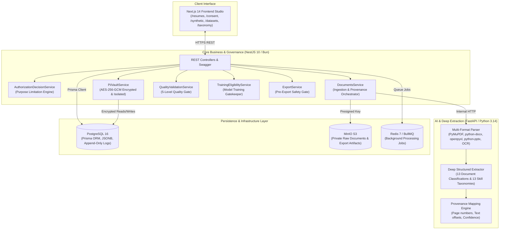

# SYSTEM.md — InterviewX DataHub Master System Manual

> **System Version**: 2.0 Universal  
> **Classification**: Internal Data Management & AI Training Infrastructure  
> **Compliance Standard**: Thailand PDPA / GDPR / ISO-27701 Privacy Information Management  
> **Core Architecture**: Decoupled Polyglot (NestJS Core + FastAPI AI Service + Next.js Studio + PostgreSQL + MinIO + Redis)

---

## 1. Executive Overview & System Topology

**InterviewX DataHub** is an enterprise data management and dataset governance platform built specifically for collecting, extracting, validating, annotating, and exporting training datasets for InterviewX Large Language Models (LLMs).

The platform bridges real-world candidate documents and synthetic interview datasets with strict privacy guarantees, governed by legal basis authorization and a zero-PII-leakage architecture.



---

## 2. Real Authorized Document Intelligence & Deep Extraction Engine

### 2.1 Multi-Format Ingestion & Cryptographic Signature Validation
The ingestion pipeline verifies all uploaded files using strict magic byte signatures rather than trusting user-supplied extensions or MIME headers (`apps/backend/src/documents/file-validator.util.ts`):

- **PDF**: `%PDF-` (`0x25 0x50 0x44 0x46`)
- **Office Open XML (DOCX, XLSX, PPTX)**: `PK\x03\x04` (`0x50 0x4B 0x03 0x04`)
- **PNG**: `\x89PNG\r\n\x1a\n` (`0x89 0x50 0x4E 0x47`)
- **JPEG/JPG**: `0xFF 0xD8 0xFF`
- **Security Scanners**: Blocks executable PE binaries (`MZ`), checks for malicious payloads (EICAR signature scanning), and computes immutable SHA-256 checksums.

### 2.2 13 Document Classifications
Documents are classified into 13 distinct types with confidence metrics and human override capabilities:
1. `RESUME` (Standard professional resume)
2. `CV` (Curriculum Vitae)
3. `ACADEMIC_CV` (Scholarly CV with publications and grants)
4. `PORTFOLIO` (Project showcases and design portfolios)
5. `TRANSCRIPT` (Official university academic transcripts)
6. `CERTIFICATE` (Professional licenses and credentials)
7. `RECOMMENDATION_LETTER` (Letters of endorsement/recommendation)
8. `RESEARCH_PAPER` (Peer-reviewed articles, preprints, theses)
9. `PROJECT_REPORT` (Technical reports and case studies)
10. `EMPLOYMENT_DOCUMENT` (Service records, employment verification letters)
11. `SCHOLARSHIP_DOCUMENT` (Fellowship and scholarship records)
12. `TRAINING_RECORD` (CPE/CPD attendance and training hours)
13. `OTHER` (Unclassified authorized documents)

### 2.3 Deep Structured Extraction Schemas
FastAPI leverages Pydantic v2 schemas (`services/ai-service/src/schemas/profile.py`) to extract comprehensive structured records:
- **Profile**: Full Name, Preferred Name, Email, Phone, Address, Nationality, Location, Languages, Professional Title, Summary, Career Objective, Industry, Profession, Career Level.
- **Education**: Institution, Faculty, Department, Degree, Major, Minor, Program, Study Mode, Start/Graduation Date, GPA, Academic Standing, Relevant Coursework, Academic Projects, Thesis Title, Achievements.
- **Work Experience**: Organization, Department, Job Title, Employment Type, Location, Start/End Date, Current Status, Responsibilities, Achievements, Tools & Technologies, Applied Skills, Measurable Business Impact (KPIs/Metrics).
- **13 Skill Taxonomies**: Technical, Domain Knowledge, Analytical, Problem Solving, Communication, Leadership, Research, Creative, Language, Interpersonal, Professional Ethics, Management, Digital Skills. Every skill item explicitly flags `is_explicit: bool` vs `is_inferred: bool`.
- **Projects**: Title, Description, Background, Problem Statement, Role, Personal Contribution vs Team Scope, Tools, Methodology, Challenges, Measurable Results, Lessons Learned.
- **Certifications**: Credential Name, Issuing Organization, License ID, Issue Date, Expiry Date, Training Hours, Verification URL, Status (`UNVERIFIED` by default).
- **Academic & Research**: Research Title, Abstract, Objectives, Methodology, Findings, Authors, Venues, DOI, Conference Presentations, Grant Funding.

### 2.4 Provenance & Evidence Tracking
Every extracted attribute is linked to an immutable provenance record (`FieldProvenanceRecord`):
```json
{
  "fieldPath": "experiences[0].job_title",
  "extractedValue": "Backend Developer",
  "normalizedValue": "Backend Developer",
  "source": {
    "documentId": "c92fa320-1b77-4fa6-8092-23fbe25d9921",
    "pageNumber": 1,
    "sectionName": "Work Experience",
    "sourceText": "Backend Developer at Tech Corp..."
  },
  "extractionMethod": "pdf_text_extraction",
  "confidenceScore": 0.96,
  "verificationStatus": "PENDING_REVIEW"
}
```

---

## 3. Consent-Governed PII Vault & Purpose Limitation Architecture

### 3.1 Architectural Separation
The system strictly enforces physical and logical separation across 5 boundaries:
1. **Original Document Storage**: Private MinIO S3 bucket, accessible only via short-lived presigned URLs.
2. **PII Vault**: High-security PostgreSQL table `PiiVault` storing sensitive fields encrypted with **AES-256-GCM**, keyed by pseudonymous `subject_id` (`SUB-XXXXXXXX`).
3. **Structured Extracted Data**: Clean `ParsedProfile` records containing only professional competencies without personal identifiers.
4. **Training-Eligible Dataset**: Anonymized datasets approved exclusively by the Training Eligibility Gate.
5. **Audit & Consent Records**: Append-only compliance ledgers (`ConsentRecord`, `ConsentHistory`, `ProcessingAuthorizationLog`, `PiiAccessLog`).

### 3.2 Granular Consent & Purpose Limitation Engine
Processing is governed by `AuthorizationDecisionService`:
- **Supported Purposes**: `DOCUMENT_EXTRACTION`, `PROFILE_MANAGEMENT`, `RESUME_ANALYSIS`, `PORTFOLIO_ANALYSIS`, `DATASET_PREPARATION`, `AI_MODEL_TRAINING`, `MODEL_FINE_TUNING`, `AI_EVALUATION`, `ACADEMIC_RESEARCH`, `SYSTEM_IMPROVEMENT`.
- **Enforcement Rules**:
  - A valid Consent ID alone does **not** grant unlimited processing rights.
  - Each processing operation validates:
    1. Consent status (`ACTIVE`).
    2. Date bounds (`granted_at <= now <= expires_at`).
    3. Document category inclusion (`permittedDataCategories`).
    4. Exact requested purpose (`permittedPurposes`).
  - Unauthorized requests are rejected immediately with `403 Forbidden` and logged in `ProcessingAuthorizationLog`.

### 3.3 Access Control & Right to be Forgotten (Purge Workflow)
- **Role-Based Access Control**:
  - `ADMIN`: Full access, can view unmasked PII in the Vault (triggers an immutable `PiiAccessLog` audit record).
  - `ML_ENGINEER`, `ANNOTATOR`, `VIEWER`: Completely barred from `PiiVault` (HTTP 403 Forbidden).
- **Consent Revocation Workflow**:
  - When consent is revoked (`POST /api/v1/consent/:id/revoke`), the system:
    1. Updates `ConsentRecord.status` to `REVOKED` and creates an immutable snapshot in `ConsentHistory`.
    2. Hard-purges the document's PII entry in `PiiVault` (`isPurged = true`, cryptographic key rotation/payload wipe).
    3. Transitions `Document.trainingEligibilityStatus` to `REVOKED_CONSENT_RESTRICTED`.
    4. Removes the raw file from MinIO storage.
    5. Excludes the record permanently from all future training exports.

---

## 4. 5-Level Data Quality Validation Gate

Every document entering the system is evaluated across 5 quality tiers (`apps/backend/src/documents/quality-validation.service.ts`):

| Level | Validation Name | Scope & Criteria | Output Action |
| :--- | :--- | :--- | :--- |
| **Level 1** | **File Integrity** | Magic byte validation, non-zero size, uncorrupted headers, anti-malware scan | Rejects corrupted uploads (HTTP 400) |
| **Level 2** | **Completeness & OCR** | Detects required sections (Skills, Experience, Education); verifies OCR confidence > 85% | Flags low-confidence scans for human review |
| **Level 3** | **Field Validation** | Validates date formats (YYYY-MM-DD), ensures graduation years are within realistic bounds (1960–2035) | Generates quality issue warnings |
| **Level 4** | **Timeline Consistency** | Detects chronological paradoxes (e.g., job start date after end date) | Flags inverted timelines as severity `ERROR` |
| **Level 5** | **Human Review & Provenance** | Human annotator audits side-by-side extracted values vs source text offsets | Grants `APPROVED` verification status |

---

## 5. Training Eligibility Gate

The `TrainingEligibilityService` acts as an absolute barrier separating general profile management from LLM training sets:

```mermaid
flowchart TD
    Doc["Uploaded Document"] --> CheckSynthetic{Is Synthetic?}
    CheckSynthetic -->|Yes| AutoApprove["APPROVED_FOR_TRAINING\n(Synthetic Zero-PII by design)"]
    CheckSynthetic -->|No (Real Data)| CheckConsent{Valid Consent ID?}
    
    CheckConsent -->|No| BlockNoConsent["RESTRICTED_NO_CONSENT\n(Blocked from training)"]
    CheckConsent -->|Yes| CheckRevoked{Consent Active?}
    
    CheckRevoked -->|Revoked / Expired| BlockRevoked["REVOKED_CONSENT_RESTRICTED\n(Permanent block & PII purged)"]
    CheckRevoked -->|Active| CheckTrainingPurpose{AI_MODEL_TRAINING\npurpose granted?}
    
    CheckTrainingPurpose -->|No| ProfileOnly["APPROVED_FOR_PROFILE_MANAGEMENT\n(Profile allowed, Training BLOCKED)"]
    CheckTrainingPurpose -->|Yes| CheckHumanReview{Human Review Status?}
    
    CheckHumanReview -->|Pending / Needs Correction| AwaitReview["PENDING_HUMAN_REVIEW\n(Awaiting verification)"]
    CheckHumanReview -->|Rejected| Rejected["REJECTED_QUALITY\n(Excluded)"]
    CheckHumanReview -->|Approved| QualityCheck{Level 1-4 Quality Pass?}
    
    QualityCheck -->|Pass| ApprovedTraining["APPROVED_FOR_TRAINING\n(Eligible for LLM Export)"]
    QualityCheck -->|Fail| QualityBlocked["RESTRICTED_QUALITY_ISSUES"]
```

The pre-export engine (`apps/backend/src/export/export.service.ts`) strictly queries documents matching:
```typescript
{
  trainingEligibilityStatus: 'APPROVED_FOR_TRAINING',
  isSynthetic: true // OR (real with active consent && status === 'APPROVED')
}
```
All export formatters (Alpaca, ChatML, ShareGPT) apply secondary regex redaction for any remaining email addresses or phone numbers.

---

## 6. Verification & Automated Test Matrix

The system features complete end-to-end unit and integration test suites:

### 6.1 Backend Test Suite (`bun test src/`)
- **Total Tests**: 47 passed, 0 failed (790ms execution time).
- **Test Suites**:
  1. `pii-vault.service.spec.ts`: AES-256-GCM encryption/decryption, pseudonymous ID generation, ADMIN RBAC enforcement, ANNOTATOR rejection (403), Right to be Forgotten purge.
  2. `consent.service.spec.ts`: Purpose limitation evaluation, category restrictions, expired consent rejection, revocation audit history.
  3. `file-validator.spec.ts`: Magic bytes validation for PDF, DOCX, PNG, JPEG; spoofed extension rejection; executable PE header blocking.
  4. `training-eligibility.service.spec.ts`: Synthetic auto-approval, missing consent blocking, revoked consent restriction, purpose separation (`PROFILE_MANAGEMENT` vs `TRAINING`), human review gate.
  5. `export.service.spec.ts`: Zero-PII sanitization, regex redaction, Alpaca/ChatML formatting, candidate-grouped train/test leak prevention.
  6. `taxonomy.service.spec.ts`: 15 universal industries, 80+ dynamic professions, many-to-many ontology mappings.
  7. `synthetic.service.spec.ts`: Multi-industry synthetic dataset generator, human QA reviews.
  8. `documents.service.spec.ts`: Ingestion validation, status management, soft deletion.

### 6.2 AI Service Test Suite (`pytest`)
- **Total Tests**: 25 passed, 0 failed (0.14s execution time).
- **Test Suites**:
  1. `test_deep_extraction.py`: 13 document classifications, 13 skill taxonomies, explicit vs inferred flags, measurable impact extraction, provenance offsets.
  2. `test_extractor.py`: Multi-format parsing, education GPA/thesis extraction, work experience.
  3. `test_consistency_engine.py`: Chronological timeline validation and cross-field checks.
  4. `test_universal_generator.py`: Synthetic interview prompts, rubrics, dilemmas across 10 dimensions.

### 6.3 TypeScript Typecheck (`bun run typecheck`)
- `apps/backend`: **0 errors** (`tsc --noEmit`).
- `apps/frontend`: **0 errors** (`tsc --noEmit`).
- `apps/frontend` Production Build: **10/10 routes successfully optimized** (`next build`).

---

## 7. Operational & Deployment Guide

### 7.1 Local Development Commands
```bash
# Start all infrastructure (Postgres, MinIO, Redis, MLflow)
docker-compose up -d postgres minio redis mlflow

# Database Migrations / Sync
cd apps/backend
bun run prisma:push
bun run prisma:generate

# Run NestJS Backend (Port 4000)
bun run start:dev

# Run FastAPI AI Service (Port 8000)
cd services/ai-service
source .venv/bin/activate
uvicorn src.main:app --host 0.0.0.0 --port 8000 --reload

# Run Next.js Frontend Studio (Port 3000)
cd apps/frontend
bun run dev
```

### 7.2 Service Endpoints
- **Frontend Studio**: `http://localhost:3000`
  - Document Intelligence Studio: `http://localhost:3000/resumes`
  - Consent & PII Vault Inspector: `http://localhost:3000/consent`
  - Synthetic Studio: `http://localhost:3000/synthetic`
  - Export & Safety Gate: `http://localhost:3000/datasets`
  - Universal Taxonomy Manager: `http://localhost:3000/taxonomy`
- **Backend Swagger API Documentation**: `http://localhost:4000/docs`
- **MinIO Console**: `http://localhost:9001` (Credentials in `.env`)
- **MLflow Tracking Server**: `http://localhost:5001`
