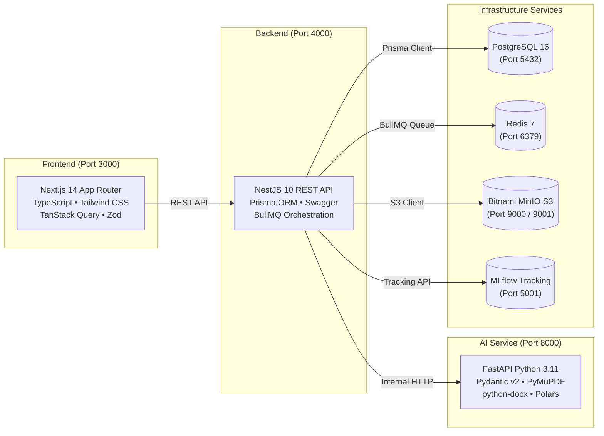
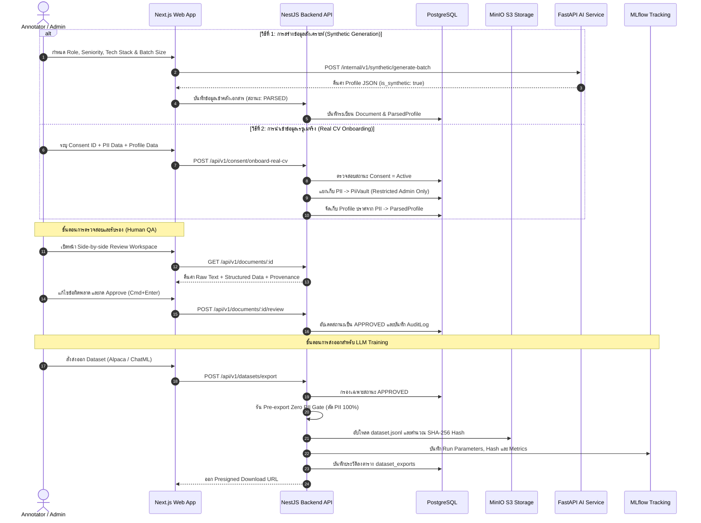
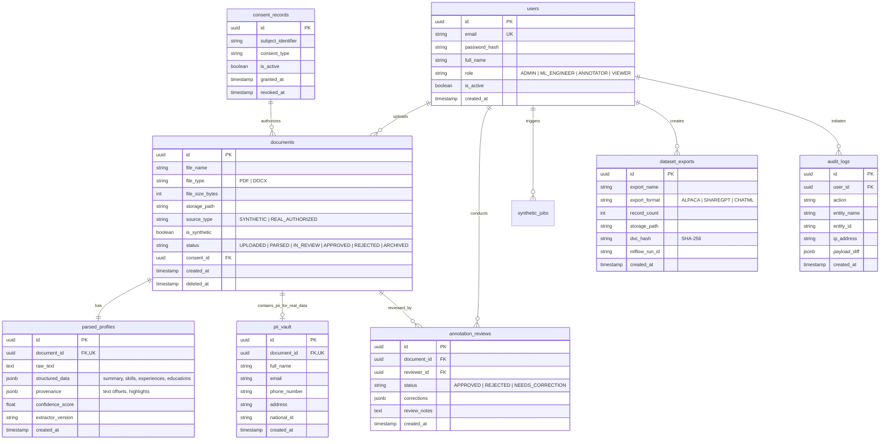

# คู่มือระบบเชิงลึก InterviewX DataHub (System Architecture & Operational Manual)

เอกสารนี้รวบรวมรายละเอียดเชิงลึกเกี่ยวกับสถาปัตยกรรมระบบ โครงสร้างฐานข้อมูล ไปป์ไลน์การประมวลผลข้อมูล มาตรการความปลอดภัย PDPA การเชื่อมต่อ API และคู่มือการติดตั้งใช้งานสำหรับ **InterviewX DataHub** แพลตฟอร์มบริหารจัดการและเตรียมชุดข้อมูลเรซูเมสำหรับการพัฒนาและฝึกสอนโมเดลภาษาขนาดใหญ่ (LLM)

---

## สารบัญ (Table of Contents)
1. [ภาพรวมและวัตถุประสงค์ระบบ (System Overview)](#1-ภาพรวมและวัตถุประสงค์ระบบ)
2. [สแต็กเทคโนโลยีและขอบเขตบริการ (Technology Stack & Services)](#2-สแต็กเทคโนโลยีและขอบเขตบริการ)
3. [สถาปัตยกรรมระบบและการไหลเวียนของข้อมูล (System Architecture & Data Flow)](#3-สถาปัตยกรรมระบบและการไหลเวียนของข้อมูล)
4. [โครงสร้างฐานข้อมูลและโมเดลข้อมูล (Database Schema & Models)](#4-โครงสร้างฐานข้อมูลและโมเดลข้อมูล)
5. [การกำกับดูแลความปลอดภัยและ PDPA (Security & Data Governance)](#5-การกำกับดูแลความปลอดภัยและ-pdpa)
6. [โมดูลการทำงานหลักและคู่มือผู้ใช้ (Core Functional Modules)](#6-โมดูลการทำงานหลักและคู่มือผู้ใช้)
7. [ข้อกำหนดและสัญญาการเชื่อมต่อ API (API Reference & Contracts)](#7-ข้อกำหนดและสัญญาการเชื่อมต่อ-api)
8. [คู่มือการติดตั้งและเริ่มรันระบบ (Deployment & Operations Guide)](#8-คู่มือการติดตั้งและเริ่มรันระบบ)
9. [การแก้ไขปัญหาที่พบบ่อย (Troubleshooting & FAQ)](#9-การแก้ไขปัญหาที่พบบ่อย)

---

## 1. ภาพรวมและวัตถุประสงค์ระบบ

**InterviewX DataHub** ถูกสร้างขึ้นเพื่อแก้ไขปัญหาคอขวดในการเทรน LLM สำหรับระบบสัมภาษณ์งานอัจฉริยะ (InterviewX) ได้แก่:
1. **การขาดแคลนข้อมูลเรซูเมเชิงโครงสร้างคุณภาพสูง**: แปลงเอกสารไร้โครงสร้าง (Unstructured PDF/DOCX) ให้เป็น JSON Profile ที่มีมาตรฐานสากล
2. **ความเสี่ยงทางกฎหมายและข้อมูลส่วนบุคคล (PII & PDPA)**: เริ่มต้นขับเคลื่อนด้วย **Synthetic Data (ข้อมูลสังเคราะห์ 100%)** ก่อนขยายสู่ **Real-world Data** ที่มีหนังสือยินยอม (Consent) ควบคู่กับสถาปัตยกรรมแยกเก็บข้อมูลส่วนบุคคล (**PII Vault Pattern**)
3. **การตรวจสอบและกำกับดูแลคุณภาพ (Human-in-the-Loop QA)**: มีพื้นที่ทำงานตรวจสอบข้อมูลแบบสองฝั่งคู่ขนาน (Side-by-side Review) เพื่อให้มนุษย์ยืนยันความถูกต้องก่อนนำเข้าคลังเทรนโมเดล
4. **การควบคุมเวอร์ชันชุดข้อมูล (Dataset Lineage)**: ส่งออกข้อมูลพร้อมเข้ารหัส SHA-256 (DVC Lineage) และบันทึกประวัติเข้าสู่ **MLflow Tracking**

---

## 2. สแต็กเทคโนโลยีและขอบเขตบริการ



| ส่วนประกอบ | เทคโนโลยีหลัก | หน้าที่และความรับผิดชอบ |
| :--- | :--- | :--- |
| **Frontend Web App** | Next.js 14, React 18, Tailwind CSS, TanStack Query, Lucide Icons | ส่วนติดต่อผู้ใช้, Side-by-side Review Workspace, Synthetic Studio, Dataset Manager |
| **Backend Core API** | NestJS 10, TypeScript, Prisma ORM, BullMQ, Swagger | ศูนย์กลาง Business Logic, Authentication, สิทธิ์ RBAC, Data Governance, Audit Trail |
| **AI & Processing Service** | Python 3.11, FastAPI, Pydantic v2, PyMuPDF, python-docx | สกัดข้อความดิบ, แปลงข้อความเป็น JSON Profile ผ่าน LLM, สร้าง Synthetic Resumes แบบ Batch |
| **Relational Database** | PostgreSQL 16 (Alpine) | จัดเก็บข้อมูลเชิงโครงสร้าง, สถานะเอกสาร, PiiVault, และ Audit Logs |
| **Object Storage** | Bitnami MinIO (S3 Compatible) | จัดเก็บไฟล์ต้นฉบับ (`raw-documents`) และไฟล์ส่งออก (`dataset-exports`) |
| **Queue & Cache** | Redis 7 (Alpine) | คิวงานประมวลผลเบื้องหลัง (BullMQ) และแคชลดภาระฐานข้อมูล |
| **Experiment Tracking** | MLflow 2.17.0 | ติดตามพารามิเตอร์การ Export ชุดข้อมูล, Run Metrics และผูกโยง Artifacts |
| **Package Management** | Bun 1.x | รันไทม์และระบบจัดการแพ็กเกจความเร็วสูงสำหรับ Monorepo Workspaces |

---

## 3. สถาปัตยกรรมระบบและการไหลเวียนของข้อมูล

### 3.1 วงจรข้อมูลครบวงจร (End-to-End Data Lifecycle)



---

## 4. โครงสร้างฐานข้อมูลและโมเดลข้อมูล

ฐานข้อมูลได้รับการออกแบบตามแนวทาง **Hybrid Relational + JSONB Strategy** และ **PII Segregation Pattern**



---

## 5. การกำกับดูแลความปลอดภัยและ PDPA

### 5.1 สถาปัตยกรรม PII Vault Pattern
- ข้อมูลระบุตัวตนของบุคคลจริง (ชื่อ, เบอร์โทร, อีเมล, เลขบัตรประชาชน) จะถูกบันทึกแยกไว้ในตาราง **`pii_vault`** ซึ่งมีการควบคุมสิทธิ์ระดับสูง
- ข้อมูลที่นำเข้าสู่ไปป์ไลน์ของ LLM (`parsed_profiles`) จะมีเฉพาะ **ทักษะ (Skills), ตำแหน่งงาน (Roles), ประสบการณ์ทำงาน, และการศึกษา** เท่านั้น
- ผู้ตรวจข้อมูลทั่วไป (`ANNOTATOR`) จะถูกบล็อกไม่ให้เข้าถึง `pii_vault` ด้วยรหัส **HTTP 403 Forbidden** (เปิดให้เฉพาะบทบาท `ADMIN` สำหรับงานตรวจสอบกฎหมายเท่านั้น)

### 5.2 สิทธิ์การเข้าถึงตามบทบาท (Role-Based Access Control: RBAC)
| สิทธิ์การใช้งาน (Permissions) | ADMIN | ML_ENGINEER | ANNOTATOR | VIEWER |
| :--- | :---: | :---: | :---: | :---: |
| ดูแดชบอร์ดและรายการเรซูเม | ✅ | ✅ | ✅ | ✅ |
| สร้างข้อมูลสังเคราะห์ (Synthetic Studio) | ✅ | ✅ | ❌ | ❌ |
| ตรวจสอบและอนุมัติข้อมูล (Side-by-side Review) | ✅ | ✅ | ✅ | ❌ |
| ดูข้อมูล PII ใน PiiVault ของข้อมูลจริง | ✅ | ❌ | ❌ | ❌ |
| ส่งออก Dataset สำหรับเทรน LLM (Export Manager) | ✅ | ✅ | ❌ | ❌ |
| เพิกถอนความยินยอมและทำลายข้อมูล (PDPA Purge) | ✅ | ❌ | ❌ | ❌ |
| ดูประวัติการใช้งานระบบ (Audit Trail Logs) | ✅ | ❌ | ❌ | ❌ |

### 5.3 วงจรการเพิกถอนความยินยอมและทำลายข้อมูล (Right to be Forgotten)
เมื่อเจ้าของข้อมูลส่วนบุคคลแจ้งขอถอนความยินยอม ระบบจะดำเนินกระบวนการแบบ **Hard Delete** อัตโนมัติ:
1. ปรับสถานะ `ConsentRecord.isActive = false` และบันทึก `revokedAt`
2. ค้นหาเอกสารทั้งหมดที่ผูกกับ Consent ID นั้น
3. **ทำลายแถวข้อมูลใน `pii_vault` ทันที** (Hard Delete ถาวร)
4. ทำลายไฟล์เอกสารต้นฉบับออกจาก MinIO S3 Bucket `raw-documents`
5. ปรับสถานะเอกสารใน `documents` เป็น `ARCHIVED` ป้องกันไม่ให้นำไปรวมใน Dataset Export
6. บันทึกหลักฐานการทำลายข้อมูลลงใน `audit_logs` พร้อม IP Address และวันเวลาเพื่อความโปร่งใสทางกฎหมาย

### 5.4 ด่านตรวจความปลอดภัย Zero PII Leakage Gate
ก่อนที่ Dataset จะถูกส่งออกเป็นไฟล์ `.jsonl` ระบบ NestJS จะทำการ:
- คัดกรองเฉพาะเอกสารที่ผ่านการกด **`APPROVED`** เท่านั้น
- สแกนและลบคีย์ข้อมูลส่วนบุคคลทิ้ง 100%
- ใช้งาน **Regex Scanner** เพื่อตรวจจับและ Masking อีเมล (`[REDACTED_EMAIL]`) และเบอร์โทรศัพท์ (`[REDACTED_PHONE]`) ที่อาจแฝงอยู่ในเนื้อหาบรรยายผลงาน

---

## 6. โมดูลการทำงานหลักและคู่มือผู้ใช้

### 6.1 สตูดิโอสร้างข้อมูลสังเคราะห์ (`/synthetic`)
- **การใช้งาน**: เหมาะสำหรับการเริ่มต้นเทรนโมเดลทันทีโดยไม่ต้องรอเอกสารจริง
- **ตัวเลือก**: กำหนดตำแหน่งงาน, เลือกระดับ Seniority (Junior, Mid, Senior, Lead), กำหนด Tech Stack และ Batch Size
- **ผลลัพธ์**: ข้อมูลจะผ่านการตรวจสอบโครงสร้างด้วย **Pydantic Schema** ได้รับแท็ก `is_synthetic = true` อัตโนมัติ

### 6.2 คลังเอกสารและการอัปโหลด (`/resumes`)
- **การใช้งาน**: คลังศูนย์กลางแสดงสถานะเรซูเมทั้งหมด (`PARSED`, `IN_REVIEW`, `APPROVED`, `REJECTED`)
- **ระบบค้นหาและตัวกรอง**: กรองตามสถานะ, แยกดูเฉพาะ Synthetic หรือ Real Data, ค้นหาตามชื่อตำแหน่งหรือชื่อไฟล์
- **ปุ่มอัปโหลดเอกสาร (Upload Modal)**: รองรับการเลือกประเภทข้อมูลและแนบไฟล์ `.pdf` / `.docx`

### 6.3 พื้นที่ตรวจข้อมูลแบบคู่ขนาน Side-by-side Review (`/resumes/:id/review`)
- **หน้าจอฝั่งซ้าย (Document Viewer)**: แสดงผลข้อความดิบเอกสาร รองรับการย่อ/ขยาย (Zoom), คัดลอกข้อความ
- **ระบบ Interactive Provenance Highlighting**: เมื่อคลิกหรือแก้ไขข้อมูลที่กล่องฝั่งขวา เอกสารฝั่งซ้ายจะเลื่อนไปยังส่วนที่เกี่ยวข้องและทำแถบสีเหลืองไฮไลต์อัตโนมัติ
- **หน้าจอฝั่งขวา (Profile Editor)**: แก้ไขบทคัดย่อ, เพิ่ม/ลบแท็กทักษะ, แก้ไขประวัติงานและข้อมูลการศึกษา
- **ปุ่มลัดคีย์บอร์ด**:
  - `Cmd + Enter` หรือ `Ctrl + Enter`: บันทึกและอนุมัติข้อมูลทันที (**Approve & Next**)
  - `Cmd + J` หรือ `Ctrl + J`: ปฏิเสธเอกสาร (**Reject**)

### 6.4 การส่งออกชุดข้อมูลสำหรับฝึกสอน LLM (`/datasets`)
- **ฟอร์แมตมาตรฐานที่รองรับ**:
  - **Alpaca Format**: สำหรับงาน Instruction Fine-tuning (`instruction`, `input`, `output`)
  - **OpenAI ChatML Format**: สำหรับการเทรนแชตบอทแบบมี System Message (`messages: [...]`)
  - **ShareGPT Format**: สำหรับการจำลองบทสัมภาษณ์หลายรอบ (`conversations: [...]`)
- **การเชื่อมโยงย้อนกลับ (Lineage)**: คำนวณค่า **SHA-256 Hash** และบันทึก Run ID เข้าสู่ **MLflow Tracking Server** บนพอร์ต `5001`

### 6.5 แดชบอร์ดตรวจสอบ Data Bias และประสิทธิภาพ (`/analytics`)
- **ดัชนีความหลากหลาย (Diversity Score)**: คำนวณด้วยสูตร Shannon-Wiener Diversity Index
- **การกระจายตัวตามสายงาน (Role Distribution)**: แสดงเปอร์เซ็นต์ของ Backend, Frontend, Data, DevOps, AI
- **แผนผังทักษะยอดนิยม (Technical Skills Heatmap)**: ตรวจจับทักษะ 10 อันดับแรกที่มีความถี่สูงสุด
- **ระบบติดตามประวัติ (Audit Trail Logs)**: ตรวจสอบย้อนกลับทุกการกระทำของระบบ

---

## 7. ข้อกำหนดและสัญญาการเชื่อมต่อ API

### 7.1 NestJS Core REST API (`http://localhost:4000/api/v1`)
เข้าดูและทดสอบผ่าน Swagger ได้ที่: **`http://localhost:4000/docs`**

| Method | Endpoint | คำอธิบาย |
| :--- | :--- | :--- |
| `GET` | `/health` | ตรวจสอบสถานะความพร้อมของระบบ Backend |
| `GET` | `/documents` | ดึงรายการเอกสารเรซูเมพร้อม Pagination และ Filter |
| `GET` | `/documents/:id` | ดึงข้อมูลเอกสาร, ข้อความดิบ และผลการสกัด Profile |
| `POST` | `/documents/:id/review` | บันทึกผลการตรวจรับรอง (Approve / Reject / Edit) และสร้าง Audit Log |
| `POST` | `/datasets/export` | สั่งสร้างและส่งออก Dataset สำหรับเทรน LLM (ผ่าน PII Gate) |
| `GET` | `/datasets/exports` | ดึงประวัติ Dataset ที่ส่งออกทั้งหมด |
| `GET` | `/datasets/exports/:id/download` | รับ Presigned URL ดาวน์โหลดไฟล์ `.jsonl` จาก MinIO |
| `POST` | `/consent` | จดทะเบียนหนังสือแสดงความยินยอม (Consent Agreement) |
| `GET` | `/consent` | เรียกดูรายการหนังสือยินยอมทั้งหมด |
| `POST` | `/consent/onboard-real-cv` | นำเข้าเรซูเมจริง (ตรวจสอบ Consent ID และแยกเก็บเข้า PiiVault) |
| `POST` | `/consent/:id/revoke` | เพิกถอนความยินยอมและทำลายข้อมูล PII ถาวร (Right to be Forgotten) |
| `GET` | `/consent/pii-vault/:docId` | ดูข้อมูลใน PiiVault (จำกัดสิทธิ์เฉพาะ Header `x-user-role: ADMIN`) |
| `GET` | `/analytics/bias-distribution` | ดึงสถิติความหลากหลายของข้อมูลและตรวจสอบความลำเอียง |
| `GET` | `/analytics/system-metrics` | ดึงข้อมูลประสิทธิภาพคิวงาน Throughput และอัตราแคช |
| `GET` | `/analytics/audit-logs` | ดึงรายการประวัติการตรวจสอบย้อนกลับ (Audit Logs) |

### 7.2 FastAPI AI Service Internal API (`http://localhost:8000`)
เข้าดูและทดสอบผ่าน Swagger ได้ที่: **`http://localhost:8000/docs`**  
*(ต้องการ Header: `x-internal-service-key: interviewx_internal_service_secret_key_2026`)*

| Method | Endpoint | คำอธิบาย |
| :--- | :--- | :--- |
| `GET` | `/health` | ตรวจสอบสถานะการทำงานของ AI Service |
| `POST` | `/internal/v1/parser/extract-text` | สกัดข้อความดิบจากไฟล์ PDF/DOCX ใน MinIO |
| `POST` | `/internal/v1/parser/extract-profile` | แปลงข้อความเป็น Structured Profile ผ่าน LLM พร้อมแยก PII |
| `POST` | `/internal/v1/synthetic/generate-batch` | สร้างข้อมูลเรซูเมจำลองแบบกลุ่มพร้อม Pydantic Validation |

---

## 8. คู่มือการติดตั้งและเริ่มรันระบบ

### 8.1 สิ่งจำเป็นที่ต้องมีในเครื่อง (Prerequisites)
- **Docker & Docker Compose** (สำหรับ Infrastructure และ Containers)
- **Bun** (เวอร์ชัน 1.1+ สำหรับรัน Frontend และ Backend)
- **Python** (เวอร์ชัน 3.11+ สำหรับรัน AI Service ใน Local)

### 8.2 การตั้งค่าสภาพแวดล้อม (Environment Configuration)
ไฟล์การตั้งค่าจะอยู่ที่ `.env` ที่ Root Directory:
```bash
cp .env.example .env
```
*(ไฟล์ `.env` ได้รับการกำหนดค่าพอร์ต รหัสผ่าน และการเชื่อมโยงระบบไว้อย่างสมบูรณ์แล้ว)*

### 8.3 การรันระบบผ่าน Docker Compose แบบครบวงจร (แนะนำ)
คำสั่งเดียวเพื่อ Build และเปิดใช้งานทั้ง 8 Services:
```bash
docker compose up -d --build
```

**ตรวจสอบสถานะ Containers**:
```bash
docker compose ps
```

### 8.4 การรันเพื่อการพัฒนาเฉพาะส่วนใน Local (Development Mode)
หากต้องการรัน Services แบบแยกพัฒนาในเครื่อง:

1. **เปิดเฉพาะ Infrastructure Services (PostgreSQL, Redis, MinIO, MLflow)**:
   ```bash
   docker compose up -d postgres redis minio mlflow
   ```

2. **ติดตั้ง Dependencies ด้วย Bun**:
   ```bash
   bun install
   ```

3. **รัน Backend Core API (NestJS)**:
   ```bash
   bun dev:backend
   ```
   *เข้าใช้งาน API ได้ที่: `http://localhost:4000/api/v1` และ Swagger ที่ `http://localhost:4000/docs`*

4. **รัน Frontend Web App (Next.js)**:
   ```bash
   bun dev:frontend
   ```
   *เปิดหน้าเว็บได้ที่: `http://localhost:3000`*

5. **รัน AI Service (FastAPI)**:
   ```bash
   cd services/ai-service
   pip install -r requirements.txt
   python -m uvicorn src.main:app --reload --port 8000
   ```
   *เข้าใช้งาน AI Docs ได้ที่: `http://localhost:8000/docs`*

---

## 9. การแก้ไขปัญหาที่พบบ่อย

### Q1: ทำไม MinIO เดิมถึงขึ้นข้อผิดพลาด `401 Unauthorized` หรือ `pull access denied`?
- **สาเหตุ**: MinIO ปิดการ Pull Image สาธารณะแบบ Anonymous บน Quay.io และ Docker Hub
- **การแก้ปัญหา**: ระบบได้เปลี่ยนมาใช้ **`bitnami/minio:latest`** ซึ่งเป็น Official Open-Source Distribution ที่เปิดให้ดาวน์โหลดสาธารณะ 100% พร้อมกำหนด `MINIO_DEFAULT_BUCKETS=raw-documents,dataset-exports` เพื่อสร้าง Bucket อัตโนมัติ

### Q2: ข้อความเตือน `the attribute 'version' is obsolete` ใน Docker Compose?
- **สาเหตุ**: Docker Compose v2 ได้ยกเลิกการใช้คีย์ `version` บนไฟล์ compose
- **การแก้ปัญหา**: ไฟล์ `docker-compose.yml` ได้ตัดคีย์ `version: '3.8'` ออกเรียบร้อยแล้ว

### Q3: ข้อมูลส่วนบุคคล (PII) จะหลุดรอดไปยังไฟล์ที่นำไปเทรน LLM หรือไม่?
- **คำตอบ**: ไม่หลุดรอดอย่างแน่นอน 100% เนื่องจาก:
  1. โครงสร้างฐานข้อมูลใช้ **PII Vault Pattern** แยกตาราง `pii_vault` ออกจาก `parsed_profiles`
  2. กระบวนการ Export ผ่าน **Zero PII Leakage Gate** ซึ่งตัดคีย์ข้อมูลติดต่อทิ้งทั้งหมดและรัน Regex Scanner กรองเนื้อหาซ้ำก่อนเขียนไฟล์ `.jsonl`

---

## 10. สรุปพอร์ตและจุดเชื่อมต่อของระบบ (System Ports Summary)

| บริการ (Service) | พอร์ต (Host Port) | หน้าต่างใช้งาน / URL |
| :--- | :---: | :--- |
| **Frontend Web App** | `3000` | [http://localhost:3000](http://localhost:3000) |
| **Backend REST API** | `4000` | [http://localhost:4000/api/v1](http://localhost:4000/api/v1) |
| **Backend Swagger Docs** | `4000` | [http://localhost:4000/docs](http://localhost:4000/docs) |
| **FastAPI AI Service** | `8000` | [http://localhost:8000/docs](http://localhost:8000/docs) |
| **PostgreSQL Database** | `5432` | `localhost:5432` (User: `interviewx`, DB: `interviewx_datahub`) |
| **Redis Queue & Cache** | `6379` | `localhost:6379` |
| **MinIO S3 API** | `9000` | `http://localhost:9000` |
| **MinIO Web Console** | `9001` | [http://localhost:9001](http://localhost:9001) *(User: `minioadmin` / Pass: `minioadmin`)* |
| **MLflow Tracking Dashboard** | `5001` | [http://localhost:5001](http://localhost:5001) |
