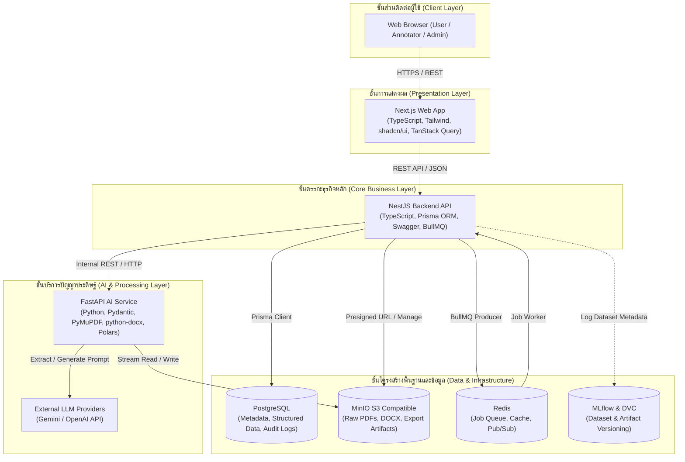

# 02. สถาปัตยกรรมระบบ (System Architecture)

เอกสารนี้ระบุการออกแบบสถาปัตยกรรมระบบ ขอบเขตความรับผิดชอบของแต่ละส่วนประกอบ (Separation of Concerns) และรูปแบบการสื่อสารระหว่างบริการของ **InterviewX DataHub** อ้างอิงข้อกำหนดจาก [`01-REQUIREMENTS.md`](file:///Users/mac/Desktop/interviewx-datahub/context/01-REQUIREMENTS.md)

---

## 1. ภาพรวมสถาปัตยกรรมระดับสูง (High-Level Architecture)

ระบบออกแบบตามสถาปัตยกรรมแบบแยกบริการ (Service-Oriented / Decoupled Architecture) โดยแบ่งออกเป็น 3 บริการหลัก และ 4 โครงสร้างพื้นฐานสนับสนุน (Infrastructure Services)

---

## 2. ขอบเขตความรับผิดชอบของแต่ละบริการ (Service Boundaries)

อ้างอิงกฎสถาปัตยกรรมใน [`AGENTS.md`](file:///Users/mac/Desktop/interviewx-datahub/AGENTS.md):

### 2.1 Next.js Frontend
- **หน้าที่**: แสดงผลหน้าจอ UI/UX, การจัดการสถานะฝั่งหน้าบ้านด้วย TanStack Query, ฟอร์มกรอกและตรวจสอบความถูกต้องด้วย Zod
- **ข้อจำกัด**: ติดต่อสื่อสารผ่าน NestJS REST API เท่านั้น **ห้ามติดต่อสื่อสารโดยตรงกับ FastAPI, PostgreSQL หรือ MinIO**

### 2.2 NestJS Core Backend
- **หน้าที่**:
  - ศูนย์กลางของ Business Logic, Authentication (JWT), RBAC, และ Data Governance
  - จัดการข้อมูลเรซูเม, การกำหนดสถานะการตรวจ (Annotation Workflow)
  - จัดการ Background Queue ผ่าน BullMQ โดยใช้ Redis
  - บันทึกและดึงข้อมูลผ่าน Prisma ORM ไปยัง PostgreSQL
  - ออก Presigned URL หรือจัดการไฟล์ร่วมกับ MinIO
  - ควบคุมการส่งออก Dataset และตรวจสอบความปลอดภัยด้าน PII
- **ข้อจำกัด**: ไม่ทำงานหนักด้าน CPU เช่น การแปลงไฟล์ PDF หรือการรัน Prompt AI ขนาดยาวด้วยตนเอง แต่จะส่งต่องานเหล่านั้นให้ FastAPI

### 2.3 FastAPI AI Service
- **หน้าที่**:
  - ประมวลผลเอกสารดิบ (Text Extraction จาก PDF ด้วย PyMuPDF และ DOCX ด้วย python-docx)
  - จัดการการเรียกใช้ LLM เพื่อสกัดข้อมูล (Information Extraction) เป็น Structured JSON
  - ระบบสร้างข้อมูลสังเคราะห์ (Synthetic Data Generator)
  - ตรวจสอบความถูกต้องของเอาต์พุต AI ด้วย Pydantic Model ก่อนส่งกลับ
  - งานคำนวณเวกเตอร์และ Data Transformation (Pandas / Polars)
- **ข้อจำกัด**: ไม่มีสิทธิ์เข้าถึงฐานข้อมูล PostgreSQL โดยตรง และไม่มี Business Logic ด้านการจัดการสิทธิ์ผู้ใช้งานหรือวงจรชีวิตข้อมูล

### 2.4 Infrastructure Layer
- **PostgreSQL**: จัดเก็บข้อมูลโครงสร้าง ผู้ใช้งาน สิทธิ์ Metadata ของเอกสาร ข้อมูลที่สกัดแล้ว และ Audit Trail (ดูรายละเอียดใน [`03-DATABASE.md`](file:///Users/mac/Desktop/interviewx-datahub/context/03-DATABASE.md))
- **MinIO**: จัดเก็บไฟล์ต้นฉบับ (Raw Documents) และไฟล์ Dataset สำเร็จรูป (Artifacts)
- **Redis**: รองรับระบบคิว (BullMQ) สำหรับงานแบบ Asynchronous และแคชชั่วคราว
- **MLflow / DVC**: บันทึกประวัติการสร้าง Dataset, Metadata Metrics, และ Data Provenance

---

## 3. รูปแบบการสื่อสารระหว่างบริการ (Inter-Service Communication)

| เส้นทางการเชื่อมต่อ | โปรโตคอล | รูปแบบข้อมูล | วัตถุประสงค์ |
| :--- | :--- | :--- | :--- |
| **Next.js → NestJS** | HTTPS / REST | JSON, multipart/form-data | การเรียกใช้ API ทั่วไปและการอัปโหลดไฟล์ |
| **NestJS → FastAPI** | HTTP (Internal) | JSON | ส่งคำขอสกัดข้อมูล, ส่ง Prompt สังเคราะห์ข้อมูล |
| **NestJS ↔ Redis** | Redis Protocol (BullMQ) | Serialized Job Data | จัดคิวงานแปลงไฟล์ สกัดข้อมูล และ Export |
| **NestJS / FastAPI → MinIO**| S3 API | Binary Stream / Multipart | จัดเก็บและดึงไฟล์เอกสารและ Artifacts |
| **NestJS → PostgreSQL** | PostgreSQL TCP | SQL (via Prisma) | จัดการข้อมูลเชิงสัมพันธ์และ Audit Logs |

---

## 4. ความปลอดภัยของเครือข่ายและการแบ่งแยกสิทธิ์ (Network & Security Isolation)

1. **Internal Service Protection**: FastAPI, PostgreSQL, Redis และ MinIO Console จะทำงานอยู่บน Internal Docker Network ไม่เปิดเผยพอร์ตสู่เครือข่ายภายนอก (Public Internet)
2. **Gateway Pattern**: NestJS ทำหน้าที่เสมือน Gateway ในการตรวจสอบสิทธิ์ (AuthN/AuthZ) ก่อนที่จะอนุญาตให้เกิดการประมวลผลใดๆ
3. **No Direct Storage Exposure**: ไฟล์ใน MinIO เข้าถึงได้ผ่าน Presigned URL ที่มีอายุจำกัด (Time-limited Signed URLs) ที่ออกให้โดย NestJS เท่านั้น

---

## 5. ข้อสมมติฐานหลัก (Explicit Assumptions)

1. **Docker Compose สำหรับ Local & Development**: สภาพแวดล้อมทั้งหมดจะถูกตั้งค่าให้รันร่วมกันได้ผ่าน `docker-compose.yml` สำหรับการพัฒนาในเครื่อง
2. **Stateless Services**: ทั้ง NestJS และ FastAPI ออกแบบให้เป็น Stateless เพื่อให้สามารถ Scale ในลักษณะแนวนอน (Horizontal Scaling) ได้ง่าย

---

## 6. ประเด็นที่ยังค้างการตัดสินใจ (Unresolved Decisions)

1. **Job Queue Bridge**: จะให้ NestJS (BullMQ) เป็นผู้ควบคุม Worker แล้วเรียก FastAPI แบบ Sync REST ภายใน worker หรือจะให้ FastAPI รัน Celery/ARQ รับงานจาก Redis โดยตรง
   - *ข้อเสนอแนะ*: ใช้ NestJS BullMQ ทำ Orchestration แล้วเรียก HTTP REST ไปยัง FastAPI ตาม architecture rule ข้อ 1 และ 2 เพื่อให้ Business Logic และ Error Handling อยู่ที่ NestJS
2. **Real-time Notification**: จะใช้ Server-Sent Events (SSE) หรือ WebSockets ใน NestJS เพื่อแจ้งเตือนหน้าบ้าน Next.js เมื่อ Background Job ทำงานเสร็จ
