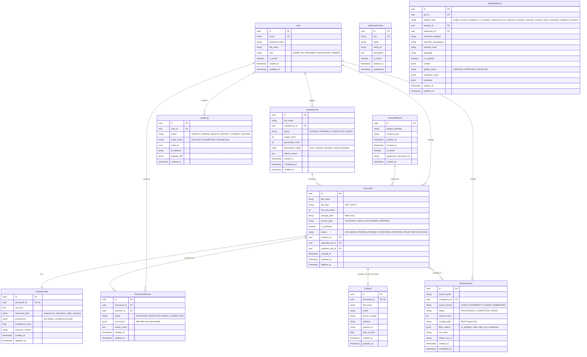

# 03. โครงสร้างฐานข้อมูล (Database Schema & Design)

เอกสารนี้ระบุการออกแบบโครงสร้างฐานข้อมูลเชิงสัมพันธ์ (Relational Database) และโมเดลข้อมูลสำหรับ **InterviewX DataHub** โดยใช้ **PostgreSQL** ร่วมกับ **Prisma ORM** ตามสถาปัตยกรรมใน [`02-ARCHITECTURE.md`](file:///Users/mac/Desktop/interviewx-datahub/context/02-ARCHITECTURE.md)

---

## 1. ยุทธศาสตร์การออกแบบโมเดลข้อมูล (Data Modeling Strategy)

1. **Hybrid Relational & Document Model**:
   - ข้อมูลเชิงสถานะ, การควบคุมสิทธิ์, ความสัมพันธ์, และ Metadata ถูกจัดเก็บในรูปแบบ Normalized Relational Tables เพื่อความสมบูรณ์ของข้อมูล (ACID)
   - ข้อมูลโครงสร้างเรซูเมที่มีความยืดหยุ่นสูง (Dynamic CV Profile เช่น รายการทักษะ, รายละเอียดประสบการณ์การทำงาน, ข้อมูลการศึกษา) และประวัติการสกัด (Provenance Mapping) จัดเก็บในรูปแบบ **JSONB** เพื่อความยืดหยุ่นและรองรับการเปลี่ยนแปลงของโครงสร้างข้อมูล
2. **การแยกเก็บข้อมูลส่วนบุคคล (PII Segregation Pattern)**:
   - ตาราง `PiiVault` ถูกแยกออกจากตาราง `ParsedProfile` อย่างเด็ดขาด เพื่อป้องกันไม่ให้ข้อมูล PII หลุดรอดเข้าไปในกระบวนการเทรนโมเดล (ตามข้อกำหนดใน [`08-SECURITY-PRIVACY.md`](file:///Users/mac/Desktop/interviewx-datahub/context/08-SECURITY-PRIVACY.md))
3. **การแยกข้อมูลสังเคราะห์และข้อมูลจริง (Synthetic vs Real Isolation)**:
   - ตาราง `Document` มีฟิลด์ `is_synthetic` แบบ Boolean ชัดเจน มีดัชนี (Index) สำหรับคัดกรอง และไม่สามารถอัปเดตจาก `true` เป็น `false` ได้

---

## 2. แผนภาพความสัมพันธ์ของข้อมูล (Entity-Relationship Diagram)



---

## 3. รายละเอียดตารางและฟิลด์หลัก (Table Specifications)

### 3.1 ตาราง Document
- ทำหน้าที่เป็นตารางศูนย์กลางของประวัติเอกสารเรซูเม
- `storage_path`: ระบุ Bucket และ Object Key ใน MinIO (เช่น `raw-documents/2026/11/uuid.pdf`)
- `is_synthetic`: บังคับค่าเริ่มต้นตามกระบวนการนำเข้า และตั้ง Index เพื่อความรวดเร็วในการ Query แยกชุดข้อมูล
- `status`: รองรับ State Machine ตั้งแต่ `UPLOADED` จนถึง `APPROVED`

### 3.2 ตาราง PiiVault
- จัดเก็บเฉพาะข้อมูลที่มีความอ่อนไหวสูงของเรซูเมจริง
- มีสิทธิ์การเข้าถึงจำกัดเป็นพิเศษ และถูกตัดออกอย่างถาวรในกระบวนการ Query ข้อมูลเพื่อสร้าง Dataset

### 3.3 ตาราง ParsedProfile
- `raw_text`: ข้อความดิบทั้งหมดที่สกัดได้จาก PyMuPDF / python-docx
- `structured_data`: ฟิลด์ JSONB มาตรฐาน เช่น:
  ```json
  {
    "summary": "Senior Software Engineer with 7+ years of experience...",
    "skills": ["TypeScript", "NestJS", "PostgreSQL", "Docker"],
    "experiences": [
      {
        "company": "Tech Corp",
        "role": "Senior Backend Developer",
        "start_date": "2021-01",
        "end_date": "Present",
        "description": "Architected microservices using NestJS..."
      }
    ],
    "educations": [
      {
        "institution": "Chulalongkorn University",
        "degree": "B.Eng. Computer Engineering",
        "year": "2019"
      }
    ]
  }
  ```
- `provenance`: เก็บตำแหน่งและที่มาของข้อมูล (Text offset หรือ bounding box) สำหรับทำ Highlight บนหน้าจอ UI

---

## 4. กลยุทธ์การทำดัชนีและประสิทธิภาพ (Indexing & Performance Strategy)

1. **B-Tree Indexes**:
   - `Document(status, is_synthetic)` สำหรับการกรองในหน้าแดชบอร์ดและหน้าค้นหา
   - `Document(created_at DESC)` สำหรับการแสดงผลรายการเอกสารล่าสุด
   - `AuditLog(entity_name, entity_id)` และ `AuditLog(user_id, created_at DESC)` สำหรับตรวจสอบย้อนกลับ
2. **GIN Index (Generalized Inverted Index)**:
   - `ParsedProfile USING GIN (structured_data)` เพื่อรองรับการค้นหาลึกระดับคีย์และค่าของ JSONB (เช่น ค้นหาเรซูเมที่มีสกิล "Python" หรือตำแหน่ง "Data Engineer")

---

## 5. นโยบายการลบข้อมูล (Deletion Policy: Soft vs Hard Delete)

- **ข้อมูลทั่วไปและ Synthetic Data**: ใช้ **Soft Delete** (`deleted_at IS NOT NULL`) เพื่อรักษาประวัติและการคำนวณสถิติ
- **ข้อมูลจริงเมื่อมีการถอนความยินยอม (Consent Revocation under PDPA)**:
  - ดำเนินการ **Hard Delete** ในตาราง `PiiVault` และลบไฟล์ต้นฉบับออกจาก MinIO ทันที
  - ข้อมูลใน `ParsedProfile` ที่หลงเหลืออยู่ (หากไม่สามารถระบุตัวตนบุคคลได้แล้ว หรือ Anonymized สมบูรณ์) อาจถูกพิจารณาเก็บเฉพาะสถิติ หรือถูกลบออกทั้งหมดตามนโยบายใน [`08-SECURITY-PRIVACY.md`](file:///Users/mac/Desktop/interviewx-datahub/context/08-SECURITY-PRIVACY.md)

---

## 6. ข้อสมมติฐานหลัก (Explicit Assumptions)

1. **ฐานข้อมูลเดียว (Single Database Instance)**: บริการ NestJS เป็นผู้ถือสิทธิ์เชื่อมต่อและจัดการ Migration ของ PostgreSQL แต่เพียงผู้เดียว
2. **การเข้ารหัส Storage**: ข้อมูลที่เป็น PII ในระดับฐานข้อมูลจะได้รับการปกป้องเพิ่มเติมด้วยการจำกัดสิทธิ์ใน Application Layer

---

## 7. ประเด็นที่ยังค้างการตัดสินใจ (Unresolved Decisions)

1. **การเข้ารหัสเฉพาะคอลัมน์ใน PiiVault (Field-level Encryption)**: ควรใช้ pg引 cryptographic extensions (เช่น `pgcrypto`) หรือเข้ารหัสในระดับ NestJS Application Layer ด้วย AES-256-GCM ก่อนบันทึก
2. **การจัดการ Versioning ของ ParsedProfile**: หากมีการ Parse ซ้ำด้วยโมเดลเวอร์ชันใหม่ จะใช้วิธีสร้างแถวใหม่ในตารางประวัติ (History Table) หรือจะเก็บเฉพาะเวอร์ชันล่าสุดและอาศัย AuditLog ในการดูความเปลี่ยนแปลง
