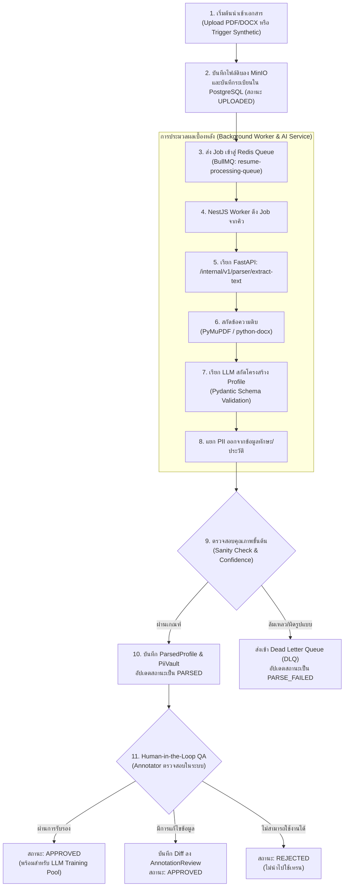

# 05. ไปป์ไลน์การประมวลผลข้อมูล (Data Processing Pipeline)

เอกสารนี้ระบุรายละเอียดขั้นตอนการประมวลผลข้อมูลเรซูเมตั้งแต่การนำเข้าจนถึงการรับรองคุณภาพ (Ingestion to Training-Ready State) สำหรับ **InterviewX DataHub** อ้างอิงสถาปัตยกรรมจาก [`02-ARCHITECTURE.md`](file:///Users/mac/Desktop/interviewx-datahub/context/02-ARCHITECTURE.md) และสัญญา API จาก [`04-API-CONTRACT.md`](file:///Users/mac/Desktop/interviewx-datahub/context/04-API-CONTRACT.md)

---

## 1. ผังการทำงานของไปป์ไลน์ข้อมูล (Pipeline Flowchart)

---

## 2. รายละเอียดขั้นตอนการประมวลผล (Processing Stages)

### 2.1 ขั้นตอนที่ 1: การนำเข้าและการจัดเก็บ (Ingestion & Storage)
- **การตรวจสอบขั้นต้น (Pre-validation)**: ตรวจสอบ MIME Type (รองรับเฉพาะ `application/pdf` และ `application/vnd.openxmlformats-officedocument.wordprocessingml.document`) และขนาดไฟล์ไม่เกิน 25MB
- **การจัดเก็บวัตถุดิบ (Raw Storage)**: บันทึกไฟล์ลง MinIO ใน Bucket `raw-documents` โดยใช้ชื่อไฟล์ที่เป็น UUID ป้องกันการซ้ำซ้อน
- **การบันทึกสถานะ**: สร้างแถวข้อมูลในตาราง `Document` ด้วยสถานะ `UPLOADED`

### 2.2 ขั้นตอนที่ 2: การสกัดข้อความดิบ (Text Extraction)
- ฝั่ง **FastAPI** ดาวน์โหลด Stream ข้อมูลจาก MinIO
- สำหรับไฟล์ PDF: ใช้ **PyMuPDF (`fitz`)** ในการอ่านข้อความ, หน้า, และตำแหน่ง Block เพื่อความเร็วและคงลำดับการอ่าน
- สำหรับไฟล์ DOCX: ใช้ **python-docx** ในการอ่าน Paragraphs และ Tables
- ทำการล้างข้อความ (Text Cleaning): ตัดอักขระแปลกปลอม, จัดการ Unicode Normalization (NFC)

### 2.3 ขั้นตอนที่ 3: การสกัดโครงสร้างข้อมูลผ่าน LLM (LLM Information Extraction)
- นำข้อความดิบส่งต่อให้ LLM (เช่น Gemini หรือ OpenAI) ผ่าน Prompt ที่กำหนดโครงสร้าง Schema อย่างเข้มงวด
- กำหนด Schema ปลายทางด้วย **Pydantic v2**:
  - `skills`: รายการทักษะทางเทคนิคและเครื่องมือ
  - `experiences`: บริษัท, ตำแหน่ง, วันเริ่มต้น-สิ้นสุด, รายละเอียดผลงาน
  - `educations`: สถาบัน, วุฒิการศึกษา, สาขา, ปีที่จบ
  - `pii`: ชื่อ-สกุล, อีเมล, เบอร์โทรศัพท์ (สกัดแยกออกมาโดยเฉพาะ)
- **Provenance Tracking**: AI Service คำนวณ Character Offset หรือตำแหน่งข้อความ เพื่อระบุว่าข้อมูลแต่ละฟิลด์ถูกสกัดมาจากส่วนใดของข้อความดิบ

### 2.4 ขั้นตอนที่ 4: การคัดกรองคุณภาพและการแยกเก็บ (Quality Gate & PII Segregation)
- ตรวจสอบความสมเหตุสมผลเชิงตรรกะ (Sanity Checks):
  - วันที่เริ่มงานต้องไม่เกินวันสิ้นสุดงาน (`start_date <= end_date`)
  - มีรายการประสบการณ์ทำงานหรือการศึกษาอย่างน้อย 1 รายการ
  - อัตราความมั่นใจ (Confidence Score) ผ่านเกณฑ์ขั้นต่ำ
- **การแยกเก็บ**:
  - หากเป็นข้อมูลจริง: บันทึกข้อมูลส่วนบุคคลลงตาราง `PiiVault` ส่วนประวัติและทักษะบันทึกลง `ParsedProfile`
  - หากเป็นข้อมูลสังเคราะห์: บันทึกเฉพาะ `ParsedProfile` โดยตรง

### 2.5 ขั้นตอนที่ 5: การตรวจสอบโดยมนุษย์ (Human-in-the-loop QA)
- ผู้ตรวจสอบ (Annotator) เข้าสู่ระบบเพื่อเปิดดูเอกสารแบบคู่ขนาน (Side-by-side View)
- แก้ไขข้อมูลฟิลด์ที่ผิดพลาด ระบบจะบันทึก Snapshot ของความเปลี่ยนแปลงลงใน `AnnotationReview`
- เมื่อได้รับการกด Approve ข้อมูลจะถือว่าผ่านเกณฑ์และพร้อมนำไปใช้ในกระบวนการ Export ชุดข้อมูล (ดูรายละเอียดใน [`07-LLM-TRAINING.md`](file:///Users/mac/Desktop/interviewx-datahub/context/07-LLM-TRAINING.md))

---

## 3. สถาปัตยกรรมคิวงานและความทนทานต่อข้อผิดพลาด (Queue & Fault Tolerance)

1. **คิวงานผ่าน BullMQ**:
   - แยก Queue สำหรับงานแต่ละประเภท: `resume-parse-queue`, `synthetic-gen-queue`, `dataset-export-queue`
   - กำหนดจำนวน Concurrency ที่เหมาะสมเพื่อไม่ให้กระทบ Rate Limit ของ External LLM API
2. **กลยุทธ์การลองซ้ำ (Retry Policy)**:
   - กรณีเกิดข้อผิดพลาดจากเครือข่าย หรือ HTTP 429 (Rate Limit): ใช้ Exponential Backoff Retry สูงสุด 3-5 ครั้ง
3. **Dead Letter Queue (DLQ)**:
   - หากลองซ้ำครบตามกำหนดแล้วยังล้มเหลว งานจะถูกย้ายเข้าสู่ Failed Queue และระบบจะอัปเดตสถานะของเรซูเมเป็น `PARSE_FAILED` พร้อมระบุสาเหตุในตาราง
4. **ความเป็น Idempotent**:
   - การสั่งประมวลผลซ้ำสำหรับ `document_id` เดิม จะทำการอัปเดตระเบียนที่มีอยู่เดิม ไม่สร้างแถวข้อมูลใหม่ที่ซ้ำซ้อน

---

## 4. ข้อสมมติฐานหลัก (Explicit Assumptions)

1. **คุณภาพของไฟล์ PDF**: สันนิษฐานว่าเรซูเมส่วนใหญ่เป็น Text-based PDF หากเป็น Image-only Scan จะต้องใช้ OCR ซึ่งยังไม่อยู่ในขอบเขตการทำงานของ Phase 1
2. **การคงอยู่ของไฟล์ดิบ**: ไฟล์ต้นฉบับจะถูกเก็บถาวรใน MinIO จนกว่าจะมีการร้องขอถอนความยินยอมหรือการลบตามนโยบาย

---

## 5. ประเด็นที่ยังค้างการตัดสินใจ (Unresolved Decisions)

1. **การรองรับ OCR สำหรับ Scanned PDF**: ควรพิจารณาติดตั้ง Tesseract OCR หรือบริการ Cloud OCR เพิ่มเติมใน Phase ใด
2. **กลไก Real-time Progress Tracking**: จะให้หน้าจอ UI ดึงสถานะแบบ Polling ทุกๆ 3 วินาที หรือจะต่อ Server-Sent Events (SSE) เพื่อรับสถานะแบบพุชทันทีเมื่อ Parsing เสร็จ
