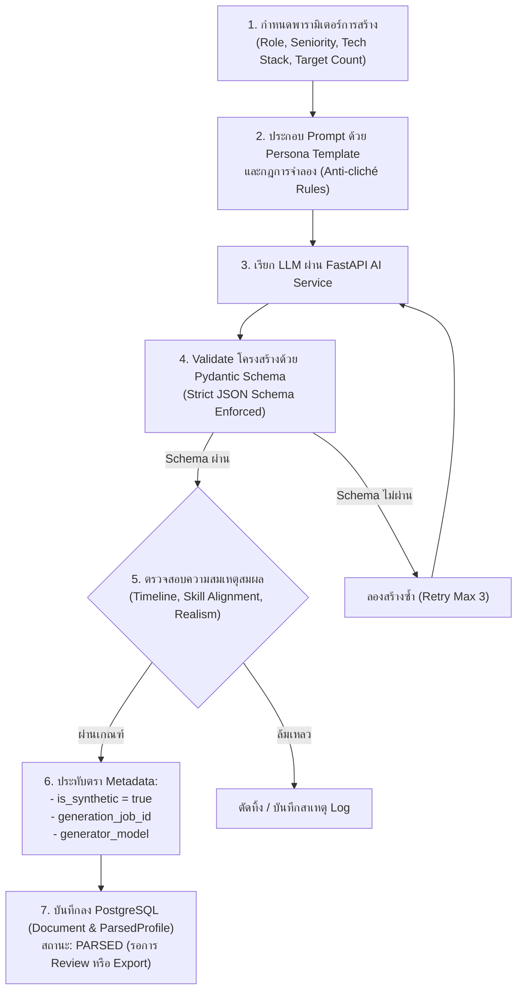

# 06. ยุทธศาสตร์และการสร้างข้อมูลสังเคราะห์ (Synthetic Data Strategy & Generation)

เอกสารนี้ระบุยุทธศาสตร์ การออกแบบ และกระบวนการสร้างข้อมูลเรซูเมสังเคราะห์ (Synthetic Resume Data) สำหรับ **InterviewX DataHub** เพื่อใช้เป็นชุดข้อมูลตั้งต้นในการฝึกสอนและประเมินผล LLM โดยปราศจากความเสี่ยงด้านข้อมูลส่วนบุคคล อ้างอิงสถาปัตยกรรมจาก [`02-ARCHITECTURE.md`](file:///Users/mac/Desktop/interviewx-datahub/context/02-ARCHITECTURE.md)

---

## 1. เหตุผลและความสำคัญของข้อมูลสังเคราะห์ (Why Synthetic First)

1. **ขจัดความเสี่ยงด้าน PII และกฎหมายคุ้มครองข้อมูล**: การเริ่มต้นเทรน LLM ด้วยข้อมูลสังเคราะห์ 100% ช่วยให้กระบวนการทดลองและพัฒนาโมเดลดำเนินไปได้อย่างรวดเร็วโดยไม่ต้องรอการรวบรวม Consent จากบุคคลจริง
2. **ควบคุมความหลากหลายและความสมดุล (Controlled Diversity & Balance)**: สามารถกำหนดสัดส่วนของตำแหน่งงาน (Roles), ระดับความอาวุโส (Seniority), อุตสาหกรรม (Industries), และกลุ่มเทคโนโลยี (Tech Stacks) ได้ตามต้องการ เพื่อป้องกันปัญหาความลำเอียงของข้อมูล (Data Bias / Imbalance)
3. **การสร้าง Edge Cases**: สามารถจำลองประวัติการทำงานที่มีลักษณะเฉพาะ เช่น การเปลี่ยนสายงาน (Career Switcher), ช่องว่างในการทำงาน (Career Gap), หรือผู้เชี่ยวชาญเทคโนโลยีเฉพาะทางที่หาได้ยากในตลาดจริง

---

## 2. เมทริกซ์การจำลองตัวตน (Persona & Archetype Matrix)

ระบบสร้างข้อมูลสังเคราะห์จะสุ่มเลือกหรือรับการกำหนดค่าตามมิติต่างๆ ดังนี้:

| มิติ (Dimension) | ตัวเลือกและการกระจายตัว (Options & Distribution) |
| :--- | :--- |
| **คลังชื่อบุคคล (Name Banks)** | **ไทย (Thai)**: 100+ ชื่อชาย-หญิงไทย, นามสกุลไทยหลากหลายตระกูล/ภูมิหลัง, พร้อมชื่อเล่นไทยและคำทับศัพท์ (เช่น กิตติพงษ์ วงษ์ประดิษฐ์ (แบงค์))<br>**สากล (International)**: Western/Anglo-American, East Asian (จีน, ญี่ปุ่น, เกาหลี), Southeast Asian (สิงคโปร์, มาเลเซีย, เวียดนาม, ฟิลิปปินส์), South Asian, Continental European |
| **สถาบันการศึกษา (Institutions)** | มหาวิทยาลัยชั้นนำของไทย (จุฬาฯ, มธ., มหิดล, มก., มจธ., สจล., มช., มข., ม.อ., มศว, นิด้า, เอแบค) และสถาบันชั้นนำระดับโลก (NUS, NTU, Univ of Tokyo, Oxford, Cambridge, Harvard, Stanford, Imperial, Melbourne) |
| **ระบบนิเวศองค์กร (Organizations)** | จำลองบริษัทตามกลุ่มอุตสาหกรรม (Tech Unicorns/Scale-ups, Healthcare Tertiary Hospitals, Banking & Wealth Houses, Corporate Law Chambers, EPC Engineering, Conglomerates) |
| **สายงาน (Job Roles)** | ครอบคลุม 8+ อุตสาหกรรม: Technology, Healthcare, Finance, Legal, Engineering, Business, Education, Creative |
| **ระดับประสบการณ์ (Seniority)** | Student/Trainee (0 ปี), Junior (1–3 ปี), Mid-level (3–5 ปี), Senior Specialist / Lead (5–8 ปี), Director / Principal (8+ ปี) |
| **ภาษาและวัฒนธรรม (Languages)** | ภาษาอังกฤษสากล (`en`), ภาษาไทย (`th`), และทวิภาษา (`mixed` / Bilingual Thai-English) พร้อมระดับความเชี่ยวชาญ CEFR |
| **ประเภทชุดข้อมูล (7 Dataset Types)** | Profile, Resume, Interview Question, Interview Answer (6 ระดับคุณภาพ), Rubric Evaluation, Feedback & Coaching, Scenario Dilemma |

---

## 3. ขั้นตอนการสร้างข้อมูลสังเคราะห์ (Generation Workflow)



### 3.1 การควบคุมคุณภาพและป้องกันความจำเจ (Anti-Cliché & Quality Rules)
- **หลีกเลี่ยงข้อความสูตรสำเร็จของ AI**: ป้องกันการใช้ประโยคซ้ำซาก เช่น "spearheaded the development", "passionate software craftsman" ในทุกแถว โดยกำหนดคลังคำกริยาและสไตล์การเขียนที่หลากหลาย
- **ความสมจริงของตัวเลขผลงาน (Realistic Impact Metrics)**: กำหนดให้ผลงานมีตัวเลขชี้วัดที่สมเหตุสมผลตามระดับตำแหน่ง (เช่น Mid-level ปรับปรุงความเร็ว query 20-30%, Lead ปรับโครงสร้างระบบลดต้นทุน Infrastructure)
- **ความสอดคล้องตามช่วงเวลา (Chronological Consistency)**: ปีที่จบการศึกษาต้องสอดคล้องกับปีที่เริ่มทำงาน และประสบการณ์แต่ละที่มีช่วงเวลาที่ต่อเนื่องหรือมีเหตุผลรองรับ

---

## 4. โครงสร้างข้อมูลและ Pydantic Validation

FastAPI จะบังคับใช้ Schema เดียวกันกับที่ใช้สกัดข้อมูลจริง เพื่อให้ปลายทางของข้อมูลทั้งสองประเภทมีหน้าตาเหมือนกัน:

```python
class SyntheticExperience(BaseModel):
    company_name: str
    role_title: str
    start_date: str # YYYY-MM
    end_date: str   # YYYY-MM or 'Present'
    responsibilities: list[str]
    technologies_used: list[str]

class SyntheticEducation(BaseModel):
    institution: str
    degree: str
    field_of_study: str
    graduation_year: int

class SyntheticResumeProfile(BaseModel):
    professional_summary: str
    skills: list[str]
    experiences: list[SyntheticExperience]
    educations: list[SyntheticEducation]
    certifications: list[str] = []
    projects: list[dict] = []
```

---

## 5. การประทับตราและตรวจสอบย้อนกลับ (Tagging & Provenance)

1. **เครื่องหมายสังเคราะห์ถาวร**: ฟิลด์ `is_synthetic = true` จะถูกกำหนดและไม่สามารถเปลี่ยนแปลงได้ผ่าน API ใดๆ
2. **Watermark ใน Metadata**: ทุกระเบียนจะเก็บ `synthetic_job_id`, `prompt_template_version`, และ `model_name` เพื่อให้สามารถสืบย้อนได้เสมอว่าข้อมูลชุดนี้ถูกสร้างขึ้นเมื่อใด ด้วยพารามิเตอร์ใด
3. **ป้องกันข้อมูลรั่วไหลสู่การทดสอบ (Data Contamination)**: การแบ่งชุดข้อมูล Train/Validation/Test ต้องคำนึงถึง Seed และกลุ่ม Persona เพื่อป้องกันไม่ให้ข้อมูลที่สร้างจาก Prompt หรือ Pattern เดียวกันหลุดข้ามไประหว่าง Split

---

## 6. ข้อสมมติฐานหลัก (Explicit Assumptions)

1. **ไม่สร้างเป็นไฟล์ PDF หลอก**: ข้อมูลสังเคราะห์จะถูกบันทึกเป็น Structured JSON Profile โดยตรง ไม่จำเป็นต้องแปลงเป็นไฟล์ PDF แล้วนำมา Parse ซ้ำ (เว้นแต่ต้องการทดสอบไปป์ไลน์การ Parse)
2. **ชื่อบุคคลและองค์กรสมมติ**: ชื่อบุคคลและชื่อบริษัทในข้อมูลสังเคราะห์ต้องเป็นชื่อที่สมมติขึ้นทั้งหมด ห้ามใช้ชื่อบุคคลจริงที่มีชื่อเสียง

---

## 7. ประเด็นที่ยังค้างการตัดสินใจ (Unresolved Decisions)

1. **ระดับอุณหภูมิของโมเดล (Temperature Tuning)**: ควรใช้ Temperature เท่าใด (เช่น 0.7 - 0.9) เพื่อสร้างความหลากหลายของภาษา แต่ยังรักษาความถูกต้องของโครงสร้าง JSON ไว้ได้
2. **การทำ Synthetic Resume PDF Rendering**: ควรมีฟีเจอร์แปลง Structured JSON ให้กลายเป็นเอกสาร PDF สังเคราะห์ (เช่น ใช้ WeasyPrint / Puppeteer) เพื่อนำไปใช้เป็นชุดทดสอบระบบ Document Parser หรือไม่
