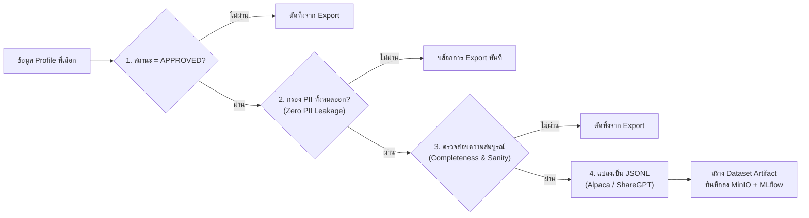

# 07. การจัดเตรียมและส่งออกชุดข้อมูลสำหรับฝึกสอน LLM (LLM Training Data Preparation & Export)

เอกสารนี้ระบุข้อกำหนด กระบวนการแปลงรูปแบบ (Data Formatting), การแบ่งชุดข้อมูล (Dataset Splitting), และการติดตามเวอร์ชัน (Versioning & Lineage) สำหรับการฝึกสอนและประเมินผลโมเดลภาษาขนาดใหญ่ (LLM) ในระบบ **InterviewX** อ้างอิงสถาปัตยกรรมจาก [`02-ARCHITECTURE.md`](file:///Users/mac/Desktop/interviewx-datahub/context/02-ARCHITECTURE.md) และความปลอดภัยจาก [`08-SECURITY-PRIVACY.md`](file:///Users/mac/Desktop/interviewx-datahub/context/08-SECURITY-PRIVACY.md)

---

## 1. กรณีการใช้งาน LLM ในระบบ InterviewX (LLM Use Cases)

ชุดข้อมูลที่ส่งออกจาก DataHub จะถูกนำไปใช้ใน 4 ภารกิจหลักของระบบ InterviewX:
1. **การสร้างคำถามสัมภาษณ์งานแบบเฉพาะบุคคล (Interview Question Generation)**: สร้างคำถามเชิงลึกตามทักษะและประสบการณ์จริงในเรซูเม
2. **การจับคู่ผู้สมัครกับตำแหน่งงาน (Resume-to-Job Matching & Skill Gap Analysis)**: วิเคราะห์ความเหมาะสมและระบุทักษะที่ยังขาด
3. **การสรุปและสังเคราะห์ประวัติการทำงาน (Profile Summarization)**: สรุปจุดเด่น ผลงานสำคัญ และภาพรวมของผู้สมัคร
4. **การจำลองบทบาทผู้สมัครเพื่อฝึกซ้อมสัมภาษณ์ (Candidate Persona Simulation)**: สร้าง AI Persona ให้มีบุคลิก ประสบการณ์ และความรู้ตรงตามเรซูเม

---

## 2. รูปแบบชุดข้อมูลที่รองรับ (Export Formats)

ระบบรองรับการส่งออกข้อมูลเป็นไฟล์ `.jsonl` (JSON Lines) ในรูปแบบมาตรฐานอุตสาหกรรม:

### 2.1 รูปแบบ Alpaca Instruction Format
เหมาะสำหรับการทำ Instruction Fine-tuning แบบคำสั่งตรงไปตรงมา:
```json
{
  "instruction": "วิเคราะห์ทักษะและสรุปประสบการณ์การทำงานของผู้สมัครนี้",
  "input": "Summary: Senior Backend Developer...\nSkills: [NestJS, PostgreSQL, Redis]...",
  "output": "ผู้สมัครมีความเชี่ยวชาญระดับ Senior ด้าน Backend Development ด้วย Node.js และ NestJS..."
}
```

### 2.2 รูปแบบ OpenAI ChatML / ShareGPT Format
เหมาะสำหรับโมเดลรูปแบบสนทนาหลายรอบ (Multi-turn Conversation):
```json
{
  "messages": [
    {
      "role": "system",
      "content": "คุณคือ AI ผู้ช่วยสัมภาษณ์งานที่มีความเชี่ยวชาญด้านเทคนิคระดับสูง"
    },
    {
      "role": "user",
      "content": "นี่คือประวัติการทำงานของผู้สมัคร:\n[Candidate Profile JSON]\nช่วยตั้งคำถามสัมภาษณ์เชิงเทคนิคเกี่ยวกับ NestJS และการออกแบบ Microservices จำนวน 3 ข้อ"
    },
    {
      "role": "assistant",
      "content": "คำถามสัมภาษณ์สำหรับผู้สมัครรายนี้ได้แก่:\n1. จากประสบการณ์การใช้ NestJS..."
    }
  ]
}
```

### 2.3 รูปแบบ RAG / Knowledge Chunking Format
จัดเตรียมท่อนข้อมูล (Chunks) พร้อม Metadata สำหรับนำไปคำนวณ Embedding และจัดเก็บลง Vector Database

---

## 3. ด่านตรวจความปลอดภัยและคุณภาพก่อน Export (Pre-Export Quality & Safety Gate)

ก่อนที่ข้อมูลจะถูกรวบรวมเป็นไฟล์ Dataset ระบบ NestJS จะบังคับใช้กฎ 4 ข้ออย่างเคร่งครัด:



1. **Rule 1 (Approval Check)**: เฉพาะเรซูเมที่มีสถานะ `APPROVED` เท่านั้นจึงจะมีสิทธิ์ถูกคัดเลือก
2. **Rule 2 (PII Stripping)**: ข้อมูลส่วนบุคคล (ชื่อ, เบอร์โทร, อีเมล, ที่อยู่, เลขประจำตัว) จะถูกคัดกรองทิ้งอย่างเด็ดขาด แม้ว่าจะเป็นข้อมูลที่ได้รับความยินยอมก็ตาม
3. **Rule 3 (Data Balance & Stratification)**: มีระบบรายงานสัดส่วนตำแหน่งงานและระดับประสบการณ์ของชุดข้อมูลที่กำลังจะ Export เพื่อให้วิศวกรเห็นการกระจายตัวของข้อมูล
4. **Rule 4 (No Metric Fabrication)**: บันทึกเฉพาะจำนวนเรเบียนจริง และค่า Hash จริง ห้ามสร้างตัวเลขสถิติหลอก

---

## 4. กลยุทธ์การแบ่งชุดข้อมูล (Dataset Splitting Strategy)

- **สัดส่วนการแบ่ง**: กำหนดสัดส่วนมาตรฐาน เช่น Train (80%), Validation (10%), Test (10%)
- **การป้องกันข้อมูลรั่วไหล (Data Contamination & Leakage Prevention)**:
  - ใช้ **Group/Stratified Split** อิงตาม Persona Archetype และวันที่นำเข้า เพื่อให้มั่นใจว่าข้อมูลที่มีโครงสร้างหรือ Template เดียวกันจะไม่กระจายตัวอยู่ทั้งใน Train และ Test Set
  - ใช้ Random Seed ที่ระบุได้แบบ Deterministic เพื่อให้การ Export ซ้ำได้ผลลัพธ์เหมือนเดิมทุกครั้ง

---

## 5. การจัดการเวอร์ชันและการเชื่อมโยงย้อนกลับ (Versioning & Lineage: MLflow, DVC & Manifest)

1. **การจัดเก็บ Artifact & Manifest**:
   - ไฟล์ชุดข้อมูลแยกตาม Split (`train.jsonl`, `val.jsonl`, `test.jsonl`) จะถูกจัดเก็บใน MinIO
   - มีการสร้างไฟล์ **`manifest.json`** บันทึกค่า Cryptographic SHA-256 Hash ของแต่ละ Split, สถิติการแบ่งกลุ่ม (Leakage Stats), และ Lineage Trace ย้อนกลับไปยัง Source Document ID และ Consent ID
2. **DVC Hash**: คำนวณค่า **SHA-256** ของชุดข้อมูลทั้งหมด และบันทึกลงในคอลัมน์ `dvc_hash` ของตาราง `DatasetExport`
3. **MLflow Tracking Integration**:
   - บันทึก Parameters: Filter criteria, Format, Split ratios, Model target
   - บันทึก Metrics: Total records, Vocabulary size, Distribution per role
   - บันทึก Artifact URI และ Manifest Path เพื่อให้กระบวนการฝึกสอนโมเดลสามารถดึงไปใช้งานได้อย่างอัตโนมัติ

---

## 6. ท่อประมวลผลการฝึกสอนโมเดล (Fine-Tuning Pipeline: LoRA & QLoRA)

DataHub พัฒนาระบบ Fine-Tuning Orchestrator (`apps/backend/src/training` และ `services/ai-service/src/training`):
1. **PEFT Configuration Generator**: รองรับการสร้างคอนฟิก LoRA/QLoRA 4-bit ตามมาตรฐาน Hugging Face PEFT สำหรับโมเดลเช่น `Qwen/Qwen2.5-7B-Instruct` และ `meta-llama/Llama-3.1-8B-Instruct`
2. **Training Job Orchestration**: ตาราง `model TrainingJob` ควบคุมสถานะ `QUEUED`, `RUNNING`, `COMPLETED`, `FAILED` พร้อมบันทึก Loss Curve และคำนวณ Perplexity (`exp(eval_loss)`)

---

## 7. ระบบทดสอบวัดผลอัตโนมัติ (Automated Benchmark Evaluation Harness)

ก่อนที่โมเดลจะได้รับการรับรอง ระบบจะประเมินผลผ่านเกณฑ์มาตรฐาน 4 ด้าน:
1. **Behavioral STAR Criteria (30%)**: โครงสร้างคำตอบถูกต้องตามหลัก Situation, Task, Action, Result
2. **Technical & Domain Depth (30%)**: ความถูกต้องและความลึกเชิงวิชาชีพตามผัง Taxonomy
3. **Thai Language Fluency & Nuance (20%)**: ความเป็นธรรมชาติและน้ำเสียงภาษาไทยที่เหมาะสม
4. **Zero PII & Guardrails (20%)**: ตรวจสอบการไม่รั่วไหลของข้อมูลส่วนบุคคล 100%

---

## 8. ทะเบียนโมเดลและด่านตรวจความปลอดภัย (Model Registry & Publishing Gate)

1. **วงจรชีวิตโมเดล**: จัดเก็บในตาราง `model ModelVersion` ผ่าน 4 สถานะ: `CANDIDATE` ➔ `STAGING` ➔ `PRODUCTION` ➔ `ARCHIVED`
2. **Integrity Gate ก่อนส่งมอบสู่ PRODUCTION**:
   - คะแนน Benchmark Score ต้อง >= `minQualityScore` (0.80)
   - ต้องผ่านการตรวจสอบ Zero PII (`piiScanPassed === true`)
   - ต้องได้รับการอนุมัติจากผู้ดูแลระบบ (`approvedById`)
3. **การเชื่อมโยงสู่ InterviewX Core**: ให้บริการ Endpoint `GET /training/models/active` สำหรับส่งต่อ Endpoint URL และ Adapter Path ไปยัง Core Serving Platform ทันที
