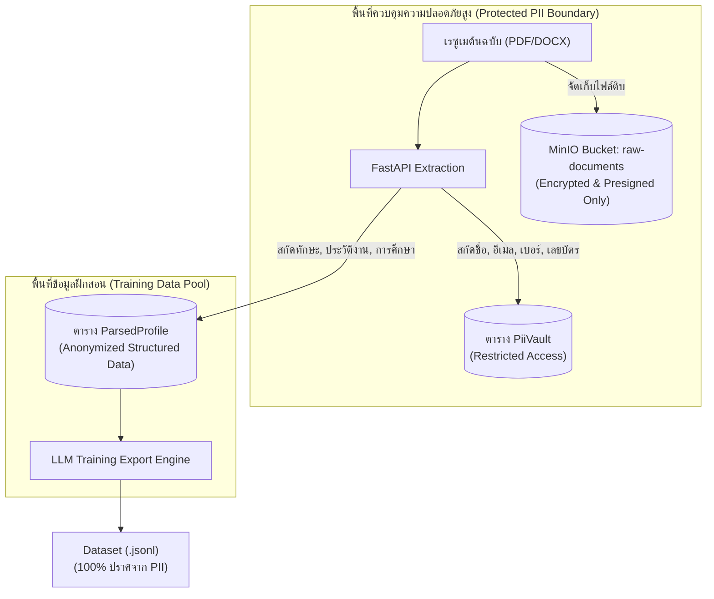

# 08. ความมั่นคงปลอดภัยและการปกป้องข้อมูลส่วนบุคคล (Security & Privacy Governance)

เอกสารนี้ระบุข้อกำหนดด้านความปลอดภัย นโยบายการคุ้มครองข้อมูลส่วนบุคคล (PDPA/GDPR), การแบ่งแยกสิทธิ์ (RBAC), สถาปัตยกรรมแยกเก็บ PII, และระบบบันทึกประวัติการใช้งาน (Audit Trail) สำหรับ **InterviewX DataHub** อ้างอิงกฎจาก [`AGENTS.md`](file:///Users/mac/Desktop/interviewx-datahub/context/08-SECURITY-PRIVACY.md)

---

## 1. กฎการกำกับดูแลข้อมูลส่วนบุคคล (Data Privacy Core Rules)

ตามข้อกำหนดใน [`AGENTS.md`](file:///Users/mac/Desktop/interviewx-datahub/AGENTS.md):
1. **ข้อมูลสังเคราะห์และข้อมูลจริงต้องแยกออกจากกันอย่างเด็ดขาด (Strict Distinguishability)**: ข้อมูลทุกรายการต้องมีป้ายกำกับแหล่งที่มาที่ชัดเจน
2. **ห้ามนำข้อมูลจริงมาใช้โดยปราศจากความยินยอมที่ชอบด้วยกฎหมาย**: ต้องมี `ConsentRecord` ที่ถูกต้องก่อนนำเข้าและประมวลผล
3. **การแยกข้อมูลระบุตัวตน (PII Segregation)**: ข้อมูล PII ต้องถูกแยกออกจากข้อมูลที่ใช้ในการฝึกสอนโมเดล
4. **การสกัดกั้นการรั่วไหลของ PII (Zero PII Leakage Gate)**: ปิดกั้นการส่งออก PII ในขั้นตอนการสร้าง Dataset อย่างสมบูรณ์
5. **รองรับการถอนความยินยอมและการลบข้อมูล (Consent Withdrawal & Right to be Forgotten)**: มีขั้นตอนและระบบอัตโนมัติในการลบข้อมูลจริงเมื่อได้รับคำขอ
6. **การบันทึกประวัติการเข้าถึง (Comprehensive Audit Logs)**: ทุกการกระทำที่เกี่ยวข้องกับข้อมูลต้องถูกบันทึก

---

## 2. สถาปัตยกรรมการแยกเก็บ PII (PII Vault Pattern)

เพื่อป้องกันไม่ให้ข้อมูลส่วนบุคคลปะปนกับประวัติการทำงานและทักษะ ระบบใช้สถาปัตยกรรมแบบแยกตารางและคีย์ (Vault Pattern):

- **PiiVault**: จัดเก็บเฉพาะข้อมูลที่มีความละเอียดอ่อน เข้าถึงได้เฉพาะผู้ดูแลระบบและกระบวนการจัดการสิทธิ์
- **ParsedProfile**: จัดเก็บเฉพาะเนื้อหาเชิงวิชาชีพ (ทักษะ, ตำแหน่งงาน, ประสบการณ์, การศึกษา) โดยไม่มีข้อมูลติดต่อหรือชื่อจริง

---

## 3. การควบคุมการเข้าถึงตามบทบาท (Role-Based Access Control: RBAC)

| สิทธิ์การใช้งาน (Permissions) | ADMIN | ML_ENGINEER | ANNOTATOR | VIEWER |
| :--- | :---: | :---: | :---: | :---: |
| ดูรายการและแดชบอร์ด (View Dashboard) | ✅ | ✅ | ✅ | ✅ |
| อัปโหลดเรซูเมจริงพร้อม Consent | ✅ | ❌ | ❌ | ❌ |
| สร้างข้อมูลสังเคราะห์ (Trigger Synthetic Job) | ✅ | ✅ | ❌ | ❌ |
| เข้าถึงหน้าตรวจสอบข้อมูล (Annotation Workspace) | ✅ | ✅ | ✅ | ❌ |
| แก้ไขและรับรองข้อมูล (Approve/Reject Profile) | ✅ | ✅ | ✅ | ❌ |
| ดูข้อมูล PII ต้นฉบับของเรซูเมจริง | ✅ | ❌ | ❌ | ❌ |
| ส่งออก Dataset สำหรับ LLM (Trigger Export) | ✅ | ✅ | ❌ | ❌ |
| จัดการคำขอถอนความยินยอม (Consent Withdrawal) | ✅ | ❌ | ❌ | ❌ |
| ตรวจสอบบันทึกระบบ (View Audit Logs) | ✅ | ❌ | ❌ | ❌ |

---

## 4. วงจรการถอนความยินยอมและการลบข้อมูล (Consent Withdrawal Lifecycle)

เมื่อเจ้าของข้อมูลส่วนบุคคล (Data Subject) แจ้งขอถอนความยินยอม (Withdrawal Request):
1. **รับคำขอและตรวจสอบ**: Admin บันทึกการเพิกถอนในตาราง `ConsentRecord` (ระบุ `revoked_at` และเปลี่ยน `is_active = false`)
2. **ค้นหาระเบียนที่เกี่ยวข้อง**: ระบบค้นหาเอกสารทั้งหมดที่ผูกกับ `consent_id` นั้น
3. **Hard Delete ใน PiiVault และ MinIO**:
   - ลบไฟล์ต้นฉบับออกจาก MinIO ทันที
   - ลบระเบียนในตาราง `PiiVault`
4. **ตัดออกจาก Training Pipeline**:
   - ปรับสถานะเรซูเมเป็น `REVOKED_DELETED` เพื่อป้องกันไม่ให้นำไปรวมใน Dataset Export ในอนาคต
   - บันทึกการลบลงใน `AuditLog` เพื่อเป็นหลักฐานทางกฎหมาย

---

## 5. การบันทึกประวัติการใช้งานระบบ (Audit Trail & Logging)

ตาราง `AuditLog` ถูกออกแบบให้เป็น **Append-Only** (ไม่อนุญาตให้อัปเดตหรือลบระเบียน):
- **ฟิลด์ที่บันทึก**: `user_id`, `action`, `entity_name`, `entity_id`, `ip_address`, `payload_diff`, `created_at`
- **กิจกรรมที่ต้องบันทึก**:
  - การเข้าสู่ระบบและการออกจากระบบ
  - การแก้ไขข้อมูลเรซูเมโดยมนุษย์ (Manual Annotation Edits)
  - การกด Approve หรือ Reject ข้อมูล
  - การสั่งรัน Synthetic Generation Job
  - การส่งออก Dataset (บันทึก filter parameters และ hash)
  - การเพิกถอนความยินยอมและการลบข้อมูล

---

## 6. ข้อสมมติฐานหลัก (Explicit Assumptions)

1. **ระบบเครือข่ายภายใน (Private Virtual Network)**: ฐานข้อมูล PostgreSQL, MinIO, Redis และ FastAPI สื่อสารผ่าน Internal Docker Network เท่านั้น มีเพียง NestJS และ Next.js ที่เชื่อมโยงกับภายนอกตามขอบเขต
2. **การเข้ารหัสในการส่งผ่าน (Encryption in Transit)**: ทราฟฟิกภายนอกทั้งหมดบังคับใช้ TLS/HTTPS

---

## 7. ประเด็นที่ยังค้างการตัดสินใจ (Unresolved Decisions)

1. **การ Masking PII อัตโนมัติบน PDF Preview**: ในหน้าจอ Side-by-side ของ Annotator ควรมีระบบระบายแถบดำ (Blackout Redaction) บนไฟล์ PDF อัตโนมัติก่อนแสดงผลหรือไม่ เพื่อให้ Annotator ไม่เห็นข้อมูล PII โดยสิ้นเชิง
2. **การเก็บรักษาข้อมูลหลังการถอนความยินยอม (Data Retention Policy)**: หาก Dataset ถูกนำไปเทรนโมเดลจนเสร็จสิ้นไปแล้วก่อนมีการถอนความยินยอม นโยบายทางกฎหมายขององค์กรจะปฏิบัติต่อ Checkpoint โมเดลนั้นอย่างไร
