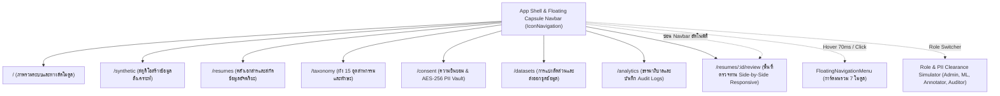

# 09. ข้อกำหนดการออกแบบส่วนติดต่อผู้ใช้ (UI/UX Specifications)

เอกสารนี้ระบุการออกแบบส่วนติดต่อผู้ใช้ (UI/UX), โครงสร้างหน้าจอหลัก (Page Architecture), และรูปแบบการปฏิสัมพันธ์ของผู้ใช้ (Interaction Patterns) สำหรับระบบ **InterviewX DataHub** อ้างอิงข้อกำหนดจาก [`01-REQUIREMENTS.md`](file:///Users/mac/Desktop/interviewx-datahub/context/01-REQUIREMENTS.md)

---

## 1. เทคโนโลยีและระบบการออกแบบ (Technology & Design System)

- **Framework**: **Next.js** (App Router, React 19 / 18, TypeScript)
- **Styling**: **Tailwind CSS**
- **UI Component Library**: **shadcn/ui** (สร้างบน Radix UI Primitives และ Lucide React Icons)
- **State & Data Fetching**: **TanStack Query (React Query)** สำหรับจัดการ Server State, Caching, และ Polling
- **Form Management & Validation**: **React Hook Form** ร่วมกับ **Zod Schema**
- **ธีมสีและการแสดงผล**: Clean Modern SaaS Light Theme ออกแบบให้สบายตา (Eye-friendly) ปราศจากความรก (Minimalist) พร้อมโครงสร้าง Floating Capsule Navbar ลอยตัว
- **สัญลักษณ์แบรนด์ (Brand Mark)**: โลโก้เวกเตอร์เฉพาะ `InterviewXLogo` (ตัวอักษร "X" ทันสมัย, Neural Node จุดเชื่อมโยงข้อมูล DataHub, และประกายดาว AI Intelligence ✦)

---

## 2. โครงสร้างหน้าจอและการนำทาง (Information Architecture & Routes)



---

## 3. ระบบแถบนำทางลอยตัว (Universal Floating Capsule Navigation)

ระบบนำทางได้รับการออกแบบตามมาตรฐาน UI/UX สากล โดยรวมศูนย์เมนูทั้งหมดไว้ในปุ่มหลักปุ่มเดียวเพื่อความโปร่งตา:

### 3.1 แถบนำทางแคปซูล (`IconNavigation.tsx`)
1. **Brand Mark & Identity**:
   - โลโก้ทรงกลมไล่เฉดสีฟ้า-คราม (`from-blue-600 via-indigo-600 to-blue-500`) บรรจุสัญลักษณ์ "X" และประกาย AI พร้อมชื่อระบบ `InterviewX DataHub`
2. **ปุ่มเมนูหลักจุดเดียว (Single Main Menu Trigger)**:
   - ปุ่ม `❖ เมนูระบบทั้งหมด (All Modules) [Active Page] ▾` แทนที่การเรียงไอคอนหลายปุ่มจนเต็มแถบ
   - **Zero-Flicker Debounce Buffer**: หน่วงเวลา 70ms ก่อนแสดงเมนู เพื่อป้องกันการเปิดโดยไม่ตั้งใจเมื่อเลื่อนเมาส์ผ่าน และหน่วงเวลา 150ms เมื่อเลื่อนเมาส์ออก เพื่อให้ผู้ใช้ลากเคอร์เซอร์ลงไปยังการ์ดเมนูด้านล่างได้อย่างต่อเนื่องไร้การกะพริบ
3. **การ์ดเมนูรวมโมดูลแบบลอยตัว (`FloatingNavigationMenu.tsx`)**:
   - การ์ดสีขาวโค้งมนระดับสูง (`rounded-[28px]`, `bg-white/95 backdrop-blur-2xl shadow-2xl`)
   - แสดงรายชื่อ 7 โมดูลระบบในแนวตั้งอย่างสบายตา พร้อมคำอธิบายภาษาอังกฤษและไทย
   - ระบุสถานะหน้าปัจจุบันด้วยป้าย `✓ ปัจจุบัน` สีน้ำเงิน
   - แนบปุ่มทางลัดเข้าสู่ **Swagger REST API UI (Port 4000)** ที่ส่วนท้าย
4. **ปุ่มแคปซูลสลับบทบาทและคัดลอก (Signature Role Pill)**:
   - แสดงสิทธิ์ปัจจุบัน: `👑 Admin / DPO`, `Annotator`, `ML Engineer`, หรือ `Auditor`
   - คลิกเพื่อเปิดหน้าต่างสลับสิทธิ์การเข้าถึง PII Vault จำลอง
   - มีปุ่มคัดลอก URL ของ Backend API (`http://localhost:4000/api/v1`) พร้อมแอนิเมชันยืนยัน **`Copied ✅`**
5. **การทำงานบนจอสัมผัส (Mobile & Tablet)**:
   - แถบเมนูด้านบนจะแสดงปุ่มแฮมเบอร์เกอร์ เมื่อแตะจะเปลี่ยนเป็นปุ่มปิด `✕` และเปิดการ์ดแสดงรายการเมนูทั้งหมดในแนวตั้ง
6. **การซ่อนแถบเมนูในห้องตรวจทาน (Review Studio Suppression)**:
   - เมื่อเข้าสู่ `/resumes/:id/review` แถบนำทางจะถูกซ่อนโดยอัตโนมัติ เพื่อคืนพื้นที่หน้าจอแบบ 100% ให้แก่การเปรียบเทียบเอกสารและการตรวจทาน

---

## 4. รายละเอียดหน้าจอหลัก (Core Views)

### 4.1 แดชบอร์ดภาพรวม (`/`)
- **Metric Cards**:
  - จำนวนเรซูเมทั้งหมด (Total Profiles)
  - สัดส่วน Synthetic Data vs Real Data (Pie/Donut Chart)
  - จำนวนเรซูเมที่รอการตรวจสอบ (Pending Review Queue)
  - จำนวนเรซูเมที่ได้รับการอนุมัติแล้ว (Approved Ready for Training)
  - อัตราความสำเร็จของการ Parse เอกสาร (Success Rate %)
- **Recent Activity Feed**: รายการกิจกรรมล่าสุด เช่น การอนุมัติเอกสาร, งานสร้างข้อมูลสังเคราะห์ที่เสร็จสิ้น

### 3.2 คลังเอกสารเรซูเม (`/resumes`)
- **DataTable พร้อมตัวกรองขั้นสูง**:
  - กรองตามสถานะ (`UPLOADED`, `PARSED`, `APPROVED`, `REJECTED`)
  - กรองตามประเภท (`SYNTHETIC`, `REAL_AUTHORIZED`)
  - ค้นหาด้วยข้อความ (ตำแหน่งงาน, สกิล, ชื่อไฟล์)
  - Pagination และการจัดเรียงตามวันที่นำเข้า
- **ปุ่ม Action**: ปุ่มอัปโหลดเอกสารเดี่ยว/กลุ่ม (Upload Modal) และปุ่มลิงก์ไปยังหน้า Review

### 3.3 พื้นที่ทำงานตรวจสอบข้อมูลแบบคู่ขนาน (`/resumes/:id/review`) - ฟีเจอร์หลัก (Flagship UX)
ออกแบบสำหรับผู้ตรวจสอบ (Annotator) เพื่อความถูกต้องและรวดเร็ว:

```
+-----------------------------------------------------------------------------------+
| Topbar: Document ID | Status: IN_REVIEW | [Save Draft] [Reject] [Approve & Next]  |
+-------------------------------------------------+---------------------------------+
| ฝั่งซ้าย: Document Viewer (50% Width)            | ฝั่งขวา: Structured Profile (50%)|
|                                                 |                                 |
| [PDF / DOCX Renderer with Zoom & Page Controls] | [Accordion: Work Experiences]   |
|                                                 |   - Company: Tech Corp          |
| [ข้อความต้นฉบับในเรซูเม]                        |   - Role: Senior Backend Dev    |
|                                                 |   - Responsibilities: [...]     |
| (แสดง Highlight สีเหลืองเมื่อคลิกฟิลด์ด้านขวา)  |                                 |
|                                                 | [Tag Input: Skills]             |
|                                                 |   [NestJS x] [PostgreSQL x]     |
|                                                 |                                 |
|                                                 | [Accordion: Education]          |
|                                                 |   - Chulalongkorn University    |
+-------------------------------------------------+---------------------------------+
```

- **Interactive Provenance**: เมื่อผู้ใช้โฟกัสหรือคลิกที่ฟิลด์ใดในฝั่งขวา (เช่น ชื่องานหรือทักษะ) เอกสารฝั่งซ้ายจะเลื่อนไปยังตำแหน่งข้อความนั้นและทำ Highlight ให้โดยอัตโนมัติ
- **Keyboard Shortcuts**:
  - `Cmd + Enter` / `Ctrl + Enter`: บันทึกและอนุมัติ (Approve) พร้อมเปิดเอกสารถัดไป
  - `Cmd + J`: ปฏิเสธเอกสาร (Reject)
  - `Tab / Shift + Tab`: เลื่อนไปยังฟิลด์ข้อมูลถัดไป

### 3.4 สตูดิโอสร้างข้อมูลสังเคราะห์ (`/synthetic`)
- **ฟอร์มตั้งค่าการสร้าง (Job Creation Form)**:
  - เลือก Role (Dropdown พร้อม Search)
  - เลือกระดับ Seniority (Junior, Mid, Senior, Lead)
  - กำหนด Tech Stack (Tag Multi-select)
  - ระบุจำนวนที่ต้องการสร้าง (Batch Size เช่น 10, 50, 100)
- **Job Monitoring Table**: แสดงคิวงานที่กำลังรัน (Progress Bar, เวลาที่ใช้, จำนวนที่สร้างสำเร็จ/ล้มเหลว)

### 3.5 ผู้จัดการชุดข้อมูลและการส่งออก (`/datasets`)
- **Export Wizard**: ตัวช่วยสร้าง Dataset สำหรับ LLM
  - Step 1: เลือกเกณฑ์การคัดกรอง (ตำแหน่ง, สกิล, เฉพาะสถานะ Approved)
  - Step 2: เลือกฟอร์แมตปลายทาง (Alpaca, ShareGPT, ChatML)
  - Step 3: กำหนดสัดส่วน Train / Val / Test
  - Step 4: ยืนยันการตัด PII (Security Confirmation Checkbox)
- **Export History**: รายการไฟล์ Dataset พร้อมปุ่มดาวน์โหลด, สถิติจำนวนระเบียน, SHA-256 Hash, และลิงก์ไปยัง MLflow Run

---

## 4. ข้อกำหนดด้านความเข้ากันได้และการแสดงผล (Responsive & Device Targets)

- **หน้าจอเป้าหมายหลัก**: Desktop และ Laptop ที่มีความละเอียดหน้าจอขั้นต่ำ **1366x768 พิกเซล** ขึ้นไป (แนะนำ 1920x1080 พิกเซล) เพื่อให้สามารถเปิดหน้าจอ Side-by-side Review ได้อย่างมีประสิทธิภาพ
- **หน้าจอแท็บเล็ตและมือถือ**: สามารถเข้าดูแดชบอร์ดและตรวจสอบสถานะงานได้ แต่ระบบจะแจ้งเตือนให้ใช้เดสก์ท็อปหากพยายามเข้าหน้า Annotation Workspace

---

## 5. ข้อสมมติฐานหลัก (Explicit Assumptions)

1. **PDF Rendering Library**: ฝั่ง Next.js จะใช้ `react-pdf` หรือ PDF.js ร่วมกับ Canvas ในการแสดงผลเอกสาร PDF
2. **เครือข่ายภายใน**: ประสิทธิภาพของหน้าจอ UI ออกแบบสำหรับใช้งานผ่านเครือข่ายภายในองค์กรหรือผ่าน VPN ที่มีความเร็วสม่ำเสมอ

---

## 6. ประเด็นที่ยังค้างการตัดสินใจ (Unresolved Decisions)

1. **การแสดงผลไฟล์ DOCX บนเบราว์เซอร์**: ควรแปลงไฟล์ DOCX เป็น PDF ในเบื้องหลังผ่าน FastAPI ก่อนส่งให้หน้าบ้านเปิดดู หรือจะใช้ไลบรารีเรนเดอร์ DOCX ฝั่งหน้าบ้าน (เช่น `docx-preview`)
   - *ข้อเสนอแนะ*: แปลง DOCX เป็น PDF ฝั่ง Backend/FastAPI เพื่อให้หน้าบ้านใช้ PDF Viewer เพียงตัวเดียวอย่างเป็นเอกภาพ
2. **การแจ้งเตือนแบบ Push Notifications**: ในหน้า Synthetic Studio ควรใช้ Toast Notification เมื่อ Job เสร็จสิ้น หรือมี Notification Center แยกเฉพาะ
