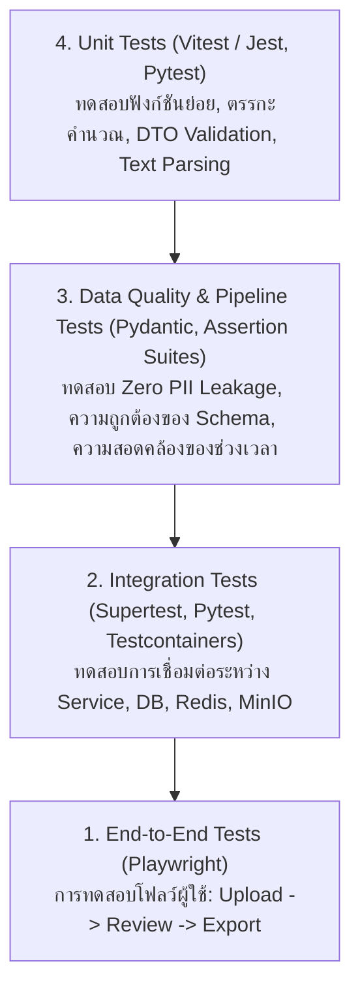

# 10. กลยุทธ์การทดสอบและการประกันคุณภาพ (Testing & Quality Assurance Strategy)

เอกสารนี้ระบุมาตรฐาน กลยุทธ์การทดสอบ (Testing Strategy), เครื่องมือ และเกณฑ์การผ่านคุณภาพ (Quality Gates) สำหรับทุกส่วนประกอบของ **InterviewX DataHub** อ้างอิงสถาปัตยกรรมจาก [`02-ARCHITECTURE.md`](file:///Users/mac/Desktop/interviewx-datahub/context/02-ARCHITECTURE.md) และความปลอดภัยจาก [`08-SECURITY-PRIVACY.md`](file:///Users/mac/Desktop/interviewx-datahub/context/08-SECURITY-PRIVACY.md)

---

## 1. พีระมิดการทดสอบ (Testing Pyramid & Scope)

---

## 2. เครื่องมือและกรอบการทดสอบ (Testing Frameworks)

| ส่วนประกอบ (Component) | เครื่องมือทดสอบหลัก | ขอบเขตการทดสอบ |
| :--- | :--- | :--- |
| **Frontend (Next.js)** | Vitest / Jest, React Testing Library, Playwright | UI Components, Hook State, Form Validation (Zod), E2E Workflows |
| **Backend (NestJS)** | Jest, Supertest, Prisma Test Utilities | Controller, Service Logic, RBAC Guards, BullMQ Jobs, REST APIs |
| **AI Service (FastAPI)** | Pytest, Pytest-asyncio, HTTPX AsyncClient | Document Parser (PDF/DOCX), Pydantic Schemas, LLM Mocking |
| **ฐานข้อมูลและคลังไฟล์** | Dockerized PostgreSQL, MinIO Local | Database Migration, Schema Constraints, File Storage CRUD |

---

## 3. กรณีทดสอบวิกฤต (Critical Test Scenarios)

เพื่อตอบสนองกฎใน [`AGENTS.md`](file:///Users/mac/Desktop/interviewx-datahub/AGENTS.md) ต้องมีชุดการทดสอบอัตโนมัติสำหรับกรณีสำคัญดังนี้:

### 3.1 การทดสอบป้องกัน PII รั่วไหล (Zero PII Leakage Test)
- **วัตถุประสงค์**: รับประกันว่าไม่มีข้อมูลส่วนบุคคลหลุดรอดไปยัง Dataset สำหรับเทรนโมเดล
- **วิธีการ**:
  - เตรียมชุดข้อมูลทดสอบที่มีข้อมูลจำลองใน `PiiVault` (ชื่อจริง, เบอร์โทร, อีเมล)
  - สั่งรันฟังก์ชัน Export Dataset
  - ตรวจสอบไฟล์ `.jsonl` ผลลัพธ์ด้วย Regex และ Assertion ให้มั่นใจว่าไม่พบคีย์หรือค่าของ PII ใดๆ ปรากฏในไฟล์

### 3.2 ความคงทนของการระบุข้อมูลสังเคราะห์ (Synthetic Tagging Immutability Test)
- **วัตถุประสงค์**: รับประกันว่าข้อมูลสังเคราะห์จะไม่ถูกดัดแปลงเป็นข้อมูลจริง
- **วิธีการ**:
  - ส่งคำขอ PATCH/PUT ไปยัง NestJS API เพื่อพยายามแก้ `is_synthetic` จาก `true` เป็น `false`
  - ยืนยันว่าระบบต้องตอบกลับด้วย HTTP 400 หรือ 403 และค่าในฐานข้อมูลยังคงเป็น `true`

### 3.3 การถอนความยินยอมและการลบข้อมูลจริง (Consent Revocation Flow Test)
- **วัตถุประสงค์**: ตรวจสอบกระบวนการทำลายข้อมูลตามสิทธิ์ PDPA
- **วิธีการ**:
  - สร้าง `Document` และ `PiiVault` พร้อมอัปโหลดไฟล์จำลองลง MinIO
  - เรียกใช้ฟังก์ชันเพิกถอนความยินยอม (`revokeConsent`)
  - ยืนยันว่าระเบียนใน `PiiVault` ถูกลบ (Hard Deleted), ไฟล์ใน MinIO ถูกทำลาย, และสถานะถูกปรับเป็นเพิกถอนแล้ว

### 3.4 การทดสอบความทนทานของไปป์ไลน์และการลองซ้ำ (Idempotency & Retry Test)
- **วัตถุประสงค์**: ทดสอบว่าคิวงานสามารถรับมือกับความล้มเหลวชั่วคราวได้
- **วิธีการ**:
  - จำลองความล้มเหลวของ External LLM API (ส่งคืน HTTP 429 หรือ 500)
  - ตรวจสอบว่าระบบมี Exponential Backoff Retry ตามจำนวนที่กำหนด
  - หากเกินจำนวนครั้ง งานต้องถูกส่งเข้า Dead Letter Queue (DLQ) โดยไม่มีข้อมูลขยะค้างในระบบ

---

## 4. ประตูตรวจสอบคุณภาพในกระบวนการ CI/CD (Quality Gates)

ก่อนที่โค้ดจะได้รับอนุญาตให้ผสาน (Merge) เข้าสู่กิ่งหลัก (Main Branch) ต้องผ่านเงื่อนไขต่อไปนี้:

1. **Linting & Code Formatting**:
   - TypeScript: `bun run lint` (ESLint) และ `bun run format:check` (Prettier) ผ่าน 100%
   - Python: `ruff check .` และ `ruff format --check .` ผ่าน 100%
2. **Type Checking**:
   - TypeScript: `bun run typecheck` (`tsc --noEmit`) ปราศจาก Type Error
   - Python: `mypy` หรือ `pyright` ผ่านการตรวจสอบ Type Annotations
3. **Automated Test Coverage**:
   - Unit & Integration Tests ต้องผ่าน 100%
   - ความครอบคลุมของการทดสอบ (Test Coverage) สำหรับ Core Business Logic และ Security Guards ใน NestJS ต้องไม่ต่ำกว่า **80%**
4. **Dependency Vulnerability Scan**:
   - `bun audit` และ `pip-audit` ต้องไม่พบช่องโหว่ความปลอดภัยระดับร้ายแรง

---

## 5. ข้อสมมติฐานหลัก (Explicit Assumptions)

1. **Mocking External LLM ใน Unit/Integration Test**: ในการรัน Test อัตโนมัติบน CI จะทำการจำลองคำตอบของ LLM (Mock API Responses) เสมอ เพื่อประหยัดค่าใช้จ่ายและป้องกันความผันผวนของผลลัพธ์
2. **Local Test Containers**: การรัน Integration Test ในเครื่องนักพัฒนาจะใช้ Docker ในการรัน PostgreSQL, MinIO และ Redis ชั่วคราว

---

## 6. ประเด็นที่ยังค้างการตัดสินใจ (Unresolved Decisions)

1. **การทดสอบความถูกต้องของ LLM Extraction (LLM Output Evaluation)**: ควรใช้เกณฑ์ใดในการวัดผลการสกัดของ AI ในระดับ CI (เช่น การวัด Exact Match บน Benchmark Dataset 50 ตัวอย่าง หรือใช้ LLM-as-a-Judge)
2. **End-to-End Test Frequency**: ควรให้ Playwright E2E Tests รันในทุก Pull Request หรือรันเฉพาะก่อน Release รอบประจำสัปดาห์เนื่องจากใช้เวลาทำงานนาน
