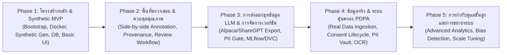

# 11. แผนงานการพัฒนาและระยะเวลา (Development Roadmap & Milestones)

เอกสารนี้ระบุแผนการดำเนินงานแบบเป็นระยะ (Phased Implementation Roadmap), การจัดลำดับความสำคัญของฟีเจอร์ (Feature Prioritization), การประเมินความเสี่ยง และข้อเสนอแนะสำหรับงานพัฒนาในก้าวถัดไปของ **InterviewX DataHub** อ้างอิงสถาปัตยกรรมและข้อกำหนดทั้งหมดจาก [`00-PROJECT-CONTEXT.md`](file:///Users/mac/Desktop/interviewx-datahub/context/00-PROJECT-CONTEXT.md) ถึง [`10-TESTING.md`](file:///Users/mac/Desktop/interviewx-datahub/context/10-TESTING.md)

---

## 1. แผนภูมิการพัฒนาแบบเป็นระยะ (Phased Roadmap Overview)

---

## 2. รายละเอียดแต่ละระยะการพัฒนา (Phase Breakdown)

### Phase 1: โครงสร้างหลักและระบบข้อมูลสังเคราะห์ (Foundation & Synthetic Pipeline MVP)
- **เป้าหมาย**: มีสภาพแวดล้อมการพัฒนาที่สมบูรณ์ สามารถสร้างข้อมูลสังเคราะห์และจัดเก็บลงฐานข้อมูล พร้อมหน้าจอแสดงผลพื้นฐาน
- **งานหลัก (Deliverables)**:
  1. ติดตั้งโครงสร้าง Monorepo (`package.json` workspaces สำหรับ Bun) และไฟล์คอนฟิกราก
  2. จัดทำ `docker-compose.yml` สำหรับรัน PostgreSQL, MinIO, Redis ในเครื่อง
  3. Scaffold โครงสร้างโปรเจกต์:
     - `apps/backend`: NestJS + Prisma ORM + BullMQ
     - `apps/frontend`: Next.js + Tailwind CSS + shadcn/ui
     - `services/ai-service`: FastAPI + Pydantic + PyMuPDF
  4. สร้างโมเดลฐานข้อมูลพื้นฐาน (`User`, `Document`, `ParsedProfile`, `SyntheticJob`) ตาม [`03-DATABASE.md`](file:///Users/mac/Desktop/interviewx-datahub/context/03-DATABASE.md)
  5. พัฒนาระบบสร้าง Synthetic Resume ใน FastAPI และเชื่อมต่อคิวใน NestJS
  6. หน้าจอ UI สำหรับสั่งสร้าง Synthetic Data และดูรายการเรซูเม

### Phase 2: พื้นที่ทำงานตรวจสอบและรับรองข้อมูล (Annotation & QA Workspace)
- **เป้าหมาย**: ผู้ตรวจสอบสามารถเข้ามาตรวจสอบและแก้ไขข้อมูล Profile เทียบกับไฟล์เอกสารจริงได้อย่างมีประสิทธิภาพ
- **งานหลัก (Deliverables)**:
  1. พัฒนาหน้าจอ Side-by-side Review Workspace ใน Next.js ตาม [`09-UI-UX.md`](file:///Users/mac/Desktop/interviewx-datahub/context/09-UI-UX.md)
  2. พัฒนาระบบเชื่อมโยงตำแหน่งข้อความ (Interactive Provenance Highlighting)
  3. พัฒนาระบบ State Machine สำหรับสถานะเอกสาร (`PARSED`, `IN_REVIEW`, `APPROVED`, `REJECTED`)
  4. บันทึกประวัติการแก้ไขและประวัติการตรวจสอบลงใน `AnnotationReview` และ `AuditLog`

### Phase 3: การส่งออกชุดข้อมูลสำหรับ LLM และการติดตามเวอร์ชัน (LLM Export & Versioning)
- **เป้าหมาย**: สามารถส่งออก Dataset คุณภาพสูงสำหรับนำไปฝึกสอนโมเดล InterviewX ได้อย่างเป็นรูปธรรม
- **งานหลัก (Deliverables)**:
  1. พัฒนาระบบ Export Module ใน NestJS รองรับฟอร์แมต Alpaca, ShareGPT, ChatML JSONL ตาม [`07-LLM-TRAINING.md`](file:///Users/mac/Desktop/interviewx-datahub/context/07-LLM-TRAINING.md)
  2. ติดตั้ง Pre-export Safety Gate: ตรวจจับและตัด PII ทิ้งแบบ 100%
  3. เชื่อมต่อ MinIO สำหรับเก็บไฟล์ Export Artifacts พร้อมคำนวณ SHA-256 Hash
  4. บันทึก Metadata และ Run Metrics เข้าสู่ MLflow Tracking

### Phase 4: การนำเข้าข้อมูลจริงและระบบคุ้มครองข้อมูลส่วนบุคคล (Real Data Onboarding & PDPA)
- **เป้าหมาย**: เริ่มเปิดรับข้อมูลเรซูเมจริงภายใต้กรอบความยินยอมและสถาปัตยกรรมความปลอดภัยขั้นสูง
- **งานหลัก (Deliverables)**:
  1. พัฒนาระบบจัดการ `ConsentRecord` และผูกโยงกับการอัปโหลดเอกสารจริง
  2. พัฒนาระบบแยกเก็บ `PiiVault` และจำกัดสิทธิ์การเข้าถึงตามนโยบายใน [`08-SECURITY-PRIVACY.md`](file:///Users/mac/Desktop/interviewx-datahub/context/08-SECURITY-PRIVACY.md)
  3. พัฒนากระบวนการเพิกถอนความยินยอม (Consent Revocation) และการ Hard Delete ไฟล์ดิบและ PII
  4. ประเมินและเพิ่มความสามารถ OCR สำหรับเอกสารเรซูเมที่เป็นภาพสแกน

### Phase 5: การกำกับดูแลขั้นสูงและการเพิ่มประสิทธิภาพ (Enterprise Governance & Scale)
- **เป้าหมาย**: แพลตฟอร์มรองรับข้อมูลปริมาณมหาศาล พร้อมแดชบอร์ดวิเคราะห์ความหลากหลายและความลำเอียงของข้อมูล
- **งานหลัก (Deliverables)**:
  1. แดชบอร์ดวิเคราะห์ Data Diversity, Role Distribution, และ Skill Heatmaps
  2. ปรับปรุงประสิทธิภาพของ Queue และการทำ Caching ใน Redis
  3. DVC Pipeline Integration สำหรับควบคุม Data Versioning ในระดับ Git Repository

---

## 3. การประเมินความเสี่ยงและมาตรการรับมือ (Risk Management)

| ความเสี่ยง (Risk) | ผลกระทบ | โอกาสเกิด | มาตรการรับมือ (Mitigation Strategy) |
| :--- | :---: | :---: | :--- |
| **การรั่วไหลของ PII สู่ Training Set** | สูงมาก | ต่ำ | ใช้ PII Vault Pattern แยกเก็บคนละตาราง และมี Automated Assertion Test บล็อกการ Export ทันทีหากตรวจพบคีย์ข้อมูลบุคคล |
| **Rate Limit หรือต้นทุน External LLM สูง** | ปานกลาง | สูง | ใช้ BullMQ ควบคุม Concurrency, มีระบบ Caching และเลือกใช้โมเดลขนาดเล็กที่ประหยัด (เช่น Gemini Flash) สำหรับงานสกัดข้อมูลพื้นฐาน |
| **ความผิดพลาดจากการสกัดโครงสร้าง PDF ซับซ้อน** | ปานกลาง | ปานกลาง | ใช้ PyMuPDF วิเคราะห์บล็อกข้อความ และมีระบบ Human-in-the-Loop เพื่อให้ผู้เชี่ยวชาญแก้ไขข้อมูลก่อน Approve |
| **การถอนความยินยอมของข้อมูลจริง** | สูง | ปานกลาง | วางระบบค้นหาและทำลายข้อมูล (Purge Pipeline) แบบอัตโนมัติที่ผ่านการทดสอบตาม [`10-TESTING.md`](file:///Users/mac/Desktop/interviewx-datahub/context/10-TESTING.md) |

---

## 4. ข้อสมมติฐานหลัก (Explicit Assumptions)

1. **ลำดับความสำคัญของ Synthetic Data**: ทีมงานเห็นชอบร่วมกันว่าจะพัฒนาและทดสอบระบบทั้งหมดด้วย Synthetic Data ให้มีความเสถียรก่อนที่จะเริ่มเปิดรับ Real-world CV ใน Phase 4
2. **การจัดสรรบทบาททีมงาน**: ในช่วงเริ่มต้น ทีมวิศวกรซอฟต์แวร์และ AI สามารถทำหน้าที่เป็นผู้ตรวจสอบข้อมูล (Annotator) ชั่วคราวเพื่อประเมินความถูกต้องของระบบได้

---

## 5. ประเด็นที่ยังค้างการตัดสินใจ (Unresolved Decisions)

1. **ระยะเวลาการเปิดรับข้อมูลจริง (Real Data Timeline)**: ควรกำหนดกรอบเวลาที่แน่ชัดว่าจะเริ่มทดสอบนำเข้าข้อมูลจริงเมื่อมี Synthetic Data ในคลังครบจำนวนเท่าใด (เช่น 10,000 ระเบียน)
2. **เครื่องมือจัดการ Monorepo**: สรุปอย่างเป็นทางการว่าจะใช้ Turborepo ร่วมกับ Bun หรือใช้ Bun Workspaces เพียงอย่างเดียวใน Phase 1

---

## 6. ข้อเสนอแนะสำหรับงานพัฒนาในก้าวถัดไป (Recommended Immediate Next Task)

> [!IMPORTANT]
> **ก้าวถัดไปที่แนะนำ (Recommended Next Development Task): เริ่มต้น Phase 1 - Repository & Infrastructure Bootstrap**
> 
> ดำเนินการตั้งค่าโครงสร้างโปรเจกต์ตั้งต้นโดย:
> 1. สร้างโครงสร้างโฟลเดอร์ Monorepo (`apps/backend`, `apps/frontend`, `services/ai-service`)
> 2. กำหนดค่า Bun Workspaces ใน Root `package.json` (`workspaces: ["apps/*", "packages/*"]`)
> 3. สร้างไฟล์ `docker-compose.yml` สำหรับรัน PostgreSQL, MinIO, และ Redis พร้อม Network และ Environment Variables ตั้งต้น
> 4. สร้างโครงร่างเบื้องต้นของ NestJS, Next.js และ FastAPI เพื่อทดสอบการรันร่วมกัน
