# 11. แผนงานการพัฒนาและสถานะความสำเร็จของระบบ (Development Roadmap & Implementation Status)

เอกสารนี้ระบุสถานะความสำเร็จของระบบตามแผนงานปฏิรูปสถาปัตยกรรม (Full System Scope & Architecture Remediation Roadmap) ทั้ง 7 เฟสของ **InterviewX DataHub** อ้างอิงสถาปัตยกรรมและข้อกำหนดทั้งหมดจาก [`00-PROJECT-CONTEXT.md`](file:///Users/mac/Desktop/interviewx-datahub/context/00-PROJECT-CONTEXT.md) ถึง [`10-TESTING.md`](file:///Users/mac/Desktop/interviewx-datahub/context/10-TESTING.md)

---

## 1. แผนภูมิสถานะความสำเร็จรายเฟส (Completed Phased Architecture Roadmap)

```mermaid
flowchart LR
    Phase1["Phase 1: Security & Infrastructure\n✅ COMPLETED 100%\n(JWT RBAC, AES-256 PII Vault, BullMQ)"] --> Phase2["Phase 2: True Document Intelligence\n✅ COMPLETED 100%\n(PyMuPDF Raster OCR, Gemini/GPT Deep Parse, Subject PDPA)"]
    Phase2 --> Phase3["Phase 3: Taxonomy & Generation\n✅ COMPLETED 100%\n(SkillSelector UI, LLM Synthetic Enhancer, Soft Delete)"]
    Phase3 --> Phase4["Phase 4: Non-destructive Provenance\n✅ COMPLETED 100%\n(Original vs Human Corrected Separation, Review Audit)"]
    Phase4 --> Phase5["Phase 5: Reproducible Dataset Preparation\n✅ COMPLETED 100%\n(Cryptographic Manifest, DVC Hash, Split Locking)"]
    Phase5 --> Phase6["Phase 6: Fine-Tuning Pipeline & Benchmark\n✅ COMPLETED 100%\n(PEFT LoRA/QLoRA Runner, STAR/Fluency Benchmark)"]
    Phase6 --> Phase7["Phase 7: Model Registry & Publishing Gate\n✅ COMPLETED 100%\n(ModelVersion Lifecycle, Zero-PII Production Gate)"]
```

---

## 2. รายละเอียดสถานะการดำเนินงานรายเฟส (Implementation Breakdown)

### ✅ Phase 1: ความปลอดภัยและโครงสร้างพื้นฐานหลัก (Critical Security & Infrastructure) — สำเร็จ 100%
- **JWT Authentication & Server-Side RolesGuard**: พัฒนา `AuthModule`, `AuthService` เข้ารหัสรหัสผ่านด้วย PBKDF2/SHA-512 และเซ็นโทเคนด้วย HMAC-SHA256 ป้องกันการปลอมแปลง Header
- **Plaintext PII Removal & AES-256-GCM**: ลบคอลัมน์ Plaintext PII ออกจากตาราง `PiiVault` อย่างสิ้นเชิง และเข้ารหัสผ่าน `encryptedPayload`
- **กำจัด Mock Data ทั้งหมด**: ลบ Mock Thai Persona และ Hardcoded Queue Metrics
- **BullMQ & Redis Worker**: เชื่อมต่อคิวงานประมวลผลเอกสารและคิวส่งออกชุดข้อมูล พร้อมโหมด Graceful Offline Fallback

### ✅ Phase 2: ปัญญาประดิษฐ์สกัดเอกสารและธรรมาภิบาลข้อมูล (True Document Intelligence & PDPA) — สำเร็จ 100%
- **Real PyMuPDF Raster OCR**: ลบข้อความจำลอง OCR หลอก และเปิดใช้ PyMuPDF Raster Optical Recognition จริง
- **LLM Deep Resume Extractor**: พัฒนา `LlmExtractorService` รองรับ Gemini 2.0 Flash และ GPT-4o-mini พร้อมกลไก Heuristic Fallback
- **Master Subject Entity & Cascades**: เพิ่มโมเดล `Subject` จัดการสิทธิและบันทึก Audit Alert การเพิกถอนสิทธิไปยังไฟล์ Export ในอดีต

### ✅ Phase 3: Taxonomy ขั้นสูงและการสร้างข้อมูลสังเคราะห์ (Taxonomy & Generation Enrichment) — สำเร็จ 100%
- **Interactive Skill Tag / Label Manager**: สร้างคอมโพเนนต์ `SkillSelector.tsx` บน Next.js รองรับการเลือกทักษะ จัดหมวดหมู่สี และ Normalize คำซ้ำ
- **LLM-Augmented Synthetic Engine**: พัฒนา `LlmSyntheticEnhancer` เสริมความหลากหลายให้คำถามสัมภาษณ์และสถานการณ์จริยธรรม
- **Taxonomy Versioning & Soft Delete**: เพิ่ม `version` และ `deletedAt` ให้โมเดล Taxonomy ทุกตัวพร้อมระบบ Soft Delete

### ✅ Phase 4: การตรวจทานข้อมูลแบบไม่ทำลายหลักฐานต้นฉบับ (Non-destructive Annotation) — สำเร็จ 100%
- **แยก `originalExtractedData` ออกจาก `humanCorrectedData`**: ในโมเดล `ParsedProfile` ข้อมูลที่สกัดได้จาก AI จะไม่ถูกเขียนทับ
- บันทึกประวัติการตรวจสอบ `isHumanVerified`, `verifiedAt`, และ `verifiedById` อย่างเคร่งครัด

### ✅ Phase 5: การจัดเตรียมชุดข้อมูลและ Manifest สำหรับ DVC (Reproducible Dataset Preparation) — สำเร็จ 100%
- **Cryptographic Dataset Manifest (`manifest.json`)**: คำนวณ SHA-256 แต่ละ Split (`train`, `val`, `test`) และส่งออกไฟล์ Manifest ลงใน MinIO ควบคู่กับ DVC Hash
- **Candidate-Grouped Split Locking**: ป้องกันข้อมูลรั่วไหลข้ามชุดข้อมูล (Data Contamination Prevention)
- **UI Manifest Inspector**: หน้าจอตรวจสอบ Manifest และ Lineage ใน `apps/frontend/src/app/datasets/page.tsx`

### ✅ Phase 6: ท่อประมวลผลการฝึกสอนและระบบทดสอบวัดผลอัตโนมัติ (Fine-Tuning & Benchmark) — สำเร็จ 100%
- **PEFT / LoRA & QLoRA Config Generator**: พัฒนา `TrainingRunnerService` และ `training.py` สร้างคอนฟิก Hugging Face PEFT อัตโนมัติ
- **Automated Multi-Criteria Benchmark Harness**: วัดผลโมเดลตามเกณฑ์ STAR (30%), Technical Depth (30%), Thai Fluency (20%), Zero PII (20%)
- **Backend Training Management**: สร้าง `TrainingService` และ `TrainingController` จัดการงานฝึกสอนร่วมกับ MLflow

### ✅ Phase 7: ทะเบียนโมเดล ด่านตรวจความปลอดภัย และการเชื่อมโยงสู่ InterviewX Core (Model Registry & Publishing Gate) — สำเร็จ 100%
- **Model Registry Lifecycle**: เพิ่มโมเดล `ModelVersion` รองรับ 4 สถานะ: `CANDIDATE` ➔ `STAGING` ➔ `PRODUCTION` ➔ `ARCHIVED`
- **Integrity Gate Enforcement**: การ Promote สู่ `PRODUCTION` บังคับผ่านเกณฑ์ Benchmark Score >= 0.80 และ Zero PII Verification
- **InterviewX Core Publishing Endpoint**: ให้บริการ Endpoint `GET /training/models/active` สำหรับการเรียกใช้งานโมเดลจริง

---

## 3. สรุปความพร้อมในการใช้งาน (Production Readiness Summary)

- **Backend Tests (Bun)**: **71/71 Tests Passed (100%)**
- **AI Service Tests (Pytest)**: **30/30 Tests Passed (100%)**
- **Frontend Typecheck (Next.js)**: **0 Errors (`tsc --noEmit`)**
- **Frontend Production Build**: **10/10 Routes Optimized (`next build`)**
> 4. สร้างโครงร่างเบื้องต้นของ NestJS, Next.js และ FastAPI เพื่อทดสอบการรันร่วมกัน
