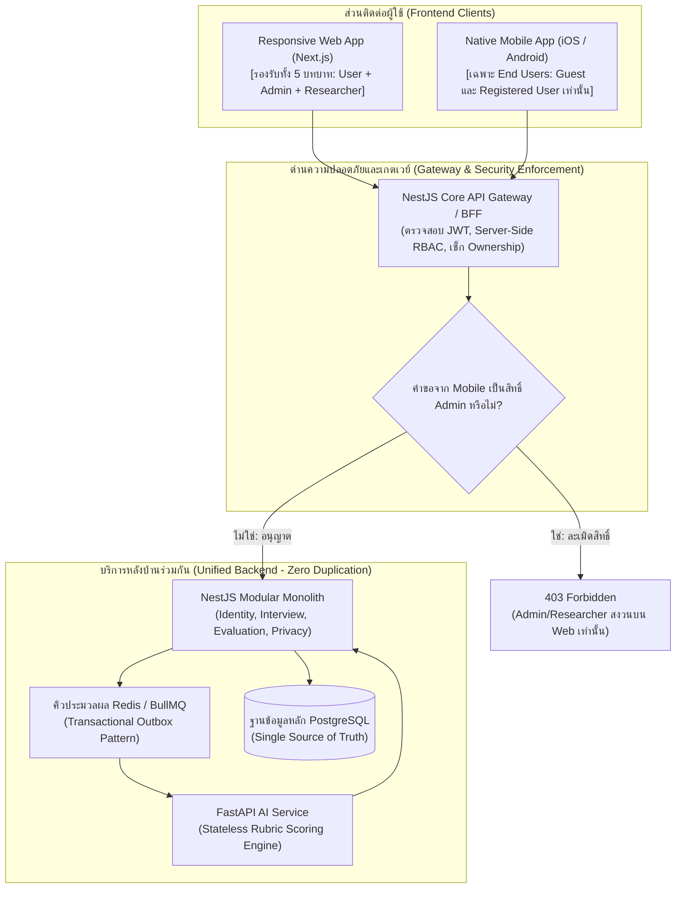
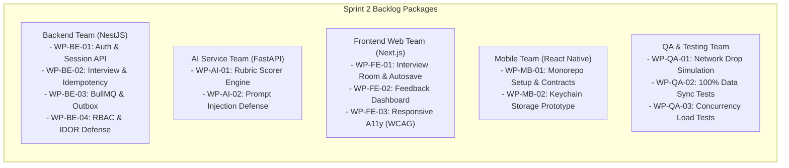

# เอกสารสรุปสำหรับนำเสนอและวางแผนงานร่วมกับทีมใน Sprint 2
## InterviewX — Sprint 2 Team Alignment & Architecture Brief

**เวอร์ชันเอกสาร:** 1.0 (สำหรับใช้งานใน Sprint 2 Planning & Grooming)  
**วันที่จัดทำ:** 13 พฤศจิกายน 2026  
**เอกสารอ้างอิงหลักฐาน:** [InterviewX_SRS_v1.1_DRAFT_TH.md](file:///D:/workspaces/interviewx-datahub/docs-interviex/InterviewX_SRS_v1.1_DRAFT_TH.md) (ฉบับภาษาไทยมาตรฐาน)  
**กลุ่มเป้าหมาย:** Product Owner, Scrum Master, Technical Lead, Backend Engineers, Frontend Engineers, Mobile Engineers, AI Engineers, QA Engineers

---

## 1. บริบทและวัตถุประสงค์ของการประชุม Sprint 2 (Context & Objectives)

หลังจากที่ทีมงานได้เสร็จสิ้น **ระยะที่ 1: การปรับประสานข้อกำหนดและขอบเขตแพลตฟอร์ม (Phase 1: Requirement Alignment)** โดยกำหนดให้ **เอกสารข้อกำหนดระบบซอฟต์แวร์ เวอร์ชัน 1.1 DRAFT (ภาษาไทยมาตรฐาน)** เป็น **เอกสารหลักฐานเวอร์ชันหลักของโครงการ (Active Primary Baseline)** และได้จัดเก็บเอกสารเวอร์ชันเดิมเข้าสู่คลังเอกสารประวัติ (Archive) เรียบร้อยแล้ว

เป้าหมายสำคัญของ **Sprint 2** คือการนำข้อกำหนดทางสถาปัตยกรรมที่ผ่านการปรับประสานมาแปลงเป็นการพัฒนาจริง (Implementation) โดยมุ่งเน้นไปที่:
1. การสร้าง **Core Mock Interview Flow** (การจำลองคำถาม, การส่งคำตอบข้อเขียน, การประเมินผล AI และการแสดงฟีดแบ็ก) บน Responsive Web Application
2. การวางรากฐาน **Unified Backend REST API** บน NestJS ให้มีคุณสมบัติ **Mobile-Ready** ทันทีตั้งแต่เริ่มต้น เพื่อรองรับ Native Mobile Application ในรอบถัดไปโดยไม่ต้องรื้อระบบ
3. การตกลงในประเด็นการตัดสินใจทางเทคนิคสำคัญ 11 ประการ (D-M01 ถึง D-M11) ร่วมกับทีมงานทุกฝ่าย

---

## 2. กฎเหล็กทางสถาปัตยกรรมที่ทีมต้องยึดถือใน Sprint 2 (Core Architectural Invariants)



### 2.1 การแบ่งแยกส่วนติดต่อผู้ใช้ (Frontend Scope Separation)
- **เว็บแอปพลิเคชัน (Responsive Web Application):** พัฒนาด้วย Next.js รองรับการทำงานบน Desktop, Tablet และ Mobile Browser สำหรับผู้ใช้ทุกบทบาท (`Guest`, `Registered User`, `Researcher`, `Payment / Finance Admin`, `System Admin`)
- **แอปพลิเคชันมือถือเนทีฟ (Native Mobile Application):** พัฒนาแยกติดตั้งสำหรับ iOS และ Android สำหรับกลุ่มผู้ใช้งานทั่วไป (`Guest` และ `Registered User`) เท่านั้น **โดยตัดขาดจากระบบงานบริหารและการเงินโดยสิ้นเชิง**

### 2.2 บริการหลังบ้านร่วมกัน (Unified Backend Service — Zero Duplication)
- ใช้ NestJS Modular Monolith, FastAPI AI Service และฐานข้อมูล PostgreSQL ร่วมกัน 100%
- **ห้ามสร้างฐานข้อมูลแยกซ้ำซ้อน** และ **ห้ามเขียนตรรกะทางธุรกิจซ้ำซ้อน** ระหว่าง Web และ Mobile
- ทุกการสื่อสารจากไคลเอนต์มายังระบบหลังบ้านต้องผ่าน REST API ที่เข้ารหัส TLS 1.3

### 2.3 กฎเหล็ก Mobile-Ready API ใน Sprint 2
- แม้ว่า Native Mobile Application จะมีกำหนดเปิดตัวอย่างเป็นทางการในรอบ R2 (ตามการตัดสินใจ D-M01) แต่ Endpoint ทั้งหมดที่พัฒนาขึ้นใน Sprint 2 **ต้องถูกออกแบบให้พร้อมรองรับ Mobile ทันทีตั้งแต่เริ่มต้น (Mobile-Ready API)** เช่น การรองรับ Bearer Token, การใช้ Idempotency Key, และโครงสร้างข้อมูล DTO ที่กะทัดรัด

---

## 3. สัญญาทางเทคนิคและโพรโทคอลที่ต้องบังคับใช้ใน Sprint 2 (Technical Contracts & Protocols)

### 3.1 การตรวจสอบสิทธิ์และความปลอดภัยของโทเค็น (Authentication & Token Protocol)
| แพลตฟอร์ม | รูปแบบการส่ง Token | วิธีการจัดเก็บฝั่งเครื่องลูกข่าย | มาตรการความปลอดภัย |
|---|---|---|---|
| **Web Application** | HTTP-Only, Secure, SameSite Cookie | Web Browser Cookie Storage | ป้องกัน XSS และแนบ CSRF Token ในคำขอ State-Changing |
| **Native Mobile App** | Header: `Authorization: Bearer <JWT>` | **iOS Keychain / Android Keystore** เท่านั้น | ห้ามเก็บใน Local Storage ปกติ, ป้องกันข้อมูลรั่วไหลระดับฮาร์ดแวร์ |

- **อายุของโทเค็น:** Access Token มีอายุ **15 นาที**, Refresh Token มีอายุ **7 วัน**
- **การเพิกถอนสิทธิ์:** เมื่อผู้ใช้สั่ง Logout หรือเปลี่ยนรหัสผ่าน ระบบต้องเพิกถอน Refresh Token ในฐานข้อมูลทันที

---

### 3.2 การส่งคำตอบสัมภาษณ์และการป้องกันคำขอซ้ำ (Idempotency & Answer Submission)
เนื่องจากเครือข่ายมือถือมีโอกาสสัญญาณขาดหาย (Network Flakiness) สูง การออกแบบ API ใน Sprint 2 ต้องมีกลไกป้องกันคำขอซ้ำซ้อนอย่างเข้มงวด:

- **Endpoint:** `POST /api/v1/interviews/{sessionId}/answers`
- **Header บังคับ:** `Idempotency-Key: <UUIDv4>` (สร้างขึ้นโดยไคลเอนต์ตั้งแต่เริ่มพิมพ์คำตอบ)
- **พฤติกรรมของระบบหลังบ้าน:**
  1. เมื่อได้รับคำขอ ให้ตรวจสอบค่า `idempotency_key` ในฐานข้อมูล
  2. หากไม่เคยมีคีย์นี้ ให้เริ่ม Transaction: บันทึกคำตอบ (`ANSWERS`), สร้างงานประเมินสถานะรอดำเนินการ (`EVALUATION_JOBS`), และบันทึก Outbox Event
  3. หากพบคีย์นี้ซ้ำและงานเดิมยังประมวลผลไม่เสร็จ ให้ตอบกลับ `202 Accepted` พร้อม `jobId` เดิม โดยไม่สร้างงานซ้ำ
  4. หากพบคีย์นี้ซ้ำและงานประเมินเสร็จแล้ว ให้ตอบกลับผลการประเมินเดิมทันที
- **การพักข้อมูลในเครื่องลูกข่าย (Client Draft Autosave):** ไคลเอนต์ (ทั้ง Web และ Mobile) ต้องบันทึกฉบับร่างคำตอบไว้ในเครื่องทุก 5 วินาที เพื่อให้ผู้ใช้สามารถกู้คืนข้อความได้ทันทีหากสัญญาณเน็ตหลุด

---

### 3.3 ระบบคิวประมวลผลการประเมินแบบอะซิงโครนัส (Async AI Evaluation Architecture)
การประเมินผล AI ต้องไม่บล็อกคำขอ HTTP โดยเด็ดขาด:

```text
[Client] ──POST Answer (Idempotency-Key)──> [NestJS API] ──Atomic Insert──> [PostgreSQL + Outbox]
                                                    │
                                           [Outbox Dispatcher]
                                                    │
                                                    ▼
                                           [Redis / BullMQ Queue]
                                                    │
                                           [Evaluation Worker]
                                                    │
                                    ──POST /internal/v1/evaluate──> [FastAPI AI Service]
                                                                            │
                                                                   [External LLM Provider]
```

- **SLA เวลาตอบสนอง:** ผลการประเมิน AI ต้องพร้อมให้เรียกดูภายใน **P95 ≤ 15.0 วินาที**
- **Endpoint สอบถามสถานะ:** `GET /api/v1/evaluations/{jobId}` ส่งกลับสถานะ: `pending`, `processing`, `completed`, `needs_review`, หรือ `failed`
- **ความแม่นยำและการตรึงเวอร์ชัน (Immutable Governance):**
  - ผลการประเมินต้องบันทึกคะแนนรูบริก, เวอร์ชันของเกณฑ์ (`rubric_version_id`), และเวอร์ชันของโมเดล (`model_version_id`) ไว้อย่างถาวร
  - ห้ามแก้ไขผลการประเมินย้อนหลัง และห้ามโมเดลสร้างคะแนนขึ้นมาเองโดยไม่มีหลักฐานอ้างอิง (Evidence Citation)

---

### 3.4 การควบคุมสิทธิ์ความเป็นเจ้าของและการป้องกัน IDOR (Insecure Direct Object References)
- **กฎเหล็กความปลอดภัย:** ห้ามเชื่อถือข้อมูล `user_id` หรือสิทธิ์ใดๆ ที่ส่งมาจากเครื่องลูกข่าย
- ในทุกคำขอที่เข้าถึงข้อมูลเซสชัน คำตอบ หรือผลการประเมิน ระบบหลังบ้านต้องดึง `user_id` จาก Token ที่ผ่านการตรวจสอบแล้วเท่านั้น และตรวจสอบในระดับฐานข้อมูลว่าผู้ใช้นั้นเป็นเจ้าของทรัพยากรจริง (Owner Check) หากไม่ใช่ ให้ตอบกลับ `403 Forbidden` หรือ `404 Not Found` ทันที

---

## 4. มติการตัดสินใจสถาปัตยกรรมที่ต้องสรุปกับทีม (Decision Items: D-M01 ถึง D-M11)

ในการประชุม Sprint 2 ทีมงานต้องรับทราบและลงมติเห็นชอบในประเด็นทางเทคนิคตาม **ทะเบียนการตัดสินใจ (Decision Register)**:

| รหัส | ประเด็นการตัดสินใจ | ข้อเสนอแนะของสถาปนิกและทีมเทคนิค | ผลกระทบต่อ Sprint 2 |
|---|---|---|---|
| **D-M01** | **กำหนดการเปิดตัว Native Mobile** | เปิดตัวในรอบ **R2** ควบคู่กับระบบสัมภาษณ์ด้วยเสียง (R1 โฟกัส Responsive Web) | Sprint 2 พัฒนา API หลังบ้านให้พร้อมรองรับ Mobile โดยยังไม่ต้อง Deploy แอปขึ้น Store |
| **D-M02** | **เทคโนโลยีพัฒนาแอปมือถือ** | เลือกใช้ **React Native / Expo** | เริ่มสร้างโฟลเดอร์ `apps/mobile` ใน Monorepo เพื่อแชร์ DTOs และ Schemas จาก `packages/contracts` |
| **D-M03** | **OS ขั้นต่ำที่รองรับ** | **iOS 16.0+** และ **Android 13.0+ (API 33)** | ฝ่าย QA กำหนด Device Farm และ Emulator สำหรับการทดสอบตามสเปกนี้ |
| **D-M04** | **สถาปัตยกรรมระบบชำระเงินบนมือถือ** | แสดงแพ็กเกจบนแอป และส่งต่อผู้ใช้ไปจ่ายเงินผ่าน **Web Checkout** ในระยะแรก | หลีกเลี่ยงค่าธรรมเนียม Store 15–30% และลดความซับซ้อนของ In-App Purchase ในช่วง MVP |
| **D-M08** | **ขอบเขตการทำงานออฟไลน์และ AI** | **Online-Required** สำหรับการประเมิน AI; ไม่อนุญาตให้รัน On-device LLM ใน R1/R2 | ไม่ต้องสร้างโมเดลย่อส่วนในเครื่อง ออกแบบให้ไคลเอนต์แคชคำตอบฉบับร่างเพื่อกันเน็ตหลุด |
| **D-M09** | **ความเท่าเทียมของฟังก์ชัน Web vs Mobile** | ฟังก์ชันสำหรับ End Users เท่าเทียมกัน 100%; ฟังก์ชัน Admin/Research สงวนบน Web | วางโครงสร้าง API กลางสำหรับฟังก์ชันสัมภาษณ์และประวัติให้ใช้งานได้ร่วมกัน |

---

## 5. การจัดสรรแพ็กเกจงานสำหรับแต่ละทีมใน Sprint 2 (Work Packages)



### 5.1 ทีมบริการหลังบ้าน (Backend Team — NestJS)
- **WP-BE-01 (Auth & Session):** ปรับปรุง `AuthModule` ให้รองรับการออก Token ทั้งแบบ Cookie (สำหรับ Web) และ Bearer Token (สำหรับ Mobile) พร้อม API `GET /api/v1/auth/me`
- **WP-BE-02 (Interview & Idempotency):** พัฒนา Endpoint `POST /api/v1/interviews` และ `POST /api/v1/interviews/{id}/answers` พร้อม Guard ตรวจสอบ `Idempotency-Key`
- **WP-BE-03 (Outbox & BullMQ):** วางระบบ Transactional Outbox บันทึกงานลงฐานข้อมูล และส่งต่องานไปยังคิว Redis/BullMQ เพื่อส่งต่อไปยัง AI Service
- **WP-BE-04 (Security & Ownership Guard):** สร้าง Custom Guard ตรวจสอบความเป็นเจ้าของทรัพยากร ป้องกัน IDOR ในทุก Endpoint

### 5.2 ทีมบริการปัญญาประดิษฐ์ (AI Service Team — FastAPI)
- **WP-AI-01 (Rubric Scorer):** พัฒนา Endpoint `POST /internal/v1/evaluate` เชื่อมต่อโมเดล LLM พร้อมตรวจสอบผลลัพธ์ด้วย Pydantic Schema และคำนวณคะแนนตามเกณฑ์รูบริก
- **WP-AI-02 (Security & Citations):** เพิ่มตัวคัดกรอง Prompt Injection และระบบตรวจสอบหลักฐานอ้างอิง (Evidence Citation) จากคำตอบของผู้ใช้

### 5.3 ทีมส่วนหน้าเว็บ (Frontend Team — Next.js)
- **WP-FE-01 (Interview Room UI):** พัฒนาหน้าจอห้องสอบสัมภาษณ์, กล่องพิมพ์คำตอบข้อเขียนแบบขยายได้, ตัวนับเวลาถอยหลัง, และระบบบันทึกฉบับร่างลง Local Storage ทุก 5 วินาที
- **WP-FE-02 (Feedback Presentation):** พัฒนาหน้าจอแสดงผลคะแนนประเมิน, การแจกแจงตามรูบริก, สรุปจุดแข็ง, และจุดที่ควรพัฒนา
- **WP-FE-03 (Responsive & A11y):** ตรวจสอบการจัดวางหน้าจอให้สมบูรณ์ตั้งแต่ความกว้าง 360px จนถึง 4K ตามมาตรฐาน WCAG 2.2 AA

### 5.4 ทีมแอปพลิเคชันมือถือ (Mobile Preparation Team — React Native)
- **WP-MB-01 (Monorepo Scaffolding):** สร้างโครงสร้างโปรเจกต์ `apps/mobile` ด้วย Expo / React Native และเชื่อมต่อ TypeScript Types และ Zod Schemas จาก `packages/contracts`
- **WP-MB-02 (Secure Storage Client):** สร้าง Wrapper จัดเก็บ Token บน iOS Keychain และ Android Keystore พร้อมตั้งค่า API Client แนบ Header `Idempotency-Key`

### 5.5 ทีมทดสอบและประกันคุณภาพ (QA & Testing Team)
- **WP-QA-01 (Idempotency & Network Drop Tests):** เขียนชุดทดสอบอัตโนมัติจำลองปัญหาสัญญาณอินเทอร์เน็ตขาดหายระหว่างส่งคำตอบ และตรวจสอบว่าระบบไม่สร้างงานซ้ำ
- **WP-QA-02 (Cross-Platform Data Integrity):** ทดสอบความถูกต้องของข้อมูลข้ามแพลตฟอร์มว่าเซสชันและคะแนนที่บันทึกตรงกัน 100%
- **WP-QA-03 (Concurrency Load Test):** จำลองโหลด 100 ผู้ใช้งานพร้อมกันเพื่อทดสอบระบบคิว BullMQ และอัตราความผิดพลาดของ API (Failure Rate ≤ 1%)

---

## 6. วาระการประชุมและคำถามสำคัญรายทีม (Sprint 2 Alignment Questions)

เพื่อความกระชับในการประชุม Sprint 2 Planning ขอให้หัวหน้าแต่ละทีมเตรียมคำตอบในประเด็นสำคัญดังนี้:

### 1. คำถามสำหรับ Product Owner (PO)
- ขอบเขตคำถามสัมภาษณ์ในรอบ R1 ได้ข้อสรุปเรื่องหมวดหมู่เริ่มต้น (เช่น Software Engineering 50 คำถาม) แล้วหรือไม่?
- โควตาเซสชันฟรีสำหรับผู้ใช้เริ่มต้น (Free Tier) ยืนยันที่ 5 เซสชันต่อเดือนตามข้อเสนอ D05 หรือไม่?

### 2. คำถามสำหรับ Backend Lead (NestJS)
- โครงสร้างฐานข้อมูล `idempotency_keys` และ `outbox_events` พร้อมสำหรับการรัน Migration ใน Sprint 2 หรือไม่?
- นโยบายการตรวจสอบ Bearer Token สำหรับ Mobile Client มีแผนทดสอบร่วมกับ Swagger / Postman อย่างไร?

### 3. คำถามสำหรับ Frontend Lead (Next.js)
- การบันทึก Local Draft Autosave จะใช้ Storage Adapter แบบใดเพื่อให้สามารถแชร์แนวคิดกับ React Native ในอนาคตได้?
- การแสดงสถานะผลประเมิน AI จะใช้รูปแบบ Polling ทุก 3 วินาที หรือเตรียมพร้อมสำหรับ Server-Sent Events (SSE)?

### 4. คำถามสำหรับ Mobile Lead (React Native)
- โครงสร้าง Monorepo สามารถนำเข้า Zod Validation Schemas จาก `packages/contracts` ได้โดยตรงหรือไม่?
- การทดสอบ Secure Keystore / Keychain บน Emulator มีอุปสรรคใดที่ต้องการการสนับสนุนจากทีม DevOps หรือไม่?

### 5. คำถามสำหรับ AI Lead (FastAPI)
- โครงสร้าง Pydantic Model สำหรับผลลัพธ์การประเมินคะแนนครอบคลุมเกณฑ์รูบริก 4 มิติแล้วหรือไม่?
- กลไกจำกัด Token และงบประมาณต่อเซสชัน (Cost Guardrail) มีการติดตั้งตัวนับใน Sprint 2 หรือไม่?

### 6. คำถามสำหรับ QA Lead
- มีแผนทดสอบจำลองเครือข่ายหลุด (Network Simulation) ด้วยเครื่องมือใด (เช่น Proxyman, Charles, หรือ Automated Mock)?
- เกณฑ์ความพร้อมในการรับมอบงาน (Definition of Done) ได้บรรจุข้อกำหนด FR15 และ NFR08 ไว้อย่างครบถ้วนแล้วหรือไม่?

---

## 7. เกณฑ์ความพร้อมในการรับมอบงานของ Sprint 2 (Definition of Done: DoD)

ชิ้นงานทุกชิ้นใน Sprint 2 จะถือว่าเสร็จสมบูรณ์ (Done) ต่อเมื่อผ่านเกณฑ์ดังต่อไปนี้:
1. **โค้ดและสัญญาทางเทคนิค:** ทุก API Endpoint มีเอกสาร OpenAPI 3.0 และ Zod Validation Schemas กำกับใน `packages/contracts`
2. **ความปลอดภัย:** ทุก Endpoint ที่เป็น Private ต้องมี Server-side Ownership Guard และผ่านการทดสอบ IDOR ป้องกันการเข้าถึงข้ามผู้ใช้
3. **ความทนทานของเครือข่าย:** ผ่านการทดสอบส่งคำขอซ้ำด้วย `Idempotency-Key` เดียวกัน และระบบไม่สร้างเรคคอร์ดหรือคิดคะแนนซ้ำ
4. **การทดสอบอัตโนมัติ:** Unit Test Coverage ไม่ต่ำกว่า 80% ใน Core Modules และผ่าน Integration Tests ร่วมกันระหว่าง NestJS, BullMQ และ FastAPI
5. **การแสดงผล:** ส่วนติดต่อผู้ใช้บนเว็บต้องผ่านการทดสอบ Responsive Layout ที่ Viewport 360px (Mobile), 768px (Tablet), และ 1024px+ (Desktop) โดยไม่มี Element ซ้อนทับหรือล้นขอบจอ
6. **การตรวจสอบย้อนกลับ:** ทุกชิ้นงานใน Backlog มีการผูกรหัสข้อกำหนด (FR/NFR ID) ตรงกับตาราง [InterviewX_Phase1_Requirement_Traceability_TH.xlsx](file:///D:/workspaces/interviewx-datahub/docs-interviex/InterviewX_Phase1_Requirement_Traceability_TH.xlsx)

---
*เอกสารนี้จัดทำขึ้นโดยทีมสถาปัตยกรรมและวิเคราะห์ระบบ เพื่อเป็นแนวทางปฏิบัติการร่วมกันใน Sprint 2*
