# InterviewX — All Final System Diagrams
**Version: 1.1 DRAFT — Phase 1: Requirement & Platform Alignment**  
**Date: 13 November 2026**  
**Status: Proposed architecture revision; pending stakeholder sign-off.**

> [!NOTE]
> **Phase 1 Platform Scope Alignment Notice**  
> This draft revision explicitly separates the two client application frontends:
> 1. **Web Application**: Responsive Web (Desktop, Tablet, Mobile Browser) supporting End Users and Administrative/Research roles.
> 2. **Native Mobile Application**: Separately installable iOS and Android applications dedicated exclusively to End Users (Guest, Registered User).
> Both frontends communicate with the unified, shared backend via authenticated HTTPS REST APIs. All administrative and research capabilities remain strictly restricted to the Web Application.

---

## D01 SYSTEM CONTEXT

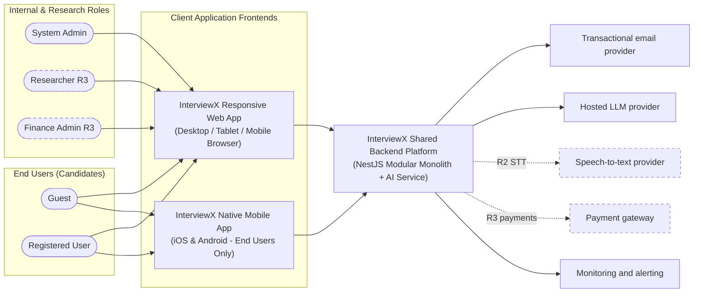

---

## D02 C4 CONTAINERS

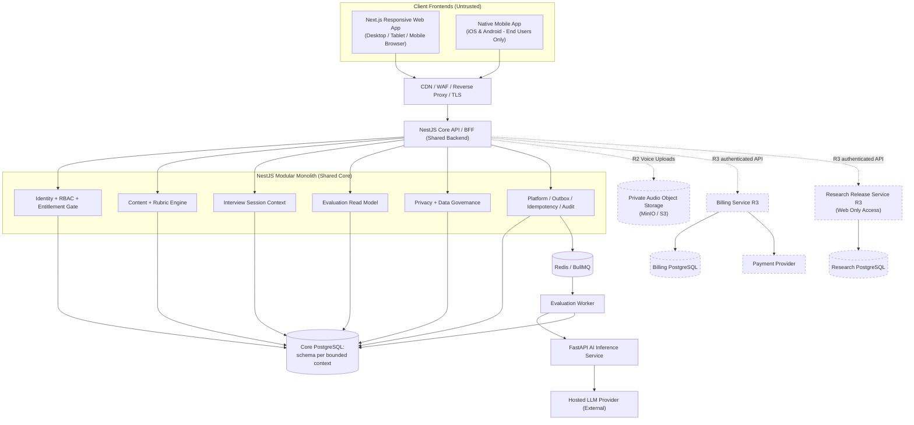

---

## D03 BOUNDED CONTEXTS

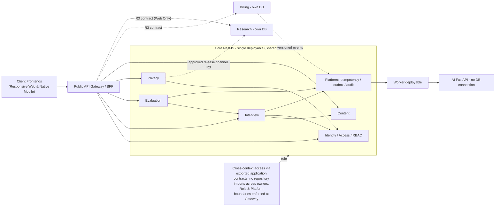

---

## D04 CORE ERD

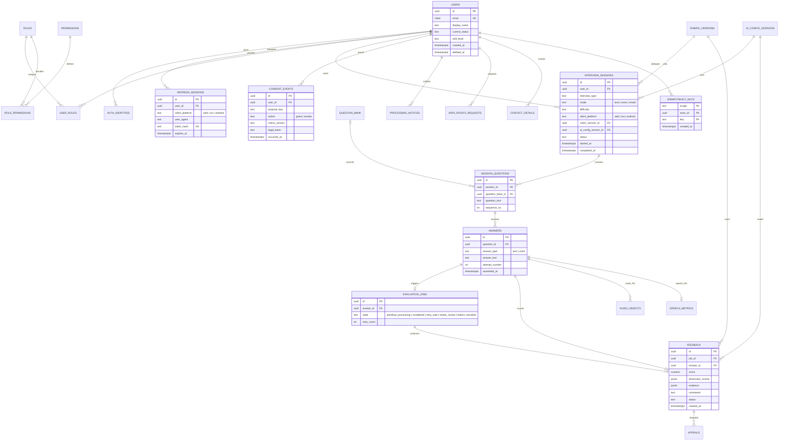

---

## D05 R3 ERD

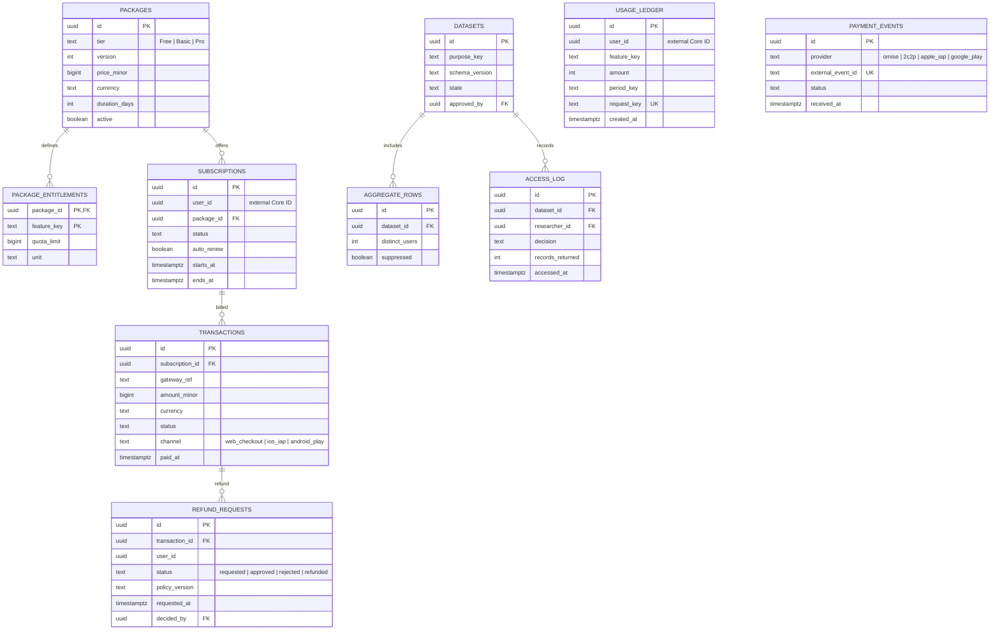

---

## D06 API TRUST

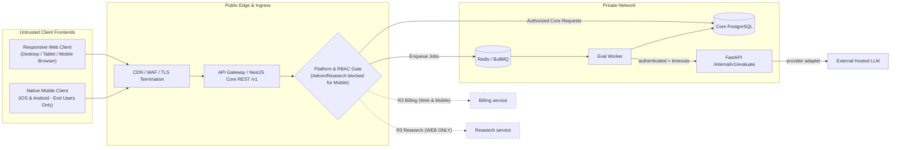

---

## D07 TEXT INTERVIEW SEQUENCE

```mermaid
sequenceDiagram
 autonumber
 actor U as User (Web or Mobile)
 participant C as Client App (Web / Native Mobile)
 participant A as NestJS Interview API (Shared Backend)
 participant D as Core PostgreSQL
 participant O as Outbox Dispatcher
 participant Q as Redis / BullMQ
 participant K as Evaluation Worker
 participant F as FastAPI AI Service
 participant L as External LLM Provider

 U->>C: Submit text answer
 C->>A: POST /v1/interviews/{id}/answers (Idempotency-Key: UUID)
 A->>A: Auth token + ownership + session state + entitlement check
 A->>D: BEGIN; insert answer, eval_job(pending), outbox_event, idempotency_key
 D-->>A: COMMIT
 A-->>C: 202 Accepted { jobId, status: "pending" }
 
 O->>D: Poll undispatched outbox events
 O->>Q: Enqueue evaluation event with stable event ID
 Q-->>O: ACK
 O->>D: Mark outbox event dispatched
 
 Q->>K: Deliver job to Evaluation Worker (at least once)
 K->>K: Inbox deduplication check
 K->>F: POST /internal/v1/evaluate (payload, rubric_version, model_version)
 F->>L: Invoke LLM provider via restricted adapter
 L-->>F: Raw candidate response
 F->>F: Validate structured JSON schema, rubric bounds, and evidence citations
 F-->>K: Return validated feedback / needs-review status
 K->>D: Atomic job state transition (completed) + persist feedback
 
 loop Async Status Polling (or WebSocket / Push)
   C->>A: GET /v1/evaluations/{jobId}
   A-->>C: Return state: pending | completed | failed | needs_review
 end
 C->>U: Render feedback score, strengths, improvements & rubric details
```

---

## D08 EVAL STATES

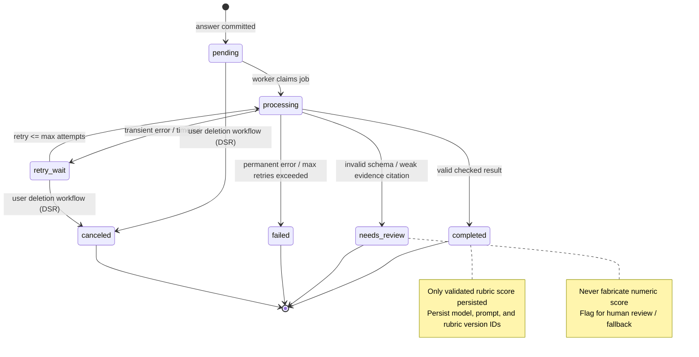

---

## D09 IDENTITY AUTHORIZATION

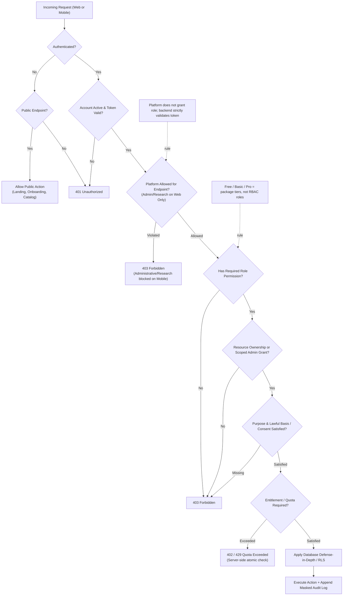

---

## D10 PRIVACY LIFECYCLE

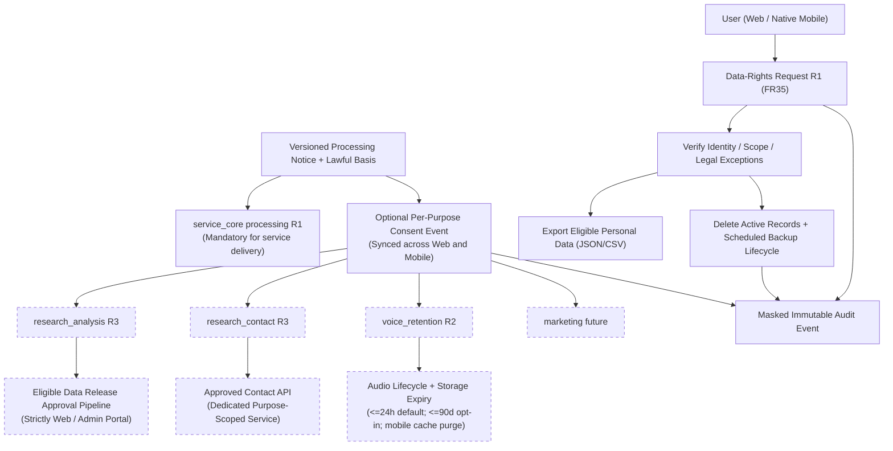

---

## D11 VOICE SEQUENCE R2

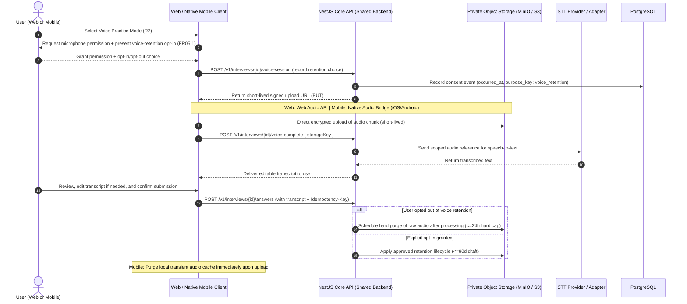

---

## D12 PAYMENT SEQUENCE R3

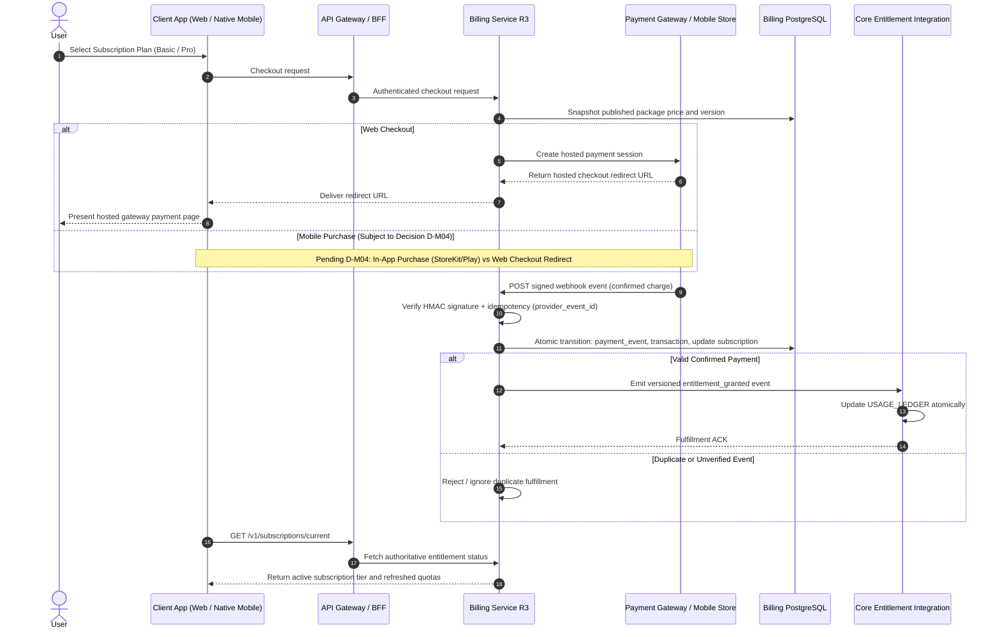

---

## D13 RESEARCH RELEASE R3

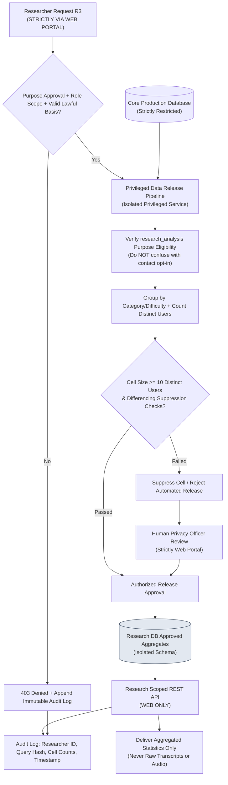

---

## D14 MANAGED PRODUCTION

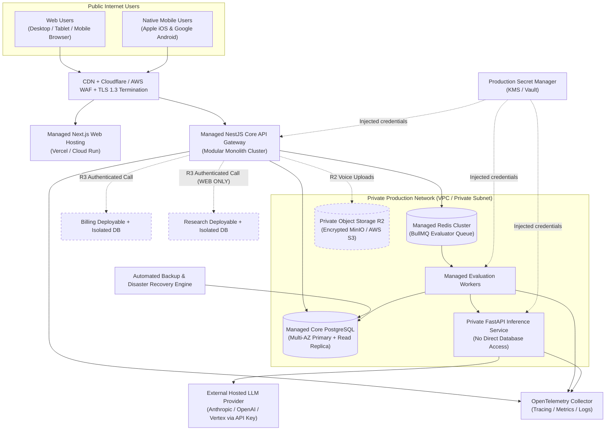

---

## D15 KUBERNETES SHOWCASE

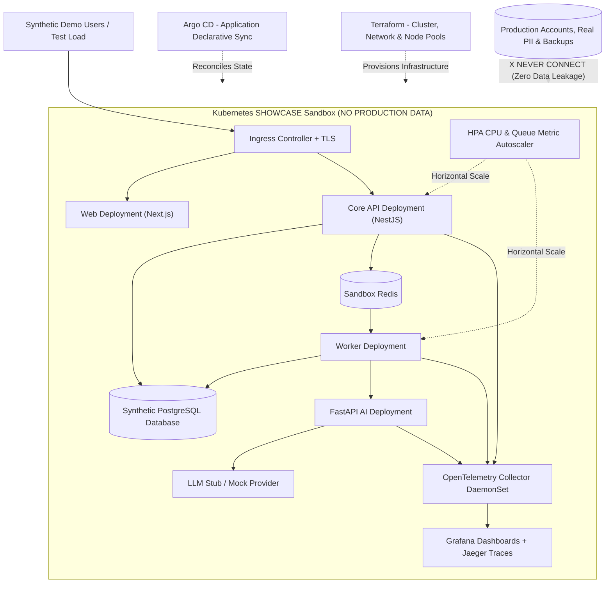

---

## D16 CI CD

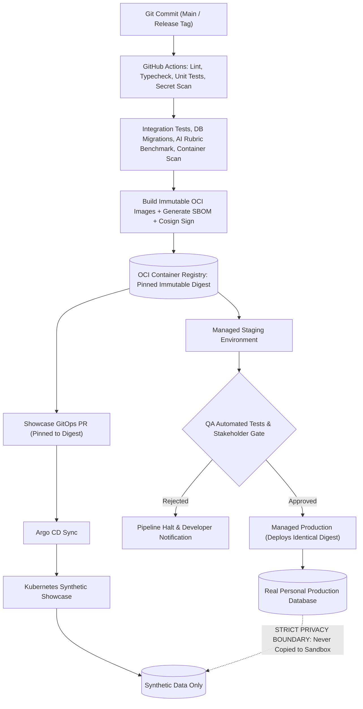

---

## D17 OBSERVABILITY RECOVERY

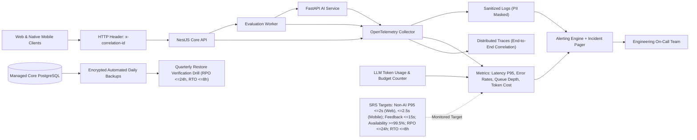

---

## D18 REPO BOUNDARIES

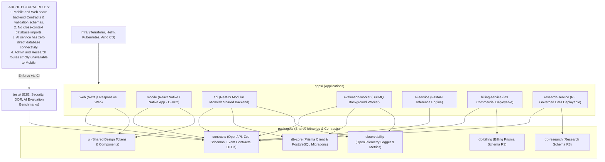

---

## D19 RELEASE ROADMAP

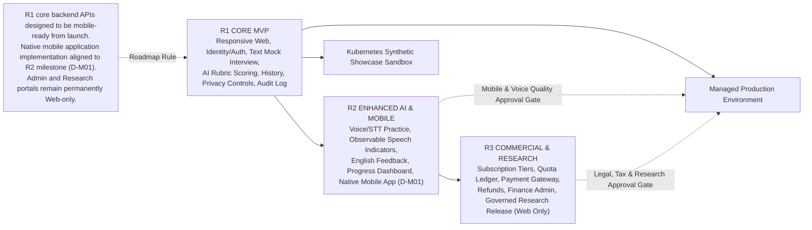
