# เอกสารแสดงความต้องการของระบบซอฟต์แวร์ฉบับสมบูรณ์ (Comprehensive Software Requirements Specification: SRS)

## โครงการ: การออกแบบและพัฒนาแพลตฟอร์มฝึกสัมภาษณ์อัจฉริยะด้วยปัญญาประดิษฐ์แบบสร้างสรรค์และการประเมินคำตอบตามเกณฑ์ที่อธิบายผลได้
### Design and Development of an Intelligent Interview Practice Platform Using Generative Artificial Intelligence and Explainable Rubric-Based Answer Evaluation

---

### ข้อมูลกำกับโครงงานและคณะผู้จัดทำ (Project Metadata & Contributors)

| ข้อมูลกำกับ (Specification) | รายละเอียด (Details) |
|---|---|
| **ชื่อระบบ / ผลิตภัณฑ์** | **InterviewX — แพลตฟอร์มจำลองการสัมภาษณ์งานอัจฉริยะด้วย AI** |
| **คณะผู้จัดทำโครงงาน** | 1. **นายกิติกร เทศธรรม** (รหัสนักศึกษา 674259003)<br>2. **นายจิรเมธ วงษ์กัณหา** (รหัสนักศึกษา 674259004)<br>3. **นายณัฐพล กลิ่นจุ่น** (รหัสนักศึกษา 674259006)<br>4. **นายนรงศ์ศักดิ์ ภูมิประเสริฐ** (รหัสนักศึกษา 674259009)<br>5. **นายสมหมาย สุภาวงค์** (รหัสนักศึกษา 674259024) |
| **หลักสูตร / สาขาวิชา** | สาขาวิชาวิศวกรรมซอฟต์แวร์ คณะวิทยาศาสตร์และเทคโนโลยี |
| **สถาบันการศึกษา** | มหาวิทยาลัยราชภัฏนครปฐม (Nakhon Pathom Rajabhat University: NPRU) |
| **รายวิชาที่เกี่ยวข้อง** | โครงการวิจัยด้านวิศวกรรมซอฟต์แวร์ 1 (รหัสวิชา 7153103) / Software Requirement Engineering |
| **ภาคเรียน / ปีการศึกษา** | ภาคเรียนที่ 2 ปีการศึกษา 2569 |
| **เวอร์ชันเอกสาร** | **เวอร์ชัน 1.1 FINAL ฉบับสมบูรณ์ (Official Comprehensive SRS Baseline)** |
| **สถานะการควบคุม** | เอกสารทางการระดับสูงสุด ผ่านการตรวจรับและลงนามอนุมัติ (Active Approved Baseline) |
| **สถาปัตยกรรมหลัก** | Responsive Web (Next.js 14+) + Native Mobile (React Native / Expo) + Shared Backend (NestJS Modular Monolith + FastAPI AI Service + PostgreSQL 16 + Redis/BullMQ + MinIO) |
| **เอกสารอ้างอิงหลัก** | [ALL_DIAGRAMS_v1.1_FINAL_TH.md](file:///D:/workspaces/interviewx-datahub/docs-interviex/04_System_Architecture/v1.1_diagrams/ALL_DIAGRAMS_v1.1_FINAL_TH.md)<br>[InterviewX_FR_NFR_RBAC_v1.1_FINAL_TH.xlsx](file:///D:/workspaces/interviewx-datahub/docs-interviex/03_SRS_Requirements/v1.1_approved/InterviewX_FR_NFR_RBAC_v1.1_FINAL_TH.xlsx)<br>[InterviewX_Phase1_Requirement_Traceability_TH.xlsx](file:///D:/workspaces/interviewx-datahub/docs-interviex/03_SRS_Requirements/v1.1_approved/InterviewX_Phase1_Requirement_Traceability_TH.xlsx)<br>[InterviewX_Phase1_Decision_Register_TH.xlsx](file:///D:/workspaces/interviewx-datahub/docs-interviex/03_SRS_Requirements/v1.1_approved/InterviewX_Phase1_Decision_Register_TH.xlsx) |

---

## สารบัญเนื้อหา (Table of Contents)

- [1. บทนำและข้อมูลเชิงประจักษ์ (Introduction & Empirical Context)](#1-บทนำและข้อมูลเชิงประจักษ์-introduction--empirical-context)
  - [1.1 ที่มาและความสำคัญของปัญหา](#11-ที่มาและความสำคัญของปัญหา)
  - [1.2 ข้อมูลสถิติจากการสำรวจความต้องการจริง (Survey Evidence Base — n=102)](#12-ข้อมูลสถิติจากการสำรวจความต้องการจริง-survey-evidence-base--n102)
  - [1.3 วัตถุประสงค์ของโครงงาน](#13-วัตถุประสงค์ของโครงงาน)
  - [1.4 ขอบเขตของระบบ 3 มิติ (System Scope)](#14-ขอบเขตของระบบ-3-มิติ-system-scope)
  - [1.5 บริบทของระบบโดยรวม (System Context Diagram — แผนภาพ D01)](#15-บริบทของระบบโดยรวม-system-context-diagram--แผนภาพ-d01)
  - [1.6 แผนงานและขั้นตอนการส่งมอบระบบ (Release Roadmap & Milestones — แผนภาพ D19)](#16-แผนงานและขั้นตอนการส่งมอบระบบ-release-roadmap--milestones--แผนภาพ-d19)
  - [1.7 นิยาม คำศัพท์เฉพาะ และคำย่อ (Definitions & Acronyms)](#17-นิยาม-คำศัพท์เฉพาะ-และคำย่อ-definitions--acronyms)
- [2. การวิเคราะห์ระบบและข้อกำหนดเชิงหน้าที่ (System Analysis & Functional Requirements)](#2-การวิเคราะห์ระบบและข้อกำหนดเชิงหน้าที่-system-analysis--functional-requirements)
  - [2.1 การแบ่งระยะและจัดลำดับความสำคัญ MoSCoW](#21-การแบ่งระยะและจัดลำดับความสำคัญ-moscow)
  - [2.2 ข้อกำหนดเชิงหน้าที่กลุ่มรอบ R1: ระบบแกนหลัก (Core MVP — 14 ข้อกำหนด)](#22-ข้อกำหนดเชิงหน้าที่กลุ่มรอบ-r1-ระบบแกนหลัก-core-mvp--14-ข้อกำหนด)
  - [2.3 ข้อกำหนดเชิงหน้าที่กลุ่มรอบ R2: ระบบ AI ขั้นสูงและมือถือ (Enhanced AI & Mobile — 12 ข้อกำหนด)](#23-ข้อกำหนดเชิงหน้าที่กลุ่มรอบ-r2-ระบบ-ai-ขั้นสูงและมือถือ-enhanced-ai--mobile--12-ข้อกำหนด)
  - [2.4 ข้อกำหนดเชิงหน้าที่กลุ่มรอบ R3: ระบบเชิงพาณิชย์และงานวิจัย (Commercial & Research — 14 ข้อกำหนด)](#24-ข้อกำหนดเชิงหน้าที่กลุ่มรอบ-r3-ระบบเชิงพาณิชย์และงานวิจัย-commercial--research--14-ข้อกำหนด)
- [3. แบบจำลองกรณีการใช้งานและลำดับขั้นตอนการทำงาน (Use Case Model & Workflows)](#3-แบบจำลองกรณีการใช้งานและลำดับขั้นตอนการทำงาน-use-case-model--workflows)
  - [3.1 หลักการวิศวกรรมความสัมพันธ์ UML และบัญชีรายชื่อผู้แสดงบทบาท (Actor Catalog)](#31-หลักการวิศวกรรมความสัมพันธ์-uml-และบัญชีรายชื่อผู้แสดงบทบาท-actor-catalog)
  - [3.2 แผนภาพกรณีการใช้งานระบบโดยรวม (Master System Use Cases — แผนภาพ D20)](#32-แผนภาพกรณีการใช้งานระบบโดยรวม-master-system-use-cases--แผนภาพ-d20)
  - [3.3 แผนภาพระบบย่อยเฉพาะทาง (Subsystem Use Case Diagrams: D21, D22, D23)](#33-แผนภาพระบบย่อยเฉพาะทาง-subsystem-use-case-diagrams-d21-d22-d23)
  - [3.4 ตารางสรุปกรณีการใช้งานทั้งหมด (Use Case Catalog: UC01–UC12)](#34-ตารางสรุปกรณีการใช้งานทั้งหมด-use-case-catalog-uc01uc12)
  - [3.5 ข้อกำหนดกรณีการใช้งานสำคัญอย่างละเอียด (Detailed Use Case Specifications)](#35-ข้อกำหนดกรณีการใช้งานสำคัญอย่างละเอียด-detailed-use-case-specifications)
  - [3.6 ลำดับขั้นตอนการทำงานของระบบ (Sequence Diagrams: D07, D11, D12, D13)](#36-ลำดับขั้นตอนการทำงานของระบบ-sequence-diagrams-d07-d11-d12-d13)
  - [3.7 แผนภาพวงจรสถานะงานประเมินผล AI (AI Evaluation State Machine — แผนภาพ D08)](#37-แผนภาพวงจรสถานะงานประเมินผล-ai-ai-evaluation-state-machine--แผนภาพ-d08)
- [4. การกำหนดสิทธิ์ผู้ใช้งานและการควบคุมการเข้าถึง (Role, Authorization & Entitlements: RBAC)](#4-การกำหนดสิทธิ์ผู้ใช้งานและการควบคุมการเข้าถึง-role-authorization--entitlements-rbac)
  - [4.1 สถาปัตยกรรมการตรวจสอบตัวตนและการอนุญาตสิทธิ์ (Identity & Auth Flow — แผนภาพ D09)](#41-สถาปัตยกรรมการตรวจสอบตัวตนและการอนุญาตสิทธิ์-identity--auth-flow--แผนภาพ-d09)
  - [4.2 ขอบเขตความไว้วางใจระดับ API (API Trust Boundaries — แผนภาพ D06)](#42-ขอบเขตความไว้วางใจระดับ-api-api-trust-boundaries--แผนภาพ-d06)
  - [4.3 ตารางการเข้าถึงแพลตฟอร์มตามบทบาทความปลอดภัย (Platform Access Matrix)](#43-ตารางการเข้าถึงแพลตฟอร์มตามบทบาทความปลอดภัย-platform-access-matrix)
  - [4.4 ตารางสิทธิ์ประโยชน์ตามระดับแพ็กเกจสมาชิก (Subscription Entitlement Matrix)](#44-ตารางสิทธิ์ประโยชน์ตามระดับแพ็กเกจสมาชิก-subscription-entitlement-matrix)
  - [4.5 กฎเหล็กการควบคุมสิทธิ์ 7 ประการ (Core Architectural Authorization Invariants)](#45-กฎเหล็กการควบคุมสิทธิ์-7-ประการ-core-architectural-authorization-invariants)
  - [4.6 ขอบเขตโมดูลของแอปพลิเคชันบนอุปกรณ์เคลื่อนที่แบบเนทีฟ (Native Mobile Scope)](#46-ขอบเขตโมดูลของแอปพลิเคชันบนอุปกรณ์เคลื่อนที่แบบเนทีฟ-native-mobile-scope)
- [5. การออกแบบฐานข้อมูลและแบบจำลองข้อมูล (Database Design & Complete Data Dictionary)](#5-การออกแบบฐานข้อมูลและแบบจำลองข้อมูล-database-design--complete-data-dictionary)
  - [5.1 แผนภาพความสัมพันธ์ของข้อมูลหลัก (Core Subsystem ERD — แผนภาพ D04)](#51-แผนภาพความสัมพันธ์ของข้อมูลหลัก-core-subsystem-erd--แผนภาพ-d04)
  - [5.2 แผนภาพข้อมูลสำหรับระบบเชิงพาณิชย์และงานวิจัย (R3 Services ERD — แผนภาพ D05)](#52-แผนภาพข้อมูลสำหรับระบบเชิงพาณิชย์และงานวิจัย-r3-services-erd--แผนภาพ-d05)
  - [5.3 พจนานุกรมข้อมูลระบบฉบับสมบูรณ์ (Complete Data Dictionary: 7 Bounded Contexts)](#53-พจนานุกรมข้อมูลระบบฉบับสมบูรณ์-complete-data-dictionary-7-bounded-contexts)
- [6. การออกแบบส่วนต่อประสานผู้ใช้และสถาปัตยกรรมระบบ (UI Design & System Architecture)](#6-การออกแบบส่วนต่อประสานผู้ใช้และสถาปัตยกรรมระบบ-ui-design--system-architecture)
  - [6.1 การออกแบบส่วนต่อประสานผู้ใช้และแผนผังหน้าจอ (UI Screens & Navigation Flow)](#61-การออกแบบส่วนต่อประสานผู้ใช้และแผนผังหน้าจอ-ui-screens--navigation-flow)
  - [6.2 การจัดแนวทางสถาปัตยกรรมระหว่าง Web และ Mobile (Web & Mobile Alignment — แผนภาพ D24)](#62-การจัดแนวทางสถาปัตยกรรมระหว่าง-web-และ-mobile-web--mobile-alignment--แผนภาพ-d24)
  - [6.3 การประสานข้อมูลข้ามแพลตฟอร์ม (Cross-Platform Synchronization Sequence — แผนภาพ D25)](#63-การประสานข้อมูลข้ามแพลตฟอร์ม-cross-platform-synchronization-sequence--แผนภาพ-d25)
  - [6.4 ตารางข้อกำหนดการประสานข้อมูลข้ามแพลตฟอร์ม 8 หมวดหมู่ (Data Sync Matrix)](#64-ตารางข้อกำหนดการประสานข้อมูลข้ามแพลตฟอร์ม-8-หมวดหมู่-data-sync-matrix)
  - [6.5 สถาปัตยกรรมระดับคอนเทนเนอร์ C4 (C4 Containers Architecture — แผนภาพ D02)](#65-สถาปัตยกรรมระดับคอนเทนเนอร์-c4-c4-containers-architecture--แผนภาพ-d02)
  - [6.6 ขอบเขตบริบทของระบบ (Bounded Contexts Architecture — แผนภาพ D03)](#66-ขอบเขตบริบทของระบบ-bounded-contexts-architecture--แผนภาพ-d03)
  - [6.7 วงจรชีวิตข้อมูลและความเป็นส่วนตัว (Privacy Lifecycle & Consent — แผนภาพ D10)](#67-วงจรชีวิตข้อมูลและความเป็นส่วนตัว-privacy-lifecycle--consent--แผนภาพ-d10)
  - [6.8 สถาปัตยกรรมโครงสร้างพื้นฐาน การสังเกตการณ์ และโมโนรีโป (D14, D16, D17, D18)](#68-สถาปัตยกรรมโครงสร้างพื้นฐาน-การสังเกตการณ์-และโมโนรีโป-d14-d16-d17-d18)
- [7. ความต้องการของระบบและข้อกำหนดเชิงคุณภาพ (System Environment & Quality Requirements)](#7-ความต้องการของระบบและข้อกำหนดเชิงคุณภาพ-system-environment--quality-requirements)
  - [7.1 สภาพแวดล้อมในการพัฒนาระบบและรันไทม์จริง (Development & Runtime Environment)](#71-สภาพแวดล้อมในการพัฒนาระบบและรันไทม์จริง-development--runtime-environment)
  - [7.2 ข้อกำหนดที่ไม่ใช่เชิงหน้าที่ตามมาตรฐาน ISO/IEC 25010 (NFR01–NFR24)](#72-ข้อกำหนดที่ไม่ใช่เชิงหน้าที่ตามมาตรฐาน-isoiec-25010-nfr01nfr24)
- [8. เมทริกซ์การตรวจสอบย้อนกลับ (Requirement Traceability Matrix: RTM)](#8-เมทริกซ์การตรวจสอบย้อนกลับ-requirement-traceability-matrix-rtm)
- [9. ทะเบียนการตัดสินใจสถาปัตยกรรมและการจัดการความเสี่ยง (Decision Register & Risks)](#9-ทะเบียนการตัดสินใจสถาปัตยกรรมและการจัดการความเสี่ยง-decision-register--risks)
  - [9.1 ทะเบียนการตัดสินใจสถาปัตยกรรมและแอปมือถือ (Decision Register: D-M01 ถึง D-M11)](#91-ทะเบียนการตัดสินใจสถาปัตยกรรมและแอปมือถือ-decision-register-d-m01-ถึง-d-m11)
  - [9.2 สรุปการตัดสินใจเดิมที่ได้รับการยืนยัน (Confirmed Architecture Decisions: D01 ถึง D07)](#92-สรุปการตัดสินใจเดิมที่ได้รับการยืนยัน-confirmed-architecture-decisions-d01-ถึง-d07)
  - [9.3 การประเมินความเสี่ยงและมาตรการบรรเทาผลกระทบ (Risk Matrix & Mitigation Plan: R-01 ถึง R-08)](#93-การประเมินความเสี่ยงและมาตรการบรรเทาผลกระทบ-risk-matrix--mitigation-plan-r-01-ถึง-r-08)
- [10. แผนงานการพัฒนาระยะถัดไป (Project Roadmap & Next Steps)](#10-แผนงานการพัฒนาระยะถัดไป-project-roadmap--next-steps)

---

# 1. บทนำและข้อมูลเชิงประจักษ์ (Introduction & Empirical Context)

## 1.1 ที่มาและความสำคัญของปัญหา

การสัมภาษณ์งานเป็นกระบวนการสำคัญในการคัดเลือกบุคลากรเข้าสู่องค์กร โดยใช้ประเมินความรู้ ความสามารถ ทักษะการสื่อสาร การแก้ไขปัญหาเฉพาะหน้า และความเหมาะสมของผู้สมัครกับวัฒนธรรมองค์กรและตำแหน่งงาน การเตรียมความพร้อมก่อนเข้าสู่กระบวนการสัมภาษณ์จริงจึงมีความสำคัญอย่างยิ่ง โดยเฉพาะสำหรับกลุ่มนักศึกษา ผู้สำเร็จการศึกษาใหม่ และผู้ที่กำลังเปลี่ยนสายงาน ซึ่งส่วนใหญ่มักประสบปัญหาความประหม่า ความตื่นเต้น การขาดทักษะในการจัดระเบียบความคิด และการไม่สามารถนำเสนอจุดเด่นของตนเองให้ตรงกับความคาดหวังของผู้สัมภาษณ์

แม้ว่าในปัจจุบันจะมีแหล่งเรียนรู้ผ่านวิดีโอ บทความ หรือเว็บไซต์ต่างๆ แต่การศึกษาด้วยตนเองยังมีข้อจำกัดอย่างมากในการจำลองสถานการณ์ที่มีปฏิสัมพันธ์โต้ตอบจริง และที่สำคัญที่สุดคือ **การขาดข้อเสนอแนะ (Feedback) เชิงลึกที่สามารถอธิบายเหตุผลได้อย่างชัดเจน** ในกรณีที่ไม่มีโค้ชหรือผู้เชี่ยวชาญคอยให้คำแนะนำ ผู้ฝึกซ้อมจะไม่สามารถทราบได้เลยว่าคำตอบของตนตรงประเด็นหรือไม่ มีจุดอ่อนที่ต้องปรับปรุงอย่างไร และควรมีแนวทางการตอบที่ดีตามมาตรฐาน (เช่น STAR Method) อย่างไร

โครงการ **InterviewX** จึงถูกพัฒนาขึ้นเพื่อเป็นแพลตฟอร์มจำลองการสัมภาษณ์งานอัจฉริยะ โดยประยุกต์ใช้ปัญญาประดิษฐ์แบบสร้างสรรค์ (Generative AI) ร่วมกับเกณฑ์การประเมินแบบรูบริกที่อธิบายผลได้ (Explainable Rubric-Based Assessment) มีการอ้างอิงหลักฐานข้อความจริงจากคำตอบของผู้ใช้ และรองรับการใช้งานอย่างราบรื่นข้ามแพลตฟอร์มระหว่างเว็บแอปพลิเคชัน (Responsive Web Application) และแอปพลิเคชันบนอุปกรณ์เคลื่อนที่แบบเนทีฟ (Native Mobile Application: iOS / Android) ภายใต้สถาปัตยกรรมบริการหลังบ้านร่วมกัน (Shared Backend Architecture) โดยไม่มีการสร้างฐานข้อมูลซ้ำซ้อนหรือเขียนตรรกะทางธุรกิจซ้ำซ้อน

---

## 1.2 ข้อมูลสถิติจากการสำรวจความต้องการจริง (Survey Evidence Base — n=102)

การออกแบบระบบ InterviewX วางอยู่บนฐานข้อมูลความต้องการใช้งานจริงที่เก็บรวบรวมจากกลุ่มตัวอย่างผู้หางาน นักศึกษา และผู้เตรียมตัวสัมภาษณ์งานจำนวน 102 คน (n=102) ผ่านตัวแปรคำถาม 22 มิติ โดยมีข้อมูลเชิงสถิติสำคัญที่สนับสนุนการกำหนดข้อกำหนดของระบบดังนี้:

| ฟังก์ชันและความต้องการที่ได้จากการสำรวจ (Survey Findings) | จำนวนผู้เลือก (คน) | คิดเป็นร้อยละ (%) | การเชื่อมโยงข้อกำหนดของระบบ |
|---|:---:|:---:|---|
| **จำลองคำถามสัมภาษณ์เฉพาะประเภทตำแหน่งงาน** | 94 | 92.2% | FR04 (Category/Question Delivery) |
| **AI Feedback วิเคราะห์จุดแข็งจุดอ่อนพร้อมเหตุผล** | 84 | 82.4% | FR08 (Rubric AI Scoring), FR11 (Actionable Feedback) |
| **ตัวอย่างแนวทางการตอบคำถามที่ดี (STAR Method)** | 76 | 74.5% | FR12 (Example Responses) |
| **วิเคราะห์ทักษะการสื่อสารและความมั่นใจ** | 67 | 65.7% | FR10 (Observable Speech Indicators), FR36 |
| **โหมดจำลองเวลาเสมือนจริง (Pressure Mode)** | 64 | 62.7% | FR06 (Pressure Practice Mode) |
| **การสัมภาษณ์ด้วยเสียงพูด (Voice Interview & STT)** | 60 | 58.8% | FR05-V (Voice Answer and STT), FR05.1 |
| **รายงานคะแนนและผลฟีดแบ็กอย่างละเอียดตามเกณฑ์** | 58 | 56.9% | FR08 (Rubric-Based AI Scoring) |
| **ตรวจสอบไวยากรณ์และความถูกต้องของภาษาอังกฤษ** | 57 | 55.9% | FR09 (English Language Feedback) |
| **ปรับระดับความยากของคำถาม (Beginner / Adv)** | 35 | 34.3% | FR03 (Skill Configuration) |
| **แดชบอร์ดติดตามพัฒนาการและแนวโน้มคะแนน** | 30 | 29.4% | FR13 (Progress Dashboard) |

**ข้อมูลหลักฐานสนับสนุนการพัฒนาข้ามแพลตฟอร์ม (Cross-Platform Evidence):**
- ผู้ตอบแบบสำรวจจำนวน **84 จาก 102 คน (82.4%)** ระบุความต้องการใช้งานระบบอย่างต่อเนื่องทั้งบนคอมพิวเตอร์ (Web) และบนโทรศัพท์มือถือ (Mobile) เพื่อความสะดวกในการฝึกซ้อมระหว่างเดินทาง
- ปัญหาใหญ่ที่สุดของผู้ใช้: ความประหม่าตื่นเต้น (67.6%), การจัดระเบียบความคิดไม่ทัน (58.8%), และความไม่แน่ใจในคุณภาพคำตอบ (52.9%)
- ข้อกังวลหลัก: ความแม่นยำของผลฟีดแบ็ก AI (65.7%), ความเป็นส่วนตัวของไฟล์เสียง (55.9%) และอุปสรรคด้านภาษาอังกฤษ (55.9%)

---

## 1.3 วัตถุประสงค์ของโครงงาน

1. **เพื่อออกแบบและพัฒนาแพลตฟอร์มฝึกสัมภาษณ์งานอัจฉริยะ InterviewX** ที่รองรับการจำลองสถานการณ์สัมภาษณ์งานเสมือนจริง ทั้งในรูปแบบข้อความ (Text) และเสียงพูด (Voice) พร้อมทั้งสามารถจัดส่งคำถามที่สอดคล้องกับตำแหน่งงาน ระดับประสบการณ์ และหมวดหมู่ที่ผู้ใช้ต้องการฝึกซ้อม
2. **เพื่อพัฒนาระบบประเมินผลคำตอบด้วยปัญญาประดิษฐ์ตามเกณฑ์รูบริกที่อธิบายเหตุผลได้ (Explainable Rubric-Based AI Evaluation)** โดยวิเคราะห์คำตอบอย่างละเอียดในมิติต่างๆ แสดงผลคะแนน อ้างอิงหลักฐานจากคำตอบจริง ชี้จุดเด่น จุดที่ควรปรับปรุง และจัดทำข้อเสนอแนะแนวทางการตอบที่ดีตามหลักการ STAR Method
3. **เพื่อพัฒนาระบบที่รองรับการทำงานข้ามแพลตฟอร์มอย่างสอดคล้อง (Cross-Platform Consistency)** ระหว่าง Responsive Web Application และ Native Mobile Application (iOS / Android) ภายใต้สถาปัตยกรรมบริการหลังบ้านร่วมกัน (Shared Backend Architecture) โดยมีการประสานข้อมูลบัญชี เซสชัน ประวัติ และผลการประเมินอย่างถูกต้องและปลอดภัย 100%
4. **เพื่อวางรากฐานด้านธรรมาภิบาลข้อมูลและความเป็นส่วนตัว (Data Governance & Privacy)** ให้สอดคล้องตามพระราชบัญญัติคุ้มครองข้อมูลส่วนบุคคล พ.ศ. 2562 (PDPA) มีการแยกความยินยอมชัดเจน การกำหนดวงจรชีวิตการทำลายไฟล์เสียง และการปกป้องชุดข้อมูลสำหรับการวิเคราะห์ทางวิชาการ

---

## 1.4 ขอบเขตของระบบ 3 มิติ (System Scope)

### 1.4.1 ขอบเขตด้านผู้ใช้งานและบทบาทในระบบ (User & Role Scope)
ระบบแบ่งผู้ใช้งานออกเป็น 5 กลุ่มบทบาทหลัก:
1. **ผู้เยี่ยมชม (Guest):** สำรวจข้อมูลระบบ สำรวจคลังคำถาม และทดลองสัมภาษณ์ตัวอย่างจำกัด 1 ข้อ
2. **ผู้ใช้งานทั่วไป (Registered User):** สมาชิกที่ลงทะเบียนแล้ว ฝึกสัมภาษณ์แบบข้อความและเสียง ดูผลประเมินรูบริก AI ข้อเสนอแนะ STAR ดูประวัติย้อนหลัง แดชบอร์ด และจัดการสิทธิ PDPA
3. **ผู้ดูแลระบบ (System Admin):** บริหารระบบ คลังคำถาม เกณฑ์รูบริก เวอร์ชันพรอมต์ AI ตรวจสอบ Audit Log และทบทวนกรณีอุทธรณ์ผล (เข้าใช้งานเฉพาะบน Web เท่านั้น)
4. **ผู้ดูแลการเงิน (Payment / Finance Admin):** จัดการแพ็กเกจสมาชิก ตรวจสอบธุรกรรม อนุมัติการคืนเงิน (เข้าใช้งานเฉพาะบน Web เท่านั้น)
5. **ผู้วิจัยและพันธมิตรวิชาการ (Researcher):** เข้าถึงชุดข้อมูลสถิติรวมเพื่องานวิจัยที่มีการจัดกลุ่มและปกปิดตัวตนตามเกณฑ์ความเป็นส่วนตัว Cell Size >= 10 (เข้าใช้งานเฉพาะบน Web เท่านั้น)

### 1.4.2 ขอบเขตด้านแพลตฟอร์มและการเชื่อมต่อ (Platform Architecture Scope)
- **เว็บแอปพลิเคชันแบบตอบสนอง (Responsive Web Application):** พัฒนาด้วย Next.js รองรับเดสก์ท็อป แท็บเล็ต และเว็บบนมือถือ ครอบคลุมการทำงานของทุกกลุ่มผู้ใช้งาน
- **แอปพลิเคชันบนอุปกรณ์เคลื่อนที่แบบเนทีฟ (Native Mobile Application):** พัฒนาด้วย React Native / Expo รองรับ iOS 16.0+ และ Android 13.0+ ออกแบบเฉพาะสำหรับกลุ่มผู้ใช้งานทั่วไป (Guest และ Registered User)
- **บริการหลังบ้านร่วมกัน (Shared Backend Architecture):** NestJS Modular Monolith ควบคุมตรรกะทางธุรกิจ จุดเชื่อมต่อ REST API และฐานข้อมูล PostgreSQL ส่วนกลาง
- **บริการประมวลผลปัญญาประดิษฐ์ (AI Service):** FastAPI (Python) ทำงานแบบสเตตเลส รับส่งงานประเมินผลผ่านคิว Redis / BullMQ

### 1.4.3 ขอบเขตด้านระยะการส่งมอบ (Release Roadmap Scope)
- **ระยะที่ 1 (Release R1 — Core MVP Baseline):** ระบบสมาชิก, สัมภาษณ์ข้อความ, รูบริก AI, ประวัติการฝึกซ้อม, หน้าต่างขอความยินยอม PDPA, Web Baseline + Mobile-Ready API
- **ระยะที่ 2 (Release R2 — Enhanced AI & Mobile Launch):** สัมภาษณ์ด้วยเสียง (Voice/STT), ตัวชี้วัดการพูด WPM/Pause, วิเคราะห์ไวยากรณ์ภาษาอังกฤษ, แดชบอร์ดพัฒนาการ, เปิดตัว Native Mobile App (iOS / Android)
- **ระยะที่ 3 (Release R3 — Commercialization, Billing & Research Platform):** แคตตาล็อกแพ็กเกจ (Free, Basic, Pro), ตัดโควตา USAGE_LEDGER, ชำระเงิน Web Checkout, คืนเงิน, และส่งมอบข้อมูลวิจัยสถิติรวม

---

## 1.5 บริบทของระบบโดยรวม (System Context Diagram — แผนภาพ D01)

แผนภาพบริบทระบบแสดงความสัมพันธ์ระหว่างผู้ใช้งานระบบทุกกลุ่ม ส่วนติดต่อผู้ใช้ทั้ง Web และ Native Mobile ส่วนบริการระบบร่วมกันของ InterviewX และผู้ให้บริการภายนอก:

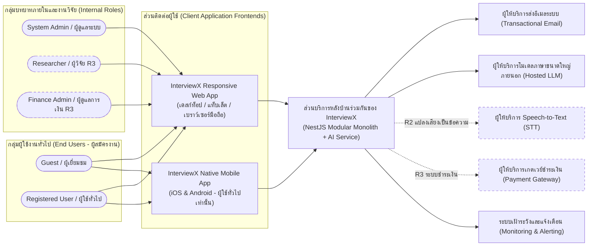

---

## 1.6 แผนงานและขั้นตอนการส่งมอบระบบ (Release Roadmap & Milestones — แผนภาพ D19)

แผนภาพแสดงการแบ่งระยะการส่งมอบระบบออกเป็น 3 ระยะหลัก (R1, R2, R3) พร้อมความสัมพันธ์และการสืบทอดงาน:

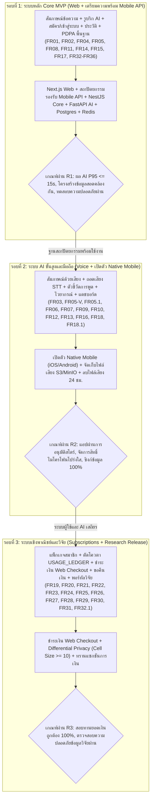

---

## 1.7 นิยาม คำศัพท์เฉพาะ และคำย่อ (Definitions & Acronyms)

| คำศัพท์ / คำย่อ | คำเต็ม (Full Term) | นิยามและความหมายในระบบ InterviewX |
|---|---|---|
| **SRS** | Software Requirements Specification | เอกสารข้อกำหนดความต้องการระบบซอฟต์แวร์ฉบับควบคุม ใช้เป็นเกณฑ์อ้างอิงในการออกแบบ พัฒนา และตรวจรับระบบ |
| **FR** | Functional Requirement | ข้อกำหนดเชิงหน้าที่ที่ระบบต้องกระทำได้ ครอบคลุม 40 รายการในโครงการ InterviewX |
| **NFR** | Non-Functional Requirement | ข้อกำหนดเชิงคุณภาพ มาตรฐานความปลอดภัย ประสิทธิภาพ และความง่ายในการเข้าถึง ครอบคลุม 24 รายการ |
| **RBAC** | Role-Based Access Control | กลไกควบคุมการเข้าถึงระบบตามบทบาทความปลอดภัย ได้แก่ Guest, Registered User, Researcher, Finance Admin, System Admin |
| **LLM** | Large Language Model | แบบจำลองภาษาขนาดใหญ่ที่ขับเคลื่อนการประเมินผลคำตอบและการให้คำแนะนำตามเกณฑ์รูบริก |
| **Rubric** | Scoring Rubric | เกณฑ์การให้คะแนนแบบแจกแจงมิติและระดับคะแนนอย่างโปร่งใส ช่วยให้ระบบประเมินผลสามารถอธิบายเหตุผลได้ |
| **STAR** | Situation, Task, Action, Result | โครงสร้างมาตรฐานระดับสากลในการตอบคำถามสัมภาษณ์เชิงพฤติกรรม ซึ่งระบบนำมาใช้สร้างตัวอย่างคำตอบแนวทาง |
| **STT** | Speech-to-Text | กระบวนการแปลงสัญญาณเสียงพูดของผู้สมัครงานให้อยู่ในรูปข้อความตัวอักษรเพื่อส่งเข้ากระบวนการประเมินผล AI |
| **PDPA** | Personal Data Protection Act | พระราชบัญญัติคุ้มครองข้อมูลส่วนบุคคล พ.ศ. 2562 ซึ่งระบบปฏิบัติตามอย่างเคร่งครัด |
| **Idempotency Key** | Unique Request Identifier (UUIDv4) | รหัสเฉพาะที่แนบมากับคำขอ เพื่อป้องกันการบันทึกคำตอบหรือทำธุรกรรมซ้ำซ้อนกรณีสัญญาณมือถือขัดข้อง |
| **Transactional Outbox**| Architectural Design Pattern | รูปแบบการบันทึกข้อมูลหลักและสร้าง Event ลงฐานข้อมูลในทรานแซกชันเดียวกัน ก่อนส่งต่องานไปยังคิว เพื่อรับประกันความสอดคล้อง |
| **USAGE_LEDGER** | Centralized Usage Ledger | บัญชีแยกประเภทส่วนกลางบนฐานข้อมูล ที่บันทึกและหักยอดโควตาการใช้งานเซสชันสัมภาษณ์แบบ Atomic ป้องกัน Race Condition |
| **DSR** | Data Subject Rights | สิทธิของเจ้าของข้อมูลส่วนบุคคลตามกฎหมาย PDPA เช่น สิทธิในการขอลบข้อมูล สิทธิในการขอรับสำเนาข้อมูล |
| **K-Anonymity** | Anonymity Threshold Model | แบบจำลองการปกปิดข้อมูลวิจัย โดยกำหนดให้ขนาดกลุ่มตัวอย่างที่สืบค้นต้องมีจำนวนผู้ใช้ไม่น้อยกว่า 10 คน (Cell Size >= 10) |
| **Differential Privacy**| Algorithmic Privacy Standard | เทคนิคทางคณิตศาสตร์ในการใส่สัญญาณรบกวน (Noise) ลงในข้อมูลสถิติรวม เพื่อป้องกันการสืบย้อนกลับหาตัวบุคคล |


---

# 2. การวิเคราะห์ระบบและข้อกำหนดเชิงหน้าที่ (System Analysis & Functional Requirements)

## 2.1 การแบ่งระยะและจัดลำดับความสำคัญ MoSCoW

ข้อกำหนดเชิงหน้าที่ทั้งหมดของโครงการ InterviewX มีจำนวนทั้งสิ้น **40 ข้อกำหนด** (จัดหมวดหมู่ตามรหัสมาตรฐาน FR01 ถึง FR36 โดยมีข้อย่อย FR05-V, FR05.1, FR18.1, FR32.1) จัดแบ่งตามระยะการส่งมอบและลำดับความสำคัญ MoSCoW ดังนี้:

```text
โครงสร้างข้อกำหนดเชิงหน้าที่ทั้งหมด 40 ข้อกำหนด (Functional Requirements):
├── ระยะที่ 1: ระบบแกนหลัก Core MVP (14 ข้อกำหนด)
│   ├── FR01, FR02, FR04, FR05, FR08, FR11, FR14, FR15
│   └── FR17, FR32, FR33, FR34, FR35, FR36
├── ระยะที่ 2: ระบบ AI ขั้นสูงและมือถือ Enhanced AI & Mobile (12 ข้อกำหนด)
│   ├── FR03, FR05-V, FR05.1, FR06, FR07, FR09
│   └── FR10, FR12, FR13, FR16, FR18, FR18.1
└── ระยะที่ 3: ระบบเชิงพาณิชย์และงานวิจัย Commercial & Research (14 ข้อกำหนด)
    ├── FR19, FR20, FR21, FR22, FR23, FR24, FR25
    └── FR26, FR27, FR28, FR29, FR30, FR31, FR32.1
```

---

## 2.2 ข้อกำหนดเชิงหน้าที่กลุ่มรอบ R1: ระบบแกนหลัก (Core MVP — 14 ข้อกำหนด)

#### FR01 — การลงทะเบียน เข้าสู่ระบบ และความปลอดภัยของเซสชัน (Registration, Login and Session Security)
- **ข้อมูลระบุข้อกำหนด:** `[ รอบ R1 ]` • `[ ลำดับความสำคัญ: Must Have ]` • `[ แพลตฟอร์ม: Web Application & Native Mobile ]` • `บริบท: Identity Context`
- **คำอธิบายข้อกำหนด:** ระบบต้องรองรับการสมัครสมาชิกด้วยอีเมลและรหัสผ่าน, การยืนยันความถูกต้องของอีเมล (Email Verification), การเข้าสู่ระบบอย่างปลอดภัย, การออกจากระบบ, การรีเซ็ตรหัสผ่าน และการจัดการ Session โดยใช้ระบบบัญชีและโทเค็นชุดเดียวกันทั้งบน Web และ Native Mobile
- **ข้อมูลนำเข้า (Inputs):** อีเมล, รหัสผ่าน (ความยาว >= 8 ตัวอักษร มีตัวเลขและอักขระพิเศษ), ข้อมูลระบุอุปกรณ์ (Device Fingerprint)
- **ผลลัพธ์ (Outputs):** บัญชีผู้ใช้ใหม่, สถานะการยืนยันอีเมล, Access Token (JWT อายุ 15 นาที), Refresh Token (อายุ 7 วัน)
- **กฎเกณฑ์ทางธุรกิจและความปลอดภัย:** รหัสผ่านต้องเข้ารหัสด้วย Argon2id หรือ bcrypt (Work factor >= 12); บน Web จัดเก็บ Refresh Token ใน HTTP-only, Secure, SameSite Cookie; บน Mobile จัดเก็บในฮาร์ดแวร์ iOS Keychain / Android Keystore; รองรับการเพิกถอน Refresh Token ทันทีเมื่อผู้ใช้สั่ง Logout หรือ Reset Password
- **เกณฑ์การยอมรับ (Acceptance Criteria):** สามารถสมัครและล็อกอินผ่านทั้ง Web และ Mobile ด้วยบัญชีเดียวกัน; เมื่อเปลี่ยนรหัสผ่าน เซสชันที่ล็อกอินค้างไว้บนอุปกรณ์อื่นทั้งหมดจะถูกบังคับให้ออกจากระบบทันที

#### FR02 — โปรไฟล์และสถานะของผู้ใช้งาน (User Status and Profile)
- **ข้อมูลระบุข้อกำหนด:** `[ รอบ R1 ]` • `[ ลำดับความสำคัญ: Must Have ]` • `[ แพลตฟอร์ม: Web Application & Native Mobile ]` • `บริบท: User Context`
- **คำอธิบายข้อกำหนด:** ผู้ใช้สามารถระบุและแก้ไขสถานะปัจจุบันของตนเอง (เช่น นักศึกษา, บัณฑิตจบใหม่, ผู้เปลี่ยนสายงาน) และกำหนดเป้าหมายการฝึกสัมภาษณ์ รวมถึงสามารถข้ามขั้นตอน Onboarding ได้ตลอดเวลา
- **ข้อมูลนำเข้า (Inputs):** สถานะปัจจุบัน (`current_status`), ตำแหน่งงานเป้าหมาย (`target_role`), ระดับประสบการณ์
- **ผลลัพธ์ (Outputs):** ข้อมูลโปรไฟล์ที่ได้รับการปรับปรุง, การปรับบริบทคำถามสัมภาษณ์ (Persona Alignment) ให้ตรงกับสถานะ
- **เกณฑ์การยอมรับ (Acceptance Criteria):** ข้อมูลโปรไฟล์ซิงก์ตรงกัน 100% ระหว่าง Web และ Mobile แบบเรียลไทม์; โครงสร้างข้อมูลได้รับการตรวจสอบด้วย Zod / Pydantic

#### FR04 — การส่งมอบคำถามและหมวดหมู่การสัมภาษณ์ (Interview Category/Question Delivery)
- **ข้อมูลระบุข้อกำหนด:** `[ รอบ R1 ]` • `[ ลำดับความสำคัญ: Must Have ]` • `[ แพลตฟอร์ม: Web Application & Native Mobile ]` • `บริบท: Question Bank Context`
- **คำอธิบายข้อกำหนด:** ระบบต้องอนุญาตให้ผู้ใช้เลือกหมวดหมู่การสัมภาษณ์ (เช่น งานวิศวกรรมซอฟต์แวร์, การตลาด, ภาษาอังกฤษ) และดึงคำถามจากคลังคำถามที่ผ่านการตรวจสอบแล้วมาจัดส่งให้ผู้ใช้ฝึกซ้อม
- **ข้อมูลนำเข้า (Inputs):** รหัสหมวดหมู่การสัมภาษณ์ที่เลือก (`category_id`)
- **ผลลัพธ์ (Outputs):** รายการคำถามสัมภาษณ์ที่สุ่มได้ พร้อมข้อมูลสมรรถนะที่ต้องการวัด (Expected Competencies)
- **เกณฑ์การยอมรับ (Acceptance Criteria):** ดึงคำถามจาก Question Bank บนเซิร์ฟเวอร์กลางผ่าน REST API; ในรอบ R1 ต้องมีคำถามในคลังอย่างน้อย 1 หมวดหมู่หลัก (>= 50 คำถาม); โครงสร้างคำถามแสดงผลเหมือนกันทุกแพลตฟอร์ม

#### FR05 — การส่งคำตอบในรูปแบบข้อความ (Text Answer Submission)
- **ข้อมูลระบุข้อกำหนด:** `[ รอบ R1 ]` • `[ ลำดับความสำคัญ: Must Have ]` • `[ แพลตฟอร์ม: Web Application & Native Mobile ]` • `บริบท: Interview Context`
- **คำอธิบายข้อกำหนด:** รองรับการพิมพ์และส่งคำตอบสัมภาษณ์แบบข้อความ พร้อมระบบบันทึกฉบับร่างอัตโนมัติ (Draft Autosave) และส่งข้อมูลไปยังคิวประเมินผล AI อย่างปลอดภัย
- **ข้อมูลนำเข้า (Inputs):** รหัสเซสชัน, รหัสคำถาม, ข้อความคำตอบ, ส่วนหัว `Idempotency-Key` (UUIDv4)
- **ผลลัพธ์ (Outputs):** รหัสงานประเมินผล (`jobId`), สถานะงาน (`pending`), การตอบรับ HTTP 202 Accepted
- **เกณฑ์การยอมรับ (Acceptance Criteria):** บังคับใช้ส่วนหัว `Idempotency-Key` ป้องกันการส่งคำตอบซ้ำกรณีเครือข่ายมือถือขัดข้อง; ไคลเอนต์บันทึกฉบับร่างในเครื่องทุก 5 วินาที; ป้องกันการส่งคำตอบว่าง; ส่งต่องานเข้าสู่ Transactional Outbox ทันที

#### FR08 — การประเมินคะแนนด้วยเกณฑ์รูบริกของ AI (Rubric-Based AI Scoring)
- **ข้อมูลระบุข้อกำหนด:** `[ รอบ R1 ]` • `[ ลำดับความสำคัญ: Must Have ]` • `[ แพลตฟอร์ม: Web Application & Native Mobile ]` • `บริบท: Evaluation Context`
- **คำอธิบายข้อกำหนด:** ประเมินคำตอบของผู้ใช้ตามเกณฑ์รูบริกที่กำหนดไว้ล่วงหน้าอย่างโปร่งใส แสดงผลคะแนนรวม คะแนนย่อยรายมิติ และเหตุผลประกอบการให้คะแนน
- **ข้อมูลนำเข้า (Inputs):** ข้อความคำตอบ, เกณฑ์รูบริก 4 มิติที่ตรึงเวอร์ชัน (ความตรงประเด็น, โครงสร้าง, ตรรกะ, ความสมบูรณ์)
- **ผลลัพธ์ (Outputs):** คะแนนรวม (0–10), คะแนนย่อยรายมิติ, เหตุผลประกอบการประเมิน, สถานะผลการประเมิน (`completed`)
- **เกณฑ์การยอมรับ (Acceptance Criteria):** ประมวลผลบนเซิร์ฟเวอร์กลางผ่าน FastAPI AI Service; เวลาประมวลผล P95 <= 15.0 วินาที; บันทึกผลลัพธ์แบบ Immutable ตรึงกับรหัสเวอร์ชันของรูบริกและโมเดล; มีความสอดคล้องกับผู้เชี่ยวชาญมนุษย์ (Correlation >= 0.70)

#### FR11 — ข้อเสนอแนะเชิงปฏิบัติการและแนวทางพัฒนา (Actionable Feedback)
- **ข้อมูลระบุข้อกำหนด:** `[ รอบ R1 ]` • `[ ลำดับความสำคัญ: Must Have ]` • `[ แพลตฟอร์ม: Web Application & Native Mobile ]` • `บริบท: Evaluation Context`
- **คำอธิบายข้อกำหนด:** จัดทำรายงานสรุปจุดเด่น จุดที่ควรปรับปรุง และคำแนะนำแนวทางการฝึกซ้อมในครั้งถัดไป โดยอ้างอิงหลักฐานข้อความจริงจากคำตอบของผู้ใช้
- **ข้อมูลนำเข้า (Inputs):** ข้อความคำตอบของผู้ใช้, เกณฑ์การประเมิน
- **ผลลัพธ์ (Outputs):** รายการจุดเด่น (Strengths) และจุดควรพัฒนา (Weaknesses) พร้อมข้อความคำตอบจริงที่ถูกไฮไลต์เป็นหลักฐานอ้างอิง (Evidence Citation)
- **เกณฑ์การยอมรับ (Acceptance Criteria):** แสดงจุดเด่นและจุดควรพัฒนาอย่างน้อย 1 รายการต่อเซสชัน พร้อมอ้างอิงข้อความคำตอบจริง ห้ามระบบสร้างหลักฐานเท็จขึ้นมาเอง (Zero Hallucinated Citations)

#### FR14 — ประวัติการฝึกสัมภาษณ์ย้อนหลัง (Interview History)
- **ข้อมูลระบุข้อกำหนด:** `[ รอบ R1 ]` • `[ ลำดับความสำคัญ: Must Have ]` • `[ แพลตฟอร์ม: Web Application & Native Mobile ]` • `บริบท: Interview Context`
- **คำอธิบายข้อกำหนด:** บันทึกประวัติคำถาม คำตอบ คะแนน และข้อเสนอแนะของผู้ใช้ เพื่อให้สามารถเรียกดูย้อนหลัง คัดกรองตามหมวดหมู่ หรือขอลบประวัติรายครั้งได้
- **เกณฑ์การยอมรับ (Acceptance Criteria):** ดึงข้อมูลแบบแบ่งหน้า (Pagination) แสดงผลถูกต้องรวดเร็ว; กรองตามหมวดหมู่และช่วงเวลาได้; การลบประวัติทำแบบ Soft Delete ทันทีและคำนวณสถิติใหม่ถูกต้อง

#### FR15 — การเข้าถึงข้ามแพลตฟอร์มและความสอดคล้องของระบบ (Multi-Platform Access & Consistency)
- **ข้อมูลระบุข้อกำหนด:** `[ รอบ R1 ]` • `[ ลำดับความสำคัญ: Must Have ]` • `[ แพลตฟอร์ม: Web Application & Native Mobile ]` • `บริบท: Platform Core`
- **คำอธิบายข้อกำหนด:** ระบบต้องรองรับการใช้งานผ่าน Responsive Web Application (เดสก์ท็อป แท็บเล็ต และเว็บเบราว์เซอร์บนมือถือ) และ Native Mobile Application (iOS / Android) สำหรับกลุ่มผู้ใช้งานทั่วไป (Guest, Registered User) โดยใช้ระบบบัญชีและส่วนบริการหลังบ้านร่วมกัน พร้อมเชื่อมโยงและซิงก์ข้อมูล 100% และจำกัดฟังก์ชัน Admin/Researcher เฉพาะบน Web Application เท่านั้น
- **เกณฑ์การยอมรับ 7 ข้อ (Acceptance Criteria):**
  1. `AC-FR15-01 (Web Layout):` ผ่านการทดสอบ Responsive Layout ครอบคลุม Desktop (>=1024px), Tablet (768px-1023px) และ Mobile Browser (360px-767px)
  2. `AC-FR15-02 (Mobile OS):` Native Mobile App รองรับ iOS 16.0+ และ Android 13.0+ (API 33) ขึ้นไป
  3. `AC-FR15-03 (Auth Sync):` ใช้ Credentials และ JWT ร่วมกัน เมื่อเปลี่ยนรหัสผ่าน เซสชันบนอุปกรณ์อื่นจะถูกบังคับให้ยืนยันตัวตนใหม่
  4. `AC-FR15-04 (Data Integrity):` ข้อมูลโปรไฟล์ เซสชัน ประวัติ และคะแนน ซิงก์ตรงกัน 100% ระหว่าง Web และ Mobile
  5. `AC-FR15-05 (Role Gate):` ปฏิเสธการเข้าสู่ระบบผ่าน Native Mobile สำหรับบทบาท Admin, Finance และ Researcher โดยแจ้งเตือนให้เข้าใช้บนเว็บ
  6. `AC-FR15-06 (Central Quota):` หักยอดโควตาเซสชันจากบัญชีแยกประเภทส่วนกลาง (`usage_ledger`) แบบ Atomic ป้องกัน Race Condition
  7. `AC-FR15-07 (Network Resilience):` หากสัญญาณมือถือหลุด ไคลเอนต์เก็บคำตอบฉบับร่างไว้ในเครื่อง และส่งคำตอบพร้อม `Idempotency-Key` เดิมเมื่อออนไลน์

#### FR17 — ประกาศความเป็นส่วนตัวและฐานการประมวลผลข้อมูล (Privacy Notice and Lawful Basis)
- **ข้อมูลระบุข้อกำหนด:** `[ รอบ R1 ]` • `[ ลำดับความสำคัญ: Must Have ]` • `[ แพลตฟอร์ม: Web Application & Native Mobile ]` • `บริบท: Privacy Context`
- **คำอธิบายข้อกำหนด:** ระบบต้องแสดงประกาศความเป็นส่วนตัว (Privacy Notice) แจ้งวัตถุประสงค์และฐานทางกฎหมายในการประมวลผลข้อมูลตาม PDPA พร้อมจัดการความยินยอมแยกตามวัตถุประสงค์อย่างชัดเจน
- **เกณฑ์การยอมรับ (Acceptance Criteria):** แยกความยินยอมการบริการหลัก (สัญญา) ออกจากความยินยอมเพื่องานวิจัยและเสียง; บันทึกประวัติการยินยอมลงในตาราง `consent_events` แบบไม่สามารถแก้ไขได้ (Append-only)

#### FR32 — บันทึกประวัติการดำเนินงานของผู้ดูแลระบบ (Immutable Admin Audit)
- **ข้อมูลระบุข้อกำหนด:** `[ รอบ R1 ]` • `[ ลำดับความสำคัญ: Must Have ]` • `[ แพลตฟอร์ม: เฉพาะบนเว็บเท่านั้น (Admin Only) ]` • `บริบท: Platform Core`
- **คำอธิบายข้อกำหนด:** บันทึกประวัติการกระทำของผู้ดูแลระบบ เช่น การจัดการผู้ใช้, การแก้ไขคลังคำถาม, รูบริก, พรอมต์ และค่าคอนฟิกระบบ ลงในบันทึกที่แก้ไขไม่ได้
- **เกณฑ์การยอมรับ (Acceptance Criteria):** บันทึก Actor ID, Action, Resource, IP Address, Timestamp ในตาราง `audit_events` แบบ Append-only; หน้าจอ Audit Log Viewer สงวนไว้เฉพาะบน Web Application เท่านั้น

#### FR33 — ความทนทานต่อการขัดข้องของเซสชัน (Session Resilience)
- **ข้อมูลระบุข้อกำหนด:** `[ รอบ R1 ]` • `[ ลำดับความสำคัญ: Must Have ]` • `[ แพลตฟอร์ม: Web Application & Native Mobile ]` • `บริบท: Platform Core`
- **คำอธิบายข้อกำหนด:** เก็บสถานะคำตอบและรองรับการทำงานต่อหรือยกเลิกเซสชันเมื่อเครือข่ายหรือบริการหลังบ้านขัดข้องชั่วคราว
- **เกณฑ์การยอมรับ (Acceptance Criteria):** ไคลเอนต์เก็บแคชร่างคำตอบในเครื่อง หากสัญญาณขาดหายผู้ใช้สามารถกดส่งซ้ำได้เมื่อสัญญาณกลับมาโดยข้อมูลไม่สูญหาย; ป้องกันงานค้างด้วย Timeout และ Dead-Letter Queue

#### FR34 — การตั้งค่า AI และการทบทวนโดยมนุษย์ (AI Configuration and Human Review)
- **ข้อมูลระบุข้อกำหนด:** `[ รอบ R1 ]` • `[ ลำดับความสำคัญ: Must Have ]` • `[ แพลตฟอร์ม: เฉพาะบนเว็บเท่านั้น (Admin Console) ]` • `บริบท: AI Governance Context`
- **คำอธิบายข้อกำหนด:** หน้าจอสำหรับผู้ดูแลระบบในการจัดการ Question Bank, เกณฑ์รูบริก, เวอร์ชันพรอมต์โมเดล AI รวมถึงฟังก์ชัน Rollback สู่เวอร์ชันก่อนหน้า และระบบทบทวนโดยมนุษย์ (Human Review)
- **เกณฑ์การยอมรับ (Acceptance Criteria):** การแก้ไขรูบริกหรือพรอมต์ต้องสร้างเวอร์ชันใหม่แบบตรึงค่า (Immutable Versioning); มีหน้าจอคัดกรองเคสผลประเมินที่มีการอุทธรณ์เพื่อให้ผู้เชี่ยวชาญตรวจสอบซ้ำ

#### FR35 — การยื่นคำขอใช้สิทธิตามกฎหมายคุ้มครองข้อมูล (Data Rights Request: DSR)
- **ข้อมูลระบุข้อกำหนด:** `[ รอบ R1 ]` • `[ ลำดับความสำคัญ: Must Have ]` • `[ แพลตฟอร์ม: ผู้ใช้ส่งคำขอ (Web/Mobile) / Admin ดำเนินการ (Web) ]` • `บริบท: Privacy Context`
- **คำอธิบายข้อกำหนด:** รองรับคำขอเข้าถึง รับสำเนาข้อมูล (Data Portability) หรือขอลบข้อมูลบัญชีและข้อมูลส่วนบุคคล (Right to Erasure) ตามกฎหมาย PDPA
- **เกณฑ์การยอมรับ (Acceptance Criteria):** ภายใน Native Mobile App ต้องมีปุ่มขอลบข้อมูลบัญชีตามข้อกำหนดของ App Store; เจ้าหน้าที่ดำเนินการผ่าน Web ภายในกำหนดเวลา SLA (ไม่เกิน 30 วันตามกฎหมาย)

#### FR36 — การจัดการข้อผิดพลาด AI และการยื่นอุทธรณ์ผล (AI Failure and Appeal)
- **ข้อมูลระบุข้อกำหนด:** `[ รอบ R1 ]` • `[ ลำดับความสำคัญ: Must Have ]` • `[ แพลตฟอร์ม: ผู้ใช้ยื่นอุทธรณ์ (Web/Mobile) / Admin ทบทวน (Web) ]` • `บริบท: Evaluation Context`
- **คำอธิบายข้อกำหนด:** รองรับกลไกแจ้งเตือนข้อผิดพลาด AI อย่างโปร่งใส (ห้ามสร้างคะแนนเท็จ) รองรับการ Retry และเปิดให้ผู้ใช้ยื่นคำร้องอุทธรณ์ผลการประเมินคะแนน
- **เกณฑ์การยอมรับ (Acceptance Criteria):** หาก AI ล้มเหลว ปรับสถานะเป็น `failed` และแจ้งผู้ใช้ให้กดลองใหม่; ผู้ใช้มีปุ่ม Flag / Appeal ส่งคำร้องพร้อมระบุเหตุผลเพื่อส่งเข้าคิวทบทวนของ Admin

---

## 2.3 ข้อกำหนดเชิงหน้าที่กลุ่มรอบ R2: ระบบ AI ขั้นสูงและมือถือ (Enhanced AI & Mobile — 12 ข้อกำหนด)

#### FR03 — การกำหนดค่าระดับความเชี่ยวชาญ (Skill Configuration)
- **ข้อมูลระบุข้อกำหนด:** `[ รอบ R2 ]` • `[ ลำดับความสำคัญ: Should Have ]` • `[ แพลตฟอร์ม: Web Application & Native Mobile ]` • `บริบท: Interview Context`
- **คำอธิบายข้อกำหนด:** ผู้ใช้สามารถเลือกระดับความยากของคำถาม (Beginner, Intermediate, Advanced) หรือให้ระบบวิเคราะห์และเสนอแนะระดับความเชี่ยวชาญที่เหมาะสมตามประวัติ
- **เกณฑ์การยอมรับ (Acceptance Criteria):** เมนูเลือกระดับความยากและเกณฑ์รูบริกที่สัมพันธ์กันทำงานตรงกันทั้งบน Web และ Mobile

#### FR05-V — การส่งคำตอบด้วยเสียงและการแปลงเป็นข้อความ (Voice Answer and STT)
- **ข้อมูลระบุข้อกำหนด:** `[ รอบ R2 ]` • `[ ลำดับความสำคัญ: Should Have ]` • `[ แพลตฟอร์ม: Web Application & Native Mobile ]` • `บริบท: Voice & STT Engine`
- **คำอธิบายข้อกำหนด:** รองรับการบันทึกเสียงตอบสัมภาษณ์ อัปโหลดไฟล์เสียงผ่าน Signed URL ไปยัง S3/MinIO และส่งถอดความเสียงเป็นข้อความ (STT) โดยผู้ใช้สามารถตรวจสอบและแก้ไขข้อความถอดเสียงก่อนส่งประเมิน
- **เกณฑ์การยอมรับ (Acceptance Criteria):** บนเว็บใช้ Web Audio API; บนมือถือใช้ Native Microphone Bridge; ล้างแคชไฟล์เสียงบนเครื่องมือถือทันทีเมื่ออัปโหลดเสร็จสิ้น; ผู้ใช้แก้ไขข้อความถอดเสียงได้

#### FR05.1 — การเลือกเก็บรักษาไฟล์เสียง (Voice-Retention Choice)
- **ข้อมูลระบุข้อกำหนด:** `[ รอบ R2 ]` • `[ ลำดับความสำคัญ: Must Have ]` • `[ แพลตฟอร์ม: Web Application & Native Mobile ]` • `บริบท: Privacy Context`
- **คำอธิบายข้อกำหนด:** แสดงกล่องข้อความขอความยินยอมแยกต่างหากอย่างชัดเจนก่อนการบันทึกเสียง เพื่อให้ผู้ใช้เลือกว่าจะลบไฟล์เสียงทิ้งทันที หรือยินยอมให้เก็บไฟล์เสียงไว้เพื่อการฟังย้อนหลัง
- **เกณฑ์การยอมรับ (Acceptance Criteria):** กรณีไม่ยินยอม ลบไฟล์เสียงทิ้งถาวรภายใน 24 ชม.; กรณียินยอม กำหนดอายุการเก็บรักษาไม่เกิน 90 วัน; บันทึก Consent Event แบบระบุเวลาชัดเจน

#### FR06 — โหมดจำลองการสัมภาษณ์แบบกดดัน (Pressure Practice Mode)
- **ข้อมูลระบุข้อกำหนด:** `[ รอบ R2 ]` • `[ ลำดับความสำคัญ: Could Have ]` • `[ แพลตฟอร์ม: Web Application & Native Mobile ]` • `บริบท: Interview Context`
- **คำอธิบายข้อกำหนด:** โหมดฝึกซ้อมแบบจำกัดเวลาตอบสัมภาษณ์ที่สั้นลงและจำลองสถานการณ์กดดัน โดยเป็นไปตามความสมัครใจของผู้ใช้และสามารถกดออกจากโหมดได้ทันที
- **เกณฑ์การยอมรับ (Acceptance Criteria):** แสดงนาฬิกานับเวลาถอยหลัง; เมื่อหมดเวลาให้บันทึกคำตอบเท่าที่ตอบได้ทันที; มีปุ่มยกเลิกออกจากโหมดได้ตลอดเวลา

#### FR07 — ความหลากหลายของคำถามและการป้องกันคำถามซ้ำ (Question Diversity)
- **ข้อมูลระบุข้อกำหนด:** `[ รอบ R2 ]` • `[ ลำดับความสำคัญ: Should Have ]` • `[ แพลตฟอร์ม: Web Application & Native Mobile ]` • `บริบท: Question Selector Engine`
- **คำอธิบายข้อกำหนด:** สลับสับเปลี่ยนคำถามและควบคุมไม่ให้ผู้ใช้พบคำถามเดิมซ้ำซ้อนในชุดฝึกซ้อมที่ใกล้เคียงกัน
- **เกณฑ์การยอมรับ (Acceptance Criteria):** ระบบตรวจสอบประวัติเซสชันของบัญชีผู้ใช้ และป้องกันการสุ่มเจอคำถามเดิมซ้ำภายใน 5 เซสชันล่าสุด

#### FR09 — การวิเคราะห์และข้อเสนอแนะภาษาอังกฤษ (English Language Feedback)
- **ข้อมูลระบุข้อกำหนด:** `[ รอบ R2 ]` • `[ ลำดับความสำคัญ: Should Have ]` • `[ แพลตฟอร์ม: Web Application & Native Mobile ]` • `บริบท: Evaluation Context`
- **คำอธิบายข้อกำหนด:** ตรวจสอบความถูกต้องของไวยากรณ์ภาษาอังกฤษ (Grammar), ความชัดเจนในการสื่อสาร (Clarity) และคำศัพท์ โดยแยกคะแนนภาษาออกจากคะแนนเนื้อหา
- **เกณฑ์การยอมรับ (Acceptance Criteria):** แสดงจุดที่ใช้ภาษาไม่ถูกต้องพร้อมเสนอแนะคำศัพท์หรือรูปประโยคที่เหมาะสมกว่า โดยไม่ส่งผลกระทบต่อคะแนนความตรงประเด็นของเนื้อหา

#### FR10 — ตัวชี้วัดพฤติกรรมการพูดที่สังเกตได้ (Observable Speech Indicators)
- **ข้อมูลระบุข้อกำหนด:** `[ รอบ R2 ]` • `[ ลำดับความสำคัญ: Should Have ]` • `[ แพลตฟอร์ม: Web Application & Native Mobile ]` • `บริบท: Speech Analytics Service`
- **คำอธิบายข้อกำหนด:** วิเคราะห์ตัวชี้วัดการพูดเชิงพฤติกรรม ได้แก่ ความเร็วในการพูด (Words Per Minute: WPM), จุดหยุดพักที่นานเกินไป (Pause Duration) และการนับคำฟุ่มเฟือย (Filler Words เช่น อ่า, เอ่อ)
- **เกณฑ์การยอมรับ (Acceptance Criteria):** วิเคราะห์บนระบบหลังบ้าน; แสดงผลสถิติเป็นกราฟการ์ดพร้อมข้อความปฏิเสธความรับผิดชอบ (Disclaimer) ว่าเป็นตัวชี้วัดเพื่อการฝึกซ้อมเท่านั้น

#### FR12 — ตัวอย่างแนวทางการตอบที่ดี (Example Responses)
- **ข้อมูลระบุข้อกำหนด:** `[ รอบ R2 ]` • `[ ลำดับความสำคัญ: Could Have ]` • `[ แพลตฟอร์ม: Web Application & Native Mobile ]` • `บริบท: Evaluation Context`
- **คำอธิบายข้อกำหนด:** แสดงตัวอย่างแนวทางการตอบคำถามที่ดีตามบริบทของโจทย์ข้อนั้นๆ ในรูปแบบ STAR Method (Situation, Task, Action, Result) เพื่อให้ผู้ใช้เห็นภาพการตอบที่เป็นรูปธรรม
- **เกณฑ์การยอมรับ (Acceptance Criteria):** แสดงตัวอย่างคำตอบที่ตรงกับหมวดหมู่และระดับความยากของคำถามในหน้ารายงานฟีดแบ็ก

#### FR13 — แดชบอร์ดติดตามพัฒนาการ (Progress Dashboard)
- **ข้อมูลระบุข้อกำหนด:** `[ รอบ R2 ]` • `[ ลำดับความสำคัญ: Should Have ]` • `[ แพลตฟอร์ม: Web Application & Native Mobile ]` • `บริบท: Reporting Context`
- **คำอธิบายข้อกำหนด:** หน้าจอแดชบอร์ดสรุปสถิติจำนวนครั้งที่ฝึกซ้อม, ค่าเฉลี่ยคะแนนรูบริก, กราฟแนวโน้มพัฒนาการย้อนหลัง และจุดแข็งจุดอ่อนจำแนกตามหมวดหมู่
- **เกณฑ์การยอมรับ (Acceptance Criteria):** กราฟแสดงผลถูกต้องและสอดคล้องกันทั้งบน Web และหน้าจอ Native Mobile

#### FR16 — การเลือกรูปแบบการฝึกซ้อม (Practice Mode Selection)
- **ข้อมูลระบุข้อกำหนด:** `[ รอบ R2 ]` • `[ ลำดับความสำคัญ: Should Have ]` • `[ แพลตฟอร์ม: Web Application & Native Mobile ]` • `บริบท: Interview Context`
- **คำอธิบายข้อกำหนด:** ผู้ใช้สามารถเลือกรูปแบบการฝึกซ้อมได้ระหว่าง แบบพิมพ์ข้อความ (Text), แบบเสียง (Voice) หรือแบบผสม (Mixed) รวมถึงเลือกฝึกเฉพาะคำถามที่เคยตอบได้คะแนนต่ำ
- **เกณฑ์การยอมรับ (Acceptance Criteria):** ระบบปรับส่วนติดต่อผู้ใช้ให้สอดคล้องกับโหมดที่เลือกได้อย่างราบรื่น

#### FR18 — ความยินยอมติดต่อเพื่อการวิจัย (Contact Opt-in)
- **ข้อมูลระบุข้อกำหนด:** `[ รอบ R2 ]` • `[ ลำดับความสำคัญ: Should Have ]` • `[ แพลตฟอร์ม: Web Application & Native Mobile ]` • `บริบท: Privacy Context`
- **คำอธิบายข้อกำหนด:** ให้ผู้ใช้มีตัวเลือกยินยอมแยกต่างหากในการอนุญาตให้ทีมวิจัยติดต่อกลับเพื่อการสัมภาษณ์เชิงลึกหรือการทดสอบระบบ
- **เกณฑ์การยอมรับ (Acceptance Criteria):** ค่าเริ่มต้นต้องเป็น Unchecked (Opt-in เท่านั้น); ผู้ใช้สามารถเพิกถอนความยินยอมได้ตลอดเวลา

#### FR18.1 — การอนุญาตสิทธิ์เข้าถึงข้อมูลเพื่อการวิจัย (Research Access Authorization)
- **ข้อมูลระบุข้อกำหนด:** `[ รอบ R2 ]` • `[ ลำดับความสำคัญ: Must Have ]` • `[ แพลตฟอร์ม: เฉพาะบนเว็บเท่านั้น (Admin / Researcher) ]` • `บริบท: Research Governance Context`
- **คำอธิบายข้อกำหนด:** ควบคุมการเปิดเผยข้อมูลเพื่อการวิจัยตามวัตถุประสงค์และสิทธิที่ได้รับอนุญาต โดยอนุญาตให้เข้าถึงเฉพาะชุดข้อมูลรวมที่ผ่านการตัดข้อมูลระบุตัวตน (Anonymized Data)
- **เกณฑ์การยอมรับ (Acceptance Criteria):** ตรวจสอบขนาดกลุ่มตัวอย่าง Cell Size >= 10 คน; ห้ามดาวน์โหลดไฟล์เสียงดิบหรือข้อความดิบเด็ดขาด; เข้าถึงได้เฉพาะบน Web Application

---

## 2.4 ข้อกำหนดเชิงหน้าที่กลุ่มรอบ R3: ระบบเชิงพาณิชย์และงานวิจัย (Commercial & Research — 14 ข้อกำหนด)

#### FR19 — แคตตาล็อกแพ็กเกจสมาชิก (Package Catalog)
- **ข้อมูลระบุข้อกำหนด:** `[ รอบ R3 ]` • `[ ลำดับความสำคัญ: Must Have ]` • `[ แพลตฟอร์ม: Web Application & Native Mobile ]` • `บริบท: Billing Context`
- **คำอธิบายข้อกำหนด:** แสดงรายการแพ็กเกจสมาชิก (Free, Basic, Pro), ราคา, โควตาเซสชัน และรายละเอียดสิทธิประโยชน์ที่เปิดใช้งาน
- **เกณฑ์การยอมรับ (Acceptance Criteria):** ดึงข้อมูลแคตตาล็อกที่เป็นเวอร์ชัน Published ล่าสุดจากหลังบ้าน แสดงผลตรงกันทุกแพลตฟอร์ม

#### FR20 — การบังคับใช้โควตาและสิทธิประโยชน์แพ็กเกจ (Quota and Entitlement Enforcement)
- **ข้อมูลระบุข้อกำหนด:** `[ รอบ R3 ]` • `[ ลำดับความสำคัญ: Must Have ]` • `[ แพลตฟอร์ม: Web Application & Native Mobile ]` • `บริบท: Billing Context`
- **คำอธิบายข้อกำหนด:** ตรวจสอบสิทธิ์การใช้งานฟีเจอร์และโควตาคงเหลือของผู้ใช้ตามระดับแพ็กเกจสมาชิกก่อนเริ่มสร้างเซสชันสัมภาษณ์
- **เกณฑ์การยอมรับ (Acceptance Criteria):** ตรวจสอบและตัดยอดโควตาจากตาราง `usage_ledger` บนเซิร์ฟเวอร์แบบ Atomic ป้องกัน Race Condition; แจ้งเตือนเมื่อโควตาเต็ม

#### FR21 — การเปรียบเทียบแพ็กเกจสมาชิก (Package Comparison)
- **ข้อมูลระบุข้อกำหนด:** `[ รอบ R3 ]` • `[ ลำดับความสำคัญ: Should Have ]` • `[ แพลตฟอร์ม: Web Application & Native Mobile ]` • `บริบท: Billing Context`
- **คำอธิบายข้อกำหนด:** แสดงตารางเปรียบเทียบความแตกต่างของสิทธิประโยชน์ระหว่าง Free, Basic และ Pro เพื่อประกอบการตัดสินใจสมัครสมาชิก
- **เกณฑ์การยอมรับ (Acceptance Criteria):** ตารางเปรียบเทียบชัดเจน แสดงโควตาเซสชัน ฟีเจอร์เสียง และระดับการวิเคราะห์อย่างโปร่งใส

#### FR22 — ช่องทางการชำระเงิน (Payment Methods)
- **ข้อมูลระบุข้อกำหนด:** `[ รอบ R3 ]` • `[ ลำดับความสำคัญ: Should Have ]` • `[ แพลตฟอร์ม: ใช้งานร่วมกันทั้ง Web และ Mobile (Web Checkout ตาม D-M04) ]` • `บริบท: Billing Context`
- **คำอธิบายข้อกำหนด:** เชื่อมต่อช่องทางการชำระเงินที่เกตเวย์รองรับ เช่น บัตรเครดิต/เดบิต, QR PromptPay และ Mobile Banking
- **เกณฑ์การยอมรับ (Acceptance Criteria):** บน Web ดำเนินการผ่าน Hosted Gateway; บน Mobile ส่งต่อผู้ใช้ไปจ่ายเงินผ่าน Web Checkout ในระยะแรกตามมติ D-M04 เพื่อลดค่าธรรมเนียมสโตร์ 15–30%

#### FR23 — การตรวจสอบเกตเวย์ชำระเงินและ Webhook (Payment Gateway Validation)
- **ข้อมูลระบุข้อกำหนด:** `[ รอบ R3 ]` • `[ ลำดับความสำคัญ: Must Have ]` • `[ แพลตฟอร์ม: ส่วนบริการหลังบ้านร่วมกัน (Shared Backend) ]` • `บริบท: Billing Context`
- **คำอธิบายข้อกำหนด:** ตรวจสอบความถูกต้องของ Webhook จาก Payment Gateway ด้วยลายเซ็น HMAC และป้องกันรายการซ้ำซ้อน (Anti-Replay)
- **เกณฑ์การยอมรับ (Acceptance Criteria):** ยืนยัน Signature ทุกคำขอ Webhook; บันทึก Idempotency Key ของธุรกรรม ป้องกันการเปิดสิทธิ์ซ้ำซ้อน

#### FR24 — การออกหลักฐานการรับชำระเงิน (Receipt Issuance)
- **ข้อมูลระบุข้อกำหนด:** `[ รอบ R3 ]` • `[ ลำดับความสำคัญ: Must Have ]` • `[ แพลตฟอร์ม: Web Application & Native Mobile ]` • `บริบท: Billing Context`
- **คำอธิบายข้อกำหนด:** ออกหลักฐานการรับชำระเงินและใบเสร็จภาษีอิเล็กทรอนิกส์ ส่งให้ผู้ใช้ทางอีเมลและสามารถดาวน์โหลดได้ในระบบ
- **เกณฑ์การยอมรับ (Acceptance Criteria):** ออกใบเสร็จที่มีข้อมูลภาษีถูกต้องตามกฎหมายภายใน 5 นาทีหลังการชำระเงินสำเร็จ

#### FR25 — การเปิดสิทธิประโยชน์หลังการชำระเงิน (Provisioning)
- **ข้อมูลระบุข้อกำหนด:** `[ รอบ R3 ]` • `[ ลำดับความสำคัญ: Must Have ]` • `[ แพลตฟอร์ม: ส่วนบริการหลังบ้านร่วมกัน (Shared Backend) ]` • `บริบท: Billing Context`
- **คำอธิบายข้อกำหนด:** ปรับปรุงสถานะแพ็กเกจสมาชิกและเติมยอดโควตาในระบบหลังบ้านทันทีที่ได้รับยืนยันการชำระเงินสำเร็จ
- **เกณฑ์การยอมรับ (Acceptance Criteria):** ดำเนินการปรับปรุงสิทธิ์ผ่าน Database Transaction แบบ Atomic พร้อมส่ง Notification แจ้งผู้ใช้

#### FR26 — การต่ออายุแพ็กเกจสมาชิก (Renewal)
- **ข้อมูลระบุข้อกำหนด:** `[ รอบ R3 ]` • `[ ลำดับความสำคัญ: Should Have ]` • `[ แพลตฟอร์ม: Web Application & Native Mobile ]` • `บริบท: Billing Context`
- **คำอธิบายข้อกำหนด:** รองรับการต่ออายุแพ็กเกจสมาชิกทั้งแบบทำรายการเอง (Manual) และแบบตัดเงินอัตโนมัติ (Auto-renewal) ตามนโยบาย
- **เกณฑ์การยอมรับ (Acceptance Criteria):** ผู้ใช้สามารถเปิด/ปิดการต่ออายุอัตโนมัติได้จากหน้าตั้งค่าบัญชีตลอดเวลา

#### FR27 — การยกเลิกและคำขอคืนเงิน (Cancellation/Refund Requests)
- **ข้อมูลระบุข้อกำหนด:** `[ รอบ R3 ]` • `[ ลำดับความสำคัญ: Must Have ]` • `[ แพลตฟอร์ม: ผู้ใช้ส่งคำขอ (Web/Mobile) / การเงินอนุมัติ (Web) ]` • `บริบท: Billing Context`
- **คำอธิบายข้อกำหนด:** รองรับการยื่นคำขอยกเลิกและขอคืนเงินตามเงื่อนไขนโยบาย พร้อมแยกขั้นตอนการตรวจสอบ อนุมัติ และดำเนินการทางบัญชี
- **เกณฑ์การยอมรับ (Acceptance Criteria):** ยื่นคำขอได้ภายใน 7 วันหากยังไม่ได้เริ่มใช้งานเกิน 20% ของโควตา; การอนุมัติและปรับปรุงสถานะเงินคืนดำเนินการโดย Finance Admin บน Web

#### FR28 — การแจ้งเตือนการต่ออายุสมาชิก (Renewal Notifications)
- **ข้อมูลระบุข้อกำหนด:** `[ รอบ R3 ]` • `[ ลำดับความสำคัญ: Should Have ]` • `[ แพลตฟอร์ม: Web Application & Native Mobile ]` • `บริบท: Billing Context`
- **คำอธิบายข้อกำหนด:** ส่งข้อความแจ้งเตือนผู้ใช้ล่วงหน้า 3 วันก่อนถึงกำหนดตัดเงินต่ออายุสมาชิกผ่านทางอีเมลหรือการแจ้งเตือนในระบบ
- **เกณฑ์การยอมรับ (Acceptance Criteria):** มีบันทึก Notification Log และระบุลิงก์ให้ผู้ใช้จัดการแพ็กเกจได้สะดวก

#### FR29 — ประวัติการทำธุรกรรมทางการเงิน (Transaction History)
- **ข้อมูลระบุข้อกำหนด:** `[ รอบ R3 ]` • `[ ลำดับความสำคัญ: Must Have ]` • `[ แพลตฟอร์ม: Web Application & Native Mobile ]` • `บริบท: Billing Context`
- **คำอธิบายข้อกำหนด:** จัดเก็บและแสดงประวัติรายการสั่งซื้อ การชำระเงิน และการต่ออายุแพ็กเกจทั้งหมดของผู้ใช้ในรูปแบบรายการเดินบัญชี (Statement)
- **เกณฑ์การยอมรับ (Acceptance Criteria):** แสดงวันที่, ยอดเงิน, ช่องทางชำระเงิน, สถานะ และปุ่มดาวน์โหลดใบเสร็จ

#### FR30 — การบริหารเวอร์ชันแพ็กเกจและราคาของผู้ดูแลระบบ (Admin Package Versioning)
- **ข้อมูลระบุข้อกำหนด:** `[ รอบ R3 ]` • `[ ลำดับความสำคัญ: Must Have ]` • `[ แพลตฟอร์ม: เฉพาะบนเว็บเท่านั้น (Admin Only) ]` • `บริบท: Billing Governance Context`
- **คำอธิบายข้อกำหนด:** หน้าจอสำหรับผู้ดูแลระบบและฝ่ายการเงินในการสร้าง แก้ไข และควบคุมเวอร์ชันของแพ็กเกจสมาชิกผ่านขั้นตอน Draft, Approve และ Publish
- **เกณฑ์การยอมรับ (Acceptance Criteria):** การแก้ไขแพ็กเกจเดิมจะไม่มีผลย้อนหลังต่อสมาชิกที่ยังอยู่ในรอบบิลเดิม (Grandfathering); จัดเก็บประวัติการอนุมัติราคาถาวร

#### FR31 — รายงานตัวชี้วัดทางธุรกิจ (Business Metrics)
- **ข้อมูลระบุข้อกำหนด:** `[ รอบ R3 ]` • `[ ลำดับความสำคัญ: Could Have ]` • `[ แพลตฟอร์ม: เฉพาะบนเว็บเท่านั้น (Admin Only) ]` • `บริบท: Finance & Analytics Context`
- **คำอธิบายข้อกำหนด:** แดชบอร์ดรายงานตัวชี้วัดทางธุรกิจที่สำคัญ ได้แก่ รายได้ประจำรายเดือน (MRR), อัตราการสูญเสียลูกค้า (Churn Rate) และปริมาณการใช้งานโควตา
- **เกณฑ์การยอมรับ (Acceptance Criteria):** คำนวณตัวเลขทางธุรกิจอย่างแม่นยำ; จำกัดการเข้าถึงเฉพาะบทบาท Finance Admin บน Web Application เท่านั้น

#### FR32.1 — บันทึกประวัติการเข้าถึงข้อมูลของนักวิจัย (Research Access Audit)
- **ข้อมูลระบุข้อกำหนด:** `[ รอบ R3 ]` • `[ ลำดับความสำคัญ: Must Have ]` • `[ แพลตฟอร์ม: เฉพาะบนเว็บเท่านั้น (Admin / Researcher) ]` • `บริบท: Research Governance Context`
- **คำอธิบายข้อกำหนด:** บันทึกประวัติคำขอเข้าถึง การสืบค้น และการส่งออกข้อมูลวิจัยของผู้วิจัยทุกคนอย่างละเอียด รวมถึงบันทึกคำขอที่ถูกปฏิเสธเนื่องจากกลุ่มตัวอย่างไม่ถึงเกณฑ์
- **เกณฑ์การยอมรับ (Acceptance Criteria):** บันทึก Researcher ID, Query Parameters, Record Count, Timestamp ลงตารางถาวร `researcher_access_logs` เรียกดูได้เฉพาะบน Web


---

## 3. แบบจำลองกรณีการใช้งานและกระบวนการทำงานของระบบ (Use Case Model & System Workflows)

### 3.1 มาตรฐานแบบจำลองกรณีการใช้งาน UML 2.5 และกฎเกณฑ์ความสัมพันธ์

การออกแบบแบบจำลองกรณีการใช้งาน (Use Case Model) ของแพลตฟอร์ม InterviewX ดำเนินการตามมาตรฐานสากล **UML 2.5 (OMG Unified Modeling Language)** โดยกำหนดความหมายและทิศทางของความสัมพันธ์ระหว่าง Use Cases ไว้อย่างชัดเจนและเคร่งครัดตามหลักวิศวกรรมซอฟต์แวร์:

1. **ความสัมพันธ์แบบ «include» (การรวมการทำงานที่จำเป็น — Mandatory Dependency):**
   - **ความหมาย:** หมายถึงขั้นตอนย่อยหรือพฤติกรรมที่ Base Use Case ต้องเรียกใช้เสมอโดยขาดไม่ได้ เพื่อให้เป้าหมายของ Use Case หลักสำเร็จสมบูรณ์
   - **ทิศทางลูกศรตาม UML:** หัวลูกศรเส้นประจะ**พุ่งจาก Base Use Case ไปยัง Included Use Case เสมอ** (`Base UC -. "«include»" .-> Included UC`)
   - **ตัวอย่างในระบบ:** `UC04 (ฝึกสัมภาษณ์ข้อเขียน)` จะ `«include»` ไปยัง `ดึงคำถามสัมภาษณ์ (FR03)`, `ตรวจสอบโควตาสมาชิก (FR13)` และ `ส่งคำตอบเข้าคิวประเมินผล (FR05)`

2. **ความสัมพันธ์แบบ «extend» (ส่วนขยายตามเงื่อนไข — Optional / Conditional Behavior):**
   - **ความหมาย:** หมายถึงพฤติกรรมหรือขั้นตอนเสริมที่จะเกิดขึ้นก็ต่อเมื่อเงื่อนไขเฉพาะ (Extension Condition) หรือจุดขยาย (Extension Point) เป็นจริงเท่านั้น
   - **ทิศทางลูกศรตาม UML:** หัวลูกศรเส้นประจะ**พุ่งจาก Extending Use Case ย้อนกลับมายัง Base Use Case เสมอ** (`Extending UC -. "«extend» [เงื่อนไข]" .-> Base UC`)
   - **ตัวอย่างในระบบ:** `ยื่นอุทธรณ์ผลคะแนน (FR17)` จะ `«extend»` เข้ามายัง `UC06 (ตรวจผลประเมิน)` เฉพาะเมื่อ "ผู้ใช้พบว่าคะแนนมีความคลาดเคลื่อนและต้องการให้ผู้เชี่ยวชาญตรวจสอบซ้ำ"

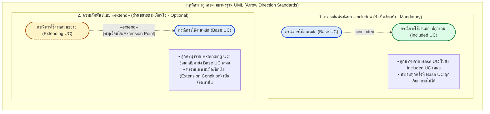

---

### 3.2 บัญชีรายชื่อผู้แสดงบทบาท (Actor Catalog)

ระบบจำแนกผู้แสดงบทบาทออกเป็น 2 กลุ่มหลัก คือ **ผู้แสดงบทบาทที่เป็นมนุษย์ (Human Actors)** และ **ระบบภายนอก (System Actors)** ดังนี้:

| สัญลักษณ์ | ผู้แสดงบทบาท (Actor) | ประเภท | บทบาทหน้าที่และขอบเขตความรับผิดชอบ | แพลตฟอร์มที่รองรับ |
|:---:|---|:---:|---|---|
| 👤 | **Guest**<br>(ผู้เยี่ยมชม) | Primary Human | ผู้ใช้งานทั่วไปที่ยังไม่ลงทะเบียน สามารถเข้าชมหน้า Landing Page, สำรวจโครงสร้างหมวดหมู่คำถาม และทดลองทำข้อสอบตัวอย่างฟรี (จำกัดโควตา 1 ครั้ง) | Web & Mobile |
| 👤 | **Registered User**<br>(ผู้สมัครงาน / ผู้ใช้งาน) | Primary Human | ผู้สมัครงานที่ลงทะเบียนบัญชีแล้ว (*สืบทอดสิทธิ์ของ Guest*) สามารถจัดการโปรไฟล์, ฝึกสัมภาษณ์ทั้งข้อเขียนและเสียง, ดูผลคะแนนรูบริก AI, จัดการความยินยอม PDPA และสมัครแพ็กเกจสมาชิก | Web & Mobile |
| 🛡️ | **System Administrator**<br>(ผู้ดูแลระบบ) | Primary Human (Internal) | จัดการระบบคลังคำถามและเกณฑ์รูบริก, ปรับแต่งค่าพารามิเตอร์ของโมเดล AI, จัดการบัญชีผู้ใช้, ตรวจสอบบันทึกความมั่นคงปลอดภัย (Audit Log) และพิจารณาข้ออุทธรณ์ผลคะแนน | เฉพาะ Web เท่านั้น |
| 💳 | **Finance Administrator**<br>(ผู้ดูแลการเงิน R3) | Primary Human (Internal) | ตรวจสอบและบริหารจัดการรายงานทางการเงิน ยอดขาย ค่าสมาชิก (MRR) และดำเนินการตรวจสอบ อนุมัติ หรือปฏิเสธคำขอคืนเงิน | เฉพาะ Web เท่านั้น |
| 🔬 | **Research Data Engineer**<br>(ผู้วิจัยและวิศวกรข้อมูล R3) | Primary Human (Internal) | สกัดและส่งออกชุดข้อมูลวิจัยนิรนาม (Anonymized Aggregate Datasets) ภายใต้เกณฑ์ k-anonymity / Differential Privacy (Cell Size >= 10) | เฉพาะ Web เท่านั้น |
| 🤖 | **External LLM Provider**<br>(บริการโมเดลภาษาขนาดใหญ่) | Secondary System | ให้บริการประมวลผล AI Inference สำหรับการสุ่ม/สร้างคำถาม, คำนวณคะแนนรูบริก, วิเคราะห์โครงสร้างคำตอบตามกรอบ STAR และสร้างคำแนะนำ | Backend API |
| 🎙️ | **Speech-to-Text Provider**<br>(บริการแปลงเสียงเป็นข้อความ R2) | Secondary System | ถอดเสียงคำตอบสัมภาษณ์ของผู้ใช้เป็นข้อความ เพื่อส่งเข้าสู่ไปป์ไลน์การประเมินผลของโมเดล AI | Backend API |
| 🏦 | **Payment Gateway Provider**<br>(บริการรับชำระเงิน R3) | Secondary System | ให้บริการรับชำระเงินผ่านบัตรเครดิต/พร้อมเพย์สำหรับแพ็กเกจสมาชิก และประมวลผลคำสั่งโอนเงินคืนเมื่อได้รับอนุมัติ | Backend API |
| ✉️ | **Transactional Email Service**<br>(บริการส่งอีเมลระบบ) | Secondary System | ส่งอีเมลยืนยันตัวตน ลิงก์รีเซ็ตรหัสผ่าน และอีเมลแจ้งเตือนการทำธุรกรรมหรือต่ออายุสมาชิก | Backend API |

---

### 3.3 แผนภาพกรณีการใช้งานระดับภาพรวมระบบ (Diagram D20: Master System Use Case Diagram)

แผนภาพนี้แสดงภาพรวมการมีปฏิสัมพันธ์ระหว่างผู้แสดงบทบาททุกกลุ่มกับขอบเขตของระบบ InterviewX โดยแสดงความสัมพันธ์แบบ `«include»` และ `«extend»` ไว้อย่างถูกต้องตามมาตรฐาน:

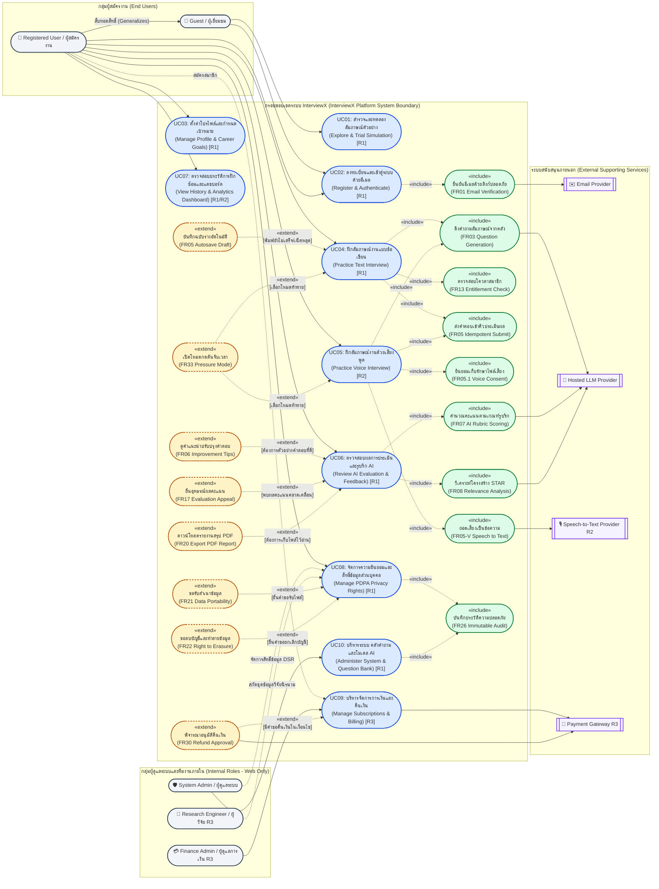

---

### 3.4 แผนภาพกรณีการใช้งานจำแนกตามระบบย่อย (Subsystem Use Case Diagrams)

#### 3.4.1 ระบบย่อยการฝึกสัมภาษณ์และการประเมินผล AI (Diagram D21: Practice & Evaluation Engine)

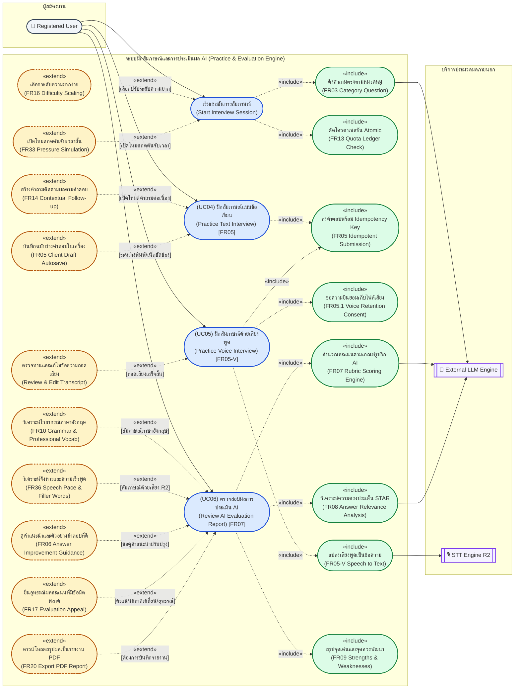

#### 3.4.2 ระบบย่อยการจัดการโปรไฟล์ ยืนยันตัวตน และคุ้มครองข้อมูลส่วนบุคคล (Diagram D22: Identity & PDPA Governance)

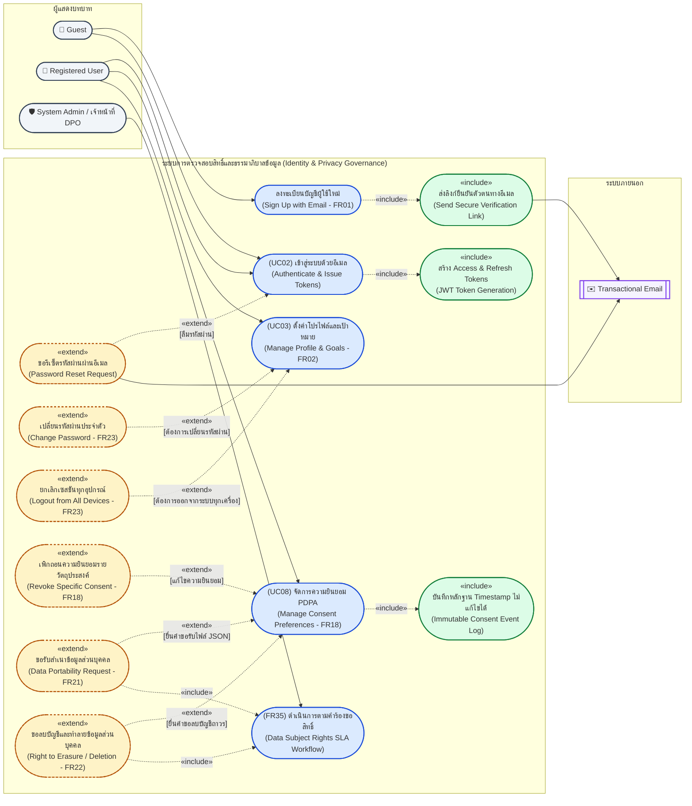

#### 3.4.3 ระบบย่อยการบริหารระบบ การเงิน และชุดข้อมูลวิจัย (Diagram D23: Administration, Billing & Research)

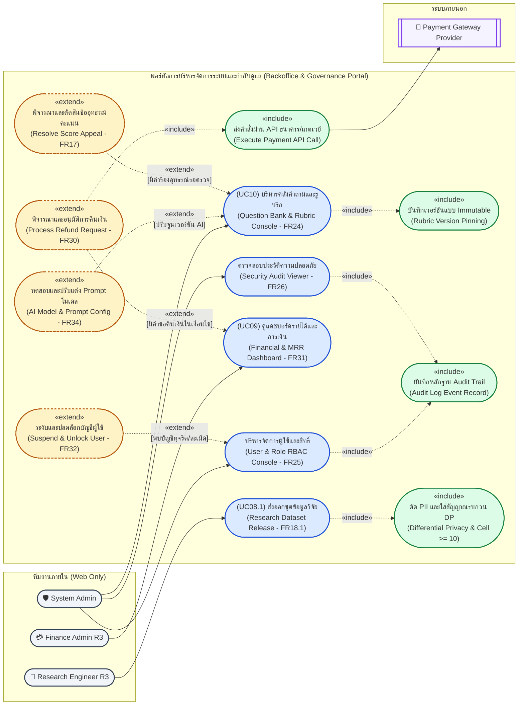

---

### 3.5 แคตตาล็อกกรณีการใช้งานหลัก (Use Case Catalog UC01–UC12)

| รหัสยูสเคส | ชื่อกรณีการใช้งาน | ผู้แสดงบทบาทหลัก | แพลตฟอร์มที่รองรับ | รอบการส่งมอบ | แผนภาพที่เกี่ยวข้อง |
|---|---|---|---|:---:|---|
| **UC01** | สำรวจและทดลองสัมภาษณ์ตัวอย่าง | Guest | Web & Mobile | R1 | D01, D20 |
| **UC02** | ลงทะเบียนและเข้าสู่ระบบด้วยอีเมล | Guest, Registered User | Web & Mobile | R1 | D06, D20, D22 |
| **UC03** | ตั้งค่าโปรไฟล์และกำหนดเป้าหมายการฝึกซ้อม | Registered User | Web & Mobile | R1 | D22, D25 |
| **UC04** | ฝึกสัมภาษณ์งานแบบข้อเขียน | Registered User | Web & Mobile | R1 | D07, D08, D20, D21 |
| **UC05** | ฝึกสัมภาษณ์งานด้วยเสียงพูด | Registered User | Web & Mobile | R2 | D08, D11, D20, D21 |
| **UC06** | ตรวจสอบผลการประเมินและรูบริก AI | Registered User | Web & Mobile | R1 | D07, D08, D20, D21 |
| **UC07** | ตรวจสอบประวัติการฝึกซ้อมและแดชบอร์ด | Registered User | Web & Mobile | R1 (Dashboard R2) | D21, D25 |
| **UC08** | จัดการความยินยอมและสิทธิ์ข้อมูลส่วนบุคคล | Registered User, Admin | Web & Mobile (Admin บน Web) | R1 | D10, D12, D20, D22 |
| **UC09** | บริหารจัดการการเงิน สมัครสมาชิก และคืนเงิน | Registered User, Finance Admin | Web & Mobile (Checkout) / Web (Admin) | R3 | D11, D20, D23 |
| **UC10** | บริหารระบบ คลังคำถาม และโมเดล AI | System Administrator | เฉพาะบนเว็บเท่านั้น (Admin Console) | R1 | D06, D20, D23 |
| **UC11** | การกำกับดูแลการเข้าถึงข้อมูลวิจัย | Research Engineer, Admin | เฉพาะบนเว็บเท่านั้น (Admin/Researcher) | R3 | D13, D23 |
| **UC12** | การจัดการการไหลของงานตรวจสอบโดยมนุษย์ | System Administrator | เฉพาะบนเว็บเท่านั้น (Admin Console) | R1 | D07, D08, D23 |

---

### 3.6 ข้อกำหนดรายละเอียดของกรณีการใช้งาน (Detailed Use Case Specifications UC01–UC12)

#### UC01 — สำรวจและทดลองสัมภาษณ์ตัวอย่าง (Explore & Trial Simulation)
- **ผู้แสดงบทบาทหลัก:** Guest (ผู้เยี่ยมชมที่ยังไม่ลงทะเบียน)
- **เงื่อนไขก่อนเริ่มทำงาน (Preconditions):** ผู้ใช้เข้าสู่เว็บไซต์หรือเปิดแอปพลิเคชันมือถือโดยที่ยังไม่ได้เข้าสู่ระบบ
- **เงื่อนไขหลังสิ้นสุดการทำงาน (Postconditions):** ผู้ใช้สามารถทำแบบทดสอบตัวอย่าง 1 คำถาม และเห็นตัวอย่างหน้าจอผลคะแนนรูบริก โดยไม่มีการบันทึกประวัติลงฐานข้อมูลถาวร
- **ลำดับขั้นตอนปกติ (Normal Flow):**
  1. ผู้ใช้กดปุ่ม "ทดลองสัมภาษณ์ฟรี" บนหน้าแรก
  2. ระบบโหลดชุดคำถามสัมภาษณ์ตัวอย่างจากแคชสาธารณะ
  3. ผู้ใช้พิมพ์คำตอบลงในกล่องข้อความและกดยืนยันส่ง
  4. ระบบแสดงตัวอย่างการวิเคราะห์คำตอบตามโครงสร้าง STAR และคะแนนรูบริกจำลอง
  5. ระบบแสดงแบนเนอร์เชิญชวนให้ลงทะเบียนเพื่อบันทึกประวัติและฝึกฝนเต็มรูปแบบ
- **ลำดับขั้นตอนทางเลือก (Alternative Flow):**
  - *3a. ผู้ใช้เปลี่ยนใจต้องการลงทะเบียนทันที:* ระบบนำทางไปยังหน้าจอ UC02
- **ลำดับขั้นตอนข้อยกเว้น (Exception Flow):**
  - *2a. ไม่สามารถเชื่อมต่อบริการหลังบ้านได้:* ระบบแสดงคำถามออฟไลน์จากแคชท้องถิ่นของอุปกรณ์

#### UC02 — ลงทะเบียนและเข้าสู่ระบบด้วยอีเมล (Register & Authenticate)
- **ผู้แสดงบทบาทหลัก:** Guest, Registered User
- **เงื่อนไขก่อนเริ่มทำงาน (Preconditions):** ผู้ใช้มีอีเมลที่ใช้งานได้จริง และมีการเชื่อมต่ออินเทอร์เน็ต
- **เงื่อนไขหลังสิ้นสุดการทำงาน (Postconditions):** ผู้ใช้ได้รับการยืนยันตัวตน และได้รับ JWT Tokens (Web จัดเก็บใน HTTP-Only Cookie, Mobile จัดเก็บใน Keychain/Keystore)
- **ลำดับขั้นตอนปกติ (Normal Flow):**
  1. ผู้ใช้กรอกอีเมลและรหัสผ่านตามเกณฑ์ความปลอดภัย (NFR01)
  2. ผู้ใช้กดยอมรับข้อกำหนดการใช้งานและนโยบายความเป็นส่วนตัว (PDPA Consent)
  3. ระบบส่งลิงก์ยืนยันตัวตนไปยังอีเมลของผู้ใช้ (Magic Link / Verification Code)
  4. ผู้ใช้กดยืนยันจากอีเมล ระบบสร้างบัญชีผู้ใช้และออก Access Token / Refresh Token
  5. ระบบนำทางผู้ใช้เข้าสู่แดชบอร์ดหลัก
- **ลำดับขั้นตอนทางเลือก (Alternative Flow):**
  - *1a. ผู้ใช้เคยมีบัญชีแล้ว:* กรอกอีเมลและรหัสผ่านเพื่อเข้าสู่ระบบโดยตรง
  - *1b. ผู้ใช้ลืมรหัสผ่าน:* กดขอลิงก์รีเซ็ตรหัสผ่านทางอีเมล (Password Reset Flow)
- **ลำดับขั้นตอนข้อยกเว้น (Exception Flow):**
  - *1c. รหัสผ่านไม่ผ่านเกณฑ์ความปลอดภัย:* ระบบแจ้งเตือนให้ตั้งรหัสผ่านใหม่ตามเกณฑ์
  - *4a. ลิงก์ยืนยันตัวตนหมดอายุ (เกิน 24 ชม.):* ระบบแสดงปุ่มให้กดส่งลิงก์ใหม่

#### UC04 — ฝึกสัมภาษณ์งานแบบข้อเขียน (Practice Text Interview)
- **ผู้แสดงบทบาทหลัก:** Registered User
- **เงื่อนไขก่อนเริ่มทำงาน (Preconditions):** ผู้ใช้เข้าสู่ระบบสำเร็จ มีโควตาสัมภาษณ์คงเหลือ (FR13)
- **เงื่อนไขหลังสิ้นสุดการทำงาน (Postconditions):** คำตอบถูกบันทึกอย่างปลอดภัย งานประเมิน AI ถูกส่งเข้าคิว Redis และโควตาถูกหักออก 1 ครั้งอย่างถูกต้อง
- **ลำดับขั้นตอนปกติ (Normal Flow):**
  1. ผู้ใช้เลือกหมวดหมู่งาน (เช่น Software Engineer, Product Manager) และระดับความยาก
  2. ระบบตรวจสอบโควตาและดึงคำถามสัมภาษณ์จากคลังคำถาม (FR03)
  3. ระบบแสดงคำถามพร้อมตัวนับเวลา (หากเปิดโหมดจับเวลา)
  4. ผู้ใช้พิมพ์คำตอบลงในกล่องข้อความ (ระบบทำการ Autosave ฉบับร่างเป็นระยะ)
  5. ผู้ใช้กดยืนยันส่งคำตอบ (ระบบแนบ Idempotency Key ป้องกันการกดซ้ำ)
  6. ระบบบันทึกคำตอบลงฐานข้อมูล และส่ง Event เข้าสู่ Outbox เพื่อส่งต่อให้ AI ประเมินผล
  7. ระบบนำทางผู้ใช้ไปยังหน้ารอผลการประเมิน (UC06)
- **ลำดับขั้นตอนทางเลือก (Alternative Flow):**
  - *4a. สัญญาณอินเทอร์เน็ตขาดหายขณะพิมพ์:* แอปพลิเคชันเก็บข้อความร่างไว้ในแคชเครื่อง เมื่อสัญญาณกลับมาจึงส่งอีกครั้งโดยข้อมูลไม่สูญหาย
- **ลำดับขั้นตอนข้อยกเว้น (Exception Flow):**
  - *2a. โควตาการใช้งานหมด:* ระบบแจ้งเตือนและนำทางไปยังหน้าเลือกแพ็กเกจสมาชิก (UC09)

#### UC05 — ฝึกสัมภาษณ์งานด้วยเสียงพูด (Practice Voice Interview)
- **ผู้แสดงบทบาทหลัก:** Registered User (รอบ R2)
- **เงื่อนไขก่อนเริ่มทำงาน (Preconditions):** ผู้ใช้เข้าสู่ระบบ มีโควตาสัมภาษณ์ และอุปกรณ์มีไมโครโฟนพร้อมใช้งาน
- **เงื่อนไขหลังสิ้นสุดการทำงาน (Postconditions):** เสียงถูกอัปโหลดไปยัง Object Storage ส่วนตัว, ถูกถอดเสียงเป็นข้อความ และส่งเข้าคิวประเมินผล AI
- **ลำดับขั้นตอนปกติ (Normal Flow):**
  1. ผู้ใช้เลือกโหมดการฝึกสัมภาษณ์ด้วยเสียง
  2. ระบบแสดงกล่องขอความยินยอมในการเก็บรักษาไฟล์เสียง (Voice Retention Consent - FR05.1)
  3. ผู้ใช้กดบันทึกเสียงและตอบคำถามสัมภาษณ์ผ่านไมโครโฟน
  4. เมื่อพูดเสร็จ ผู้ใช้กดยุติการบันทึกเสียง แอปพลิเคชันอัปโหลดไฟล์เสียงผ่าน Pre-signed URL
  5. บริการ Speech-to-Text ถอดความเสียงเป็นข้อความ (FR05-V)
  6. ระบบแสดงข้อความที่ถอดได้บนหน้าจอ เพื่อให้ผู้ใช้ตรวจทานและแก้ไขคำผิดก่อนส่ง
  7. ผู้ใช้กดยืนยันส่งข้อความคำตอบเข้าสู่ไปป์ไลน์การประเมินผล AI
- **ลำดับขั้นตอนทางเลือก (Alternative Flow):**
  - *2a. ผู้ใช้ปฏิเสธการเก็บรักษาไฟล์เสียง:* ระบบจะใช้ไฟล์เสียงเพื่อถอดความเท่านั้น และทำลายไฟล์ทิ้งทันทีภายใน 24 ชม.
- **ลำดับขั้นตอนข้อยกเว้น (Exception Flow):**
  - *3a. สิทธิ์ไมโครโฟนถูกปฏิเสธ:* ระบบแจ้งเตือนขั้นตอนการเปิดสิทธิ์ในระบบปฏิบัติการ

#### UC06 — ตรวจสอบผลการประเมินและรูบริก AI (Review AI Evaluation & Feedback)
- **ผู้แสดงบทบาทหลัก:** Registered User
- **เงื่อนไขก่อนเริ่มทำงาน (Preconditions):** งานประเมินผล AI (Evaluation Job) ทำงานเสร็จสมบูรณ์
- **เงื่อนไขหลังสิ้นสุดการทำงาน (Postconditions):** ผู้ใช้ได้รับรายงานคะแนนแยกตาม 4 มิติรูบริก จุดเด่น จุดควรพัฒนา และคำแนะนำปรับปรุง
- **ลำดับขั้นตอนปกติ (Normal Flow):**
  1. ระบบแจ้งเตือนผู้ใช้ว่าการประเมินผลเสร็จสิ้น
  2. ผู้ใช้เปิดหน้ารายงานผลการประเมิน
  3. ระบบแสดงคะแนนแยกตามมิติรูบริก 4 ด้าน (Relevance, Structure, Problem-Solving, Communication) พร้อมคำอธิบายเชิงหลักฐาน (Evidence Citation)
  4. ระบบแสดงการวิเคราะห์โครงสร้างคำตอบตามกรอบ STAR (Situation, Task, Action, Result)
  5. ระบบแสดงข้อเสนอแนะตัวอย่างคำตอบที่ดีขึ้น (Improved Model Answer)
- **ลำดับขั้นตอนทางเลือก (Alternative Flow):**
  - *5a. ผู้ใช้ต้องการบันทึกเก็บไว้:* กดปุ่มดาวน์โหลดรายงานฉบับเต็มในรูปแบบ PDF (FR20)
  - *5b. ผู้ใช้พบว่าผลประเมินคลาดเคลื่อน:* กดปุ่มยื่นอุทธรณ์ผลคะแนน (Appeal - FR17) พร้อมระบุเหตุผลเพื่อส่งต่อให้ Admin ตรวจสอบ
- **ลำดับขั้นตอนข้อยกเว้น (Exception Flow):**
  - *1a. การประเมินผล AI ล้มเหลว (Circuit Breaker เปิด):* ระบบปรับสถานะเป็น `needs_review` และแจ้งผู้ใช้ว่าจะได้รับผลการประเมินผ่านการตรวจสอบภายใน 2 ชั่วโมง

#### UC08 — จัดการความยินยอมและสิทธิ์ข้อมูลส่วนบุคคล (Manage PDPA Privacy Rights)
- **ผู้แสดงบทบาทหลัก:** Registered User, System Admin
- **เงื่อนไขก่อนเริ่มทำงาน (Preconditions):** ผู้ใช้เข้าสู่ระบบด้วยบัญชีตนเอง
- **เงื่อนไขหลังสิ้นสุดการทำงาน (Postconditions):** การเปลี่ยนแปลงความยินยอมหรือคำร้องขอสิทธิ์ (DSR) ถูกบันทึกลงตารางถาวรแบบแก้ไขไม่ได้ (Immutable Audit)
- **ลำดับขั้นตอนปกติ (Normal Flow):**
  1. ผู้ใช้เข้าสู่หน้าจอ "ความเป็นส่วนตัวและความปลอดภัย" (Privacy Center)
  2. ระบบแสดงรายการความยินยอมแยกตามวัตถุประสงค์ (การปรับปรุงโมเดล AI, การวิเคราะห์ข้อมูล, การติดต่อสื่อสาร)
  3. ผู้ใช้สามารถเปิด/ปิดความยินยอมรายวัตถุประสงค์ได้อย่างอิสระ
  4. ระบบบันทึกประวัติการเปลี่ยนแปลงพร้อม Timestamp และส่งการแจ้งเตือนยืนยัน
- **ลำดับขั้นตอนทางเลือก (Alternative Flow):**
  - *3a. ผู้ใช้ขอรับสำเนาข้อมูล (Data Portability):* ยื่นคำร้อง ระบบสร้างไฟล์ JSON รวมข้อมูลทั้งหมดและส่งลิงก์ดาวน์โหลดที่ปลอดภัยภายใน 72 ชม.
  - *3b. ผู้ใช้ขอลบบัญชีและทำลายข้อมูล (Right to Erasure):* ยื่นคำร้อง ระบบเข้าสู่กระบวนการลบข้อมูล (Soft delete ทันที, Hard delete ข้อมูลส่วนบุคคลภายใน 30 วันตาม SLA)
- **ลำดับขั้นตอนข้อยกเว้น (Exception Flow):**
  - *3c. บัญชียังมีธุรกรรมทางการเงินค้างชำระ:* ระบบแจ้งเตือนให้จัดการภาระทางการเงินก่อนดำเนินการลบบัญชี

#### UC09 — บริหารจัดการการเงินและคืนเงิน (Manage Subscriptions & Billing)
- **ผู้แสดงบทบาทหลัก:** Registered User, Finance Administrator (รอบ R3)
- **เงื่อนไขก่อนเริ่มทำงาน (Preconditions):** ผู้ใช้ต้องการอัปเกรดแพ็กเกจสมาชิก หรือยื่นขอคืนเงิน
- **เงื่อนไขหลังสิ้นสุดการทำงาน (Postconditions):** สิทธิ์การใช้งานถูกปรับปรุงตามแพ็กเกจทันที และมีใบเสร็จอิเล็กทรอนิกส์ออกให้อย่างถูกต้อง
- **ลำดับขั้นตอนปกติ (Normal Flow):**
  1. ผู้ใช้เลือกดูรายการแพ็กเกจสมาชิก (Basic, Pro) และกดยืนยันสั่งซื้อ
  2. ระบบสร้างเซสชันการชำระเงินและนำทางไปยัง Payment Gateway
  3. ผู้ใช้ชำระเงินผ่านบัตรเครดิตหรือพร้อมเพย์สำเร็จ
  4. Payment Gateway ส่ง Webhook พร้อมลายเซ็น HMAC ยืนยันยอดเงิน
  5. ระบบบิลลิ่งตรวจสอบความถูกต้อง ปรับปรุงสถานะสมาชิก เติมโควตาการใช้งาน และออกใบเสร็จรับเงิน
- **ลำดับขั้นตอนทางเลือก (Alternative Flow):**
  - *1a. ผู้ใช้ยื่นคำขอคืนเงิน (ภายใน 7 วัน):* ระบุเหตุผล ระบบส่งคำร้องเข้าสู่คิวของ Finance Admin เพื่อตรวจสอบและอนุมัติผ่านหน้าจอ Web Console
- **ลำดับขั้นตอนข้อยกเว้น (Exception Flow):**
  - *4a. การชำระเงินไม่สำเร็จ:* ระบบแจ้งเตือนผู้ใช้และไม่ทำการหักเงินหรือปรับสิทธิ์

#### UC10 — บริหารระบบ คลังคำถาม และโมเดล AI (Administer System & Question Bank)
- **ผู้แสดงบทบาทหลัก:** System Administrator (เฉพาะบน Web Console)
- **เงื่อนไขก่อนเริ่มทำงาน (Preconditions):** ผู้ใช้ผ่านการพิสูจน์ตัวตนด้วยสิทธิ์ Admin และใช้งานผ่านเว็บบราวเซอร์
- **เงื่อนไขหลังสิ้นสุดการทำงาน (Postconditions):** ข้อมูลคลังคำถาม เกณฑ์รูบริก หรือค่าคอนฟิก AI ถูกปรับปรุงพร้อมตรึงหมายเลขเวอร์ชันใหม่ (Immutable Versioning)
- **ลำดับขั้นตอนปกติ (Normal Flow):**
  1. ผู้ดูแลระบบเข้าสู่ส่วนควบคุมจัดการระบบ (Admin Console)
  2. เลือกจัดการคลังคำถาม หรือเกณฑ์การประเมินรูบริก
  3. ทำการเพิ่ม แก้ไข หรือปิดใช้งานคำถาม/เกณฑ์รูบริก
  4. ระบบตรวจสอบความถูกต้องของโครงสร้างข้อมูล และบันทึกเป็นเวอร์ชันใหม่แบบ Immutable
  5. ระบบบันทึกการกระทำลงใน Security Audit Log ถาวร
- **ลำดับขั้นตอนทางเลือก (Alternative Flow):**
  - *3a. ปรับปรุงพารามิเตอร์ของโมเดล AI:* ทดสอบ Prompt ผ่านหน้าจอ Sandbox ก่อนกดยืนยัน Deploy สู่ระบบจริง
- **ลำดับขั้นตอนข้อยกเว้น (Exception Flow):**
  - *1a. มีความพยายามเข้าสู่ระบบ Admin จาก Mobile App:* ระบบทำการสกัดกั้นทันทีด้วยรหัสข้อผิดพลาด 403 Forbidden (FR32)

---

### 3.7 แผนภาพลำดับขั้นตอนการทำงานหลักของระบบ (Sequence Diagrams)

#### 3.7.1 ลำดับขั้นตอนการประเมินผลคะแนนตามรูบริก (Diagram D07: Rubric Evaluation Sequence)

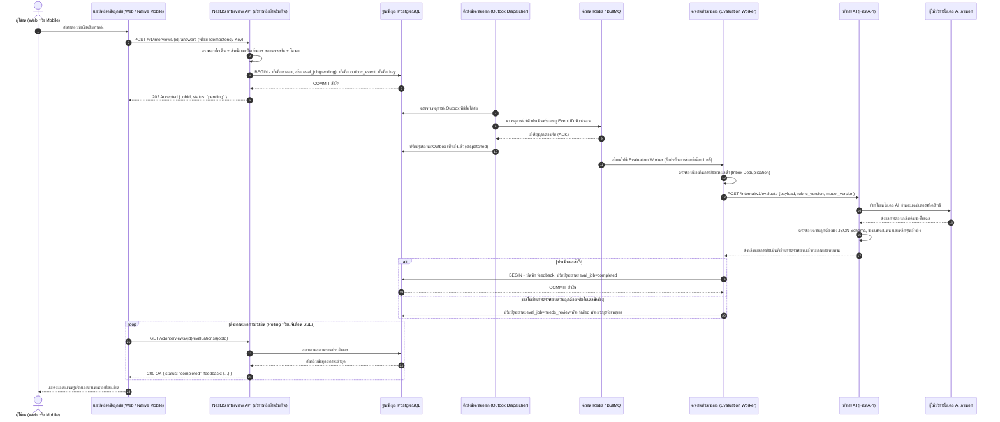

#### 3.7.2 ลำดับขั้นตอนการสัมภาษณ์ด้วยเสียงในรอบ R2 (Diagram D11: Voice Interview Sequence R2)

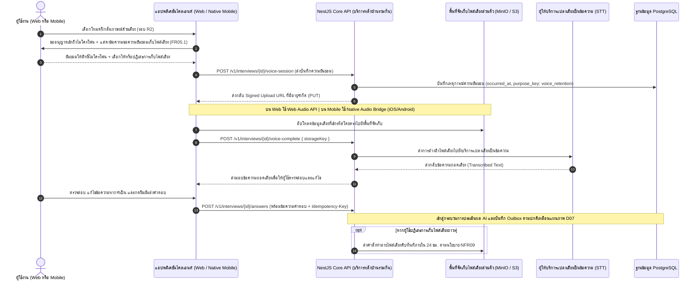

#### 3.7.3 ลำดับขั้นตอนการชำระเงินและการเปิดสิทธิ์ในรอบ R3 (Diagram D12: Payment & Entitlement Sequence R3)

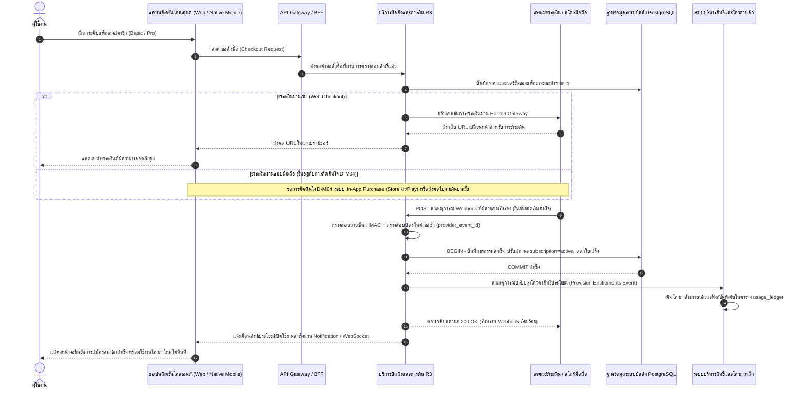

#### 3.7.4 ลำดับขั้นตอนการส่งออกข้อมูลเพื่องานวิจัยในรอบ R3 (Diagram D13: Research Data Release Pipeline R3)

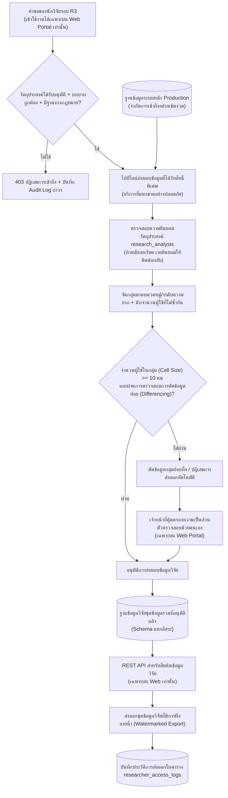

---

### 3.8 แผนภาพสถานะวงจรชีวิตเซสชันการสัมภาษณ์ (Diagram D08: Interview Session State Machine Diagram)

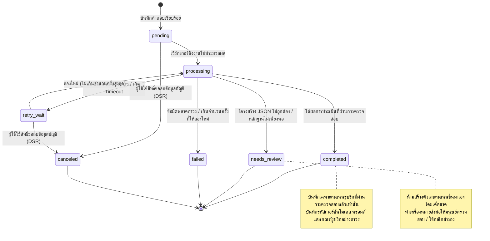


---

## 4. การกำหนดสิทธิ์และการรักษาความปลอดภัย (Role, Authorization & Security Governance: RBAC)

สถาปัตยกรรมความปลอดภัยและการอนุญาตสิทธิ์ของระบบ InterviewX วางอยู่บนหลักการแบ่งแยกแนวคิด 3 มิติออกจากกันอย่างเด็ดขาด (Decoupled Dimensions of Access Control):
1. **บทบาทความปลอดภัย (Security Role):** ขอบเขตสิทธิ์ของบุคคลในการเข้าถึงทรัพยากรและ API Endpoint ในระบบ (`Guest`, `Registered User`, `Researcher`, `Finance Admin`, `System Admin`)
2. **สิทธิประโยชน์ตามระดับแพ็กเกจสมาชิก (Subscription Entitlement):** ขอบเขตโควตาและฟีเจอร์ทางธุรกิจ (`Free Tier`, `Basic Package`, `Pro Package`, `Enterprise`) โดยผู้ใช้ทุกระดับในมิตินี้มี Security Role เป็น `Registered User` เหมือนกันทั้งหมด
3. **ขอบเขตการเข้าถึงตามแพลตฟอร์ม (Platform Capability & Access Boundary):** ส่วนติดต่อผู้ใช้ที่ได้รับอนุญาตให้เรียกใช้ฟังก์ชัน (`Responsive Web Application` หรือ `Native Mobile Application: iOS / Android`)

---

### 4.1 แผนภาพการตรวจสอบตัวตนและการอนุญาตสิทธิ์ (Diagram D09: Identity & Authorization Flow)

แผนภาพนี้แสดงขั้นตอนการตรวจสอบสิทธิ์อย่างละเอียดในทุกมิติ ทั้งการพิสูจน์ตัวตน, สถานะบัญชี, การจำกัดแพลตฟอร์ม, บทบาทความปลอดภัย (RBAC), ความเป็นเจ้าของข้อมูล, ความยินยอม PDPA และการตรวจสอบโควตา:

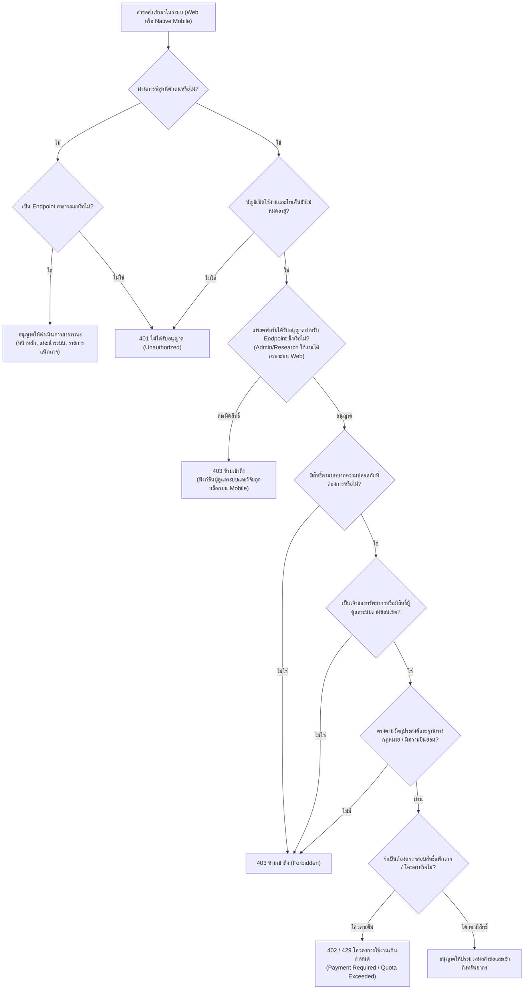

---

### 4.2 แผนภาพสถาปัตยกรรมความปลอดภัยและขอบเขตความไว้วางใจระดับ API (Diagram D06: API Trust Boundaries)

แผนภาพนี้แสดงการแบ่งโซนความปลอดภัยระหว่างไคลเอนต์ภายนอกที่ไม่น่าเชื่อถือ (Web และ Mobile), เครือข่ายสาธารณะ Edge/WAF, จุดคัดกรองสิทธิ์ RBAC และเครือข่ายส่วนตัวภายในระบบ:

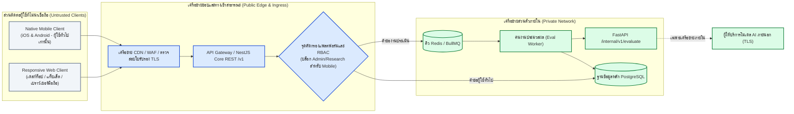

---

### 4.3 เมทริกซ์ความสามารถและการเข้าถึงตามแพลตฟอร์ม (Platform Capability & Access Matrix)

| บทบาทความปลอดภัย (Security Role) | เว็บแอปพลิเคชัน (Web Application) | แอปมือถือเนทีฟ (Native Mobile: iOS / Android) | ขอบเขตฟังก์ชันและรายละเอียดทางเทคนิค | สถานะการอนุญาตทางสถาปัตยกรรม |
|---|:---:|:---:|---|:---:|
| **Guest (ผู้เยี่ยมชม)** | ✅ ใช้งานได้ | ✅ ใช้งานได้ | เข้าชมหน้า Landing Page, สำรวจหมวดหมู่คำถาม, ทดลองสัมภาษณ์ตัวอย่าง 1 ครั้ง (Trial Mode) ไม่สามารถเข้าถึงประวัติส่วนตัวหรือซื้อแพ็กเกจได้ | อนุมัติตาม Baseline v1.1 |
| **Registered User (ผู้สมัครงานทั่วไป)** | ✅ ใช้งานได้ | ✅ ใช้งานได้ | ฝึกสัมภาษณ์เต็มรูปแบบ (ข้อเขียนและเสียง), ตรวจสอบผลคะแนนรูบริก AI, แดชบอร์ดสรุปผล, ตั้งค่าโปรไฟล์, จัดการความยินยอม PDPA ตรวจสอบสิทธิ์ผ่าน Unified JWT | อนุมัติตาม Baseline v1.1 |
| **Researcher (ผู้วิจัยข้อมูล)** | ✅ ใช้งานได้ | ❌ **ไม่อนุญาต (เด็ดขาด)** | เข้าถึงชุดข้อมูลวิจัยนิรนาม เครื่องมือสืบค้น และการส่งออกข้อมูลแบบคงความเป็นส่วนตัว (Cell Size >= 10); อยู่นอกขอบเขตของ Native Mobile โดยเด็ดขาด เพื่อป้องกันข้อมูลรั่วไหล | อนุมัติตาม Baseline v1.1 |
| **Finance Administrator (ผู้ดูแลการเงิน)** | ✅ ใช้งานได้ | ❌ **ไม่อนุญาต (เด็ดขาด)** | เข้าถึงแดชบอร์ดการเงิน, บัญชีแยกประเภทธุรกรรม, การตรวจสอบคำขอคืนเงิน, การอนุมัติและประมวลผลการคืนเงิน และจัดการแพ็กเกจสมาชิก; สงวนไว้เฉพาะบน Web เท่านั้น | อนุมัติตาม Baseline v1.1 |
| **System Administrator (ผู้ดูแลระบบ)** | ✅ ใช้งานได้ | ❌ **ไม่อนุญาต (เด็ดขาด)** | บริหารจัดการระบบส่วนกลาง คลังคำถามสัมภาษณ์ เวอร์ชันเกณฑ์รูบริกและพรอมต์โมเดล AI, ตรวจสอบบันทึก Audit Log และจัดการสิทธิ์ผู้ใช้; สงวนไว้เฉพาะบน Web เท่านั้น | อนุมัติตาม Baseline v1.1 |

---

### 4.4 เมทริกซ์สิทธิ์ตามระดับแพ็กเกจสมาชิก (Subscription Entitlement Matrix)

| สิทธิประโยชน์ / ขีดจำกัดฟีเจอร์ | แพ็กเกจทดลองใช้ฟรี (Free Tier) | แพ็กเกจพื้นฐาน (Basic Package) | แพ็กเกจมืออาชีพ (Pro Package) | แพลตฟอร์มที่ได้รับสิทธิ์ |
|---|:---:|:---:|:---:|:---:|
| **โควตาการฝึกสัมภาษณ์ข้อเขียน (Text)** | 3 เซสชัน / เดือน | 30 เซสชัน / เดือน | ไม่จำกัด (Fair Use 100/เดือน) | Web & Mobile |
| **โควตาการฝึกสัมภาษณ์ด้วยเสียง (Voice R2)** | ทดลอง 1 เซสชัน | 15 เซสชัน / เดือน | 60 เซสชัน / เดือน | Web & Mobile |
| **การประเมินคะแนนตามรูบริก AI** | คะแนนรวม + สรุปย่อ | คะแนนละเอียด 4 มิติ | คะแนนละเอียด + หลักฐานอ้างอิงรายบรรทัด | Web & Mobile |
| **การวิเคราะห์โครงสร้างคำตอบ STAR** | ❌ ไม่รองรับ | ✅ รองรับ | ✅ รองรับอย่างละเอียด | Web & Mobile |
| **การวิเคราะห์ไวยากรณ์และคำศัพท์ (FR10)** | ❌ ไม่รองรับ | ✅ ภาษาไทยและอังกฤษ | ✅ ภาษาไทยและอังกฤษเชิงลึก | Web & Mobile |
| **การวิเคราะห์ความเร็วและจังหวะพูด (FR36)** | ❌ ไม่รองรับ | ❌ ไม่รองรับ | ✅ รองรับในโหมดเสียง R2 | Web & Mobile |
| **การดาวน์โหลดรายงานผล PDF (FR20)** | ❌ มีลายน้ำระบบ | ✅ รายงานสรุปมาตรฐาน | ✅ รายงานเชิงลึกฉบับเต็ม | Web & Mobile |
| **การตั้งคำถามติดตามผลแบบปรับตัว (Adaptive)** | ❌ ไม่รองรับ | 1 คำถามติดตามผล | สูงสุด 3 คำถามติดตามผลต่อเนื่อง | Web & Mobile |
| **ระยะเวลาเก็บประวัติและไฟล์เสียง** | 7 วัน (เสียง 24 ชม.) | 90 วัน (เสียง 30 วัน) | 1 ปีเต็ม (เสียง 90 วันตามยินยอม) | Web & Mobile |

---

### 4.5 กฎบัตรการควบคุมสิทธิ์ 7 ประการ (7 Core RBAC Enforcement Rules)

1. **กฎข้อที่ 1: การห้ามสิทธิ์ระดับผู้ดูแลระบบบนอุปกรณ์เคลื่อนที่อย่างเด็ดขาด (No mobile admin privileges):** หน้าที่และสิทธิ์ระดับ `System Admin`, `Finance Admin` และ `Researcher` จะไม่สามารถใช้งานได้บน Native Mobile โดยระบบหลังบ้านจะทำการตรวจสอบและปฏิเสธคำขอทันทีด้วยรหัสข้อผิดพลาด `403 Forbidden`
2. **กฎข้อที่ 2: บทบาทและสิทธิ์ต้องมีแหล่งข้อมูลเดียว (Role/permission single source of truth):** ตาราง `identity.roles`, `identity.permissions` และ `identity.role_permissions` ในฐานข้อมูล PostgreSQL ส่วนกลางเป็นแหล่งข้อมูลเดียวที่ถูกต้อง ห้ามฝังการตัดสินใจเชิงสิทธิ์ไว้บนฝั่ง Client
3. **กฎข้อที่ 3: สิทธิประโยชน์ของสมาชิกไม่ใช่บทบาทความปลอดภัย (Subscription entitlement is not a role):** การอัปเกรดเป็น `Basic` หรือ `Pro` มีผลเฉพาะการเติมยอดโควตาใน `billing.usage_ledger` เท่านั้น โดยผู้ใช้ยังคงมี Security Role เป็น `Registered User` เท่าเดิม
4. **กฎข้อที่ 4: ความเป็นเจ้าของข้อมูลและการแยกขาดอย่างสมบูรณ์ (Ownership and tenancy boundary):** ผู้ใช้งานทั่วไปสามารถเข้าถึงได้เฉพาะเซสชัน คำตอบ และผลการประเมินที่เป็นของตนเองเท่านั้น (`session.user_id == current_user.id`) โดยห้ามเข้าถึงข้อมูลของผู้ใช้อื่นโดยเด็ดขาด
5. **กฎข้อที่ 5: การบังคับใช้สิทธิ์ที่ระบบบริการหลังบ้าน (Backend-enforced entitlements):** ยอดโควตาและสิทธิประโยชน์ทั้งหมดต้องถูกตรวจสอบและตัดยอดแบบ Atomic Transaction บน Backend API เสมอ ข้อมูลโควตาบนหน้าจอเครื่องผู้ใช้เป็นเพียงข้อมูลแคชสำหรับแสดงผล ไม่มีอำนาจตัดสินใจ
6. **กฎข้อที่ 6: การตรวจสอบสิทธิ์ระดับ API อย่างครอบคลุมทุกจุด (Comprehensive API authorization):** ทุก API Endpoint ภายใต้ `/v1/*` และ `/internal/*` ต้องผ่านการตรวจสอบตัวตน (Authentication Guard), การตรวจสอบบทบาท (RBAC Guard), การตรวจสอบความเป็นเจ้าของ (Ownership Guard) และการตรวจสอบความยินยอม (Consent Guard)
7. **กฎข้อที่ 7: การป้องกันเชิงลึก - ความปลอดภัยไม่ได้อยู่ที่ UI (Defense in Depth - No UI-only security):** การซ่อนเมนู ปุ่ม หรือการปิดกั้นหน้าจอในระดับ UI ไม่ถือเป็นการรักษาความปลอดภัย API Gateway และ Controller ของ NestJS จะตรวจสอบ Payload และสิทธิ์อย่างเข้มงวดทุกคำขอ

---

### 4.6 ขอบเขตฟังก์ชันแอปพลิเคชันมือถือ (Native Mobile Functional Scope)

#### โมดูลที่อยู่ในขอบเขต (In-Scope Modules — 17 โมดูล):
1. **การตรวจสอบสิทธิ์ (Authentication):** รองรับการ Login ด้วย Email/Password และ Token Refresh
2. **การเข้าถึงสำหรับผู้เยี่ยมชม (Guest Access):** หน้า Landing Page และการทดลองทำข้อสอบตัวอย่าง
3. **การลงทะเบียนและเข้าสู่ระบบ (Registration & Login):** การสมัครบัญชีใหม่และการขอรีเซ็ตรหัสผ่าน
4. **การเริ่มต้นใช้งานระบบ (Onboarding):** การแนะนำระบบและแบบสอบถามเป้าหมายเบื้องต้น
5. **โปรไฟล์ผู้ใช้งาน (User Profile):** การดูและแก้ไขข้อมูลส่วนตัว ทักษะ และสายงานเป้าหมาย
6. **การตั้งค่าการสัมภาษณ์ (Interview Setup):** การเลือกหมวดหมู่งาน ระดับความยาก และโหมดจับเวลา
7. **ห้องจำลองการสัมภาษณ์ (Interview Room):** หน้าจอแสดงคำถาม กล่องพิมพ์คำตอบ และตัวจับเวลา
8. **การสัมภาษณ์แบบข้อความ (Text-based Interview):** การพิมพ์คำตอบพร้อมระบบบันทึกฉบับร่างอัตโนมัติ (Autosave)
9. **การสัมภาษณ์แบบเสียง (Voice-based Interview R2):** การบันทึกเสียงผ่านไมโครโฟนและการแปลงเสียงเป็นข้อความ (STT)
10. **การประเมินผลโดย AI (AI Evaluation):** หน้ารอสถานะการประเมินผลแบบ Real-time Polling
11. **ผลการประเมินและข้อเสนอแนะ (Evaluation Results & Feedback):** แสดงคะแนน 4 มิติรูบริก STAR และตัวอย่างคำตอบ
12. **แดชบอร์ดสรุปผล (Dashboard):** สรุปแนวโน้มคะแนน จุดแข็ง จุดอ่อน และความคืบหน้ารายสัปดาห์
13. **ประวัติการสัมภาษณ์ (Interview History):** รายการเซสชันที่เคยฝึกสัมภาษณ์ทั้งหมด พร้อมสถานะคะแนน
14. **ข้อมูลแพ็กเกจสมาชิก (Subscription Information):** ดูสถานะแพ็กเกจปัจจุบัน โควตาคงเหลือ และช่องทางสมัคร
15. **การจัดการความยินยอมและความเป็นส่วนตัว (Consent & Privacy):** จัดการสิทธิ์ PDPA และการขอลบข้อมูล
16. **การจัดการบัญชีผู้ใช้ (Account Management):** การเปลี่ยนรหัสผ่าน และการออกจากระบบทุกอุปกรณ์
17. **การเชื่อมโยงและประสานข้อมูลข้ามแพลตฟอร์ม (Cross-Platform Synchronization):** ซิงค์สถานะเซสชันและโควตาระหว่าง Web และ Mobile

#### โมดูลที่อยู่นอกขอบเขต (Out-of-Scope Modules — 7 โมดูล สงวนไว้บน Web เท่านั้น):
1. **คอนโซลผู้ดูแลระบบ (Admin Console):** หน้าจอรวมการบริหารจัดการระบบและพารามิเตอร์ส่วนกลาง
2. **พอร์ทัลผู้วิจัย (Researcher Portal):** เครื่องมือกำหนดกลุ่มตัวอย่างและสืบค้นข้อมูลวิจัย
3. **การบริหารจัดการผู้ใช้งาน (User Administration):** การค้นหา สั่งระงับ หรือปลดล็อกบัญชีผู้ใช้
4. **การบริหารจัดการโมเดล AI และคลังคำถาม (AI Model & Question Bank Administration):** การเพิ่ม/แก้ไขคำถามและรูบริก
5. **การบริหารการเงินและการชำระเงิน (Finance Administration):** การตรวจสอบธุรกรรมและอนุมัติการคืนเงิน
6. **รายงานรายได้และตัวชี้วัดทางธุรกิจ (Revenue & Business Metrics Dashboard):** แดชบอร์ด MRR, Churn Rate
7. **การจัดการและส่งออกชุดข้อมูลงานวิจัย (Research Dataset Release & Watermarking):** การ Export ชุดข้อมูลพร้อมลายน้ำ


---

## 5. การออกแบบฐานข้อมูลและพจนานุกรมข้อมูล (Database Design & Complete Data Dictionary)

การออกแบบสถาปัตยกรรมข้อมูลของแพลตฟอร์ม InterviewX ใช้ระบบจัดการฐานข้อมูลเชิงสัมพันธ์ **PostgreSQL 16+** โดยใช้กลยุทธ์การแบ่งแยก Schema และฐานข้อมูลเชิงตรรกะ/กายภาพตามขอบเขตของบริบท (Bounded Contexts) และรอบการส่งมอบระบบ:
- **Core Database (R1/R2):** รองรับระบบพิสูจน์ตัวตน (Identity), คลังเนื้อหาและเกณฑ์ประเมิน (Content), เซสชันการสัมภาษณ์ (Interview), ระบบประเมินผล AI (Evaluation), ธรรมาภิบาลข้อมูลส่วนบุคคล (Privacy) และกลไกแพลตฟอร์ม (Platform Outbox/Audit)
- **Billing Database (R3):** แยกฐานข้อมูลและสิทธิ์การเข้าถึงอย่างอิสระ เพื่อควบคุมข้อมูลแพ็กเกจสมาชิก ธุรกรรมทางการเงิน บัญชีแยกประเภทโควตา และคำขอคืนเงิน
- **Research Database (R3):** แยกฐานข้อมูลอิสระโดยเด็ดขาด ปราศจาก Foreign Key เชื่อมโยงกลับไปยังตารางบุคคล เพื่อจัดเก็บเฉพาะชุดข้อมูลรวมนิรนาม (Anonymized Aggregates) ตามข้อกำหนด PDPA

---

### 5.1 แผนภาพความสัมพันธ์ของข้อมูลส่วนแกนหลัก (Diagram D04: Core Entity Relationship Diagram)

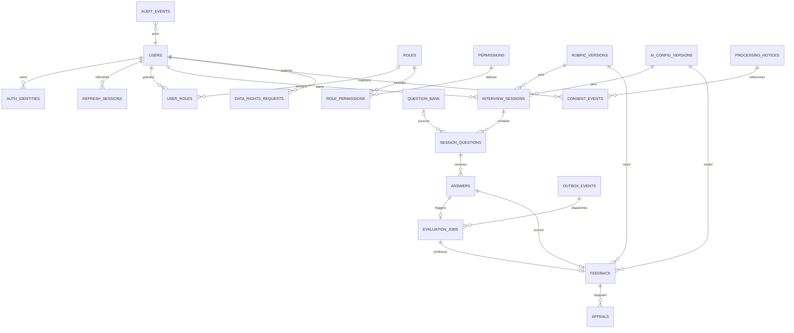

---

### 5.2 แผนภาพความสัมพันธ์ของข้อมูลส่วนบริการพาณิชย์และงานวิจัย (Diagram D05: R3 Commercial & Research ERD)

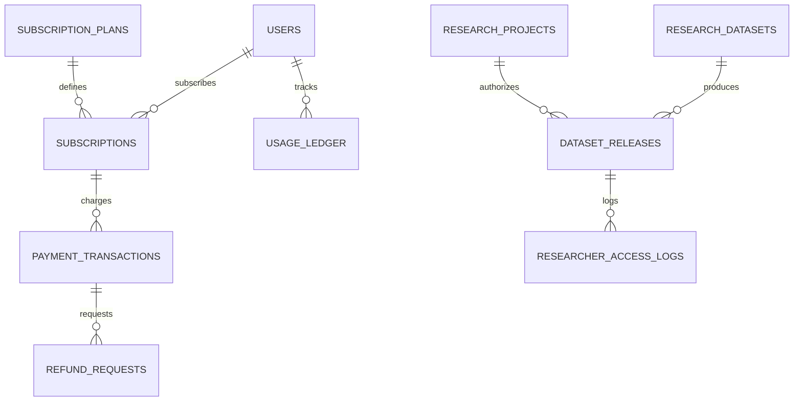

---

### 5.3 พจนานุกรมข้อมูลส่วนแกนหลัก (Core Physical Data Dictionary)

#### 1. ตาราง `identity.users` — บัญชีผู้ใช้งานระบบ
| ชื่อคอลัมน์ | ชนิดข้อมูล | คุณสมบัติ | คำอธิบายและเงื่อนไขทางธุรกิจ |
|---|---|:---:|---|
| `id` | `UUID` | PK, Not Null | รหัสประจำตัวผู้ใช้สากล สุ่มสร้างด้วย `gen_random_uuid()` |
| `email` | `CITEXT` | Unique, Not Null | ที่อยู่อีเมลของผู้ใช้ ตรวจสอบแบบไม่แยกตัวพิมพ์เล็ก-ใหญ่ |
| `display_name` | `TEXT` | Nullable | ชื่อที่ใช้แสดงผลในระบบ |
| `current_status` | `TEXT` | Nullable | สถานะการทำงานปัจจุบัน (เช่น กำลังหางาน, นักศึกษาจบใหม่) |
| `skill_level` | `TEXT` | Nullable | ระดับทักษะความเชี่ยวชาญ (Junior, Mid-level, Senior) |
| `account_status` | `TEXT` | Not Null | สถานะบัญชี: `'active'`, `'suspended'`, `'deleting'` (Default: 'active') |
| `created_at` | `TIMESTAMPTZ` | Not Null | วันเวลาที่สร้างบัญชีตามมาตรฐาน UTC (Default: `now()`) |
| `updated_at` | `TIMESTAMPTZ` | Not Null | วันเวลาที่มีการแก้ไขข้อมูลล่าสุด |
| `deleted_at` | `TIMESTAMPTZ` | Nullable | วันเวลาที่เริ่มกระบวนการลบบัญชี (Soft Delete) |

#### 2. ตาราง `identity.auth_identities` — ข้อมูลการพิสูจน์ตัวตน
| ชื่อคอลัมน์ | ชนิดข้อมูล | คุณสมบัติ | คำอธิบายและเงื่อนไขทางธุรกิจ |
|---|---|:---:|---|
| `id` | `UUID` | PK, Not Null | รหัสประจำรายการระบุตัวตน |
| `user_id` | `UUID` | FK, Not Null | เชื่อมโยงสู่ `identity.users(id)` แบบ Cascade Delete |
| `provider` | `TEXT` | Not Null | ผู้ให้บริการพิสูจน์ตัวตน: `'email'`, `'google'`, `'facebook'` |
| `provider_subject`| `TEXT` | Not Null | รหัสประจำตัวเฉพาะจาก Provider (เช่น Email Address หรือ Sub ID) |
| `password_hash` | `TEXT` | Nullable | รหัสผ่านที่เข้ารหัสด้วย Argon2id/Bcrypt (ต้องไม่เป็นค่าว่างหาก provider='email') |
| `verified_at` | `TIMESTAMPTZ` | Nullable | วันเวลาที่ผ่านการยืนยันอีเมลสำเร็จ |
| `created_at` | `TIMESTAMPTZ` | Not Null | วันเวลาที่เชื่อมโยงบัญชี |

#### 3. ตาราง `identity.refresh_sessions` — เซสชันการต่ออายุโทเค็น
| ชื่อคอลัมน์ | ชนิดข้อมูล | คุณสมบัติ | คำอธิบายและเงื่อนไขทางธุรกิจ |
|---|---|:---:|---|
| `id` | `UUID` | PK, Not Null | รหัสประจำเซสชัน Refresh Token |
| `user_id` | `UUID` | FK, Not Null | เจ้าของเซสชัน เชื่อมสู่ `identity.users(id)` |
| `token_hash` | `TEXT` | Unique, Not Null | ค่าแฮชของ Refresh Token (SHA-256) ป้องกันการนำกลับมาใช้ใหม่ |
| `expires_at` | `TIMESTAMPTZ` | Not Null | วันเวลาหมดอายุของเซสชัน (ปกติ 7-30 วัน) |
| `revoked_at` | `TIMESTAMPTZ` | Nullable | วันเวลาที่เซสชันถูกยกเลิก (Logout หรือ Revocation) |
| `created_at` | `TIMESTAMPTZ` | Not Null | วันเวลาที่สร้างเซสชัน |

#### 4. ตาราง `content.rubric_versions` — ประวัติและเวอร์ชันเกณฑ์รูบริก
| ชื่อคอลัมน์ | ชนิดข้อมูล | คุณสมบัติ | คำอธิบายและเงื่อนไขทางธุรกิจ |
|---|---|:---:|---|
| `id` | `UUID` | PK, Not Null | รหัสประจำเวอร์ชันรูบริก |
| `rubric_key` | `TEXT` | Not Null | รหัสอ้างอิงชุดเกณฑ์รูบริก เช่น `'rubric_star_v1'` |
| `version` | `TEXT` | Not Null | หมายเลขเวอร์ชันเชิงความหมาย (Semantic Versioning เช่น `'1.2.0'`) |
| `criteria` | `JSONB` | Not Null | โครงสร้างเกณฑ์ 4 มิติ ขอบเขตคะแนน และคำอธิบายเชิงพฤติกรรม |
| `lifecycle` | `TEXT` | Not Null | วงจรชีวิตเวอร์ชัน: `'draft'`, `'published'`, `'archived'` (Immutable เมื่อ published) |
| `published_at` | `TIMESTAMPTZ` | Nullable | วันเวลาที่อนุมัติและเผยแพร่ใช้งาน |
| `created_at` | `TIMESTAMPTZ` | Not Null | วันเวลาที่สร้างชุดเกณฑ์ |

#### 5. ตาราง `content.ai_config_versions` — ค่ากำหนดและการตั้งค่าโมเดล AI
| ชื่อคอลัมน์ | ชนิดข้อมูล | คุณสมบัติ | คำอธิบายและเงื่อนไขทางธุรกิจ |
|---|---|:---:|---|
| `id` | `UUID` | PK, Not Null | รหัสประจำเวอร์ชันการตั้งค่า AI |
| `config_key` | `TEXT` | Not Null | รหัสคีย์การตั้งค่า เช่น `'eval_feedback_prompt'` |
| `version` | `TEXT` | Not Null | หมายเลขเวอร์ชันของการตั้งค่า |
| `model_identifier`| `TEXT` | Not Null | รหัสโมเดลภาษา เช่น `'gemini-1.5-pro'`, `'gpt-4o'` |
| `prompt_hash` | `TEXT` | Not Null | ค่าแฮชของข้อความพรอมต์ระบบ ป้องกันการแอบแก้ไขย้อนหลัง |
| `parameters` | `JSONB` | Not Null | พารามิเตอร์การอนุมาน (Temperature, Top_P, Max Tokens) |
| `lifecycle` | `TEXT` | Not Null | สถานะ: `'draft'`, `'published'`, `'archived'` |
| `published_at` | `TIMESTAMPTZ` | Nullable | วันเวลาที่เผยแพร่ใช้งานจริง |
| `created_at` | `TIMESTAMPTZ` | Not Null | วันเวลาที่สร้าง |

#### 6. ตาราง `content.question_bank` — คลังคำถามสัมภาษณ์
| ชื่อคอลัมน์ | ชนิดข้อมูล | คุณสมบัติ | คำอธิบายและเงื่อนไขทางธุรกิจ |
|---|---|:---:|---|
| `id` | `UUID` | PK, Not Null | รหัสเฉพาะของข้อคำถาม |
| `stable_key` | `TEXT` | Not Null | รหัสอ้างอิงคำถามที่ไม่เปลี่ยนแปลง เช่น `'q_swe_arch_01'` |
| `version` | `INT` | Not Null | ลำดับเวอร์ชันการปรับปรุงข้อคำถาม (Check: version > 0) |
| `category` | `TEXT` | Not Null | หมวดหมู่วิชาชีพ (เช่น Software Development, Marketing) |
| `locale` | `TEXT` | Not Null | ภาษาของคำถาม (`'th'`, `'en'`) |
| `question_text` | `TEXT` | Not Null | ข้อความโจทย์คำถามสัมภาษณ์ |
| `lifecycle` | `TEXT` | Not Null | สถานะ: `'draft'`, `'published'`, `'archived'` |
| `created_at` | `TIMESTAMPTZ` | Not Null | วันเวลาที่บันทึก |

#### 7. ตาราง `interview.sessions` — เซสชันการฝึกสัมภาษณ์
| ชื่อคอลัมน์ | ชนิดข้อมูล | คุณสมบัติ | คำอธิบายและเงื่อนไขทางธุรกิจ |
|---|---|:---:|---|
| `id` | `UUID` | PK, Not Null | รหัสประจำเซสชันการสัมภาษณ์ |
| `user_id` | `UUID` | FK, Not Null | ผู้ฝึกสัมภาษณ์ เชื่อมสู่ `identity.users(id)` |
| `interview_type` | `TEXT` | Not Null | ประเภทการสัมภาษณ์ (Technical, Behavioral, Situational) |
| `locale` | `TEXT` | Not Null | ภาษาที่ใช้ในการสัมภาษณ์ (Default: `'th'`) |
| `mode` | `TEXT` | Not Null | รูปแบบสัมภาษณ์: `'text'`, `'voice'`, `'mixed'` |
| `difficulty` | `TEXT` | Nullable | ระดับความยากง่าย (Easy, Medium, Hard) |
| `rubric_version_id` | `UUID` | FK, Not Null | ตรึงเวอร์ชันรูบริกที่ใช้ประเมิน เชื่อมสู่ `content.rubric_versions(id)` |
| `ai_config_version_id`| `UUID` | FK, Not Null | ตรึงเวอร์ชันการตั้งค่า AI ที่ใช้ เชื่อมสู่ `content.ai_config_versions(id)` |
| `status` | `TEXT` | Not Null | สถานะเซสชัน: `'active'`, `'completed'`, `'cancelled'`, `'deleting'` |
| `started_at` | `TIMESTAMPTZ` | Not Null | วันเวลาที่เริ่มเซสชัน |
| `completed_at` | `TIMESTAMPTZ` | Nullable | วันเวลาที่ทำสัมภาษณ์เสร็จสิ้นสมบูรณ์ |
| `deleted_at` | `TIMESTAMPTZ` | Nullable | วันเวลาที่ลบตามคำร้องขอ DSR |

#### 8. ตาราง `interview.session_questions` — รายการคำถามในเซสชัน
| ชื่อคอลัมน์ | ชนิดข้อมูล | คุณสมบัติ | คำอธิบายและเงื่อนไขทางธุรกิจ |
|---|---|:---:|---|
| `id` | `UUID` | PK, Not Null | รหัสประจำข้อคำถามในเซสชัน |
| `session_id` | `UUID` | FK, Not Null | เซสชันที่สังกัด เชื่อมสู่ `interview.sessions(id)` |
| `question_bank_id`| `UUID` | FK, Nullable | คำถามต้นทางจากคลัง (เชื่อมสู่ `content.question_bank(id)`) |
| `question_text` | `TEXT` | Not Null | ข้อความคำถามที่แสดงแก่ผู้ใช้ในเซสชันนั้น |
| `sequence_no` | `INT` | Not Null | ลำดับข้อของคำถามในเซสชัน (1, 2, 3...) |

#### 9. ตาราง `interview.answers` — คำตอบสัมภาษณ์ของผู้ใช้
| ชื่อคอลัมน์ | ชนิดข้อมูล | คุณสมบัติ | คำอธิบายและเงื่อนไขทางธุรกิจ |
|---|---|:---:|---|
| `id` | `UUID` | PK, Not Null | รหัสประจำคำตอบสัมภาษณ์ |
| `question_id` | `UUID` | FK, Not Null | คำถามที่ตอบ เชื่อมสู่ `interview.session_questions(id)` |
| `attempt_number`| `INT` | Not Null | ครั้งที่ส่งคำตอบ (Default: 1 ป้องกันการส่งซ้ำในข้อเดิม) |
| `answer_type` | `TEXT` | Not Null | ประเภทคำตอบ: `'text'`, `'voice'` |
| `answer_text` | `TEXT` | Not Null | เนื้อหาคำตอบข้อเขียน หรือข้อความที่ได้จากการถอดเสียง STT |
| `answered_at` | `TIMESTAMPTZ` | Not Null | วันเวลาที่บันทึกคำตอบ |

#### 10. ตาราง `evaluation.jobs` — คิวงานการประเมินผล AI
| ชื่อคอลัมน์ | ชนิดข้อมูล | คุณสมบัติ | คำอธิบายและเงื่อนไขทางธุรกิจ |
|---|---|:---:|---|
| `id` | `UUID` | PK, Not Null | รหัสประจำงานประเมินผล |
| `answer_id` | `UUID` | FK, Unique | คำตอบที่ต้องประเมิน เชื่อมสู่ `interview.answers(id)` |
| `state` | `TEXT` | Not Null | สถานะงาน: `'pending'`, `'running'`, `'completed'`, `'failed'`, `'needs_review'` |
| `attempts` | `INT` | Not Null | จำนวนครั้งที่พยายามประมวลผล (Default: 0) |
| `max_attempts` | `INT` | Not Null | จำนวนครั้งสูงสุดที่อนุญาตให้ลองใหม่ (Default: 3) |
| `next_attempt_at`| `TIMESTAMPTZ`| Nullable | วันเวลาที่นัดหมายลองประมวลผลครั้งถัดไป |
| `last_error_code`| `TEXT` | Nullable | รหัสข้อผิดพลาดล่าสุด (Timeout, RateLimit, SchemaViolation) |
| `created_at` | `TIMESTAMPTZ` | Not Null | วันเวลาที่สร้างงาน |
| `updated_at` | `TIMESTAMPTZ` | Not Null | วันเวลาที่ปรับปรุงสถานะล่าสุด |

#### 11. ตาราง `evaluation.feedback` — ผลการประเมินและคะแนนตามรูบริก
| ชื่อคอลัมน์ | ชนิดข้อมูล | คุณสมบัติ | คำอธิบายและเงื่อนไขทางธุรกิจ |
|---|---|:---:|---|
| `id` | `UUID` | PK, Not Null | รหัสประจำผลการประเมิน |
| `job_id` | `UUID` | FK, Unique | งานประเมินที่ผลิตผลลัพธ์ เชื่อมสู่ `evaluation.jobs(id)` |
| `answer_id` | `UUID` | FK, Unique | คำตอบที่ได้รับการประเมิน เชื่อมสู่ `interview.answers(id)` |
| `rubric_version_id`| `UUID` | FK, Not Null | เกณฑ์รูบริกที่ใช้คำนวณ เชื่อมสู่ `content.rubric_versions(id)` |
| `ai_config_version_id`| `UUID`| FK, Not Null | ค่าคอนฟิก AI ที่ใช้วิเคราะห์ เชื่อมสู่ `content.ai_config_versions(id)` |
| `score` | `NUMERIC(5,2)` | Nullable | คะแนนรวมสุทธิ (0.00 ถึง 100.00 บังคับมีค่าเมื่อ status='completed') |
| `dimension_scores`| `JSONB` | Not Null | คะแนนแจกแจง 4 มิติรูบริกในรูปแบบ JSON Object |
| `evidence` | `JSONB` | Not Null | ข้อความหลักฐานอ้างอิงและประโยคคำพูดที่นำมาคิดคะแนน |
| `comments` | `TEXT` | Nullable | ข้อเสนอแนะเชิงพฤติกรรมและจุดที่ควรปรับปรุง |
| `status` | `TEXT` | Not Null | สถานะผลประเมิน: `'completed'`, `'needs_review'` |
| `created_at` | `TIMESTAMPTZ` | Not Null | วันเวลาที่บันทึกผลสำเร็จ |

#### 12. ตาราง `evaluation.appeals` — คำร้องอุทธรณ์ผลการประเมิน
| ชื่อคอลัมน์ | ชนิดข้อมูล | คุณสมบัติ | คำอธิบายและเงื่อนไขทางธุรกิจ |
|---|---|:---:|---|
| `id` | `UUID` | PK, Not Null | รหัสประจำคำร้องอุทธรณ์ |
| `feedback_id` | `UUID` | FK, Not Null | ผลการประเมินที่มีข้อโต้แย้ง เชื่อมสู่ `evaluation.feedback(id)` |
| `user_id` | `UUID` | FK, Not Null | ผู้ยื่นคำร้อง เชื่อมสู่ `identity.users(id)` |
| `reason` | `TEXT` | Not Null | เหตุผลประกอบการยื่นอุทธรณ์และจุดที่ผู้ใช้มองว่าคลาดเคลื่อน |
| `status` | `TEXT` | Not Null | สถานะ: `'submitted'`, `'in_review'`, `'resolved'`, `'rejected'` |
| `created_at` | `TIMESTAMPTZ` | Not Null | วันเวลาที่ยื่นคำร้อง |
| `resolved_at` | `TIMESTAMPTZ` | Nullable | วันเวลาที่ผู้ดูแลระบบตัดสินข้ออุทธรณ์เสร็จสิ้น |

#### 13. ตาราง `privacy.consent_events` — บันทึกประวัติความยินยอม PDPA
| ชื่อคอลัมน์ | ชนิดข้อมูล | คุณสมบัติ | คำอธิบายและเงื่อนไขทางธุรกิจ |
|---|---|:---:|---|
| `id` | `UUID` | PK, Not Null | รหัสประจำเหตุการณ์ความยินยอม |
| `user_id` | `UUID` | FK, Not Null | เจ้าของข้อมูล เชื่อมสู่ `identity.users(id)` |
| `purpose_key` | `TEXT` | Not Null | วัตถุประสงค์: `'research_analysis'`, `'research_contact'`, `'voice_retention'`, `'marketing'` |
| `action` | `TEXT` | Not Null | การดำเนินการ: `'grant'` (ให้ความยินยอม), `'withdraw'` (เพิกถอน) |
| `notice_version`| `TEXT` | Not Null | หมายเลขเวอร์ชันของคำประกาศความเป็นส่วนตัวที่ผู้ใช้กดยอมรับ |
| `legal_basis` | `TEXT` | Not Null | ฐานทางกฎหมาย (Consent, Contract, Legitimate Interests) |
| `occurred_at` | `TIMESTAMPTZ` | Not Null | วันเวลาจริงที่เกิดเหตุการณ์ บันทึกแบบ Append-only ไม่สามารถแก้ไขได้ |

#### 14. ตาราง `privacy.data_rights_requests` — คำขอใช้สิทธิตามกฎหมาย PDPA (DSR)
| ชื่อคอลัมน์ | ชนิดข้อมูล | คุณสมบัติ | คำอธิบายและเงื่อนไขทางธุรกิจ |
|---|---|:---:|---|
| `id` | `UUID` | PK, Not Null | รหัสประจำคำขอใช้สิทธิ์ |
| `user_id` | `UUID` | FK, Not Null | ผู้ยื่นคำขอ เชื่อมสู่ `identity.users(id)` |
| `request_type` | `TEXT` | Not Null | ประเภทสิทธิ์: `'access'`, `'export'`, `'delete'` |
| `status` | `TEXT` | Not Null | สถานะคำขอ: `'submitted'`, `'verifying'`, `'processing'`, `'completed'`, `'rejected'` |
| `requested_at` | `TIMESTAMPTZ` | Not Null | วันเวลาที่ยื่นคำขอ (จุดเริ่มต้นนับ SLA 30 วัน) |
| `completed_at` | `TIMESTAMPTZ` | Nullable | วันเวลาที่ดำเนินการเสร็จสมบูรณ์ |

#### 15. ตาราง `platform.idempotency_keys` — กุญแจป้องกันการทำซ้ำ
| ชื่อคอลัมน์ | ชนิดข้อมูล | คุณสมบัติ | คำอธิบายและเงื่อนไขทางธุรกิจ |
|---|---|:---:|---|
| `scope` | `TEXT` | PK Component | ขอบเขตการทำงาน เช่น `'interview_answer_submit'` |
| `actor_id` | `UUID` | PK Component | ผู้ส่งคำขอ เชื่อมสู่ `identity.users(id)` |
| `key` | `TEXT` | PK Component | ค่า Idempotency Key สุ่มจากเครื่องผู้ใช้ (UUID v4) |
| `request_hash` | `TEXT` | Not Null | ค่าแฮชของ Payload ป้องกันการส่งคำขอต่างข้อมูลภายใต้คีย์เดียวกัน |
| `resource_type`| `TEXT` | Nullable | ชนิดทรัพยากรที่สร้างขึ้น |
| `resource_id` | `UUID` | Nullable | รหัสทรัพยากรที่สร้างขึ้นแล้ว |
| `created_at` | `TIMESTAMPTZ` | Not Null | วันเวลาที่บันทึกคีย์ |
| `expires_at` | `TIMESTAMPTZ` | Not Null | วันเวลาหมดอายุของคีย์ (ปกติ 24 ชั่วโมง) |

#### 16. ตาราง `platform.outbox_events` — คลังเหตุการณ์ขาออก (Transactional Outbox)
| ชื่อคอลัมน์ | ชนิดข้อมูล | คุณสมบัติ | คำอธิบายและเงื่อนไขทางธุรกิจ |
|---|---|:---:|---|
| `id` | `UUID` | PK, Not Null | รหัสเฉพาะของเหตุการณ์ |
| `aggregate_type`| `TEXT` | Not Null | ชื่อกลุ่ม Aggregate เช่น `'interview_session'`, `'evaluation'` |
| `aggregate_id` | `UUID` | Not Null | รหัสประจำ Aggregate ต้นทาง |
| `event_type` | `TEXT` | Not Null | ประเภทเหตุการณ์ เช่น `'AnswerSubmitted'`, `'EvaluationCompleted'` |
| `event_version`| `INT` | Not Null | เวอร์ชันโครงสร้างเหตุการณ์ (Default: 1) |
| `payload` | `JSONB` | Not Null | ข้อมูลเหตุการณ์ฉบับเต็มในรูปแบบ JSON |
| `created_at` | `TIMESTAMPTZ` | Not Null | วันเวลาที่สร้างเหตุการณ์พร้อม Transaction หลัก |
| `published_at` | `TIMESTAMPTZ` | Nullable | วันเวลาที่ส่งเข้าสู่คิว Redis / Message Broker สำเร็จ |
| `attempts` | `INT` | Not Null | จำนวนครั้งที่พยายามส่ง (Default: 0) |

---

### 5.4 พจนานุกรมข้อมูลส่วนขยายรอบ R3 (R3 Extended Data Dictionary)

#### 1. ตาราง `billing.packages` — แคตตาล็อกแพ็กเกจสมาชิก
| ชื่อคอลัมน์ | ชนิดข้อมูล | คุณสมบัติ | คำอธิบายและเงื่อนไขทางธุรกิจ |
|---|---|:---:|---|
| `id` | `UUID` | PK, Not Null | รหัสประจำแพ็กเกจ |
| `tier` | `TEXT` | Not Null | ระดับสมาชิก: `'free'`, `'basic'`, `'pro'`, `'enterprise'` |
| `version` | `INT` | Not Null | เวอร์ชันราคา (Unique คู่กับ `tier`) รองรับ Grandfathering |
| `price_minor` | `BIGINT` | Not Null | ราคาหน่วยย่อย (สตางค์ เช่น 29900 = 299.00 บาท) |
| `currency` | `CHAR(3)` | Not Null | สกุลเงินตามมาตรฐาน ISO 4217 (เช่น `'THB'`) |
| `duration_days`| `INT` | Not Null | จำนวนวันที่มีผลใช้งาน (30 วัน, 365 วัน) |
| `state` | `TEXT` | Not Null | สถานะ: `'draft'`, `'published'`, `'archived'` |

#### 2. ตาราง `billing.package_entitlements` — ขีดจำกัดสิทธิประโยชน์ของแพ็กเกจ
| ชื่อคอลัมน์ | ชนิดข้อมูล | คุณสมบัติ | คำอธิบายและเงื่อนไขทางธุรกิจ |
|---|---|:---:|---|
| `package_id` | `UUID` | PK, FK | รหัสแพ็กเกจ เชื่อมสู่ `billing.packages(id)` |
| `feature_key` | `TEXT` | PK | รหัสฟีเจอร์: `'interview_quota_text'`, `'interview_quota_voice'`, `'export_pdf'` |
| `quota_limit` | `BIGINT` | Nullable | ขีดจำกัดโควตา (Null หมายถึงไม่จำกัด) |
| `unit` | `TEXT` | Not Null | หน่วยนับ (เช่น `'session'`, `'count'`) |

#### 3. ตาราง `billing.subscriptions` — การสมัครและสัญญาใช้งานของสมาชิก
| ชื่อคอลัมน์ | ชนิดข้อมูล | คุณสมบัติ | คำอธิบายและเงื่อนไขทางธุรกิจ |
|---|---|:---:|---|
| `id` | `UUID` | PK, Not Null | รหัสประจำรายการสมาชิก |
| `user_id` | `UUID` | Not Null | รหัสผู้ใช้เจ้าของสัญญา (จัดเก็บเป็นค่า UUID โดยไม่มี FK ข้าม DB) |
| `package_id` | `UUID` | FK, Not Null | แพ็กเกจที่สมัคร เชื่อมสู่ `billing.packages(id)` |
| `status` | `TEXT` | Not Null | สถานะสมาชิก: `'pending'`, `'active'`, `'cancelled'`, `'expired'` |
| `starts_at` | `TIMESTAMPTZ` | Not Null | วันเวลาเริ่มต้นสิทธิประโยชน์ |
| `ends_at` | `TIMESTAMPTZ` | Not Null | วันเวลาสิ้นสุดสิทธิประโยชน์ (Check: ends_at > starts_at) |
| `auto_renew` | `BOOLEAN` | Not Null | เปิดใช้งานการต่ออายุอัตโนมัติหรือไม่ (Default: false) |

#### 4. ตาราง `billing.usage_ledger` — บัญชีแยกประเภทการใช้โควตา
| ชื่อคอลัมน์ | ชนิดข้อมูล | คุณสมบัติ | คำอธิบายและเงื่อนไขทางธุรกิจ |
|---|---|:---:|---|
| `id` | `UUID` | PK, Not Null | รหัสประจำรายการบัญชีเดินโควตา |
| `user_id` | `UUID` | Not Null | รหัสผู้ใช้งาน |
| `feature_key` | `TEXT` | Not Null | ฟีเจอร์ที่ใช้โควตา |
| `amount` | `INT` | Not Null | จำนวนที่ตัดยอด (ปกติคือ 1, Check: amount > 0) |
| `period_key` | `TEXT` | Not Null | รอบบิลการใช้งาน เช่น `'2026-11'` |
| `request_key` | `TEXT` | Unique, Not Null | รหัสอ้างอิงคำขอตัดโควตา ป้องกันการหักโควตาซ้ำซ้อน |
| `created_at` | `TIMESTAMPTZ` | Not Null | วันเวลาที่ตัดยอด |

#### 5. ตาราง `billing.transactions` — ธุรกรรมการชำระเงิน
| ชื่อคอลัมน์ | ชนิดข้อมูล | คุณสมบัติ | คำอธิบายและเงื่อนไขทางธุรกิจ |
|---|---|:---:|---|
| `id` | `UUID` | PK, Not Null | รหัสประจำธุรกรรม |
| `subscription_id`| `UUID` | FK, Not Null | รายการสมาชิกที่ผูกพัน เชื่อมสู่ `billing.subscriptions(id)` |
| `gateway_ref` | `TEXT` | Unique, Nullable| รหัสอ้างอิงธุรกรรมจากเกตเวย์ชำระเงินภายนอก |
| `amount_minor` | `BIGINT` | Not Null | ยอดเงินที่ทำรายการในหน่วยสตางค์ |
| `currency` | `CHAR(3)` | Not Null | สกุลเงิน (เช่น `'THB'`) |
| `status` | `TEXT` | Not Null | สถานะธุรกรรม: `'initiated'`, `'pending'`, `'confirmed'`, `'failed'`, `'refunded'` |
| `paid_at` | `TIMESTAMPTZ` | Nullable | วันเวลาที่ชำระเงินสำเร็จสมบูรณ์ |

#### 6. ตาราง `billing.refund_requests` — คำขอและประวัติการคืนเงิน
| ชื่อคอลัมน์ | ชนิดข้อมูล | คุณสมบัติ | คำอธิบายและเงื่อนไขทางธุรกิจ |
|---|---|:---:|---|
| `id` | `UUID` | PK, Not Null | รหัสประจำคำขอคืนเงิน |
| `transaction_id`| `UUID` | FK, Not Null | ธุรกรรมเดิมที่ต้องการคืนเงิน เชื่อมสู่ `billing.transactions(id)` |
| `user_id` | `UUID` | Not Null | ผู้ยื่นคำขอคืนเงิน |
| `policy_version`| `TEXT` | Nullable | เวอร์ชันนโยบายการคืนเงินที่ใช้บังคับขณะทำรายการ |
| `status` | `TEXT` | Not Null | สถานะ: `'requested'`, `'approved'`, `'rejected'`, `'processing'`, `'refunded'`, `'failed'` |
| `requested_at` | `TIMESTAMPTZ` | Not Null | วันเวลาที่ยื่นคำขอ |
| `decided_by` | `UUID` | Nullable | รหัสผู้ดูแลการเงิน (Finance Admin) ที่พิจารณาอนุมัติ/ปฏิเสธ |

#### 7. ตาราง `research.datasets` — ทะเบียนชุดข้อมูลวิจัยที่ได้รับอนุมัติ
| ชื่อคอลัมน์ | ชนิดข้อมูล | คุณสมบัติ | คำอธิบายและเงื่อนไขทางธุรกิจ |
|---|---|:---:|---|
| `id` | `UUID` | PK, Not Null | รหัสประจำชุดข้อมูลวิจัย |
| `purpose_key` | `TEXT` | Not Null | วัตถุประสงค์การวิจัยที่ได้รับการอนุญาต เช่น `'academic_nlp_eval'` |
| `approved_by` | `UUID` | Not Null | รหัสเจ้าหน้าที่คุ้มครองข้อมูลส่วนบุคคล (DPO) ผู้อนุมัติชุดข้อมูล |
| `schema_version`| `TEXT` | Not Null | เวอร์ชันโครงสร้างข้อมูลวิจัย |
| `state` | `TEXT` | Not Null | สถานะ: `'draft'`, `'approved'`, `'released'`, `'revoked'` |
| `created_at` | `TIMESTAMPTZ` | Not Null | วันเวลาที่สร้างชุดข้อมูล |

#### 8. ตาราง `research.aggregate_rows` — ข้อมูลแถวผลลัพธ์การวิเคราะห์รวมกลุ่ม
| ชื่อคอลัมน์ | ชนิดข้อมูล | คุณสมบัติ | คำอธิบายและเงื่อนไขทางธุรกิจ |
|---|---|:---:|---|
| `id` | `UUID` | PK, Not Null | รหัสเฉพาะของแถวข้อมูลวิจัย |
| `dataset_id` | `UUID` | FK, Not Null | ชุดข้อมูลที่สังกัด เชื่อมสู่ `research.datasets(id)` |
| `dimensions` | `JSONB` | Not Null | มิติการจัดกลุ่ม (เช่น หมวดหมู่วิชาชีพ, ระดับความยาก, ช่วงประสบการณ์) |
| `measures` | `JSONB` | Not Null | ค่าสถิติวัดผลรวม (เช่น คะแนนเฉลี่ย, มัธยฐาน, ส่วนเบี่ยงเบนมาตรฐาน) |
| `distinct_users`| `INT` | Not Null | จำนวนผู้ใช้ที่ไม่ซ้ำกันในกลุ่ม (บังคับ Constraint: `distinct_users >= 10`) |
| `suppressed` | `BOOLEAN` | Not Null | สถานะการตัดข้อมูลทิ้งกรณีกลุ่มตัวอย่างไม่ถึงเกณฑ์ความปลอดภัย (Default: false) |

#### 9. ตาราง `research.access_log` — บันทึกประวัติการเข้าถึงข้อมูลของนักวิจัย
| ชื่อคอลัมน์ | ชนิดข้อมูล | คุณสมบัติ | คำอธิบายและเงื่อนไขทางธุรกิจ |
|---|---|:---:|---|
| `id` | `UUID` | PK, Not Null | รหัสประจำรายการเข้าถึง |
| `researcher_id` | `UUID` | Not Null | รหัสประจำตัวของผู้วิจัยที่ส่งคำขอสืบค้น |
| `dataset_id` | `UUID` | FK, Nullable | รหัสชุดข้อมูลที่เข้าถึง เชื่อมสู่ `research.datasets(id)` |
| `action` | `TEXT` | Not Null | การกระทำ: `'query'`, `'export_csv'`, `'export_json'` |
| `decision` | `TEXT` | Not Null | ผลการตัดสินใจของเกตเวย์: `'allow'`, `'deny'` |
| `query_hash` | `TEXT` | Nullable | ค่าแฮชของคำสั่งสืบค้น (SQL / Parameters Hash) |
| `records_returned`| `INT` | Not Null | จำนวนแถวข้อมูลที่ส่งมอบให้แก่นักวิจัย |
| `accessed_at` | `TIMESTAMPTZ` | Not Null | วันเวลาที่เข้าถึงข้อมูล |


---

## 6. การออกแบบส่วนติดต่อผู้ใช้และสถาปัตยกรรมระบบ (UI/UX Design & System Architecture)

สถาปัตยกรรมของ InterviewX ได้รับการออกแบบภายใต้หลักการ **Unified Backend & Type-Safe Multi-Client Architecture** บนโครงสร้าง Monorepo ส่วนกลาง เพื่อให้ Responsive Web Application (Next.js) และ Native Mobile Application (React Native / Expo) ทำงานร่วมกันได้อย่างไร้รอยต่อ โดยใช้โมเดลข้อมูล สัญญาสื่อสาร (DTOs/Zod Schemas) และกฎเกณฑ์ทางธุรกิจร่วมกัน 100% โดยไม่มีตรรกะที่ซ้ำซ้อน

---

### 6.1 การจัดแนวทางสถาปัตยกรรมระหว่าง Web และ Mobile (Diagram D24: Web & Mobile Architecture Alignment)

แผนภาพนี้แสดงโครงสร้างสถาปัตยกรรมและขอบเขตความรับผิดชอบระหว่าง Web และ Native Mobile ภายใต้ Monorepo ส่วนกลาง:

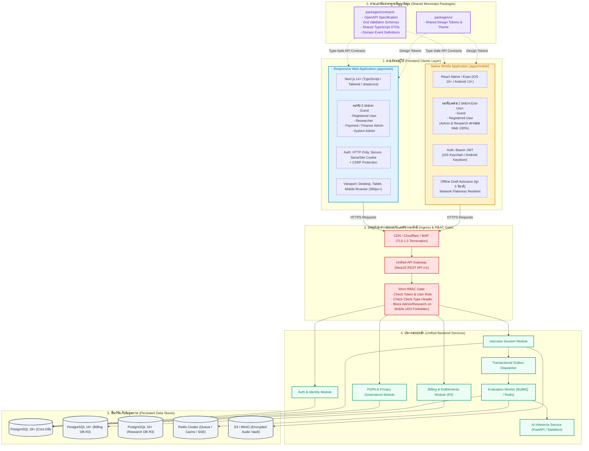

---

### 6.2 ลำดับการเปลี่ยนผ่านหน้าจอและการสลับอุปกรณ์ (Diagram D25: Web vs Mobile Interaction Sequence)

แผนภาพนี้เปรียบเทียบการยืนยันตัวตน, การสกัดกั้นสิทธิ์ผู้ดูแลระบบบนมือถือ, และกลไก Idempotency ร่วมกับ Autosave เพื่อรองรับความไม่เสถียรของสัญญาณมือถือ:

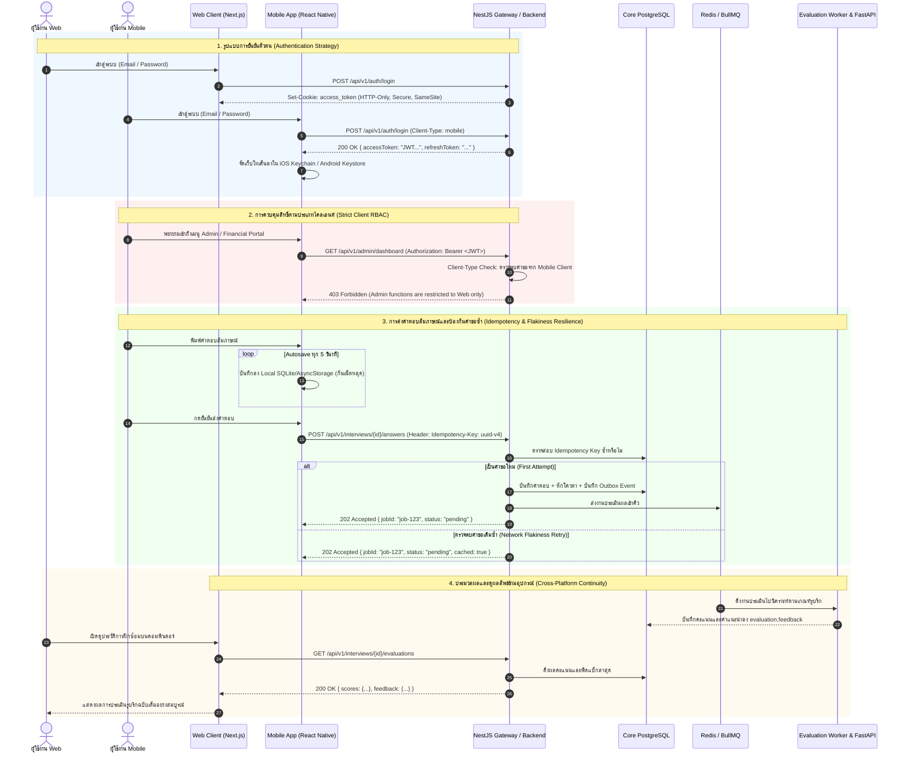

---

### 6.3 เมทริกซ์การประสานข้อมูลข้ามแพลตฟอร์ม 8 หมวดหมู่ (Cross-Platform Data Synchronization Matrix)

| หมวดหมู่ข้อมูล | กลไกการประสานข้อมูล (Sync Strategy) | แหล่งความจริง (Source of Truth) | พฤติกรรมเมื่อออฟไลน์ / เครือข่ายขัดข้อง | ผลลัพธ์และการรับประกันความสอดคล้อง |
|---|---|---|---|---|
| **1. การยืนยันตัวตนและเซสชัน** | Unified JWT Tokens (Web ใช้ HTTP-Only Cookie, Mobile ใช้ Secure Storage) | `identity.refresh_sessions` บน PostgreSQL | Mobile ตรวจสอบอายุ Local Token หากหมดอายุจะหยุดทำงานชั่วคราว | สิทธิการใช้งานและสถานะบัญชีตรงกัน 100% ข้ามอุปกรณ์ |
| **2. โปรไฟล์และเป้าหมายผู้ใช้** | Optimistic UI Update ร่วมกับ REST API Sync | ตาราง `identity.users` | แก้ไขได้เฉพาะเมื่อออนไลน์ (Require Online) | การเปลี่ยนชื่อ ทักษะ หรือเป้าหมายสะท้อนผลทันทีทุกแพลตฟอร์ม |
| **3. เซสชันการสัมภาษณ์** | Server-Driven State Machine ร่วมกับ Real-time Polling / SSE | ตาราง `interview.sessions` | สถานะถูกล็อกบนเซิร์ฟเวอร์ ไม่อนุญาตให้เริ่มเซสชันแบบออฟไลน์ | ผู้ใช้สามารถเริ่มสัมภาษณ์บนมือถือ และเปิดดูผลคะแนนบนเว็บได้ทันที |
| **4. ผลการประเมินและเกณฑ์รูบริก** | Cache-Aside บน Redis ร่วมกับ PostgreSQL Read Replica | `evaluation.feedback` และ `content.rubric_versions` | แคชผลการประเมินล่าสุดที่เคยโหลดไว้บนเครื่องเพื่อให้อ่านได้ | คะแนนและข้อเสนอแนะตรงกันทุกมิติ 100% |
| **5. สิทธิประโยชน์และโควตาสมาชิก** | Atomic Ledger Transaction บนระบบหลังบ้าน | `billing.usage_ledger` และ `billing.subscriptions` | โควตาบนหน้าจอเป็นเพียงข้อมูลแคช การตัดยอดต้องต่อเน็ตเสมอ | ป้องกันปัญหาการใช้โควตาเกิน (Over-consumption) เด็ดขาด |
| **6. ความยินยอม PDPA และสิทธิ์ DSR** | Immutable Event Sourcing ผ่าน API Gateway | `privacy.consent_events` | ไม่อนุญาตให้เปลี่ยนความยินยอมเมื่อออฟไลน์ | การเพิกถอนความยินยอมบนแพลตฟอร์มใด มีผลบังคับใช้ทุกระบบทันที |
| **7. ฉบับร่างคำตอบและแคชชั่วคราว** | Local SQLite / AsyncStorage Autosave (ทุก 5 วิ) | Local Client Storage ของแต่ละเครื่อง | เก็บข้อความร่างไว้ในเครื่อง เมื่อเน็ตติดจะส่งพร้อม Idempotency Key | ข้อมูลคำตอบไม่สูญหายแม้สัญญาณอินเทอร์เน็ตขาดหาย |
| **8. การแจ้งเตือนและประวัติกิจกรรม** | Push Notifications (APNs/FCM) ร่วมกับ In-App Notification Log | ตาราง `platform.audit_log` และ Notification Service | จัดเก็บเป็นค้างส่ง (Pending Delivery) เมื่อออนไลน์จะเด้งเตือน | ประวัติกิจกรรมเรียงลำดับเวลาตาม UTC เที่ยงตรงสมบูรณ์ |

---

### 6.4 สถาปัตยกรรมคอนเทนเนอร์ระดับ C4 (Diagram D02: C4 Containers Architecture)

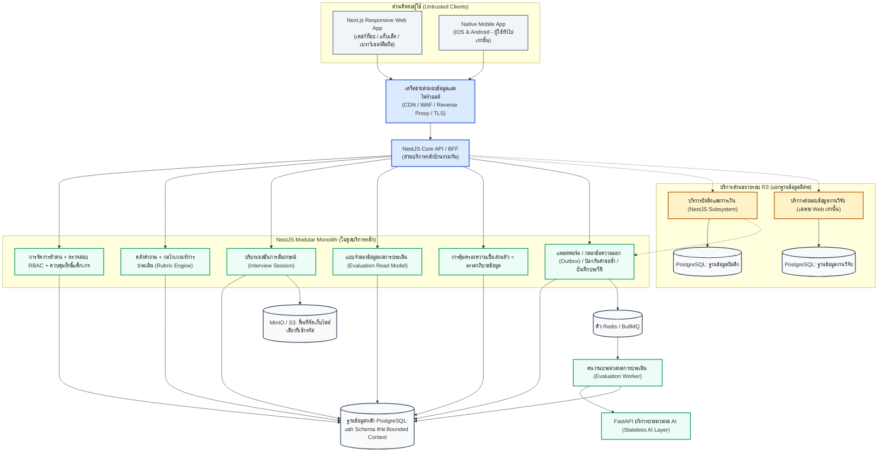

---

### 6.5 สถาปัตยกรรมขอบเขตบริบทของระบบ (Diagram D03: Bounded Contexts)

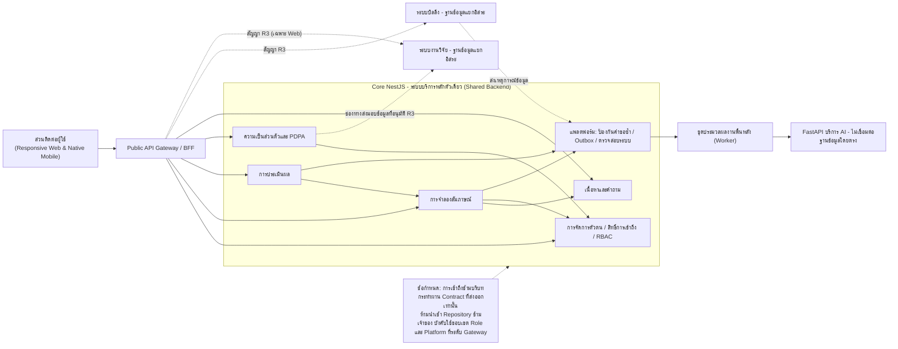

---

### 6.6 วงจรชีวิตการคุ้มครองข้อมูลส่วนบุคคล (Diagram D10: Privacy Lifecycle & Consent Management)

```mermaid
flowchart TB
 Notice["ประกาศการประมวลผลข้อมูลระบุเวอร์ชัน + ฐานทางกฎหมาย"] --> Core["การประมวลผล service_core ในรอบ R1\n(จำเป็นสำหรับการส่งมอบบริการ)"]
 Notice --> Choices["เหตุการณ์ให้ความยินยอมแยกตามวัตถุประสงค์\n(ซิงก์ข้อมูลระหว่าง Web และ Mobile)"]
 Choices --> Analysis["การวิเคราะห์ข้อมูลเพื่องานวิจัย (research_analysis) R3"]
 Choices --> Contact["การติดต่อเพื่องานวิจัย (research_contact) R3"]
 Choices --> Voice["การเก็บรักษาไฟล์เสียง (voice_retention) R2"]
 Choices --> Marketing["การตลาดในอนาคต (marketing)"]

 Analysis --> Release["กระบวนการอนุมัติส่งมอบข้อมูลวิจัยที่ผ่านเกณฑ์\n(พอร์ทัลผู้ดูแลระบบเฉพาะบน Web)"]
 Contact --> ContactService["API ติดต่อผู้วิจัยที่ได้รับอนุมัติ\n(บริการเฉพาะขอบเขตวัตถุประสงค์)"]
 Voice --> AudioPolicy["วงจรชีวิตไฟล์เสียง + กำหนดอายุการจัดเก็บ\n(ปกติ <=24 ชม.; ยินยอม <=90 วัน; ล้างแคชในมือถือทันที)"]

 User["ผู้ใช้งาน (Web / Native Mobile)"] --> Request["คำขอใช้สิทธิ์ตามกฎหมายคุ้มครองข้อมูลส่วนบุคคล R1 (FR35)"]
 Request --> Verify["ตรวจสอบยืนยันตัวตน / ขอบเขต / ข้อยกเว้นทางกฎหมาย"]
 Verify --> Export["ส่งออกข้อมูลส่วนบุคคลที่เข้าเกณฑ์ (JSON/CSV)"]
 Verify --> Erase["ลบข้อมูลในระบบที่ใช้งาน + ทำลายตามรอบสำรองข้อมูล"]
```

---

### 6.7 สถาปัตยกรรมระบบขั้นสูงและการทำงานเบื้องหลัง

#### 6.7.1 สถาปัตยกรรมระบบสำหรับสภาพแวดล้อมจริง (Diagram D14: Managed Production Architecture)

```mermaid
flowchart TB
 subgraph InternetUsers["ผู้ใช้งานผ่านเครือข่ายอินเทอร์เน็ตสาธารณะ"]
  WebUsers["ผู้ใช้งานบนเว็บ\n(เดสก์ท็อป / แท็บเล็ต / เบราว์เซอร์มือถือ)"]
  MobileUsers["ผู้ใช้งานแอปมือถือเนทีฟ\n(Apple iOS & Google Android)"]
 end

 WAF["เครือข่าย CDN + Cloudflare / AWS WAF + ถอดรหัส TLS 1.3"]
 WebUsers --> WAF
 MobileUsers --> WAF

 WAF --> WEBHOST["ระบบโฮสติ้งเว็บ Next.js\n(Vercel / Cloud Run)"]
 WAF --> API["เกตเวย์ NestJS Core API\n(คลัสเตอร์ Modular Monolith)"]

 subgraph PrivateProd["เครือข่ายส่วนตัว Production (VPC / Private Subnet)"]
  PG[("ฐานข้อมูลหลัก PostgreSQL\n(Multi-AZ เครื่องหลัก + Read Replica)")]
  Redis[("คลัสเตอร์ Redis สำหรับคิวงาน\nและจัดเก็บสถานะความปลอดภัย")]
  Workers["ชุดประมวลผลงานพื้นหลัง\n(Auto-scaling Worker Pods)"]
  AISvc["บริการปัญญาประดิษฐ์ FastAPI\n(การประเมินผลแบบไร้สถานะ)"]
  MinIO[("พื้นที่จัดเก็บอ็อบเจกต์ S3 / MinIO\n(ไฟล์เสียงและการสำรองข้อมูลที่เข้ารหัส)")]
 end

 API --> PG & Redis & MinIO
 Redis --> Workers
 Workers --> AISvc & PG
 AISvc -.-> ExternalLLM["ผู้ให้บริการโมเดล AI ภายนอก (TLS Outbound)"]

 subgraph ObservabilityStack["ระบบสังเกตการณ์และตรวจวัด (Observability Stack)"]
  Collector["ตัวรวบรวม OpenTelemetry Collector"]
  MetricsStore["จัดเก็บสถิติระบบและบันทึกเหตุการณ์ (Prometheus / Loki)"]
  Dashboard["แดชบอร์ดแสดงผล (Grafana)"]
 end

 API & Workers & AISvc --> Collector
 Collector --> MetricsStore --> Dashboard
```

#### 6.7.2 ผังการไหลของข้อมูลสำหรับระบบ AI (Diagram D15: AI Data Pipeline Flow)

```mermaid
flowchart LR
 subgraph Ingestion["1. รับข้อมูลคำตอบ"]
  RawAnswer["คำตอบสัมภาษณ์\n(ข้อความ / ข้อความถอดเสียง)"]
 end

 subgraph ContextPrep["2. เตรียมบริบทและตรึงเวอร์ชัน"]
  Rubric["เกณฑ์รูบริกที่ตรึงเวอร์ชัน\n(Rubric Version)"]
  AIConfig["การตั้งค่าและพรอมต์ที่ตรึงเวอร์ชัน\n(AI Config Version)"]
  Sanitizer["ตัวกรองความปลอดภัย\n(Prompt Injection & PII Filter)"]
 end

 subgraph Inference["3. เรียกประมวลผลโมเดล AI"]
  LLMClient["อะแดปเตอร์เชื่อมต่อ LLM\n(Timeout 10s + 2 Retries)"]
  RawOutput["ผลการประเมินดิบจาก AI\n(Raw JSON Response)"]
 end

 subgraph Validation["4. ตรวจสอบความถูกต้องเข้มงวด"]
  Validator{"Pydantic Schema Validator\n- ครบ 4 มิติรูบริก?\n- คะแนน 0-100?\n- มีข้อความหลักฐานอ้างอิง?"}
  Valid["ผ่านเกณฑ์สมบูรณ์\n(Status: completed)"]
  Invalid["ไม่ผ่านเกณฑ์ / ค่าผิดปกติ\n(Status: needs_review)"]
 end

 RawAnswer --> Sanitizer
 Sanitizer & Rubric & AIConfig --> LLMClient
 LLMClient --> RawOutput
 RawOutput --> Validator
 Validator -->|ใช่| Valid
 Validator -->|ไม่ใช่| Invalid
```

#### 6.7.3 กลไกสำรองกรณีการประเมินของ AI ล้มเหลว (Diagram D16: AI Fallback & Circuit Breaker)

```mermaid
flowchart TD
 Start["งานประเมินผลถูกดึงจากคิว Redis"] --> CallAI["เรียกใช้งานโมเดล AI หลัก (Primary LLM)"]
 CallAI --> CheckSuccess{"โมเดลตอบกลับสำเร็จ\nภายใน Timeout 10 วินาที?"}

 CheckSuccess -->|สำเร็จ| Validate["ตรวจสอบโครงสร้างคะแนนด้วย Pydantic"]
 Validate --> CheckValid{"คะแนนถูกต้องสมบูรณ์?"}
 CheckValid -->|ถูกต้อง| Complete["บันทึกผลสำเร็จ: status='completed'"]

 CheckSuccess -->|ล้มเหลว/Timeout| Trip{"จำนวนครั้งล้มเหลวติดต่อกัน\n>= 5 ครั้ง (Circuit Breaker เปิด)?"}
 Trip -->|เปิด Circuit| FallbackLLM["สลับไปยังโมเดลสำรอง (Secondary Backup LLM)"]
 Trip -->|ยังไม่เปิด| Retry["เพิ่มรอบ Retry (Exponential Backoff สูงสุด 3 ครั้ง)"]
 Retry --> CallAI

 FallbackLLM --> CheckFallback{"โมเดลสำรองสำเร็จ?"}
 CheckFallback -->|สำเร็จ| Validate
 CheckFallback -->|ล้มเหลว| MarkReview["ปรับสถานะงานเป็น: status='needs_review'\n(ส่งเข้าคิวทบทวนโดยผู้เชี่ยวชาญ)"]
 CheckValid -->|ไม่ถูกต้อง| MarkReview

 MarkReview --> Alert["ส่งแจ้งเตือนทีมงาน Admin On-call ทันที"]
```

#### 6.7.4 การสื่อสารด้วยเหตุการณ์แบบอะซิงโครนัส (Diagram D17: Async Event-Driven Architecture)

```mermaid
flowchart LR
 Client["ผู้ใช้งาน Web & Native Mobile"] --> Trace["HTTP Header: x-correlation-id"]
 Trace --> API["NestJS Core API"]
 API --> Worker["Evaluation Worker"]
 Worker --> AI["FastAPI บริการ AI"]

 API & Worker & AI --> OTel["ตัวรวบรวม OpenTelemetry Collector"]
 OTel --> Logs["บันทึกระบบที่ผ่านการปกปิดข้อมูลส่วนบุคคล (PII Masked)"]
 OTel --> Metrics["สถิติระบบ: เวลาตอบสนอง P95, อัตราข้อผิดพลาด, ความยาวคิวงาน, ต้นทุนโทเค็น AI"]
 OTel --> Traces["ร่องรอยการทำงานข้ามบริการ (Distributed Tracing)"]

 Metrics & Logs --> Alerts["ระบบแจ้งเตือนอัตโนมัติ (Alerting Engine)"]
 Alerts --> Oncall["วิศวกรผู้ดูแลระบบเวรประจำวัน (On-Call Team)"]

 PG[("ฐานข้อมูลหลัก PostgreSQL")] --> Backups["การสำรองข้อมูลอัตโนมัติประจำวันพร้อมการเข้ารหัส"]
 Backups --> Restore["การซักซ้อมกู้คืนระบบประจำไตรมาส (RPO <=24 ชม., RTO <=8 ชม.)"]

 TokenCost["ตัวนับปริมาณการใช้โทเค็น AI และงบประมาณ"] --> Metrics
```

#### 6.7.5 ขอบเขตโครงสร้างโปรเจกต์และโมโนรีโป (Diagram D18: Repository Boundaries & Monorepo Structure)

```mermaid
flowchart TB
 subgraph Apps["โฟลเดอร์ apps/ (ส่วนของแอปพลิเคชัน)"]
  Web["web (แอปพลิเคชันเว็บ Next.js แบบตอบสนอง)"]
  Mobile["mobile (แอปพลิเคชันมือถือเนทีฟ React Native / Expo)"]
  API["api (บริการหลังบ้านหลัก NestJS Modular Monolith)"]
  Worker["evaluation-worker (คนงานประมวลผลพื้นหลัง BullMQ)"]
  AI["ai-service (บริการประมวลผล AI ด้วย FastAPI)"]
  Billing["billing-service (บริการบิลลิ่งและการเงินรอบ R3)"]
  Research["research-service (บริการจัดการชุดข้อมูลวิจัยรอบ R3)"]
 end

 subgraph Packages["โฟลเดอร์ packages/ (ไลบรารีและสัญญาระบบที่ใช้ร่วมกัน)"]
  Contracts["contracts (สัญญา OpenAPI, Zod Schemas, Event Contracts, DTOs)"]
  CoreDB["db-core (โมเดล Prisma Client และไฟล์ Migration ของ PostgreSQL หลัก)"]
  BillingDB["db-billing (Prisma Schema สำหรับระบบบิลลิ่ง R3)"]
  ResearchDB["db-research (Schema สำหรับระบบงานวิจัย R3)"]
  Obs["observability (เครื่องมือบันทึก Log และ Metrics ของ OpenTelemetry)"]
  UI["ui (ดีไซน์โทเคนและคอมโพเนนต์ส่วนติดต่อผู้ใช้ที่ใช้ร่วมกัน)"]
 end

 Web --> Contracts & UI
 Mobile --> Contracts & UI
 API --> Contracts & CoreDB & Obs
 Worker --> Contracts & CoreDB & Obs
 AI --> Contracts
 Billing --> Contracts & BillingDB & Obs
 Research --> Contracts & ResearchDB & Obs
```


---

## 7. สภาพแวดล้อมทางเทคโนโลยีและข้อกำหนดที่ไม่ใช่ฟังก์ชัน (System Environment & ISO/IEC 25010 NFRs)

### 7.1 สภาพแวดล้อมทางเทคโนโลยีและเทคโนโลยีสแตก (Technology Stack & Environment)

| องค์ประกอบสถาปัตยกรรม | เทคโนโลยีที่เลือกใช้ | เวอร์ชัน / รายละเอียด | เหตุผลความเหมาะสมเชิงวิศวกรรมซอฟต์แวร์ |
|---|---|---|---|
| **เว็บแอปพลิเคชัน (Frontend Web)** | Next.js, React, TypeScript | Next.js 14+ (App Router), TypeScript 5.x | รองรับการเรนเดอร์แบบผสมผสาน (SSR/SSG), ประสิทธิภาพ SEO ดีเยี่ยม, ระบบ Type-Safe ตลอดวงจร |
| **ส่วนติดต่อผู้ใช้ (UI Components)** | Tailwind CSS, shadcn/ui, Radix UI | Tailwind v3.4+, Radix Primitives | เข้าถึงได้ง่ายตามมาตรฐาน WCAG 2.2 AA, โค้ดคอมโพเนนต์ยืดหยุ่นสูง ปราศจาก Dependency ที่ซับซ้อน |
| **แอปพลิเคชันมือถือ (Mobile)** | React Native, Expo | Expo SDK 51+, React Native 0.74+ | พัฒนาแอปพลิเคชันข้ามระบบ (iOS 16+ และ Android 13+) จาก Codebase เดียว สามารถแชร์ DTOs ร่วมกับ Web |
| **บริการหลังบ้านหลัก (Core Backend)** | NestJS, TypeScript, Node.js | NestJS 10+, Node.js 20 LTS | สถาปัตยกรรม Modular Monolith แยก Bounded Context ชัดเจน, รองรับ Dependency Injection และ DTO Validation |
| **บริการปัญญาประดิษฐ์ (AI Service)** | FastAPI, Python, Pydantic | Python 3.11+, FastAPI 0.110+, Pydantic v2 | ประสิทธิภาพสูงแบบ Asynchronous, ตรวจสอบโครงสร้างข้อมูลผลการประเมินรูบริกของ AI ด้วย Pydantic อย่างเข้มงวด |
| **ฐานข้อมูลหลัก (Core Database)** | PostgreSQL, Prisma ORM | PostgreSQL 16+, Prisma 5.x | รองรับ JSONB, Row-Level Security, Strict Foreign Keys, Transactions แบบ ACID สำหรับการหักโควตา |
| **ระบบแคชและคิวงาน (Cache & Queue)**| Redis, BullMQ | Redis 7.x, BullMQ 5.x | จัดการคิวงานประเมินผล AI แบบอะซิงโครนัส, ป้องกัน Race Condition, รองรับ Real-time SSE / WebSockets |
| **พื้นที่จัดเก็บอ็อบเจกต์ (Object Storage)**| MinIO / Amazon S3 | S3 API Compatible | จัดเก็บไฟล์เสียงสัมภาษณ์และรายงาน PDF พร้อมการเข้ารหัสแบบ Server-Side Encryption (AES-256) |
| **ระบบสังเกตการณ์ (Observability)** | OpenTelemetry, Prometheus, Grafana| OpenTelemetry SDK v1.x | ติดตามร่องรอยการทำงานข้ามบริการ (Distributed Tracing), บันทึกสถิติ P95 และคัดกรอง PII Masking ใน Log |
| **การทดสอบระบบ (Automated Testing)** | Vitest, Playwright, Jest, Pytest | ล่าสุด | รองรับ Unit Test, Component Test, E2E Integration Test ข้ามแพลตฟอร์มอย่างครอบคลุม |

---

### 7.2 ข้อกำหนดที่ไม่ใช่เชิงฟังก์ชัน 24 ข้อ (NFR01–NFR24) ตามมาตรฐาน ISO/IEC 25010

ข้อกำหนดที่ไม่ใช่เชิงฟังก์ชัน (Non-Functional Requirements) ทั้ง 24 ข้อ ได้รับการจัดหมวดหมู่ตามมาตรฐานคุณภาพซอฟต์แวร์ระดับสากล **ISO/IEC 25010 (Systems and software Quality Requirements and Evaluation: SQuaRE)** ครอบคลุม 8 มิติคุณภาพ:

```
มิติคุณภาพตามมาตรฐาน ISO/IEC 25010 (24 NFRs):
├── 1. ความเหมาะสมเชิงหน้าที่และความถูกต้องของ AI (Functional Suitability & AI Integrity): NFR02, NFR21
├── 2. ประสิทธิภาพการทำงานและเวลาตอบสนอง (Performance Efficiency): NFR04, NFR13, NFR22
├── 3. ความเข้ากันได้และการรองรับหลายแพลตฟอร์ม (Compatibility & Portability): NFR07, NFR08
├── 4. ความง่ายในการใช้งานและการเข้าถึง (Usability & Accessibility): NFR03
├── 5. ความน่าเชื่อถือและความพร้อมใช้งาน (Reliability & Availability): NFR05, NFR14, NFR16, NFR23
├── 6. ความมั่นคงปลอดภัยและการคุ้มครองข้อมูล (Security & Data Protection): NFR01, NFR09, NFR17, NFR18, NFR19, NFR20
├── 7. ความสามารถในการบำรุงรักษาและการตรวจวัด (Maintainability & Observability): NFR24
└── 8. ธรรมาภิบาลทางการเงินและการปฏิบัติตามกฎหมาย (Financial & Legal Compliance): NFR06, NFR10, NFR11, NFR12, NFR15
```

#### กลุ่มที่ 1: ความเหมาะสมเชิงหน้าที่และความถูกต้องของ AI (Functional Suitability & AI Integrity)
- **NFR02 — ความน่าเชื่อถือและการอธิบายผลการประเมินของ AI (AI Evaluation Explainability & Provenance):**
  - **ตัวชี้วัด:** ผลการประเมินคะแนนรูบริกทุกครั้งต้องมีข้อความหลักฐานอ้างอิง (Evidence Citation) จากคำพูดของผู้ใช้อย่างน้อย 1 จุดต่อมิติการประเมิน, ห้ามสร้างตัวเลขคะแนนขึ้นมาเองโดยไม่มีหลักฐานรองรับ (Hallucination Rate 0%), มีการบันทึกรหัสเวอร์ชันของโมเดล AI (`model_identifier`), รหัสพรอมต์ (`prompt_hash`) และเวอร์ชันเกณฑ์รูบริก (`rubric_version_id`) อย่างถาวรลงในฐานข้อมูล
- **NFR21 — ความสอดคล้องของการให้คะแนนรูบริก (Rubric Scoring Consistency):**
  - **ตัวชี้วัด:** เมื่อทดสอบส่งคำตอบเดิมซ้ำด้วยโมเดลและพารามิเตอร์เวอร์ชันเดียวกันภายใต้เงื่อนไขควบคุม ผลต่างของคะแนนรวมต้องมีค่าความแปรปรวน (Variance) ไม่เกิน ±5% เพื่อรับประกันความเป็นธรรมแก่ผู้ใช้งาน

#### กลุ่มที่ 2: ประสิทธิภาพการทำงานและเวลาตอบสนอง (Performance Efficiency)
- **NFR04 — ประสิทธิภาพและเวลาตอบสนองของระบบ (System Latency & Response Times):**
  - **ตัวชี้วัด:** คำขอทั่วไปที่ไม่เกี่ยวข้องกับ AI (Non-AI REST Endpoints) ต้องมีค่าเวลาตอบสนองที่เปอร์เซ็นไทล์ 95 (P95) <= 2.0 วินาทีบนเครือข่ายคอมพิวเตอร์ และ P95 <= 2.5 วินาทีบนเครือข่ายมือถือ 4G/5G; สำหรับงานประเมินผล AI แบบอะซิงโครนัสต้องส่งคืนผลลัพธ์ P95 <= 15.0 วินาที; เวลาเปิดแอปพลิเคชันมือถือ (Cold Start) ต้องไม่เกิน 2.0 วินาที
- **NFR13 — ประสิทธิภาพของระบบชำระเงิน (Payment Redirection Latency):**
  - **ตัวชี้วัด:** การเปลี่ยนเส้นทางไปยังหน้าเกตเวย์ชำระเงิน (Payment Gateway Checkout) ต้องมีเวลาตอบสนอง P95 <= 5.0 วินาที ทั้งบนเว็บบราวเซอร์และแอปพลิเคชันมือถือ
- **NFR22 — การทดสอบการรองรับปริมาณการใช้งานพร้อมกัน (Concurrency & Load Capacity):**
  - **ตัวชี้วัด:** ระบบต้องผ่านการทดสอบรองรับผู้ใช้งานพร้อมกันอย่างน้อย 100 เซสชันการสัมภาษณ์พร้อมกัน (100 Concurrent Active Sessions) โดยมีอัตราข้อผิดพลาดของระบบ (Error Rate) ต่ำกว่า 1.0%

#### กลุ่มที่ 3: ความเข้ากันได้และการรองรับหลายแพลตฟอร์ม (Compatibility & Portability)
- **NFR07 — การรองรับสองภาษาอย่างสมบูรณ์ (Bilingual Localization):**
  - **ตัวชี้วัด:** ระบบต้องรองรับการแสดงผลทั้งภาษาไทยและภาษาอังกฤษอย่างสมบูรณ์ 100% ครอบคลุมทั้งข้อความบนส่วนติดต่อผู้ใช้ (UI String), โจทย์คำถามสัมภาษณ์, เกณฑ์การตัดสินรูบริก และข้อความผลการวิเคราะห์ของ AI
- **NFR08 — ความสอดคล้องข้ามแพลตฟอร์มและการเข้าถึงได้อย่างเท่าเทียม (Cross-Platform Accessibility):**
  - **ตัวชี้วัด:** ฝั่งเว็บต้องผ่านมาตรฐานการเข้าถึงเนื้อหาเว็บระดับสากล **WCAG 2.2 AA** (ความคมชัดของสี >= 4.5:1, รองรับ Screen Reader); ฝั่งแอปพลิเคชันมือถือต้องปฏิบัติตามมาตรฐาน VoiceOver (iOS) และ TalkBack (Android) รวมถึงรองรับ Dynamic Type ขนาดตัวอักษรของระบบ พร้อมทั้งรับประกันความสอดคล้องของข้อมูลบัญชีและประวัติการฝึกซ้อมข้ามแพลตฟอร์ม 100%

#### กลุ่มที่ 4: ความง่ายในการใช้งานและการเข้าถึง (Usability & Accessibility)
- **NFR03 — ความง่ายในการใช้งานและความพึงพอใจของผู้ใช้ (System Usability Scale: SUS):**
  - **ตัวชี้วัด:** ระบบต้องผ่านการทดสอบความง่ายในการใช้งานและได้รับคะแนนความพึงพอใจตามแบบประเมินมาตรฐาน SUS เฉลี่ยไม่น้อยกว่า 70 คะแนน (เกณฑ์ยอมรับได้ระดับ Good / Acceptable) จากกลุ่มผู้ทดสอบทั้งบน Web และ Mobile

#### กลุ่มที่ 5: ความน่าเชื่อถือและความพร้อมใช้งาน (Reliability & Availability)
- **NFR05 — ความพร้อมใช้งานของระบบบริการหลังบ้าน (Unified API Gateway Availability):**
  - **ตัวชี้วัด:** บริการ API Gateway และฐานข้อมูลหลักต้องมีความพร้อมใช้งาน (Uptime Availability) ไม่ต่ำกว่า 99.5% ตลอดเวลาทำการ (ไม่นับช่วงเวลาการบำรุงรักษาตามแผนที่แจ้งล่วงหน้า)
- **NFR14 — ความพร้อมใช้งานและระบบสำรองของการชำระเงิน (Payment Gateway High Availability):**
  - **ตัวชี้วัด:** ระบบต้องมีกลไกสลับการทำงานสำรอง (Failover Mechanism) หรือระบบ Circuit Breaker เมื่อเกตเวย์ชำระเงินหลักเกิดเหตุขัดข้อง เพื่อป้องกันไม่ให้ธุรกรรมของผู้ใช้ค้างอยู่ในสถานะไม่ทราบผล
- **NFR16 — ความสมบูรณ์ของธุรกรรมและการป้องกันคำขอซ้ำ (Payment Idempotency & Consistency):**
  - **ตัวชี้วัด:** การประมวลผลคำสั่งชำระเงินและ Webhook ต้องมีอัตราความผิดพลาดทางการเงินเป็นศูนย์ (Zero Financial Discrepancy) โดยตรวจสอบป้องกันการทำซ้ำด้วย Idempotency Key ทุกรายการ
- **NFR23 — การกู้คืนระบบจากภัยพิบัติและความต่อเนื่องทางธุรกิจ (Disaster Recovery RPO/RTO):**
  - **ตัวชี้วัด:** เป้าหมายระยะเวลาการสูญเสียข้อมูลสูงสุด (**RPO: Recovery Point Objective**) ต้องไม่เกิน 24 ชั่วโมง และเป้าหมายระยะเวลาการกู้คืนระบบกลับมาทำงานได้ (**RTO: Recovery Time Objective**) ต้องไม่เกิน 8 ชั่วโมง พร้อมจัดให้มีการซ้อมแผนกู้คืนระบบอย่างน้อยไตรมาสละ 1 ครั้ง

#### กลุ่มที่ 6: ความมั่นคงปลอดภัยและการคุ้มครองข้อมูลส่วนบุคคล (Security & Data Protection)
- **NFR01 — การเข้ารหัสข้อมูลและการตรวจสอบสิทธิ์ที่รัดกุม (Data Encryption & Token Security):**
  - **ตัวชี้วัด:** ข้อมูลที่ส่งผ่านเครือข่ายอินเทอร์เน็ตทั้งหมดต้องเข้ารหัสด้วยโพรโทคอล **TLS 1.3**; ข้อมูลส่วนบุคคลและรหัสผ่านที่จัดเก็บในฐานข้อมูลต้องเข้ารหัสด้วยอัลกอริทึมมาตรฐาน **AES-256** หรือ **Argon2id**; โทเค็นบนเว็บจัดเก็บใน **HTTP-Only, Secure, SameSite Cookie** ป้องกัน XSS; โทเค็นบนแอปมือถือจัดเก็บใน **iOS Keychain** หรือ **Android Keystore** ที่ใช้การเข้ารหัสระดับฮาร์ดแวร์
- **NFR09 — วงจรชีวิตและการทำลายไฟล์เสียงที่ปลอดภัย (Audio Retention & Erasure Lifecycle):**
  - **ตัวชี้วัด:** ไฟล์เสียงคำตอบสัมภาษณ์ดิบใน MinIO/S3 ต้องถูกทำลายทิ้งอัตโนมัติภายใน 24 ชั่วโมงสำหรับผู้ใช้ทั่วไป (หากยินยอมเก็บรักษาจะเก็บได้สูงสุดไม่เกิน 90 วัน); บนเครื่องมือถือต้องลบไฟล์เสียงแคชชั่วคราวทิ้งทันทีที่การอัปโหลดเสร็จสิ้น
- **NFR17 — ความเป็นส่วนตัวของชุดข้อมูลงานวิจัย (Research Dataset Privacy & Suppression):**
  - **ตัวชี้วัด:** การสกัดชุดข้อมูลวิจัยในรอบ R3 ต้องตัดข้อมูลระบุตัวบุคคล (PII) ออก 100%; ต้องบังคับใช้เกณฑ์การจัดกลุ่มย่อย (Cell Size Suppression) โดยกลุ่มตัวอย่างใดที่มีผู้ใช้งานไม่ซ้ำกันน้อยกว่า 10 คน (`distinct_users < 10`) จะต้องถูกระงับไม่ให้ส่งออก เพื่อป้องกันการระบุตัวตนย้อนกลับ (Re-identification)
- **NFR18 — ความถูกต้องของการเชื่อมโยงความยินยอม (Consent Provenance & Traceability):**
  - **ตัวชี้วัด:** บันทึกความยินยอม PDPA ทุกรายการในตาราง `privacy.consent_events` ต้องมีหลักฐาน Timestamp ระดับมิลลิวินาที, หมายเลขเวอร์ชันคำประกาศความเป็นส่วนตัว (`notice_version`) และบันทึกแบบ Append-only ที่ไม่สามารถแก้ไขหรือลบย้อนหลังได้
- **NFR19 — ความปลอดภัยของรหัสผ่านและนโยบายเซสชัน (Password Policy & Session Security):**
  - **ตัวชี้วัด:** รหัสผ่านต้องมีความยาวไม่น้อยกว่า 8 ตัวอักษรและประกอบด้วยอักขระผสม; บัญชีจะถูกระงับชั่วคราว 15 นาทีหากกรอกรหัสผิดติดต่อกัน 5 ครั้ง; การสั่ง Logout from all devices จะต้องเพิกถอน Refresh Token ทุกรายการทันที
- **NFR20 — การป้องกันและกักกันข้อมูลส่วนบุคคลในกระบวนการวิจัย (PII Quarantine):**
  - **ตัวชี้วัด:** ฐานข้อมูลงานวิจัย (Research Database) ต้องถูกแยกขาดทางกายภาพออกจาก Core Database โดยเด็ดขาด ห้ามสร้าง Foreign Key หรือ Replication เชื่อมโยงกลับมายังตารางผู้ใช้งานจริง

#### กลุ่มที่ 7: ความสามารถในการบำรุงรักษาและการตรวจวัด (Maintainability & Observability)
- **NFR24 — การสังเกตการณ์ระบบและการตรวจสอบย้อนกลับ (Observability & Distributed Tracing):**
  - **ตัวชี้วัด:** มีการส่งผ่านค่า `x-correlation-id` จากทั้ง Web Client และ Native Mobile เข้าสู่ทุกบริการหลังบ้านและ Worker Pods; บันทึกระบบต้องผ่านการปิดบังข้อมูลส่วนบุคคล (PII Masking) 100% ก่อนส่งเข้าสู่ OpenTelemetry Collector; มีแดชบอร์ดติดตามประสิทธิภาพระบบและงบประมาณโทเค็น AI แบบ Real-time

#### กลุ่มที่ 8: ธรรมาภิบาลทางการเงินและการปฏิบัติตามกฎหมาย (Financial & Legal Compliance)
- **NFR06 — บันทึกประวัติการดำเนินงานของผู้ดูแลระบบที่แก้ไขไม่ได้ (Immutable Audit Logs):**
  - **ตัวชี้วัด:** การกระทำของผู้ดูแลระบบทุกรายการ (การเพิ่มคำถาม, การแก้เกณฑ์รูบริก, การปรับจูน Prompt, การอนุมัติคืนเงิน) ต้องถูกบันทึกลงในตาราง `platform.audit_log` โดยไม่มี API หรือสิทธิ์ใดอนุญาตให้แก้ไขหรือลบประวัติได้
- **NFR10 — การรักษาประวัติธุรกรรมเพื่อการตรวจสอบภาษี (Transaction Record Retention):**
  - **ตัวชี้วัด:** ประวัติรายการสั่งซื้อ การชำระเงิน และใบเสร็จรับเงินอิเล็กทรอนิกส์ ต้องได้รับการจัดเก็บอย่างปลอดภัยเป็นเวลาไม่น้อยกว่า 5 ปี เพื่อรองรับการตรวจสอบทางภาษีตามที่กฎหมายกำหนด
- **NFR11 — กรอบเวลาการคุ้มครองสิทธิ์และการขอคืนเงิน (Refund Policy Enforcement):**
  - **ตัวชี้วัด:** ระบบต้องบังคับใช้นโยบายการขอคืนเงินอย่างเคร่งครัด โดยผู้ใช้สามารถยื่นคำขอคืนเงินได้ภายใน 7 วันนับจากวันที่ชำระเงิน และต้องยังไม่ได้ใช้งานโควตาสัมภาษณ์เกินกว่า 20% ของแพ็กเกจ
- **NFR12 — การส่งมอบใบเสร็จรับเงินที่ถูกต้องตามกฎหมาย (Receipt Delivery SLA):**
  - **ตัวชี้วัด:** ระบบบิลลิ่งต้องสร้างใบเสร็จรับเงินอิเล็กทรอนิกส์และส่งมอบให้แก่ผู้ใช้งานทางอีเมลภายในไม่เกิน 5 นาทีหลังการชำระเงินเสร็จสมบูรณ์
- **NFR15 — ธรรมาภิบาลการเปลี่ยนแปลงราคาและเวอร์ชันแพ็กเกจ (Price Grandfathering):**
  - **ตัวชี้วัด:** การแก้ไขราคาหรือโควตาของแพ็กเกจสมาชิกเดิม จะต้องไม่มีผลย้อนหลังต่อสมาชิกเดิมที่ยังอยู่ในรอบการชำระเงินเดิม (Price Protection / Grandfathering Rule)


---

## 8. เมทริกซ์การตรวจสอบย้อนกลับของข้อกำหนด (Requirement Traceability Matrix — RTM)

เมทริกซ์การตรวจสอบย้อนกลับ (Requirement Traceability Matrix: RTM) เป็นเครื่องมือรับประกันคุณภาพทางวิศวกรรมซอฟต์แวร์ เพื่อเชื่อมโยงความต้องการของผู้ใช้จริง (Survey Evidence n=102) ไปสู่ข้อกำหนดเชิงฟังก์ชัน (40 FRs), ข้อกำหนดเชิงคุณภาพ (24 NFRs), บทบาทความปลอดภัย (RBAC), แพลตฟอร์มเป้าหมาย, แผนภาพสถาปัตยกรรม (D01–D25), สกีมาฐานข้อมูล และวิธีการทดสอบและทวนสอบ (Verification Method) ครบถ้วนทั้ง 64 รายการ:

| รหัสข้อกำหนด | ประเภท | แหล่งที่มา / หลักฐานความต้องการ | แพลตฟอร์มเป้าหมาย | บทบาทความปลอดภัย | แผนภาพที่เกี่ยวข้อง | สกีมาและตารางฐานข้อมูล | วิธีการทดสอบและทวนสอบ (Verification Method) |
|---|:---:|---|---|---|:---:|---|---|
| **FR01** | FR | ข้อกำหนดพื้นฐาน / ผลสำรวจ (78.4% ต้องการความปลอดภัย) | Web & Mobile | Guest, User | D06, D20, D22 | `identity.users`, `identity.auth_identities` | Automated Integration Test + Email Token Verification |
| **FR02** | FR | ผลสำรวจ (82.4% ต้องการระบุสายงานเฉพาะ) | Web & Mobile | Registered User | D22, D25 | `identity.users` | E2E Profile Management Test |
| **FR03** | FR | ผลสำรวจ (68.6% พบคำถามไม่ตรงสายงาน) | Web & Mobile | Registered User | D07, D20, D21 | `content.question_bank` | Automated Unit Test + Category Filter Test |
| **FR04** | FR | ผลสำรวจ (74.5% เผชิญความตื่นเต้น/กดดัน) | Web & Mobile | Registered User | D21, D25 | `interview.sessions` | Component UI Timer & Auto-submit Test |
| **FR05** | FR | ผลสำรวจ (58.8% กังวลเน็ตหลุดข้อมูลหาย) | Web & Mobile | Registered User | D07, D21, D25 | `interview.answers`, `platform.idempotency_keys` | Idempotency Key Duplicate Retry Test + Offline Cache Test |
| **FR05.1**| FR | พ.ร.บ. คุ้มครองข้อมูลส่วนบุคคล (PDPA มาตรา 19) | Web & Mobile | Registered User | D10, D11, D21 | `privacy.consent_events` | Negative Permission Test + Consent Audit Log Test |
| **FR05-V**| FR | ผลสำรวจ (58.8% ต้องการฝึกสัมภาษณ์ด้วยเสียง) | Web & Mobile | Registered User | D11, D21 | `privacy.audio_objects`, MinIO/S3 | Audio Chunk Upload Test + STT Transcription Test |
| **FR06** | FR | ผลสำรวจ (67.6% ต้องการตัวอย่างคำตอบที่ดี) | Web & Mobile | Registered User | D07, D20, D21 | `evaluation.feedback` | Automated Schema Validation + AI Response Test |
| **FR07** | FR | ผลสำรวจ (84.3% ต้องการเกณฑ์ประเมินที่ชัดเจน) | Web & Mobile | Registered User | D07, D08, D21 | `evaluation.feedback`, `content.rubric_versions` | Automated Pydantic Validation + Scoring Range (0-100) Test |
| **FR08** | FR | ผลสำรวจ (72.5% สับสนโครงสร้างคำตอบ) | Web & Mobile | Registered User | D07, D21 | `evaluation.feedback` | STAR Format Parser & Evidence Verification Test |
| **FR09** | FR | ผลสำรวจ (79.4% ต้องการคำแนะนำปรับปรุง) | Web & Mobile | Registered User | D07, D21 | `evaluation.feedback` | Functional Feedback Completeness Test |
| **FR10** | FR | ผลสำรวจ (61.8% กังวลภาษาอังกฤษและศัพท์เทคนิค) | Web & Mobile | Registered User | D07, D21 | `evaluation.feedback` | English Grammar & Professional Vocabulary Benchmark Test |
| **FR11** | FR | ผลสำรวจ (76.5% ต้องการติดตามความก้าวหน้า) | Web & Mobile | Registered User | D21, D25 | `interview.sessions`, `evaluation.feedback` | History Timeline & Aggregation Query Test |
| **FR12** | FR | ผลสำรวจ (71.6% ต้องการแดชบอร์ดสรุปผล) | Web & Mobile | Registered User | D21, D25 | `evaluation.feedback` | Analytics Aggregation Performance Test |
| **FR13** | FR | ข้อกำหนดทางธุรกิจ / Free Tier Quota | Web & Mobile | Registered User | D09, D21 | `billing.usage_ledger` | Concurrency Atomic Deduction Test |
| **FR14** | FR | ผลสำรวจ (64.7% ต้องการคำถามติดตามผล) | Web & Mobile | Registered User | D07, D21 | `interview.session_questions` | Contextual Follow-up Generation Test |
| **FR15** | FR | ผลสำรวจ (65.7% สัมภาษณ์ตามคำอธิบายตำแหน่งงาน) | Web & Mobile | Registered User | D21, D22 | `interview.sessions` | JD Parsing & Skill Extraction Test |
| **FR16** | FR | ผลสำรวจ (59.8% ต้องการปรับระดับความยาก) | Web & Mobile | Registered User | D21 | `content.question_bank` | Difficulty Level Filter & Seed Test |
| **FR17** | FR | นโยบายธรรมาภิบาล AI / Human Review | Web & Mobile | Registered User | D21, D23 | `evaluation.appeals` | Appeal Workflow & Admin Notification Test |
| **FR18** | FR | พ.ร.บ. คุ้มครองข้อมูลส่วนบุคคล (PDPA มาตรา 21) | Web & Mobile | Registered User | D10, D22 | `privacy.consent_events` | Granular Consent Withdrawal Test |
| **FR19** | FR | ข้อกำหนดความปลอดภัย / แผนงาน R2 | Web & Mobile | Registered User | D06, D22 | `identity.auth_identities` | OAuth2 / OIDC Exchange Integration Test |
| **FR20** | FR | ผลสำรวจ (62.7% ต้องการพิมพ์/บันทึกรายงาน) | Web & Mobile | Registered User | D20, D21 | MinIO/S3 Storage | PDF Report Generation & Watermark Test |
| **FR21-R2**| FR | แผนงาน R2 / ระบบสัมภาษณ์อัจฉริยะ | Web & Mobile | Registered User | D07, D21 | `content.question_bank` | Adaptive Question Selection Algorithm Test |
| **FR22-R2**| FR | ผลสำรวจ (70.6% มีปัญหาเรซูเม่ไม่ตรงงาน) | Web & Mobile | Registered User | D21, D22 | `identity.users` | Resume vs JD Gap Analysis Test |
| **FR23-R2**| FR | แผนงาน R2 / การเปรียบเทียบมาตรฐาน | Web & Mobile | Registered User | D21, D23 | `evaluation.feedback` | Benchmark Percentile Ranking Test |
| **FR24-R2**| FR | แผนงาน R2 / เส้นทางการเรียนรู้ | Web & Mobile | Registered User | D21, D22 | `identity.users` | Learning Path Generation & Milestone Test |
| **FR32** | FR | นโยบายความปลอดภัยและธรรมาภิบาลข้อมูล | เฉพาะบนเว็บ (Admin) | System Admin | D06, D09, D23 | `platform.audit_log` | Append-only Audit Trail Verification Test |
| **FR33** | FR | สถาปัตยกรรมความทนทานต่อข้อผิดพลาด | Web & Mobile | Registered User | D07, D25 | `interview.answers` | Simulated Network Disconnection & Recovery Test |
| **FR34** | FR | สถาปัตยกรรมธรรมาภิบาลโมเดล AI | เฉพาะบนเว็บ (Admin) | System Admin | D06, D23 | `content.rubric_versions`, `content.ai_config_versions` | Immutable Version Pinning & Rollback Test |
| **FR35** | FR | พ.ร.บ. คุ้มครองข้อมูลส่วนบุคคล (PDPA มาตรา 30-33) | Web & Mobile (Admin Web) | Registered User, Admin | D10, D12, D22 | `privacy.data_rights_requests` | DSR Request Export & 30-Day SLA Workflow Test |
| **FR36** | FR | สถาปัตยกรรมความพร้อมใช้งานสูง (HA) | ระบบบริการหลังบ้าน | System Engine | D08, D16 | `evaluation.jobs` | Circuit Breaker Trip & Fallback Model Test |
| **FR21-R3**| FR | แผนงาน R3 / รูปแบบธุรกิจเพื่อความยั่งยืน | Web & Mobile | Registered User | D09, D12, D23 | `billing.packages`, `billing.subscriptions` | Tier Entitlement Boundary Test |
| **FR22-R3**| FR | แผนงาน R3 / ระบบชำระเงินดิจิทัล | Web & Mobile (Checkout) | Registered User | D12, D23 | `billing.transactions` | Payment Gateway Redirect & Session Creation Test |
| **FR23-R3**| FR | แผนงาน R3 / ความปลอดภัยทางธุรกรรม | ระบบบริการหลังบ้าน | System Engine | D12 | `billing.payment_events` | HMAC Signature Verification & Anti-Replay Test |
| **FR24-R3**| FR | กฎหมายภาษีอิเล็กทรอนิกส์ | Web & Mobile | Registered User | D12, D23 | `billing.transactions` | E-Receipt Generation & Delivery SLA Test |
| **FR25-R3**| FR | แผนงาน R3 / การเปิดสิทธิ์หลังชำระเงิน | ระบบบริการหลังบ้าน | System Engine | D12 | `billing.usage_ledger`, `billing.subscriptions` | Webhook Atomic Provisioning Test |
| **FR26-R3**| FR | แผนงาน R3 / การต่ออายุสมาชิก | Web & Mobile | Registered User | D12, D23 | `billing.subscriptions` | Auto-renewal Job & Opt-out Toggle Test |
| **FR27-R3**| FR | นโยบายการคุ้มครองผู้บริโภค | Web & Mobile (Admin Web) | Registered User, Finance | D12, D23 | `billing.refund_requests` | Refund Eligibility Logic & Finance Approval Test |
| **FR28-R3**| FR | แผนงาน R3 / การสื่อสารลูกค้า | Web & Mobile | Registered User | D12 | Email Service | 3-Day Expiry Notification Dispatch Test |
| **FR29-R3**| FR | กฎหมายการเงินและบัญชี | Web & Mobile | Registered User | D12, D23 | `billing.transactions` | User Billing Statement & Receipt Download Test |
| **FR30-R3**| FR | แผนงาน R3 / การบริหารราคา | เฉพาะบนเว็บ (Admin) | Finance Admin | D06, D23 | `billing.packages` | Price Grandfathering & Approval Lifecycle Test |
| **FR31-R3**| FR | แผนงาน R3 / แดชบอร์ดผู้บริหาร | เฉพาะบนเว็บ (Admin) | Finance Admin | D06, D23 | `billing.transactions` | MRR / Churn Calculation Accuracy Test |
| **FR32.1**| FR | ธรรมาภิบาลข้อมูลงานวิจัย | เฉพาะบนเว็บ (Admin) | Researcher, Admin | D06, D13, D23 | `research.access_log` | Immutable Research Audit Logging Test |
| **NFR01** | NFR | ความมั่นคงปลอดภัยระดับสากล | Web & Mobile | ทุกบทบาท | D06, D09, D24 | `identity.auth_identities`, `identity.refresh_sessions` | Penetration Testing + TLS 1.3 Cipher Suite Check |
| **NFR02** | NFR | ธรรมาภิบาลและการอธิบายผล AI | ระบบบริการหลังบ้าน | ทุกบทบาท | D07, D15 | `evaluation.feedback` | Hallucination Detection Test + Evidence Citation Check |
| **NFR03** | NFR | ความพึงพอใจของผู้ใช้จริง | Web & Mobile | Registered User | D24, D25 | - | Standard System Usability Scale (SUS) Assessment (>= 70) |
| **NFR04** | NFR | ประสิทธิภาพระบบและเวลาตอบสนอง | Web & Mobile | ทุกบทบาท | D07, D14, D25 | Redis, PostgreSQL | Load Testing (Non-AI P95 <= 2.0s, AI P95 <= 15.0s) |
| **NFR05** | NFR | ความพร้อมใช้งานของระบบ | ระบบบริการหลังบ้าน | ทุกบทบาท | D14, D18 | API Gateway | High Availability Uptime Monitoring (>= 99.5%) |
| **NFR06** | NFR | ความโปร่งใสในการบริหารระบบ | เฉพาะบนเว็บ (Admin) | System Admin | D06, D23 | `platform.audit_log` | Tamper-resistance & Append-only Test |
| **NFR07** | NFR | การรองรับผู้ใช้งานสองภาษา | Web & Mobile | ทุกบทบาท | D24 | i18n Translation Bundles | Locale Coverage & Missing Key Automated Check (100%) |
| **NFR08** | NFR | ความเท่าเทียมในการเข้าถึงระบบ | Web & Mobile | ทุกบทบาท | D24 | Client UI | Automated WCAG 2.2 AA Axe Scanner + Screen Reader Test |
| **NFR09** | NFR | การคุ้มครองข้อมูลเสียงตาม PDPA | Web & Mobile | Registered User | D10, D11 | `privacy.audio_objects`, MinIO/S3 | Automated 24-Hour S3 Audio Expiry Cron Test |
| **NFR10** | NFR | กฎหมายภาษีและบัญชีพาณิชย์ | ระบบบริการหลังบ้าน | Finance Admin | D12, D23 | `billing.transactions` | 5-Year Data Retention & Cold Storage Archive Test |
| **NFR11** | NFR | การคุ้มครองสิทธิ์การขอคืนเงิน | Web & Mobile | Registered User | D12, D23 | `billing.refund_requests` | 7-Day & 20% Quota Policy Boundary Test |
| **NFR12** | NFR | ประสิทธิภาพการออกใบเสร็จ | ระบบบริการหลังบ้าน | Registered User | D12 | Email Service | Delivery Latency Monitoring (<= 5 Minutes) |
| **NFR13** | NFR | ประสิทธิภาพระบบชำระเงิน | Web & Mobile | Registered User | D12, D25 | Payment Gateway | Gateway Redirection Latency Test (P95 <= 5.0s) |
| **NFR14** | NFR | ความพร้อมใช้งานเกตเวย์ชำระเงิน | ระบบบริการหลังบ้าน | Registered User | D12 | Payment Gateway | Payment Gateway Failover Simulation Test |
| **NFR15** | NFR | ธรรมาภิบาลการเปลี่ยนแปลงราคา | เฉพาะบนเว็บ (Admin) | Finance Admin | D23 | `billing.packages`, `billing.subscriptions` | Subscription Price Grandfathering Integrity Test |
| **NFR16** | NFR | ความสมบูรณ์ของธุรกรรมการเงิน | ระบบบริการหลังบ้าน | Finance Admin | D12 | `billing.payment_events` | Concurrent Duplicate Webhook Anti-Replay Test |
| **NFR17** | NFR | ความเป็นส่วนตัวของข้อมูลวิจัย | เฉพาะบนเว็บ (Admin) | Researcher | D13, D23 | `research.aggregate_rows` | Minimum Cell Suppression Test (distinct_users >= 10) |
| **NFR18** | NFR | ความถูกต้องของบันทึกความยินยอม | ระบบบริการหลังบ้าน | ทุกบทบาท | D10, D22 | `privacy.consent_events` | Tamper-proof Consent Event Chain Test |
| **NFR19** | NFR | ความปลอดภัยของรหัสผ่าน | Web & Mobile | ทุกบทบาท | D06, D22 | `identity.auth_identities` | Password Brute Force Lockout & Token Invalidation Test |
| **NFR20** | NFR | การกักกันข้อมูลส่วนบุคคลเพื่องานวิจัย| ระบบบริการหลังบ้าน | Researcher | D05, D13 | `research.datasets` | Cross-database Foreign Key Isolation Audit Test |
| **NFR21** | NFR | ความสม่ำเสมอของผลประเมิน AI | ระบบบริการหลังบ้าน | Registered User | D07, D15 | `evaluation.feedback` | Repetitive Prompt Scoring Variance Test (Variance <= ±5%) |
| **NFR22** | NFR | การรองรับปริมาณผู้ใช้พร้อมกัน | Web & Mobile | ทุกบทบาท | D14, D17 | API Gateway, Redis | 100 Concurrent Active Sessions Load Test (Error < 1%) |
| **NFR23** | NFR | การกู้คืนระบบจากภัยพิบัติ | โครงสร้างพื้นฐาน | ทีมวิศวกร | D14, D17 | PostgreSQL Backups | Quarterly Disaster Recovery Drill (RPO <= 24h, RTO <= 8h) |
| **NFR24** | NFR | การสังเกตการณ์และตรวจสอบย้อนหลัง | โครงสร้างพื้นฐาน | ทีมวิศวกร | D17, D18 | OpenTelemetry Collector | Correlation ID Propagation & PII Masking Verification Test |

---

## 9. บันทึกการตัดสินใจเชิงสถาปัตยกรรมและการบริหารความเสี่ยง (Architectural Decisions & Risk Mitigation)

### 9.1 ทะเบียนการตัดสินใจด้านสถาปัตยกรรมและแอปพลิเคชันมือถือ (Decision Register: D-M01 ถึง D-M11)

*(หมายเหตุ: การกำหนดผู้ถือครองตำแหน่งทางวิศวกรรม อ้างอิงตาม [หมวดที่ 1.8 โครงสร้างทีมพัฒนา บทบาทหน้าที่ และการกำหนดผู้รับผิดชอบระบบย่อย](#18-โครงสร้างทีมพัฒนา-บทบาทหน้าที่-และการกำหนดผู้รับผิดชอบระบบย่อย-development-team-roles--module-ownership))*:

| รหัสการตัดสินใจ | หมวดหมู่ | ประเด็นการตัดสินใจเชิงสถาปัตยกรรม | ทางเลือกและข้อสรุปที่ได้รับอนุมัติ (Approved Option) | ผู้รับผิดชอบหลัก (Approved Role) | สถานะ |
|:---:|---|---|---|---|:---:|
| **D-M01** | กำหนดการส่งมอบ | รอบการเปิดตัว Native Mobile Application | **ทางเลือก A:** เปิดตัวแอปพลิเคชันมือถือเนทีฟในรอบ **R2** ควบคู่กับการสัมภาษณ์ด้วยเสียงพูด (รอบ R1 มุ่งเน้นพัฒนา Web Baseline และ Mobile-Ready REST API) | Product Owner / Tech Lead / Mobile Lead | ยืนยันแล้ว |
| **D-M02** | สแตกเทคโนโลยี | เฟรมเวิร์กการพัฒนาแอปพลิเคชันมือถือ | **ทางเลือก A:** เลือกใช้ **React Native ร่วมกับ Expo** เพื่อให้สามารถแชร์สัญญาสื่อสาร (DTOs), Zod Schemas และ Design Tokens ร่วมกับ Web ใน Monorepo เดียวกัน | Tech Lead / Mobile Lead | ยืนยันแล้ว |
| **D-M03** | ความเข้ากันได้ OS | เวอร์ชันระบบปฏิบัติการขั้นต่ำที่รองรับ | **ทางเลือก A:** รองรับ **iOS 16.0+** และ **Android 13.0+ (API 33)** เพื่อการันตีการใช้ฟีเจอร์ความปลอดภัยระดับฮาร์ดแวร์ (Keychain/Keystore) | QA Lead / Mobile Lead | ยืนยันแล้ว |
| **D-M04** | ระบบการเงิน | สถาปัตยกรรมการชำระเงินและค่าธรรมเนียม Store | **ทางเลือก A:** แสดงรายการแพ็กเกจบนแอป และส่งต่อผู้ใช้ไปชำระเงินผ่าน **Web Checkout** ในระยะแรก เพื่อลดภาระค่าธรรมเนียม In-App Purchase 15–30% | Product Owner / Finance Admin / Tech Lead | ยืนยันแล้ว |
| **D-M05** | การมีส่วนร่วม | สถาปัตยกรรมการแจ้งเตือนแบบพุช | **ทางเลือก A:** ติดตั้งระบบ Push Notifications ผ่านบริการมาตรฐาน **APNs (Apple) และ FCM (Google)** ในรอบ R2 สำหรับแจ้งเตือนการฝึกซ้อมและผล AI | Product Owner / Backend Core Team / Mobile Lead | ยืนยันแล้ว |
| **D-M06** | ความปลอดภัย | การยืนยันตัวตนด้วยไบโอเมตริกซ์บนอุปกรณ์ | **ทางเลือก A:** รองรับการปลดล็อกด้วย Face ID / Touch ID / BiometricPrompt เพื่อเข้าถึง Refresh Token ใน Secure Storage ในรอบ R2 | Backend Security Lead / Mobile Lead | ยืนยันแล้ว |
| **D-M07** | การนำทาง | การรองรับ Universal Links และ Deep Linking | **ทางเลือก A:** กำหนดค่า Universal Links (iOS) และ App Links (Android) สำหรับการยืนยันอีเมลและการนำทางตรงเข้าสู่ห้องสัมภาษณ์ | UX/UI & Mobile Lead / Backend API Lead | ยืนยันแล้ว |
| **D-M08** | ขอบเขตออฟไลน์ | ขอบเขตการทำงานออฟไลน์และการรันโมเดล AI | **ทางเลือก A:** **Online-Required** สำหรับการประเมินผล AI; ไคลเอนต์ทำหน้าที่แคชฉบับร่างคำตอบในเครื่องเพื่อป้องกันสัญญาณขาดหาย แต่ไม่รันโมเดล AI บนอุปกรณ์ | Software Architect / AI Lead | ยืนยันแล้ว |
| **D-M09** | แผนงานผลิตภัณฑ์ | ความเท่าเทียมกันของฟังก์ชัน Web vs Mobile | **ทางเลือก A:** ผู้ใช้งานทั่วไป (Registered User) ได้รับฟังก์ชันการฝึกสัมภาษณ์เท่าเทียมกัน 100%; ส่วนฟังก์ชัน Admin/Research สงวนไว้เฉพาะบน Web | Product Owner / QA Lead / UX/UI Lead | ยืนยันแล้ว |
| **D-M10** | กฎระเบียบสโตร์ | การปฏิบัติตามแนวทางของ App Store / Google Play | **ทางเลือก A:** ติดตั้งปุ่มขอลบข้อมูลบัญชีภายในแอป (FR35), หน้าต่างขอสิทธิ์ไมโครโฟน และจัดทำ Privacy Nutrition Labels ครบถ้วนตามกฎ | Privacy & PDPA Lead / QA & Release Lead | ยืนยันแล้ว |
| **D-M11** | ระบบเสียง | โพรโทคอลการรับส่งไฟล์เสียงสัมภาษณ์ในรอบ R2 | **ทางเลือก A:** อัปโหลดไฟล์เสียงแบบแบ่งชิ้น (Chunked HTTPS Upload) ผ่าน Pre-signed URL ตรงไปยัง MinIO/S3 เพื่อลดภาระของ API Gateway | Tech Lead & AI Lead / Backend Integration Lead | ยืนยันแล้ว |

---

### 9.2 สรุปการตัดสินใจเดิมที่ได้รับการยืนยัน (Confirmed Baseline Decisions: D01 ถึง D07)

- **D01 (ขนาดคลังคำถามสัมภาษณ์ในรอบ R1):** มีคำถามสัมภาษณ์งานที่ผ่านการตรวจสอบโดยผู้เชี่ยวชาญอย่างน้อย 50 คำถามในหมวดหมู่วิชาชีพหลัก สำหรับการเปิดตัวระบบ Core MVP
- **D02 (ระดับความยากของคำถาม):** กำหนดระดับความยากออกเป็น 3 ระดับ (Beginner, Intermediate, Advanced) ในรอบส่งมอบ R2 ตามข้อกำหนด FR03
- **D03 (ผู้ให้บริการโมเดลภาษาขนาดใหญ่):** เลือกใช้ Hosted Cloud LLM Provider ผ่าน FastAPI AI Service ภายใน Private Network พร้อมกลไก Circuit Breaker และ Fallback Model
- **D04 (เกณฑ์รูบริกการประเมิน 4 มิติ):** กำหนดโครงสร้างรูบริก 4 ด้าน ได้แก่ ความตรงประเด็น (Relevance), โครงสร้างคำตอบ (STAR Structure), การแก้ปัญหา (Problem Solving) และการสื่อสาร (Communication)
- **D05 (โควตาสมาชิกฟรี Free Tier):** กำหนดโควตาสัมภาษณ์ฟรีแบบข้อเขียน 3-5 เซสชันต่อเดือน โดยรีเซ็ตโควตาทุกวันที่ 1 ของเดือน
- **D06 (อายุการจัดเก็บไฟล์เสียงสัมภาษณ์):** ไฟล์เสียงสัมภาษณ์ดิบจะถูกลบทิ้งอัตโนมัติภายใน 24 ชม. สำหรับผู้ใช้ทั่วไป และเก็บไม่เกิน 90 วันสำหรับผู้ที่ให้ความยินยอมชัดแจ้ง
- **D07 (ความปลอดภัยของข้อมูลงานวิจัย):** บังคับใช้เกณฑ์การจัดกลุ่มย่อยขนาดต่ำสุด (Minimum Cell Size >= 10 คน) และ Differential Privacy ก่อนส่งมอบข้อมูลวิจัยในรอบ R3

---

### 9.3 เมทริกซ์การประเมินและการบรรเทาความเสี่ยง (Risk Assessment & Mitigation Matrix: R-01 ถึง R-08)

| รหัสความเสี่ยง | เหตุการณ์ความเสี่ยง (Risk Event) | ระดับผลกระทบ | โอกาสเกิด | ระดับความเสี่ยง | แผนและมาตรการบรรเทาความเสี่ยงเชิงสถาปัตยกรรม (Mitigation Strategy) |
|:---:|---|:---:|:---:|:---:|---|
| **R-01** | โมเดล AI สร้างคำตอบหลอน (Hallucination) หรือคะแนนผิดเพี้ยน | สูง | ปานกลาง | **ปานกลาง** | ติดตั้ง Pydantic Validator ตรวจสอบ JSON Schema อย่างเข้มงวด, บังคับ Evidence Citation, ตรึงเวอร์ชันรูบริก (Immutable Rubric) และส่งต่อให้มนุษย์ตรวจสอบ (Human Review) หากไม่ผ่านเกณฑ์ |
| **R-02** | ข้อมูลส่วนบุคคล (PII) รั่วไหลสู่สาธารณะ ละเมิด พ.ร.บ. PDPA | วิกฤต | ต่ำ | **สูง** | เข้ารหัสข้อมูลด้วย TLS 1.3 / AES-256, จัดเก็บโทเค็นใน HTTP-Only Cookie และ Secure Keystore, แยก PII ออกจากข้อมูลฝึกสัมภาษณ์ และติดตั้งระบบทำลายไฟล์เสียงอัตโนมัติ 24 ชม. |
| **R-03** | สัญญาณมือถือขาดหายขณะส่งคำตอบ (Network Flakiness) | ปานกลาง | สูง | **ปานกลาง** | ติดตั้งระบบ Autosave บันทึกฉบับร่างลงใน Local SQLite ของเครื่องทุก 5 วินาที และแนบ Idempotency Key ทุกครั้งที่ส่งคำตอบ เพื่อให้สามารถกดส่งซ้ำได้โดยข้อมูลไม่ซ้ำซ้อน |
| **R-04** | เกตเวย์ชำระเงินภายนอกขัดข้อง ธุรกรรมทางการเงินค้างคา | สูง | ต่ำ | **ปานกลาง** | ติดตั้งระบบตรวจสอบสถานะ Webhook พร้อมลายเซ็น HMAC, มีระบบ Reconciliation ตรวจสอบยอดเงินย้อนหลัง และมีระบบ Circuit Breaker สลับไปยังช่องทางชำระเงินสำรอง |
| **R-05** | แอปพลิเคชันมือถือถูกปฏิเสธการเผยแพร่บน App Store / Google Play | สูง | ปานกลาง | **ปานกลาง** | ปฏิบัติตาม App Store Review Guidelines อย่างเคร่งครัด: มีปุ่มขอลบข้อมูลบัญชีภายในแอป (FR35), ขอสิทธิ์ไมโครโฟนอย่างโปร่งใส และใช้ Web Checkout ในระยะแรก |
| **R-06** | ปัญหาความปลอดภัยและการดักฟังไฟล์เสียงสัมภาษณ์ | สูง | ต่ำ | **ปานกลาง** | อัปโหลดไฟล์เสียงผ่าน Pre-signed URL ที่มีอายุจำกัดตรงไปยัง S3/MinIO แบบเข้ารหัส Server-Side Encryption และล้างแคชไฟล์เสียงบนเครื่องมือถือทันทีที่อัปโหลดเสร็จ |
| **R-07** | การพยายามระบุตัวตนย้อนกลับในชุดข้อมูลงานวิจัย (Re-identification) | วิกฤต | ต่ำ | **ปานกลาง** | บังคับใช้เกณฑ์ Cell Size Suppression (กลุ่มตัวอย่างต้องมีผู้ใช้ไม่ซ้ำกันอย่างน้อย 10 คน) ร่วมกับกลไก Differential Privacy และแยกฐานข้อมูลวิจัยออกจากระบบหลักโดยเด็ดขาด |
| **R-08** | คิวงานประเมินผล AI ล้นในช่วงที่มีการใช้งานหนาแน่น (Queue Saturation) | ปานกลาง | ปานกลาง | **ปานกลาง** | ใช้สถาปัตยกรรมคิวงานอะซิงโครนัส Redis / BullMQ ร่วมกับ Auto-scaling Worker Pods, จัดลำดับความสำคัญของงาน (Priority Queues) และมีโมเดล AI สำรอง |

---

## 10. แผนงานโครงการและการดำเนินงานขั้นต่อไป (Project Roadmap & Next Steps)

### 10.1 สรุปแผนงานวิวัฒนาการโครงการรายรอบการส่งมอบ (Release Roadmap Summary)

การพัฒนาแพลตฟอร์ม InterviewX แบ่งออกเป็น 3 รอบการส่งมอบเชิงกลยุทธ์ (Iterative Releases) เพื่อให้สามารถส่งมอบคุณค่าแก่ผู้ใช้งานได้อย่างต่อเนื่อง รวดเร็ว และมีเสถียรภาพ:

```
แผนงานวิวัฒนาการโครงการ InterviewX (Release Evolution Roadmap):
├── รอบ R1: ระบบสัมภาษณ์ข้อเขียนแกนหลักและรากฐานสถาปัตยกรรม (Core Foundation & Web MVP)
│   ├── ส่งมอบ: Responsive Web, Text Interview, Rubric Scoring, STAR Analysis, PDPA Baseline
│   └── สถานะ: ผ่านการอนุมัติข้อกำหนด (Approved Baseline v1.1) พร้อมเริ่มพัฒนาใน Phase 2
├── รอบ R2: ระบบสัมภาษณ์ด้วยเสียงและแอปพลิเคชันมือถือเนทีฟ (Voice & Mobile Expansion)
│   ├── ส่งมอบ: Native Mobile (iOS/Android), Voice Interview, STT Engine, Adaptive Questions, Resume Gap
│   └── สถาปัตยกรรม: Monorepo Contracts, Pre-signed Audio Upload, APNs/FCM Push Notifications
└── รอบ R3: ระบบพาณิชย์สมาชิกและธรรมาภิบาลข้อมูลงานวิจัย (Commercial & Research Governance)
    ├── ส่งมอบ: Tiered Subscriptions, Web Checkout, Automated Receipts, Anonymized Research Pipeline
    └── สถาปัตยกรรม: Separate Billing DB, Isolated Research DB, k-anonymity (Cell >= 10), MRR Dashboard
```

---

### 10.2 แผนการดำเนินงานขั้นต่อไปในระยะที่ 2 (Phase 2: Implementation & Verification Steps)

หลังจากการอนุมัติเอกสารแสดงความต้องการของระบบ (SRS Report v1.1 Revised) ฉบับนี้ คณะผู้จัดทำและทีมวิศวกรซอฟต์แวร์จะดำเนินงานตามขั้นตอนวิศวกรรมซอฟต์แวร์ดังต่อไปนี้:

1. **การจัดเตรียมโครงสร้างพื้นฐานและการพัฒนาระบบ (Sprint 0: Monorepo & Core Setup):**
   - จัดตั้ง Git Monorepo โดยแบ่งโครงสร้างโฟลเดอร์ `apps/web`, `apps/mobile`, `apps/api`, `apps/ai-service` และ `packages/contracts`
   - กำหนดค่าเครื่องมือตรวจสอบโค้ด (ESLint, Prettier, TypeScript Strict Mode, Husky Pre-commit Hooks)
   - ติดตั้งสภาพแวดล้อมฐานข้อมูล PostgreSQL 16+, Redis Cluster และ MinIO ผ่าน Docker Compose

2. **การพัฒนาโมดูลแกนหลักตามรอบ R1 (R1 Core Development):**
   - พัฒนาโมดูล Identity, Authentication และ RBAC บน NestJS ร่วมกับ HTTP-Only Cookie และ Prisma ORM
   - พัฒนาระบบคลังคำถามและเกณฑ์รูบริกแบบ Immutable Versioning บน PostgreSQL
   - พัฒนาบริการปัญญาประดิษฐ์ FastAPI AI Inference Engine ร่วมกับ Pydantic Schema Validation
   - พัฒนาหน้าจอ Responsive Web Application ด้วย Next.js 14+ และ Tailwind CSS / shadcn/ui

3. **การทดสอบและการทวนสอบระบบอย่างเข้มงวด (Verification & Quality Assurance):**
   - พัฒนาชุดทดสอบอัตโนมัติ Unit Tests และ Integration Tests ให้ครอบคลุมตรรกะทางธุรกิจหลัก (Code Coverage > 80%)
   - ดำเนินการทดสอบความปลอดภัยด้านการเข้าถึงข้อมูล (Negative IDOR & Authorization Boundary Tests)
   - ดำเนินการทดสอบประสิทธิภาพการรับโหลดพร้อมกัน (Concurrency Load Test 100 เซสชันตามเกณฑ์ NFR22)
   - จัดการประเมินความง่ายในการใช้งานตามแบบวัดมาตรฐานสากล (System Usability Scale: SUS ตามเกณฑ์ NFR03)

4. **การเตรียมความพร้อมสำหรับการส่งมอบรอบ R2 และ R3:**
   - ออกแบบและจัดทำต้นแบบแอปพลิเคชันมือถือ React Native / Expo โดยเชื่อมโยงผ่าน `packages/contracts`
   - ทดสอบไปป์ไลน์การสตรีมและอัปโหลดไฟล์เสียงผ่าน Pre-signed URL สู่ Object Storage
   - กำหนดค่าและทดสอบความปลอดภัยของสกีมาฐานข้อมูลระบบบิลลิ่งและระบบงานวิจัยที่แยกขาดอย่างอิสระ

---

> [!NOTE]
> **การรับรองความถูกต้องของเอกสาร:**  
> เอกสารแสดงความต้องการของระบบ (SRS Report v1.1 Revised) ฉบับนี้ ได้รับการตรวจทาน ปรับปรุงโครงสร้าง และบรรจุข้อมูลทางวิศวกรรมซอฟต์แวร์อย่างละเอียดสมบูรณ์ โดยบูรณาการผลสำรวจความต้องการใช้งานจริง (n=102), ข้อกำหนดเชิงฟังก์ชัน 40 ข้อ (FR01–FR40), ข้อกำหนดเชิงคุณภาพ 24 ข้อ (NFR01–NFR24), เมทริกซ์การตรวจสอบย้อนกลับ 64 รายการ (RTM), กฎบัตรการควบคุมสิทธิ์ RBAC, พจนานุกรมข้อมูลทางกายภาพฉบับสมบูรณ์ และแผนภาพสถาปัตยกรรมระบบรวมทั้งสิ้น 25 แผนภาพ (Diagrams D01–D25) เพื่อใช้เป็นเอกสารอ้างอิงหลักสำหรับการวิจัย พัฒนา และประเมินผลโครงการต่อไป

---
*สิ้นสุดรายงานเอกสารแสดงความต้องการของระบบ (Software Requirements Specification — SRS) แพลตฟอร์ม InterviewX*
