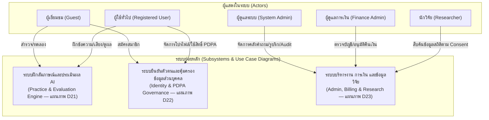

# InterviewX — เอกสารข้อกำหนดระบบซอฟต์แวร์ (Software Requirements Specification: SRS)

> **ข้อกำหนดความต้องการระบบซอฟต์แวร์ (SYSTEM REQUIREMENTS SPECIFICATION)**  
> `ฉบับปรับปรุงมาตรฐาน — เวอร์ชัน 1.1 FINAL (เอกสารหลักฐานทางการผ่านการอนุมัติแล้ว: Active Primary Baseline)`

> [!NOTE]
> **ประกาศการกำกับดูแลเอกสาร (Document Governance Notice)**  
> **วันที่อนุมัติ:** 17 พฤศจิกายน 2026 | **สถานะ:** เอกสารควบคุมระดับสูงสุด ผ่านการตรวจรับและลงนามอนุมัติอย่างเป็นทางการ (Approved Official Baseline v1.1)  
> **วัตถุประสงค์:** เอกสารฉบับนี้จัดทำขึ้นเพื่อกำหนดกรอบการทำงาน ข้อกำหนดเชิงหน้าที่ (FR 40 รายการ), ข้อกำหนดที่ไม่ใช่เชิงหน้าที่ (NFR 24 รายการ), ตารางสิทธิ์ RBAC, และความสอดคล้องระหว่าง **เว็บแอปพลิเคชัน (Responsive Web Application)** และ **แอปพลิเคชันบนอุปกรณ์เคลื่อนที่แบบเนทีฟ (Native Mobile Application: iOS / Android)** ร่วมกับ **สถาปัตยกรรมบริการหลังบ้านร่วมกัน (Shared Backend Architecture)** โดยไม่ให้เกิดความซ้ำซ้อนของฐานข้อมูลหรือตรรกะทางธุรกิจ

### ข้อมูลกำกับเอกสาร (Document Metadata)

| รายการข้อมูล (Specification) | รายละเอียด (Details) |
|---|---|
| **รหัสเอกสาร (Document ID)** | IX-SRS-001 |
| **ชั้นความลับ (Classification)** | เอกสารควบคุม • ผ่านการอนุมัติอย่างเป็นทางการ (Controlled Document • Approved Baseline v1.1) |
| **เวอร์ชันเอกสาร (Document Version)** | 1.1 FINAL (Official Active Primary Baseline) |
| **แบบจำลองการส่งมอบ (Scope Model)** | **R1:** ระบบแกนหลัก (Core MVP Web Baseline & Mobile-Ready API)<br>**R2:** ระบบ AI ขั้นสูงและมือถือ (Enhanced AI & Native Mobile Launch)<br>**R3:** ระบบเชิงพาณิชย์และวิจัย (Commercialization, Billing & Research Release) |
| **สแตกเทคโนโลยีหลัก (Tech Stack)** | Next.js Responsive Web + Native Mobile (React Native / Expo) + NestJS Modular API + FastAPI AI Service + PostgreSQL + Redis / BullMQ |
| **เอกสารอ้างอิงและสอบทาน** | [InterviewX_FR_NFR_RBAC_v1.1_FINAL_TH.xlsx](file:///D:/workspaces/interviewx-datahub/docs-interviex/03_SRS_Requirements/v1.1_approved/InterviewX_FR_NFR_RBAC_v1.1_FINAL_TH.xlsx)<br>[InterviewX_Phase1_Requirement_Traceability_TH.xlsx](file:///D:/workspaces/interviewx-datahub/docs-interviex/03_SRS_Requirements/v1.1_approved/InterviewX_Phase1_Requirement_Traceability_TH.xlsx)<br>[ALL_DIAGRAMS_v1.1_FINAL_TH.md](file:///D:/workspaces/interviewx-datahub/docs-interviex/04_System_Architecture/v1.1_diagrams/ALL_DIAGRAMS_v1.1_FINAL_TH.md)<br>[InterviewX_Phase1_Decision_Register_TH.xlsx](file:///D:/workspaces/interviewx-datahub/docs-interviex/03_SRS_Requirements/v1.1_approved/InterviewX_Phase1_Decision_Register_TH.xlsx) |

---

## การควบคุมเอกสารและการอนุมัติ (Document Control & Approval)

### บันทึกประวัติการควบคุมเอกสาร (Document Control)

| หัวข้อ | รายละเอียด |
|---|---|
| **รหัสเอกสาร (Document ID)** | IX-SRS-001 |
| **เวอร์ชัน (Version)** | 1.1 FINAL |
| **สถานะ (Status)** | เอกสารหลักฐานทางการผ่านการอนุมัติแล้ว — ระยะที่ 1: การปรับประสานข้อกำหนดระบบ (Approved Active Baseline) |
| **เอกสารอ้างอิงต้นทาง (Sources)** | InterviewX_SRS_Final_For_Approval_v1.0.docx; InterviewX_FR_NFR_RBAC.xlsx; ผลสำรวจความต้องการใช้งานจริง (n=102); ALL_DIAGRAMS.md (D01–D25); ทะเบียนการตัดสินใจสถาปัตยกรรม (D-M01 ถึง D-M11) |
| **นโยบายการเปลี่ยนแปลง (Change Policy)** | การแก้ไขเปลี่ยนแปลงข้อกำหนดหลังจาก Baseline v1.1 จะต้องบันทึกเป็นคำขอเปลี่ยนแปลง (Change Request) พร้อมประเมินผลกระทบ ขอบเขตแพลตฟอร์ม และได้รับความเห็นชอบจาก Architecture Review Board เสมอ |
| **ลำดับการบังคับใช้ (Precedence)** | ข้อกำหนดฉบับนี้ (v1.1 FINAL) > ข้อกำหนดหลักฐานเดิม (Baseline v1.0) > กรณีทดสอบอ้างอิง (Test Cases) > เอกสารร่างเดิม |

### บันทึกการลงนามอนุมัติ (Approval Record)

| ตำแหน่งและบทบาทความรับผิดชอบ | ชื่อ-นามสกุล / คณะทำงาน | วันที่ | สถานะการพิจารณา |
|---|---|---|---|
| **เจ้าของผลิตภัณฑ์ / ผู้สนับสนุนโครงการ (Product Owner / Sponsor)** | Product Owner Team | 17/11/2026 | อนุมัติแล้ว (Approved) |
| **หัวหน้าฝ่ายเทคนิค / สถาปนิกซอฟต์แวร์ (Technical Lead / Architect)** | Technical Lead | 17/11/2026 | อนุมัติแล้ว (Approved) |
| **หัวหน้าทีมพัฒนาแอปมือถือ (Mobile Lead / Architect)** | Mobile Lead | 17/11/2026 | อนุมัติแล้ว (Approved) |
| **ผู้เชี่ยวชาญด้านกฎหมายและความเป็นส่วนตัว (Privacy / Legal Reviewer)** | Legal & Privacy Team | 17/11/2026 | อนุมัติแล้ว (Approved) |
| **หัวหน้าฝ่ายประกันคุณภาพระบบ (QA / Acceptance Owner)** | QA Lead | 17/11/2026 | อนุมัติแล้ว (Approved) |

---

## สารบัญเนื้อหา (Table of Contents)

| หมวดที่ | ชื่อหมวดเนื้อหา |
|---|---|
| **หมวดที่ 01** | [1. บทนำและการกำกับดูแลเอกสาร (Introduction & Governance)](#1-บทนำและการกำกับดูแลเอกสาร-introduction--governance) |
| **หมวดที่ 02** | [2. ข้อมูลหลักฐานและการวิเคราะห์ผู้มีส่วนได้ส่วนเสีย (Evidence & Stakeholder Analysis)](#2-ข้อมูลหลักฐานและการวิเคราะห์ผู้มีส่วนได้ส่วนเสีย-evidence--stakeholder-analysis) |
| **หมวดที่ 03** | [3. ขอบเขตระบบ ข้อสมมติ และแผนการส่งมอบ (System Scope, Assumptions & Delivery Plan)](#3-ขอบเขตระบบ-ข้อสมมติ-และแผนการส่งมอบ-system-scope-assumptions--delivery-plan) |
| **หมวดที่ 04** | [4. บริบทระบบ กรณีการใช้งาน และการไหลของงาน (System Context, Use Cases & Workflows)](#4-บริบทระบบ-กรณีการใช้งาน-และการไหลของงาน-system-context-use-cases--workflows) |
| **หมวดที่ 05** | [5. ข้อกำหนดเชิงหน้าที่ (Functional Requirements: 40 รายการใน R1, R2, R3)](#5-ข้อกำหนดเชิงหน้าที่-functional-requirements-40-รายการ) |
| **หมวดที่ 06** | [6. ข้อกำหนดที่ไม่ใช่เชิงหน้าที่ (Non-Functional Requirements: NFR01–NFR24)](#6-ข้อกำหนดที่ไม่ใช่เชิงหน้าที่-non-functional-requirements-nfr01nfr24) |
| **หมวดที่ 07** | [7. การกำหนดสิทธิ์ผู้ใช้งานและการควบคุมการเข้าถึง (Role, Authorization & Entitlements: RBAC)](#7-การกำหนดสิทธิ์ผู้ใช้งานและการควบคุมการเข้าถึง-role-authorization--entitlements-rbac) |
| **หมวดที่ 08** | [8. เลเยอร์ปัญญาประดิษฐ์และการประเมินผล (AI Layer, Inference & Evaluation Engine)](#8-เลเยอร์ปัญญาประดิษฐ์และการประเมินผล-ai-layer-inference--evaluation-engine) |
| **หมวดที่ 09** | [9. การคุ้มครองข้อมูลส่วนบุคคล ความเป็นส่วนตัว และข้อมูลวิจัย (Privacy, Consent & Research Data Governance)](#9-การคุ้มครองข้อมูลส่วนบุคคล-ความเป็นส่วนตัว-และข้อมูลวิจัย-privacy-consent--research-data-governance) |
| **หมวดที่ 10** | [10. การบริหารแพ็กเกจสมาชิก ระบบชำระเงิน และการคืนเงิน (Package, Payment & Refund Governance)](#10-การบริหารแพ็กเกจสมาชิก-ระบบชำระเงิน-และการคืนเงิน-package-payment--refund-governance) |
| **หมวดที่ 11** | [11. แบบจำลองข้อมูลและพจนานุกรมข้อมูล (Data Model & Data Dictionary)](#11-แบบจำลองข้อมูลและพจนานุกรมข้อมูล-data-model--data-dictionary) |
| **หมวดที่ 12** | [12. สถาปัตยกรรมระบบ ส่วนต่อประสาน และแผนภาพระบบ 25 แผนภาพ (Architecture, Interfaces & Operations)](#12-สถาปัตยกรรมระบบ-ส่วนต่อประสาน-และแผนภาพระบบ-25-แผนภาพ) |
| **หมวดที่ 13** | [13. การเชื่อมโยงข้อกำหนดและการตรวจสอบความถูกต้อง (Traceability & Verification)](#13-การเชื่อมโยงข้อกำหนดและการตรวจสอบความถูกต้อง-traceability--verification) |
| **หมวดที่ 14** | [14. ความเสี่ยง ทะเบียนการตัดสินใจ และเงื่อนไขการอนุมัติ (Risks, Decisions & Approval Conditions)](#14-ความเสี่ยง-ทะเบียนการตัดสินใจ-และเงื่อนไขการอนุมัติ-risks-decisions--approval-conditions) |

---

## 1. บทนำและการกำกับดูแลเอกสาร (Introduction & Governance)

InterviewX คือแพลตฟอร์มจำลองการสัมภาษณ์งานด้วยระบบปัญญาประดิษฐ์ (AI Mock Interview Platform) ที่ออกแบบขึ้นเพื่อแก้ไขปัญหาความประหม่า ขาดทักษะการเรียบเรียงความคิด และการขาดโค้ชให้คำปรึกษาของผู้หางานและนักศึกษา โดยระบบสร้างโจทย์คำถามเสมือนจริง ประเมินคำตอบด้วยเกณฑ์รูบริก (Rubric) ที่อธิบายเหตุผลได้ อ้างอิงหลักฐานข้อความจริง และให้คำแนะนำแบบ STAR Method ที่นำไปปรับปรุงได้ทันที

ในเวอร์ชัน 1.1 FINAL นี้ ขอบเขตของแพลตฟอร์มได้รับการปรับประสานอย่างสมบูรณ์เพื่อรองรับ 2 ส่วนติดต่อผู้ใช้ (Frontend Clients) ภายใต้สถาปัตยกรรมบริการหลังบ้านร่วมกัน (Shared Backend Architecture):
1. **เว็บแอปพลิเคชันแบบตอบสนอง (Responsive Web Application):** พัฒนาด้วย Next.js ร่วมกับ TypeScript และ Tailwind CSS รองรับการทำงานบนคอมพิวเตอร์เดสก์ท็อป แท็บเล็ต และเว็บเบราว์เซอร์บนมือถือ ครอบคลุมการใช้งานสำหรับผู้ใช้งานทุกกลุ่ม (Guest, Registered User, Researcher, Payment / Finance Admin, System Admin)
2. **แอปพลิเคชันบนอุปกรณ์เคลื่อนที่แบบเนทีฟ (Native Mobile Application):** พัฒนาเป็นแอปพลิเคชันแยกติดตั้งสำหรับระบบปฏิบัติการ iOS และ Android (ด้วย React Native / Expo) ออกแบบเฉพาะสำหรับกลุ่มผู้ใช้งานทั่วไป (End Users: Guest และ Registered User) โดยเฉพาะ

ทั้งสองแพลตฟอร์มเชื่อมต่อไปยังระบบบริการหลังบ้านชุดเดียวกัน ผ่านจุดเชื่อมต่อบริการ (REST API) ที่มีความปลอดภัยสูง โดยไม่มีการสร้างฐานข้อมูลซ้ำซ้อนหรือเขียนตรรกะทางธุรกิจซ้ำซ้อน และสงวนฟังก์ชันผู้ดูแลระบบ การเงิน และงานวิจัยไว้เฉพาะบน Web Application เท่านั้น

### คำศัพท์และคำย่อสำคัญ (Definitions & Acronyms)

- **FR (Functional Requirements):** ข้อกำหนดเชิงหน้าที่ที่ระบบต้องปฏิบัติการได้ (รวม 40 รายการ: R1 14 ข้อ, R2 12 ข้อ, R3 14 ข้อ)
- **NFR (Non-Functional Requirements):** เกณฑ์มาตรฐานเชิงคุณภาพ ความปลอดภัย ประสิทธิภาพ และความง่ายในการเข้าถึง (รวม 24 รายการ)
- **RBAC (Role-Based Access Control):** การควบคุมการเข้าถึงตามบทบาทความปลอดภัยของระบบ (Guest, Registered User, Researcher, Finance Admin, System Admin)
- **Subscription Entitlement:** สิทธิประโยชน์และโควตาการใช้งานตามแพ็กเกจ (Free, Basic, Pro) ซึ่งถูกควบคุมผ่านบัญชีแยกประเภทหลังบ้าน (USAGE_LEDGER)
- **Platform Scope:** สภาพแวดล้อมที่ฟังก์ชันได้รับอนุญาตให้เข้าถึง (Web Application หรือ Native Mobile Application)
- **Idempotency Key:** รหัสเฉพาะ (UUIDv4) ที่แนบมากับส่วนหัวคำขอ เพื่อป้องกันการบันทึกคำตอบหรือทำธุรกรรมซ้ำซ้อนกรณีสัญญาณมือถือขาดหาย
- **Transactional Outbox:** แพตเทิร์นสถาปัตยกรรมที่บันทึกข้อมูลและสร้าง Event ลงฐานข้อมูลใน Transaction เดียวกัน ก่อนส่งต่องานไปยัง Redis/BullMQ

---

## 2. ข้อมูลหลักฐานและการวิเคราะห์ผู้มีส่วนได้ส่วนเสีย (Evidence & Stakeholder Analysis)

### ข้อมูลสถิติจากการสำรวจความต้องการใช้งาน (Survey Evidence Base — n=102)

ฐานข้อมูลการสำรวจความต้องการใช้งานระบบจริงเก็บรวบรวมจากกลุ่มตัวอย่างผู้หางานและผู้เตรียมตัวสัมภาษณ์จำนวน 102 คน (n=102) ผ่าน 22 ตัวแปรคำถาม โดยมีข้อมูลเชิงสถิติสำคัญที่สนับสนุนการออกแบบระบบดังนี้:

| ฟีเจอร์ที่ต้องการจากการสำรวจ (Survey Feature) | จำนวนผู้เลือก (คน) | คิดเป็นร้อยละ (%) | เชื่อมโยงข้อกำหนด |
|---|---|---|---|
| จำลองคำถามเฉพาะประเภทตำแหน่งงาน | 94 | 92.2% | FR04 |
| AI Feedback วิเคราะห์จุดแข็งจุดอ่อนพร้อมวิธีปรับปรุง | 84 | 82.4% | FR08, FR11 |
| ตัวอย่างแนวทางการตอบที่ดี (Sample Answers / STAR) | 76 | 74.5% | FR12 |
| วิเคราะห์ทักษะการสื่อสารและความมั่นใจ | 67 | 65.7% | FR10, FR36 |
| โหมดจำลองเวลาเสมือนจริง (Pressure Practice Mode) | 64 | 62.7% | FR06 |
| รายงานคะแนนและผลฟีดแบ็กอย่างละเอียดตามเกณฑ์ | 58 | 56.9% | FR08, FR09 |
| ตรวจสอบไวยากรณ์และความถูกต้องของภาษาอังกฤษ | 57 | 55.9% | FR09 |
| การสัมภาษณ์ด้วยเสียงพูด (Voice Interview & STT) | 60 | 58.8% | FR05-V, FR05.1 |
| ปรับระดับความยากของคำถามสัมภาษณ์ (Beginner/Adv) | 35 | 34.3% | FR03 |
| แดชบอร์ดติดตามพัฒนาการและแนวโน้มคะแนน | 30 | 29.4% | FR13 |

**ข้อมูลหลักฐานสนับสนุนการพัฒนาข้ามแพลตฟอร์ม (Cross-Platform Evidence):**
- ผู้ตอบแบบสำรวจจำนวน **84 จาก 102 คน (82.4%)** ระบุความต้องการใช้งานระบบอย่างต่อเนื่องทั้งบนคอมพิวเตอร์ (Web) และบนโทรศัพท์มือถือ (Mobile) เพื่อความสะดวกในการฝึกซ้อมระหว่างการเดินทาง
- ปัญหาใหญ่ที่สุดของผู้ตอบแบบสำรวจ: ความประหม่า/ตื่นเต้น (67.6%), การเรียบเรียงความคิดไม่ทัน (58.8%), ไม่รู้ว่าคำตอบดีพอหรือไม่ (52.9%)
- ความกังวลหลักของผู้ใช้งาน: ความแม่นยำของผลฟีดแบ็ก (65.7%), ความเป็นส่วนตัวของข้อมูลและเสียง (55.9%) และอุปสรรคทางภาษาอังกฤษ (55.9%)

### การวิเคราะห์กลุ่มผู้มีส่วนได้ส่วนเสีย (Stakeholder Analysis)

1. **กลุ่มผู้ฝึกสัมภาษณ์งาน (Candidates / End Users):**
   - `Guest (ผู้เยี่ยมชม):` สำรวจข้อมูล ทดลองสัมภาษณ์ตัวอย่าง (Trial Session) ได้อย่างจำกัดโดยไม่ต้องลงทะเบียน
   - `Registered User (ผู้ใช้ทั่วไป):` สมาชิกที่ลงทะเบียน มีสิทธิ์ฝึกสัมภาษณ์แบบข้อเขียนและเสียง ดูผลประเมิน ประวัติการฝึก และตั้งค่าโปรไฟล์ ใช้งานได้เท่าเทียมกันทั้งบน Web และ Native Mobile
2. **กลุ่มสถาบันการศึกษาและพันธมิตรวิชาการ (Academic / Research Partners):**
   - `Researcher (ผู้วิจัย):` เข้าถึงชุดข้อมูลวิจัยที่มีการจัดกลุ่มสถิติรวมโดยไม่เปิดเผยตัวตน (Anonymized Aggregate Data, Cell Size >= 10) จำกัดเฉพาะบน Web Application เท่านั้น
3. **กลุ่มผู้ดูแลระบบและฝ่ายสนับสนุนเทคนิค (System Administrators & Support):**
   - `System Admin (ผู้ดูแลระบบ):` บริหารคลังคำถาม, เกณฑ์รูบริก, เวอร์ชันพรอมต์ AI, ตรวจสอบ Audit Logs และจัดการเคสอุทธรณ์ผลประเมิน จำกัดเฉพาะบน Web Application เท่านั้น
4. **กลุ่มบริหารการเงินและบัญชี (Payment & Finance Administrators):**
   - `Payment / Finance Admin (ผู้ดูแลการเงิน):` จัดการแคตตาล็อกแพ็กเกจสมาชิก ตรวจสอบธุรกรรม และอนุมัติการคืนเงิน จำกัดเฉพาะบน Web Application เท่านั้น

---

## 3. ขอบเขตระบบ ข้อสมมติ และแผนการส่งมอบ (System Scope, Assumptions & Delivery Plan)

### ตารางการแบ่งขอบเขตระบบและแพลตฟอร์ม (Scope Breakdown by Release)

| หมวดหมู่ฟังก์ชันงาน | รอบ R1: ระบบแกนหลัก (Core MVP) | รอบ R2: ระบบ AI ขั้นสูงและมือถือ | รอบ R3: ระบบเชิงพาณิชย์และวิจัย |
|---|---|---|---|
| **เว็บแอปพลิเคชัน (Web App)** | สมัคร/เข้าสู่ระบบ, สัมภาษณ์ข้อเขียน, ประเมินผลรูบริก AI, ประวัติการฝึก, หน้าจอ Admin พื้นฐาน | รองรับการสัมภาษณ์ด้วยเสียง (Web Audio), ตัวชี้วัดการพูด, แดชบอร์ดพัฒนาการ | พอร์ทัลผู้ดูแลการเงิน, พอร์ทัลผู้วิจัย, ระบบชำระเงิน Web Checkout |
| **แอปพลิเคชันมือถือเนทีฟ (Native Mobile)** | *เตรียมความพร้อม API บริการหลังบ้าน (Mobile-Ready Backend API)* | เปิดตัวแอป iOS / Android: ฝึกสัมภาษณ์ (ข้อความ/เสียง), รับผลประเมิน, ซิงก์ข้อมูล 100% | จัดการข้อมูลแพ็กเกจสมาชิก, ดูโควตาคงเหลือ (การซื้อแพ็กเกจขึ้นกับ D-M04) |
| **สถาปัตยกรรมบริการหลังบ้าน** | NestJS Core API Gateway, FastAPI AI Inference, PostgreSQL Core, Redis/BullMQ, OpenTelemetry | เพิ่ม MinIO/S3 สำหรับไฟล์เสียง, โมดูลถอดความเสียง (STT), ระบบแจ้งเตือน Push | บริการบิลลิ่งและบัญชีแยกประเภทโควตา (USAGE_LEDGER), ไปป์ไลน์ส่งมอบข้อมูลวิจัย |

### ข้อสมมติสำคัญของระบบ (System Assumptions)

1. **การรักษาความปลอดภัยของโทเค็นบนอุปกรณ์เคลื่อนที่:** Native Mobile Application ต้องจัดเก็บ Refresh Token ไว้ในพื้นที่จัดเก็บความปลอดภัยระดับฮาร์ดแวร์ (iOS Keychain และ Android Keystore) เท่านั้น ห้ามจัดเก็บใน Local Storage ปกติ
2. **ความผันผวนของเครือข่ายมือถือ:** การส่งคำตอบสัมภาษณ์จากไคลเอนต์ต้องแนบส่วนหัว `Idempotency-Key` ทุกครั้ง และระบบต้องรองรับการบันทึกฉบับร่างในเครื่อง (Draft Autosave) ทุก 5 วินาที
3. **การทำงานแบบออนไลน์เป็นหลัก (Online-Required):** การประเมินผลคำตอบด้วย AI ต้องประมวลผลบน Cloud Cluster เท่านั้น ไม่อนุญาตให้รันโมเดลภาษาขนาดใหญ่บนเครื่องลูกข่าย (Zero On-device LLM) ในรอบ R1 และ R2
4. **วงจรชีวิตไฟล์เสียงบนเครื่องและเซิร์ฟเวอร์:** ไฟล์เสียงบนเครื่องมือถือต้องถูกลบทิ้งทันทีหลังอัปโหลดเสร็จสิ้น และไฟล์เสียงบนเซิร์ฟเวอร์จะถูกทำลายทิ้งภายใน 24 ชั่วโมง เว้นแต่ผู้ใช้จะยินยอมให้เก็บรักษา (ไม่เกิน 90 วัน)
5. **การปฏิบัติตามกฎระเบียบของ Store:** แอปพลิเคชันมือถือต้องมีฟังก์ชันขอลบบัญชีผู้ใช้ภายในแอป (FR35), ขออนุญาตไมโครโฟนอย่างโปร่งใส และจัดทำ Privacy Nutrition Labels ครบถ้วนตามมาตรฐาน Apple และ Google

---

## 4. บริบทระบบ กรณีการใช้งาน และการไหลของงาน (System Context, Use Cases & Workflows)

โครงสร้างกรณีการใช้งานของ InterviewX เชื่อมโยงโดยตรงกับชุดแผนภาพสถาปัตยกรรมระบบใน [ALL_DIAGRAMS_v1.1_FINAL_TH.md](file:///D:/workspaces/interviewx-datahub/docs-interviex/04_System_Architecture/v1.1_diagrams/ALL_DIAGRAMS_v1.1_FINAL_TH.md):



### สรุปกรณีการใช้งานหลัก (Core Use Cases Summary — อ้างอิง D20–D23)

| รหัสกรณีการใช้งาน | ชื่อกรณีการใช้งาน | บทบาทผู้ใช้หลัก | แพลตฟอร์มที่รองรับ | รอบการส่งมอบ | แผนภาพอ้างอิง |
|---|---|---|---|---|---|
| **UC01** | สำรวจและทดลองใช้งานระบบเบื้องต้น | Guest | Web Application & Native Mobile | R1 | D20, D21 |
| **UC02** | ลงทะเบียน ยืนยันตัวตน และเข้าสู่ระบบ | Guest / Registered User | Web Application & Native Mobile | R1 | D09, D22 |
| **UC03** | ตั้งค่าโปรไฟล์และกำหนดเป้าหมายการฝึกซ้อม | Registered User | Web Application & Native Mobile | R1 | D22, D25 |
| **UC04** | ดำเนินการฝึกสัมภาษณ์แบบข้อเขียน | Registered User | Web Application & Native Mobile | R1 | D07, D21 |
| **UC05** | ดำเนินการฝึกสัมภาษณ์ด้วยเสียงพูด | Registered User | Web Application & Native Mobile | R2 | D11, D21 |
| **UC06** | ตรวจสอบผลการประเมินและข้อเสนอแนะ AI | Registered User | Web Application & Native Mobile | R1 | D08, D21 |
| **UC07** | ตรวจสอบประวัติการฝึกซ้อมและแดชบอร์ด | Registered User | Web Application & Native Mobile | R1 (Dashboard R2) | D21, D25 |
| **UC08** | จัดการความยินยอมและสิทธิ์คุ้มครองข้อมูล (PDPA) | Registered User | Web Application & Native Mobile | R1 | D10, D22 |
| **UC09** | บริหารจัดการการเงินและรายการคืนเงิน | Finance Admin | เฉพาะบน Web Application เท่านั้น | R3 | D12, D23 |
| **UC10** | บริหารจัดการระบบ คลังคำถาม และเกณฑ์รูบริก | System Admin | เฉพาะบน Web Application เท่านั้น | R1 | D23 |
| **UC11** | ยื่นคำร้องอุทธรณ์ผลการประเมินคะแนน AI | Registered User | Web Application & Native Mobile | R1 | D08, D21 |
| **UC12** | สืบค้นและส่งออกชุดข้อมูลสถิติเพื่องานวิจัย | Researcher | เฉพาะบน Web Application เท่านั้น | R3 | D13, D23 |

---

## 5. ข้อกำหนดเชิงหน้าที่ (Functional Requirements: 40 รายการ)

ข้อกำหนดเชิงหน้าที่ทั้งหมดถูกจัดหมวดหมู่อย่างเป็นระบบตามรอบการส่งมอบ R1, R2, และ R3 โดยคงรหัสมาตรฐานตรงกัน 100% กับ [InterviewX_FR_NFR_RBAC_v1.1_FINAL_TH.xlsx](file:///D:/workspaces/interviewx-datahub/docs-interviex/03_SRS_Requirements/v1.1_approved/InterviewX_FR_NFR_RBAC_v1.1_FINAL_TH.xlsx) และ [InterviewX_Phase1_Requirement_Traceability_TH.xlsx](file:///D:/workspaces/interviewx-datahub/docs-interviex/03_SRS_Requirements/v1.1_approved/InterviewX_Phase1_Requirement_Traceability_TH.xlsx):

```
ข้อกำหนดเชิงหน้าที่ทั้งหมด 40 ข้อ:
├── R1: ระบบแกนหลัก Core MVP (14 ข้อ)
│   ├── FR01, FR02, FR04, FR05, FR08, FR11, FR14, FR15
│   └── FR17, FR32, FR33, FR34, FR35, FR36
├── R2: ระบบ AI ขั้นสูงและมือถือ Enhanced AI & Mobile (12 ข้อ)
│   ├── FR03, FR05-V, FR05.1, FR06, FR07, FR09
│   └── FR10, FR12, FR13, FR16, FR18, FR18.1
└── R3: ระบบเชิงพาณิชย์และงานวิจัย Commercial & Research (14 ข้อ)
    ├── FR19, FR20, FR21, FR22, FR23, FR24, FR25
    └── FR26, FR27, FR28, FR29, FR30, FR31, FR32.1
```

---

### 5.1 กลุ่มรอบ R1 — ระบบแกนหลัก (Core MVP: 14 ข้อกำหนด)

#### FR01 — การลงทะเบียน เข้าสู่ระบบ และความปลอดภัยของเซสชัน (Registration, Login and Session Security)
`[ R1 ]  [ ความสำคัญ: Must ]  [ แพลตฟอร์ม: ใช้งานร่วมกันทั้ง Web และ Mobile ]  • บริบท: Identity Context`
- **คำอธิบายข้อกำหนด:** ระบบต้องรองรับการสมัครสมาชิกด้วยอีเมลและรหัสผ่าน, การยืนยันอีเมล, การเข้าสู่ระบบอย่างปลอดภัย, การออกจากระบบ, การรีเซ็ตรหัสผ่าน และการจัดการ Session โดยใช้ระบบบัญชีและโทเค็นชุดเดียวกันทั้งบน Web และ Native Mobile
- **เกณฑ์การยอมรับ (Acceptance Criteria):** รหัสผ่านเข้ารหัสด้วย Argon2id หรือ bcrypt (Work factor >= 12); Access Token (JWT) อายุ 15 นาที, Refresh Token อายุ 7 วัน; บน Web จัดเก็บใน HTTP-only, Secure, SameSite Cookie; บน Native Mobile จัดเก็บใน iOS Keychain / Android Keystore; รองรับการเพิกถอน Refresh Token ทันทีเมื่อผู้ใช้สั่ง Logout หรือ Reset Password

#### FR02 — โปรไฟล์และสถานะของผู้ใช้งาน (User Status and Profile)
`[ R1 ]  [ ความสำคัญ: Must ]  [ แพลตฟอร์ม: ใช้งานร่วมกันทั้ง Web และ Mobile ]  • บริบท: User Context`
- **คำอธิบายข้อกำหนด:** ผู้ใช้สามารถระบุและแก้ไขสถานะปัจจุบัน (นักศึกษา, บัณฑิตจบใหม่, ผู้เปลี่ยนสายงาน) และกำหนดเป้าหมายการฝึกสัมภาษณ์ รวมถึงสามารถข้ามขั้นตอน Onboarding ได้
- **เกณฑ์การยอมรับ (Acceptance Criteria):** ข้อมูลโปรไฟล์ซิงก์ตรงกัน 100% ระหว่าง Web และ Mobile แบบเรียลไทม์; มีการตรวจสอบโครงสร้างและความถูกต้องของข้อมูลด้วย Zod / Pydantic

#### FR04 — การส่งมอบคำถามและหมวดหมู่การสัมภาษณ์ (Interview Category/Question Delivery)
`[ R1 ]  [ ความสำคัญ: Must ]  [ แพลตฟอร์ม: ใช้งานร่วมกันทั้ง Web และ Mobile ]  • บริบท: Question Bank Context`
- **คำอธิบายข้อกำหนด:** ระบบต้องอนุญาตให้ผู้ใช้เลือกหมวดหมู่การสัมภาษณ์ (เช่น งานวิศวกรรมซอฟต์แวร์, การตลาด, ภาษาอังกฤษ) และดึงคำถามจากคลังคำถามที่ผ่านการตรวจสอบแล้วมาจัดส่งให้ผู้ใช้ฝึกซ้อม
- **เกณฑ์การยอมรับ (Acceptance Criteria):** ดึงคำถามจาก Question Bank บนเซิร์ฟเวอร์กลางผ่าน REST API; ในรอบ R1 ต้องมีคำถามในคลังอย่างน้อย 1 หมวดหมู่หลัก (>= 50 คำถาม); โครงสร้างคำถามแสดงผลเหมือนกันทุกแพลตฟอร์ม

#### FR05 — การส่งคำตอบในรูปแบบข้อความ (Text Answer Submission)
`[ R1 ]  [ ความสำคัญ: Must ]  [ แพลตฟอร์ม: ใช้งานร่วมกันทั้ง Web และ Mobile ]  • บริบท: Interview Context`
- **คำอธิบายข้อกำหนด:** รองรับการพิมพ์และส่งคำตอบสัมภาษณ์แบบข้อความ พร้อมระบบบันทึกฉบับร่างอัตโนมัติ (Draft Autosave) และส่งข้อมูลไปยังคิวประเมินผล AI อย่างปลอดภัย
- **เกณฑ์การยอมรับ (Acceptance Criteria):** บังคับใช้ส่วนหัว `Idempotency-Key` (UUIDv4) ป้องกันการส่งคำตอบซ้ำกรณีเครือข่ายมือถือขัดข้อง; ไคลเอนต์บันทึกฉบับร่างในเครื่องทุก 5 วินาที; ป้องกันการส่งคำตอบว่าง; ส่งต่องานเข้าสู่ Transactional Outbox ทันที

#### FR08 — การประเมินคะแนนด้วยเกณฑ์รูบริกของ AI (Rubric-Based AI Scoring)
`[ R1 ]  [ ความสำคัญ: Must ]  [ แพลตฟอร์ม: ใช้งานร่วมกันทั้ง Web และ Mobile ]  • บริบท: Evaluation Context`
- **คำอธิบายข้อกำหนด:** ประเมินคำตอบของผู้ใช้ตามเกณฑ์รูบริกที่กำหนดไว้ล่วงหน้าอย่างโปร่งใส แสดงผลคะแนนรวม คะแนนย่อยรายมิติ และเหตุผลประกอบการให้คะแนน
- **เกณฑ์การยอมรับ (Acceptance Criteria):** ประมวลผลบนเซิร์ฟเวอร์กลางผ่าน FastAPI AI Service; เวลาประมวลผล P95 <= 15.0 วินาที; บันทึกผลลัพธ์แบบ Immutable ตรึงกับรหัสเวอร์ชันของรูบริกและโมเดล; มีความสอดคล้องกับผู้เชี่ยวชาญมนุษย์ (Correlation >= 0.70)

#### FR11 — ข้อเสนอแนะเชิงปฏิบัติการและแนวทางพัฒนา (Actionable Feedback)
`[ R1 ]  [ ความสำคัญ: Must ]  [ แพลตฟอร์ม: ใช้งานร่วมกันทั้ง Web และ Mobile ]  • บริบท: Evaluation Context`
- **คำอธิบายข้อกำหนด:** จัดทำรายงานสรุปจุดเด่น จุดที่ควรปรับปรุง และคำแนะนำแนวทางการฝึกซ้อมในครั้งถัดไป โดยอ้างอิงหลักฐานข้อความจริงจากคำตอบของผู้ใช้
- **เกณฑ์การยอมรับ (Acceptance Criteria):** แสดงจุดเด่นและจุดควรพัฒนาอย่างน้อย 1 รายการต่อเซสชัน พร้อมอ้างอิงข้อความคำตอบของผู้ใช้ (Evidence Citation) ห้ามระบบสร้างหลักฐานเท็จขึ้นมาเอง

#### FR14 — ประวัติการฝึกสัมภาษณ์ย้อนหลัง (Interview History)
`[ R1 ]  [ ความสำคัญ: Must ]  [ แพลตฟอร์ม: ใช้งานร่วมกันทั้ง Web และ Mobile ]  • บริบท: Interview Context`
- **คำอธิบายข้อกำหนด:** บันทึกประวัติคำถาม คำตอบ คะแนน และข้อเสนอแนะของผู้ใช้ เพื่อให้สามารถเรียกดูย้อนหลัง คัดกรองตามหมวดหมู่ หรือขอลบประวัติรายครั้งได้
- **เกณฑ์การยอมรับ (Acceptance Criteria):** ดึงข้อมูลแบบแบ่งหน้า (Pagination) แสดงผลถูกต้องรวดเร็ว; กรองตามหมวดหมู่และช่วงเวลาได้; การลบประวัติทำแบบ Soft Delete ทันทีและคำนวณสถิติใหม่ถูกต้อง

#### FR15 — การเข้าถึงข้ามแพลตฟอร์มและความสอดคล้องของระบบ (Multi-Platform Access & Consistency)
`[ R1 ]  [ ความสำคัญ: Must ]  [ แพลตฟอร์ม: ใช้งานร่วมกันทั้ง Web และ Mobile ]  • บริบท: Platform Core`
- **คำอธิบายข้อกำหนด:** ระบบต้องรองรับการใช้งานผ่าน Responsive Web Application (เดสก์ท็อป แท็บเล็ต และเว็บเบราว์เซอร์บนมือถือ) และ Native Mobile Application (iOS / Android) สำหรับกลุ่มผู้ใช้งานทั่วไป (Guest, Registered User) โดยใช้ระบบบัญชีและส่วนบริการหลังบ้านร่วมกัน พร้อมเชื่อมโยงและซิงก์ข้อมูล 100% และจำกัดฟังก์ชัน Admin/Researcher เฉพาะบน Web Application เท่านั้น
- **เกณฑ์การยอมรับ 7 ข้อ (Acceptance Criteria):**
  1. `AC-FR15-01 (Web Layout):` ผ่านการทดสอบ Responsive Layout ครอบคลุม Desktop (>=1024px), Tablet (768px-1023px) และ Mobile Browser (360px-767px)
  2. `AC-FR15-02 (Mobile OS):` Native Mobile App รองรับ iOS 16.0+ และ Android 13.0+ (API 33) ขึ้นไป
  3. `AC-FR15-03 (Auth Sync):` ใช้ Credentials และ JWT ร่วมกัน เมื่อเปลี่ยนรหัสผ่าน เซสชันบนอุปกรณ์อื่นจะถูกบังคับให้ยืนยันตัวตนใหม่
  4. `AC-FR15-04 (Data Integrity):` ข้อมูลโปรไฟล์ เซสชัน ประวัติ และคะแนน ซิงก์ตรงกัน 100% ระหว่าง Web และ Mobile
  5. `AC-FR15-05 (Role Gate):` ปฏิเสธการเข้าสู่ระบบผ่าน Native Mobile สำหรับบทบาท Admin, Finance และ Researcher โดยแจ้งเตือนให้เข้าใช้บนเว็บ
  6. `AC-FR15-06 (Central Quota):` หักยอดโควตาเซสชันจากบัญชีแยกประเภทส่วนกลาง (USAGE_LEDGER) แบบ Atomic ป้องกัน Race Condition
  7. `AC-FR15-07 (Network Resilience):` หากสัญญาณมือถือหลุด ไคลเอนต์เก็บคำตอบฉบับร่างไว้ในเครื่อง และส่งคำตอบพร้อม `Idempotency-Key` เดิมเมื่อออนไลน์

#### FR17 — ประกาศความเป็นส่วนตัวและฐานการประมวลผลข้อมูล (Privacy Notice and Lawful Basis)
`[ R1 ]  [ ความสำคัญ: Must ]  [ แพลตฟอร์ม: ใช้งานร่วมกันทั้ง Web และ Mobile ]  • บริบท: Privacy Context`
- **คำอธิบายข้อกำหนด:** ระบบต้องแสดงประกาศความเป็นส่วนตัว (Privacy Notice) แจ้งวัตถุประสงค์และฐานทางกฎหมายในการประมวลผลข้อมูลตาม PDPA พร้อมจัดการความยินยอมแยกตามวัตถุประสงค์อย่างชัดเจน
- **เกณฑ์การยอมรับ (Acceptance Criteria):** แยกความยินยอมการบริการหลัก (สัญญา) ออกจากความยินยอมเพื่องานวิจัยและเสียง; บันทึกประวัติการยินยอมลงในตาราง `CONSENT_EVENTS` แบบไม่สามารถแก้ไขได้

#### FR32 — บันทึกประวัติการดำเนินงานของผู้ดูแลระบบ (Immutable Admin Audit)
`[ R1 ]  [ ความสำคัญ: Must ]  [ แพลตฟอร์ม: เฉพาะบนเว็บเท่านั้น (Admin Only) ]  • บริบท: Platform Core`
- **คำอธิบายข้อกำหนด:** บันทึกประวัติการกระทำของผู้ดูแลระบบ เช่น การจัดการผู้ใช้, การแก้ไขคลังคำถาม, รูบริก, พรอมต์ และค่าคอนฟิกระบบ ลงในบันทึกที่แก้ไขไม่ได้
- **เกณฑ์การยอมรับ (Acceptance Criteria):** บันทึก Actor ID, Action, Resource, IP Address, Timestamp ในตาราง `AUDIT_EVENTS` แบบ Append-only; หน้าจอ Audit Log Viewer สงวนไว้เฉพาะบน Web Application เท่านั้น

#### FR33 — ความทนทานต่อการขัดข้องของเซสชัน (Session Resilience)
`[ R1 ]  [ ความสำคัญ: Must ]  [ แพลตฟอร์ม: ใช้งานร่วมกันทั้ง Web และ Mobile ]  • บริบท: Platform Core`
- **คำอธิบายข้อกำหนด:** เก็บสถานะคำตอบและรองรับการทำงานต่อหรือยกเลิกเซสชันเมื่อเครือข่ายหรือบริการหลังบ้านขัดข้องชั่วคราว
- **เกณฑ์การยอมรับ (Acceptance Criteria):** ไคลเอนต์เก็บแคชร่างคำตอบในเครื่อง หากสัญญาณขาดหายผู้ใช้สามารถกดส่งซ้ำได้เมื่อสัญญาณกลับมาโดยข้อมูลไม่สูญหาย; ป้องกันงานค้างด้วย Timeout และ Dead-Letter Queue

#### FR34 — การตั้งค่า AI และการทบทวนโดยมนุษย์ (AI Configuration and Human Review)
`[ R1 ]  [ ความสำคัญ: Must ]  [ แพลตฟอร์ม: เฉพาะบนเว็บเท่านั้น (Admin Console) ]  • บริบท: AI Governance Context`
- **คำอธิบายข้อกำหนด:** หน้าจอสำหรับผู้ดูแลระบบในการจัดการ Question Bank, เกณฑ์รูบริก, เวอร์ชันพรอมต์โมเดล AI รวมถึงฟังก์ชัน Rollback สู่เวอร์ชันก่อนหน้า และระบบทบทวนโดยมนุษย์ (Human Review)
- **เกณฑ์การยอมรับ (Acceptance Criteria):** การแก้ไขรูบริกหรือพรอมต์ต้องสร้างเวอร์ชันใหม่แบบตรึงค่า (Immutable Versioning); มีหน้าจอคัดกรองเคสผลประเมินที่มีการอุทธรณ์เพื่อให้ผู้เชี่ยวชาญตรวจสอบซ้ำ

#### FR35 — การยื่นคำขอใช้สิทธิตามกฎหมายคุ้มครองข้อมูล (Data Rights Request: DSR)
`[ R1 ]  [ ความสำคัญ: Must ]  [ แพลตฟอร์ม: ผู้ใช้ส่งคำขอ (Web/Mobile) / Admin ดำเนินการ (Web) ]  • บริบท: Privacy Context`
- **คำอธิบายข้อกำหนด:** รองรับคำขอเข้าถึง รับสำเนาข้อมูล (Data Portability) หรือขอลบข้อมูลบัญชีและข้อมูลส่วนบุคคล (Right to Erasure) ตามกฎหมาย PDPA
- **เกณฑ์การยอมรับ (Acceptance Criteria):** ภายใน Native Mobile App ต้องมีปุ่มขอลบข้อมูลบัญชีตามข้อกำหนดของ App Store; เจ้าหน้าที่ดำเนินการผ่าน Web ภายในกำหนดเวลา SLA (ไม่เกิน 30 วันตามกฎหมาย)

#### FR36 — การจัดการข้อผิดพลาด AI และการยื่นอุทธรณ์ผล (AI Failure and Appeal)
`[ R1 ]  [ ความสำคัญ: Must ]  [ แพลตฟอร์ม: ผู้ใช้ยื่นอุทธรณ์ (Web/Mobile) / Admin ทบทวน (Web) ]  • บริบท: Evaluation Context`
- **คำอธิบายข้อกำหนด:** รองรับกลไกแจ้งเตือนข้อผิดพลาด AI อย่างโปร่งใส (ห้ามเมคคะแนนเท็จ) รองรับการ Retry และเปิดให้ผู้ใช้ยื่นคำร้องอุทธรณ์ผลการประเมินคะแนน
- **เกณฑ์การยอมรับ (Acceptance Criteria):** หาก AI ล้มเหลว ปรับสถานะเป็น `failed` และแจ้งผู้ใช้ให้กดลองใหม่; ผู้ใช้มีปุ่ม Flag / Appeal ส่งคำร้องพร้อมระบุเหตุผลเพื่อส่งเข้าคิวทบทวนของ Admin

---

### 5.2 กลุ่มรอบ R2 — ระบบ AI ขั้นสูงและมือถือ (Enhanced AI & Mobile: 12 ข้อกำหนด)

#### FR03 — การกำหนดค่าระดับความเชี่ยวชาญ (Skill Configuration)
`[ R2 ]  [ ความสำคัญ: Should ]  [ แพลตฟอร์ม: ใช้งานร่วมกันทั้ง Web และ Mobile ]  • บริบท: Interview Context`
- **คำอธิบายข้อกำหนด:** ผู้ใช้สามารถเลือกระดับความยากของคำถาม (Beginner, Intermediate, Advanced) หรือให้ระบบวิเคราะห์และเสนอแนะระดับความเชี่ยวชาญที่เหมาะสมตามประวัติ
- **เกณฑ์การยอมรับ (Acceptance Criteria):** เมนูเลือกระดับความยากและเกณฑ์รูบริกที่สัมพันธ์กันทำงานตรงกันทั้งบน Web และ Mobile

#### FR05-V — การส่งคำตอบด้วยเสียงและการแปลงเป็นข้อความ (Voice Answer and STT)
`[ R2 ]  [ ความสำคัญ: Should ]  [ แพลตฟอร์ม: ใช้งานร่วมกันทั้ง Web และ Mobile ]  • บริบท: Voice & STT Engine`
- **คำอธิบายข้อกำหนด:** รองรับการบันทึกเสียงตอบสัมภาษณ์ อัปโหลดไฟล์เสียงผ่าน Signed URL ไปยัง S3/MinIO และส่งถอดความเสียงเป็นข้อความ (STT) โดยผู้ใช้สามารถตรวจสอบและแก้ไขข้อความถอดเสียงก่อนส่งประเมิน
- **เกณฑ์การยอมรับ (Acceptance Criteria):** บนเว็บใช้ Web Audio API; บนมือถือใช้ Native Microphone Bridge; ล้างแคชไฟล์เสียงบนเครื่องมือถือทันทีเมื่ออัปโหลดเสร็จสิ้น; ผู้ใช้แก้ไขข้อความถอดเสียงได้

#### FR05.1 — การเลือกเก็บรักษาไฟล์เสียง (Voice-Retention Choice)
`[ R2 ]  [ ความสำคัญ: Must ]  [ แพลตฟอร์ม: ใช้งานร่วมกันทั้ง Web และ Mobile ]  • บริบท: Privacy Context`
- **คำอธิบายข้อกำหนด:** แสดงกล่องข้อความขอความยินยอมแยกต่างหากอย่างชัดเจนก่อนการบันทึกเสียง เพื่อให้ผู้ใช้เลือกว่าจะลบไฟล์เสียงทิ้งทันที หรือยินยอมให้เก็บไฟล์เสียงไว้เพื่อการฟังย้อนหลัง
- **เกณฑ์การยอมรับ (Acceptance Criteria):** กรณีไม่ยินยอม ลบไฟล์เสียงทิ้งถาวรภายใน 24 ชม.; กรณียินยอม กำหนดอายุการเก็บรักษาไม่เกิน 90 วัน; บันทึก Consent Event แบบระบุเวลาชัดเจน

#### FR06 — โหมดจำลองการสัมภาษณ์แบบกดดัน (Pressure Practice Mode)
`[ R2 ]  [ ความสำคัญ: Could ]  [ แพลตฟอร์ม: ใช้งานร่วมกันทั้ง Web และ Mobile ]  • บริบท: Interview Context`
- **คำอธิบายข้อกำหนด:** โหมดฝึกซ้อมแบบจำกัดเวลาตอบสัมภาษณ์ที่สั้นลงและจำลองสถานการณ์กดดัน โดยเป็นไปตามความสมัครใจของผู้ใช้และสามารถกดออกจากโหมดได้ทันที
- **เกณฑ์การยอมรับ (Acceptance Criteria):** แสดงนาฬิกานับเวลาถอยหลัง; เมื่อหมดเวลาให้บันทึกคำตอบเท่าที่ตอบได้ทันที; มีปุ่มยกเลิกออกจากโหมดได้ตลอดเวลา

#### FR07 — ความหลากหลายของคำถามและการป้องกันคำถามซ้ำ (Question Diversity)
`[ R2 ]  [ ความสำคัญ: Should ]  [ แพลตฟอร์ม: ใช้งานร่วมกันทั้ง Web และ Mobile ]  • บริบท: Question Selector Engine`
- **คำอธิบายข้อกำหนด:** สลับสับเปลี่ยนคำถามและควบคุมไม่ให้ผู้ใช้พบคำถามเดิมซ้ำซ้อนในชุดฝึกซ้อมที่ใกล้เคียงกัน
- **เกณฑ์การยอมรับ (Acceptance Criteria):** ระบบตรวจสอบประวัติเซสชันของบัญชีผู้ใช้ และป้องกันการสุ่มเจอคำถามเดิมซ้ำภายใน 5 เซสชันล่าสุด

#### FR09 — การวิเคราะห์และข้อเสนอแนะภาษาอังกฤษ (English Language Feedback)
`[ R2 ]  [ ความสำคัญ: Should ]  [ แพลตฟอร์ม: ใช้งานร่วมกันทั้ง Web และ Mobile ]  • บริบท: Evaluation Context`
- **คำอธิบายข้อกำหนด:** ตรวจสอบความถูกต้องของไวยากรณ์ภาษาอังกฤษ (Grammar), ความชัดเจนในการสื่อสาร (Clarity) และคำศัพท์ โดยแยกคะแนนภาษาออกจากคะแนนเนื้อหา
- **เกณฑ์การยอมรับ (Acceptance Criteria):** แสดงจุดที่ใช้ภาษาไม่ถูกต้องพร้อมเสนอแนะคำศัพท์หรือรูปประโยคที่เหมาะสมกว่า โดยไม่ส่งผลกระทบต่อคะแนนความตรงประเด็นของเนื้อหา

#### FR10 — ตัวชี้วัดพฤติกรรมการพูดที่สังเกตได้ (Observable Speech Indicators)
`[ R2 ]  [ ความสำคัญ: Should ]  [ แพลตฟอร์ม: ใช้งานร่วมกันทั้ง Web และ Mobile ]  • บริบท: Speech Analytics Service`
- **คำอธิบายข้อกำหนด:** วิเคราะห์ตัวชี้วัดการพูดเชิงพฤติกรรม ได้แก่ ความเร็วในการพูด (Words Per Minute: WPM), จุดหยุดพักที่นานเกินไป (Pause Duration) และการนับคำฟุ่มเฟือย (Filler Words เช่น อ่า, เอ่อ)
- **เกณฑ์การยอมรับ (Acceptance Criteria):** วิเคราะห์บนระบบหลังบ้าน; แสดงผลสถิติเป็นกราฟการ์ดพร้อมข้อความปฏิเสธความรับผิดชอบ (Disclaimer) ว่าเป็นตัวชี้วัดเพื่อการฝึกซ้อมเท่านั้น

#### FR12 — ตัวอย่างแนวทางการตอบที่ดี (Example Responses)
`[ R2 ]  [ ความสำคัญ: Could ]  [ แพลตฟอร์ม: ใช้งานร่วมกันทั้ง Web และ Mobile ]  • บริบท: Evaluation Context`
- **คำอธิบายข้อกำหนด:** แสดงตัวอย่างแนวทางการตอบคำถามที่ดีตามบริบทของโจทย์ข้อนั้นๆ ในรูปแบบ STAR Method (Situation, Task, Action, Result) เพื่อให้ผู้ใช้เห็นภาพการตอบที่เป็นรูปธรรม
- **เกณฑ์การยอมรับ (Acceptance Criteria):** แสดงตัวอย่างคำตอบที่ตรงกับหมวดหมู่และระดับความยากของคำถามในหน้ารายงานฟีดแบ็ก

#### FR13 — แดชบอร์ดติดตามพัฒนาการ (Progress Dashboard)
`[ R2 ]  [ ความสำคัญ: Should ]  [ แพลตฟอร์ม: ใช้งานร่วมกันทั้ง Web และ Mobile ]  • บริบท: Reporting Context`
- **คำอธิบายข้อกำหนด:** หน้าจอแดชบอร์ดสรุปสถิติจำนวนครั้งที่ฝึกซ้อม, ค่าเฉลี่ยคะแนนรูบริก, กราฟแนวโน้มพัฒนาการย้อนหลัง และจุดแข็งจุดอ่อนจำแนกตามหมวดหมู่
- **เกณฑ์การยอมรับ (Acceptance Criteria):** กราฟแสดงผลถูกต้องและสอดคล้องกันทั้งบน Web และหน้าจอ Native Mobile

#### FR16 — การเลือกรูปแบบการฝึกซ้อม (Practice Mode Selection)
`[ R2 ]  [ ความสำคัญ: Should ]  [ แพลตฟอร์ม: ใช้งานร่วมกันทั้ง Web และ Mobile ]  • บริบท: Interview Context`
- **คำอธิบายข้อกำหนด:** ผู้ใช้สามารถเลือกรูปแบบการฝึกซ้อมได้ระหว่าง แบบพิมพ์ข้อความ (Text), แบบเสียง (Voice) หรือแบบผสม (Mixed) รวมถึงเลือกฝึกเฉพาะคำถามที่เคยตอบได้คะแนนต่ำ
- **เกณฑ์การยอมรับ (Acceptance Criteria):** ระบบปรับส่วนติดต่อผู้ใช้ให้สอดคล้องกับโหมดที่เลือกได้อย่างราบรื่น

#### FR18 — ความยินยอมติดต่อเพื่อการวิจัย (Contact Opt-in)
`[ R2 ]  [ ความสำคัญ: Should ]  [ แพลตฟอร์ม: ใช้งานร่วมกันทั้ง Web และ Mobile ]  • บริบท: Privacy Context`
- **คำอธิบายข้อกำหนด:** ให้ผู้ใช้มีตัวเลือกยินยอมแยกต่างหากในการอนุญาตให้ทีมวิจัยติดต่อกลับเพื่อการสัมภาษณ์เชิงลึกหรือการทดสอบระบบ
- **เกณฑ์การยอมรับ (Acceptance Criteria):** ค่าเริ่มต้นต้องเป็น Unchecked (Opt-in เท่านั้น); ผู้ใช้สามารถเพิกถอนความยินยอมได้ตลอดเวลา

#### FR18.1 — การอนุญาตสิทธิ์เข้าถึงข้อมูลเพื่อการวิจัย (Research Access Authorization)
`[ R2 ]  [ ความสำคัญ: Must ]  [ แพลตฟอร์ม: เฉพาะบนเว็บเท่านั้น (Admin / Researcher) ]  • บริบท: Research Governance Context`
- **คำอธิบายข้อกำหนด:** ควบคุมการเปิดเผยข้อมูลเพื่อการวิจัยตามวัตถุประสงค์และสิทธิที่ได้รับอนุญาต โดยอนุญาตให้เข้าถึงเฉพาะชุดข้อมูลรวมที่ผ่านการตัดข้อมูลระบุตัวตน (Anonymized Data)
- **เกณฑ์การยอมรับ (Acceptance Criteria):** ตรวจสอบขนาดกลุ่มตัวอย่าง Cell Size >= 10 คน; ห้ามดาวน์โหลดไฟล์เสียงดิบหรือข้อความดิบเด็ดขาด; เข้าถึงได้เฉพาะบน Web Application

---

### 5.3 กลุ่มรอบ R3 — ระบบเชิงพาณิชย์และงานวิจัย (Commercial & Research: 14 ข้อกำหนด)

#### FR19 — แคตตาล็อกแพ็กเกจสมาชิก (Package Catalog)
`[ R3 ]  [ ความสำคัญ: Must ]  [ แพลตฟอร์ม: ใช้งานร่วมกันทั้ง Web และ Mobile ]  • บริบท: Billing Context`
- **คำอธิบายข้อกำหนด:** แสดงรายการแพ็กเกจสมาชิก (Free, Basic, Pro), ราคา, โควตาเซสชัน และรายละเอียดสิทธิประโยชน์ที่เปิดใช้งาน
- **เกณฑ์การยอมรับ (Acceptance Criteria):** ดึงข้อมูลแคตตาล็อกที่เป็นเวอร์ชัน Published ล่าสุดจากหลังบ้าน แสดงผลตรงกันทุกแพลตฟอร์ม

#### FR20 — การบังคับใช้โควตาและสิทธิประโยชน์แพ็กเกจ (Quota and Entitlement Enforcement)
`[ R3 ]  [ ความสำคัญ: Must ]  [ แพลตฟอร์ม: ใช้งานร่วมกันทั้ง Web และ Mobile ]  • บริบท: Billing Context`
- **คำอธิบายข้อกำหนด:** ตรวจสอบสิทธิ์การใช้งานฟีเจอร์และโควตาคงเหลือของผู้ใช้ตามระดับแพ็กเกจสมาชิกก่อนเริ่มสร้างเซสชันสัมภาษณ์
- **เกณฑ์การยอมรับ (Acceptance Criteria):** ตรวจสอบและตัดยอดโควตาจากตาราง `USAGE_LEDGER` บนเซิร์ฟเวอร์แบบ Atomic ป้องกัน Race Condition; แจ้งเตือนเมื่อโควตาเต็ม

#### FR21 — การเปรียบเทียบแพ็กเกจสมาชิก (Package Comparison)
`[ R3 ]  [ ความสำคัญ: Should ]  [ แพลตฟอร์ม: ใช้งานร่วมกันทั้ง Web และ Mobile ]  • บริบท: Billing Context`
- **คำอธิบายข้อกำหนด:** แสดงตารางเปรียบเทียบความแตกต่างของสิทธิประโยชน์ระหว่าง Free, Basic และ Pro เพื่อประกอบการตัดสินใจสมัครสมาชิก
- **เกณฑ์การยอมรับ (Acceptance Criteria):** ตารางเปรียบเทียบชัดเจน แสดงโควตาเซสชัน ฟีเจอร์เสียง และระดับการวิเคราะห์อย่างโปร่งใส

#### FR22 — ช่องทางการชำระเงิน (Payment Methods)
`[ R3 ]  [ ความสำคัญ: Should ]  [ แพลตฟอร์ม: ใช้งานร่วมกันทั้ง Web และ Mobile (Web Checkout ตาม D-M04) ]  • บริบท: Billing Context`
- **คำอธิบายข้อกำหนด:** เชื่อมต่อช่องทางการชำระเงินที่เกตเวย์รองรับ เช่น บัตรเครดิต/เดบิต, QR PromptPay และ Mobile Banking
- **เกณฑ์การยอมรับ (Acceptance Criteria):** บน Web ดำเนินการผ่าน Hosted Gateway; บน Mobile ส่งต่อผู้ใช้ไปจ่ายเงินผ่าน Web Checkout ในระยะแรกตามมติ D-M04

#### FR23 — การตรวจสอบเกตเวย์ชำระเงินและ Webhook (Payment Gateway Validation)
`[ R3 ]  [ ความสำคัญ: Must ]  [ แพลตฟอร์ม: ส่วนบริการหลังบ้านร่วมกัน (Shared Backend) ]  • บริบท: Billing Context`
- **คำอธิบายข้อกำหนด:** ตรวจสอบความถูกต้องของ Webhook จาก Payment Gateway ด้วยลายเซ็น HMAC และป้องกันรายการซ้ำซ้อน (Anti-Replay)
- **เกณฑ์การยอมรับ (Acceptance Criteria):** ยืนยัน Signature ทุกคำขอ Webhook; บันทึก Idempotency Key ของธุรกรรม ป้องกันการเปิดสิทธิ์ซ้ำซ้อน

#### FR24 — การออกหลักฐานการรับชำระเงิน (Receipt Issuance)
`[ R3 ]  [ ความสำคัญ: Must ]  [ แพลตฟอร์ม: ใช้งานร่วมกันทั้ง Web และ Mobile ]  • บริบท: Billing Context`
- **คำอธิบายข้อกำหนด:** ออกหลักฐานการรับชำระเงินและใบเสร็จภาษีอิเล็กทรอนิกส์ ส่งให้ผู้ใช้ทางอีเมลและสามารถดาวน์โหลดได้ในระบบ
- **เกณฑ์การยอมรับ (Acceptance Criteria):** ออกใบเสร็จที่มีข้อมูลภาษีถูกต้องตามกฎหมายภายใน 5 นาทีหลังการชำระเงินสำเร็จ

#### FR25 — การเปิดสิทธิประโยชน์หลังการชำระเงิน (Provisioning)
`[ R3 ]  [ ความสำคัญ: Must ]  [ แพลตฟอร์ม: ส่วนบริการหลังบ้านร่วมกัน (Shared Backend) ]  • บริบท: Billing Context`
- **คำอธิบายข้อกำหนด:** ปรับปรุงสถานะแพ็กเกจสมาชิกและเติมยอดโควตาในระบบหลังบ้านทันทีที่ได้รับยืนยันการชำระเงินสำเร็จ
- **เกณฑ์การยอมรับ (Acceptance Criteria):** ดำเนินการปรับปรุงสิทธิ์ผ่าน Database Transaction แบบ Atomic พร้อมส่ง Notification แจ้งผู้ใช้

#### FR26 — การต่ออายุแพ็กเกจสมาชิก (Renewal)
`[ R3 ]  [ ความสำคัญ: Should ]  [ แพลตฟอร์ม: ใช้งานร่วมกันทั้ง Web และ Mobile ]  • บริบท: Billing Context`
- **คำอธิบายข้อกำหนด:** รองรับการต่ออายุแพ็กเกจสมาชิกทั้งแบบทำรายการเอง (Manual) และแบบตัดเงินอัตโนมัติ (Auto-renewal) ตามนโยบาย
- **เกณฑ์การยอมรับ (Acceptance Criteria):** ผู้ใช้สามารถเปิด/ปิดการต่ออายุอัตโนมัติได้จากหน้าตั้งค่าบัญชีตลอดเวลา

#### FR27 — การยกเลิกและคำขอคืนเงิน (Cancellation/Refund Requests)
`[ R3 ]  [ ความสำคัญ: Must ]  [ แพลตฟอร์ม: ผู้ใช้ส่งคำขอ (Web/Mobile) / การเงินอนุมัติ (Web) ]  • บริบท: Billing Context`
- **คำอธิบายข้อกำหนด:** รองรับการยื่นคำขอยกเลิกและขอคืนเงินตามเงื่อนไขนโยบาย พร้อมแยกขั้นตอนการตรวจสอบ อนุมัติ และดำเนินการทางบัญชี
- **เกณฑ์การยอมรับ (Acceptance Criteria):** ยื่นคำขอได้ภายใน 7 วันหากยังไม่ได้เริ่มใช้งาน; การอนุมัติและปรับปรุงสถานะเงินคืนดำเนินการโดย Finance Admin บน Web

#### FR28 — การแจ้งเตือนการต่ออายุสมาชิก (Renewal Notifications)
`[ R3 ]  [ ความสำคัญ: Should ]  [ แพลตฟอร์ม: ใช้งานร่วมกันทั้ง Web และ Mobile ]  • บริบท: Billing Context`
- **คำอธิบายข้อกำหนด:** ส่งข้อความแจ้งเตือนผู้ใช้ล่วงหน้า (เช่น 3 วันก่อนถึงกำหนด) ผ่านทางอีเมลหรือการแจ้งเตือนในระบบก่อนถึงรอบการตัดเงินต่ออายุ
- **เกณฑ์การยอมรับ (Acceptance Criteria):** มีบันทึก Notification Log และระบุลิงก์ให้ผู้ใช้จัดการแพ็กเกจได้สะดวก

#### FR29 — ประวัติการทำธุรกรรมทางการเงิน (Transaction History)
`[ R3 ]  [ ความสำคัญ: Must ]  [ แพลตฟอร์ม: ใช้งานร่วมกันทั้ง Web และ Mobile ]  • บริบท: Billing Context`
- **คำอธิบายข้อกำหนด:** จัดเก็บและแสดงประวัติรายการสั่งซื้อ การชำระเงิน และการต่ออายุแพ็กเกจทั้งหมดของผู้ใช้ในรูปแบบรายการเดินบัญชี
- **เกณฑ์การยอมรับ (Acceptance Criteria):** แสดงวันที่, ยอดเงิน, ช่องทางชำระเงิน, สถานะ และปุ่มดาวน์โหลดใบเสร็จ

#### FR30 — การบริหารเวอร์ชันแพ็กเกจและราคาของผู้ดูแลระบบ (Admin Package Versioning)
`[ R3 ]  [ ความสำคัญ: Must ]  [ แพลตฟอร์ม: เฉพาะบนเว็บเท่านั้น (Admin Only) ]  • บริบท: Billing Governance Context`
- **คำอธิบายข้อกำหนด:** หน้าจอสำหรับผู้ดูแลระบบและฝ่ายการเงินในการสร้าง แก้ไข และควบคุมเวอร์ชันของแพ็กเกจสมาชิกผ่านขั้นตอน Draft, Approve และ Publish
- **เกณฑ์การยอมรับ (Acceptance Criteria):** การแก้ไขแพ็กเกจเดิมจะไม่มีผลย้อนหลังต่อสมาชิกที่ยังอยู่ในรอบบิลเดิม; จัดเก็บประวัติการอนุมัติราคาถาวร

#### FR31 — รายงานตัวชี้วัดทางธุรกิจ (Business Metrics)
`[ R3 ]  [ ความสำคัญ: Could ]  [ แพลตฟอร์ม: เฉพาะบนเว็บเท่านั้น (Admin Only) ]  • บริบท: Finance & Analytics Context`
- **คำอธิบายข้อกำหนด:** แดชบอร์ดรายงานตัวชี้วัดทางธุรกิจที่สำคัญ ได้แก่ รายได้ประจำรายเดือน (MRR), อัตราการสูญเสียลูกค้า (Churn Rate) และปริมาณการใช้งานโควตา
- **เกณฑ์การยอมรับ (Acceptance Criteria):** คำนวณตัวเลขทางธุรกิจอย่างแม่นยำ; จำกัดการเข้าถึงเฉพาะบทบาท Finance Admin บน Web Application เท่านั้น

#### FR32.1 — บันทึกประวัติการเข้าถึงข้อมูลของนักวิจัย (Research Access Audit)
`[ R3 ]  [ ความสำคัญ: Must ]  [ แพลตฟอร์ม: เฉพาะบนเว็บเท่านั้น (Admin / Researcher) ]  • บริบท: Research Governance Context`
- **คำอธิบายข้อกำหนด:** บันทึกประวัติคำขอเข้าถึง การสืบค้น และการส่งออกข้อมูลวิจัยของผู้วิจัยทุกคนอย่างละเอียด รวมถึงบันทึกคำขอที่ถูกปฏิเสธเนื่องจากกลุ่มตัวอย่างไม่ถึงเกณฑ์
- **เกณฑ์การยอมรับ (Acceptance Criteria):** บันทึก Researcher ID, Query Parameters, Record Count, Timestamp ลงตารางถาวร เรียกดูได้เฉพาะบน Web

---

## 6. ข้อกำหนดที่ไม่ใช่เชิงหน้าที่ (Non-Functional Requirements: NFR01–NFR24)

ข้อกำหนดที่ไม่ใช่เชิงหน้าที่ทั้งหมด 24 รายการ คงรหัสมาตรฐานและเกณฑ์ชี้วัดครอบคลุมทั้ง 2 แพลตฟอร์ม:

```
ข้อกำหนดเชิงคุณภาพ NFR 24 ข้อ:
├── กลุ่ม 1: ความมั่นคงปลอดภัยและการคุ้มครองข้อมูล (NFR01, NFR09, NFR17, NFR18, NFR19, NFR20)
├── กลุ่ม 2: ความแม่นยำและธรรมาภิบาล AI (NFR02, NFR21)
├── กลุ่ม 3: ประสิทธิภาพ ความพร้อมใช้งาน และการรองรับการขยายตัว (NFR04, NFR05, NFR13, NFR14, NFR22, NFR23, NFR24)
├── กลุ่ม 4: ความง่ายในการใช้งาน การเข้าถึงได้อย่างเท่าเทียม และสากล (NFR03, NFR07, NFR08)
└── กลุ่ม 5: ธรรมาภิบาลทางการเงินและการปฏิบัติตามกฎระเบียบ (NFR06, NFR10, NFR11, NFR12, NFR15, NFR16)
```

### กลุ่มที่ 1: ความมั่นคงปลอดภัยและการคุ้มครองข้อมูลส่วนบุคคล (Security & Privacy)
- **NFR01 — การเข้ารหัสข้อมูลและการตรวจสอบสิทธิ์:** เข้ารหัสข้อมูลที่ส่งผ่านเครือข่ายด้วย TLS 1.3 และเข้ารหัสข้อมูลที่จัดเก็บด้วย AES-256; Web จัดเก็บโทเค็นใน HTTP-only cookies; Native Mobile จัดเก็บโทเค็นใน iOS Keychain / Android Keystore
- **NFR09 — วงจรชีวิตและการทำลายไฟล์เสียง:** ไฟล์เสียงดิบในพื้นที่จัดเก็บส่วนตัวต้องถูกทำลายทิ้งภายใน 24 ชม. สำหรับผู้ใช้ทั่วไป (ยินยอม <=90 วัน); บนเครื่องมือถือต้องล้างแคชไฟล์เสียงทันทีเมื่ออัปโหลดเสร็จสิ้น
- **NFR17 — ความเป็นส่วนตัวของข้อมูลงานวิจัย:** การเข้าถึงข้อมูลวิจัยจำกัดเฉพาะบทบาท Researcher บน Web Application เท่านั้น โดยต้องผ่านการตรวจสอบขนาดกลุ่มตัวอย่าง (Cell Size >= 10 คน) และใช้ Differential Privacy
- **NFR18 — การควบคุมการเข้าถึงไฟล์เสียงดิบ:** Private Object Storage บล็อกการเข้าถึงหรือดาวน์โหลดไฟล์เสียงดิบสำหรับผู้วิจัยและผู้ดูแลระบบทั่วไป 100%
- **NFR19 — การป้องกันการโจมตีระดับสิทธิ์และ IDOR:** บังคับใช้การตรวจสอบสิทธิ์ RBAC และสิทธิ์ความเป็นเจ้าของข้อมูลที่ระบบบริการหลังบ้าน 100% ในทุกคำขอ ไม่เชื่อถือสถานะฝั่งไคลเอนต์เด็ดขาด
- **NFR20 — การป้องกันการโจมตีโมเดล AI (Prompt Injection):** สกัดกั้นและตรวจสอบข้อความคำตอบของผู้ใช้ที่ฝั่งเซิร์ฟเวอร์ก่อนส่งต่อไปยังโมเดล AI และตรวจสอบ Schema ผลลัพธ์ด้วย Pydantic

### กลุ่มที่ 2: ความแม่นยำและมาตรฐานการทำงานของ AI (AI Accuracy & Model Governance)
- **NFR02 — ความแม่นยำและการอธิบายผลของ AI:** การประเมินคะแนนต้องอ้างอิงตามเกณฑ์รูบริกที่กำหนดไว้ล่วงหน้าอย่างโปร่งใส และอ้างอิงหลักฐานจากคำตอบของผู้ใช้จริง ห้ามสร้างตัวเลขคะแนนขึ้นมาเองเด็ดขาด (Correlation >= 0.70)
- **NFR21 — การตรึงเวอร์ชันของเกณฑ์ประเมินและโมเดล AI:** ตรึงรหัสเวอร์ชันของเกณฑ์รูบริก พรอมต์ และโมเดล AI แบบไม่สามารถแก้ไขได้ (Immutable) เพื่อให้สามารถตรวจสอบย้อนหลังได้ 100%

### กลุ่มที่ 3: ประสิทธิภาพ ความพร้อมใช้งาน และการรองรับการขยายตัว (Performance & Scalability)
- **NFR04 — ประสิทธิภาพและเวลาตอบสนอง:** คำขอทั่วไป (Non-AI) P95 <= 2.0 วินาทีบนเว็บ และ P95 <= 2.5 วินาทีบนเครือข่ายมือถือ; ผลประเมิน AI P95 <= 15.0 วินาที; เวลาเปิดแอปมือถือ (Cold Start) <= 2.0 วินาที
- **NFR05 — ความพร้อมใช้งานของระบบ (Availability):** ระบบบริการหลังบ้านส่วนกลาง (Unified API Gateway) ต้องมีความพร้อมใช้งานไม่ต่ำกว่า 99.5% ตลอดเวลาทำการ
- **NFR13 — ประสิทธิภาพของระบบชำระเงิน:** การเปลี่ยนเส้นทางไปยังระบบชำระเงิน P95 <= 5.0 วินาที ทั้งบนเว็บและมือถือ
- **NFR14 — ความพร้อมใช้งานของระบบชำระเงิน:** มีระบบสลับการทำงานสำรองกรณีเกตเวย์ชำระเงินหลักขัดข้อง
- **NFR22 — การทดสอบการรองรับโหลดพร้อมกัน:** ผ่านการทดสอบรองรับผู้ใช้งานพร้อมกัน 100 เซสชัน (Concurrency Load Test) โดยมีอัตราข้อผิดพลาดไม่เกิน 1% ครอบคลุมทั้ง Web และ Mobile
- **NFR23 — การกู้คืนระบบจากภัยพิบัติ:** เป้าหมายระยะเวลาการสูญเสียข้อมูลสูงสุด (RPO) <= 24 ชั่วโมง และเป้าหมายระยะเวลากู้คืนระบบ (RTO) <= 8 ชั่วโมง พร้อมการซ้อมกู้คืนรายไตรมาส
- **NFR24 — การสังเกตการณ์ระบบและการตรวจสอบย้อนกลับ:** มีการส่งผ่าน Correlation ID จากทั้ง Web Browser และ Native Mobile เข้าสู่ระบบบันทึกส่วนกลาง OpenTelemetry เพื่อการวิเคราะห์ปัญหา

### กลุ่มที่ 4: ความง่ายในการใช้งาน การเข้าถึงได้อย่างเท่าเทียม และการรองรับสากล (Usability & Accessibility)
- **NFR03 — ความง่ายในการใช้งานและความพึงพอใจ:** ได้รับคะแนนความพึงพอใจในการใช้งานระบบ (System Usability Scale: SUS) ไม่ต่ำกว่า 70 คะแนน ทั้งบน Web และ Native Mobile
- **NFR07 — การรองรับสองภาษา (Bilingual Support):** รองรับภาษาไทยและภาษาอังกฤษอย่างสมบูรณ์แบบ ทั้งข้อความในระบบ คำถาม เกณฑ์รูบริก และผลการประเมิน
- **NFR08 — การเข้าถึงได้อย่างเท่าเทียมและความสอดคล้องข้ามแพลตฟอร์ม (Cross-Platform Accessibility & Consistency):** รองรับมาตรฐาน WCAG 2.2 ระดับ AA สำหรับ Web Application และรองรับเทคโนโลยีสิ่งอำนวยความสะดวกบนอุปกรณ์เคลื่อนที่ตาม Apple Human Interface Guidelines และ Android Accessibility Suite (VoiceOver, TalkBack, Dynamic Type) พร้อมทั้งรับประกันความสอดคล้องของข้อมูลบัญชี ประวัติ และสิทธิประโยชน์ข้ามแพลตฟอร์ม 100%

### กลุ่มที่ 5: ธรรมาภิบาลทางการเงินและการปฏิบัติตามกฎระเบียบ (Billing & Compliance Governance)
- **NFR06 — การควบคุมและตรวจสอบต้นทุน AI:** มีระบบติดตามและคำนวณต้นทุนการใช้งานโทเค็น AI ต่อเซสชันแบบรวมศูนย์ ทั้งคำขอจากเว็บและมือถือ
- **NFR10 — ความปลอดภัยในการประมวลผลการชำระเงิน:** ดำเนินการชำระเงินผ่าน Hosted Gateway หรือ Store In-App Purchase โดยห้ามบันทึกข้อมูลบัตรเครดิต (PAN / CVV) บนเซิร์ฟเวอร์หรืออุปกรณ์เด็ดขาด
- **NFR11 — การตรวจสอบและยืนยันความถูกต้องของ Webhook:** ตรวจสอบลายเซ็น HMAC Webhook และป้องกัน Replay Attack ที่ระบบหลังบ้าน
- **NFR12 — การป้องกันการทำรายการซ้ำซ้อน (Idempotency):** บังคับใช้ Idempotency Key ในทุกคำขอที่สร้างหรือแก้ไขทรัพยากร เพื่อป้องกันผลกระทบจากเครือข่ายมือถือหลุด
- **NFR15 — การตรวจสอบประวัติการทำธุรกรรมทางการเงิน:** หน้าจอตรวจสอบรายการเดินบัญชีและ Audit Trail สงวนไว้เฉพาะบน Web Application เท่านั้น
- **NFR16 — การปฏิบัติตามกฎหมายและระเบียบภาษี:** ออกใบเสร็จรับเงินทางภาษีถูกต้องตามกฎหมาย และแอปพลิเคชันมือถือปฏิบัติตามกฎระเบียบของ App Store

---

## 7. การกำหนดสิทธิ์ผู้ใช้งานและการควบคุมการเข้าถึง (Role, Authorization & Entitlements: RBAC)

สถาปัตยกรรมความปลอดภัยของ InterviewX ได้แบ่งแยกแนวคิด 3 มิติออกจากกันอย่างเด็ดขาด:
1. **บทบาทความปลอดภัย (Security Role):** ตัวกำหนดสิทธิ์การเข้าถึงทรัพยากรในระบบ (`Guest`, `Registered User`, `Researcher`, `Payment / Finance Admin`, `System Admin`)
2. **สิทธิประโยชน์ตามระดับแพ็กเกจสมาชิก (Subscription Entitlement):** ตัวกำหนดโควตาและขีดจำกัดฟีเจอร์ทางธุรกิจ (`Free`, `Basic`, `Pro`) ซึ่งไม่ใช่ Security Role โดยผู้ใช้ทุกคนในกลุ่มนี้มี Security Role เดียวกันคือ `Registered User`
3. **ขอบเขตแพลตฟอร์ม (Platform Scope):** สภาพแวดล้อมส่วนติดต่อผู้ใช้ที่ได้รับอนุญาตให้เข้าถึงฟังก์ชัน (`Web Application` หรือ `Native Mobile Application`)

### ตารางการเข้าถึงแพลตฟอร์มตามบทบาทความปลอดภัย (Platform Access Matrix: Role × Platform)

| บทบาทความปลอดภัย (Security Role) | เว็บแอปพลิเคชัน (Web Application) | แอปมือถือเนทีฟ (Native Mobile: iOS / Android) | ขอบเขตการใช้งานและขอบเขตทางเทคนิค | สถานะการอนุญาต |
|---|---|---|---|---|
| **Guest (ผู้เยี่ยมชม)** | ทำได้ | ทำได้ | หน้าหลักสาธารณะ, แนะนำระบบ, สำรวจหมวดหมู่สัมภาษณ์ และทดลองทำข้อสอบตัวอย่าง 1 ข้อ (Trial Session) หากเปิดใช้งาน; ไม่สามารถเข้าถึงประวัติส่วนตัวหรือซื้อแพ็กเกจได้ | อนุมัติตาม Baseline v1.1 |
| **Registered User (ผู้ใช้ทั่วไป)** | ทำได้ | ทำได้ | ฝึกสัมภาษณ์เต็มรูปแบบ (ข้อความและเสียง), ประวัติการฝึก, ผลประเมิน AI, แดชบอร์ดสรุปผล, ตั้งค่าโปรไฟล์, จัดการความยินยอม PDPA ตรวจสอบสิทธิ์ผ่าน Unified JWT | อนุมัติตาม Baseline v1.1 |
| **Researcher (ผู้วิจัย)** | ทำได้ | **ไม่ได้ (เด็ดขาด)** | เข้าถึงชุดข้อมูลวิจัยรวมที่ได้รับอนุมัติ เครื่องมือสืบค้น และการส่งออกข้อมูลแบบคงความเป็นส่วนตัว; นอกขอบเขตของ Native Mobile โดยเด็ดขาด เพื่อป้องกันการรั่วไหลของข้อมูลวิจัยบนอุปกรณ์พกพา | อนุมัติตาม Baseline v1.1 |
| **Payment / Finance Admin (ผู้ดูแลการเงิน)** | ทำได้ | **ไม่ได้ (เด็ดขาด)** | เข้าถึงแดชบอร์ดการเงิน บัญชีแยกประเภทธุรกรรม การตรวจสอบคำขอคืนเงิน การอนุมัติและประมวลผลการคืนเงิน และจัดการแคตตาล็อกแพ็กเกจ; จำกัดเฉพาะบน Web Application เท่านั้น | อนุมัติตาม Baseline v1.1 |
| **System Admin (ผู้ดูแลระบบ)** | ทำได้ | **ไม่ได้ (เด็ดขาด)** | บริหารจัดการระบบส่วนกลาง คลังคำถามสัมภาษณ์ เวอร์ชันเกณฑ์รูบริกและพรอมต์ AI มอบหมายสิทธิ์ผู้ใช้ และตรวจสอบ Audit Logs ถาวร; จำกัดเฉพาะบน Web Application เท่านั้น | อนุมัติตาม Baseline v1.1 |

### ตารางสิทธิ์การใช้งานตามระดับแพ็กเกจสมาชิก (Subscription Entitlement Matrix: Tier × Platform)

| ระดับแพ็กเกจสมาชิก (Subscription Tier) | การใช้งานบน Web Application | การใช้งานบน Native Mobile | สิทธิประโยชน์และโควตาการใช้งาน (Feature Entitlements) | กลไกการบังคับใช้สิทธิ์ (Enforcement) |
|---|---|---|---|---|
| **แพ็กเกจฟรี (Free Tier)** | ใช้งานได้ตามสิทธิ์ | ใช้งานได้ตามสิทธิ์ | สัมภาษณ์ข้อความ 5 เซสชัน/เดือน, 1 หมวดหมู่หลัก, ประเมินด้วยรูบริกมาตรฐาน AI, ไม่รองรับเสียง (0 เซสชัน), ประวัติย้อนหลังมาตรฐาน, ไม่ต้องผูกบัตรเครดิต | ระบบบันทึกแบบ Atomic ที่หลังบ้าน (USAGE_LEDGER) ซิงก์ข้อมูลข้ามทุกอุปกรณ์ |
| **แพ็กเกจเบสิก (Basic Tier)** | ใช้งานได้ตามสิทธิ์ | ใช้งานได้ตามสิทธิ์ | สัมภาษณ์ข้อความ 30 เซสชัน/เดือน, สัมภาษณ์เสียง 10 เซสชัน/เดือน, ครอบคลุมทุกหมวดหมู่, วิเคราะห์ไวยากรณ์ภาษาอังกฤษเบื้องต้น, แดชบอร์ดติดตามพัฒนาการ | ตรวจสอบโควตาแบบ Atomic ที่เซิร์ฟเวอร์หลังบ้านขณะสร้างเซสชันผ่าน API |
| **แพ็กเกจโปร (Pro Tier)** | ใช้งานได้ตามสิทธิ์ | ใช้งานได้ตามสิทธิ์ | สัมภาษณ์ข้อความไม่จำกัด (Fair Use), สัมภาษณ์เสียงไม่จำกัด, วิเคราะห์จังหวะการพูดขั้นสูง, จำลองโหมดกดดัน, คิวประมวลผล AI ลำดับความสำคัญพิเศษ | ตรวจสอบโควตาแบบ Atomic ร่วมกับ Rate-Limiter นโยบาย Fair Use บนเซิร์ฟเวอร์ |

### กฎเกณฑ์การควบคุมสิทธิ์ 7 ประการ (Core Architectural Authorization Rules)

1. **กฎข้อที่ 1: แพลตฟอร์มไม่ใช่สิ่งทดแทนบทบาท (Platform does not replace Role):** ส่วนติดต่อผู้ใช้ (Web vs. Native Mobile) มีหน้าที่เพียงนำเสนอหน้าจอ ไม่ใช่ตัวกำหนดสิทธิ์ บทบาทความปลอดภัยถูกควบคุมโดย Token ของระบบหลังบ้านอย่างเป็นอิสระจากอุปกรณ์
2. **กฎข้อที่ 2: สิทธิ์แพ็กเกจไม่ใช่สิ่งทดแทนบทบาทความปลอดภัย (Subscription does not replace Role):** แพ็กเกจ Free, Basic และ Pro เป็นการกำหนดโควตาทางธุรกิจ ไม่ใช่ Security Role ผู้ใช้ทุกคนมีบทบาทความปลอดภัยเดียวกันคือ `Registered User`
3. **กฎข้อที่ 3: ขอบเขตการเข้าถึงของผู้เยี่ยมชม (Guest access boundary):** ผู้เยี่ยมชมที่ไม่ผ่านการพิสูจน์ตัวตนจะไม่สามารถเข้าถึงทรัพยากรส่วนบุคคล ประวัติ หรือข้อมูลโปรไฟล์ได้จนกว่าจะลงทะเบียนสำเร็จ
4. **กฎข้อที่ 4: การบังคับใช้ความเป็นเจ้าของทรัพยากร (Resource ownership enforcement):** ผู้ใช้เข้าถึงได้เฉพาะทรัพยากรที่ตนเองเป็นเจ้าของเท่านั้น คำขอข้ามบัญชี (IDOR) จะถูกปฏิเสธที่ฝั่งเซิร์ฟเวอร์ทันที (403/404)
5. **กฎข้อที่ 5: การตรวจสอบสิทธิ์ที่ระบบบริการหลังบ้าน (Backend-enforced entitlements):** โควตาและสิทธิ์ต้องได้รับการตรวจสอบแบบ Atomic บน Backend API เสมอ สถานะบนเครื่องผู้ใช้ไม่มีอำนาจตัดสินใจเด็ดขาด
6. **กฎข้อที่ 6: การตรวจสอบสิทธิ์ระดับ API อย่างครอบคลุม (Comprehensive API authorization):** ทุก API Endpoint ต้องบังคับใช้การตรวจสอบตัวตน บทบาท ความเป็นเจ้าของ และความยินยอมในทุกคำขอ
7. **กฎข้อที่ 7: การป้องกันเชิงลึก - ความปลอดภัยไม่ได้อยู่ที่ UI (Defense in Depth - No UI-only security):** การซ่อนปุ่มบนหน้าจอไม่ถือเป็นการรักษาความปลอดภัย API Gateway และบริการหลังบ้านจะปฏิเสธคำขอที่ไม่ได้รับอนุญาตเสมอ

### ขอบเขตโมดูลของแอปพลิเคชันบนอุปกรณ์เคลื่อนที่แบบเนทีฟ (Native Mobile Functional Scope)

- **โมดูลที่อยู่ในขอบเขต (In-Scope Modules — 17 โมดูล):**  
  1. การตรวจสอบสิทธิ์ (Authentication) | 2. การเข้าถึงสำหรับผู้เยี่ยมชม (Guest Access) | 3. การลงทะเบียนและเข้าสู่ระบบ (Registration & Login) | 4. การเริ่มต้นใช้งานระบบ (Onboarding) | 5. โปรไฟล์ผู้ใช้งาน (User Profile) | 6. การตั้งค่าการสัมภาษณ์ (Interview Setup) | 7. ห้องจำลองการสัมภาษณ์ (Interview Room) | 8. การสัมภาษณ์แบบข้อความ (Text-based Interview) | 9. การสัมภาษณ์แบบเสียง (Voice-based Interview) | 10. การประเมินผลโดย AI (AI Evaluation) | 11. ผลการประเมินและข้อเสนอแนะ (Evaluation Results & Feedback) | 12. แดชบอร์ดสรุปผล (Dashboard) | 13. ประวัติการสัมภาษณ์ (Interview History) | 14. ข้อมูลแพ็กเกจสมาชิก (Subscription Information) | 15. การจัดการความยินยอมและความเป็นส่วนตัว (Consent & Privacy) | 16. การจัดการบัญชีผู้ใช้ (Account Management) | 17. การเชื่อมโยงและประสานข้อมูลข้ามแพลตฟอร์ม (Cross-Platform Data Synchronization)
- **โมดูลที่อยู่นอกขอบเขต (Out-of-Scope Modules — 7 โมดูล):**  
  1. คอนโซลผู้ดูแลระบบ (Admin Console) | 2. พอร์ทัลผู้วิจัย (Researcher Portal) | 3. การบริหารจัดการผู้ใช้งาน (User Administration) | 4. การบริหารจัดการโมเดล AI (AI Model Administration) | 5. การบริหารการเงินและการชำระเงิน (Payment / Finance Administration) | 6. รายงานรายได้และการเงิน (Revenue & Financial Reports) | 7. การจัดการชุดข้อมูลงานวิจัย (Research Data Management)
- **ประเด็นที่อยู่ระหว่างรอการตัดสินใจ (Pending Decisions — 6 ประเด็น):**  
  1. ระบบแจ้งเตือนแบบพุช (Push Notifications: APNs/FCM — D-M05) | 2. การปลดล็อกด้วยไบโอเมตริกซ์ (Biometric Authentication — D-M06) | 3. การเชื่อมโยงเชิงลึก (Deep Linking & Universal Links — D-M07) | 4. การบันทึกเสียงเบื้องหลัง (Background Audio Recording) | 5. โหมดสัมภาษณ์ออฟไลน์เต็มรูปแบบ (Full Offline Mode — D-M08) | 6. การประมวลผล AI บนเครื่องอุปกรณ์ (On-device AI Processing — D-M08)

---

## 8. เลเยอร์ปัญญาประดิษฐ์และการประเมินผล (AI Layer, Inference & Evaluation Engine)

สถาปัตยกรรมส่วนประมวลผล AI ของ InterviewX ถูกออกแบบให้ทำงานแบบสเตตเลส (Stateless) บนบริการแยกส่วน FastAPI โดยไม่มีการเชื่อมต่อกับฐานข้อมูลโดยตรง:
1. **การประมวลผลบนคลาวด์เซิร์ฟเวอร์เท่านั้น (Server-Side Inference):** การประเมินผลคำตอบด้วยเกณฑ์รูบริกดำเนินการบน Cloud AI Cluster โดยไม่มีการรันโมเดลภาษาขนาดใหญ่บนเครื่องลูกข่าย (Zero On-device LLM) ทั้งบน Web และ Native Mobile ในรอบ R1 และ R2
2. **เกณฑ์การให้คะแนนแบบรูบริกที่อธิบายเหตุผลได้:** การให้คะแนนคำตอบต้องเป็นไปตามเกณฑ์รูบริกที่กำหนดไว้ล่วงหน้าอย่างโปร่งใส พร้อมทั้งอ้างอิงหลักฐานข้อความจากคำตอบของผู้ใช้จริง ห้ามโมเดลสร้างคะแนนขึ้นมาโดยไม่มีหลักฐานสนับสนุน
3. **การส่งต่องานแบบ Asynchronous:** ระบบใช้คิว Redis / BullMQ และแพตเทิร์น Transactional Outbox ในการส่งต่องานไปยัง Evaluation Worker เพื่อรองรับการขยายตัวและป้องกันปัญหาระบบค้าง
4. **การตรวจสอบผลลัพธ์ด้วย Pydantic:** ผลลัพธ์ที่ได้จากโมเดลภายนอกต้องผ่านการตรวจสอบโครงสร้าง JSON Schema และขอบเขตคะแนนอย่างเข้มงวดด้วย Pydantic ก่อนบันทึกลงฐานข้อมูล

---

## 9. การคุ้มครองข้อมูลส่วนบุคคล ความเป็นส่วนตัว และข้อมูลวิจัย (Privacy, Consent & Research Data Governance)

ระบบปฏิบัติตาม พ.ร.บ. คุ้มครองข้อมูลส่วนบุคคล พ.ศ. 2562 (PDPA) อย่างเคร่งครัด:
1. **การแยกความยินยอมตามวัตถุประสงค์ (Granular Consent):** แยกการขอความยินยอมระหว่างการให้บริการหลัก (service_core: ฐานสัญญา), การวิเคราะห์เพื่องานวิจัย (research_analysis: Consent), การติดต่อกลับ (research_contact: Consent) และการเก็บรักษาไฟล์เสียง (voice_retention: Consent)
2. **วงจรชีวิตไฟล์เสียง (Audio Lifecycle):** ไฟล์เสียงสัมภาษณ์ในรอบ R2 จะถูกลบทิ้งอย่างถาวรภายใน 24 ชั่วโมงหลังประมวลผลเสร็จสิ้น เว้นแต่ผู้ใช้จะให้ความยินยอมอย่างชัดแจ้ง (เก็บรักษาไม่เกิน 90 วัน) และบนเครื่องมือถือต้องล้างแคชไฟล์เสียงทันทีเมื่ออัปโหลดเสร็จสิ้น
3. **การปกป้องข้อมูลวิจัย (Differential Privacy):** การส่งออกข้อมูลเพื่องานวิจัยในรอบ R3 จำกัดเฉพาะข้อมูลสถิติรวมที่มีขนาดกลุ่มตัวอย่าง Cell Size >= 10 คน และห้ามส่งออกข้อความคำตอบดิบหรือไฟล์เสียงเด็ดขาด
4. **กระบวนการรองรับสิทธิ์ของเจ้าของข้อมูล (Data Subject Rights):** รองรับสิทธิ์การเข้าถึงข้อมูล (FR35) และสิทธิ์การขอลบข้อมูลบัญชี (Right to Erasure) ทั้งบนหน้าเว็บและภายในแอปมือถือตามข้อบังคับของ App Store

---

## 10. การบริหารแพ็กเกจสมาชิก ระบบชำระเงิน และการคืนเงิน (Package, Payment & Refund Governance)

ข้อกำหนดสำหรับการดำเนินงานเชิงพาณิชย์ในรอบ R3:
1. **ระดับแพ็กเกจสมาชิก:** แบ่งออกเป็น Free Tier, Basic Tier และ Pro Tier โดยมีการควบคุมโควตาการใช้งานผ่านบัญชีแยกประเภทส่วนกลาง (`USAGE_LEDGER`)
2. **ช่องทางการชำระเงิน:** บน Web Application ดำเนินการผ่าน Hosted Gateway ที่ได้มาตรฐานความปลอดภัย; บน Native Mobile Application กำหนดแนวทางตามการตัดสินใจ D-M04 (การส่งต่อผู้ใช้ไปชำระเงินบน Web Checkout ในระยะแรก เพื่อลดค่าธรรมเนียม Store 15-30%)
3. **นโยบายการคืนเงิน (Refund Policy):** การขอคืนเงินสามารถกระทำได้ภายใน 7 วันหลังการสั่งซื้อ หากยังไม่มีการใช้งานเซสชันสัมภาษณ์เกินกว่าที่กำหนด โดยการอนุมัติเงินคืนดำเนินการโดย Finance Admin บน Web Console

---

## 11. แบบจำลองข้อมูลและพจนานุกรมข้อมูล (Data Model & Data Dictionary)

โครงสร้างฐานข้อมูลเชิงสัมพันธ์ PostgreSQL แบ่ง Schema ตาม Bounded Context (อ้างอิงแผนภาพ D04 และ D05 ใน [ALL_DIAGRAMS_v1.1_FINAL_TH.md](file:///D:/workspaces/interviewx-datahub/docs-interviex/04_System_Architecture/v1.1_diagrams/ALL_DIAGRAMS_v1.1_FINAL_TH.md)):
- **Identity Context:** `USERS`, `AUTH_IDENTITIES`, `REFRESH_SESSIONS`, `USER_ROLES`, `ROLES`, `ROLE_PERMISSIONS`
- **Interview Context:** `INTERVIEW_SESSIONS`, `SESSION_QUESTIONS`, `QUESTION_BANK`, `ANSWERS`, `USER_PREFERENCES`
- **Evaluation Context:** `EVALUATION_JOBS`, `FEEDBACK`, `RUBRIC_VERSIONS`, `AI_CONFIG_VERSIONS`, `APPEALS`
- **Privacy Context:** `PROCESSING_NOTICES`, `CONSENT_EVENTS`, `DATA_RIGHTS_REQUESTS`
- **Platform Core:** `OUTBOX_EVENTS`, `AUDIT_EVENTS`, `IDEMPOTENCY_KEYS`
- **Billing Context (R3):** `SUBSCRIPTIONS`, `SUBSCRIPTION_PLANS`, `PAYMENT_TRANSACTIONS`, `USAGE_LEDGER`, `REFUND_REQUESTS`
- **Research Context (R3):** `RESEARCH_DATASETS`, `DATASET_RELEASES`, `RESEARCHER_ACCESS_LOGS`

---

## 12. สถาปัตยกรรมระบบ ส่วนต่อประสาน และแผนภาพระบบ 25 แผนภาพ (Architecture, Interfaces & Operations)

### การเชื่อมโยงไปยังแผนภาพสถาปัตยกรรมระบบ 25 แผนภาพ (ALL_DIAGRAMS v1.1 FINAL)

ระบบ InterviewX มีสถาปัตยกรรมที่ได้รับการบันทึกอย่างสมบูรณ์ผ่าน 25 แผนภาพใน [ALL_DIAGRAMS_v1.1_FINAL_TH.md](file:///D:/workspaces/interviewx-datahub/docs-interviex/04_System_Architecture/v1.1_diagrams/ALL_DIAGRAMS_v1.1_FINAL_TH.md):

| หมวดหมู่สถาปัตยกรรม | รหัสแผนภาพ | ชื่อแผนภาพสถาปัตยกรรม | คำอธิบายสาระสำคัญ |
|---|---|---|---|
| **บริบทและคอนเทนเนอร์** | **D01** | บริบทระบบโดยรวม (System Context) | ผู้ใช้ระบบ, ขอบเขตระบบ และบริการภายนอก (LLM, Payment, Email, S3) |
| | **D02** | สถาปัตยกรรมระดับ C4 Containers | Next.js Web, Mobile App, NestJS Gateway, FastAPI AI, Redis, Postgres |
| | **D03** | ขอบเขตบริบทของระบบ (Bounded Contexts) | Identity, Interview, Evaluation, Privacy, Billing, Research |
| **แบบจำลองข้อมูล (ERD)** | **D04** | แผนภาพข้อมูลหลัก (Core ERD) | ตารางและ Foreign Keys สำหรับ Core Services รอบ R1 และ R2 |
| | **D05** | แผนภาพข้อมูลเชิงพาณิชย์และวิจัย (R3 ERD) | USAGE_LEDGER, SUBSCRIPTIONS, TRANSACTIONS, RESEARCH_DATASETS |
| **ความปลอดภัยและความไว้วางใจ** | **D06** | ขอบเขตความไว้วางใจระดับ API (API Trust) | การแบ่ง Trust Boundaries และการตรวจสอบ Token ข้าม Layer |
| | **D09** | การตรวจสอบตัวตนและการอนุญาตสิทธิ์ | Unified JWT, Refresh Token Rotation, Keychain/Keystore Storage |
| | **D10** | วงจรชีวิตข้อมูลและความเป็นส่วนตัว | การจัดการ Consent, Retention Policy และสิทธิ์ลบข้อมูล PDPA |
| **ลำดับการทำงาน (Sequences)** | **D07** | ลำดับการสัมภาษณ์แบบข้อความ (Text Interview) | Idempotency Key, Transactional Outbox, คิว BullMQ และ Polling ผล AI |
| | **D08** | วงจรสถานะการประเมินผล AI (Eval States) | สถานะ Job: pending -> processing -> completed / needs_review / failed |
| | **D11** | ลำดับการสัมภาษณ์ด้วยเสียงในรอบ R2 | Signed URL, Chunked Audio Upload, STT Engine และการล้างแคช |
| | **D12** | ลำดับการชำระเงินและควบคุมสิทธิ์ R3 | Webhook HMAC verification, Provisioning และการหักยอดโควตา |
| | **D13** | ไปป์ไลน์ส่งมอบข้อมูลวิจัย R3 | Differential Privacy, K-Anonymity (Cell Size >= 10), Export Filter |
| **โครงสร้างพื้นฐานและการปล่อยระบบ** | **D14** | สถาปัตยกรรมสภาพแวดล้อมจริง (Production) | Managed Postgres, Valkey/Redis, Cloud Object Storage, Load Balancers |
| | **D15** | สภาพแวดล้อมจำลอง Kubernetes Sandbox | Kube Pods, Services, Ingress Controller และ ConfigMaps |
| | **D16** | ไปป์ไลน์รวมโค้ดและส่งมอบต่อเนื่อง (CI/CD) | Lint, Unit Test, Build, E2E Test, Docker Push, Canary Deploy |
| | **D17** | การสังเกตการณ์ระบบและการกู้คืน (DR) | OpenTelemetry, Prometheus, Grafana, Daily Backups (RPO 24h, RTO 8h) |
| | **D18** | ขอบเขตโมโนรีโป (Repository Boundaries) | `apps/web`, `apps/mobile`, `apps/api`, `packages/contracts` |
| | **D19** | แผนงานและขั้นตอนส่งมอบ (Release Roadmap) | ความสัมพันธ์และ Milestones ของ R1, R2 และ R3 |
| **กรณีการใช้งาน (Use Cases)** | **D20** | แผนภาพกรณีการใช้งานระบบโดยรวม | ภาพรวม Actors และ Use Cases หลักทั้งหมดของระบบ |
| | **D21** | ระบบย่อย: ฝึกสัมภาษณ์และประเมินผล AI | Use Cases ย่อยสำหรับการฝึกทำข้อสอบข้อเขียนและเสียง |
| | **D22** | ระบบย่อย: ตัวตนและคุ้มครองข้อมูลส่วนบุคคล | Use Cases ย่อยสำหรับการล็อกอิน, จัดการโปรไฟล์ และใช้สิทธิ์ PDPA |
| | **D23** | ระบบย่อย: บริหารระบบ การเงิน และวิจัย | Use Cases ย่อยสำหรับ System Admin, Finance และ Researcher |
| **การจัดแนวทาง Web & Mobile** | **D24** | การจัดแนวทางสถาปัตยกรรม Web และ Mobile | เปรียบเทียบขอบเขตและองค์ประกอบความปลอดภัย Web vs Mobile |
| | **D25** | ลำดับการทำงานและการสลับรูปแบบ Web/Mobile | การเริ่มทำข้อสอบบนอุปกรณ์หนึ่งและดูผลลัพธ์บนอีกอุปกรณ์หนึ่ง |

### การเชื่อมโยงและประสานข้อมูลข้ามแพลตฟอร์ม 8 หมวดหมู่ (Data Synchronization Specification)

| หมวดหมู่ข้อมูล | แหล่งข้อมูลหลัก (Source of Truth) | จุดเชื่อมต่อระบบ (API Endpoint) | พฤติกรรมและความถี่ในการซิงก์ | กลยุทธ์จัดการข้อขัดแย้ง | มาตรการความปลอดภัย |
|---|---|---|---|---|---|
| **1. ข้อมูลบัญชีผู้ใช้** | PostgreSQL (USERS, AUTH_IDENTITIES) | `/api/v1/auth/me` | ดึงข้อมูลเมื่อเปิดแอป; รีเฟรชโทเค็นตามรอบ (Access 15m / Refresh 7d) | เวลาฝั่งเซิร์ฟเวอร์เป็นหลัก (Server Timestamp Wins) | จัดเก็บโทเค็นใน Keychain / Keystore; เข้ารหัส TLS 1.3 |
| **2. โปรไฟล์ผู้ใช้งาน** | PostgreSQL (USERS.current_status) | `/api/v1/users/profile` | ซิงก์เมื่อแอปขึ้นสู่เบื้องหน้า และเมื่อบันทึกข้อมูล | การบันทึกครั้งหลังสุดเป็นฝ่ายชนะ (Last-write-wins) | ตรวจสอบสิทธิ์ความเป็นเจ้าของ; ตรวจสอบโครงสร้างข้อมูลด้วย Zod |
| **3. สิทธิ์และโควตาแพ็กเกจ** | PostgreSQL (SUBSCRIPTIONS, USAGE_LEDGER) | `/api/v1/subscriptions/current` | ดึงข้อมูลเมื่อเริ่มสร้างเซสชัน; ตรวจสอบแบบ Atomic | สถานะที่เซิร์ฟเวอร์มีอำนาจตัดสินใจเด็ดขาดเหนือแคชเครื่อง | บังคับใช้กฎที่หลังบ้าน; ป้องกัน Race Condition |
| **4. เซสชันสัมภาษณ์ปัจจุบัน** | PostgreSQL (INTERVIEW_SESSIONS) | `/api/v1/interviews/{id}/answers` | ส่งคำขอและรับผลเป็นรายข้อ; พักข้อมูลคำตอบไว้ในเครื่องหากเน็ตหลุด | ใช้ Idempotency Key ใน Header ป้องกันการส่งคำตอบซ้ำ | เซสชันล็อกกับ user_id; CSRF บน Web, Bearer Token บน Mobile |
| **5. ประวัติการสัมภาษณ์** | PostgreSQL (INTERVIEW_SESSIONS, FEEDBACK) | `/api/v1/interviews/history` | ดึงข้อมูลแบบแบ่งหน้าตามคำขอ; แคชในเครื่องเพื่อแสดงผลไว | บันทึกประวัติแบบต่อท้ายเท่านั้น (Append-only) | กรองข้อมูลตาม user_id อย่างเข้มงวด; เซสชันที่ถูกลบจะไม่ถูกส่งกลับ |
| **6. ผลการประเมิน AI** | PostgreSQL (FEEDBACK, EVALUATION_JOBS) | `/api/v1/evaluations/{jobId}` | สอบถามสถานะเป็นระยะ (Polling P95 <= 15s) หรือรับการแจ้งเตือน | บันทึกผลลัพธ์แบบ Immutable ตรึงกับเวอร์ชันรูบริก | ผลการประเมินเป็นกรรมสิทธิ์ของผู้ใช้คนนั้นเท่านั้น |
| **7. การตั้งค่าผู้ใช้งาน** | PostgreSQL (USER_PREFERENCES) + Local Storage | `/api/v1/users/preferences` | ซิงก์การตั้งค่าหลักข้ามอุปกรณ์; การตั้งค่าเฉพาะเครื่องเก็บไว้ในเครื่อง | ข้อมูลคลาวด์ใช้ Last-write-wins; ข้อมูลในเครื่องแยกอิสระ | ตรวจสอบโครงสร้างข้อมูลตาม Allowlist อย่างเข้มงวด |
| **8. บันทึกความยินยอม PDPA** | PostgreSQL (CONSENT_EVENTS, NOTICES) | `/api/v1/privacy/consents` | ซิงก์เมื่อเปิดแอป; หากมีประกาศใหม่จะแสดงหน้าต่างขอยินยอมทันที | บันทึกประวัติแบบ Append-only; ความยินยอมล่าสุดมีผลบังคับใช้ | มี Audit Trail ตรวจสอบได้; การเพิกถอนมีผลระงับบริการทันที |

---

## 13. การเชื่อมโยงข้อกำหนดและการตรวจสอบความถูกต้อง (Traceability & Verification)

ข้อกำหนดทั้งหมดได้รับการเชื่อมโยงอย่างเป็นระบบผ่าน **เมทริกซ์การตรวจสอบย้อนกลับ (Requirement Traceability Matrix: RTM)** ใน [InterviewX_Phase1_Requirement_Traceability_TH.xlsx](file:///D:/workspaces/interviewx-datahub/docs-interviex/03_SRS_Requirements/v1.1_approved/InterviewX_Phase1_Requirement_Traceability_TH.xlsx) ครอบคลุม 64 รายการ (FR 40 รายการ และ NFR 24 รายการ) ซึ่งมีการระบุ:
- **แหล่งที่มาของความต้องการ (Evidence Source):** ผลสำรวจผู้ใช้จริง (n=102), ข้อกำหนดตั้งต้น Baseline v1.0, ข้อกำหนดทางกฎหมาย PDPA
- **ขอบเขตแพลตฟอร์ม (Platform Target):** ใช้งานร่วมกันทั้ง Web และ Mobile (30 FR, 18 NFR), เฉพาะบนเว็บเท่านั้น (7 FR, 2 NFR), ส่วนบริการหลังบ้านร่วมกัน (3 FR, 4 NFR)
- **บทบาทความปลอดภัยที่เกี่ยวข้อง (Target Security Roles):** จำแนกสิทธิ์ตาม Guest, Registered User, Researcher, Finance Admin, System Admin
- **แผนภาพสถาปัตยกรรมและบริบทฐานข้อมูล:** เชื่อมโยงสู่แผนภาพ D01–D25 และ Schemas ใน PostgreSQL
- **วิธีการทดสอบและทวนสอบ (Verification Method):** ชุดทดสอบอัตโนมัติ (Automated Unit/Integration Test), E2E Test, Negative IDOR Security Test, Concurrency Load Test, การตรวจสอบการหมดอายุโทเค็น และการทดสอบกู้คืนระบบจากภัยพิบัติ

---

## 14. ความเสี่ยง ทะเบียนการตัดสินใจ และเงื่อนไขการอนุมัติ (Risks, Decisions & Approval Conditions)

### ทะเบียนการตัดสินใจด้านสถาปัตยกรรมและแอปพลิเคชันมือถือ (Decision Register: D-M01 ถึง D-M11)

อ้างอิงจาก [InterviewX_Phase1_Decision_Register_TH.xlsx](file:///D:/workspaces/interviewx-datahub/docs-interviex/03_SRS_Requirements/v1.1_approved/InterviewX_Phase1_Decision_Register_TH.xlsx):

| รหัส | หมวดหมู่ | ประเด็นการตัดสินใจ | ข้อสรุปและทางเลือกที่เลือก | ผู้รับผิดชอบ | สถานะการตัดสินใจ |
|---|---|---|---|---|---|
| **D-M01** | กำหนดการส่งมอบ | รอบการเปิดตัว Native Mobile Application | **ทางเลือก A:** เปิดตัวในรอบ **R2** ควบคู่กับระบบสัมภาษณ์ด้วยเสียง (R1 พัฒนา Web Baseline และ Mobile-Ready API) | Product Owner / Tech Lead | ยืนยันแล้ว (Confirmed) |
| **D-M02** | เทคโนโลยีโมบาย | การเลือกเฟรมเวิร์กพัฒนาแอปพลิเคชันมือถือ | **ทางเลือก A:** เลือกใช้ **React Native / Expo** เพื่อแชร์ DTOs และ Validation Schemas ร่วมกับ Web และ Backend | Technical Lead / Mobile Architect | ยืนยันแล้ว (Confirmed) |
| **D-M03** | ความเข้ากันได้ OS | เวอร์ชันระบบปฏิบัติการขั้นต่ำที่รองรับ | **ทางเลือก A:** รองรับ **iOS 16.0+** และ **Android 13.0+ (API 33)** เพื่อความปลอดภัยระดับฮาร์ดแวร์ | QA Lead / Mobile Architect | ยืนยันแล้ว (Confirmed) |
| **D-M04** | ระบบการเงิน | สถาปัตยกรรมการชำระเงินและค่าธรรมเนียม Store | **ทางเลือก A:** แสดงแพ็กเกจบนแอป และส่งต่อผู้ใช้ไปจ่ายเงินผ่าน **Web Checkout** ในระยะแรก เพื่อลดค่าธรรมเนียม Store 15-30% | Finance Admin / PO / Legal | ยืนยันแล้ว (Confirmed) |
| **D-M05** | การมีส่วนร่วม | ขอบเขตและโครงสร้างระบบ Push Notifications | **ทางเลือก A:** ติดตั้งระบบแจ้งเตือนผ่าน **APNs / FCM** ในรอบ R2 สำหรับเตือนฝึกซ้อมและแจ้งผล AI | Product Owner / Backend Lead | ยืนยันแล้ว (Confirmed) |
| **D-M06** | ความปลอดภัย | การยืนยันตัวตนด้วยไบโอเมตริกซ์บนมือถือ | **ทางเลือก A:** รองรับ Face ID / Touch ID เพื่อปลดล็อก Refresh Token ใน Keychain/Keystore ในรอบ R2 | Security Lead / Mobile Lead | ยืนยันแล้ว (Confirmed) |
| **D-M07** | การนำทาง | การรองรับ Deep Linking & Universal Links | **ทางเลือก A:** กำหนดค่า Universal Links / App Links สำหรับยืนยันอีเมลและเข้าสู่ห้องสัมภาษณ์ | Frontend Lead / Mobile Lead | ยืนยันแล้ว (Confirmed) |
| **D-M08** | การทำงานออฟไลน์ | ขอบเขตการทำงานออฟไลน์และการรันโมเดล AI | **ทางเลือก A:** **Online-Required** สำหรับการประเมิน AI; ไคลเอนต์แคชคำตอบฉบับร่างกันเน็ตหลุด ไม่รัน On-device LLM | Software Architect / AI Lead | ยืนยันแล้ว (Confirmed) |
| **D-M09** | แผนงานผลิตภัณฑ์ | ความเท่าเทียมกันของฟังก์ชัน Web vs Mobile | **ทางเลือก A:** ฟังก์ชันสำหรับ End Users เท่าเทียมกัน 100%; ฟังก์ชัน Admin/Research สงวนไว้เฉพาะบน Web | Product Owner / QA Lead | ยืนยันแล้ว (Confirmed) |
| **D-M10** | กฎระเบียบสโตร์ | การปฏิบัติตามนโยบายความยินยอมของ App Store | **ทางเลือก A:** มีปุ่มขอลบข้อมูลบัญชีภายในแอป (FR35), ขอสิทธิ์ไมโครโฟน และทำ Privacy Nutrition Labels ครบถ้วน | Legal / Privacy / Release Lead | ยืนยันแล้ว (Confirmed) |
| **D-M11** | ระบบเสียง | โพรโทคอลการรับส่งไฟล์เสียงสัมภาษณ์ใน R2 | **ทางเลือก A:** อัปโหลดไฟล์เสียงแบบแบ่งชิ้น (Chunked HTTPS Upload) ผ่าน Signed URL ไปยัง S3/MinIO | Technical Lead / AI Lead | ยืนยันแล้ว (Confirmed) |

### สรุปประเด็นการตัดสินใจเดิมที่ได้รับการยืนยัน (Confirmed v1.0 Decisions: D01 ถึง D07)

- **D01 (ขนาดคลังคำถาม R1):** มีคำถามสัมภาษณ์งานอย่างน้อย 50 คำถามใน 1 หมวดหมู่หลักสำหรับการเปิดตัว Core MVP
- **D02 (ระดับความยาก):** กำหนดระดับความยาก 3 ระดับ (Beginner, Intermediate, Advanced) ในรอบ R2 (FR03)
- **D03 (โมเดลภาษาหลัก):** ใช้ Cloud LLM Provider ผ่าน FastAPI AI Service พร้อม Fallback Model และ Guardrails
- **D04 (เกณฑ์รูบริก):** กำหนดรูบริก 4 มิติหลัก (ความตรงประเด็น, โครงสร้างคำตอบ, ตรรกะเหตุผล, ความสมบูรณ์)
- **D05 (โควตาฟรี Free Tier):** กำหนดโควตาสัมภาษณ์แบบข้อเขียน 5 เซสชันต่อเดือนสำหรับสมาชิก Free
- **D06 (อายุจัดเก็บไฟล์เสียง):** ไฟล์เสียงดิบลบทิ้งภายใน 24 ชม. สำหรับผู้ใช้ทั่วไป และเก็บไม่เกิน 90 วันสำหรับผู้ที่ให้ความยินยอม
- **D07 (ความปลอดภัยข้อมูลวิจัย):** ข้อมูลวิจัยต้องมีขนาดกลุ่มตัวอย่างขั้นต่ำ Cell Size >= 10 คน และผ่านกระบวนการ Differential Privacy

---

> [!IMPORTANT]
> **สถานะการใช้งานอย่างเป็นทางการ:**  
> เอกสารฉบับนี้เป็น **Single Source of Truth** ด้านข้อกำหนดความต้องการระบบของ InterviewX ที่ผ่านการอนุมัติแล้ว ทีมวิศวกรซอฟต์แวร์ทุกฝ่าย (Backend, Frontend, Mobile, AI, QA) ต้องยึดถือข้อกำหนดในเอกสารนี้ร่วมกับ [InterviewX_FR_NFR_RBAC_v1.1_FINAL_TH.xlsx](file:///D:/workspaces/interviewx-datahub/docs-interviex/03_SRS_Requirements/v1.1_approved/InterviewX_FR_NFR_RBAC_v1.1_FINAL_TH.xlsx), [InterviewX_Phase1_Requirement_Traceability_TH.xlsx](file:///D:/workspaces/interviewx-datahub/docs-interviex/03_SRS_Requirements/v1.1_approved/InterviewX_Phase1_Requirement_Traceability_TH.xlsx) และ [ALL_DIAGRAMS_v1.1_FINAL_TH.md](file:///D:/workspaces/interviewx-datahub/docs-interviex/04_System_Architecture/v1.1_diagrams/ALL_DIAGRAMS_v1.1_FINAL_TH.md) ในการพัฒนาและการทดสอบระบบตลอดทุกรอบการส่งมอบ

---
*สิ้นสุดเอกสารข้อกำหนดระบบซอฟต์แวร์ InterviewX ฉบับภาษาไทยมาตรฐาน (v1.1 FINAL Approved Baseline)*
