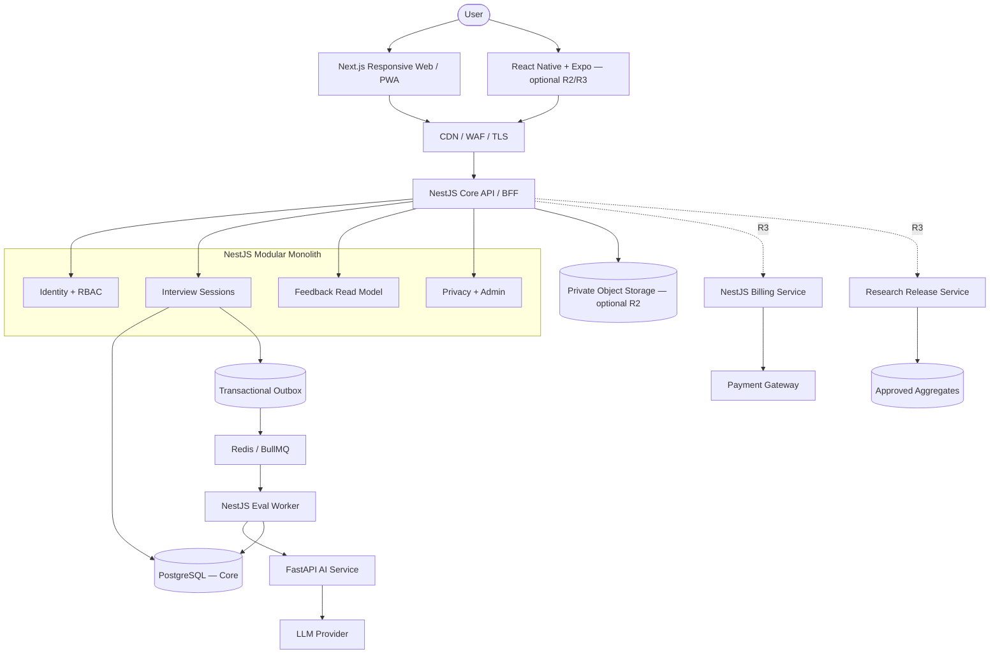
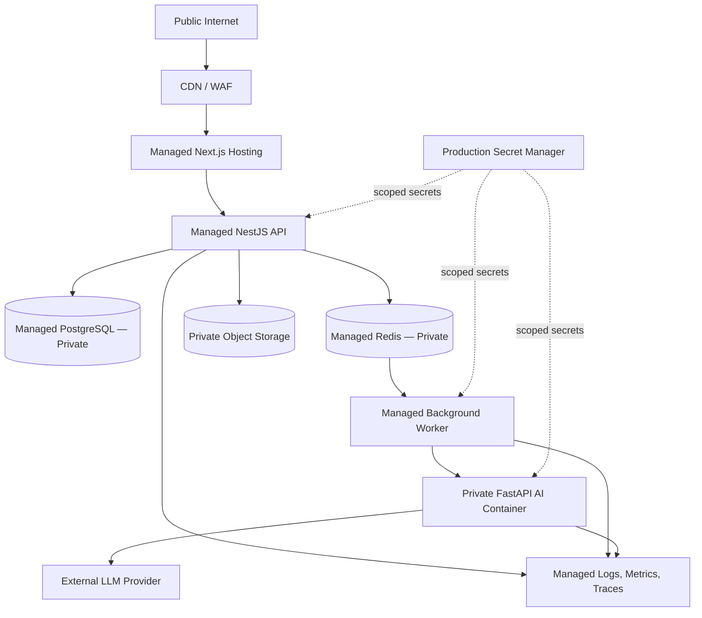
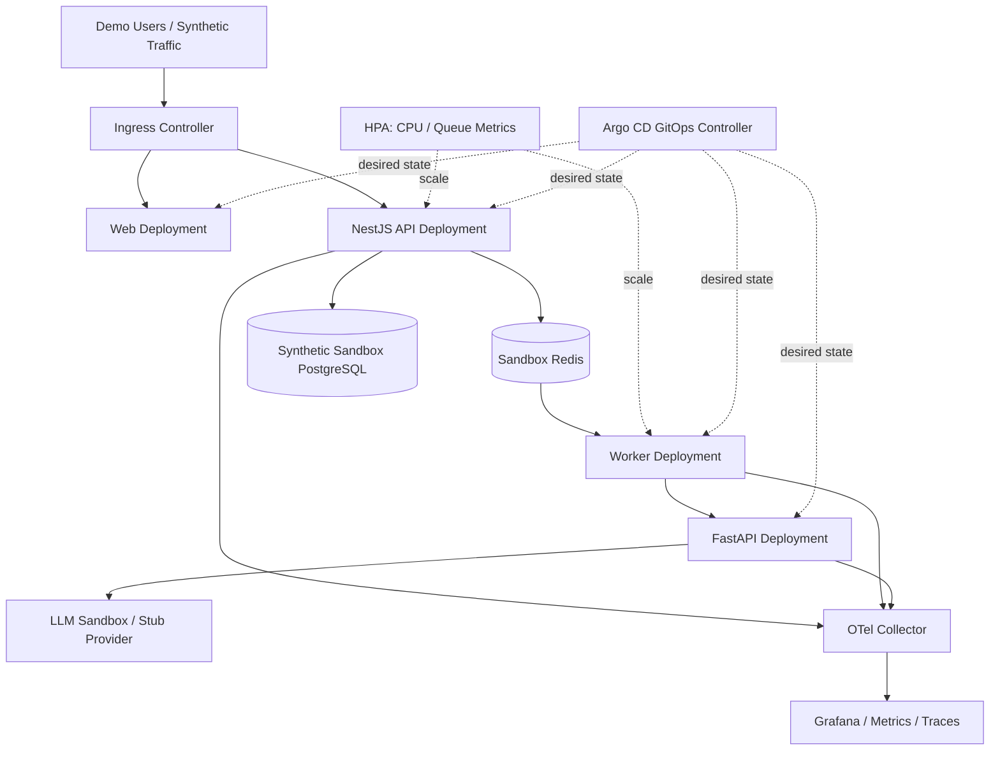
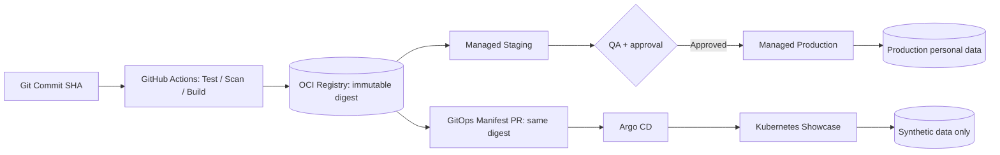
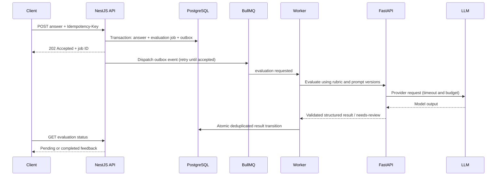

# InterviewX Architecture Diagrams v1.0

Status: Proposed architecture. Source requirements: InterviewX SRS Final for Approval v1.0 (08 October 2026; pending stakeholder sign-off). Mermaid diagrams are logical plans, not deployed systems.

## 1. C4-style Container View

## 2. Managed Production Deployment

## 3. Kubernetes Showcase Deployment

## 4. Shared Image Promotion and Independent State

## 5. Interview Evaluation Sequence

## 6. Mandatory environment invariants

- Distinct accounts/projects, network boundaries, credentials, databases, buckets and domains.
- No production data, session tokens, raw audio, or production DB snapshots in Kubernetes showcase.
- Build once, promote the exact signed/scanned image digest; app configuration differs by environment.
- Terraform manages infrastructure; Argo CD manages Kubernetes applications; avoid two controllers for the same object.
- R1 has no R3 billing/research runtime dependencies.
