# InterviewX — All Final System Diagrams

**Status: Proposed final design; pending stakeholder sign-off.**

## D01 SYSTEM CONTEXT

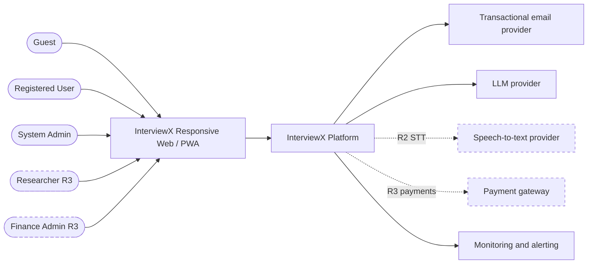

## D02 C4 CONTAINERS

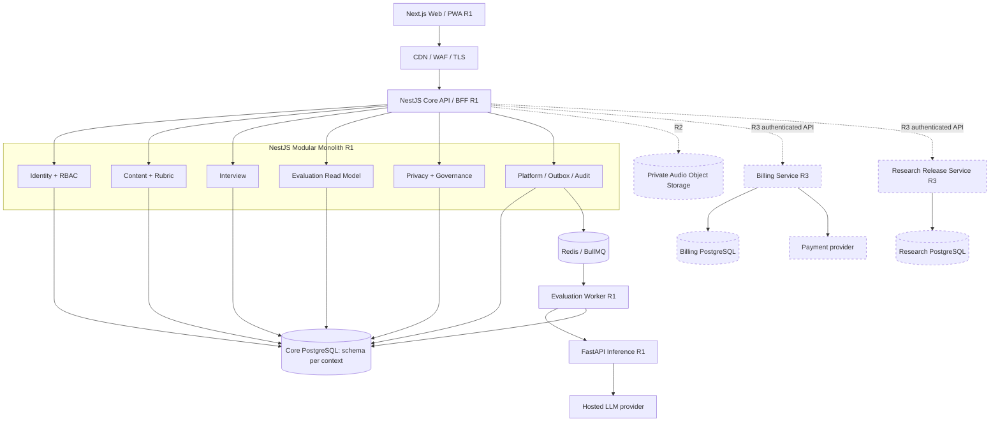

## D03 BOUNDED CONTEXTS

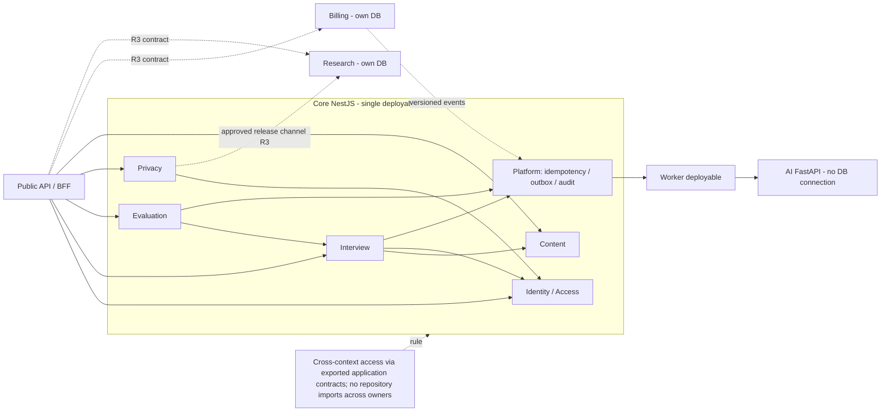

## D04 CORE ERD

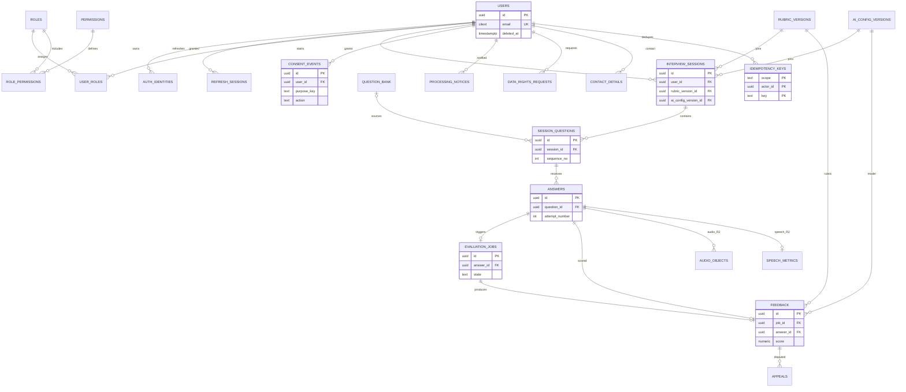

## D05 R3 ERD

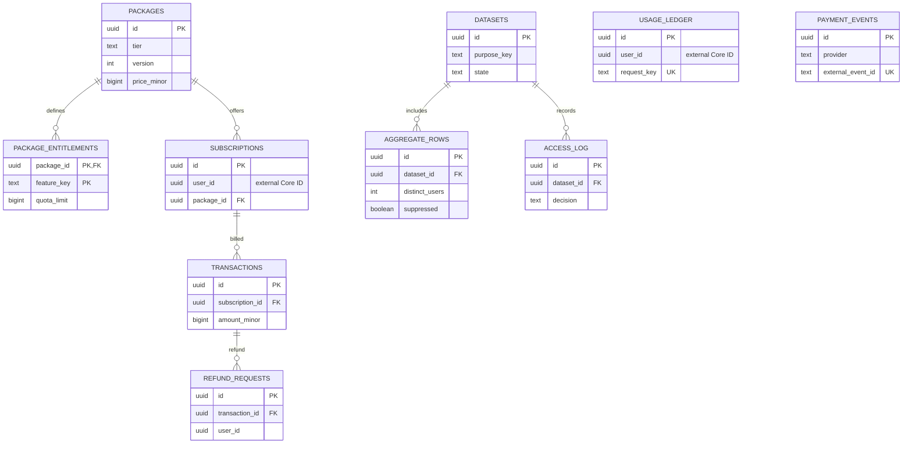

## D06 API TRUST

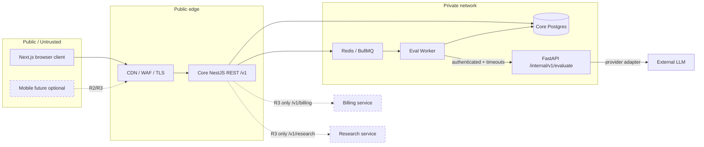

## D07 TEXT INTERVIEW SEQUENCE

```mermaid
sequenceDiagram
 autonumber
 actor U as User
 participant W as Web
 participant A as NestJS Interview API
 participant D as Core PostgreSQL
 participant O as Outbox dispatcher
 participant Q as Redis/BullMQ
 participant K as Evaluation Worker
 participant F as FastAPI AI
 participant L as LLM Provider
 U->>W: Submit text answer
 W->>A: POST /v1/interviews/{id}/answers
Idempotency-Key
 A->>A: Auth + ownership + state + content checks
 A->>D: BEGIN; insert answer, job, outbox, idempotency
 D-->>A: COMMIT
 A-->>W: 202 Accepted: jobId
 O->>D: Read undispatched outbox
 O->>Q: Enqueue stable event ID
 Q-->>O: Accepted
 O->>D: Mark dispatched
 Q->>K: Deliver at least once
 K->>K: Inbox/job-state deduplication
 K->>F: POST /internal/v1/evaluate with versions
 F->>L: Restricted provider call
 L-->>F: Untrusted candidate
 F->>F: Validate rubric, schema and evidence
 F-->>K: Validated feedback / needs-review
 K->>D: Atomic job transition + feedback result
 W->>A: GET /v1/evaluations/{jobId}
 A-->>W: pending / completed / failed / needs-review
```

## D08 EVAL STATES

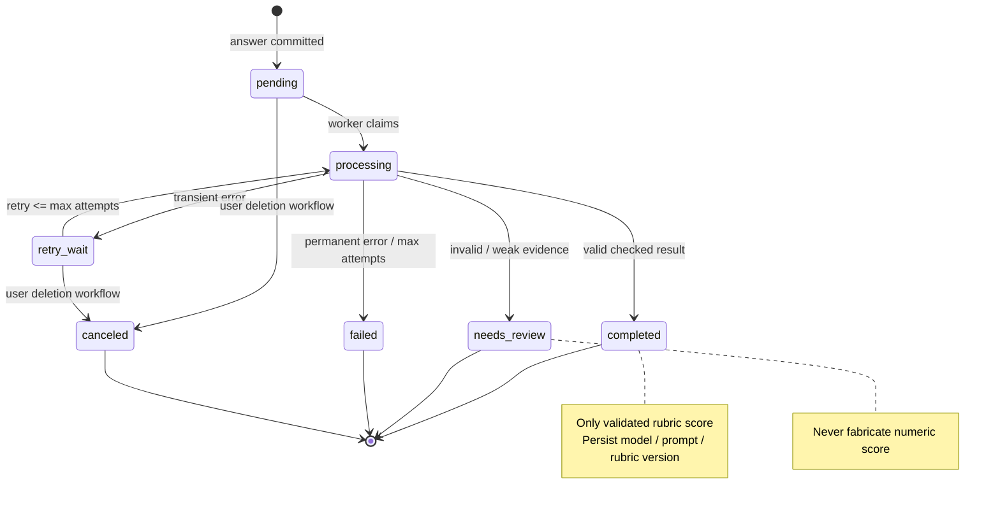

## D09 IDENTITY AUTHORIZATION

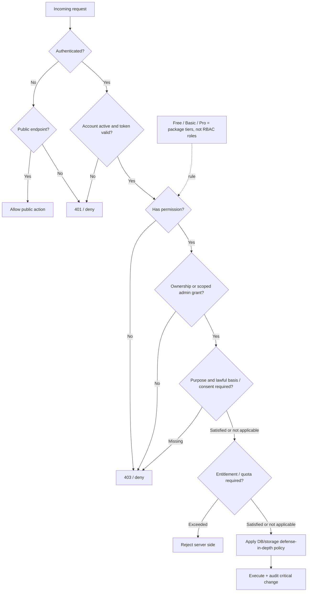

## D10 PRIVACY LIFECYCLE

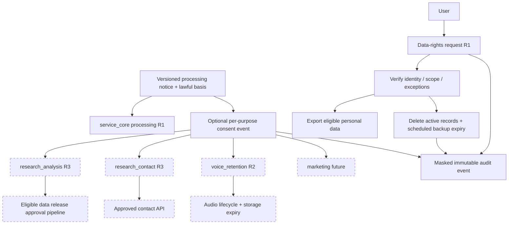

## D11 VOICE SEQUENCE R2

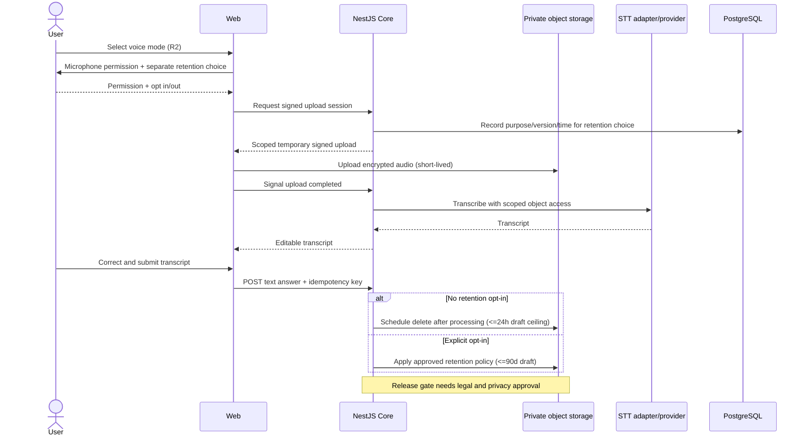

## D12 PAYMENT SEQUENCE R3

```mermaid
sequenceDiagram
 actor U as User
 participant API as API / BFF
 participant B as Billing Service R3
 participant G as Payment Gateway
 participant DB as Billing PostgreSQL
 participant C as Core Entitlement Integration
 U->>API: Checkout selection
 API->>B: Authenticated checkout request
 B->>DB: Snapshot published package price
 B->>G: Create hosted payment session
 G-->>B: Hosted checkout reference
 B-->>U: Gateway hosted redirect
 G->>B: Signed webhook event
 B->>B: Verify authenticity + provider event ID
 B->>DB: Atomic inbox + state transition + outbox
 alt Confirmed, new valid payment
  B->>C: Versioned entitlement-granted event
  C-->>B: Deduplicated fulfillment ACK
 else Duplicate or pending
  B->>B: No duplicate fulfillment
 end
 U->>API: GET payment status
 API->>B: Fetch authorized status
 B-->>U: pending / confirmed / failed
 Note over B,DB: Refund needs request -> approval -> execution; rules not approved
```

## D13 RESEARCH RELEASE R3

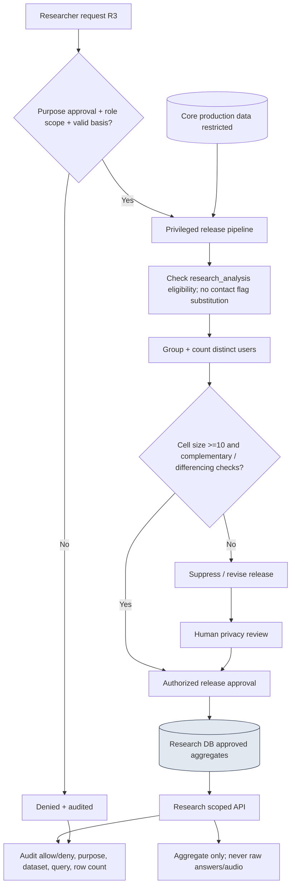

## D14 MANAGED PRODUCTION

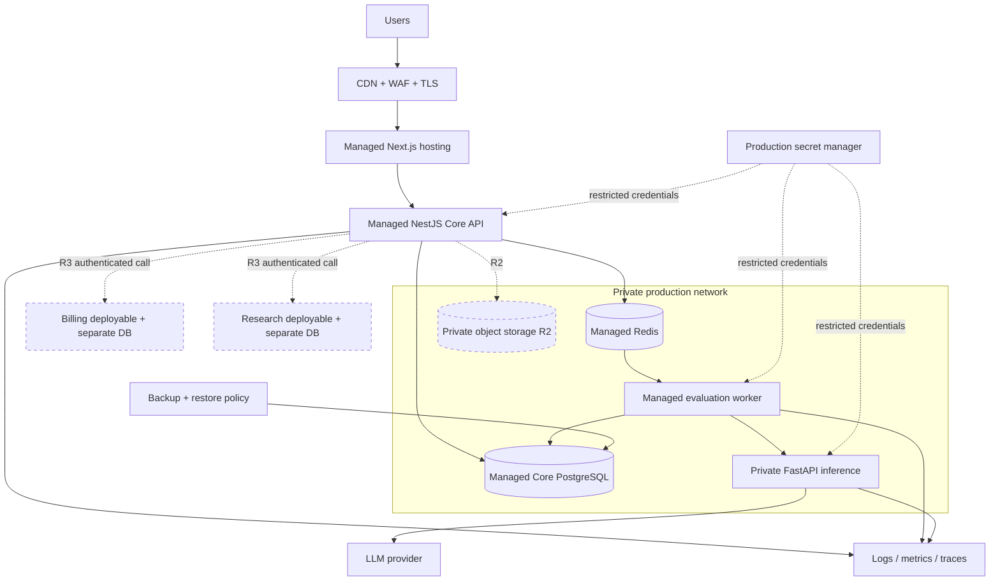

## D15 KUBERNETES SHOWCASE

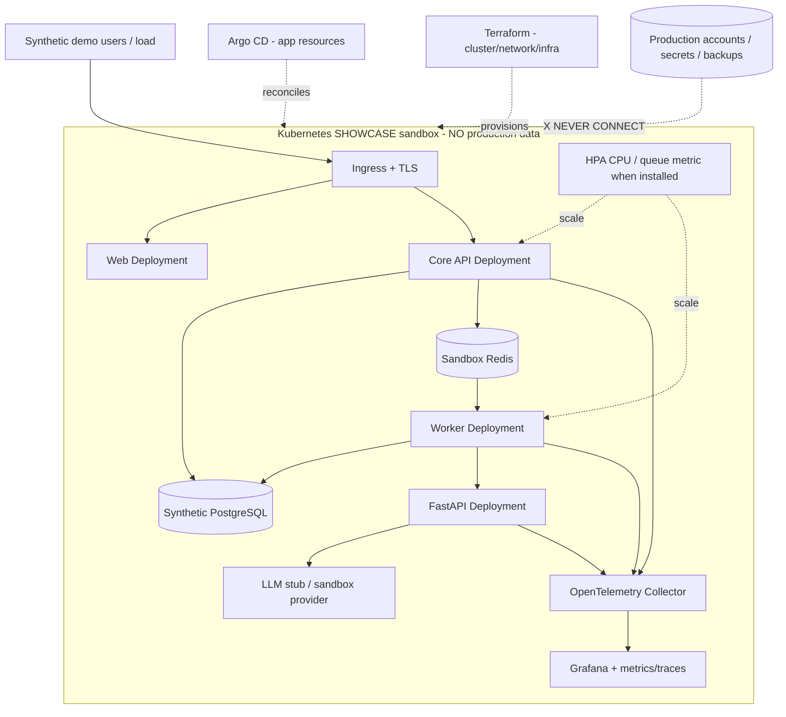

## D16 CI CD

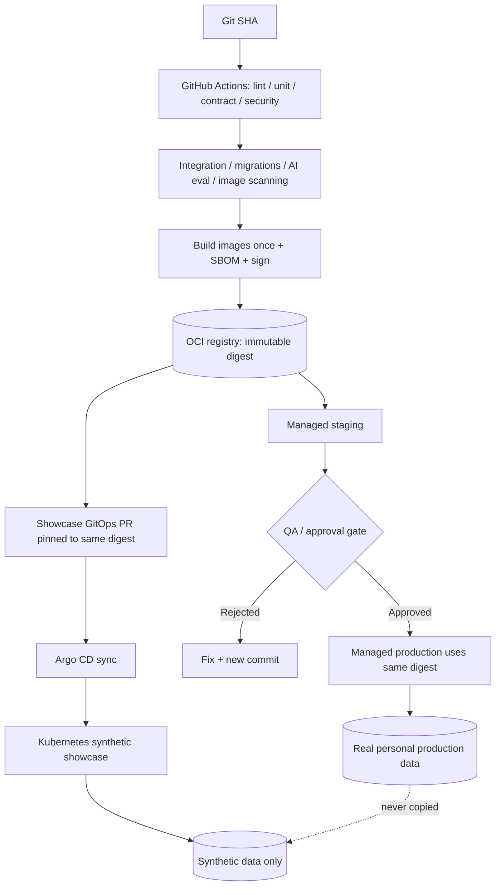

## D17 OBSERVABILITY RECOVERY

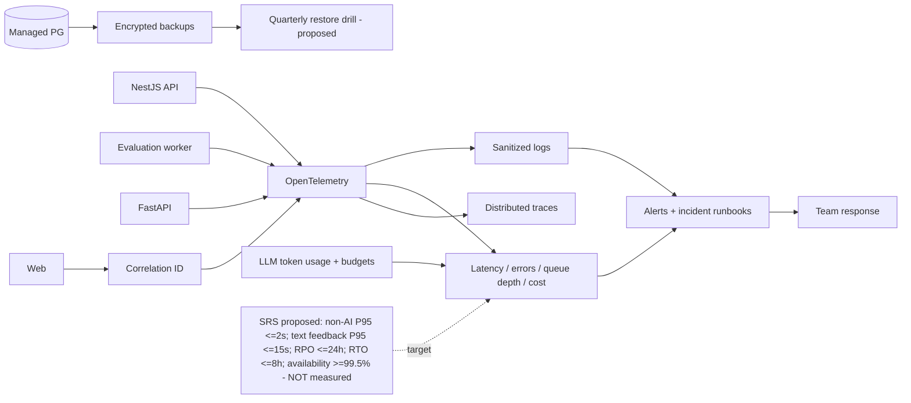

## D18 REPO BOUNDARIES

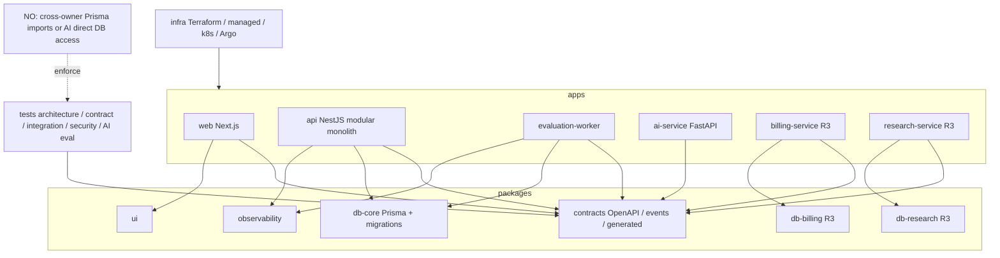

## D19 RELEASE ROADMAP

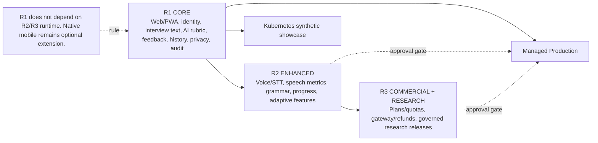
