# แผนภาพสถาปัตยกรรมระบบ InterviewX ทั้งหมด (InterviewX System Architecture Diagrams)
**เวอร์ชัน: 1.1 DRAFT — ระยะที่ 1: การปรับประสานข้อกำหนดและขอบเขตแพลตฟอร์ม (Phase 1: Requirement & Platform Alignment)**  
**วันที่: 13 พฤศจิกายน 2026**  
**สถานะ: ข้อเสนอปรับปรุงสถาปัตยกรรมระบบ — รอการลงนามอนุมัติจากผู้มีส่วนได้ส่วนเสีย (Pending Stakeholder Sign-Off)**

> [!NOTE]
> **ประกาศการปรับประสานขอบเขตแพลตฟอร์มในระยะที่ 1 (Phase 1 Platform Scope Alignment Notice)**  
> เอกสารฉบับร่างนี้ได้แยกส่วนติดต่อผู้ใช้ (Frontend) ออกเป็น 2 แอปพลิเคชันอย่างชัดเจนตามข้อกำหนดของระบบ:
> 1. **เว็บแอปพลิเคชัน (Web Application):** แอปพลิเคชันเว็บแบบตอบสนอง (Responsive Web: เดสก์ท็อป แท็บเล็ต และเว็บเบราว์เซอร์บนมือถือ) รองรับกลุ่มผู้ใช้งานทั่วไป (End Users) และบทบาทงานบริหารระบบ/งานวิจัย (System Admin, Finance Admin, Researcher)
> 2. **แอปพลิเคชันบนอุปกรณ์เคลื่อนที่แบบเนทีฟ (Native Mobile Application):** แอปพลิเคชันแยกติดตั้งสำหรับ iOS และ Android ออกแบบเฉพาะสำหรับผู้ใช้งานทั่วไป (Guest, Registered User) เท่านั้น
> 
> ทั้งสองแอปพลิเคชันสื่อสารกับส่วนบริการหลังบ้านร่วมกัน (Shared Backend Architecture) ผ่าน REST API ที่ผ่านการตรวจสอบสิทธิ์ โดยระบบงานบริหารและงานวิจัยทั้งหมดจะถูกจำกัดให้เข้าถึงได้เฉพาะผ่าน Web Application เท่านั้นเพื่อความมั่นคงปลอดภัยขั้นสูงสุด

---

## D01 บริบทระบบโดยรวม (System Context)

แผนภาพบริบทระบบแสดงความสัมพันธ์ระหว่างผู้ใช้งานระบบทุกกลุ่ม ส่วนติดต่อผู้ใช้ทั้ง Web และ Native Mobile ส่วนบริการระบบร่วมกันของ InterviewX และผู้ให้บริการภายนอก

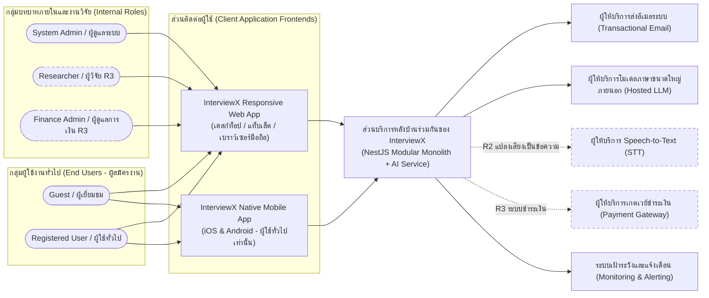

---

## D02 สถาปัตยกรรมคอนเทนเนอร์ระดับ C4 (C4 Containers Architecture)

แสดงโครงสร้างคอนเทนเนอร์ระดับเทคโนโลยี การแบ่งเลเยอร์ระหว่างไคลเอนต์ที่ไม่น่าเชื่อถือ (Untrusted Clients), Edge Ingress, NestJS Core API, AI Service, ฐานข้อมูล PostgreSQL และพื้นที่จัดเก็บอ็อบเจกต์ (Object Storage)

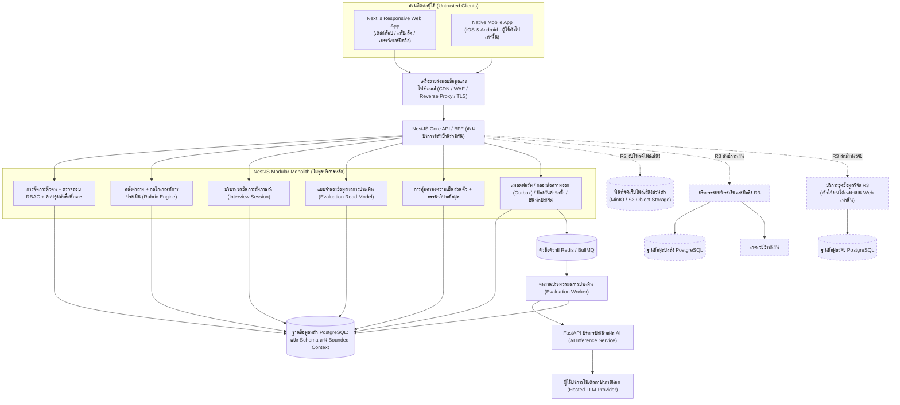

---

## D03 ขอบเขตบริบทของระบบ (Bounded Contexts)

แสดงการแยกบริบทตามหลักการออกแบบโดเมน (Domain-Driven Design: DDD) ภายในสถาปัตยกรรม NestJS Modular Monolith ร่วมกับส่วนบริการ AI แบบสเตตเลส (Stateless)

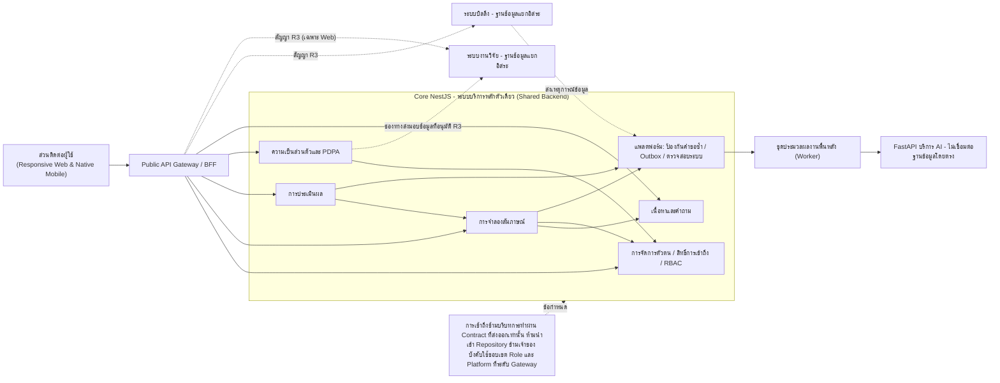

---

## D04 แผนภาพความสัมพันธ์ของข้อมูลหลัก (Core Entity Relationship Diagram: ERD)

แสดงแบบจำลองข้อมูลเชิงสัมพันธ์สำหรับรอบส่งมอบ R1 และ R2 ครอบคลุมระบบบัญชีผู้ใช้ เซสชันสัมภาษณ์ คลังคำถาม เกณฑ์การประเมิน และบันทึกความยินยอม PDPA

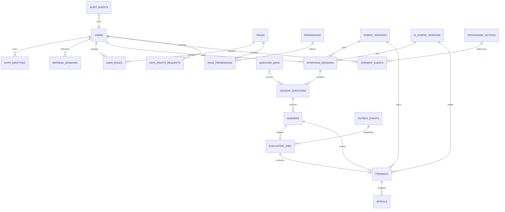

---

## D05 แผนภาพข้อมูลสำหรับระบบเชิงพาณิชย์และงานวิจัย (R3 Commercial & Research ERD)

แสดงแบบจำลองข้อมูลสำหรับรอบส่งมอบ R3 ซึ่งแยกฐานข้อมูลอย่างเป็นอิสระ เพื่อบริหารจัดการแพ็กเกจสมาชิก ธุรกรรมทางการเงิน บัญชีแยกประเภทโควตา และข้อมูลงานวิจัยแบบคงความเป็นส่วนตัว

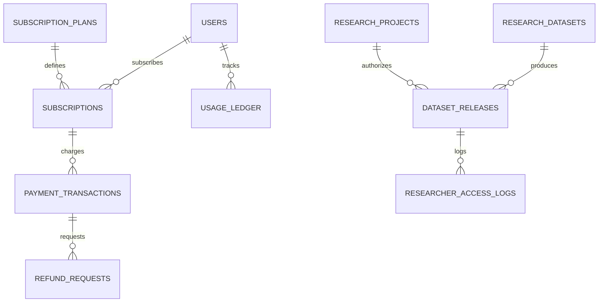

---

## D06 ขอบเขตความไว้วางใจระดับ API (API Trust Boundaries)

แสดงการแบ่งโซนความปลอดภัยระหว่างไคลเอนต์ภายนอกที่ไม่น่าเชื่อถือ (Web และ Mobile), เครือข่ายสาธารณะ Edge/WAF, จุดคัดกรองสิทธิ์ RBAC และเครือข่ายส่วนตัวภายในระบบ

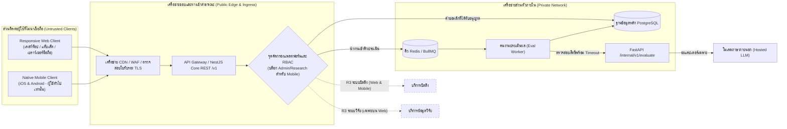

---

## D07 ลำดับขั้นตอนการสัมภาษณ์แบบข้อความ (Text-based Interview Sequence)

แสดงขั้นตอนการส่งคำตอบสัมภาษณ์ การจัดเก็บข้อมูลแบบ Atomic การส่งต่องานผ่าน Outbox Pattern การประเมินผลโดยโมเดล AI และการดึงผลการประเมิน

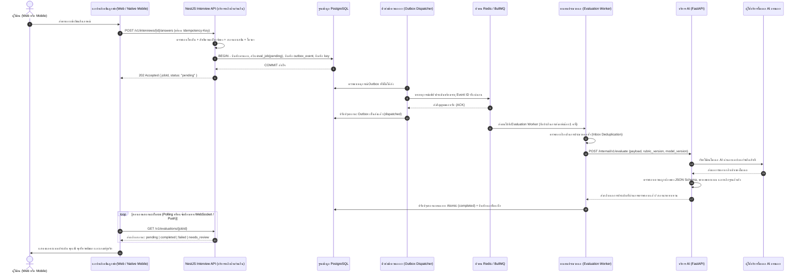

---

## D08 วงจรสถานะการประเมินผลของ AI (AI Evaluation States & Transitions)

แสดงการเปลี่ยนสถานะของงานประเมินผล AI จากเริ่มต้นจนเสร็จสมบูรณ์ พร้อมกลไกจัดการข้อผิดพลาด การตรวจสอบความถูกต้อง และการยกเลิกตามสิทธิ์ PDPA

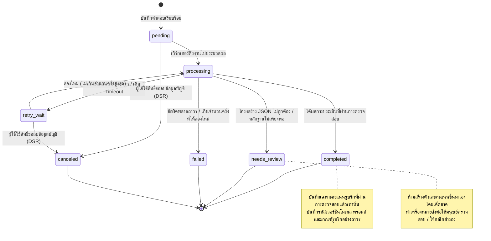

---

## D09 การตรวจสอบตัวตนและการอนุญาตสิทธิ์ (Identity & Authorization Flow)

แสดงขั้นตอนการตรวจสอบสิทธิ์อย่างละเอียดในทุกมิติ: การพิสูจน์ตัวตน, สถานะบัญชี, การจำกัดแพลตฟอร์ม, บทบาทความปลอดภัย (RBAC), ความเป็นเจ้าของข้อมูล, ความยินยอม PDPA และการตรวจสอบโควตา

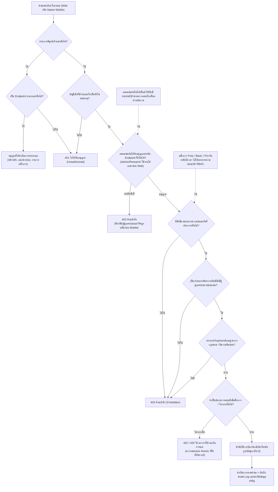

---

## D10 วงจรชีวิตข้อมูลและความเป็นส่วนตัว (Privacy Lifecycle & Consent Management)

แสดงการจัดการความยินยอมตาม พ.ร.บ. คุ้มครองข้อมูลส่วนบุคคล (PDPA), การจัดเก็บไฟล์เสียง, และกระบวนการรองรับสิทธิ์ของเจ้าของข้อมูล (Data Subject Rights: DSR)

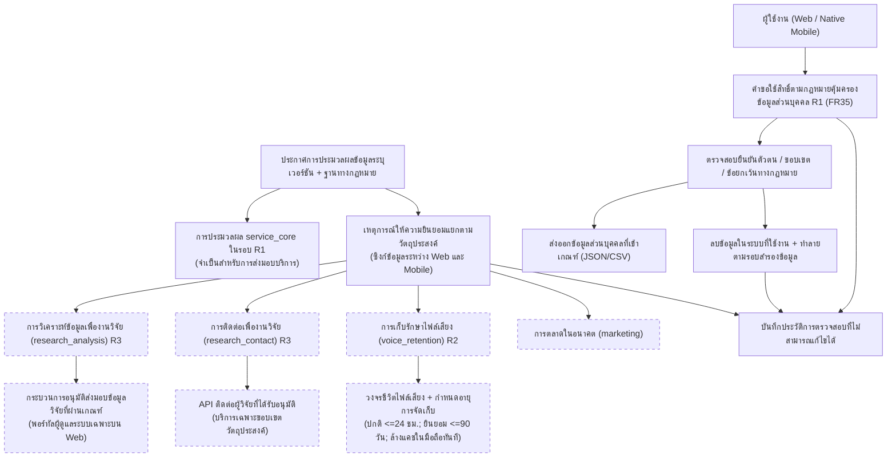

---

## D11 ลำดับขั้นตอนการสัมภาษณ์ด้วยเสียงในรอบ R2 (Voice Interview Sequence R2)

แสดงขั้นตอนการฝึกสัมภาษณ์ด้วยเสียง การขอสิทธิ์ไมโครโฟน การอัปโหลดไฟล์เสียงผ่าน Signed URL การแปลงเสียงเป็นข้อความ (STT) และการล้างแคชเสียงบนมือถือ

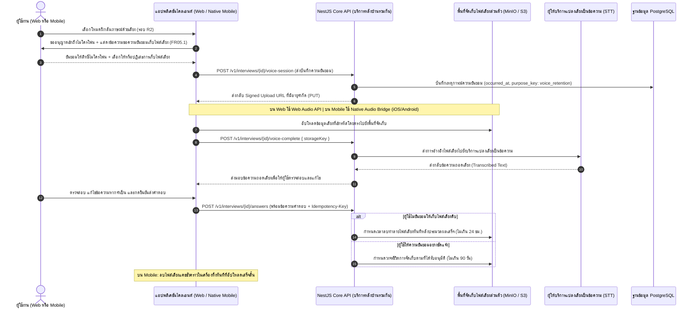

---

## D12 ลำดับขั้นตอนการชำระเงินและการควบคุมสิทธิ์ในรอบ R3 (Payment & Entitlement Sequence R3)

แสดงการเลือกซื้อแพ็กเกจสมาชิก การชำระเงินผ่านระบบ Web Checkout หรือ Mobile Store (ตามการตัดสินใจ D-M04) การตรวจสอบ Webhook และการอัปเดตโควตาแบบ Atomic

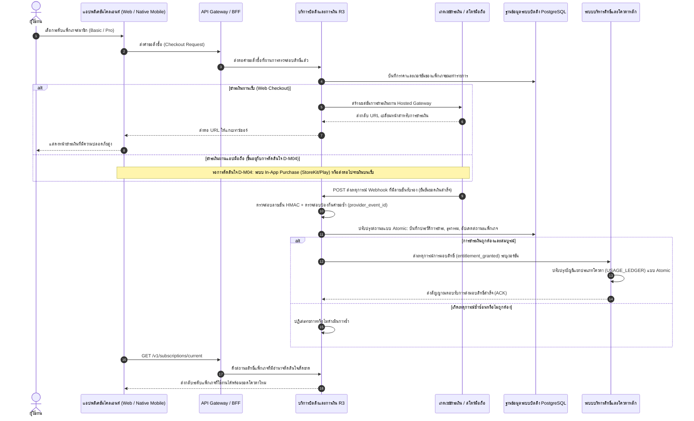

---

## D13 กระบวนการส่งมอบข้อมูลเพื่องานวิจัยในรอบ R3 (Research Data Release Pipeline R3)

แสดงไปป์ไลน์การสกัดและส่งออกข้อมูลงานวิจัยแบบรวมกลุ่ม ซึ่งจำกัดการเข้าถึงเฉพาะผ่าน Web Application เท่านั้น พร้อมการควบคุมความเป็นส่วนตัวแบบ Differential Privacy (Cell Size >= 10)

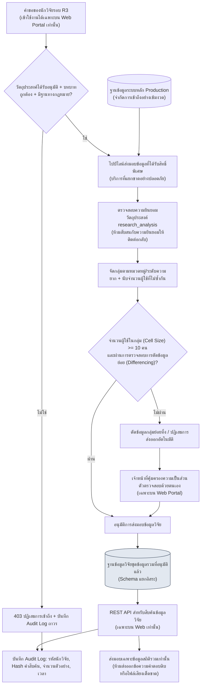

---

## D14 สถาปัตยกรรมระบบสำหรับสภาพแวดล้อมจริง (Managed Production Architecture)

แสดงโครงสร้างพื้นฐานบนคลาวด์สำหรับระบบจริง รองรับทั้งผู้ใช้ Web และ Native Mobile ผ่านไฟร์วอลล์ WAF, คลัสเตอร์ NestJS, เวิร์กเกอร์เบื้องหลัง, บริการ AI และการสำรองข้อมูลอัตโนมัติ

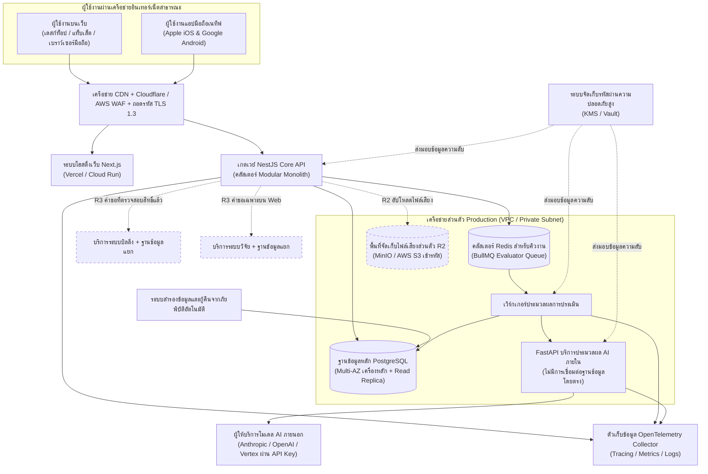

---

## D15 สภาพแวดล้อมจำลองบน Kubernetes (Kubernetes Showcase Sandbox)

แสดงสถาปัตยกรรมสำหรับสภาพแวดล้อมทดสอบและสาธิต ซึ่งทำงานบนคลัสเตอร์ Kubernetes และใช้ข้อมูลจำลอง (Synthetic Data) 100% โดยตัดขาดจากข้อมูล Production โดยสิ้นเชิง

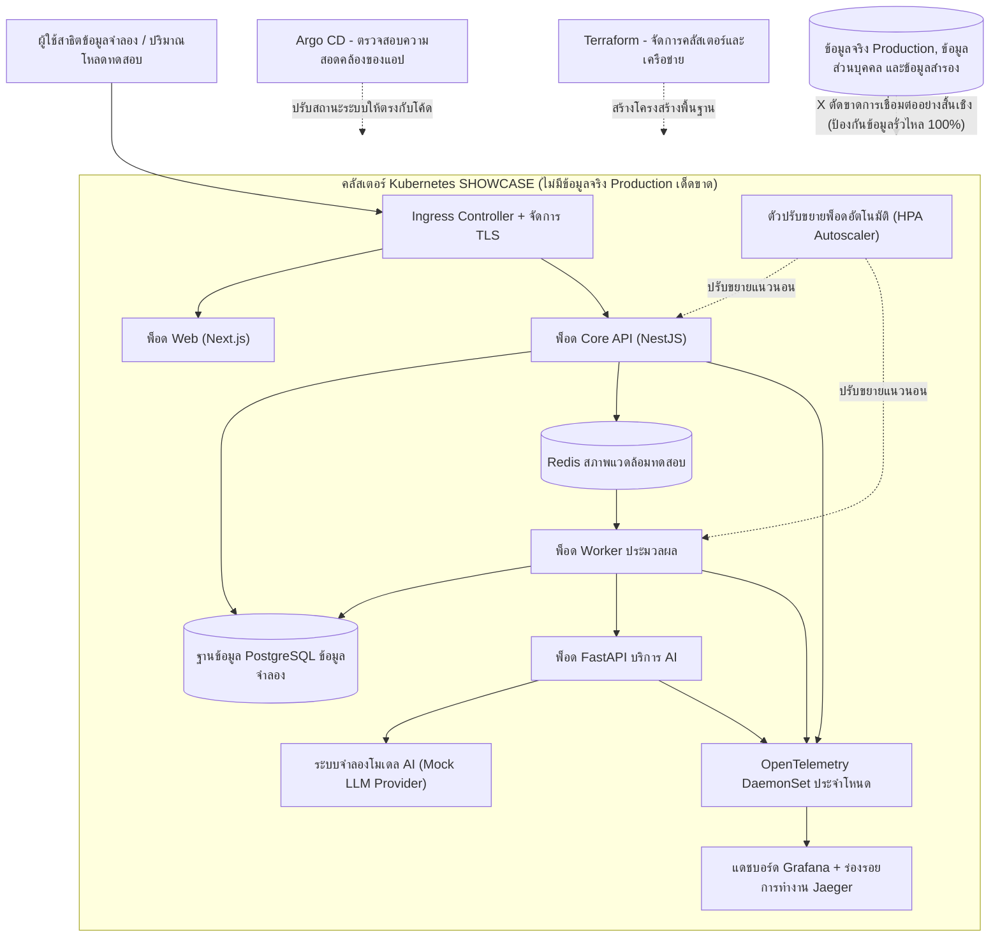

---

## D16 ไปป์ไลน์การรวมโค้ดและส่งมอบระบบอย่างต่อเนื่อง (CI/CD Pipeline)

แสดงวงจรการทดสอบ การสแกนความปลอดภัย การสร้าง Image แบบ Immutable และการ Deploy ไปยังระบบ Staging, Production และ Showcase Sandbox

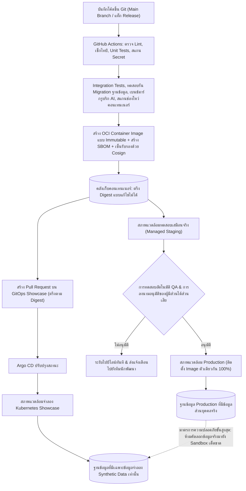

---

## D17 การสังเกตการณ์ระบบและการกู้คืนจากภัยพิบัติ (Observability & Disaster Recovery)

แสดงการติดตามระบบด้วย OpenTelemetry, การส่งต่อ Correlation ID จากทั้ง Web และ Mobile, แดชบอร์ดตรวจสอบประสิทธิภาพ (SLA) และแผนการกู้คืนข้อมูล

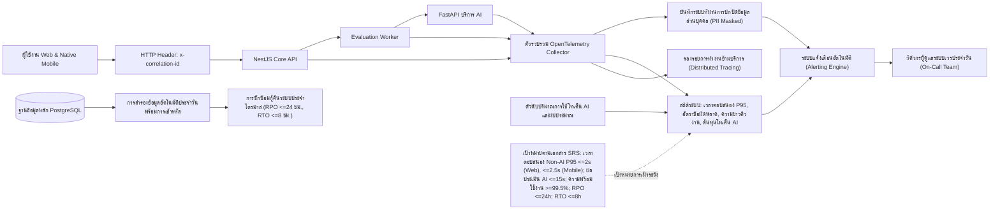

---

## D18 ขอบเขตโครงสร้างโปรเจกต์และโมโนรีโป (Repository Boundaries & Monorepo Structure)

แสดงการจัดระเบียบโครงสร้างซอร์สโค้ดในรูปแบบ Monorepo การแชร์แพ็กเกจ DTOs และ Validation Schemas ระหว่าง Web และ Native Mobile และการป้องกันการละเมิดขอบเขตสถาปัตยกรรม

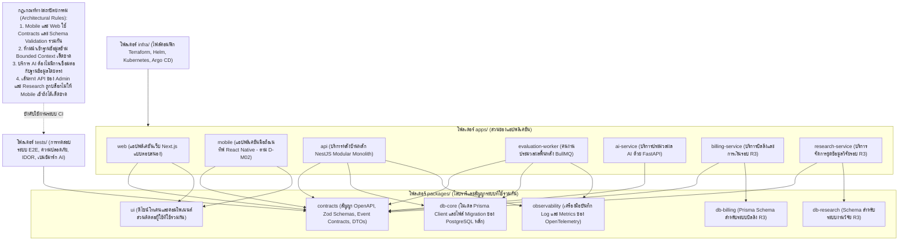

---

## D19 แผนงานและขั้นตอนการส่งมอบระบบ (Release Roadmap & Delivery Milestones)

แสดงแผนงานการส่งมอบระบบตั้งแต่รอบ R1 (Core MVP), R2 (ระบบเสียงและแอปมือถือ) จนถึงรอบ R3 (ระบบเชิงพาณิชย์และงานวิจัย) พร้อมเกณฑ์การตัดสินใจอนุมัติผ่านแต่ละรอบ

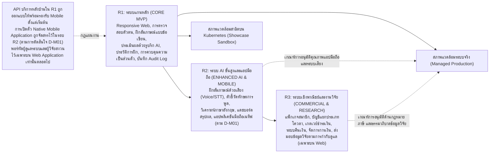

---

## D20 แผนภาพกรณีการใช้งานระบบโดยรวม (System Use Case Diagram)

แผนภาพกรณีการใช้งานระดับภาพรวมระบบแสดงความสัมพันธ์ระหว่างผู้แสดงบทบาท (Actors) ทั้ง 5 กลุ่ม กับกรณีการใช้งานหลัก (UC01 ถึง UC10) พร้อมระบุความสัมพันธ์ **`«include»`** (ขั้นตอนที่ต้องทำเสมอ) และ **`«extend»`** (ส่วนขยายตามเงื่อนไข) ไว้อย่างชัดเจน:

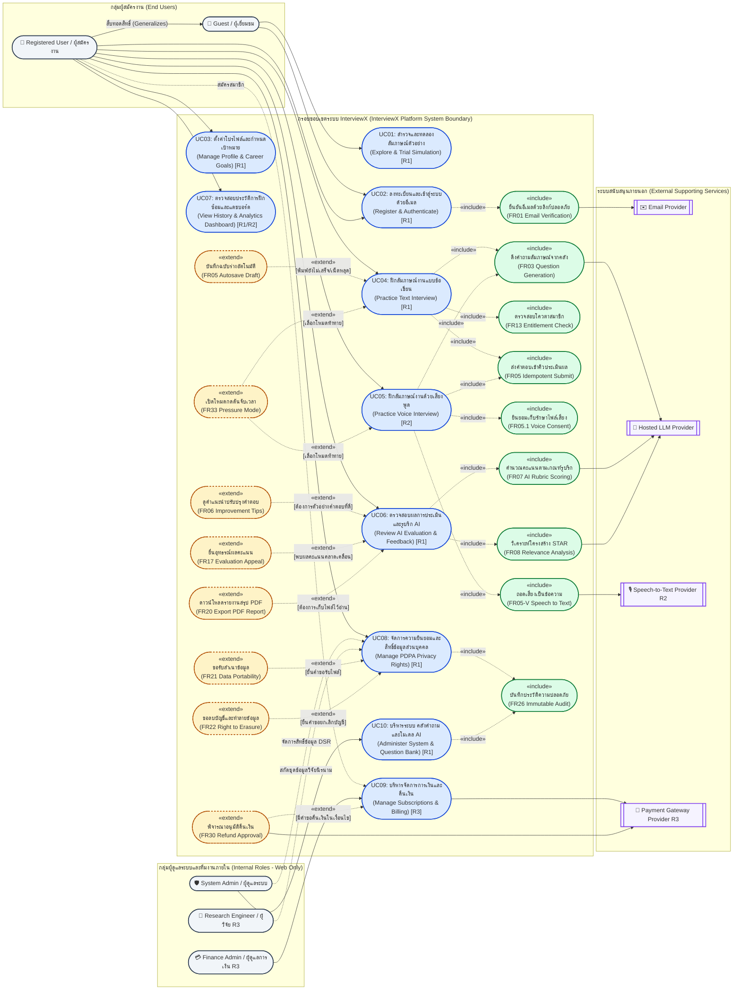

> 📖 ดูรายละเอียดโมเดลกรณีการใช้งานฉบับสมบูรณ์ พร้อมแผนภาพเจาะลึกรายระบบย่อย (Subsystems D21–D23) และตาราง Traceability ได้ที่:  
> 👉 [InterviewX_Use_Case_Diagrams_v1.1.md](file:///D:/workspaces/interviewx-datahub/docs-interviex/04_System_Architecture/InterviewX_Use_Case_Diagrams_v1.1.md)

---

## D24 การจัดแนวทางสถาปัตยกรรมระหว่าง Web และ Mobile (Web & Mobile Architecture Alignment)

แสดงการจัดวางโครงสร้างและขอบเขตความรับผิดชอบระหว่าง Responsive Web (Next.js) และ Native Mobile (React Native / Expo) ภายใต้สถาปัตยกรรม Monorepo ที่ใช้สัญญากลาง (Shared Contracts) และบริการหลังบ้านแบบรวมศูนย์ (Unified Backend) โดยไม่มีตรรกะทางธุรกิจหรือฐานข้อมูลซ้ำซ้อน

```mermaid
flowchart TD
    %% Styling & Classes
    classDef clientWeb fill:#e0f2fe,stroke:#0284c7,stroke-width:2px,color:#0369a1;
    classDef clientMobile fill:#fef3c7,stroke:#d97706,stroke-width:2px,color:#b45309;
    classDef sharedContracts fill:#ede9fe,stroke:#7c3aed,stroke-width:2px,color:#5b21b6;
    classDef securityGate fill:#fee2e2,stroke:#dc2626,stroke-width:2px,color:#991b1b;
    classDef backendCore fill:#ecfdf5,stroke:#059669,stroke-width:2px,color:#047857;
    classDef dataStore fill:#f1f5f9,stroke:#475569,stroke-width:2px,color:#1e293b;
    classDef external fill:#f3f4f6,stroke:#9ca3af,stroke-width:1px,color:#374151;

    %% 1. Client Layer
    subgraph ClientLayer["1. ส่วนติดต่อผู้ใช้ (Frontend Clients Layer)"]
        subgraph WebApp["Responsive Web Application (apps/web)"]
            W_Tech["Next.js 14+ (TypeScript / Tailwind / shadcn/ui)"]
            W_Roles["รองรับ 5 บทบาท:<br/>- Guest<br/>- Registered User<br/>- Researcher<br/>- Payment / Finance Admin<br/>- System Admin"]
            W_Auth["Auth: HTTP-Only, Secure, SameSite Cookie<br/>+ CSRF Protection"]
            W_View["Viewport: Desktop, Tablet, Mobile Browser (360px+)"]
        end

        subgraph MobileApp["Native Mobile Application (apps/mobile)"]
            M_Tech["React Native / Expo (iOS 16+ / Android 13+)"]
            M_Roles["รองรับเฉพาะ 2 บทบาท End-User:<br/>- Guest<br/>- Registered User<br/>(Admin & Research สงวนบน Web 100%)"]
            M_Auth["Auth: Bearer JWT<br/>(iOS Keychain / Android Keystore)"]
            M_Storage["Offline Draft Autosave (ทุก 5 วินาที)<br/>Network Flakiness Resilient"]
        end
    end

    %% 2. Shared Monorepo Contracts Layer
    subgraph MonorepoLayer["2. ส่วนแบ่งปันมาตรฐานสัญญาข้อมูล (Shared Monorepo Packages)"]
        Contracts["packages/contracts<br/>- OpenAPI Specification<br/>- Zod Validation Schemas<br/>- Shared TypeScript DTOs<br/>- Domain Event Definitions"]
        UI_Shared["packages/ui<br/>- Shared Design Tokens & Theme"]
    end

    Contracts -.->|Type-Safe API Contracts| WebApp
    Contracts -.->|Type-Safe API Contracts| MobileApp
    UI_Shared -.->|Design Tokens| WebApp
    UI_Shared -.->|Design Tokens| MobileApp

    %% 3. Edge Gateway & Security Layer
    subgraph GatewayLayer["3. เกตเวย์และความปลอดภัย (Edge & API Gateway Boundary)"]
        CDN_WAF["Cloudflare WAF / CDN / TLS 1.3 Termination"]
        
        subgraph IngressGateway["NestJS Ingress & Policy Enforcement"]
            AuthGuard["Unified Auth Guard<br/>- Extract Cookie (Web)<br/>- Extract Bearer JWT (Mobile)"]
            ClientGuard{"ตรวจสอบสิทธิ์ตามประเภทไคลเอนต์<br/>(Client-Type & RBAC Guard)"}
            IdempotencyMW["Idempotency Middleware<br/>(ตรวจจับ Idempotency-Key Header: UUIDv4)"]
            RateLimiter["Rate Limiting & Anti-Abuse<br/>(Throttler by Client IP / User ID)"]
        end
    end

    WebApp -->|HTTPS / REST API| CDN_WAF
    MobileApp -->|HTTPS / REST API| CDN_WAF
    CDN_WAF --> AuthGuard
    AuthGuard --> IdempotencyMW
    IdempotencyMW --> RateLimiter
    RateLimiter --> ClientGuard

    ClientGuard -->|คำขอจาก Mobile ขอสิทธิ์ Admin/Researcher| RejectAdmin["403 Forbidden<br/>(Strictly Block Administrative Actions on Mobile)"]
    ClientGuard -->|คำขอถูกต้องตามสิทธิ์| BackendRouting["Route ไปยังโมดูลที่เกี่ยวข้อง"]

    %% 4. Backend Modular Monolith
    subgraph BackendCore["4. บริการหลังบ้านร่วมกัน (Unified Backend - Zero Duplication)"]
        subgraph NestJS["NestJS Modular Monolith (apps/api)"]
            Mod_Identity["Identity & Auth Module<br/>(Token Rotation, Ownership Guard)"]
            Mod_Interview["Interview & Session Module<br/>(Question Gen, Answer Ingestion)"]
            Mod_Eval["Evaluation Module<br/>(Transactional Outbox Publisher)"]
            Mod_Privacy["Privacy & Consent Module<br/>(PDPA Audit Logs, Consent Check)"]
        end

        subgraph AsyncQueue["ระบบประมวลผลงานพื้นหลัง (Async Processing)"]
            OutboxPoll["Transactional Outbox Dispatcher"]
            BullQueue[("Redis / BullMQ<br/>(Evaluation Job Queue)")]
            EvalWorker["Evaluation Worker<br/>(Inbox Deduplication)"]
        end

        subgraph AIService["AI Evaluation Engine (apps/ai-service)"]
            FastAPI["FastAPI AI Service<br/>(Stateless Scoring Engine)"]
            PydanticVal["Pydantic Output Validation<br/>(Rubric Bounds & Citation Check)"]
        end
    end

    BackendRouting --> NestJS
    Mod_Eval --> OutboxPoll
    OutboxPoll --> BullQueue
    BullQueue --> EvalWorker
    EvalWorker --> FastAPI
    FastAPI --> PydanticVal

    %% 5. Data Layer
    subgraph DataLayer["5. ชั้นการจัดเก็บข้อมูล (Single Source of Truth)"]
        Postgres[("Core PostgreSQL<br/>- USERS & REFRESH_TOKENS<br/>- SESSIONS & QUESTIONS<br/>- ANSWERS & EVALUATION_JOBS<br/>- OUTBOX_EVENTS<br/>- IDEMPOTENCY_KEYS")]
        ObjectStore[("MinIO / S3<br/>- Audio Cache (R2 Voice)<br/>- Export Artifacts")]
    end

    NestJS --> Postgres
    EvalWorker --> Postgres

    %% 6. External Services
    subgraph ExternalServices["6. บริการภายนอก (External Services)"]
        ExtLLM["External LLM Provider<br/>(OpenAI / Claude / Gemini)"]
        WebCheckout["Web Payment Gateway (R3)<br/>(Mobile Redirects to Web Checkout)"]
    end

    FastAPI --> ExtLLM
    WebApp -.-> WebCheckout
    MobileApp -.->|D-M04: In-App Browser Redirect| WebCheckout

    %% Apply Classes
    class WebApp,W_Tech,W_Roles,W_Auth,W_View clientWeb;
    class MobileApp,M_Tech,M_Roles,M_Auth,M_Storage clientMobile;
    class MonorepoLayer,Contracts,UI_Shared sharedContracts;
    class GatewayLayer,CDN_WAF,IngressGateway,AuthGuard,ClientGuard,IdempotencyMW,RateLimiter,RejectAdmin securityGate;
    class BackendCore,NestJS,Mod_Identity,Mod_Interview,Mod_Eval,Mod_Privacy,AsyncQueue,OutboxPoll,BullQueue,EvalWorker,AIService,FastAPI,PydanticVal backendCore;
    class DataLayer,Postgres,ObjectStore dataStore;
    class ExternalServices,ExtLLM,WebCheckout external;
```

---

## D25 ลำดับการทำงานและการสลับรูปแบบระหว่าง Web และ Mobile (Web vs Mobile Interaction Sequence)

แสดงเปรียบเทียบการยืนยันตัวตน (Cookie vs Bearer Token), การสกัดกั้นสิทธิ์ Admin บน Mobile, และกลไก Idempotency ร่วมกับ Autosave เพื่อรองรับความไม่เสถียรของสัญญาณมือถือ (Network Flakiness)

```mermaid
sequenceDiagram
    autonumber
    actor UserWeb as ผู้ใช้งาน Web
    actor UserMobile as ผู้ใช้งาน Mobile
    participant ClientWeb as Web Client (Next.js)
    participant ClientMobile as Mobile App (React Native)
    participant API as NestJS Gateway / Backend
    participant DB as Core PostgreSQL
    participant Queue as Redis / BullMQ
    participant AI as Evaluation Worker & FastAPI

    %% 1. Authentication Strategy Comparison
    rect rgb(240, 248, 255)
    note over UserWeb, API: 1. รูปแบบการยืนยันตัวตน (Authentication Strategy)
    UserWeb->>ClientWeb: เข้าสู่ระบบ (Email / Password)
    ClientWeb->>API: POST /api/v1/auth/login
    API-->>ClientWeb: Set-Cookie: access_token (HTTP-Only, Secure, SameSite)
    
    UserMobile->>ClientMobile: เข้าสู่ระบบ (Email / Password)
    ClientMobile->>API: POST /api/v1/auth/login (Client-Type: mobile)
    API-->>ClientMobile: 200 OK { accessToken: "JWT...", refreshToken: "..." }
    ClientMobile->>ClientMobile: จัดเก็บโทเค็นลงใน iOS Keychain / Android Keystore
    end

    %% 2. Strict Client RBAC Enforcement
    rect rgb(255, 240, 240)
    note over UserMobile, API: 2. การควบคุมสิทธิ์ตามประเภทไคลเอนต์ (Strict Client RBAC)
    UserMobile->>ClientMobile: พยายามเข้าถึงเมนู Admin / Financial Portal
    ClientMobile->>API: GET /api/v1/admin/dashboard (Authorization: Bearer <JWT>)
    API->>API: Client-Type Check: ตรวจพบคำขอจาก Mobile Client
    API-->>ClientMobile: 403 Forbidden (Admin functions are restricted to Web only)
    end

    %% 3. Answer Submission & Idempotency
    rect rgb(240, 255, 240)
    note over UserMobile, AI: 3. การส่งคำตอบสัมภาษณ์และป้องกันคำขอซ้ำ (Idempotency & Flakiness Resilience)
    UserMobile->>ClientMobile: พิมพ์คำตอบสัมภาษณ์
    loop Local Draft Autosave (ทุก 5 วินาที)
        ClientMobile->>ClientMobile: บันทึกข้อความลง Local Storage สำรองไว้
    end
    UserMobile->>ClientMobile: กดปุ่ม "ส่งคำตอบ"
    ClientMobile->>ClientMobile: สร้าง UUIDv4 สำหรับ Idempotency-Key
    ClientMobile->>API: POST /api/v1/interviews/{id}/answers<br/>Header: Idempotency-Key: 550e8400-e29b...<br/>Header: Authorization: Bearer <JWT>
    
    API->>API: ถอดรหัส JWT จาก Bearer Header + ตรวจสอบสิทธิ์ความเป็นเจ้าของ Session
    API->>DB: ตรวจสอบ Idempotency-Key ซ้ำหรือไม่?
    alt เป็นคำขอใหม่ (Key ยังไม่เคยมีในระบบ)
        API->>DB: BEGIN - บันทึกคำตอบ + สร้าง Job (pending) + บันทึก Outbox Event + บันทึก Key
        DB-->>API: COMMIT
        API-->>ClientMobile: 202 Accepted { jobId: "job_123", status: "pending" }
        API->>Queue: Dispatcher ส่ง Job เข้าคิว Redis / BullMQ
        Queue->>AI: ดำเนินการประเมินผล AI ด้วย Rubric
        AI->>DB: บันทึกผลคะแนนและฟีดแบ็ก (completed)
    else สัญญาณเน็ตมือถือหลุด ไคลเอนต์ Retry ส่งซ้ำด้วย Key เดิม
        API->>DB: พบคีย์เดิมในระบบ (ตรวจสอบสถานะงาน)
        DB-->>API: คืนค่าสถานะงานปัจจุบัน (pending หรือ completed)
        API-->>ClientMobile: 202 Accepted { jobId: "job_123", status: "pending" } (ไม่สร้างงานซ้ำ)
    end
    
    loop Polling ผลการประเมิน (หรือ Push Notification)
        ClientMobile->>API: GET /api/v1/evaluations/job_123
        API-->>ClientMobile: 200 OK { status: "completed", score: 85, feedback: {...} }
    end
    ClientMobile->>UserMobile: แสดงผลการประเมิน, จุดแข็ง, จุดที่ควรพัฒนา
    end
```

