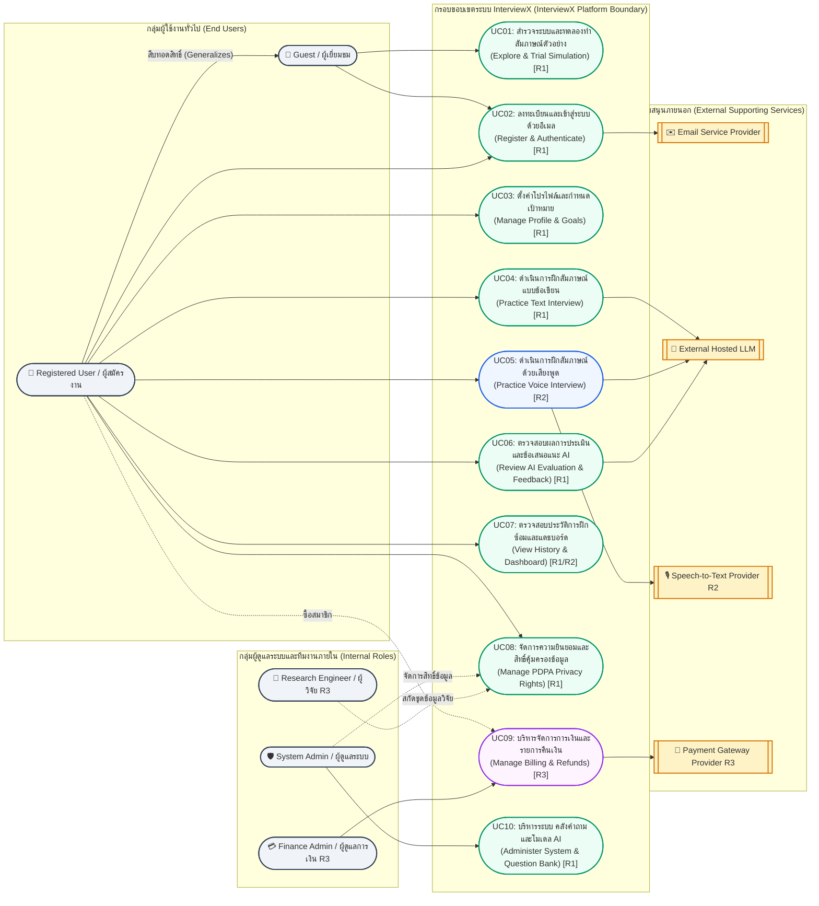
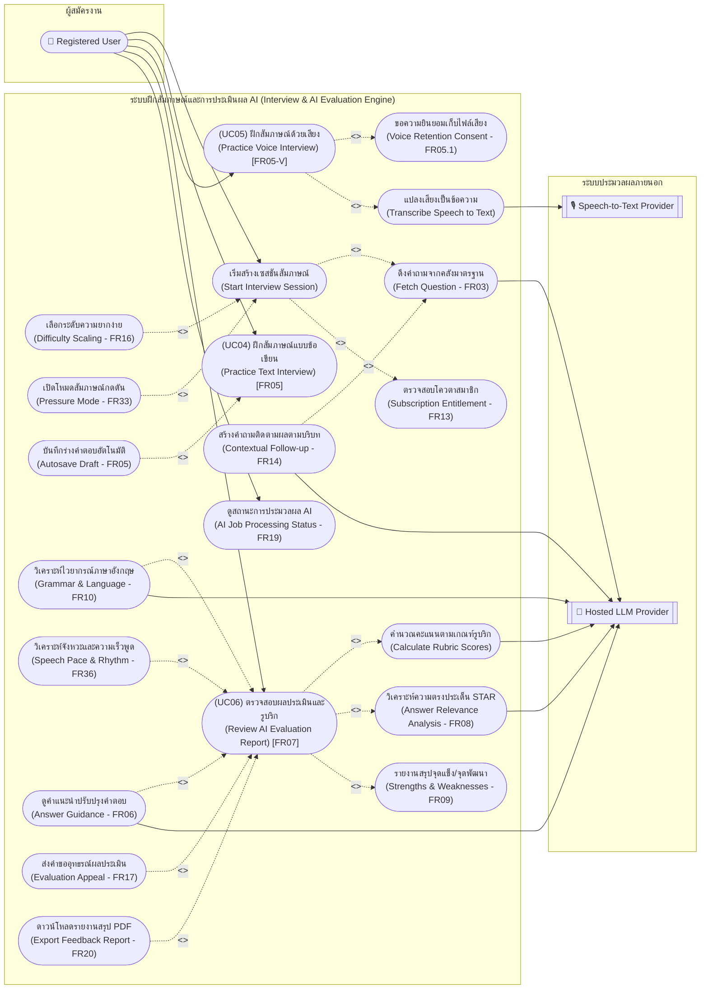
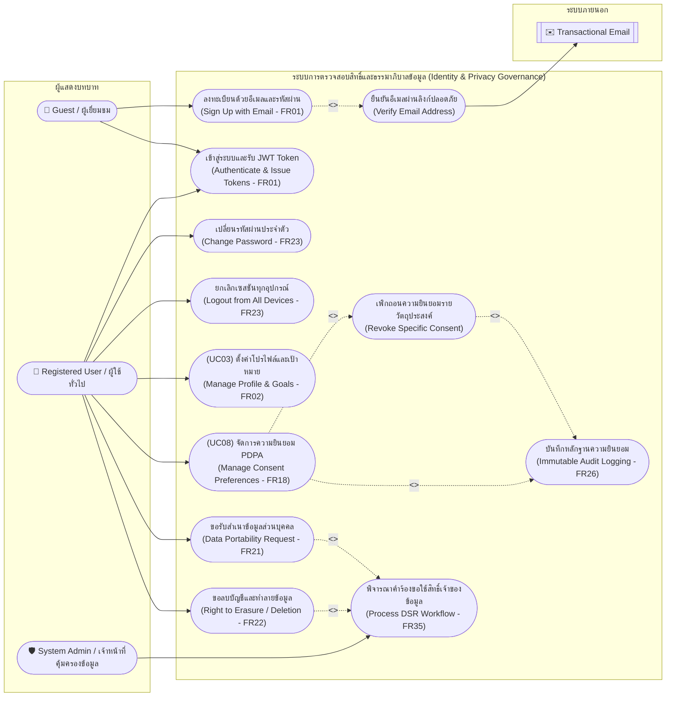
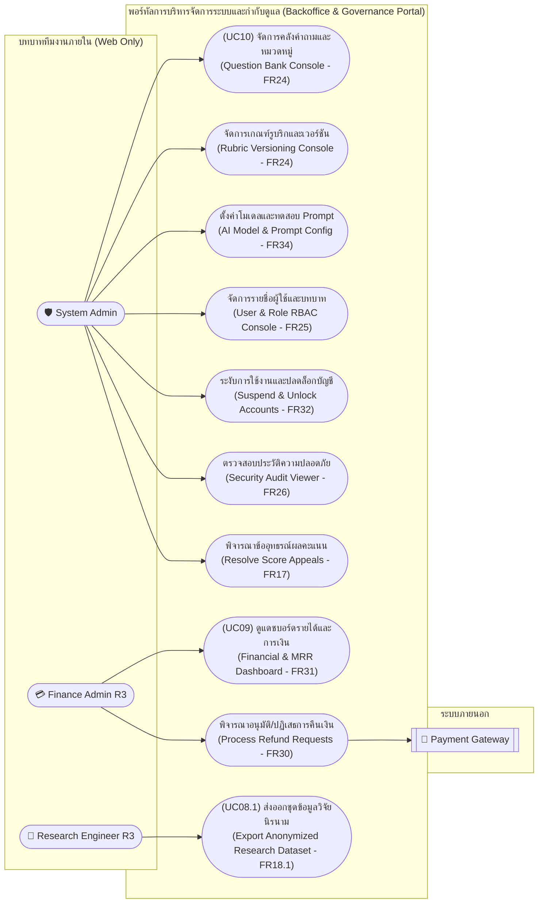

# แบบจำลองกรณีการใช้งานระบบ InterviewX (InterviewX System Use Case Model)
> **InterviewX — AI Job Interview Simulation System**  
> **เวอร์ชัน:** 1.1 DRAFT (Phase 1: Requirement & Platform Alignment Baseline)  
> **วันที่จัดทำ:** 13 พฤศจิกายน 2026  
> **สถานะเอกสาร:** ข้อกำหนดทางสถาปัตยกรรมระบบ (System Architecture Specification)

---

## 📌 บทนำและภาพรวม (Introduction & Overview)

เอกสารฉบับนี้กำหนดแบบจำลองกรณีการใช้งาน (Use Case Model) ของระบบ **InterviewX** โดยครอบคลุมผู้แสดงบทบาท (Actors) ทั้งหมด ทั้งผู้ใช้บุคคล (Human Actors) และระบบภายนอกที่ทำงานร่วมกัน (External Supporting Systems) พร้อมทั้งแสดงความสัมพันธ์ระหว่างกรณีการใช้งานตามมาตรฐาน UML (`<<include>>`, `<<extend>>`, และ Generalization)

โมเดลกรณีการใช้งานนี้เชื่อมโยงและสอดคล้อง 100% กับ:
1. **กรณีการใช้งานหลัก (Core Use Cases UC01–UC10):** ตามที่ระบุใน [InterviewX_SRS_v1.1_DRAFT_TH.md](file:///D:/workspaces/interviewx-datahub/docs-interviex/03_SRS_Requirements/InterviewX_SRS_v1.1_DRAFT_TH.md#L158-L175)
2. **ข้อกำหนดเชิงหน้าที่ (Functional Requirements FR01–FR36):** อ้างอิง [03_SRS_Requirements](file:///D:/workspaces/interviewx-datahub/docs-interviex/03_SRS_Requirements/)
3. **การแบ่งส่วนติดต่อผู้ใช้ (Platform Boundary):** แยกการเข้าถึงระหว่าง Responsive Web Application (เข้าถึงได้ทุกบทบาท) และ Native Mobile Application (จำกัดเฉพาะ End Users: Guest และ Registered User) ตามมติสถาปัตยกรรม D-M01

---

## 👥 บัญชีรายชื่อผู้แสดงบทบาท (Actor Catalog)

| สัญลักษณ์ | ผู้แสดงบทบาท (Actor) | ประเภท | บทบาทหน้าที่และสิทธิ์การเข้าถึง | แพลตฟอร์มที่รองรับ |
|:---:|---|:---:|---|---|
| 👤 | **Guest** (ผู้เยี่ยมชม) | ผู้ใช้ภายนอก (Primary Human) | ผู้ใช้งานทั่วไปที่ยังไม่ลงทะเบียน สามารถดูหน้าแรก สำรวจหมวดหมู่คำถาม และทดลองทำแบบสัมภาษณ์ตัวอย่างฟรีแบบจำกัด | Web & Mobile |
| 👤 | **Registered User** (ผู้สมัครงาน / ผู้ใช้งาน) | ผู้ใช้ภายนอก (Primary Human) | ผู้สมัครงานที่ลงทะเบียนบัญชีแล้ว สืบทอดสิทธิ์ของ Guest สามารถจัดการโปรไฟล์ ฝึกสัมภาษณ์แบบข้อเขียน/เสียง ดูผลการประเมิน AI ตรวจสอบประวัติ และจัดการสิทธิ์ PDPA | Web & Mobile |
| 🛡️ | **System Administrator** (ผู้ดูแลระบบ) | บทบาทภายใน (Primary Human) | จัดการระบบคลังคำถามและรูบริก, ปรับแต่งพารามิเตอร์โมเดล AI, จัดการบัญชีผู้ใช้และสิทธิ์ความปลอดภัย, ตรวจสอบ Audit Log และพิจารณาข้ออุทธรณ์ผลคะแนน | เฉพาะ Web เท่านั้น |
| 💳 | **Finance Administrator** (ผู้ดูแลการเงิน R3) | บทบาทภายใน (Primary Human) | ดูแลและตรวจสอบรายงานทางการเงิน ยอดขาย ค่าสมาชิก (MRR) และดำเนินการตรวจสอบและอนุมัติ/ปฏิเสธคำขอคืนเงิน | เฉพาะ Web เท่านั้น |
| 🔬 | **Research Data Engineer** (ผู้วิจัยและวิศวกรข้อมูล R3) | บทบาทภายใน (Primary Human) | สกัดและส่งออกชุดข้อมูลวิจัยแบบนิรนาม (Anonymized Aggregate Datasets) ภายใต้เกณฑ์ k-anonymity / Differential Privacy เพื่องานวิจัยและพัฒนา LLM | เฉพาะ Web เท่านั้น |
| 🤖 | **External LLM Provider** (ผู้ให้บริการโมเดล AI) | ระบบภายนอก (Secondary System) | ให้บริการ AI Inference สำหรับการสร้างคำถามสัมภาษณ์ (FR03/FR14), การตรวจให้คะแนนตามเกณฑ์รูบริก (FR07), การวิเคราะห์โครงสร้างคำตอบ (FR08) และสร้างข้อเสนอแนะ | API หลังบ้าน |
| 🎙️ | **Speech-to-Text Provider** (บริการแปลงเสียงเป็นข้อความ R2) | ระบบภายนอก (Secondary System) | บริการภายนอกสำหรับแปลงไฟล์เสียงคำตอบสัมภาษณ์ของผู้ใช้เป็นข้อความตัวอักษรเพื่อส่งเข้ากระบวนการประเมินผล AI | API หลังบ้าน |
| 🏦 | **Payment Gateway** (ผู้ให้บริการชำระเงิน R3) | ระบบภายนอก (Secondary System) | ให้บริการตัดบัตรเครดิต/พร้อมเพย์สำหรับแพ็กเกจสมาชิก และประมวลผลคำสั่งโอนเงินคืนตามคำขอ | API หลังบ้าน |
| ✉️ | **Transactional Email Service** (บริการส่งอีเมลระบบ) | ระบบภายนอก (Secondary System) | บริการส่งอีเมลยืนยันตัวตน ลิงก์รีเซ็ตรหัสผ่าน และอีเมลสรุปรายงานการฝึกสัมภาษณ์ | API หลังบ้าน |

---

## 🌐 1. แผนภาพกรณีการใช้งานระดับภาพรวมระบบ (System-Level Master Use Case Diagram)

แผนภาพนี้แสดงภาพรวมการมีปฏิสัมพันธ์ระหว่างผู้แสดงบทบาททั้ง 5 กลุ่ม กับกรณีการใช้งานหลักทั้ง 10 รายการ (UC01–UC10) และระบบภายนอก 4 ระบบ ภายใต้ขอบเขตระบบ **InterviewX Platform System Boundary**:

---

## 🎯 2. แผนภาพกรณีการใช้งานระบบฝึกสัมภาษณ์และการประเมินผล AI (Practice & AI Evaluation Subsystem)

แผนภาพนี้เจาะลึกกระบวนการหลักของการจำลองการสัมภาษณ์งาน (UC04, UC05) และการประเมินผลฟีดแบ็กจาก AI (UC06) โดยแสดงความสัมพันธ์ `<<include>>` (กระบวนการจำเป็น) และ `<<extend>>` (กระบวนการเสริมตามเงื่อนไข):

---

## 🔒 3. แผนภาพกรณีการใช้งานระบบยืนยันตัวตน บัญชี และคุ้มครองข้อมูลส่วนบุคคล (Auth & Privacy Subsystem)

แผนภาพนี้ครอบคลุมการควบคุมการเข้าถึง บัญชีผู้ใช้งาน และการปฏิบัติตาม พ.ร.บ. คุ้มครองข้อมูลส่วนบุคคล (PDPA) ตามข้อกำหนด FR01, FR02, FR18, FR21, FR22, FR23, และ FR35:

---

## 📊 4. แผนภาพกรณีการใช้งานระบบบริหาร คลังคำถาม การเงิน และข้อมูลวิจัย (Administration & Governance Subsystem)

แผนภาพนี้แสดงฟังก์ชันการทำงานสำหรับบทบาทภายใน (Admin, Finance, Researcher) ซึ่งทำงานผ่าน **Web Application เท่านั้น** ครอบคลุมคลังคำถาม (FR24), การจัดการผู้ใช้ (FR25/FR32), การเงินและคืนเงิน (FR30/FR31), การตั้งค่า AI (FR34) และการวิจัยข้อมูล (FR18.1):

---

## 📋 5. ตารางแจกแจงกรณีการใช้งานและตรวจสอบย้อนกลับ (Use Case Specification & Traceability Matrix)

| รหัส UC | ชื่อกรณีการใช้งาน | ผู้แสดงบทบาทหลัก | ความสัมพันธ์ (Relationship) | ความต้องการเชิงหน้าที่ (FR) | รองรับบนแพลตฟอร์ม | รอบส่งมอบ |
|:---:|---|---|---|---|:---:|:---:|
| **UC01** | สำรวจระบบและทดลองทำสัมภาษณ์ตัวอย่าง | Guest | Extends Browse, Includes Trial Simulation | FR01, FR03, FR04, FR05 | Web & Mobile | R1 |
| **UC02** | ลงทะเบียนและเข้าสู่ระบบด้วยอีเมล | Guest, Registered User | Includes Verify Email Address | FR01, FR23 | Web & Mobile | R1 |
| **UC03** | ตั้งค่าโปรไฟล์และกำหนดเป้าหมาย | Registered User | Direct Association | FR02 | Web & Mobile | R1 |
| **UC04** | ดำเนินการฝึกสัมภาษณ์แบบข้อเขียน | Registered User | Includes FR03, FR13; Extends FR05 (Autosave), FR16, FR33 | FR03, FR04, FR05, FR16, FR19, FR33 | Web & Mobile | R1 |
| **UC05** | ดำเนินการฝึกสัมภาษณ์ด้วยเสียงพูด | Registered User | Includes FR05.1 (Voice Consent), STT Transcription | FR05-V, FR05.1, FR36 | Web & Mobile | R2 |
| **UC06** | ตรวจสอบผลการประเมินและข้อเสนอแนะ AI | Registered User | Includes FR07, FR08, FR09; Extends FR06, FR10, FR17, FR20 | FR06, FR07, FR08, FR09, FR10, FR17, FR20 | Web & Mobile | R1 |
| **UC07** | ตรวจสอบประวัติการฝึกซ้อมและแดชบอร์ด | Registered User | Direct Association | FR11, FR12 | Web & Mobile | R1 (Dashboard R2) |
| **UC08** | จัดการความยินยอมและสิทธิ์คุ้มครองข้อมูล | Registered User, Admin | Includes Audit Logging; Extends FR21 (Portability), FR22 (Erasure) | FR18, FR21, FR22, FR35 | Web & Mobile (User) / Web (Admin) | R1 |
| **UC08.1**| สกัดและส่งออกชุดข้อมูลวิจัยนิรนาม | Research Engineer | Includes Differential Privacy Filter | FR18.1 | เฉพาะ Web เท่านั้น | R3 |
| **UC09** | บริหารจัดการการเงินและรายการคืนเงิน | Finance Admin, User | Includes Payment Gateway; Extends FR30 (Refund) | FR13, FR27, FR30, FR31 | เฉพาะ Web เท่านั้น (Admin) / Web & Mobile (User Checkout) | R3 |
| **UC10** | บริหารระบบ คลังคำถาม และโมเดล AI | System Admin | Includes Immutable Versioning, Audit Log | FR24, FR25, FR26, FR32, FR34 | เฉพาะ Web เท่านั้น | R1 |

---

## 💡 สรุปการเชื่อมโยงทางสถาปัตยกรรม (Architectural Invariants)

1. **การจำกัดขอบเขตแพลตฟอร์ม (Platform Scoping Guard):**  
   กรณีการใช้งาน UC01–UC08 ถูกออกแบบให้รองรับทั้ง Web Application และ Native Mobile Application เพื่อประสบการณ์ที่ดีที่สุดของผู้สมัครงาน ในขณะที่กรณีการใช้งานของทีมงานภายใน (UC09 การเงิน, UC10 ดูแลระบบ และ UC08.1 สกัดข้อมูลวิจัย) ถูกจำกัดให้อยู่บน Web Application เท่านั้นเพื่อความปลอดภัยสูงสุดตามหลัก Defense in Depth
2. **การคงทนของข้อมูลและเครือข่ายมือถือ (Network Resilience & Idempotency):**  
   กรณีการใช้งาน UC04 และ UC05 บังคับใช้ส่วนหัว `Idempotency-Key` ร่วมกับการบันทึกฉบับร่างในเครื่อง (Draft Autosave) เพื่อป้องกันข้อมูลคำตอบสูญหายเมื่อสัญญาณมือถือหลุด
3. **การคุ้มครองข้อมูลส่วนบุคคลโดยการออกแบบ (Privacy by Design - PDPA):**  
   กรณีการใช้งาน UC05.1 (Voice Retention Consent) บังคับให้ระบบต้องได้รับความยินยอมแยกต่างหาก และต้องลบไฟล์เสียงภายใน 24 ชั่วโมงหากผู้ใช้ไม่อนุญาตให้เก็บ
