# แผนเนื้อหาและพิมพ์เขียวการจัดทำสไลด์นำเสนอข้อเสนอโครงงาน (Proposal Presentation Blueprint & Slide Deck Content)

## InterviewX — AI Mock Interview Platform
**เวอร์ชันเอกสาร:** v1.3 (Comprehensive & Slide-Ready Edition)  
**วันที่ปรับปรุงล่าสุด:** 24 พฤศจิกายน 2569  
**สถานะ:** เอกสารต้นแบบเนื้อหาและพิมพ์เขียวการจัดทำสไลด์ฉบับสมบูรณ์ (Approved Presentation Blueprint)

---

### ข้อมูลโครงงาน (Project Identity)
- **ชื่อโครงการ (ภาษาไทย):** การออกแบบและพัฒนาแพลตฟอร์มฝึกสัมภาษณ์อัจฉริยะด้วยปัญญาประดิษฐ์แบบสร้างสรรค์และการประเมินคำตอบตามเกณฑ์ที่อธิบายผลได้
- **ชื่อโครงการ (ภาษาอังกฤษ):** Design and Development of an Intelligent Interview Practice Platform Using Generative Artificial Intelligence and Explainable Rubric-Based Answer Evaluation
- **ระดับการศึกษา / สาขาวิชา:** หลักสูตรวิทยาศาสตรบัณฑิต สาขาวิชาวิศวกรรมซอฟต์แวร์ (Software Engineering)
- **คณะ:** คณะวิทยาศาสตร์และเทคโนโลยี
- **สถาบันการศึกษา:** มหาวิทยาลัยราชภัฏนครปฐม (Nakhon Pathom Rajabhat University)
- **รหัสและชื่อรายวิชา:** โครงการวิจัยด้านวิศวกรรมซอฟต์แวร์ 1 (รหัสวิชา 7153103) / Software Requirement Engineering
- **ภาคเรียน / ปีการศึกษา:** ภาคเรียนที่ 2 ปีการศึกษา 2569

---

### คณะผู้จัดทำและบทบาทหน้าที่ทางการ (Development Team & Approved Roles)
1. **นายนรงศักดิ์ ภูมิประเสริฐ (รหัสนักศึกษา: 674259009)**  
   *Approved Role:* **Tech Lead, Architecture, AI Layer, DevOps, Integration**  
   *ขอบเขตรับผิดชอบหลัก:* ภาพรวมสถาปัตยกรรมระบบ, ออกแบบบริการ FastAPI AI Inference, Rubric Engine, ระบบ Docker & CI/CD Pipeline
2. **นายสมหมาย สุภาวงค์ (รหัสนักศึกษา: 674259024)**  
   *Approved Role:* **UX/UI Lead, Design System, Frontend/Mobile**  
   *ขอบเขตรับผิดชอบหลัก:* วิจัยประสบการณ์ผู้ใช้ (UX Research), ออกแบบ Design System, พัฒนา Next.js Web App และ Native Mobile App
3. **นายกิติกร เทศธรรม (รหัสนักศึกษา: 674259003)**  
   *Approved Role:* **Fullstack, NestJS Core Backend, API**  
   *ขอบเขตรับผิดชอบหลัก:* NestJS Core Backend, ระบบระบุตัวตนและยืนยันสิทธิ์ (Identity & Auth), สัญญา REST API, การตรวจสอบ DTOs, Prisma ORM
4. **นายจิรเมธ วงษ์กัณหา (รหัสนักศึกษา: 674259004)**  
   *Approved Role:* **Fullstack, NestJS Core Backend, Integration**  
   *ขอบเขตรับผิดชอบหลัก:* โฟลว์เซสชันการสัมภาษณ์ (Interview Session), ระบบคิว BullMQ, Transactional Outbox, Idempotency, Session Resilience
5. **นายณัฐพล กลิ่นจุ่น (รหัสนักศึกษา: 674259006)**  
   *Approved Role:* **BA, QA, Tester, Documentation**  
   *ขอบเขตรับผิดชอบหลัก:* วิเคราะห์ข้อกำหนด (Requirement Analysis), ตารางตรวจสอบย้อนกลับ RTM, ออกแบบ Test Scenarios/Cases, QA Testing

---

### คำแนะนำสำหรับผู้จัดทำสไลด์และผู้นำเสนอ (Guide for Slide Designers & Presenters)
1. **การแบ่งสัดส่วนเนื้อหา:** เอกสารนี้แบ่งโครงสร้างเป็น **24 สไลด์** โดยแต่ละสไลด์จะระบุ **รูปแบบเลย์เอาต์ (Layout Specs)**, **การจัดวางเนื้อหาแบ่งตามกล่อง/คอลัมน์ (Box 1, Box 2, Box 3)** เพื่อให้ผู้ทำสไลด์สามารถคัดลอกข้อความไปวางลงใน Text Box แต่ละจุดบน PowerPoint, Keynote, Canva หรือ Figma ได้ทันที
2. **การจัดวางภาพและไดอะแกรม (Diagram Integration):** แต่ละสไลด์มีโค้ด **Mermaid Diagram ที่ผ่านการตรวจสอบความถูกต้องแล้ว** สามารถนำไปเรนเดอร์เป็นภาพความละเอียดสูง (PNG/SVG) ผ่าน [Mermaid Live Editor](https://mermaid.live) หรือเปิดดูพรีวิวบน Markdown ได้ทันที
3. **การคุมโทนสีและดีไซน์ (Visual Palette):**
   - *Primary Tech Blue:* `#2563EB` (สีน้ำเงินสำหรับหัวข้อและบล็อกเทคโนโลยี)
   - *Success Green:* `#10B981` (สีเขียวสำหรับผลประเมินจุดแข็งและเกณฑ์ที่ผ่าน)
   - *Warning Amber:* `#F59E0B` (สีส้ม/เหลืองสำหรับจุดที่ต้องปรับปรุงและข้อควรระวัง)
   - *Dark Background / Surface:* `#0F172A` หรือพื้นหลังขาวสะอาด `#FFFFFF` เน้น Contrast สูง
4. **การบริหารเวลาบนเวที (Time Budget):** เวลานำเสนอ 15–20 นาที (เฉลี่ย 40–50 วินาทีต่อสไลด์) และเวลาสำหรับตอบข้อซักถามคณะกรรมการ (Q&A) 10–15 นาที

---

# สารบัญโครงสร้าง 24 สไลด์

- **ส่วนที่ 1: ภาพรวมโครงการและปัญหาที่ต้องการแก้ไข (Slides 1–5)**
  - สไลด์ที่ 1: หน้าปกโครงงานและข้อมูลคณะผู้จัดทำ (Project Title & Identity)
  - สไลด์ที่ 2: ที่มาและความสำคัญของปัญหา (Background & Significance)
  - สไลด์ที่ 3: ปัญหาและอุปสรรคของกลุ่มเป้าหมาย (Problem Statement & Pain Points)
  - สไลด์ที่ 4: ผลการสำรวจความต้องการของผู้ใช้งาน (User Survey Results: Demographics & Features)
  - สไลด์ที่ 5: ความต้องการด้านแพลตฟอร์มและการยอมรับ AI (Platform Preference & AI Adoption)
- **ส่วนที่ 2: วัตถุประสงค์และแนวทางแก้ไข (Slides 6–8)**
  - สไลด์ที่ 6: วัตถุประสงค์ของโครงการ 4 เสาหลัก (Project Objectives: 4 Pillars)
  - สไลด์ที่ 7: แนวคิดและแนวทางการแก้ไขปัญหา (Proposed Solution & Closed-Loop Learning)
  - สไลด์ที่ 8: กลุ่มผู้ใช้งานและบทบาทในระบบ (Target Users & System Roles - RBAC)
- **ส่วนที่ 3: รูปแบบการทำงานและความสามารถหลักของระบบ (Slides 9–13)**
  - สไลด์ที่ 9: ภาพรวมกระบวนการทำงานของระบบ (System Workflow & Asynchronous Queue)
  - สไลด์ที่ 10: ระบบจำลองการสัมภาษณ์และบริหารเซสชัน (Interview Simulation & Resilience)
  - สไลด์ที่ 11: ระบบประเมินคำตอบด้วย AI และเกณฑ์รูบริก (Explainable AI Evaluation & Rubric Engine)
  - สไลด์ที่ 12: ตัวอย่างผลการประเมินและ Feedback เชิงลึก (Evaluation Output UI Prototype)
  - สไลด์ที่ 13: ความเป็นส่วนตัวและการคุ้มครองข้อมูลตามกฎหมาย (Privacy & PDPA Architecture)
- **ส่วนที่ 4: การออกแบบและสถาปัตยกรรมระบบ (Slides 14–16)**
  - สไลด์ที่ 14: สถาปัตยกรรมระบบโดยรวม (System Architecture & C4 Container Model)
  - สไลด์ที่ 15: สแต็กเทคโนโลยีที่เลือกใช้ (Technology Stack & Toolchain)
  - สไลด์ที่ 16: ข้อกำหนดด้านคุณภาพและความปลอดภัย (Quality Attributes & NFR Summary)
- **ส่วนที่ 5: ขอบเขตการพัฒนาและแผนส่งมอบระบบ (Slides 17–19)**
  - สไลด์ที่ 17: ขอบเขตการทำงานของระบบ 3 ระยะ (System Scope: R1–R3 Phased Strategy)
  - สไลด์ที่ 18: แผนการส่งมอบและเกณฑ์ผ่านแต่ละ Release (Release Roadmap & Release Gates)
  - สไลด์ที่ 19: แผนการดำเนินงานโครงการ 12 เดือน (Project Timeline & Milestones)
- **ส่วนที่ 6: ทีมพัฒนา การทดสอบ และผลลัพธ์ (Slides 20–24)**
  - สไลด์ที่ 20: สมาชิกทีมและบทบาทหน้าที่ (Project Team & Module Ownership Matrix)
  - สไลด์ที่ 21: การทดสอบและการประเมินระบบ 6 มิติ (Testing & Quality Assurance Framework)
  - สไลด์ที่ 22: ผลลัพธ์ที่คาดว่าจะได้รับ (Expected Project Deliverables / Outcomes)
  - สไลด์ที่ 23: ประโยชน์ที่คาดว่าจะได้รับ (Expected Benefits & Stakeholder Impact)
  - สไลด์ที่ 24: สรุปโครงการและปิดการนำเสนอ (Conclusion & Next Steps)
- **ภาคผนวกและข้อมูลเสริม (Appendix):**
  - คู่มือเตรียมตอบคำถามคณะกรรมการเชิงลึก (Key Q&A Defense Guide 10 ประเด็น)
  - รายการตรวจสอบความพร้อมก่อนขึ้นเวทีนำเสนอจริง (Pre-flight Checklist)

---

# รายละเอียดเนื้อหา แผนผังเลย์เอาต์ ไดอะแกรม และบทพูดรายสไลด์ (Slides 1–24)

---

## สไลด์ที่ 1 — หน้าปกโครงงานและข้อมูลคณะผู้จัดทำ (Project Title & Identity)
*ประเภทสไลด์: Title / Cover Slide*  
*เวลาที่แนะนำ: 45 วินาที*  
*โครงสร้างเลย์เอาต์บนสไลด์ (Slide Layout Specification):*  
- **แบ่ง 2 ส่วน (ซ้าย-ขวา 50/50):**  
  - *ฝั่งซ้าย (Hero Header):* โลโก้โครงการ InterviewX, ชื่อระบบภาษาไทยและอังกฤษ, สโลแกนหลัก, แท็กเวอร์ชัน `SRS v1.1 FINAL Approved Baseline`
  - *ฝั่งขวา (Academic & Team Card):* ข้อมูลหลักสูตร สถาบัน และการ์ดรายชื่อสมาชิกทีม 5 คน พร้อมรหัสนักศึกษาและตำแหน่งหลัก

### 1. ข้อความพาดหัวหลักบนสไลด์ (Headline & Key Message)
> **INTERVIEWX:** แพลตฟอร์มฝึกสัมภาษณ์งานอัจฉริยะด้วย GenAI และการประเมินผลตามเกณฑ์รูบริกที่อธิบายผลได้จริง

### 2. เนื้อหาสำหรับจัดวางบนสไลด์ (Slide Content Blueprint)
- **กล่องที่ 1 (ชื่อโครงการและบริบท):**
  - **INTERVIEWX** — AI Mock Interview Platform
  - **ชื่อภาษาไทย:** การออกแบบและพัฒนาแพลตฟอร์มฝึกสัมภาษณ์อัจฉริยะด้วยปัญญาประดิษฐ์แบบสร้างสรรค์และการประเมินคำตอบตามเกณฑ์ที่อธิบายผลได้
  - **ชื่อภาษาอังกฤษ:** Design and Development of an Intelligent Interview Practice Platform Using Generative Artificial Intelligence and Explainable Rubric-Based Answer Evaluation
- **กล่องที่ 2 (ข้อมูลทางวิชาการ):**
  - โครงการวิจัยด้านวิศวกรรมซอฟต์แวร์ 1 (รหัสวิชา 7153103)
  - สาขาวิชาวิศวกรรมซอฟต์แวร์ คณะวิทยาศาสตร์และเทคโนโลยี มหาวิทยาลัยราชภัฏนครปฐม
  - ภาคเรียนที่ 2 ปีการศึกษา 2569
- **กล่องที่ 3 (การ์ดรายชื่อคณะผู้จัดทำ):**
  1. **นายนรงศักดิ์ ภูมิประเสริฐ (รหัส 674259009)** — Tech Lead & Architecture
  2. **นายสมหมาย สุภาวงค์ (รหัส 674259024)** — UX/UI Lead & Frontend
  3. **นายกิติกร เทศธรรม (รหัส 674259003)** — Fullstack Core Backend & API
  4. **นายจิรเมธ วงษ์กัณหา (รหัส 674259004)** — Fullstack Session & Integration
  5. **นายณัฐพล กลิ่นจุ่น (รหัส 674259006)** — BA & QA Software Tester

### 3. แผนภาพประกอบสไลด์ (Diagram for Slide)
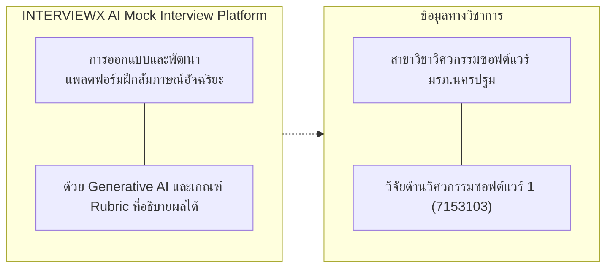

### 4. แนวทางการนำเสนอและบทพูด (Speaker Notes & Script)
- **บทพูดนำเสนอ:**  
  "กราบเรียนท่านคณะกรรมการและอาจารย์ทุกท่าน กลุ่มของพวกเราขอเสนอนำเสนอข้อเสนอโครงงานเรื่อง **InterviewX** ซึ่งเป็นการออกแบบและพัฒนาแพลตฟอร์มฝึกสัมภาษณ์งานอัจฉริยะด้วย Generative AI จุดเด่นของเราคือการประเมินคำตอบตามเกณฑ์รูบริกที่อธิบายผลได้ (Explainable Rubric-Based Evaluation) ไม่ใช่เพียงการให้คะแนนแบบ Black Box แต่ช่วยให้ผู้ฝึกเข้าใจเหตุผลของคะแนน เห็นหลักฐานจากคำตอบจริง และรู้วิธีปรับปรุงคำตอบตามวิธีมาตรฐานสากลครับ"
- **จุดที่ต้องเน้นย้ำ:** เน้นคำว่า **Explainable** และ **Rubric-Based** ซึ่งเป็นนวัตกรรมหลักของโครงการ

---

## สไลด์ที่ 2 — ที่มาและความสำคัญของปัญหา (Background & Significance)
*ประเภทสไลด์: Problem Overview & Opportunity*  
*เวลาที่แนะนำ: 50 วินาที*  
*โครงสร้างเลย์เอาต์บนสไลด์ (Slide Layout Specification):*  
- **แบ่ง 2 คอลัมน์ (50/50) + แถบสรุปด้านล่าง:**  
  - *คอลัมน์ซ้าย (The Recruitment Challenge):* ความท้าทายในการสัมภาษณ์งานยุคใหม่ (วัดทั้ง Hard Skills & Behavioral Soft Skills) และอุปสรรคของผู้สมัคร
  - *คอลัมน์ขวา (The Preparation Gap):* ข้อจำกัดของการเตรียมตัวแบบดั้งเดิม (สื่อทางเดียว ไร้ผู้ประเมิน) เปรียบเทียบกับโอกาสของ Generative AI
  - *แถบด้านล่าง (Core Opportunity):* สรุปโอกาสของ InterviewX ในการสร้าง Closed-Loop Learning

### 1. ข้อความพาดหัวหลักบนสไลด์ (Headline & Key Message)
> การสัมภาษณ์งานเป็นทักษะเชิงปฏิบัติที่ต้องอาศัยการฝึกฝนเฉพาะบุคคล แต่การเตรียมตัวแบบเดิมยังขาดระบบสะท้อนผล (Feedback Loop) ที่เป็นรูปธรรม

### 2. เนื้อหาสำหรับจัดวางบนสไลด์ (Slide Content Blueprint)
- **กล่องที่ 1 (ความสำคัญและความท้าทายของผู้สมัคร):**
  - **ด่านชี้ขาดทางอาชีพ:** การสัมภาษณ์งานไม่ได้วัดเพียงความรู้เชิงเทคนิค (Hard Skills) แต่วัดทักษะการสื่อสารเฉพาะหน้า การจัดระเบียบความคิด และการตอบตามสถานการณ์ (Behavioral Questions)
  - **แรงกดดันทางจิตใจ:** ผู้สมัคร โดยเฉพาะกลุ่มนักศึกษาจบใหม่ เผชิญความตื่นเต้น ประหม่า และจัดลำดับคำตอบไม่ทันต่อหน้าผู้สัมภาษณ์จริง
  - **ขาดความมั่นใจในมาตรฐาน:** ผู้สมัครไม่สามารถตัดสินได้ด้วยตนเองว่าคำตอบของตนมีคุณภาพ ตรงประเด็น หรือน่าเชื่อถือเพียงใด
- **กล่องที่ 2 (ช่องว่างของการเตรียมตัวแบบดั้งเดิม):**
  - **สื่อสารทางเดียว (One-Way Media):** บทความ หนังสือ หรือคลิปวิดีโอบน YouTube ให้ได้เพียงแนวทางคำถาม แต่ไม่สามารถตรวจคำตอบเฉพาะบุคคลได้
  - **ขาดผู้เชี่ยวชาญส่วนบุคคล (No Personal Coach):** การฝึกซ้อมกับผู้เชี่ยวชาญจริงมีต้นทุนเวลาและค่าใช้จ่ายสูง ทำให้ไม่สามารถฝึกฝนได้บ่อยครั้งตามต้องการ
  - **สภาวะไร้ Feedback (Zero Feedback Loop):** ในโลกความเป็นจริง ผู้สัมภาษณ์แจ้งเพียงผล 'ผ่าน/ไม่ผ่าน' โดยไม่เคยบอกเหตุผล ทำให้ผู้สมัครไม่ทราบจุดบกพร่องที่แท้จริง
- **กล่องที่ 3 (โอกาสเชิงนวัตกรรมของ InterviewX):**
  - ผสาน **Generative AI** สร้างคู่ซ้อมสัมภาษณ์เสมือนจริงที่พร้อมโต้ตอบได้ตลอด 24 ชั่วโมง
  - ขับเคลื่อนด้วย **Explainable Rubric-Based Assessment** ให้ข้อสะท้อนกลับเชิงลึกที่จับต้องได้จริง

### 3. แผนภาพประกอบสไลด์ (Diagram for Slide)
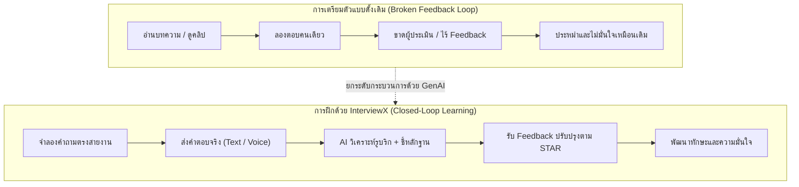

### 4. แนวทางการนำเสนอและบทพูด (Speaker Notes & Script)
- **บทพูดนำเสนอ:**  
  "ปัญหาสำคัญที่สุดของการเตรียมตัวสัมภาษณ์งานในปัจจุบัน ไม่ใช่การขาดแคลนข้อมูลคำถามครับ แต่คือ 'การขาดโอกาสฝึกซ้อมเสมือนจริง' และ 'การไม่เคยได้รับ Feedback' นักศึกษาส่วนใหญ่อ่านบทความหรือดูคลิป YouTube แต่เมื่อถึงเวลาสัมภาษณ์จริงกลับตื่นเต้นและตอบไม่ตรงคำถาม เพราะการอ่านเป็นการรับข้อมูลทางเดียว ไม่มีการประเมินว่าสิ่งที่เราตอบมีตรรกะ มีโครงสร้าง หรือมีหลักฐานสนับสนุนเพียงใด InterviewX จึงถูกออกแบบมาเพื่อเติมเต็มช่องว่างนี้ครับ"

---

## สไลด์ที่ 3 — ปัญหาและอุปสรรคของกลุ่มเป้าหมาย (Problem Statement & Pain Points)
*ประเภทสไลด์: Data Evidence / Pain Point Breakdown*  
*เวลาที่แนะนำ: 50 วินาที*  
*โครงสร้างเลย์เอาต์บนสไลด์ (Slide Layout Specification):*  
- **แบ่ง 2 ส่วน (ซ้าย-ขวา):**  
  - *ฝั่งซ้าย (Key Metric Callouts & Critical Finding):* กล่องสถิติเน้นสีขนาดใหญ่ 3 ปัญหาหลัก + กล่องไฮไลต์สีแดงชี้ประเด็นสำคัญเรื่องการขาด Feedback (62.75%)
  - *ฝั่งขวา (Detailed Data Table & Core Gaps):* ตารางแจกแจงสถิติปัญหาทั้ง 8 รายการจากการสำรวจ (n=102) และแผนผังจัดกลุ่ม 4 มิติปัญหาหลัก (Core Gaps)

### 1. ข้อความพาดหัวหลักบนสไลด์ (Headline & Key Message)
> กว่า 68% ของกลุ่มตัวอย่างประสบความตื่นเต้นประหม่า และ 62.7% ไม่เคยได้รับ Feedback หลังการสัมภาษณ์จริง

### 2. เนื้อหาสำหรับจัดวางบนสไลด์ (Slide Content Blueprint)
- **กล่องที่ 1 (สถิติปัญหาสำคัญจากการสำรวจจริง n=102 คน):**
  - **68.63% (70 คน):** ประสบความกังวล ตื่นเต้น และประหม่าในการสัมภาษณ์งาน
  - **63.73% (65 คน):** ขาดความมั่นใจในการตอบคำถาม
  - **48.04% (49 คน):** ติดขัดด้านการสื่อสารและการใช้ภาษาอังกฤษ
  - **38.24% (39 คน):** ไม่รู้แนวทางหรือรูปแบบคำถามเฉพาะของตำแหน่งงาน
  - **35.29% (36 คน):** สื่อสารไม่ชัดเจน เรียบเรียงประโยคไม่ทันเวลา
  - **28.43% (29 คน):** ขาดประสบการณ์และไม่มีสถานที่ให้ฝึกซ้อมเสมือนจริง
  - **25.49% (26 คน):** ขาด Feedback เพื่อนำมาพัฒนาตนเอง
  - **18.63% (19 คน):** ตอบไม่ตรงประเด็นคำถาม
- **กล่องที่ 2 (ข้อค้นพบชี้ขาด - Critical Real-World Finding):**
  - **62.75% (64 คน)** ระบุว่า **'ไม่เคยได้รับ Feedback ใดๆ เลยหลังการสัมภาษณ์จริง'** ส่งผลให้เกิดปัญหาสะสมและไม่ทราบทิศทางการปรับปรุง
- **กล่องที่ 3 (บทสรุป 4 มิติปัญหาเชิงโครงสร้าง):**
  1. **Psychological Gap:** ขาดความพร้อมทางอารมณ์ มีความวิตกกังวลสูง
  2. **Practice Gap:** ขาดพื้นที่จำลองสถานการณ์จริงที่มีการโต้ตอบ
  3. **Communication Gap:** เรียบเรียงความคิดไม่ทัน และติดขัดด้านภาษา
  4. **Evaluation Gap:** ขาดการประเมินที่มีเกณฑ์วัดผลและคำแนะนำที่นำไปใช้ได้ทันที

### 3. แผนภาพประกอบสไลด์ (Diagram for Slide)
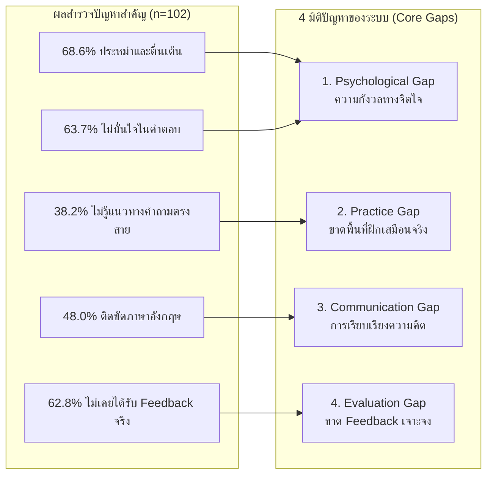

### 4. แนวทางการนำเสนอและบทพูด (Speaker Notes & Script)
- **บทพูดนำเสนอ:**  
  "เพื่อยืนยันปัญหา คณะผู้จัดทำได้สำรวจกลุ่มตัวอย่างจำนวน 102 คน พบข้อมูลเชิงสถิติที่น่าสนใจมากครับ เกือบ 70% กังวลเรื่องความตื่นเต้นประหม่า และกว่า 63% ไม่มั่นใจในคำตอบของตนเอง แต่สิ่งที่น่าตกใจยิ่งกว่าคือผู้ตอบแบบสอบถามถึง 62.75% ระบุว่า ในชีวิตจริงไม่เคยได้รับ Feedback ใดๆ จากผู้สัมภาษณ์เลย บริษัทส่วนใหญ่ตอบเพียงว่าผ่านหรือไม่ผ่าน ทำให้ผู้สมัครไม่เคยรู้เลยว่าตนเองบกพร่องตรงไหน นี่คือ Pain Point ใหญ่ที่ระบบ InterviewX ตั้งเป้าเข้ามาแก้ไขครับ"

---

## สไลด์ที่ 4 — ผลการสำรวจความต้องการของผู้ใช้งาน (User Survey Results)
*ประเภทสไลด์: Market Research & Feature Demands*  
*เวลาที่แนะนำ: 45 วินาที*  
*โครงสร้างเลย์เอาต์บนสไลด์ (Slide Layout Specification):*  
- **แบ่ง 2 คอลัมน์ (40/60):**  
  - *คอลัมน์ซ้าย (Demographics Profile):* ข้อมูลกลุ่มตัวอย่าง 102 คน (นักศึกษา 66.7%, เด็กจบใหม่ 18.6%, ทำงานแล้ว 11.8%)
  - *คอลัมน์ขวา (Feature Priority Ranking):* แถบกราฟความต้องการฟังก์ชัน 8 รายการ เรียงจากมากไปน้อย ชูอันดับ 1 (คำถามตรงสาย 92.2%) และอันดับ 2 (วิเคราะห์การสื่อสาร 65.7%)

### 1. ข้อความพาดหัวหลักบนสไลด์ (Headline & Key Message)
> ผู้ใช้ 92% ต้องการคำถามจำลองตรงตามสายงาน และมากกว่า 65% ต้องการ AI วิเคราะห์ความมั่นใจและการสื่อสาร

### 2. เนื้อหาสำหรับจัดวางบนสไลด์ (Slide Content Blueprint)
- **กล่องที่ 1 (ข้อมูลกลุ่มตัวอย่าง n=102 คน):**
  - ช่วงเวลาเก็บข้อมูล: 2–8 ตุลาคม 2569
  - **นักเรียน / นักศึกษา:** **66.67% (68 คน)**
  - **บัณฑิตจบใหม่:** **18.63% (19 คน)**
  - **พนักงานประจำ / กำลังเปลี่ยนงาน:** **11.76% (12 คน)**
  - **อื่นๆ:** **2.94% (3 คน)**
  - *ข้อสังเกต:* กลุ่มเป้าหมายหลักกว่า 85.3% คือผู้ที่กำลังเตรียมตัวก้าวเข้าสู่ตลาดแรงงาน
- **กล่องที่ 2 (อันดับฟังก์ชันที่ผู้ใช้ต้องการสูงสุด):**
  1. **จำลองคำถามตามประเภทงาน:** **92.16% (94 คน)** *(ความต้องการอันดับ 1)*
  2. **วิเคราะห์การสื่อสารและความมั่นใจ:** **65.69% (67 คน)**
  3. **คะแนนและ Feedback รายละเอียดสูง:** **56.86% (58 คน)**
  4. **วิเคราะห์ไวยากรณ์ภาษาอังกฤษ:** **55.88% (57 คน)**
  5. **วิเคราะห์คำตอบอัตโนมัติด้วย AI:** **53.92% (55 คน)**
  6. **ฝึกสัมภาษณ์ด้วยเสียงพูด:** **37.25% (38 คน)**
  7. **ปรับระดับความยากของคำถาม:** **34.31% (35 คน)**
  8. **Dashboard ติดตามพัฒนาการ:** **29.41% (30 คน)**
- **กล่องที่ 3 (ข้อสรุปเชิงวิศวกรรมความต้องการ):**
  - ระบบต้องมี **Question Categorization Engine** ที่แม่นยำตรงสายงาน
  - ผลลัพธ์การประเมินต้องไม่หยุดที่ตัวเลขคะแนน แต่ต้องมี **Actionable Feedback**

### 3. แผนภาพประกอบสไลด์ (Diagram for Slide)
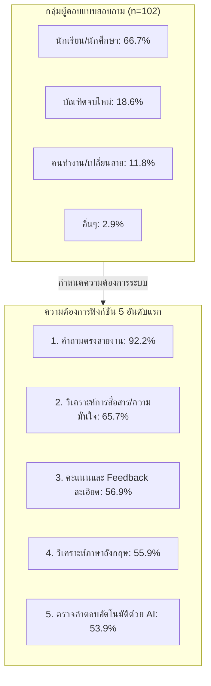

### 4. แนวทางการนำเสนอและบทพูด (Speaker Notes & Script)
- **บทพูดนำเสนอ:**  
  "จากกลุ่มตัวอย่าง 102 คน ซึ่งกว่า 85% เป็นกลุ่มนักศึกษาและบัณฑิตจบใหม่ เมื่อสอบถามถึงฟังก์ชันที่ต้องการ พบว่าความต้องการอันดับ 1 สูงถึง 92% คือ 'การจำลองคำถามที่ตรงกับตำแหน่งงานและสายวิชาชีพจริง' ตามมาด้วยความต้องการระบบวิเคราะห์การสื่อสารและ Feedback รายละเอียดสูงกว่า 65% ตัวเลขเหล่านี้ถูกใช้เป็นฐานกำหนด Functional Requirements ในเอกสาร SRS โดยตรงครับ"

---

## สไลด์ที่ 5 — ความต้องการด้านแพลตฟอร์มและการยอมรับ AI (Platform Preference & AI Adoption)
*ประเภทสไลด์: Technical Decisions & Risk Assessment*  
*เวลาที่แนะนำ: 50 วินาที*  
*โครงสร้างเลย์เอาต์บนสไลด์ (Slide Layout Specification):*  
- **แบ่ง 3 คอลัมน์เท่ากัน (33/33/33):**  
  - *คอลัมน์ 1 (Platform & Interaction Preference):* ตัวเลขช่องทาง (Web + Mobile 82.4%) และรูปแบบโต้ตอบ (Text + Voice 74.5%)
  - *คอลัมน์ 2 (AI Adoption & Concerns):* ความกังวลต่อ AI (ความแม่นยำคะแนน 65.7%, ความเป็นส่วนตัว PDPA 55.9%)
  - *คอลัมน์ 3 (Architectural Decisions):* การแปลงข้อมูลสำรวจสู่ 4 การตัดสินใจเชิงวิศวกรรมระบบของ InterviewX

### 1. ข้อความพาดหัวหลักบนสไลด์ (Headline & Key Message)
> ผู้ใช้ 82% ต้องการใช้งานทั้ง Web และ Mobile โดยให้ความสำคัญสูงสุดกับความแม่นยำของ AI และความเป็นส่วนตัว

### 2. เนื้อหาสำหรับจัดวางบนสไลด์ (Slide Content Blueprint)
- **กล่องที่ 1 (พฤติกรรมและความต้องการแพลตฟอร์ม):**
  - **ช่องทางใช้งาน:** ต้องการใช้ทั้ง **Web และ Mobile Application สูงถึง 82.35% (84 คน)** (ใช้ Mobile อย่างเดียว 9.8%, Web อย่างเดียว 7.8%)
  - **รูปแบบการฝึก:** ต้องการฝึกทั้ง **พิมพ์ข้อความ (Text) และเสียงพูด (Voice) ร่วมกันถึง 74.51% (76 คน)** (พิมพ์อย่างเดียว 16.7%, เสียงอย่างเดียว 8.8%)
  - **ประสบการณ์เดิม:** 70.59% เคยใช้ AI ช่วยเตรียมตัวสัมภาษณ์ และ 90.20% สนใจใช้ระบบฝึกสัมภาษณ์ด้วย AI ในระดับสูง
- **กล่องที่ 2 (ข้อกังวลต่อระบบ AI ที่ต้องคลี่คลาย):**
  - **ความแม่นยำของ Feedback และการให้คะแนน:** **65.69% (67 คน)** *(กังวลสูงสุด)*
  - **ความเป็นส่วนตัวและความปลอดภัยของข้อมูล (PDPA):** **55.88% (57 คน)**
  - **ความถูกต้องทางไวยากรณ์และบริบทภาษา:** **55.88% (57 คน)**
- **กล่องที่ 3 (ผลต่อการตัดสินใจเชิงสถาปัตยกรรม - Decisions):**
  1. **Shared Backend:** รองรับทั้ง Web และ Native Mobile ภายใต้ API เดียวกัน
  2. **Phased Delivery Strategy:** ส่งมอบ Text MVP ใน R1 ➔ ต่อยอด Voice & Mobile Launch ใน R2
  3. **Explainable Rubric Matrix:** ขจัดปัญหา AI Black Box ด้วยการแสดงคะแนน 4 มิติพร้อม Evidence
  4. **Privacy-First Architecture:** มีระบบขอความยินยอม (Consent) และลบไฟล์เสียงอัตโนมัติตาม PDPA

### 3. แผนภาพประกอบสไลด์ (Diagram for Slide)
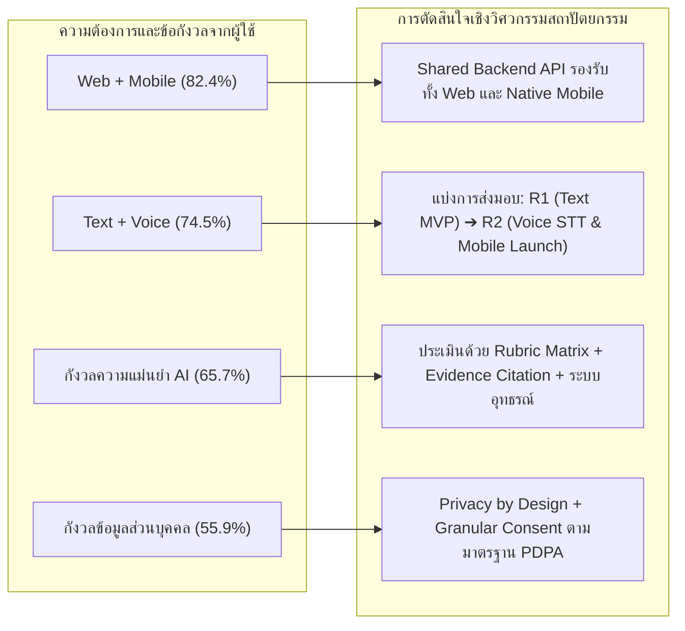

### 4. แนวทางการนำเสนอและบทพูด (Speaker Notes & Script)
- **บทพูดนำเสนอ:**  
  "ผลสำรวจยืนยันชัดเจนครับว่า ผู้ใช้กว่า 82% ต้องการใช้ทั้งเว็บและแอปมือถือ และกว่า 74% ต้องการฝึกทั้งพิมพ์และพูด ในขณะเดียวกัน ผู้ใช้มีความกังวลสูงเรื่อง 'ความแม่นยำของ AI' และ 'ความเป็นส่วนตัวของข้อมูล' ข้อมูลนี้ทำให้ทีมเราตัดสินใจเชิงวิศวกรรมซอฟต์แวร์ 4 ประการ คือ วางระบบ Shared Backend, แบ่งรอบส่งมอบอย่างมีลำดับ, ออกแบบการประเมินให้มีเกณฑ์รูบริกและชี้หลักฐานได้ และสร้างระบบ Data Privacy ตาม PDPA ครับ"
- **ข้อควรระวัง / ประเด็นตัวเลข:**  
  หากกรรมการถามถึงตัวเลข Voice ในสไลด์ 4 (37.25%) เทียบกับสไลด์นี้ (74.51%) ให้อธิบายว่า 37.25% คือผู้ที่มองว่าเสียงเป็นฟังก์ชันเร่งด่วนในรอบแรก แต่ในเชิงภาพรวมความชอบ 74.51% ต้องการให้ระบบมีทั้งพิมพ์และเสียงควบคู่กัน ซึ่งทีมนำมาใช้เป็นฐานแบ่ง Release R1 (Text) และ R2 (Voice) ครับ

---

## สไลด์ที่ 6 — วัตถุประสงค์ของโครงการ 4 เสาหลัก (Project Objectives: 4 Pillars)
*ประเภทสไลด์: Core Goals / Strategic Pillars*  
*เวลาที่แนะนำ: 50 วินาที*  
*โครงสร้างเลย์เอาต์บนสไลด์ (Slide Layout Specification):*  
- **การ์ด 4 ช่อง (2x2 Grid Layout):**  
  - *การ์ด 1 (บนซ้าย):* วัตถุประสงค์ที่ 1 — พัฒนาระบบจำลองการสัมภาษณ์อัจฉริยะ (Simulation Engine)
  - *การ์ด 2 (บนขวา):* วัตถุประสงค์ที่ 2 — พัฒนาระบบประเมินผล AI ที่อธิบายเหตุผลได้ (Explainable Evaluation)
  - *การ์ด 3 (ล่างซ้าย):* วัตถุประสงค์ที่ 3 — รองรับการทำงานข้ามแพลตฟอร์มอย่างมีเอกภาพ (Cross-Platform Experience)
  - *การ์ด 4 (ล่างขวา):* วัตถุประสงค์ที่ 4 — วางรากฐานธรรมาภิบาลข้อมูลและความเป็นส่วนตัว (Privacy & Governance)

### 1. ข้อความพาดหัวหลักบนสไลด์ (Headline & Key Message)
> 4 วัตถุประสงค์หลักเพื่อส่งมอบแพลตฟอร์มฝึกสัมภาษณ์ที่จำลองสมจริง ประเมินโปร่งใส ใช้งานได้ทุกอุปกรณ์ และปลอดภัยสูงสุด

### 2. เนื้อหาสำหรับจัดวางบนสไลด์ (Slide Content Blueprint)
- **การ์ดที่ 1 — ระบบจำลองการสัมภาษณ์อัจฉริยะ (Simulation Engine):**
  - ออกแบบและพัฒนาระบบฝึกสัมภาษณ์ที่รองรับทั้งรูปแบบข้อความ (Text ใน R1) และเสียงพูด (Voice ใน R2)
  - จัดส่งคำถามให้ตรงตามตำแหน่งงาน ระดับความยาก (Junior, Mid, Senior) และหมวดหมู่วิชาชีพ
- **การ์ดที่ 2 — ระบบประเมินผล AI ที่อธิบายได้ (Explainable AI Evaluation):**
  - พัฒนาระบบประเมินผลคำตอบด้วย Generative AI ตามเกณฑ์รูบริก 4 มิติ (Relevance, Structure, Logic, Completeness)
  - แสดงคะแนนพร้อมหลักฐานจากคำตอบจริง (Evidence Citation) ชี้จุดแข็ง จุดปรับปรุง และแนะแนวทางตอบแบบ STAR Method
- **การ์ดที่ 3 — สถาปัตยกรรมข้ามแพลตฟอร์ม (Cross-Platform Architecture):**
  - พัฒนา Responsive Web Application และ Native Mobile Application (iOS / Android ใน R2)
  - เชื่อมต่อและทำงานประสานกันภายใต้สถาปัตยกรรมหลังบ้านร่วมกัน (Shared Backend Architecture) อย่างมั่นคงปลอดภัย
- **การ์ดที่ 4 — ธรรมาภิบาลข้อมูลและความเป็นส่วนตัว (Privacy & Data Governance):**
  - วางระบบบริหารความยินยอม (Consent Management) สอดคล้องตาม พ.ร.บ. คุ้มครองข้อมูลส่วนบุคคล (PDPA)
  - กำหนดวงจรชีวิตการทำลายไฟล์เสียงอัตโนมัติ และปกปิดข้อมูลระบุตัวตน (De-identification) สำหรับชุดข้อมูลวิจัย

### 3. แผนภาพประกอบสไลด์ (Diagram for Slide)
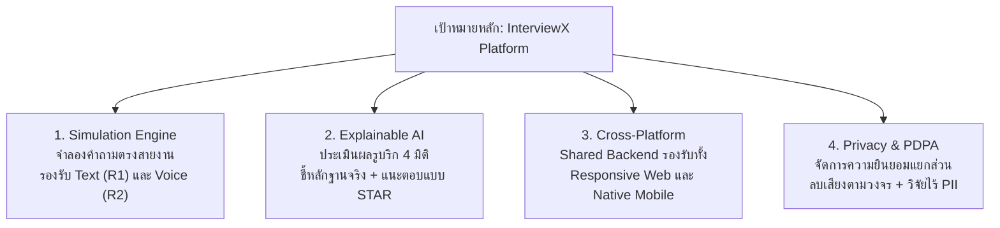

### 4. แนวทางการนำเสนอและบทพูด (Speaker Notes & Script)
- **บทพูดนำเสนอ:**  
  "โครงการ InterviewX มุ่งเน้นวัตถุประสงค์ 4 ข้อที่มีความเชื่อมโยงกันอย่างเป็นระบบครับ ข้อแรก คือการสร้างระบบจำลองคำถามที่ตรงสายงาน ข้อที่สอง ซึ่งเป็นหัวใจสำคัญทางวิศวกรรม AI คือการสร้างระบบประเมินผลที่อธิบายเหตุผลและอ้างอิงหลักฐานได้ ไม่ใช่ Black Box ข้อที่สาม คือการพัฒนาข้ามแพลตฟอร์ม Web และ Native Mobile บน Shared Backend เดียวกัน และข้อสุดท้าย คือการวางมาตรฐานความปลอดภัยและสิทธิข้อมูลส่วนบุคคลตามมาตรฐาน PDPA ครับ"

---

## สไลด์ที่ 7 — แนวคิดและแนวทางการแก้ไขปัญหา (Proposed Solution & Closed-Loop Learning)
*ประเภทสไลด์: Solution Concept & User Journey*  
*เวลาที่แนะนำ: 45 วินาที*  
*โครงสร้างเลย์เอาต์บนสไลด์ (Slide Layout Specification):*  
- **ส่วนบน (Process Diagram):** แผนผังวงจรปิด 5 ขั้นตอน (Practice ➔ Evaluate ➔ Explain ➔ Improve ➔ Repeat)
- **ส่วนล่าง (Core Value Grid 4 กล่อง):** กล่องนำเสนอคุณค่าหลัก 4 ด้าน (Contextual Questions, Evidence-Based, Actionable STAR, Safe Space)

### 1. ข้อความพาดหัวหลักบนสไลด์ (Headline & Key Message)
> วงจรการเรียนรู้แบบปิด (Closed-Loop Learning) เปลี่ยนการฝึกสัมภาษณ์ให้วัดผล อธิบาย และพัฒนาทักษะได้จริง

### 2. เนื้อหาสำหรับจัดวางบนสไลด์ (Slide Content Blueprint)
- **กล่องที่ 1 (วงจรการเรียนรู้ 5 ขั้นตอน - The 5-Step Learning Loop):**
  1. **Practice (ฝึกซ้อม):** เลือกสายงาน ระดับความยาก และตอบคำถามในสถานการณ์จำลอง
  2. **Evaluate (ประเมินผล):** AI วิเคราะห์คำตอบเทียบเกณฑ์ Rubric Matrix แบบอัตโนมัติ
  3. **Explain (อธิบายผล):** แสดงคะแนนแยกรายมิติพร้อมชี้ประโยคหลักฐานอ้างอิงจากคำตอบจริง
  4. **Improve (ปรับปรุง):** รับคำแนะนำจุดแข็ง จุดบกพร่อง และตัวอย่างการตอบตามโครงสร้าง STAR
  5. **Repeat (ฝึกซ้ำ):** ติดตามพัฒนาการผ่านประวัติ และฝึกซ้ำเพื่อยกระดับความมั่นใจ
- **กล่องที่ 2 (คุณค่าหลักที่แตกต่าง - Core Value Propositions):**
  - **Contextual Precision:** คำถามตรงตามสายงานและบริบทเฉพาะ ไม่ใช่คำถามทั่วไป
  - **Evidence Grounding:** ทุกคะแนนและข้อคิดเห็นมีประโยคคำตอบจริงอ้างอิง ตรวจสอบได้
  - **Actionable Guidance:** ชี้แนะการปรับปรุงอย่างเป็นรูปธรรมตามกรอบ STAR Method (Situation, Task, Action, Result)
  - **Psychological Safety:** พื้นที่ฝึกซ้อมที่ปลอดภัย ซ้อมได้ไม่จำกัดจำนวนครั้ง ขจัดความประหม่า

### 3. แผนภาพประกอบสไลด์ (Diagram for Slide)
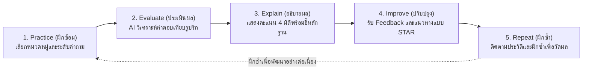

### 4. แนวทางการนำเสนอและบทพูด (Speaker Notes & Script)
- **บทพูดนำเสนอ:**  
  "แนวคิดของ InterviewX คือการสร้าง Closed-Loop Learning Process ครับ ผู้ใช้ไม่ได้เข้ามาแค่ตอบคำถามแล้วจบ แต่เมื่อตอบแล้ว ระบบจะประเมิน (Evaluate) อธิบายเหตุผลพร้อมชี้หลักฐาน (Explain) ให้แนวทางแก้ไขแบบ STAR (Improve) และให้ผู้ใช้สามารถฝึกซ้ำเพื่อดูพัฒนาการ (Repeat) ได้อย่างต่อเนื่อง เราไม่ได้สร้างเครื่องมือที่ตอบแทนผู้สมัคร แต่เราสร้างแพลตฟอร์มฝึกสอนที่ทำให้ผู้สมัครเก่งขึ้นด้วยตนเองครับ"

---

## สไลด์ที่ 8 — กลุ่มผู้ใช้งานและบทบาทในระบบ (Target Users & System Roles - RBAC)
*ประเภทสไลด์: Role-Based Access Control & User Archetypes*  
*เวลาที่แนะนำ: 45 วินาที*  
*โครงสร้างเลย์เอาต์บนสไลด์ (Slide Layout Specification):*  
- **แบ่ง 2 ฝั่ง (ซ้าย-ขวา 60/40):**  
  - *ฝั่งซ้าย (RBAC Matrix Table):* ตารางเปรียบเทียบ 5 บทบาท หน้าที่รับผิดชอบ และช่องทางที่อนุญาตให้ใช้งาน
  - *ฝั่งขวา (Security Boundaries & Trust Rules):* ไดอะแกรมบริบทระบบ และกล่องกฎเหล็กด้านความปลอดภัย (Admin/Finance/Researcher ใช้งานผ่าน Web เท่านั้น)

### 1. ข้อความพาดหัวหลักบนสไลด์ (Headline & Key Message)
> โครงสร้าง 5 บทบาทตามหลักการจำกัดสิทธิ์ขั้นต่ำ (Least Privilege) แยกกลุ่มผู้ใช้ทั่วไปและงานบริหารอย่างเข้มงวด

### 2. เนื้อหาสำหรับจัดวางบนสไลด์ (Slide Content Blueprint)
- **กล่องที่ 1 (ตารางกำหนดสิทธิ์ตามบทบาท - RBAC Matrix):**

| บทบาท (Role) | สิทธิ์และหน้าที่รับผิดชอบในระบบ | ช่องทางที่อนุญาต |
|---|---|:---:|
| **Guest** | ผู้เยี่ยมชม: ทดลองตอบคำถามตัวอย่างแบบจำกัดเซสชัน | Web & Mobile |
| **Registered User** | ผู้ใช้ทั่วไป: ฝึกซ้อมเต็มรูปแบบ, บันทึกประวัติ, จัดการ PDPA | Web & Mobile |
| **System Admin** | ผู้ดูแลระบบ: จัดการคลังคำถาม, รูบริก, Audit Log, คำอุทธรณ์ | **Web เท่านั้น** |
| **Finance Admin (R3)** | ผู้ดูแลการเงิน: จัดการแพ็กเกจ, ตรวจสอบสลิป, อนุมัติการคืนเงิน | **Web เท่านั้น** |
| **Researcher (R3)** | นักวิจัย: เข้าถึงข้อมูลสถิติภาพรวมที่ปกปิดตัวตน (Anonymized) | **Web เท่านั้น** |

- **กล่องที่ 2 (กฎความปลอดภัยด้านการเข้าถึง - Security Trust Boundaries):**
  - **Single Platform for Administration:** บังคับให้งานบริหารระบบ การเงิน และงานวิจัยทำผ่าน Web Application เท่านั้น ไม่อนุญาตบนอุปกรณ์เคลื่อนที่เพื่อลด Attack Surface
  - **Zero Trust Data Separation:** ผู้ดูแลระบบไม่มีสิทธิ์เปิดดูข้อมูลส่วนบุคคลหรือคำตอบของผู้ใช้โดยไม่มีคำอุทธรณ์ และนักวิจัยเข้าถึงได้เฉพาะชุดข้อมูลสถิติที่ตัด PII แล้วเท่านั้น

### 3. แผนภาพประกอบสไลด์ (Diagram for Slide — อ้างอิง D01 System Context)
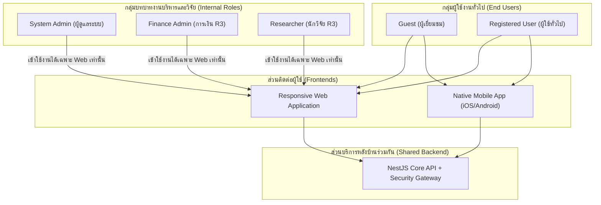

### 4. แนวทางการนำเสนอและบทพูด (Speaker Notes & Script)
- **บทพูดนำเสนอ:**  
  "ระบบของเราออกแบบการควบคุมสิทธิ์ตามมาตรฐาน RBAC แบ่งออกเป็น 5 บทบาทชัดเจนครับ สำหรับกลุ่มผู้ใช้งานทั่วไปคือ Guest และ Registered User จะสามารถใช้งานได้ทั้งบน Web และ Mobile แต่สำหรับบทบาทสำคัญอย่าง System Admin, Finance Admin และ Researcher เราบังคับเชิงสถาปัตยกรรมให้เข้าถึงได้เฉพาะผ่าน Web Application เท่านั้น และต้องผ่านการยืนยันตัวตนชั้นสูง เพื่อป้องกันความปลอดภัยและควบคุมการรั่วไหลของข้อมูลครับ"

---

## สไลด์ที่ 9 — ภาพรวมกระบวนการทำงานของระบบ (System Workflow & Asynchronous Queue)
*ประเภทสไลด์: End-to-End Processing Architecture*  
*เวลาที่แนะนำ: 50 วินาที*  
*โครงสร้างเลย์เอาต์บนสไลด์ (Slide Layout Specification):*  
- **ส่วนบน (Process Sequence):** แผนภาพ Sequence Diagram การส่งคำตอบแบบอะซิงโครนัส (User ➔ API ➔ DB ➔ Queue ➔ AI Worker ➔ Storage)
- **ส่วนล่าง (Engineering Highlights 3 กล่อง):** กล่องอธิบายหลักการวิศวกรรม (Non-blocking I/O, Transactional Outbox, Fault Tolerance & Retry)

### 1. ข้อความพาดหัวหลักบนสไลด์ (Headline & Key Message)
> การประมวลผลแบบ Asynchronous Queue ช่วยให้ระบบตอบสนองฉับไว แม้งานประเมินผล AI จะมีความซับซ้อนสูง

### 2. เนื้อหาสำหรับจัดวางบนสไลด์ (Slide Content Blueprint)
- **กล่องที่ 1 (ลำดับกระบวนการประมวลผล 5 ขั้นตอน):**
  1. **Session Setup:** ผู้ใช้เลือกหมวดและระดับ ➔ ระบบจัดส่งคำถามแบบสุ่มโดยไม่ซ้ำกับคำถามเดิม
  2. **Answer Submission:** ผู้ใช้ส่งคำตอบพร้อม **Idempotency Key (UUIDv4)** ป้องกันคำขอซ้ำ
  3. **Atomic Transaction & Queueing:** Core Backend บันทึกคำตอบ ➔ ตอบรับ `202 Accepted` ทันที ➔ ส่งงานเข้า **Redis / BullMQ Queue**
  4. **AI Inference & Validation:** **FastAPI AI Worker** ดึงงานจากคิว ➔ สื่อสารกับ Hosted LLM ➔ ตรวจสอบผลลัพธ์ผ่าน Pydantic Validation
  5. **Persistence & Delivery:** บันทึกคะแนนและประโยคหลักฐานลง PostgreSQL ➔ Client ดึงผลลัพธ์ไปแสดงผล
- **กล่องที่ 2 (หัวใจสำคัญด้านวิศวกรรมระบบ):**
  - **Decoupled Architecture:** แยก Core API ออกจาก AI Service เพื่อไม่ให้ความหน่วงของ AI กระทบการทำงานของระบบหลัก
  - **Fault Tolerance:** ระบบคิวมีนโยบาย Retry Policy อัตโนมัติ (Exponential Backoff) ป้องกันงานสูญหาย

### 3. แผนภาพประกอบสไลด์ (Diagram for Slide — อ้างอิง D07 & D08)
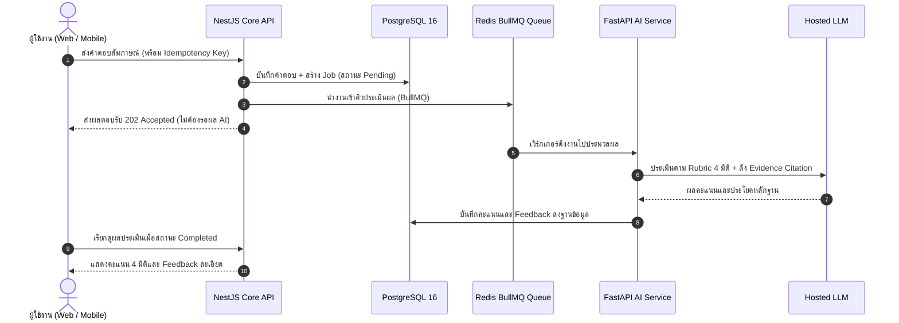

### 4. แนวทางการนำเสนอและบทพูด (Speaker Notes & Script)
- **บทพูดนำเสนอ:**  
  "ในสไลด์ที่ 9 คือภาพรวมการประมวลผลคำตอบครับ เมื่อผู้ใช้กดส่งคำตอบ NestJS Core Backend จะไม่รอให้ AI ประเมินเสร็จในทันที เพราะโมเดล LLM อาจใช้เวลา 5 ถึง 10 วินาที แต่ระบบจะบันทึกคำตอบและโยนงานเข้า Redis BullMQ Queue จากนั้น FastAPI AI Worker จะดึงงานไปประเมินตามเกณฑ์รูบริก และบันทึกผลกลับลงฐานข้อมูล สถาปัตยกรรมแบบ Asynchronous นี้ช่วยให้ระบบรองรับโหลดพร้อมกันได้สูง โดยที่หน้าบ้านของผู้ใช้ไม่ค้างครับ"

---

## สไลด์ที่ 10 — ระบบจำลองการสัมภาษณ์และบริหารเซสชัน (Interview Simulation & Resilience)
*ประเภทสไลด์: Core Feature Deep-dive*  
*เวลาที่แนะนำ: 45 วินาที*  
*โครงสร้างเลย์เอาต์บนสไลด์ (Slide Layout Specification):*  
- **แบ่ง 3 การ์ดฟังก์ชันหลัก (3 Columns):**  
  - *การ์ด 1 (Question Bank & Categorization):* คลังคำถาม 4 ประเภท และการแบ่งระดับความยาก
  - *การ์ด 2 (Input Modalities):* รูปแบบการส่งคำตอบ (Text ใน R1 vs Voice/STT ใน R2)
  - *การ์ด 3 (Session Resilience Engine):* วงจรสถานะเซสชัน, ระบบ Auto-save Drafts และการป้องกันคำขอซ้ำ

### 1. ข้อความพาดหัวหลักบนสไลด์ (Headline & Key Message)
> จำลองคำถามตรงสายงาน พร้อมระบบบริหารจัดการเซสชันที่ยืดหยุ่นและป้องกันการสูญหายของคำตอบ

### 2. เนื้อหาสำหรับจัดวางบนสไลด์ (Slide Content Blueprint)
- **กล่องที่ 1 (คลังคำถามตรงสายงาน - Question Categorization):**
  - **4 หมวดหมู่หลัก:** Job Interview (งานสายเทคโนโลยี/ทั่วไป), Study Interview (เข้าศึกษาต่อ), Scholarship (ชิงทุน), English Interview (ภาษาอังกฤษ)
  - **3 ระดับประสบการณ์:** Junior (ระดับเริ่มต้น), Mid-Level (ระดับกลาง), Senior (ระดับชำนาญการ)
  - **Anti-repetition Logic:** อัลกอริทึมตรวจสอบประวัติ ป้องกันไม่ให้สุ่มได้คำถามเดิมในเซสชันเดียวกัน
- **กล่องที่ 2 (รูปแบบการส่งคำตอบ - Modalities R1 & R2):**
  - **Release 1 (Text MVP):** ส่งคำตอบด้วยข้อเขียน มีระบบตรวจนับความยาวและจำกัดขนาดคำตอบ
  - **Release 2 (Voice & STT):** บันทึกเสียงพูดผ่านไมโครโฟน แปลงเสียงเป็นข้อความด้วย Whisper STT และตรวจจับคลื่นเสียง (Waveform)
- **กล่องที่ 3 (เสถียรภาพของเซสชัน - Session Resilience):**
  - **Auto-save Drafts:** บันทึกแบบร่างคำตอบอัตโนมัติทุกๆ 30 วินาที ป้องกันข้อมูลสูญหายเมื่อเครือข่ายขัดข้อง
  - **Idempotency Protection:** ป้องกันการบันทึกคำตอบซ้ำซ้อนเมื่อเกิดการกดปุ่มส่งซ้ำหรือเน็ตหลุด
  - **Session State Transitions:** ติดตามสถานะอย่างรัดกุม (`INITIATED`, `IN_PROGRESS`, `EVALUATING`, `COMPLETED`)

### 3. แผนภาพประกอบสไลด์ (Diagram for Slide — อ้างอิง D08 Session Lifecycle)
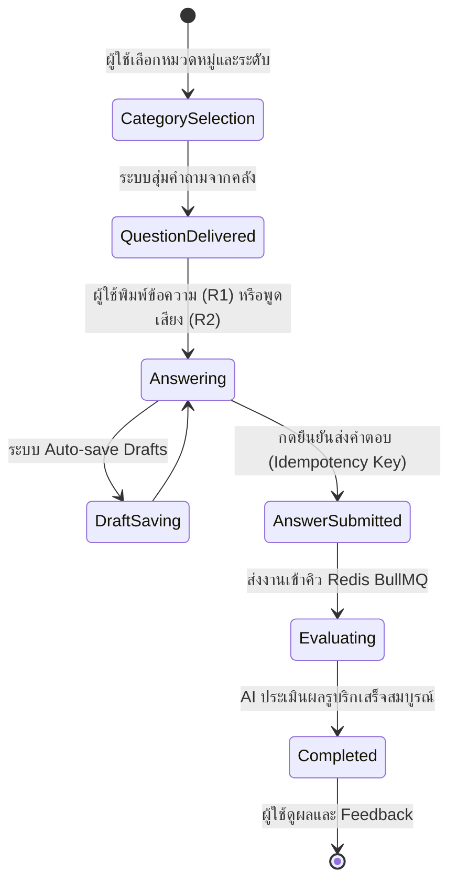

### 4. แนวทางการนำเสนอและบทพูด (Speaker Notes & Script)
- **บทพูดนำเสนอ:**  
  "ระบบจำลองการสัมภาษณ์เป็นด่านแรกที่ผู้ใช้มีปฏิสัมพันธ์ครับ เราออกแบบคลังคำถามให้ครอบคลุมทั้งการสมัครงานและการเรียนต่อ มีการจำแนกระดับความยากชัดเจน ในรอบ R1 เราจะเริ่มต้นด้วยการพิมพ์ข้อความเพื่อให้ผู้ใช้ฝึกจัดระเบียบความคิด และใน R2 จะเพิ่มระบบเสียงและการตรวจจับคลื่นเสียง นอกจากนี้ เรายังใส่ใจเรื่อง Session Resilience มีระบบบันทึกแบบร่างอัตโนมัติ และระบบป้องกันการส่งคำตอบซ้ำเพื่อความเสถียรสูงสุดครับ"

---

## สไลด์ที่ 11 — ระบบประเมินคำตอบด้วย AI และเกณฑ์รูบริก (Explainable AI Evaluation & Rubric Engine)
*ประเภทสไลด์: AI Core Innovation*  
*เวลาที่แนะนำ: 55 วินาที*  
*โครงสร้างเลย์เอาต์บนสไลด์ (Slide Layout Specification):*  
- **แบ่ง 2 คอลัมน์ (50/50):**  
  - *คอลัมน์ซ้าย (Rubric Matrix 4 Dimensions):* รายละเอียดเกณฑ์ 4 มิติ สัดส่วนคะแนน และความหมายในการประเมิน
  - *คอลัมน์ขวา (Explainability Pillars & Governance):* หลักการอ้างอิงหลักฐาน (Evidence Citation), การแนะแนวตามวิธี STAR และระบบอุทธรณ์ผล

### 1. ข้อความพาดหัวหลักบนสไลด์ (Headline & Key Message)
> ยกระดับจากการให้คะแนนแบบ Black Box สู่การประเมิน 4 มิติ ที่มีหลักฐานอ้างอิงและตรวจสอบย้อนกลับได้

### 2. เนื้อหาสำหรับจัดวางบนสไลด์ (Slide Content Blueprint)
- **กล่องที่ 1 (4 มิติการประเมินตามเกณฑ์รูบริก - Rubric Matrix):**
  1. **Relevance (ความตรงประเด็น - 25%):** คำตอบตอบตรงกับเป้าหมายของคำถาม ไม่ตอบนอกประเด็น สอดคล้องกับตำแหน่งงาน
  2. **Structure (โครงสร้างคำตอบ - 25%):** มีการจัดลำดับความคิด มีบทนำ ลำดับเนื้อหา และบทสรุปที่เข้าใจง่าย
  3. **Logic & Evidence (ตรรกะและเหตุผล - 25%):** มีตัวอย่างสถานการณ์จริงสนับสนุนอย่างสมเหตุสมผลและน่าเชื่อถือ
  4. **Completeness (ความสมบูรณ์ - 25%):** ข้อมูลครอบคลุมสาระสำคัญที่บทบาทงานนั้นต้องการครบถ้วน
- **กล่องที่ 2 (เสาหลักความโปร่งใสและอธิบายได้ - Explainability Pillars):**
  - **Mandatory Evidence Citation:** ทุกคะแนนในแต่ละมิติต้องมีข้อความยกมาจากคำตอบจริงของผู้ใช้เพื่อสนับสนุนเหตุผล
  - **Actionable Feedback:** ชี้จุดเด่น จุดบกพร่อง พร้อมคำแนะนำการเรียบเรียงคำตอบใหม่ตาม **STAR Method (Situation, Task, Action, Result)**
  - **Model & Rubric Versioning:** บันทึกเวอร์ชันของ Model, System Prompt และ Rubric ทุกครั้งเพื่อความโปร่งใส
  - **Human Review & Appeal:** รองรับกระบวนการยื่นคำอุทธรณ์ผลคะแนนเพื่อให้ผู้ดูแลระบบทบทวนได้

### 3. แผนภาพประกอบสไลด์ (Diagram for Slide — Rubric Evaluation Engine Flow)
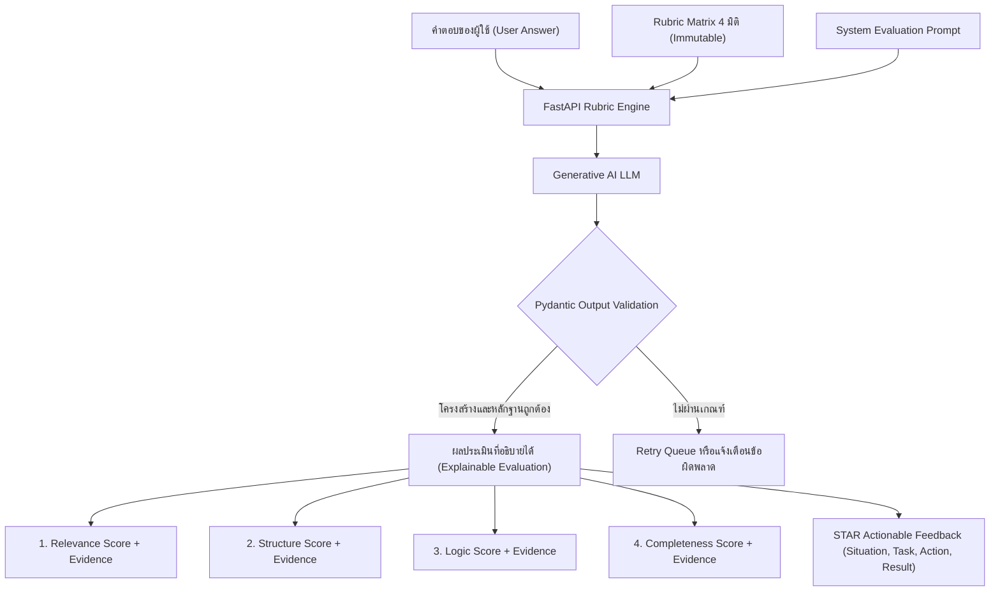

### 4. แนวทางการนำเสนอและบทพูด (Speaker Notes & Script)
- **บทพูดนำเสนอ:**  
  "จุดเด่นที่สุดของ InterviewX ในทางวิศวกรรม AI คือระบบ Explainable Evaluation ครับ ปัญหาของ ChatGPT ทั่วไปคือเมื่อขอคะแนน มันจะให้ตัวเลขแบบกว้างๆ ที่ไม่มีเกณฑ์แน่นอน แต่ของเราบังคับให้ AI ทำงานร่วมกับ Rubric Matrix 4 มิติ คือ ความตรงประเด็น โครงสร้าง ตรรกะ และความสมบูรณ์ และที่สำคัญที่สุดคือ ระบบต้องมี 'Evidence Citation' ชี้ให้เห็นว่าประโยคไหนในคำตอบที่ทำให้ได้คะแนนหรือถูกหักคะแนน พร้อมแนะนำการตอบตามกรอบ STAR Method สากลครับ"

---

## สไลด์ที่ 12 — ตัวอย่างผลการประเมินและ Feedback เชิงลึก (Evaluation Output UI Prototype)
*ประเภทสไลด์: UI Mockup Showcase & Practical Example*  
*เวลาที่แนะนำ: 50 วินาที*  
*โครงสร้างเลย์เอาต์บนสไลด์ (Slide Layout Specification):*  
- **จำลองหน้าจอ UI Report (Split Card Layout):**  
  - *ฝั่งซ้าย (Score Card):* มิเตอร์คะแนนรวม 72/100 และแถบคะแนน 4 มิติ
  - *ฝั่งขวา (Feedback & Evidence Drawer):* การ์ดจุดแข็ง, การ์ดจุดปรับปรุง, ไฮไลต์ประโยคหลักฐาน และกล่องแนะแนวทางตอบแบบ STAR
  - *ป้ายกำกับด้านล่าง:* แถบข้อความระบุชัดเจนว่าเป็น `Illustrative UI Prototype`

### 1. ข้อความพาดหัวหลักบนสไลด์ (Headline & Key Message)
> หน้าต่างสรุปผลประเมินที่ชัดเจน: แสดงคะแนนย่อย ชี้หลักฐานคำตอบ และแนะแนวทางตอบแบบ STAR ทันที

### 2. เนื้อหาสำหรับจัดวางบนสไลด์ (Slide Content Blueprint)
- **กล่องที่ 1 (ตัวอย่างคะแนนประกอบหน้าจอ - Sample Score Breakdown):**
  - **คำถามตัวอย่าง:** *"เล่าประสบการณ์การแก้ไขปัญหาความขัดแย้งในทีมพัฒนาระหว่างการส่งมอบงาน"*
  - **คะแนนรวม (Overall Score):** **72 / 100**
  - **Relevance (ความตรงประเด็น):** **80 / 100** *(คำตอบเล่าถึงความขัดแย้งในทีมชัดเจน)*
  - **Structure (โครงสร้างคำตอบ):** **70 / 100** *(มีการเกริ่นสถานการณ์ แต่วิธีแก้ยังไม่ชัดเจน)*
  - **Logic & Evidence (ตรรกะและเหตุผล):** **65 / 100** *(ขาดตัวอย่างการกระทำที่เป็นรูปธรรม)*
  - **Completeness (ความสมบูรณ์):** **73 / 100** *(ครอบคลุมบริบท แต่ขาดผลลัพธ์เชิงตัวเลข)*
- **กล่องที่ 2 (ตัวอย่าง Feedback เชิงลึก - Actionable Insights):**
  - **จุดแข็ง (Strengths):** อธิบายบริบทความขัดแย้งและกำหนดปัญหาได้ดี (ตรงตาม Situation และ Task)
  - **จุดควรปรับปรุง (Areas for Improvement):** ขาดการระบุบทบาทของตนเองในการแก้ปัญหา (Action) และไม่ได้ระบุผลสัมฤทธิ์ที่เป็นตัวเลข (Result)
  - **หลักฐานที่ตรวจพบ (Evidence Citation):** *"ผมกับเพื่อนร่วมทีมมีความเห็นไม่ตรงกันเรื่องเฟรมเวิร์ก แต่สุดท้ายก็ผ่านไปได้..."*
  - **คำแนะนำ STAR:** แนะนำให้ระบุว่า *"ผมได้จัดประชุมร่วมกัน นำเกณฑ์ข้อดีข้อเสียมาเปรียบเทียบ และสรุปเลือกโซลูชัน ส่งผลให้งานส่งมอบได้ทันเวลาเร็วขึ้น 15%"*

### 3. แผนภาพประกอบสไลด์ (Diagram for Slide — UI Card Layout Structure)
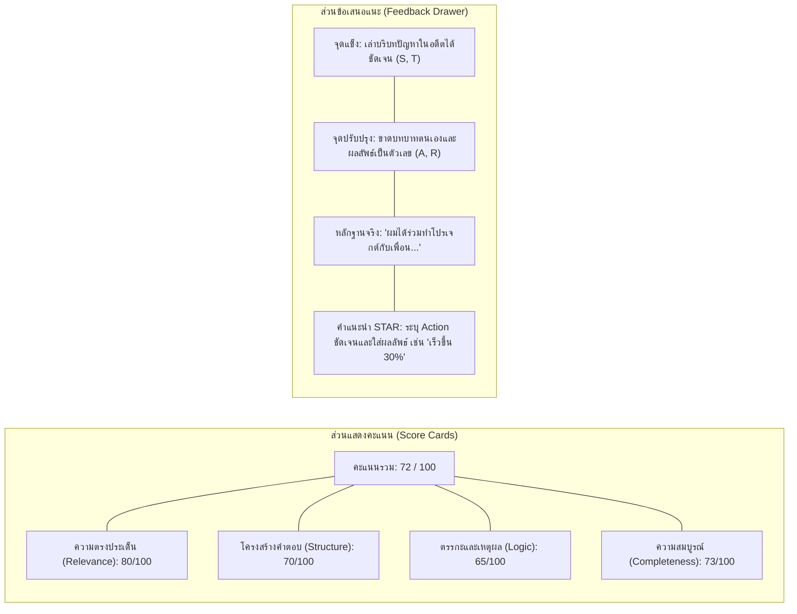

### 4. แนวทางการนำเสนอและบทพูด (Speaker Notes & Script)
- **บทพูดนำเสนอ:**  
  "นี่คือตัวอย่างหน้าจอผลประเมินที่ผู้ใช้งานจะได้รับครับ ด้านซ้ายจะเห็นคะแนนรวมและคะแนนแยก 4 มิติ ทำให้ผู้ใช้รู้ทันทีว่ามิติใดที่ทำได้ดี และมิติใดเป็นจุดอ่อน ส่วนด้านขวาคือสิ่งที่มีค่าที่สุดครับ คือ Actionable Feedback ที่อ้างอิงประโยคจริงของผู้ฝึก และแนะนำวิธีปรับแก้ประโยคตามโมเดล STAR เพื่อให้ผู้สมัครนำไปใช้พัฒนาตนเองในการสัมภาษณ์จริงครับ"
- **ข้อควรระวัง / กฎเหล็ก:** ย้ำชัดเจนว่าคะแนน 72/100 บนสไลด์เป็นข้อมูลจำลองเพื่อสาธิตหน้าจอ ไม่ใช่ผลทดลองจริงของ AI

---

## สไลด์ที่ 13 — ความเป็นส่วนตัวและการคุ้มครองข้อมูลตามกฎหมาย (Privacy & PDPA Architecture)
*ประเภทสไลด์: Compliance & Data Privacy*  
*เวลาที่แนะนำ: 45 วินาที*  
*โครงสร้างเลย์เอาต์บนสไลด์ (Slide Layout Specification):*  
- **การ์ด 4 เสาหลัก (4 Columns / Pillar Grid):**  
  - *เสาที่ 1:* การจัดการความยินยอมแยกวัตถุประสงค์ (Granular Consent)
  - *เสาที่ 2:* การรองรับสิทธิเจ้าของข้อมูล (Data Subject Rights: DSR)
  - *เสาที่ 3:* วงจรชีวิตและการทำลายไฟล์เสียงอัตโนมัติใน R2 (Audio Lifecycle)
  - *เสาที่ 4:* มาตรการคุ้มครองข้อมูลเพื่องานวิจัยใน R3 (Research Anonymization & k ≥ 10)

### 1. ข้อความพาดหัวหลักบนสไลด์ (Headline & Key Message)
> ออกแบบระบบบนหลักการ Privacy by Design สอดคล้องตามมาตรฐาน PDPA ตั้งแต่วันแรกของการพัฒนา

### 2. เนื้อหาสำหรับจัดวางบนสไลด์ (Slide Content Blueprint)
- **กล่องที่ 1 (Granular Consent Management):**
  - แยกกล่องความยินยอมเป็นอิสระ 3 วัตถุประสงค์: ความยินยอมเพื่อการฝึก, การบันทึกเสียง (R2), และการวิเคราะห์สถิติวิจัย (R3)
  - ผู้ใช้สามารถเลือกให้ความยินยอมหรือไม่ก็ได้ และสามารถถอนความยินยอมได้ตลอดเวลา
  - บันทึกเวอร์ชัน Privacy Notice และประวัติเวลาที่ให้ความยินยอมในระบบ
- **กล่องที่ 2 (Data Subject Rights - DSR):**
  - รองรับสิทธิการเข้าถึงและขอสำเนาข้อมูลประวัติการฝึก (Right of Access & Portability)
  - รองรับสิทธิในการขอลบข้อมูลประวัติและทำลายบัญชีผู้ใช้ (Right to Erasure) อย่างสมบูรณ์
- **กล่องที่ 3 (Audio Lifecycle & Retention Policy ใน R2):**
  - จัดเก็บไฟล์เสียงใน Private MinIO Storage พร้อมเข้ารหัสลับ AES-256
  - มีระบบลบไฟล์เสียงดิบอัตโนมัติ (Auto-purge ภายใน 30 วัน หรือตามที่ผู้ใช้เลือก)
- **กล่องที่ 4 (Research Governance ใน R3):**
  - ตัดข้อมูลระบุตัวบุคคล (PII 100%) ก่อนส่งมอบชุดข้อมูลสถิติ
  - บังคับใช้เกณฑ์ **Cell Size Suppression (k ≥ 10)** ป้องกันการสืบหาตัวตนย้อนกลับ (Re-identification)
  - แยกฐานข้อมูลวิจัยและรหัสผ่านเข้าถึงออกจากฐานข้อมูล Core โดยสิ้นเชิง

### 3. แผนภาพประกอบสไลด์ (Diagram for Slide — อ้างอิง D10 Privacy Lifecycle)
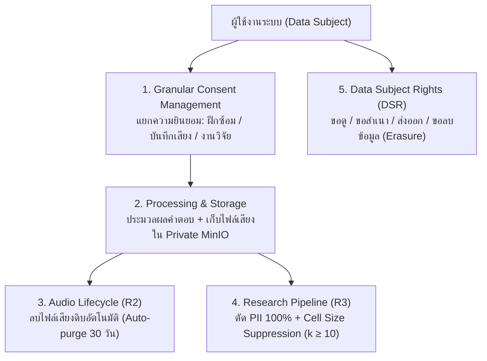

### 4. แนวทางการนำเสนอและบทพูด (Speaker Notes & Script)
- **บทพูดนำเสนอ:**  
  "สำหรับประเด็นด้านความปลอดภัย เนื่องจากเสียงพูดและคำตอบสัมภาษณ์อาจมีข้อมูลส่วนบุคคล (PII) เราจึงออกแบบตามหลัก Privacy by Design และสอดคล้องตามกฎหมาย PDPA ครับ ระบบมีการขอ Consent แยกตามวัตถุประสงค์ มีระบบลบไฟล์เสียงอัตโนมัติตามระยะเวลาที่กำหนดเพื่อไม่เก็บข้อมูลเสียงค้างไว้ และในส่วนของข้อมูลวิจัยในอนาคต เราจะตัด PII ทั้งหมดและใช้เกณฑ์ Cell Size Suppression ไม่ส่งออกข้อมูลหากมีจำนวนผู้ใช้ซ้ำกันน้อยกว่า 10 คน เพื่อป้องกันการสืบหาตัวตนครับ"

---

## สไลด์ที่ 14 — สถาปัตยกรรมระบบโดยรวม (System Architecture & C4 Container Model)
*ประเภทสไลด์: Technical Architecture & C4 Model*  
*เวลาที่แนะนำ: 55 วินาที*  
*โครงสร้างเลย์เอาต์บนสไลด์ (Slide Layout Specification):*  
- **ส่วนบน (Architecture Flowchart):** แผนภาพ C4 Container Architecture แสดง 5 เลเยอร์ระบบ
- **ส่วนล่าง (Core Architecture Principles 3 กล่อง):** อธิบาย Single Ownership, Shared Backend DTOs และ Trust Boundaries

### 1. ข้อความพาดหัวหลักบนสไลด์ (Headline & Key Message)
> สถาปัตยกรรมแบบ Shared Backend แยกขอบเขตการทำงานอย่างเป็นอิสระ เพื่อความมั่นคงปลอดภัยและขยายตัวได้ง่าย

### 2. เนื้อหาสำหรับจัดวางบนสไลด์ (Slide Content Blueprint)
- **กล่องที่ 1 (5 ระดับชั้นสถาปัตยกรรมระบบ - 5 Architectural Tiers):**
  1. **Client Tier:** Next.js 14 Responsive Web และ React Native / Expo Native Mobile (R2)
  2. **Core Backend Tier:** NestJS Modular Monolith จัดการ Auth, RBAC, Business Logic และ REST APIs
  3. **Queue Tier:** Redis 7.x & BullMQ 5.x จัดการคิวงานประเมินผล AI และงานเบื้องหลังแบบ Asynchronous
  4. **AI Processing Tier:** FastAPI (Python) รับคำขอประเมิน ตรวจสอบสกีมา และสื่อสารกับ Hosted LLM
  5. **Data & Storage Tier:** PostgreSQL 16 (Core Database) และ MinIO Object Storage (จัดเก็บไฟล์เสียง)
- **กล่องที่ 2 (กฎเหล็กเชิงสถาปัตยกรรม - Architectural Principles):**
  - **Single Ownership Principle:** FastAPI AI Service **ห้ามเชื่อมต่อฐานข้อมูล Core PostgreSQL โดยตรง** ต้องรับส่งงานผ่าน Queue และ API เท่านั้น
  - **Shared API Contracts:** Web และ Mobile เชื่อมต่อผ่าน REST API Contract ชุดเดียวกัน โดยแชร์ DTOs ร่วมกันผ่าน Monorepo
  - **Decoupled Billing & Research (R3):** บริการระบบการเงินและระบบวิจัยมีฐานข้อมูลและสิทธิ์การเข้าถึงแยกอิสระจากระบบหลัก

### 3. แผนภาพประกอบสไลด์ (Diagram for Slide — อ้างอิง D02 C4 Container Architecture)
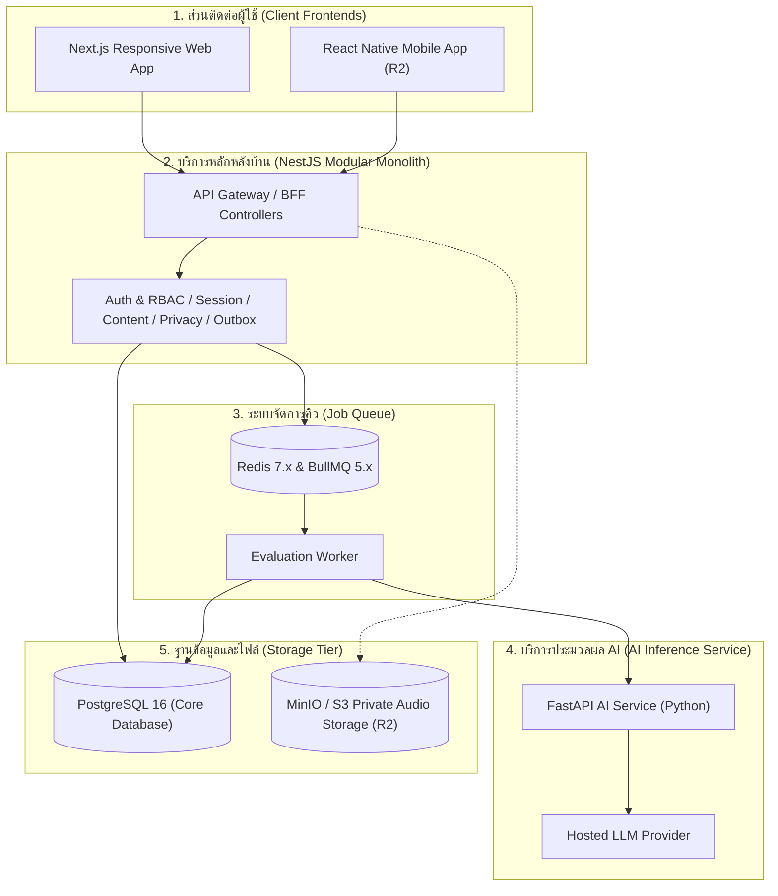

### 4. แนวทางการนำเสนอและบทพูด (Speaker Notes & Script)
- **บทพูดนำเสนอ:**  
  "ในสไลด์ที่ 14 คือภาพรวมสถาปัตยกรรมระดับระบบครับ เราเลือกใช้แนวคิด Shared Backend โดยมี NestJS Modular Monolith เป็นศูนย์กลางในการจัดการธุรกิจ ฐานข้อมูล และการควบคุมสิทธิ์ ส่วนโมดูล AI เราแยกออกมาเป็น FastAPI Service บนภาษา Python โดยมีข้อกำหนดทางวิศวกรรมที่เข้มงวดว่า AI Service จะไม่มีสิทธิ์เข้าถึงฐานข้อมูล Core Database โดยตรง แต่จะสื่อสารผ่าน Redis Queue เท่านั้น สถาปัตยกรรมนี้ทำให้ระบบมีความปลอดภัยสูง แต่ละส่วนสามารถสเกลได้อย่างอิสระครับ"

---

## สไลด์ที่ 15 — สแต็กเทคโนโลยีที่เลือกใช้ (Technology Stack & Toolchain)
*ประเภทสไลด์: Tech Stack & Engineering Tools*  
*เวลาที่แนะนำ: 40 วินาที*  
*โครงสร้างเลย์เอาต์บนสไลด์ (Slide Layout Specification):*  
- **แบ่ง 4 หมวดหมู่เท่ากัน (4 Columns Grid):**  
  - *คอลัมน์ 1 (Frontend & Mobile):* Next.js 14, Tailwind, shadcn/ui, React Native
  - *คอลัมน์ 2 (Core Backend):* NestJS, TypeScript, Prisma ORM, JWT
  - *คอลัมน์ 3 (AI & Speech Engine):* Python 3.11, FastAPI, Pydantic, Whisper
  - *คอลัมน์ 4 (Data, Infra & QA):* PostgreSQL 16, Redis, MinIO, Docker, Vitest, Playwright

### 1. ข้อความพาดหัวหลักบนสไลด์ (Headline & Key Message)
> เลือกใช้ชุดเครื่องมือระดับมาตรฐานอุตสาหกรรม ที่มีเสถียรภาพสูง ปลอดภัย และรองรับระบบข้ามแพลตฟอร์ม

### 2. เนื้อหาสำหรับจัดวางบนสไลด์ (Slide Content Blueprint)
- **กล่องที่ 1 (Frontend & Mobile Stack):**
  - **Web:** Next.js 14+ (App Router), React 18, TypeScript เพื่อ SSR/CSR ประสิทธิภาพสูง
  - **Styling:** Tailwind CSS ร่วมกับ shadcn/ui และ Radix UI รองรับ Accessibility (WCAG 2.2 AA)
  - **Mobile (R2):** React Native / Expo พัฒนาแอปเนทีฟบน iOS และ Android
- **กล่องที่ 2 (Core Backend Stack):**
  - **Framework:** NestJS (Node.js LTS) ด้วย TypeScript รองรับ Dependency Injection และโครงสร้างโมดูล
  - **Data Access:** Prisma ORM 5.x ช่วยจัดการ Schema Migration และ Type-safe Database Queries
  - **Security:** HTTP-Only Cookies, JWT, Helmet และ Rate Limiting
- **กล่องที่ 3 (AI & Machine Learning Stack):**
  - **Inference Service:** FastAPI (Python 3.11+) พัฒนา Microservice ประสิทธิภาพสูง
  - **Data Validation:** Pydantic v2 ควบคุมโครงสร้าง JSON Output ของ AI ให้แม่นยำ 100%
  - **Speech Processing (R2):** OpenAI Whisper Engine สำหรับถอดเสียงพูดเป็นข้อความ
- **กล่องที่ 4 (Infrastructure, Queue & Testing):**
  - **Data Tier:** PostgreSQL 16, Redis 7.x (BullMQ) และ MinIO S3 Object Storage
  - **DevOps:** Docker, Docker Compose, GitHub Actions CI/CD Pipeline
  - **Testing:** Vitest, Playwright (E2E), Jest, Pytest

### 3. แผนภาพประกอบสไลด์ (Diagram for Slide — Technology Stack Integration Map)
```mermaid
flowchart LR
  subgraph FrontendStack["Frontend & UI"]
    F1["Next.js 14+ (Web)"]
    F2["React Native / Expo (Mobile R2)"]
    F3["Tailwind CSS & shadcn/ui"]
  end
  subgraph BackendStack["Backend & AI"]
    B1["NestJS Core (TypeScript)"]
    B2["FastAPI (Python AI Engine)"]
    B3["Pydantic & Whisper STT"]
  end
  subgraph InfraStack["Data & Infrastructure"]
    D1["PostgreSQL 16 (Prisma ORM)"]
    D2["Redis 7 & BullMQ 5"]
    D3["MinIO Object Storage & Docker"]
  end
  FrontendStack -->|"Shared DTOs & Contracts"| BackendStack
  BackendStack -->|"Persistence & Background Jobs"| InfraStack
```

### 4. แนวทางการนำเสนอและบทพูด (Speaker Notes & Script)
- **บทพูดนำเสนอ:**  
  "สำหรับสแต็กเทคโนโลยี เราเลือกใช้เครื่องมือที่ทีมมีความเชี่ยวชาญและเป็นมาตรฐานอุตสาหกรรมครับ ฝั่งเว็บใช้ Next.js 14 ร่วมกับ Tailwind CSS และ shadcn/ui ฝั่งโมบายล์ใช้ React Native/Expo ฝั่งระบบหลังบ้านใช้ NestJS ด้วยภาษา TypeScript ซึ่งช่วยให้สามารถแชร์ API Schema กับหน้าบ้านได้ และฝั่ง AI ใช้ FastAPI ร่วมกับ Pydantic เพื่อตรวจสอบ Type และความถูกต้องของข้อมูลประเมินก่อนส่งกลับครับ"

---

## สไลด์ที่ 16 — ข้อกำหนดด้านคุณภาพและความปลอดภัย (Quality Attributes & NFR Summary)
*ประเภทสไลด์: Non-Functional Requirements & Performance SLAs*  
*เวลาที่แนะนำ: 50 วินาที*  
*โครงสร้างเลย์เอาต์บนสไลด์ (Slide Layout Specification):*  
- **จัดตารางกริด 6 มิติ (3 คอลัมน์ x 2 แถว):**  
  - *การ์ด 1:* AI Quality & Explainability (NFR01, NFR02)
  - *การ์ด 2:* System Performance & Latency SLA (NFR06, NFR07)
  - *การ์ด 3:* Concurrency & Scalability (NFR22)
  - *การ์ด 4:* Security & Encryption (NFR10)
  - *การ์ด 5:* Usability & Accessibility (NFR03, NFR04)
  - *การ์ด 6:* Availability & Reliability (NFR05)

### 1. ข้อความพาดหัวหลักบนสไลด์ (Headline & Key Message)
> กำหนด 24 ข้อกำหนดด้านคุณภาพ (NFR01–NFR24) เพื่อเป็นเกณฑ์ชี้วัดประสิทธิภาพและความปลอดภัยที่ตรวจสอบได้

### 2. เนื้อหาสำหรับจัดวางบนสไลด์ (Slide Content Blueprint)
- **กล่องที่ 1 (AI Integrity & Consistency):**
  - **NFR01 (Explainability):** ผลประเมิน AI ต้องมี Evidence Citation อ้างอิงประโยคจริงอย่างน้อย 1 จุดในทุกมิติ
  - **NFR02 (Consistency):** เมื่อส่งคำตอบเดิมประเมินซ้ำภายใต้เงื่อนไขควบคุม คะแนนต้องมีความแปรปรวนไม่เกิน **±5%**
- **กล่องที่ 2 (Performance & Latency SLAs):**
  - **NFR06 (API Latency):** Non-AI REST API มีค่า P95 ≤ **2.0 วินาที** (บนเว็บ) และ ≤ **2.5 วินาที** (บนเครือข่ายมือถือ)
  - **NFR07 (AI Latency):** การประเมินผล AI แบบ Asynchronous มีค่า P95 ≤ **15 วินาที**
- **กล่องที่ 3 (Scalability & Load Capacity):**
  - **NFR22 (Concurrency):** ระบบต้องรองรับผู้ใช้งานพร้อมกันอย่างน้อย **100 Concurrent Active Sessions** โดยมีอัตราความผิดพลาด (Error Rate) ต่ำกว่า 1.0%
- **กล่องที่ 4 (Security, Privacy & Standards):**
  - **NFR10 (Encryption):** เข้ารหัสข้อมูลระหว่างส่งด้วย TLS 1.3 และเข้ารหัสข้อมูลจัดเก็บด้วย AES-256 / Argon2id
  - **NFR24 (Research Privacy):** ชุดข้อมูลวิจัยต้องผ่านเกณฑ์ Cell Size Suppression โดยต้องมีผู้ใช้ไม่ซ้ำกันอย่างน้อย 10 คน
  - **NFR03 & NFR04:** คะแนน System Usability Scale (SUS) เฉลี่ยไม่น้อยกว่า **70 / 100** และเว็บผ่านมาตรฐาน WCAG 2.2 AA

### 3. แผนภาพประกอบสไลด์ (Diagram for Slide — Quality Attributes SLA Matrix)
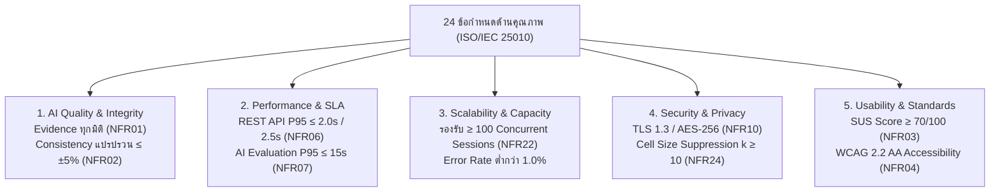

### 4. แนวทางการนำเสนอและบทพูด (Speaker Notes & Script)
- **บทพูดนำเสนอ:**  
  "ในส่วนของ Non-Functional Requirements เราได้กำหนดเป้าหมายเชิงวิศวกรรมไว้ 24 ข้อ ครอบคลุมมาตรฐาน ISO/IEC 25010 ครับ ประเด็นสำคัญคือความเร็วและเสถียรภาพ REST API ทั่วไปต้องตอบสนองใน 2 วินาที ส่วน AI Evaluation ต้องเสร็จสิ้นใน 15 วินาที ที่ระดับ P95 รองรับผู้ใช้พร้อมกัน 100 เซสชัน และในมิติคุณภาพ AI คะแนนประเมินซ้ำต้องมีความแปรปรวนไม่เกิน 5% ตัวเลขเหล่านี้ไม่ใช่ตัวเลขสมมติ แต่เป็นเกณฑ์มาตรฐานที่เราจะใช้ในการรัน Test Suites ตรวจรับงานครับ"

---

## สไลด์ที่ 17 — ขอบเขตการทำงานของระบบ 3 ระยะ (System Scope: R1–R3 Phased Strategy)
*ประเภทสไลด์: Scope Management & Release Planning*  
*เวลาที่แนะนำ: 55 วินาที*  
*โครงสร้างเลย์เอาต์บนสไลด์ (Slide Layout Specification):*  
- **แบ่ง 3 คอลัมน์เปรียบเทียบ (33/33/33):**  
  - *คอลัมน์ 1 (R1 Core MVP):* ขอบเขตการพิมพ์ข้อความ, เว็บ และระบบประเมินรูบริก
  - *คอลัมน์ 2 (R2 Enhanced AI & Mobile):* ขอบเขตการสัมภาษณ์เสียง, Speech Analytics และ Native Mobile App
  - *คอลัมน์ 3 (R3 Commercial & Research):* ระบบสมาชิก, การชำระเงิน และชุดข้อมูลวิจัยที่ Anonymized

### 1. ข้อความพาดหัวหลักบนสไลด์ (Headline & Key Message)
> ยุทธศาสตร์การพัฒนา 3 ระยะ (R1–R3) ควบคุมความเสี่ยง ส่งมอบระบบแกนหลักที่มีเสถียรภาพก่อนขยายความสามารถ

### 2. เนื้อหาสำหรับจัดวางบนสไลด์ (Slide Content Blueprint)
- **คอลัมน์ที่ 1 — Release 1: Core Text MVP (ระบบแกนหลักและเว็บ):**
  - *สถานะ:* ส่งมอบในเฟสแรกเพื่อสร้างรากฐานระบบ
  - สมัครสมาชิก ยืนยันตัวตน และจัดการโปรไฟล์ (Auth, JWT, RBAC)
  - จำลองการสัมภาษณ์แบบข้อเขียน (Text Interview Simulation)
  - ประเมินผล AI ตาม Rubric Matrix 4 มิติ พร้อม Evidence Citation และคำแนะนำ STAR
  - ประวัติการฝึกซ้อม (Practice History) และระบบจัดการสิทธิข้อมูล PDPA พื้นฐาน
  - คลังคำถาม เกณฑ์รูบริก และพอร์ทัลผู้ดูแลระบบ (Admin Question/Rubric Management)
  - **ผลส่งมอบ:** Responsive Web App + Mobile-Ready Backend APIs
- **คอลัมน์ที่ 2 — Release 2: Enhanced AI & Mobile Launch (เสียงและแอปมือถือ):**
  - *สถานะ:* ต่อยอดความสามารถด้านเสียงและเปิดตัวแอปพลิเคชันมือถือ
  - สัมภาษณ์ด้วยเสียงพูด (Voice Interview) พร้อมแปลงเสียงเป็นข้อความด้วย Whisper STT
  - วิเคราะห์ตัวบ่งชี้การพูด (Speech Analytics): คำต่อนาที (WPM), คำฟุ่มเฟือย (Filler Words), ช่วงหยุดพูด (Pause)
  - ข้อเสนอแนะด้านภาษาอังกฤษ (Grammar, Vocabulary, Clarity) และ Progress Dashboard
  - นโยบายลบไฟล์เสียงอัตโนมัติ (Audio Retention & Auto-purge Policy)
  - **ผลส่งมอบ:** Native Mobile App (iOS / Android ด้วย React Native)
- **คอลัมน์ที่ 3 — Release 3: Commercial & Research Governance (พาณิชย์และวิจัย):**
  - *สถานะ:* ขยายสู่ระบบบริการสมาชิกเชิงพาณิชย์และชุดข้อมูลงานวิจัย
  - แคตตาล็อกแพ็กเกจสมาชิก และระบบบันทึกโควตาการใช้งาน (Usage Ledger)
  - ระบบชำระเงิน Web Checkout, ออกใบเสร็จอัตโนมัติ และการขอคืนเงิน (Refunds)
  - พอร์ทัลผู้ดูแลการเงิน (Finance Administration)
  - ไปป์ไลน์ส่งออกข้อมูลวิจัยที่ผ่านการตัด PII และระงับข้อมูลตามเกณฑ์ Cell Size ≥ 10
  - **ผลส่งมอบ:** ระบบบริการสมาชิก และคลังข้อมูลสถิติเพื่องานวิจัย

### 3. แผนภาพประกอบสไลด์ (Diagram for Slide — Release Evolution Roadmap)
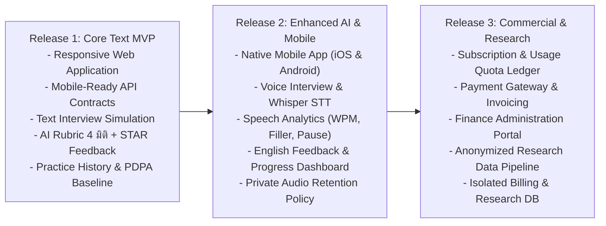

### 4. แนวทางการนำเสนอและบทพูด (Speaker Notes & Script)
- **บทพูดนำเสนอ:**  
  "เพื่อควบคุมความเสี่ยงในการพัฒนาซอฟต์แวร์ ทีมงานได้แบ่งขอบเขตงานออกเป็น 3 Release อย่างชัดเจนครับ ใน R1 เรามุ่งเน้นการสร้าง Core MVP ให้เสถียร คือการฝึกด้วยข้อความและการประเมินรูบริกบนเว็บ เมื่อรากฐานมั่นคง ใน R2 เราจึงขยายสู่การสัมภาษณ์ด้วยเสียง การวิเคราะห์สปีดการพูด และเปิดตัว Native Mobile บน iOS/Android และสุดท้ายใน R3 จะเป็นการต่อยอดสู่ระบบเชิงพาณิชย์และการเปิดเผยข้อมูลสถิติเพื่องานวิจัยครับ"
- **จุดที่ต้องเน้นย้ำ:** ย้ำกับกรรมการว่า **"Native Mobile ไม่ได้เปิดตัวใน R1"** ใน R1 เราส่งมอบเว็บและเตรียมสัญญาร่วม API ไว้เท่านั้น

---

## สไลด์ที่ 18 — แผนการส่งมอบและเกณฑ์ผ่านแต่ละ Release (Release Roadmap & Release Gates)
*ประเภทสไลด์: Delivery Roadmap & Quality Gates*  
*เวลาที่แนะนำ: 45 วินาที*  
*โครงสร้างเลย์เอาต์บนสไลด์ (Slide Layout Specification):*  
- **ส่วนบน (Process Gate Flow):** แผนภาพขั้นตอนส่งมอบที่มีด่านตรวจรับ Gate 1, Gate 2, Gate 3 คั่นกลาง
- **ส่วนล่าง (Gate Exit Criteria 3 กล่อง):** กล่องแจกแจงเกณฑ์ชี้ขาดในการตรวจรับของแต่ละด่าน

### 1. ข้อความพาดหัวหลักบนสไลด์ (Headline & Key Message)
> แต่ละ Release มีเกณฑ์ตรวจรับ (Release Gates) ที่ชัดเจน เพื่อการันตีคุณภาพก่อนอนุญาตให้ขยายสู่ระยะถัดไป

### 2. เนื้อหาสำหรับจัดวางบนสไลด์ (Slide Content Blueprint)
- **กล่องที่ 1 (เกณฑ์ผ่านด่านที่ 1 - Gate 1: R1 Core MVP Sign-off Criteria):**
  - ระบบสัมภาษณ์แบบข้อความและประเมินผล AI ทำงานได้อย่างสมบูรณ์บน Web
  - ค่าความหน่วง AI Evaluation Latency P95 ≤ **15 วินาที**
  - ผ่านการทดสอบ Negative IDOR และ Authorization Boundary โดยไม่มีช่องโหว่ความปลอดภัยระดับร้ายแรง
  - สัญญาร่วม API และ Prisma Schema ตรงตามข้อกำหนดในเอกสาร SRS 100%
- **กล่องที่ 2 (เกณฑ์ผ่านด่านที่ 2 - Gate 2: R2 Voice & Mobile Sign-off Criteria):**
  - Native Mobile App ผ่านการทดสอบ Build และปฏิบัติตามมาตรฐาน Store Guidelines ทั้ง Apple App Store และ Google Play Store
  - การแปลงเสียงพูด (STT) มีความแม่นยำตามเกณฑ์ และมีการขอสิทธิ์ไมโครโฟนที่โปร่งใส
  - การซิงก์ข้อมูลระหว่าง Web และ Mobile ข้ามอุปกรณ์สอดคล้องกันแบบเรียลไทม์
  - ระบบลบไฟล์เสียงดิบอัตโนมัติตรวจสอบแล้วว่าทำงานถูกต้องตามวงจรชีวิต
- **กล่องที่ 3 (เกณฑ์ผ่านด่านที่ 3 - Gate 3: R3 Commercial & Research Sign-off Criteria):**
  - การเชื่อมต่อ Payment Gateway และการตัดโควตาใน Usage Ledger ถูกต้อง 100% ไม่เกิด Double Spending
  - ชุดข้อมูลส่งออกวิจัยผ่านการตรวจสอบ Anonymization โดยปราศจาก PII และระงับกลุ่มตัวอย่างต่ำกว่า 10 คน

### 3. แผนภาพประกอบสไลด์ (Diagram for Slide — อ้างอิง D19 Release Roadmap & Gates)
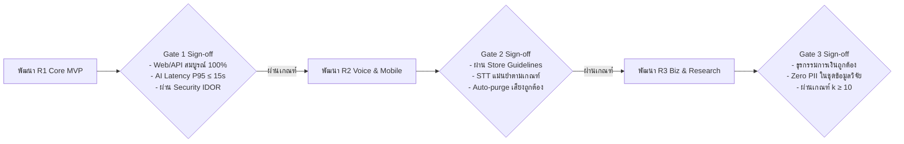

### 4. แนวทางการนำเสนอและบทพูด (Speaker Notes & Script)
- **บทพูดนำเสนอ:**  
  "ในกระบวนการส่งมอบ เราไม่ได้มองแค่รายการฟังก์ชัน แต่เรากำหนด 'Release Gates' เป็นด่านตรวจรับคุณภาพครับ หาก R1 ไม่ผ่านเกณฑ์ด้านความเร็ว P95 หรือไม่ผ่านการทดสอบสิทธิ์ IDOR ทีมงานจะไม่ได้รับอนุญาตให้ข้ามไปพัฒนา R2 การมี Gate ชัดเจนช่วยให้คณะกรรมการมั่นใจได้ว่า ทุกเฟสที่ส่งมอบมีความมั่นคงและมีคุณภาพจริงตามหลักวิศวกรรมซอฟต์แวร์ครับ"

---

## สไลด์ที่ 19 — แผนการดำเนินงานโครงการ 12 เดือน (Project Timeline & Milestones)
*ประเภทสไลด์: Project Management & Schedule*  
*เวลาที่แนะนำ: 45 วินาที*  
*โครงสร้างเลย์เอาต์บนสไลด์ (Slide Layout Specification):*  
- **ส่วนบน (Phases Timeline Flow):** แผนภาพแสดง 6 ช่วงระยะดำเนินงาน (พ.ย. 69 – ต.ค. 70)
- **ส่วนล่าง (Gantt Schedule Table):** ตารางแจกแจงเดือน ขั้นตอนหลัก กิจกรรมสำคัญ และ Deliverables

### 1. ข้อความพาดหัวหลักบนสไลด์ (Headline & Key Message)
> กรอบระยะเวลาดำเนินงาน 12 เดือน แบ่งเป็น 6 ช่วงกิจกรรมหลักตามวงจรชีวิตการพัฒนาซอฟต์แวร์

### 2. เนื้อหาสำหรับจัดวางบนสไลด์ (Slide Content Blueprint)
- **ตารางแผนงาน 12 เดือน (Project Sprints & Schedule):**

| ช่วงเวลา (Months) | ระยะกิจกรรมหลัก (Phases) | กิจกรรมสำคัญและผลลัพธ์ที่ส่งมอบ (Key Deliverables) |
|---|---|---|
| **เดือน 1–2 (พ.ย.–ธ.ค. 69)** | **Requirement & Research** | วิเคราะห์ผลสำรวจ (n=102), จัดทำ SRS v1.1, Use Cases, RTM และนำเสนอ Proposal |
| **เดือน 3–4 (ม.ค.–ก.พ. 70)** | **UI/UX & Sprint 0 Setup** | ออกแบบ Design System, สถาปัตยกรรมระบบ, Monorepo และสภาพแวดล้อม Docker |
| **เดือน 5–6 (มี.ค.–เม.ย. 70)** | **R1 Core MVP Development** | พัฒนา Web, NestJS Core, FastAPI AI Rubric Engine, Auth และ PDPA |
| **เดือน 7 (พ.ค. 70)** | **R1 Verification & Gate 1** | ทดสอบระบบ R1, Concurrency Test (100 Users), IDOR Tests และตรวจรับ Gate 1 |
| **เดือน 8–9 (มิ.ย.–ก.ค. 70)** | **R2 Voice & Mobile Dev** | พัฒนา Whisper STT, Speech Analytics, Native Mobile App (iOS/Android) |
| **เดือน 10 (ส.ค. 70)** | **R3 Commercial & Research** | พัฒนา Billing, Payment Gateway, Research Data Pipeline และตรวจรับ Gate 3 |
| **เดือน 11–12 (ก.ย.–ต.ค. 70)** | **Final QA, UAT & Defense** | System Integration Testing, SUS Usability Test (n≥30), เอกสารฉบับสมบูรณ์และสอบจบ |

### 3. แผนภาพประกอบสไลด์ (Diagram for Slide — 12-Month Project Phases Flow)
```mermaid
flowchart LR
  M1["เดือน 1–2 (พ.ย.–ธ.ค. 69)<br/>Requirement & Research<br/>SRS v1.1 / RTM / สอบ Proposal"]
  --> M2["เดือน 3–4 (ม.ค.–ก.พ. 70)<br/>UI/UX & Sprint 0 Setup<br/>Design System / Monorepo"]
  --> M3["เดือน 5–6 (มี.ค.–เม.ย. 70)<br/>R1 Core MVP Development<br/>Web / NestJS / FastAPI Engine"]
  --> M4["เดือน 7 (พ.ค. 70)<br/>R1 Verification & Gate 1<br/>Concurrency 100 / IDOR Test"]
  --> M5["เดือน 8–9 (มิ.ย.–ก.ค. 70)<br/>R2 Voice & Mobile Dev<br/>Whisper STT / Native Mobile"]
  --> M6["เดือน 10 (ส.ค. 70)<br/>R3 Commercial & Research<br/>Payment / Anonymized Data"]
  --> M7["เดือน 11–12 (ก.ย.–ต.ค. 70)<br/>Final Testing & UAT<br/>SUS Test / Final Defense"]
```

### 4. แนวทางการนำเสนอและบทพูด (Speaker Notes & Script)
- **บทพูดนำเสนอ:**  
  "แผนการดำเนินงานของโครงการมีกรอบเวลารวม 12 เดือน ตั้งแต่เดือนพฤศจิกายน 2569 ถึงตุลาคม 2570 ครับ ขณะนี้เราอยู่ในช่วงเดือนที่ 1–2 คือการรวบรวมความต้องการ จัดทำเอกสาร SRS และนำเสนอ Proposal จากนั้นในเดือนที่ 3–4 จะเป็นขั้นตอนการจัดตั้งสภาพแวดล้อมและออกแบบหน้าจอ และจะเข้าสู่การพัฒนาและทดสอบ R1 ในช่วงเดือนที่ 5 ถึง 7 ตามลำดับ แผนงานนี้สอดคล้องกับกรอบระยะเวลาของหลักสูตรวิศวกรรมซอฟต์แวร์ครับ"

---

## สไลด์ที่ 20 — สมาชิกทีมและบทบาทหน้าที่ (Project Team & Module Ownership Matrix)
*ประเภทสไลด์: Team Structure & Module Ownership*  
*เวลาที่แนะนำ: 50 วินาที*  
*โครงสร้างเลย์เอาต์บนสไลด์ (Slide Layout Specification):*  
- **ส่วนบน (Team Profiles 5 กล่อง):** ข้อมูลสมาชิก 5 คน รูปถ่าย รหัสนักศึกษา ตำแหน่งทางการ และงานหลัก
- **ส่วนล่าง (Module Ownership Matrix Table):** ตารางแจกแจงผู้รับผิดชอบหลักและผู้ร่วมสนับสนุนของ 12 โมดูลระบบย่อย

### 1. ข้อความพาดหัวหลักบนสไลด์ (Headline & Key Message)
> โครงสร้างทีม 5 คน แบ่งขอบเขตความรับผิดชอบอย่างชัดเจน (Single Ownership) ครอบคลุมทุกมิติของโครงการ

### 2. เนื้อหาสำหรับจัดวางบนสไลด์ (Slide Content Blueprint)
- **กล่องที่ 1 (รายชื่อและตำแหน่งทางการของสมาชิกทั้ง 5 คน):**
  1. **นายนรงศักดิ์ ภูมิประเสริฐ (รหัส 674259009)** — *Tech Lead, Architecture, AI Layer, DevOps, Integration*
  2. **นายสมหมาย สุภาวงค์ (รหัส 674259024)** — *UX/UI Lead, Design System, Frontend/Mobile*
  3. **นายกิติกร เทศธรรม (รหัส 674259003)** — *Fullstack, NestJS Core Backend, API*
  4. **นายจิรเมธ วงษ์กัณหา (รหัส 674259004)** — *Fullstack, NestJS Core Backend, Integration*
  5. **นายณัฐพล กลิ่นจุ่น (รหัส 674259006)** — *BA, QA, Tester, Documentation*
- **กล่องที่ 2 (ตารางกำหนดผู้รับผิดชอบระบบย่อย - Module Ownership Matrix):**

| โมดูล / ระบบย่อย | ผู้รับผิดชอบหลัก (Primary) | ผู้ร่วมสนับสนุน (Supporting) | รอบการส่งมอบ |
|---|---|---|:---:|
| System Architecture & Standards | นายนรงศักดิ์ ภูมิประเสริฐ | นายกิติกร, นายจิรเมธ | R1–R3 |
| AI Architecture & FastAPI AI Service | นายนรงศักดิ์ ภูมิประเสริฐ | นายจิรเมธ วงษ์กัณหา | R1–R3 |
| DevOps, Docker & CI/CD Pipeline | นายนรงศักดิ์ ภูมิประเสริฐ | นายกิติกร, นายจิรเมธ | R1–R3 |
| Authentication & Identity Module | นายกิติกร เทศธรรม | นายนรงศักดิ์ ภูมิประเสริฐ | R1 |
| REST API Contracts & DTOs | นายกิติกร เทศธรรม | นายจิรเมธ วงษ์กัณหา | R1–R3 |
| Interview Session Flow & Question Bank | นายจิรเมธ วงษ์กัณหา | นายกิติกร เทศธรรม | R1 |
| BullMQ Queue & Transactional Outbox | นายจิรเมธ วงษ์กัณหา | นายนรงศักดิ์ ภูมิประเสริฐ | R1 |
| UX/UI Research & Design System | นายสมหมาย สุภาวงค์ | นายณัฐพล กลิ่นจุ่น | R1–R3 |
| Responsive Web Application | นายสมหมาย สุภาวงค์ | นายกิติกร, นายจิรเมธ | R1–R3 |
| Native Mobile Application | นายสมหมาย สุภาวงค์ | นายกิติกร, นายจิรเมธ | R2 |
| Requirements Analysis & RTM | นายณัฐพล กลิ่นจุ่น | สมาชิกทุกคน | R1–R3 |
| QA & Software Testing Suites | นายณัฐพล กลิ่นจุ่น | สมาชิกทุกคน | R1–R3 |

### 3. แผนภาพประกอบสไลด์ (Diagram for Slide — Team Structure & Module Ownership)
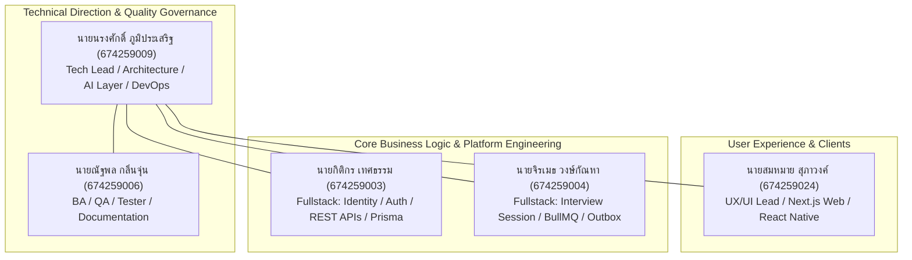

### 4. แนวทางการนำเสนอและบทพูด (Speaker Notes & Script)
- **บทพูดนำเสนอ:**  
  "โครงการ InterviewX ขับเคลื่อนด้วยทีมงาน 5 คน โดยมีการกระจายบทบาทหน้าที่อย่างชัดเจนตามข้อตกลงทีมครับ ผม นายนรงศักดิ์ รับหน้าที่ Tech Lead ดูแลสถาปัตยกรรมและ AI Service, คุณสมหมาย ดูแล UX/UI และ Frontend ทั้งหมด, คุณกิติกร และคุณจิรเมธ รับผิดชอบ Core Backend โดยแบ่งส่วน Auth/API และส่วน Session/Queue ออกจากกันเพื่อความคล่องตัว และคุณณัฐพล รับผิดชอบบทบาท BA และ QA ตรวจสอบคุณภาพและเอกสารทั้งหมด การจัดสรรงานแบบ Single Ownership นี้ทำให้ทีมทำงานได้รวดเร็วและไม่มีจุดทับซ้อนครับ"

---

## สไลด์ที่ 21 — การทดสอบและการประเมินระบบ 6 มิติ (Testing & Quality Assurance Framework)
*ประเภทสไลด์: Verification, QA & Test Strategy*  
*เวลาที่แนะนำ: 50 วินาที*  
*โครงสร้างเลย์เอาต์บนสไลด์ (Slide Layout Specification):*  
- **แผนผังกรอบการทดสอบ 6 ด้าน (3 คอลัมน์ x 2 แถว):**  
  - *มิติ 1:* Functional & RTM Verification (40 FRs, Coverage > 80%)
  - *มิติ 2:* Integration & Contract Testing (OpenAPI, Zod DTOs)
  - *มิติ 3:* AI Evaluation & Consistency Testing (±5% Variance)
  - *มิติ 4:* Security & Privacy Testing (Negative IDOR, Auto-purge)
  - *มิติ 5:* Usability Testing (SUS Score ≥ 70)
  - *มิติ 6:* Performance & Concurrency Load Testing (100 Active Sessions)

### 1. ข้อความพาดหัวหลักบนสไลด์ (Headline & Key Message)
> กรอบการทดสอบ 6 มิติ ครอบคลุมทั้งฟังก์ชันการทำงาน คุณภาพของปัญญาประดิษฐ์ ความปลอดภัย และประสิทธิภาพ

### 2. เนื้อหาสำหรับจัดวางบนสไลด์ (Slide Content Blueprint)
- **กล่องที่ 1 (Functional & Integration Verification):**
  - **Functional & RTM Testing:** ตรวจสอบความครบถ้วนของฟังก์ชันทั้ง 40 FRs ผ่าน RTM Matrix และเขียน Unit Tests ด้วย Vitest/Jest (Code Coverage > 80%)
  - **API Contract Testing:** ทวนสอบสัญญา API ระหว่าง Web ➔ NestJS Core ➔ FastAPI AI Service เพื่อป้องกัน Breaking Changes
- **กล่องที่ 2 (AI Quality & Explainability Verification):**
  - **Consistency Testing:** ประเมินคำตอบชุดเดิมซ้ำภายใต้สภาวะควบคุม ควบคุมความแปรปรวนของคะแนนไม่ให้เกิน **±5%**
  - **Evidence Grounding Test:** ตรวจสอบความถูกต้องของประโยคหลักฐานว่าต้องเป็น Substring จากคำตอบจริง
  - **Expert Benchmark Comparison:** เปรียบเทียบผลคะแนน AI กับผลประเมินของผู้เชี่ยวชาญด้านทรัพยากรบุคคล
- **กล่องที่ 3 (Security, Privacy, Usability & Performance):**
  - **Security & PDPA:** ทำ Negative IDOR Tests ป้องกันการเข้าถึงข้ามสิทธิ์ ตรวจสอบวงจรลบเสียง และทดสอบ Cell Size Suppression
  - **Usability Test:** วัดค่า System Usability Scale (SUS) กับกลุ่มตัวอย่าง (เป้าหมายคะแนนเฉลี่ย ≥ 70/100)
  - **Load & Concurrency:** ทำ Load Testing จำลองผู้ใช้ 100 เซสชันพร้อมกัน วัดค่า P95 Latency ≤ 15s

### 3. แผนภาพประกอบสไลด์ (Diagram for Slide — 6-Layer QA Framework)
```mermaid
flowchart TD
  QA["กรอบการทดสอบและประกันคุณภาพระบบ (QA Framework)"]
  QA --> T1["1. Functional & RTM Testing<br/>ทวนสอบ 40 FRs และ 64 RTM Links"]
  QA --> T2["2. Integration Contract Testing<br/>ทดสอบสัญญาร่วม Web / Mobile / NestJS / FastAPI"]
  QA --> T3["3. AI Rubric & Consistency Testing<br/>Evidence Citation & คะแนนแปรปรวน ≤ ±5%"]
  QA --> T4["4. Security & PDPA Governance<br/>Negative IDOR / Auto-purge เสียง / Cell Size ≥ 10"]
  QA --> T5["5. Usability & Accessibility Testing<br/>System Usability Scale (SUS) ≥ 70/100"]
  QA --> T6["6. Performance & Concurrency Load<br/>100 Concurrent Active Sessions (P95 ≤ 15s)"]
```

### 4. แนวทางการนำเสนอและบทพูด (Speaker Notes & Script)
- **บทพูดนำเสนอ:**  
  "กระบวนการ Quality Assurance ของเราไม่ได้ทดสอบเพียงแค่ปุ่มกดทำงานได้หรือไม่ครับ แต่ครอบคลุม 6 มิติที่สำคัญ โดยเฉพาะการทดสอบ AI เราจะมีการทดสอบความนิ่งของผลคะแนน (Consistency Test) ภายใต้คำตอบเดิมซ้ำๆ และตรวจสอบว่ามี Evidence รองรับจริง มีการทดสอบความปลอดภัยด้านสิทธิ์และการรั่วไหลของข้อมูลส่วนบุคคล และการทดสอบ Load Test ผู้ใช้ 100 คนพร้อมกัน เพื่อพิสูจน์ว่าระบบพร้อมใช้งานในสภาพแวดล้อมจริงครับ"

---

## สไลด์ที่ 22 — ผลลัพธ์ที่คาดว่าจะได้รับ (Expected Project Deliverables / Outcomes)
*ประเภทสไลด์: Concrete Deliverables & Outputs*  
*เวลาที่แนะนำ: 40 วินาที*  
*โครงสร้างเลย์เอาต์บนสไลด์ (Slide Layout Specification):*  
- **การ์ด 4 ผลลัพธ์รูปธรรม (2x2 Grid):**  
  - *การ์ด 1:* แพลตฟอร์ม InterviewX (ซอฟต์แวร์ทำงานได้จริงบน Web & Mobile)
  - *การ์ด 2:* บริการประเมินผล AI ที่อธิบายผลได้ (FastAPI Rubric Engine)
  - *การ์ด 3:* สถาปัตยกรรมระบบที่ได้มาตรฐาน (Shared Backend Architecture)
  - *การ์ด 4:* รากฐานธรรมาภิบาลข้อมูลและการวิจัย (PDPA Compliance & Dataset)

### 1. ข้อความพาดหัวหลักบนสไลด์ (Headline & Key Message)
> ส่งมอบผลลัพธ์ที่เป็นรูปธรรม ทั้งซอฟต์แวร์ที่ใช้งานได้จริง สถาปัตยกรรมที่ได้มาตรฐาน และธรรมาภิบาลข้อมูล

### 2. เนื้อหาสำหรับจัดวางบนสไลด์ (Slide Content Blueprint)
- **การ์ดที่ 1 — แพลตฟอร์ม InterviewX (Working Software):**
  - Responsive Web Application ที่สมบูรณ์แบบใน Release 1
  - Native Mobile Application บน iOS และ Android ใน Release 2
- **การ์ดที่ 2 — บริการประเมินผล AI ที่อธิบายเหตุผลได้ (Explainable AI Engine):**
  - โมเดลบริการประเมินผลที่แสดงคะแนนรูบริก 4 มิติ อ้างอิงประโยคหลักฐาน และสร้างคำแนะนำปรับปรุงตามวิธี STAR
- **การ์ดที่ 3 — สถาปัตยกรรมซอฟต์แวร์ระดับองค์กร (Enterprise Architecture):**
  - สถาปัตยกรรม Shared Backend แบบแยกส่วน (NestJS + FastAPI + Redis Queue)
  - สัญญา OpenAPI สากล และฐานข้อมูลเชิงสัมพันธ์ที่สมบูรณ์ตามหลัก Database Normalization
- **การ์ดที่ 4 — ระบบธรรมาภิบาลข้อมูลและงานวิจัย (Data Governance & Research Pipeline):**
  - ระบบจัดการสิทธิข้อมูลส่วนบุคคลและการขอ Consent ตามมาตรฐาน PDPA
  - ไปป์ไลน์การจัดทำชุดข้อมูลสถิติที่ปกปิดตัวตนเพื่อสนับสนุนการศึกษาและวิจัย

### 3. แผนภาพประกอบสไลด์ (Diagram for Slide — Project Deliverables Architecture)
```mermaid
flowchart LR
  D1["1. แพลตฟอร์ม InterviewX<br/>- Responsive Web App (R1)<br/>- Native Mobile App (R2)"]
  D2["2. Explainable AI Engine<br/>- Rubric Matrix 4 มิติ<br/>- Evidence Citation<br/>- STAR Recommendation"]
  D3["3. สถาปัตยกรรมระบบมาตรฐาน<br/>- Shared Backend API<br/>- Asynchronous Queue<br/>- ระบบพร้อมสเกลอิสระ"]
  D4["4. ธรรมาภิบาลข้อมูล PDPA<br/>- Granular Consent<br/>- Auto-purge ไฟล์เสียง<br/>- ชุดข้อมูลวิจัยไร้ PII"]
```

### 4. แนวทางการนำเสนอและบทพูด (Speaker Notes & Script)
- **บทพูดนำเสนอ:**  
  "ผลลัพธ์ที่โครงการนี้จะส่งมอบประกอบด้วย 4 ส่วนสำคัญครับ คือ หนึ่ง ตัวแอปพลิเคชันที่ใช้งานได้จริงทั้งบนเว็บและมือถือ สอง ระบบประเมินผล AI ที่อธิบายผลได้ สาม สถาปัตยกรรมซอฟต์แวร์ที่รองรับการขยายตัว และสี่ ระบบธรรมาภิบาลข้อมูลตามมาตรฐาน PDPA ทั้งหมดนี้คือผลส่งมอบที่สามารถวัดผลและตรวจสอบได้เมื่อสิ้นสุดโครงการครับ"

---

## สไลด์ที่ 23 — ประโยชน์ที่คาดว่าจะได้รับ (Expected Benefits & Stakeholder Impact)
*ประเภทสไลด์: Stakeholder Benefits & Impact Assessment*  
*เวลาที่แนะนำ: 45 วินาที*  
*โครงสร้างเลย์เอาต์บนสไลด์ (Slide Layout Specification):*  
- **แบ่ง 3 คอลัมน์ตามผู้มีส่วนได้ส่วนเสีย (33/33/33):**  
  - *คอลัมน์ 1 (Job Seekers & Students):* ประโยชน์ต่อผู้สมัครงานและนักศึกษา
  - *คอลัมน์ 2 (Educational Institutions):* ประโยชน์ต่อสถาบันการศึกษาและศูนย์แนะแนว
  - *คอลัมน์ 3 (Academic & Technology Community):* ประโยชน์ต่อวงการวิชาการและเทคโนโลยี

### 1. ข้อความพาดหัวหลักบนสไลด์ (Headline & Key Message)
> สร้างคุณประโยชน์รอบด้าน ทั้งการยกระดับทักษะผู้สมัคร เสริมเครื่องมือทางการศึกษา และสร้างกรณีศึกษาด้าน GenAI

### 2. เนื้อหาสำหรับจัดวางบนสไลด์ (Slide Content Blueprint)
- **คอลัมน์ที่ 1 — ประโยชน์ต่อกลุ่มผู้สมัครงานและนักศึกษา (Job Seekers & Students):**
  - **ลดความประหม่า:** สร้างความคุ้นเคยกับคำถามตรงสายงานผ่านการฝึกซ้อมซ้ำในพื้นที่ปลอดภัย
  - **พัฒนาทักษะตรงจุด:** ทราบจุดแข็งและจุดอ่อนของตนเองผ่าน Feedback เชิงลึกและคำแนะนำ STAR
  - **เข้าถึงได้เท่าเทียม:** ฝึกซ้อมได้ตลอด 24 ชั่วโมงจากทุกสถานที่โดยไม่ต้องเสียค่าใช้จ่ายสูง
- **คอลัมน์ที่ 2 — ประโยชน์ต่อสถาบันการศึกษา (Educational Institutions):**
  - **เครื่องมือเสริมการเรียนรู้:** มีแพลตฟอร์มจำลองสถานการณ์สำหรับกิจกรรมเตรียมความพร้อมก่อนเข้าสู่ตลาดแรงงาน
  - **ยกระดับอัตราการได้งาน:** ช่วยเพิ่มศักยภาพและความพร้อมของบัณฑิตจบใหม่ในการสอบสัมภาษณ์จริง
- **คอลัมน์ที่ 3 — ประโยชน์ด้านเทคโนโลยีและวิชาการ (Technological & Academic Value):**
  - **กรณีศึกษา Explainable GenAI:** เป็นต้นแบบการผสานโมเดลภาษาเข้ากับเกณฑ์รูบริกเพื่อการวัดผลที่โปร่งใส
  - **ต้นแบบ Shared Backend PDPA:** แสดงแนวทางการออกแบบระบบข้ามแพลตฟอร์มที่มีธรรมาภิบาลข้อมูลอย่างเข้มงวด

### 3. แผนภาพประกอบสไลด์ (Diagram for Slide — Stakeholder Value Impact Chain)
```mermaid
flowchart TD
  SystemValue["คุณค่าของ InterviewX Platform (Simulation + Rubric AI + Feedback)"]
  SystemValue --> U["1. ผู้สมัครงานและนักศึกษา<br/>- ลดความประหม่า สร้างความมั่นใจ<br/>- รู้จุดบกพร่องและแนวทางแก้ไข<br/>- ฝึกซ้อมได้ตลอด 24 ชั่วโมง"]
  SystemValue --> E["2. สถาบันการศึกษาและอาจารย์<br/>- เครื่องมือวัดทักษะ Soft Skills นักศึกษา<br/>- เตรียมความพร้อมก่อนก้าวสู่ตลาดแรงงาน<br/>- เพิ่มอัตราการได้งานของบัณฑิต"]
  SystemValue --> T["3. วงการวิชาการและเทคโนโลยี<br/>- กรณีศึกษา Explainable GenAI Evaluation<br/>- ต้นแบบ Cross-Platform Shared Backend<br/>- สถาปัตยกรรม Data Governance ตาม PDPA"]
```

### 4. แนวทางการนำเสนอและบทพูด (Speaker Notes & Script)
- **บทพูดนำเสนอ:**  
  "สำหรับประโยชน์ของโครงการ เรามองออกเป็น 3 มิติครับ มิติแรกต่อผู้ใช้ คือช่วยแก้ Pain Point ความประหม่าและให้ Feedback ที่เขาไม่เคยได้ มิติต่อสถาบันการศึกษา คือเป็นเครื่องมือช่วยยกระดับอัตราการได้งานของบัณฑิต และมิติต่อวิชาการ คือการเป็นกรณีศึกษาว่า เราจะนำ Generative AI มาใช้ในการประเมินผลอย่างโปร่งใสและมีจริยธรรมได้อย่างไรครับ"

---

## สไลด์ที่ 24 — สรุปโครงการและปิดการนำเสนอ (Conclusion & Next Steps)
*ประเภทสไลด์: Summary, Vision & Closing*  
*เวลาที่แนะนำ: 45 วินาที*  
*โครงสร้างเลย์เอาต์บนสไลด์ (Slide Layout Specification):*  
- **ส่วนบน (Executive Recap):** สรุปปรัชญาโครงการ 4 คำสำคัญ (Practice ➔ Evaluate ➔ Explain ➔ Improve)
- **ส่วนกลาง (Immediate Next Steps):** ก้าวถัดไปหลังอนุมัติ Proposal (Sprint 0, Design System, R1 MVP)
- **ส่วนล่าง (Closing & Q&A Banner):** ข้อความขอบคุณคณะกรรมการ และเปิดรับคำถามและข้อเสนอแนะ

### 1. ข้อความพาดหัวหลักบนสไลด์ (Headline & Key Message)
> InterviewX: แพลตฟอร์มฝึกสัมภาษณ์ที่มุ่งเน้นการ 'ฝึกฝน ประเมินผล เข้าใจ และพัฒนา' เพื่อความสำเร็จในอาชีพ

### 2. เนื้อหาสำหรับจัดวางบนสไลด์ (Slide Content Blueprint)
- **กล่องที่ 1 (สรุปปรัชญาและคุณค่าของโครงการ):**
  - **PRACTICE (ฝึกฝน):** จำลองคำถามตรงสายงานในพื้นที่ปลอดภัยไร้แรงกดดัน
  - **EVALUATE (ประเมินผล):** ประเมินแม่นยำด้วย AI ร่วมกับ Rubric Matrix 4 มิติ
  - **EXPLAIN (เข้าใจ):** อธิบายเหตุผลของคะแนนพร้อมอ้างอิงประโยคหลักฐานจริง
  - **IMPROVE (พัฒนา):** ชี้แนะแนวทางการตอบใหม่ที่ตรงตามวิธี STAR Method
- **กล่องที่ 2 (ก้าวถัดไปหลังผ่านการอนุมัติ Proposal - Immediate Next Steps):**
  - จัดตั้ง Git Monorepo, สภาพแวดล้อม Docker, และระบบตรวจสอบคุณภาพโค้ด (Sprint 0)
  - ออกแบบระบบ Design System ร่วมกับกลุ่มเป้าหมายผู้ใช้งานจริง
  - พัฒนาและส่งมอบระบบแกนหลัก Release 1 (Core Text MVP) ภายในไตรมาสถัดไป
- **กล่องที่ 3 (ปิดการนำเสนอและเปิดเวที Q&A):**
  - **ขอขอบพระคุณคณะกรรมการและอาจารย์ทุกท่านเป็นอย่างสูง**
  - พร้อมรับฟังข้อเสนอแนะและตอบข้อซักถาม (Q&A Session)

### 3. แผนภาพประกอบสไลด์ (Diagram for Slide — Summary Vision Flow)
```mermaid
flowchart LR
  P["PRACTICE<br/>ฝึกซ้อมตรงสายงาน"]
  --> E["EVALUATE<br/>ประเมินด้วยรูบริก"]
  --> X["EXPLAIN<br/>อธิบายเหตุผลและหลักฐาน"]
  --> I["IMPROVE<br/>พัฒนาคำตอบตาม STAR"]
  --> S["CAREER SUCCESS<br/>ความสำเร็จในอาชีพ"]
```

### 4. แนวทางการนำเสนอและบทพูด (Speaker Notes & Script)
- **บทพูดนำเสนอ:**  
  "โดยสรุปแล้ว InterviewX ไม่ได้เป็นเพียงแค่ระบบสัมภาษณ์อัตโนมัติ แต่คือแพลตฟอร์มที่ผสานพลังของ Generative AI และเกณฑ์รูบริกเข้าด้วยกัน เพื่อช่วยให้ผู้สมัครฝึกฝน ประเมินผล เข้าใจเหตุผล และพัฒนาทักษะการสื่อสารได้อย่างแท้จริง พวกเรามุ่งมั่นที่จะพัฒนาโครงการนี้ให้มีคุณภาพตามมาตรฐานวิศวกรรมซอฟต์แวร์ทุกประการ ขอขอบพระคุณท่านคณะกรรมการทุกท่าน และพวกเราพร้อมรับฟังข้อเสนอแนะและตอบข้อซักถามแล้วครับ"

---

# ภาคผนวก: คู่มือเตรียมตอบคำถามคณะกรรมการเชิงลึก (Key Q&A Defense Guide)

รวม 10 ประเด็นคำถามเชิงลึกที่คณะกรรมการมักจะซักถามในวันสอบ Proposal พร้อมแนวทางตอบที่ถูกต้องตามหลักการวิศวกรรมซอฟต์แวร์:

### 1. เหตุใดจึงต้องใช้ Generative AI ร่วมกับเกณฑ์ Rubric? ทำไมไม่ใช้ AI ให้คะแนนโดยตรง?
- **แนวทางตอบ:**  
  "การให้ Generative AI ตัดสินคะแนนโดยไม่มีเกณฑ์อ้างอิง มักประสบปัญหา **Black Box** และความไม่คงเส้นคงวา (Inconsistency) การตอบคำถามเดิมในแต่ละครั้งอาจได้คะแนนต่างกันอย่างสิ้นเชิง การนำ **Rubric Matrix 4 มิติ** เข้ามากำกับ จะทำหน้าที่เป็น Guardrail บังคับให้ AI ประเมินตามกรอบเกณฑ์ที่ชัดเจน และบังคับให้ส่งคืนหลักฐาน (Evidence Citation) ทำให้คะแนนมีความเที่ยงตรง ตรวจสอบย้อนกลับได้ และอธิบายเหตุผลแก่ผู้ใช้ได้อย่างโปร่งใสครับ"

### 2. InterviewX แตกต่างจากการที่ผู้ใช้เปิด ChatGPT หรือ Claude เพื่อซ้อมสัมภาษณ์เองอย่างไร?
- **แนวทางตอบ:**  
  "ความแตกต่างมี 4 ประการหลักครับ:  
  1. **กระบวนการแบบองค์รวม (Structured Workflow):** ChatGPT เป็นเพียงหน้าต่างแชตแบบ Free-form แต่ InterviewX มีระบบจัดการเซสชัน มีหมวดหมู่คำถามตามระดับงานจริง และมีการวัดผลพัฒนาการอย่างเป็นระบบ  
  2. **การประเมินแบบมีเกณฑ์รองรับ (Rubric Matrix):** ChatGPT มักให้คำชมทั่วไป แต่ระบบของเราบังคับวิเคราะห์แยก 4 มิติพร้อมชี้ประโยคหลักฐาน  
  3. **การต่อยอดสู่ Voice และ Speech Analytics (R2):** เรามีแผนการวิเคราะห์จังหวะการพูด (WPM, Filler words) ซึ่งแชตบอตทั่วไปทำไม่ได้  
  4. **ความเป็นส่วนตัวและธรรมาภิบาลข้อมูล (PDPA):** ข้อมูลใน InterviewX มีการบริหารความยินยอมและนโยบายลบไฟล์เสียงอัตโนมัติที่สอดคล้องตามกฎหมายไทยครับ"

### 3. ระบบมีวิธีจัดการกับปัญหา AI เกิดภาพหลอน (Hallucination) หรือให้คะแนนผิดพลาดอย่างไร?
- **แนวทางตอบ:**  
  "เราวางมาตรการป้องกันไว้ 4 ระดับครับ:  
  1. **Strict Output Schema:** ใช้ Pydantic บังคับโครงสร้าง JSON หากผลลัพธ์ไม่ตรงเกณฑ์จะทำการ Reject และ Retry  
  2. **Mandatory Evidence Grounding:** ระบบบังคับให้ AI ต้องส่งข้อความที่เป็น Substring จากคำตอบจริงของผู้ใช้มาเป็นหลักฐาน หากกุข้อความขึ้นมาเอง ระบบตรวจจับจะไม่ผ่าน  
  3. **Model & Prompt Versioning:** บันทึกเวอร์ชันของโมเดลและ Prompt ทุกครั้งเพื่อความสามารถในการทำซ้ำ (Reproducibility)  
  4. **Human Review & Appeal Workflow:** ผู้ใช้ที่ไม่เห็นด้วยกับผลประเมินสามารถกดยื่นอุทธรณ์เพื่อให้ผู้ดูแลระบบตรวจสอบได้ครับ"

### 4. ทำไมจึงต้องใช้ Redis BullMQ สำหรับงานประเมินผล AI?
- **แนวทางตอบ:**  
  "เพราะงานประเมินผลผ่าน LLM เป็นงานที่ใช้เวลานาน (I/O & Compute Bound) ประมาณ 5–15 วินาที หากใช้การประมวลผลแบบ Synchronous ผ่าน HTTP ปกติ จะทำให้ Connection ของผู้ใช้ถูกบล็อก มีโอกาสเกิด Request Timeout และระบบจะไม่สามารถรองรับโหลดพร้อมกันได้ การใช้ **Redis BullMQ** ช่วยแยกภาระงานออกไปทำเบื้องหลัง (Background Worker) มีระบบ Retry อัตโนมัติหาก AI Provider ขัดข้อง และช่วยให้หน้าบ้านตอบสนองได้อย่างรวดเร็วครับ"

### 5. ทำไมต้องแบ่งการส่งมอบออกเป็น R1, R2 และ R3? ขอบเขตของ R1 ไม่น้อยเกินไปหรือ?
- **แนวทางตอบ:**  
  "การแบ่งรอบการส่งมอบเป็นไปตามหลักวิศวกรรมซอฟต์แวร์เพื่อควบคุมความเสี่ยง (Risk-driven Incremental Delivery) ครับ ขอบเขตของ R1 มีความสำคัญสูงสุดเพราะเป็นรากฐานของระบบทั้งหมด ได้แก่ สถาปัตยกรรม Monorepo, ระบบ Auth & RBAC, ระบบจำลองคำถาม, สัญญาร่วม API, ระบบประเมินรูบริก และระบบความเป็นส่วนตัว PDPA หากเรารวมระบบ Voice และ Mobile เข้ามาตั้งแต่รอบแรก จะเพิ่มความเสี่ยงด้านความล่าช้าและการควบคุมคุณภาพ การทำ R1 ให้สมบูรณ์และผ่านเกณฑ์ Gate 1 จะทำให้การต่อยอดสู่ R2 และ R3 เป็นไปได้อย่างราบรื่นและมั่นคงครับ"

### 6. มีการเปิดตัว Native Mobile Application ในรอบ R1 หรือไม่?
- **แนวทางตอบ:**  
  "ไม่มีการเปิดตัว Native Mobile Application ในรอบ R1 ครับ ใน R1 เราส่งมอบ **Responsive Web Application** ที่ใช้งานได้ดีทั้งบนเดสก์ท็อปและบราวเซอร์มือถือ พร้อมทั้งพัฒนา **Mobile-Ready REST APIs** และแชร์ Schema สัญญาร่วมไว้ล่วงหน้า และแอปพลิเคชัน Native Mobile สำหรับ iOS และ Android จะถูกพัฒนาและส่งมอบอย่างเป็นทางการใน **Release 2** ครับ"

### 7. นักวิจัย (Researcher) ในรอบ R3 สามารถเข้าถึงข้อมูลคำตอบของผู้สมัครงานได้หรือไม่?
- **แนวทางตอบ:**  
  "ไม่สามารถเข้าถึงข้อมูลระบุตัวบุคคลได้ครับ บทบาท Researcher ในข้อกำหนด SRS ถูกจำกัดให้เข้าถึงได้เฉพาะ **ชุดข้อมูลสถิติรวม (Aggregated & De-identified Dataset)** ที่ผ่านกระบวนการตัด PII และผ่านการตรวจสอบ **Cell Size Suppression (k ≥ 10)** เท่านั้น นอกจากนี้ ฐานข้อมูลงานวิจัยยังถูกแยกขาด (Isolated Database) ออกจากฐานข้อมูล Core Database อย่างสิ้นเชิงครับ"

### 8. ระบบจะพิสูจน์คุณภาพการประเมินของ AI อย่างไรว่ามีความแม่นยำและเชื่อถือได้จริง?
- **แนวทางตอบ:**  
  "ในขั้นตอนการทดสอบ (Verification Phase) เราจะจัดทำชุดคำตอบมาตรฐาน (Benchmark Dataset) และกำหนดให้ผู้เชี่ยวชาญด้านทรัพยากรบุคคลทำการประเมินตามเกณฑ์รูบริก จากนั้นจะนำผลการประเมินของ AI มาเปรียบเทียบความสอดคล้อง รวมถึงการทดสอบ **Consistency Test (NFR02)** โดยการส่งคำตอบเดิมซ้ำภายใต้สภาวะควบคุมเพื่อวัดว่าความแปรปรวนของคะแนนอยู่ในเกณฑ์ ±5% หรือไม่ โดยผลการทดลองจริงจะถูกนำมารายงานในรายงานฉบับสมบูรณ์ครับ"

### 9. เหตุใดจึงเลือกใช้ NestJS ร่วมกับ FastAPI แทนที่จะพัฒนาด้วยภาษาเดียวทั้งหมด?
- **แนวทางตอบ:**  
  "เราเลือกเครื่องมือตามความเหมาะสมของงาน (Right Tool for the Right Job) ครับ:  
  - **NestJS (TypeScript):** โดดเด่นมากในงาน Enterprise Backend, การวางโครงสร้าง Modular, การจัดการ Dependency Injection, Auth, RBAC และสามารถแชร์ Data Contracts กับ Next.js และ React Native ได้อย่างไร้รอยต่อ  
  - **FastAPI (Python):** เป็นมาตรฐานสากลในฝั่ง AI/ML มี Ecosystem ของไลบรารีการประมวลผลข้อความและเสียงที่แข็งแกร่ง (Pydantic, Whisper, LangChain)  
  การแยกสองส่วนนี้ออกจากกันผ่าน REST/Queue ทำให้สถาปัตยกรรมมีความยืดหยุ่นและเป็นอิสระต่อกันครับ"

### 10. หากระบบมีผู้ใช้งานพร้อมกันจำนวนมาก ค่าใช้จ่ายในการเรียกใช้ AI API จะสูงเกินไปหรือไม่ มีวิธีควบคุมอย่างไร?
- **แนวทางตอบ:**  
  "เรามีกลยุทธ์ควบคุมต้นทุน (Cost Optimization) 3 ประการครับ:  
  1. **Strict Token Budgeting:** ออกแบบ Prompt ให้กระชับ จำกัด Max Tokens ในการตอบ  
  2. **Semantic Caching:** สำหรับคำตอบหรือมิติที่เคยมีการประเมินในบริบทใกล้เคียงกัน  
  3. **Usage Entitlements & Rate Limiting (R3):** มีการจำกัดโควตาการใช้งานต่อผู้ใช้ผ่าน Usage Ledger ป้องกันการเรียกใช้เกินขอบเขตที่กำหนดครับ"

---

# รายการตรวจสอบก่อนขึ้นนำเสนอสไลด์จริง (Pre-flight Checklist)

- [ ] **ข้อมูลโครงการ:** ตรวจสอบชื่อโครงการภาษาไทยและอังกฤษให้ตรงกับเอกสาร SRS v1.1 FINAL
- [ ] **ข้อมูลทีม:** ตรวจสอบชื่อ นามสกุล และรหัสนักศึกษาทั้ง 5 คนให้ถูกต้องครบถ้วน
- [ ] **บทบาทหน้าที่:** ใช้ชื่อ Approved Team Roles และ Module Ownership ตาม Master Knowledge Pack หัวข้อ 11
- [ ] **ตัวเลขสถิติ:** ยืนยันข้อมูล Survey n=102 และทำความเข้าใจบริบทตัวเลข Voice เพื่อตอบคำถามได้อย่างมั่นใจ
- [ ] **ภาพจำลองคะแนน:** ระบุบนสไลด์ 12 ชัดเจนว่าเป็น "Illustrative UI Mockup" ไม่ใช่ผลทดลองจริง
- [ ] **ขอบเขต Release:** ยืนยันชัดเจนว่า R1 คือ Web Core MVP และ Native Mobile จะส่งมอบใน R2
- [ ] **แผนภาพสถาปัตยกรรม:** คัดลอกและเรนเดอร์ Diagram จากเอกสารฉบับนี้ไปใส่ในสไลด์ให้สวยงามและอ่านง่าย
- [ ] **เวลาการซ้อม:** ซ้อมพูดนำเสนอให้อยู่ในกรอบเวลา 15–20 นาที (ตกสไลด์ละประมาณ 40–50 วินาที)
- [ ] **การจัดสรรบทพูด:** มีการแบ่งท่อนการนำเสนอให้สมาชิกในทีมทุกคนได้มีส่วนร่วมพูดบนเวทีอย่างสมดุล

---
*เอกสารนี้จัดทำขึ้นเพื่อใช้เป็นพิมพ์เขียวสำหรับการจัดทำสไลด์และบทพูดนำเสนอ Proposal โครงการ InterviewX สาขาวิชาวิศวกรรมซอฟต์แวร์ มหาวิทยาลัยราชภัฏนครปฐม*
